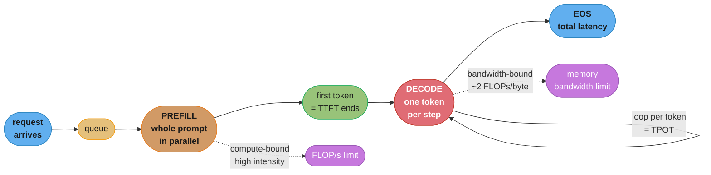
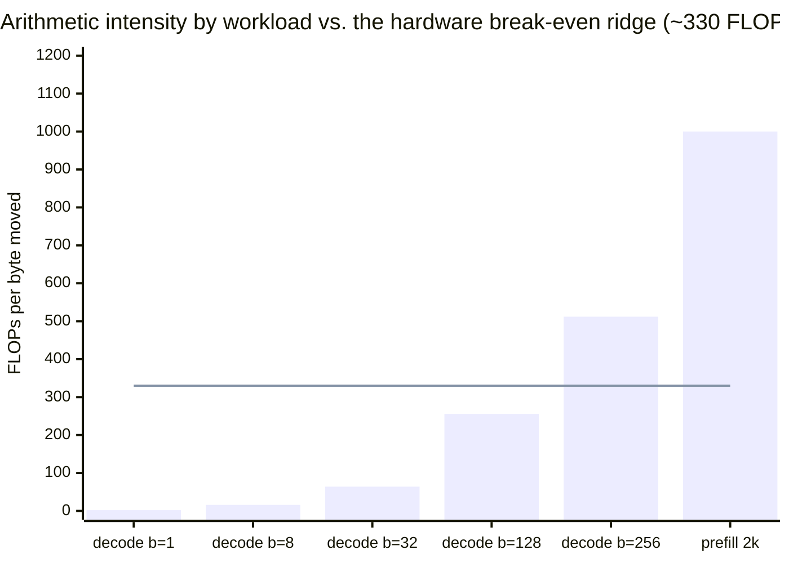
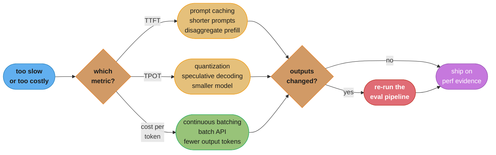

# Chapter 9: Inference Optimization

> Ch 9 of 10 · AI Engineering: Building Applications with Foundation Models (Huyen, 1st ed.,
> O'Reilly 2025) · builds on Ch 8 (Dataset Engineering), leads to Ch 10 (AI Engineering
> Architecture and User Feedback)

## Chapter Map

Chapters 5 through 8 were about making a model *good* — prompting it well, grounding it in
retrieval, finetuning it, and building the dataset that finetuning consumes. This chapter is about
making it *affordable and fast enough to actually serve*, which is a different engineering problem
with a different bottleneck. Huyen's organizing insight is that inference performance is
overwhelmingly a **memory-bandwidth** problem rather than a compute problem, and that almost every
optimization in the chapter is legible once you know which of those two limits a given phase of
generation is hitting. The chapter's first half builds that vocabulary: compute-bound versus
memory-bandwidth-bound, arithmetic intensity, the roofline model, and the metrics — TTFT, TPOT,
throughput, goodput, MFU, MBU, cost per token — that tell you which regime you are in and whether
an optimization helped. The second half is the catalog, split along a line the chapter treats as
load-bearing: **model-level** optimizations change the model and can therefore change its outputs,
while **service-level** optimizations change how requests are scheduled and executed and leave the
outputs identical. That distinction determines which optimizations need a fresh evaluation run and
which are free to deploy.

**TL;DR:**
- Token generation is **memory-bandwidth-bound**, not compute-bound: decoding one token reads the
  entire model's weights to do a tiny amount of arithmetic, so accelerators sit mostly idle and the
  binding constraint is how fast weights move from memory, not how fast the chip multiplies.
- **Prefill and decode have opposite bottlenecks** — prefill processes the whole prompt in parallel
  and is compute-bound, decode emits one token at a time and is bandwidth-bound — which is why
  they get separate metrics (TTFT and TPOT) and, increasingly, separate hardware.
- The metrics that matter are **TTFT, TPOT, total latency, throughput and goodput** on the
  performance side and **cost per token plus utilization (MFU/MBU)** on the cost side; latency and
  throughput trade against each other, and goodput is the metric that refuses to let you hide a
  latency regression inside a throughput win.
- **Model-level** optimizations — quantization, distillation, pruning, attention and KV-cache
  changes, architecture changes — can change model outputs and therefore require re-evaluation.
- **Service-level** optimizations — continuous batching, prefill/decode disaggregation, prompt
  caching, and the parallelism strategies — leave outputs unchanged, which makes them the ones to
  reach for first.

## The Big Question

A model that costs a dollar per request and takes twelve seconds to answer is not a product,
regardless of how good its answers are. So: where does that dollar and that twelve seconds actually
go, and which of the many available optimizations addresses *your* bottleneck rather than someone
else's?

The chapter's answer starts with an observation that is counter-intuitive to anyone who thinks of
accelerators as compute devices. Generating one token from a 70-billion-parameter model requires
reading roughly 140 GB of weights out of memory and performing roughly 140 GFLOPs of arithmetic —
about two floating-point operations per byte read. A modern accelerator can do several hundred
floating-point operations in the time it takes to fetch one byte. The chip is therefore idle for
the overwhelming majority of every decode step, waiting on memory. Analogy: a chef who can chop
faster than anyone alive, working in a kitchen where each ingredient has to be fetched one at a
time from a warehouse across town. Buying a faster chef changes nothing. The entire chapter is a
catalog of ways to either shorten the trip (quantization, smaller models, better attention) or make
each trip carry more (batching), and knowing which of those two you are doing is the difference
between an optimization and a change.

---

## 9.1 Understanding Inference Optimization

Before any optimization, the chapter builds the model of *why* inference is slow and expensive, and
the vocabulary for saying which part of it a given change addresses.

### The Two Phases: Prefill and Decode

Autoregressive generation has two phases with fundamentally different performance characteristics,
and conflating them is the source of most confused inference-performance conversations.

**Prefill** processes the entire input prompt at once. Every token in the prompt can be attended to
and processed in parallel, so the accelerator gets a large matrix multiplication with a lot of work
per byte of weights loaded — the weights are read once and used against many tokens. Prefill is
therefore **compute-bound**: it saturates the chip's arithmetic units and its duration scales with
prompt length.

**Decode** generates output tokens one at a time, each conditioned on everything before it. Because
the next token cannot be computed before the current one exists, there is no parallelism *within* a
single sequence's decode. Each step reads the entire model's weights to produce a single token's
worth of arithmetic. Decode is therefore **memory-bandwidth-bound**, and its duration scales with
the number of output tokens generated, not with prompt length.

This split is why the chapter insists on two separate latency metrics rather than one, and it is
the seed of several optimizations later in the chapter — most directly, disaggregated serving,
which puts the two phases on different machines precisely because they want different hardware.

### Compute-Bound, Memory-Bandwidth-Bound, and Arithmetic Intensity

A workload is **compute-bound** when it is limited by how many operations the processor can perform
per second, and **memory-bandwidth-bound** when it is limited by how fast data moves between memory
and the processor. Which one applies is determined by **arithmetic intensity**: the ratio of
floating-point operations performed to bytes of data moved.

```
  Decoding: arithmetic intensity and the break-even ratio

  arithmetic intensity  =  FLOPs performed  /  bytes moved from memory

  A device has its own break-even ratio:

    break-even  =  peak compute (FLOP/s)  /  peak memory bandwidth (bytes/s)

  For a high-end accelerator with roughly
    peak compute .......... ~1,000 TFLOP/s   (bf16, dense)
    peak bandwidth ........ ~3,000 GB/s      (HBM3-class)
    break-even ............ ~1,000e12 / 3,000e9  =  ~330 FLOPs per byte

  Now place the two phases on that scale:

    PREFILL, 2,000-token prompt, batch 1
      weights read once, used against 2,000 tokens
      arithmetic intensity ~ hundreds to low thousands of FLOPs/byte
      -> ABOVE break-even  ->  COMPUTE-BOUND

    DECODE, batch size 1
      weights read once, used against ONE token
      each weight participates in ~2 FLOPs (one multiply-add)
      arithmetic intensity ~ 2 FLOPs/byte
      -> ~165x BELOW break-even  ->  SEVERELY MEMORY-BANDWIDTH-BOUND

    DECODE, batch size 256
      weights read once, used against 256 tokens (one per sequence)
      arithmetic intensity ~ 2 * 256 = ~512 FLOPs/byte
      -> ABOVE break-even  ->  approaching COMPUTE-BOUND

  This single table explains why batching is the highest-leverage service-level
  optimization in the chapter: it is the only lever that raises arithmetic intensity
  WITHOUT changing the model at all.
```

Caption: batch-1 decode uses roughly one two-hundredth of the arithmetic intensity the hardware is
balanced for; every service-level optimization in §9.2 is, at bottom, an attempt to close that gap.

The **roofline model** is the standard way to draw this. Plot achievable performance (FLOP/s) against
arithmetic intensity (FLOPs/byte) on log axes and you get two lines: a sloped one where performance
is capped by `bandwidth × arithmetic intensity` (the memory-bound region) and a flat one where it is
capped by peak compute (the compute-bound region). The "ridge point" where they meet is the
break-even ratio above. A kernel's position under this roofline tells you which optimization class
can help it: a kernel on the sloped part is helped by reading fewer bytes (quantization, smaller
KV cache, fusion) or by reusing what it reads (batching), while a kernel on the flat part is helped
only by doing less arithmetic or by faster arithmetic units.

The practical diagnostic the chapter draws from this: **if you are memory-bandwidth-bound, buying a
chip with more FLOP/s does nothing.** Many inference deployments are on the sloped part of the
roofline and are effectively paying for compute they cannot use.

### AI Accelerators and What Their Specs Mean

The specs that matter for inference are, in order: **memory capacity** (does the model plus its KV
cache fit at all), **memory bandwidth** (how fast decode can run), and **peak compute** (how fast
prefill can run). The chapter's framing is that the first is a hard gate, the second is the usual
binding constraint, and the third is the one most often quoted in marketing.

Memory capacity is a gate rather than a gradient because a model that does not fit must be split
across devices, which introduces communication between them and a whole class of parallelism
strategies covered in §9.2. Memory bandwidth is the constraint most decode-heavy workloads actually
hit, which is why successive high-bandwidth-memory generations matter more to inference performance
than headline FLOP/s numbers do. Interconnect bandwidth between accelerators becomes the third
constraint the moment a model is split.

### Online vs Batch APIs

Not every request needs to be answered now, and the chapter separates two service modes whose
optimization targets are genuinely opposed.

**Online APIs** serve requests interactively and optimize for **latency**. A user is waiting, so
TTFT and TPOT are the metrics, and the system will happily leave hardware under-utilized rather
than make a waiting user wait longer.

**Batch APIs** accept a large set of requests with a loose completion deadline — typically hours —
and optimize for **cost**. With no interactive latency constraint, the scheduler can pack requests
into very large batches, run them when capacity is otherwise idle, and drive utilization far higher
than an online service can. Providers pass a substantial fraction of that saving on: a large
discount relative to the same tokens through the online endpoint is standard, commonly around half
price.

The engineering point is that a great deal of real workload — bulk classification, offline
enrichment, evaluation runs, dataset generation from Chapter 8 — has no interactive user at all, and
routing it through an online endpoint is paying an interactivity premium for interactivity nobody
consumes.

### Latency, Throughput and Goodput

The chapter's performance metrics are deliberately more granular than "how long did it take,"
because a single latency number hides the thing users actually perceive.

**Time to first token (TTFT)** is the interval from request arrival to the first output token
reaching the user. It is dominated by prefill (plus queueing), so it scales with prompt length. For
a streaming interface this is the number that determines whether the product feels responsive,
because it is when the user stops staring at nothing.

**Time per output token (TPOT)** — also seen as inter-token latency — is the average interval
between successive output tokens once generation has started. It is dominated by decode, so it is a
memory-bandwidth story. TPOT determines the *reading speed* the user experiences; a comfortable
reading pace is a useful yardstick, and generating meaningfully faster than a user reads buys little
perceived benefit.

**Total latency** composes them: `total = TTFT + TPOT × (number of output tokens)`. This decomposition
is the most useful single formula in the chapter, because it tells you immediately which lever to
pull. A long-prompt, short-answer workload is a TTFT problem; a short-prompt, long-answer workload
is a TPOT problem; and a workload whose answers are needlessly verbose has a *token-count* problem
that no infrastructure change will fix.

**Throughput** is output tokens per second across all concurrent requests — the system-level
measure that determines cost per token. Throughput and latency trade against each other through
batch size: larger batches raise arithmetic intensity and therefore throughput, while making each
individual request wait longer.

**Goodput** is the metric that refuses to let that tradeoff be hidden. It counts only the requests
that completed *within their latency SLO* per unit time. A configuration that doubles raw throughput
while pushing 40% of requests past their deadline has improved throughput and destroyed goodput —
and goodput, not throughput, is what corresponds to served users.

All of these should be read as **distributions, not averages**. The chapter's guidance is to track
percentiles, because a p50 that looks fine alongside a p99 that is ten times worse describes a
system where a meaningful slice of users has a bad experience that the mean has averaged away.

```
  Decoding: two configurations, same hardware, opposite conclusions

  SLO: TTFT <= 1.0s, total latency <= 10s

  config A -- small batches, latency-optimized
    batch size ................. 8
    TTFT p50 / p99 ............. 0.3s / 0.8s
    TPOT ....................... 18 ms/token
    throughput ................. 4,400 tokens/s
    requests within SLO ........ 99%
    GOODPUT .................... 0.99 * request rate

  config B -- large batches, throughput-optimized
    batch size ................. 128
    TTFT p50 / p99 ............. 0.9s / 4.6s   <-- p99 blows the SLO
    TPOT ....................... 26 ms/token
    throughput ................. 12,300 tokens/s   (2.8x better!)
    requests within SLO ........ 61%
    GOODPUT .................... 0.61 * request rate

  Config B has 2.8x the throughput and serves FEWER USABLE REQUESTS. Reporting
  throughput alone would have made this look like a clear win, which is exactly
  the failure goodput exists to prevent.
```

Caption: throughput measures work done; goodput measures work delivered on time. Optimizing the
first without watching the second is how a serving change ships as a win and arrives as an incident.

### Cost Metrics and Utilization

On the cost side, the primary metric is **cost per token**, and the chapter is careful that input and
output tokens have genuinely different economics rather than merely different price-list entries.
Input tokens are processed in the compute-bound prefill phase, in parallel, cheaply per token.
Output tokens are produced in the bandwidth-bound decode phase, one at a time. That is the physical
reason output tokens are priced several times higher than input tokens across providers, and it is
the reason "make the model less verbose" is a real cost optimization rather than a stylistic
preference.

For teams running their own hardware, cost per token is a function of **utilization**, and the
chapter gives two utilization metrics matched to the two bottlenecks:

**Model FLOP/s utilization (MFU)** is achieved FLOP/s divided by the hardware's peak FLOP/s — how
much of the compute you are actually using. **Model bandwidth utilization (MBU)** is achieved memory
bandwidth divided by peak bandwidth — how much of the memory system you are actually using.

The reason both exist is that a decode-heavy workload can show a genuinely terrible MFU — a small
single-digit percentage is unremarkable — while showing a high MBU, and that combination is not a
bug. It is the correct signature of a memory-bandwidth-bound workload running well. Reading MFU
alone in that situation leads teams to chase a compute-utilization number that is not achievable and
not the constraint.

```
  Decoding: reading MFU and MBU together

  MFU low, MBU high ......... memory-bandwidth-bound, running EFFICIENTLY.
                              Typical of decode. Optimize by moving fewer bytes:
                              quantization, smaller KV cache, fused kernels.
                              Buying more FLOP/s will not help.

  MFU high, MBU low ......... compute-bound, running efficiently.
                              Typical of prefill with long prompts.
                              Optimize by doing less arithmetic or using
                              faster arithmetic (lower-precision matmuls).

  MFU low, MBU low .......... something is wrong. Not bound by either resource:
                              suspect small batches, launch overhead, host-device
                              stalls, poor scheduling, or a synchronization bug.
                              This is the case worth investigating first.

  MFU high, MBU high ........ well-balanced and near the roofline ridge.
                              Little headroom without changing the model.
```

Caption: the diagnostic value is in the *pair*. The low/low quadrant is the one that means a bug
rather than a bottleneck, and it is invisible if you only ever look at one of the two numbers.

---

## 9.2 Inference Optimization

With the vocabulary in place, the chapter catalogs the optimizations, and it splits them along a
line worth stating precisely because it determines the risk of deploying each one.

**Model-level optimizations change the model itself.** They can change its outputs, so every one of
them requires re-running the evaluation pipeline from Chapters 3 and 4 before it ships.

**Service-level optimizations change how requests are scheduled, batched and executed** without
touching the model's parameters or its mathematics. Outputs are unchanged, so they can be deployed
on performance evidence alone.

That asymmetry is the chapter's practical ordering advice: exhaust service-level optimizations
first, because they are free of quality risk, then spend model-level changes deliberately against a
measured quality budget.

### Model-Level: Quantization

**Quantization** — reducing the numeric precision of weights and sometimes activations, covered
mechanically in Chapter 7 — is the chapter's highest-leverage single model-level optimization for
inference, and its effect here is best understood through the roofline. Halving the bytes per weight
halves the bytes that must be read per decode step, which on a memory-bandwidth-bound workload
translates almost directly into a proportional speedup, *and* halves the memory the model occupies,
which leaves more room for KV cache and larger batches, which raises arithmetic intensity further.
It is the rare optimization that improves both of the constraints it touches.

The distinctions that matter at serving time: **weight-only quantization** compresses just the
weights and dequantizes them on the fly for computation in higher precision, which addresses exactly
the memory-bandwidth bottleneck and is why it is the common choice for decode-heavy serving.
**Weight-and-activation quantization** additionally quantizes the activations so the arithmetic
itself runs in low precision, which additionally helps the compute-bound prefill phase but is harder
to do without quality loss. The quality cost is uneven across a model — a small number of outlier
weights and sensitive layers matter disproportionately — which is why practical schemes keep those
components at higher precision rather than quantizing uniformly.

### Model-Level: Distillation

**Distillation** trains a smaller student model to reproduce a larger teacher's behavior, and from
the inference side its appeal is simple: fewer parameters means fewer bytes to read per token, so a
model that is several times smaller is several times faster in the bandwidth-bound regime and
proportionally cheaper. The classic result the chapter points to is a distilled encoder model that
was roughly **40% smaller and 60% faster while retaining about 97%** of its teacher's benchmark
performance — a tradeoff shape that generalizes: distillation buys a large efficiency gain for a
small, measurable capability loss on the target task, and a large one off it. Chapter 8's synthesis
section is the data half of this technique; the two are the same operation viewed from different
sides.

### Model-Level: Pruning

**Pruning** removes parameters from a trained model. **Unstructured pruning** zeroes out individual
weights wherever they are least important, achieving high nominal sparsity but producing an
irregular pattern that ordinary dense hardware cannot exploit — a model that is 60% zeros still
reads all its weights unless the hardware and kernels specifically support that sparsity pattern.
**Structured pruning** removes whole units — attention heads, entire channels, whole layers —
producing a genuinely smaller dense model that runs faster on unmodified hardware.

The chapter's honest assessment is that pruning is less used in practice than quantization and
distillation, precisely because unstructured sparsity rarely converts into real speedup and
structured pruning usually costs more quality per unit of speedup than quantization does. It is
worth knowing and rarely worth reaching for first.

### Model-Level: Attention and the KV Cache

Attention optimization is where the largest inference-specific wins live, and the object at the
center of it is the **KV cache**.

During decode, each new token must attend to every previous token, which requires those tokens' key
and value vectors. Recomputing them at every step would be quadratic waste, so they are computed
once and cached. The cost is memory — and unlike the weights, the KV cache grows with every token
generated and with every concurrent sequence.

```
  Decoding: KV cache size, and what grouped-query attention buys

  KV cache bytes per token
    = 2 (K and V) * num_layers * num_kv_heads * head_dim * bytes_per_value

  Worked example -- a 70B-class model, fp16 cache:
    num_layers ......... 80
    head_dim ........... 128
    bytes_per_value .... 2

  WITHOUT grouped-query attention (num_kv_heads = 64, one per query head):
    2 * 80 * 64 * 128 * 2  =  2,621,440 bytes  =  2.5 MB per token
      4,096-token sequence ....... 10.2 GB   for ONE user
      batch of 16 sequences ...... 164 GB    -- does not fit anywhere sane

  WITH grouped-query attention (num_kv_heads = 8, shared across query heads):
    2 * 80 *  8 * 128 * 2  =    327,680 bytes  =  0.31 MB per token
      4,096-token sequence ....... 1.28 GB
      batch of 16 sequences ...... 20.5 GB   -- fits alongside a quantized model

  An 8x reduction in KV cache, which converts directly into 8x the batch size at
  the same memory budget -- and batch size is the arithmetic-intensity lever from
  section 9.1. This is why GQA is now near-universal in models built to be served.
```

Caption: the KV cache, not the weights, is what caps concurrency on long-context workloads — and
grouped-query attention is the architectural change that made long-context serving economically
possible.

The optimization family follows directly from that formula, since each technique attacks a different
term:

**Multi-query attention (MQA)** collapses to a single shared key/value head across all query heads —
the most aggressive reduction, with a corresponding quality cost. **Grouped-query attention (GQA)**
is the middle ground that dominates modern models: several query heads share one key/value head,
capturing most of MQA's memory saving with much less quality loss. **Sliding-window / local
attention** bounds how far back a token may attend, which caps KV cache growth at a constant rather
than letting it grow linearly with sequence length. **KV cache quantization** stores the cache in
lower precision, attacking the `bytes_per_value` term directly.

Separately from *shrinking* the cache, **PagedAttention** fixes how it is *allocated*. The naive
approach reserves a contiguous block sized for each sequence's maximum possible length, which wastes
enormous memory on sequences that finish early and fragments what remains. PagedAttention borrows
the operating system's virtual-memory idea: the cache is stored in fixed-size blocks that need not
be contiguous, with a block table mapping logical positions to physical blocks. The result is that
memory is allocated as tokens are actually generated rather than reserved for a worst case, waste
drops from a large fraction to a few percent, and blocks holding a shared prefix can be shared
across sequences by reference rather than duplicated. Higher effective batch size follows directly
from the reclaimed memory, which is the arithmetic-intensity lever again.

Alongside the cache, **kernel-level attention optimization** attacks the memory traffic of the
attention computation itself. **FlashAttention**-style approaches restructure attention so that the
large intermediate attention matrix is never written to and read back from high-bandwidth memory at
all; instead the computation is tiled to work within the much faster on-chip memory, fusing the
matrix multiply, softmax and second multiply into a single pass. The arithmetic performed is
mathematically identical — this is an IO-reduction technique, not an approximation — which places it
in the unusual category of a model-level-looking change with no output change at all. The chapter's
broader point here is that **operator fusion** and hand-written kernels (in CUDA, or in higher-level
kernel languages) are a real optimization tier: every unfused operation is another round trip to
memory in a workload already limited by memory.

### Model-Level: Architecture and Decoding

Two further model-level families round out the section.

**Architectural changes** trade a model's shape for its serving cost. **Mixture-of-experts (MoE)**
architectures activate only a subset of parameters per token, so a model with a very large total
parameter count reads only its active experts per step — high capacity at a fraction of the
per-token memory traffic, at the cost of holding all experts in memory and a routing step.
Non-transformer sequence architectures, notably state-space models, avoid the KV cache's linear
growth entirely by carrying a fixed-size recurrent state, which changes long-context serving
economics fundamentally.

**Decoding-level techniques** speed up generation without changing the model's output distribution.
**Speculative decoding** uses a small, fast draft model to propose several tokens ahead, then
verifies them all in a single forward pass of the large model — which is cheap precisely because the
large model was bandwidth-bound and had spare compute. Accepted tokens are kept; the first rejected
one is corrected and the process resumes. Because the verification step is mathematically
constructed to preserve the large model's output distribution, this is a genuine free speedup on
predictable text, commonly a factor of two or more, and it degrades gracefully to no speedup (not to
wrong output) when the draft model guesses badly. Related techniques replace the draft model with
cheaper sources of guesses — copying continuations directly from the prompt or from retrieved
context, which works remarkably well for summarization and code editing where much of the output
appears verbatim in the input.

### Service-Level: Batching

Batching is the highest-leverage service-level optimization because, per §9.1, it is the only lever
that raises arithmetic intensity without altering the model. The chapter distinguishes three
generations of it.

**Static batching** waits until a fixed number of requests have arrived, runs them together, and
returns them together. The batch runs until the *longest* sequence in it finishes, so every request
that finished early holds its slot idle, and every request waits for the slowest one. Simple, and
badly suited to generation, where output lengths vary by an order of magnitude within a batch.

**Dynamic batching** caps the wait with a time window: run whatever has arrived when the window
expires, or when the batch is full. This bounds the latency penalty of waiting for a batch to fill,
but retains static batching's core flaw — the batch is still fixed for the duration of the run, so
finished sequences still hold their slots.

**Continuous batching** (also called in-flight batching) operates at token granularity instead of
request granularity. After every decoding step, sequences that finished are evicted and newly
arrived requests are admitted into the freed slots. There is no batch boundary to wait for and no
idle slot held by a completed sequence. This is the technique that made high-throughput LLM serving
practical, and it is the default in modern serving engines. The reason it matters so much
specifically for generation is variable output length: with static batching, one request generating
2,000 tokens holds fifteen slots hostage for the entire run, while continuous batching turns those
slots over continuously.

```
  Decoding: static vs continuous batching, batch of 4, variable output lengths

  request output lengths: R1=30 tokens, R2=300 tokens, R3=45 tokens, R4=60 tokens

  STATIC BATCHING -- slot occupancy over the 300 decoding steps
    R1  |####----------------------------------------------------------|
    R2  |##############################################################|
    R3  |######--------------------------------------------------------|
    R4  |########------------------------------------------------------|
        ^ '#' = generating, '-' = finished but STILL HOLDING THE SLOT

    useful slot-steps  =  30 + 300 + 45 + 60      =   435
    allocated slot-steps = 4 slots * 300 steps    = 1,200
    slot utilization ..... 36%   -- 64% of the batch capacity is wasted
    R1's user also waits the full 300 steps to receive a 30-token answer

  CONTINUOUS BATCHING -- slots are reclaimed the step a sequence finishes
    R1 finishes at step 30  -> slot freed, next queued request admitted
    R3 finishes at step 45  -> slot freed, next queued request admitted
    R4 finishes at step 60  -> slot freed, next queued request admitted
    R2 runs to step 300, alone in its slot, while the other three slots have
      each served several further requests in the meantime

    slot utilization ..... near 100%
    R1's user receives their answer at step 30, not step 300

  Same hardware, same model, same batch size: roughly 2.8x the useful work, and
  a large latency improvement for short requests rather than a regression.
```

Caption: with generation, output lengths inside a batch differ by an order of magnitude — which is
exactly the condition that makes request-granularity batching waste most of its capacity and
token-granularity batching recover it.

### Service-Level: Decoupling Prefill and Decode

Since prefill is compute-bound and decode is memory-bandwidth-bound, running both on the same
device means each phase interferes with the other: a long prefill occupying the compute units stalls
every in-flight decode step, showing up as TPOT spikes and jitter that correlate with other users'
prompt lengths.

**Disaggregated serving** splits the two phases onto separate machines or separate pools: prefill
machines run prompts and produce KV caches, which are transferred to decode machines that generate
tokens. Each pool can then be sized, scheduled and even hardware-matched to its own bottleneck —
prefill wants compute, decode wants bandwidth and memory capacity. The cost is transferring the KV
cache across the interconnect between the two pools, which is why the technique pays off most on
long prompts (where the prefill interference being eliminated is large) and needs fast interconnect
to be worth it at all.

### Service-Level: Prompt Caching and Other Caching

If two requests share a prefix, the prefill work for that prefix is identical and need not be done
twice. **Prompt caching** (prefix caching, or context caching) stores the computed KV cache for a
prefix and reuses it for any later request that begins with the same tokens.

The workloads this transforms are the common ones. A long system prompt sent with every request is
prefilled once instead of thousands of times. A multi-turn conversation re-sends its entire history
on every turn, and each turn's prefill can start from the previous turn's cached state rather than
from scratch. A document-grounded application asking many questions about one long document prefills
the document once. The saving is proportional to the shared prefix's share of the prompt, and for
long system prompts or long documents with short questions that share approaches the whole prompt —
which is why providers offering it price cached input tokens at a large discount relative to fresh
input tokens, and why latency improves as much as cost does.

The mechanical caveats are that the shared portion must be an *exact* token-level prefix (so putting
variable content such as a timestamp or a user id at the *start* of a prompt defeats caching
entirely — variable content belongs at the end), and that cached entries occupy memory and expire.

The chapter also notes the other caching tiers an AI application uses — exact-match response caching
and semantic caching — but places their detailed treatment in Chapter 10, where they appear as an
architectural component rather than an inference-engine feature.

### Service-Level: Parallelism

When a model or its KV cache does not fit on one accelerator, or when one is not fast enough, work
is split across devices. The chapter covers four axes, and their distinguishing feature is *what*
gets split and therefore *what* has to be communicated.

**Data parallelism** replicates the whole model on each device and sends different requests to each.
No communication during inference, linear throughput scaling, and no help whatsoever with a model
that does not fit — this is horizontal scaling, not model splitting.

**Tensor parallelism** splits individual weight matrices across devices, so every device holds a
shard of every layer and each layer's computation requires combining partial results. This reduces
per-device memory *and* per-device latency for a single request, at the cost of a collective
communication at every layer — which makes it extremely sensitive to interconnect speed and normally
confined to devices inside one node with a fast link between them.

**Pipeline parallelism** splits the model by *layers*: device 1 holds the first group of layers,
device 2 the next, and so on, with activations passed down the chain. Communication is small (one
activation tensor per boundary) but naive scheduling leaves devices idle waiting for work — the
**pipeline bubble** — which is mitigated by splitting the batch into micro-batches so several are in
flight through the pipeline at once. Pipeline parallelism raises throughput but does not reduce
single-request latency; that request still traverses every stage in sequence.

**Context (sequence) parallelism** splits along the *sequence* dimension, distributing a long input's
tokens across devices. This is the axis that addresses very long contexts, where the KV cache rather
than the weights is what does not fit.

**Expert parallelism** is the MoE-specific case, placing different experts on different devices and
routing each token to the devices holding its selected experts.

These compose in practice — tensor parallelism within a node, pipeline parallelism across nodes,
data parallelism across replicas is a common arrangement — and the chapter's guidance is to reach
for them in order of communication cost: replicate first, split within a fast-interconnect node
second, split across nodes last.

---

## Beyond the book — inference tooling since January 2025

> The chapter presents inference optimization in terms of durable mechanisms — the compute versus
> memory-bandwidth distinction, arithmetic intensity and the roofline, TTFT/TPOT/goodput,
> quantization, KV-cache management and paged attention, continuous batching, prefill/decode
> disaggregation, prompt caching and the parallelism axes. It names representative techniques rather
> than endorsing a particular serving engine, accelerator generation, or provider price list, and
> the specific numbers below are not the book's.

Inference tooling has moved quickly since the book's January 2025 publication, and three things are
worth knowing while reading this chapter — none of which contradict its mechanisms, all of which are
instances of them.

**Disaggregated prefill/decode serving has gone from a research technique to a shipped feature** in
the mainstream open-source serving engines rather than something a team assembles itself. The
economics the chapter describes are unchanged; what changed is that adopting them is now a
configuration decision.

**Prompt-caching support and its pricing have become near-universal across major providers**, with
cached input tokens billed at a steep discount to fresh input tokens and cache lifetimes,
minimum cacheable prefix lengths and explicit-versus-automatic cache control differing by provider.
Any specific discount percentage or TTL should be read from the provider's current documentation
rather than from this chapter or from memory, since these have changed more than once.

**Low-precision formats below int8/fp8 have continued to spread**, with successive accelerator
generations adding native support for narrower floating-point types and serving stacks adding
matching kernels. This extends §9.2's quantization argument to smaller footprints on hardware that
executes them natively; the tradeoff being spent is the same one.

For current engine capabilities, hardware numeric support and provider pricing, see
`llm/inference_engines/inference_engines.md`, `llm/vllm_deep_dive/vllm_deep_dive.md`,
`llm/token_economics_and_cost_optimization/token_economics_and_cost_optimization.md` and
`cuda/tensor_cores_and_mixed_precision/tensor_cores_and_mixed_precision.md`.

---

## Visual Intuition



Caption: the two phases sit on opposite sides of the roofline ridge, which is why they get separate
metrics, respond to different optimizations, and are increasingly run on separate machines.



Caption: the flat line is the hardware's compute-to-bandwidth break-even. Everything left of where
the bars cross it is memory-bandwidth-bound and gains nothing from more FLOP/s — batching is the
only service-level lever that walks a workload rightward.



Caption: the chapter's decision procedure in one picture — diagnose against a specific metric, then
route through the model-level versus service-level distinction, because only one branch needs a
fresh evaluation before it ships.

```
  Decoding: where a 12-second request actually goes, and what fixes each part

  request: 8,000-token prompt (mostly a fixed system prompt + a long document),
           600-token answer, single-user latency-optimized serving

  TTFT ...................... 2,100 ms   prefill of 8,000 tokens + queueing
  TPOT ......................    16 ms   per output token
  decode total .............. 9,600 ms   600 tokens * 16 ms
  TOTAL .................... 11,700 ms

  Which lever moves which number:
    prompt caching (7,500 of the 8,000 tokens are a stable prefix)
      TTFT 2,100 ms -> ~250 ms                             -1,850 ms
    weight-only int8 quantization (halves bytes read per decode step)
      TPOT 16 ms -> ~9 ms                                  -4,200 ms
    speculative decoding (~2x accepted-token rate on this text)
      TPOT 9 ms -> ~5 ms effective                         -2,400 ms
    prompting the model to answer in 250 tokens instead of 600
      decode 250 * 5 ms = 1,250 ms                         -1,750 ms
    ------------------------------------------------------------------
    TOTAL after all four .................. ~1,500 ms      7.8x faster

  Note that the single largest contributor -- 600 output tokens at 16 ms each --
  is attacked most cheaply by GENERATING FEWER TOKENS, which is a prompt change,
  not an infrastructure change. It is the optimization teams reach for last.
```

Caption: total latency decomposes as `TTFT + TPOT x output tokens`, so the output-token count is a
multiplier on every decode-side optimization — which makes verbosity an infrastructure problem.

---

## Key Concepts Glossary

- **Inference** — running a trained model to produce outputs, as opposed to training it.
- **Prefill** — the phase that processes the entire input prompt in parallel; compute-bound.
- **Decode** — the phase that generates output tokens one at a time; memory-bandwidth-bound.
- **Compute-bound** — limited by how many operations per second the processor can perform.
- **Memory-bandwidth-bound** — limited by how fast data moves between memory and the processor.
- **Arithmetic intensity** — FLOPs performed per byte moved from memory; determines which bound applies.
- **Roofline model** — a plot of achievable performance against arithmetic intensity, with a bandwidth-sloped region, a compute-flat region, and a ridge point between them.
- **Ridge point / break-even ratio** — peak compute divided by peak bandwidth; the arithmetic intensity at which a workload switches regimes.
- **Online API** — interactive serving optimized for latency.
- **Batch API** — deferred bulk serving optimized for cost, typically at a substantial discount.
- **Time to first token (TTFT)** — request arrival to first output token; dominated by prefill and queueing.
- **Time per output token (TPOT)** — average interval between successive output tokens; dominated by decode.
- **Total latency** — `TTFT + TPOT x number of output tokens`.
- **Throughput** — output tokens per second across all concurrent requests.
- **Goodput** — requests per second completing *within* their latency SLO.
- **Cost per token** — the primary cost metric, with output tokens structurally more expensive than input tokens.
- **MFU (model FLOP/s utilization)** — achieved FLOP/s as a fraction of hardware peak.
- **MBU (model bandwidth utilization)** — achieved memory bandwidth as a fraction of hardware peak.
- **Model-level optimization** — a change to the model that can alter its outputs and requires re-evaluation.
- **Service-level optimization** — a change to scheduling or execution that leaves outputs unchanged.
- **Quantization** — reducing numeric precision of weights and/or activations.
- **Weight-only quantization** — compressing weights while computing in higher precision; targets the bandwidth bottleneck.
- **Distillation** — training a smaller student model to reproduce a larger teacher's behavior.
- **Pruning** — removing parameters; unstructured (irregular, rarely converts to speedup) or structured (whole heads/channels/layers).
- **KV cache** — cached key and value vectors for previously processed tokens, avoiding quadratic recomputation during decode.
- **Multi-query attention (MQA)** — one shared key/value head across all query heads.
- **Grouped-query attention (GQA)** — several query heads sharing one key/value head; the common middle ground.
- **Sliding-window / local attention** — bounding attention range so KV cache size stops growing with sequence length.
- **KV cache quantization** — storing the cache at lower precision.
- **PagedAttention** — allocating the KV cache in fixed-size non-contiguous blocks with a block table, eliminating over-reservation and enabling prefix sharing.
- **FlashAttention** — IO-aware tiled attention that avoids materializing the attention matrix in high-bandwidth memory; mathematically exact.
- **Operator fusion** — combining several operations into one kernel to avoid intermediate round trips to memory.
- **Mixture-of-experts (MoE)** — activating only a subset of parameters per token, decoupling total capacity from per-token cost.
- **Speculative decoding** — a small draft model proposing tokens that the large model verifies in one pass, preserving the output distribution.
- **Static batching** — fixed batch, formed and run to completion together; wastes slots on early-finishing sequences.
- **Dynamic batching** — static batching with a bounded wait window.
- **Continuous / in-flight batching** — token-granularity scheduling that evicts finished sequences and admits new ones every step.
- **Disaggregated serving** — running prefill and decode on separate machine pools matched to their different bottlenecks.
- **Prompt / prefix caching** — reusing the computed KV cache for a shared exact token prefix across requests.
- **Data parallelism** — replicating the whole model across devices and splitting requests between them.
- **Tensor parallelism** — splitting individual weight matrices across devices; communication at every layer.
- **Pipeline parallelism** — splitting the model by layer groups across devices; small communication, pipeline bubbles.
- **Pipeline bubble** — device idle time in a pipeline, mitigated by micro-batching.
- **Context / sequence parallelism** — splitting along the sequence dimension for very long contexts.
- **Expert parallelism** — placing MoE experts on different devices and routing tokens to them.

---

## Tradeoffs & Decision Tables

| | Prefill | Decode |
|---|---|---|
| Parallelism available | Full — all prompt tokens at once | None within a sequence |
| Bottleneck | Compute (FLOP/s) | Memory bandwidth |
| Arithmetic intensity | Hundreds to thousands of FLOPs/byte | ~2 FLOPs/byte at batch 1 |
| Scales with | Prompt length | Number of output tokens |
| Governing metric | TTFT | TPOT |
| Helped most by | Prompt caching, shorter prompts, more compute | Quantization, smaller model, batching, speculative decoding |

| Optimization | Level | Changes outputs? | Primary win | Main cost |
|---|---|---|---|---|
| Quantization | Model | Yes | Bytes read per step, memory footprint | Quality loss, uneven across layers |
| Distillation | Model | Yes | Model size, therefore bandwidth and cost | Capability loss off the target task |
| Structured pruning | Model | Yes | Real dense speedup | Quality per unit speedup worse than quantization |
| Unstructured pruning | Model | Yes | Nominal sparsity only | Rarely converts to real speedup |
| GQA / MQA | Model (architecture) | Yes | KV cache size, therefore batch size | Quality loss, MQA more than GQA |
| KV cache quantization | Model | Yes | KV cache size | Quality loss on long contexts |
| PagedAttention | Service | No | Reclaimed KV memory, higher batch size | Implementation complexity |
| FlashAttention | Kernel | No — exact | Attention memory traffic | Kernel/hardware support required |
| Speculative decoding | Decoding | No — distribution preserved | Effective TPOT | Draft model memory, no gain on unpredictable text |
| Continuous batching | Service | No | Slot utilization, throughput | Scheduler complexity |
| Prefill/decode disaggregation | Service | No | TPOT jitter, per-pool sizing | KV cache transfer, needs fast interconnect |
| Prompt caching | Service | No | TTFT and input cost on shared prefixes | Cache memory, exact-prefix requirement |

| Batching strategy | Slot reclaim | Latency for short requests | Throughput | Use when |
|---|---|---|---|---|
| Static | At batch end | Worst — waits for the longest sequence | Low | Uniform output lengths, offline work |
| Dynamic | At batch end | Bounded queue wait, same tail problem | Moderate | Bursty arrivals, uniform lengths |
| Continuous | Every step | Best — returns as soon as done | Highest | Any real generation workload |

| Parallelism | What is split | Communication | Reduces single-request latency? | Fits a model that does not fit? |
|---|---|---|---|---|
| Data | Requests | None during inference | No | No |
| Tensor | Weight matrices | Collective at every layer | Yes | Yes |
| Pipeline | Layer groups | One activation per boundary | No | Yes |
| Context / sequence | The sequence dimension | Attention-related exchange | Yes for long inputs | Yes, for KV-cache-limited cases |
| Expert (MoE) | Experts | Token routing | Partly | Yes |

| MFU | MBU | Diagnosis |
|---|---|---|
| Low | High | Memory-bandwidth-bound, running correctly — move fewer bytes |
| High | Low | Compute-bound, running correctly — do less or faster arithmetic |
| Low | Low | Not bound by either — suspect small batches, launch overhead, stalls, scheduling bugs |
| High | High | Near the roofline ridge — little headroom without changing the model |

---

## Common Pitfalls / War Stories

- **Buying more FLOP/s to fix a bandwidth-bound workload.** Decode at small batch sizes runs at
  roughly two FLOPs per byte against hardware balanced for hundreds, so the compute units are idle
  most of every step. Upgrading to a chip with more peak FLOP/s and the same memory bandwidth
  changes nothing measurable, and the invoice arrives anyway. Check MBU before approving the
  hardware.
- **Reporting a throughput win that is a goodput loss.** Increasing batch size reliably raises
  tokens per second while pushing tail latency past the SLO. A change that improves throughput 2.8x
  while dropping in-SLO completion from 99% to 61% has made the service worse, and only goodput
  says so.
- **Reading averages instead of percentiles.** A healthy p50 alongside a p99 an order of magnitude
  worse describes a system where a real slice of users has a bad time — and batching pathologies,
  queueing and long prompts all live specifically in that tail.
- **Optimizing infrastructure when the problem is output length.** Total latency is
  `TTFT + TPOT x output tokens`, so the token count multiplies every decode-side gain. A model that
  answers in 600 tokens what it could answer in 250 has more than doubled its own latency and cost,
  and the fix is a prompt change that costs nothing.
- **Putting variable content at the start of a prompt.** Prefix caching requires an exact token-level
  prefix match, so a timestamp, a request id, or a user name placed ahead of a long stable system
  prompt defeats caching for every request. Variable content belongs at the end.
- **Sizing serving capacity from model weights alone.** The KV cache, not the weights, is usually
  what limits concurrency on long-context workloads — a 70B-class model without grouped-query
  attention needs roughly 10 GB of KV cache for a single 4,096-token sequence, so capacity planning
  that only counts weights under-provisions badly.
- **Assuming unstructured pruning produces a speedup.** Zeroing 60% of a model's weights yields a
  model that still reads all of them unless the hardware and kernels exploit that exact sparsity
  pattern. Structured pruning gives a genuinely smaller dense model; unstructured usually gives a
  smaller number in a report.
- **Deploying a model-level optimization without re-running evaluation.** Quantization, distillation,
  pruning and attention-architecture changes all can change outputs. The chapter's model-level versus
  service-level split exists precisely to mark which changes require the evaluation pipeline before
  shipping — and quantization is the one most often waved through because "it is just precision."
- **Serving batch workloads through an online endpoint.** Bulk classification, offline enrichment,
  evaluation runs and synthetic-data generation have no interactive user, so paying online pricing
  for them is paying an interactivity premium nobody consumes.
- **Using static batching for generation.** Output lengths within a batch differ by an order of
  magnitude, so completed sequences hold their slots until the longest one finishes — commonly
  wasting the majority of batch capacity, and making a 30-token answer wait for a 300-token one.
- **Adding tensor parallelism across a slow interconnect.** Tensor parallelism communicates at every
  layer, so splitting a model across nodes joined by a slow link can be slower than not splitting it
  at all. Replicate first, split within a fast-interconnect node second, split across nodes last.

---

## Real-World Systems Referenced

**Attention and KV-cache techniques:** multi-query attention, grouped-query attention, sliding-window
/ local attention, KV cache quantization, and PagedAttention as the operating-system-inspired block
allocator for KV memory. **Kernel-level work:** FlashAttention as the IO-aware, mathematically exact
attention implementation, plus operator fusion and hand-written kernels as a general tier.
**Distillation:** the distilled-encoder result of roughly 40% smaller and 60% faster at about 97% of
teacher performance, as the canonical size-versus-quality tradeoff. **Serving techniques:**
continuous / in-flight batching as the technique that made high-throughput LLM serving practical,
disaggregated prefill and decode, and prompt/prefix caching. **Architectures:** mixture-of-experts as
capacity decoupled from per-token cost, and state-space-style architectures as the alternative to a
linearly growing KV cache. **Decoding:** speculative decoding with a small draft model, and
reference-based variants that draw candidate continuations from the prompt or retrieved context.
**Service modes:** online versus batch APIs, with batch endpoints commonly priced around half of
online rates.

---

## Summary

Inference optimization is legible once you know which of two limits a workload is hitting.
Autoregressive generation splits into a compute-bound prefill phase, which processes the whole
prompt in parallel and determines TTFT, and a memory-bandwidth-bound decode phase, which emits one
token at a time and determines TPOT — and at batch size one, decode performs roughly two
floating-point operations per byte of weights it reads, against hardware balanced for hundreds. That
gap is the chapter's central fact: accelerators serving generation are mostly idle, waiting on
memory, and nearly every optimization in the chapter either moves fewer bytes or reuses each byte
across more tokens. The metrics follow from the two phases — TTFT, TPOT, `total = TTFT + TPOT x output
tokens`, throughput, and goodput, which is the one that refuses to let a latency regression hide
inside a throughput win — alongside cost per token and the MFU/MBU pair, whose value is in being read
together, since low MFU with high MBU is a correctly running bandwidth-bound workload while low on
both means something is broken. The optimizations divide into model-level changes — quantization,
distillation, pruning, MQA/GQA and KV cache quantization, PagedAttention's allocator, FlashAttention's
IO-aware kernels, MoE and alternative architectures, speculative decoding — which can change outputs
and therefore require re-evaluation, and service-level changes — continuous batching, prefill/decode
disaggregation, prompt caching, and the data, tensor, pipeline, context and expert parallelism axes —
which leave outputs identical and should therefore be exhausted first. Continuous batching is the
single highest-leverage service-level technique because it is the only lever that raises arithmetic
intensity without touching the model, and because generation's wildly variable output lengths make
request-granularity batching waste most of its capacity. Chapter 10 takes the optimized model and
places it inside a complete application architecture — context, guardrails, routing, caching,
observability — and closes the loop back to Chapter 8 by turning user feedback into the next
dataset.

---

## Interview Questions

**Q: Why is token generation memory-bandwidth-bound rather than compute-bound?**
**Short:** Decoding one token reads the entire model's weights to perform roughly two FLOPs per byte, far below what the hardware is balanced for.
Each decode step must load every weight from high-bandwidth memory but uses each one in only a single multiply-add for that one token, giving an arithmetic intensity around 2 FLOPs per byte. Modern accelerators have a compute-to-bandwidth break-even ratio in the hundreds of FLOPs per byte, so the arithmetic units sit idle for the overwhelming majority of each step. The practical consequence is that a chip with more peak FLOP/s and the same memory bandwidth will not make decoding faster.

**Q: Why do prefill and decode need separate latency metrics?**
**Short:** They have opposite bottlenecks — prefill is compute-bound and scales with prompt length, decode is bandwidth-bound and scales with output length.
Prefill processes every prompt token in parallel, so the weights are read once and used against thousands of tokens, giving high arithmetic intensity; it determines TTFT. Decode generates one token at a time with no intra-sequence parallelism, giving very low arithmetic intensity; it determines TPOT. Collapsing them into one latency number hides which of the two is actually your problem, and they respond to completely different optimizations.

**Q: What does goodput measure that throughput does not, and why does the distinction matter?**
**Short:** Goodput counts only requests completing within their latency SLO, so a throughput win that blows the tail shows up as a loss.
Increasing batch size reliably raises tokens per second while increasing per-request latency, so it is entirely possible to nearly triple throughput and simultaneously drop the share of requests meeting their deadline from 99% to 61%. Throughput would report that as a large win; goodput reports it as serving fewer usable requests. Since users experience deadlines rather than aggregate token rates, goodput is the metric that corresponds to the product.

**Q: What is the difference between model-level and service-level optimizations, and why does the book treat it as load-bearing?**
**Short:** Model-level changes can alter outputs and need re-evaluation, service-level changes leave outputs identical and can ship on performance evidence alone.
Quantization, distillation, pruning and attention-architecture changes modify the model, so a quality regression is possible and the evaluation pipeline must be re-run before deploying. Continuous batching, prefill/decode disaggregation, prompt caching and the parallelism strategies change only how work is scheduled and executed, so the outputs are bit-comparable. That asymmetry gives a clear ordering: exhaust the service-level tier first, then spend model-level changes deliberately against a measured quality budget.

**Q: Why is continuous batching so much better than static batching for text generation specifically?**
**Short:** Output lengths within a batch vary by an order of magnitude, so completed sequences hold slots idle until the longest one finishes.
With static batching, a request generating 30 tokens occupies its slot for all 300 steps that the longest request in the batch needs, so slot utilization can fall to a third or less, and the short request's user waits ten times longer than necessary. Continuous batching schedules at token granularity: finished sequences are evicted every step and queued requests admitted into the freed slots. Same hardware and same batch size, roughly three times the useful work, and short requests return promptly instead of being held hostage.

**Q: How does batching change which side of the roofline a decode workload sits on?**
**Short:** Batching reuses one read of the weights across many sequences, so arithmetic intensity scales roughly with batch size.
At batch size one, decode performs about two FLOPs per byte of weights read. At batch size 256, that single read serves 256 tokens, giving roughly 512 FLOPs per byte, which is past a typical hardware break-even in the low hundreds. This is why batching is the highest-leverage service-level optimization in the chapter: it is the only lever that raises arithmetic intensity without altering the model at all, and it moves a workload from the bandwidth-limited slope onto the compute-limited plateau.

**Q: Why does the KV cache, rather than the model weights, usually cap concurrency on long-context workloads?**
**Short:** KV cache grows with every token and every concurrent sequence, while weights are a fixed one-time cost.
The cache size per token is `2 x layers x kv_heads x head_dim x bytes`, so a 70B-class model with 80 layers, 64 KV heads and 128-dimensional heads at fp16 needs about 2.5 MB per token — roughly 10 GB for a single 4,096-token sequence, before any batching. Weights are loaded once regardless of how many users there are; the cache multiplies by both context length and concurrency. Capacity planning from parameter count alone therefore under-provisions badly on long-context serving.

**Q: What does grouped-query attention buy at serving time, and how much?**
**Short:** It shrinks the KV cache by the ratio of query heads to key/value heads, which converts directly into that many more concurrent sequences.
GQA has several query heads share one key/value head, so the `num_kv_heads` term in the cache-size formula drops. Going from 64 KV heads to 8 is an eight-fold reduction — 2.5 MB per token down to about 0.31 MB — which at a fixed memory budget means roughly eight times the batch size. Since batch size is the arithmetic-intensity lever, the memory saving becomes a throughput gain as well, which is why GQA is now near-universal in models designed to be served rather than just benchmarked.

**Q: What problem does PagedAttention solve, and what idea does it borrow?**
**Short:** It stops the KV cache being over-reserved for each sequence's worst-case length, borrowing the operating system's virtual-memory paging model.
Naive allocation reserves a contiguous block sized for the maximum possible sequence length, so a request that stops after 200 tokens still holds memory for thousands, and what remains gets fragmented. PagedAttention stores the cache in fixed-size non-contiguous blocks with a block table mapping logical positions to physical ones, so memory is allocated as tokens are actually produced and waste falls to a few percent. It also lets sequences sharing a prefix reference the same physical blocks instead of duplicating them, and the reclaimed memory converts straight into a larger batch.

**Q: Why is FlashAttention a speedup even though it performs the same arithmetic?**
**Short:** It is an IO-reduction technique — the large intermediate attention matrix is never written to and read back from high-bandwidth memory.
Standard attention materializes the full attention matrix in HBM, which is enormous memory traffic in a workload already limited by memory. FlashAttention tiles the computation so it fits in fast on-chip memory and fuses the matrix multiply, softmax and second multiply into one pass, so the intermediate never leaves the chip. Because the mathematics is unchanged, it is exact rather than approximate, which puts it in the unusual category of a kernel-level change with no output change and therefore no re-evaluation requirement.

**Q: How does speculative decoding produce a speedup without changing the model's output distribution?**
**Short:** A small draft model proposes several tokens that the large model verifies in one forward pass, with a rejection rule that preserves the target distribution.
Because the large model is bandwidth-bound, it has spare compute, so verifying several proposed tokens in a single pass costs barely more than generating one. Accepted tokens are kept, the first rejected one is corrected from the large model's own distribution, and generation resumes — a construction designed so the resulting sample distribution matches what the large model alone would have produced. On predictable text this commonly gives a factor of two or more, and when the draft model guesses badly it degrades to no speedup rather than to wrong output.

**Q: Why does the book separate MFU from MBU instead of tracking one utilization number?**
**Short:** They diagnose different bottlenecks, and low MFU with high MBU is a correctly running bandwidth-bound workload, not a problem.
MFU is achieved FLOP/s over peak FLOP/s; MBU is achieved memory bandwidth over peak bandwidth. Decode legitimately shows single-digit MFU alongside high MBU, and chasing the MFU number there is chasing something unachievable and irrelevant. The genuinely alarming quadrant is low on both, which means the workload is bound by neither resource — pointing at small batches, kernel launch overhead, host-device stalls, or a scheduling bug — and that quadrant is invisible if you only ever look at one metric.

**Q: Why do providers price output tokens several times higher than input tokens?**
**Short:** Input tokens are processed in parallel during compute-bound prefill, output tokens one at a time during bandwidth-bound decode.
Prefill reads the weights once and applies them to the whole prompt, so the per-token cost of input is low. Each output token requires its own full pass over the model's weights, so the per-token cost of output is dominated by memory traffic that cannot be amortized across the sequence. The pricing difference is therefore a reflection of physics rather than a policy choice, and the practical consequence is that reducing output verbosity is a genuine cost optimization rather than a stylistic one.

**Q: What is the most common way teams accidentally defeat prompt caching?**
**Short:** Placing variable content such as a timestamp or user id at the start of the prompt, ahead of the stable prefix.
Prefix caching requires an exact token-level match from the beginning of the prompt, so a single varying token at position zero invalidates the cache for every subsequent token no matter how much of the rest is identical. Moving variable content to the end preserves a long shared prefix and lets the stable system prompt or document be prefilled once instead of on every request. The gain is proportional to how much of the prompt the shared prefix represents, which for long system prompts or document-grounded applications is most of it.

**Q: When does disaggregating prefill and decode pay off, and what does it cost?**
**Short:** It pays off when long prefills are causing TPOT jitter for in-flight decodes, and it costs a KV cache transfer between pools.
Running both phases on the same device means a long prefill occupies the compute units and stalls every concurrent decode step, showing up as tail-latency spikes that correlate with other users' prompt lengths. Splitting them into separate pools lets each be sized, scheduled and hardware-matched to its own bottleneck — compute for prefill, bandwidth and memory capacity for decode. The KV cache must then be shipped from the prefill pool to the decode pool, so the technique needs a fast interconnect and is most worthwhile with long prompts.

**Q: How should you choose between tensor, pipeline and data parallelism?**
**Short:** By what has to be communicated — replicate first, split within a fast-interconnect node second, split across nodes last.
Data parallelism replicates the whole model and communicates nothing during inference, but does not help a model that does not fit. Tensor parallelism splits weight matrices and reduces both memory and single-request latency, but requires a collective at every layer, so it belongs inside a node with a fast link. Pipeline parallelism splits by layer group with only one activation tensor per boundary, so it tolerates slower links, but it improves throughput rather than single-request latency and introduces pipeline bubbles that micro-batching mitigates.

**Q: Why is unstructured pruning less useful in practice than its sparsity numbers suggest?**
**Short:** Irregular zeros still get read unless hardware and kernels exploit that exact sparsity pattern, so nominal sparsity rarely becomes real speedup.
Zeroing individual weights wherever they matter least can reach high sparsity ratios on paper, but ordinary dense matrix hardware reads and multiplies the zeros along with everything else. Structured pruning removes whole attention heads, channels or layers, producing a genuinely smaller dense model that runs faster on unmodified hardware. Even then, the chapter's assessment is that structured pruning usually costs more quality per unit of speedup than quantization does, which is why pruning is worth knowing and rarely worth reaching for first.

**Q: When is routing a workload to a batch API the obvious right call?**
**Short:** Whenever no interactive user is waiting — bulk classification, offline enrichment, evaluation runs, synthetic-data generation.
Batch endpoints accept a loose completion deadline, typically hours, which lets the provider pack requests into very large batches and run them when capacity is otherwise idle, and they pass a large share of that saving on — commonly around half the online price. Since the entire premium of an online endpoint buys interactivity, paying it for work nobody is waiting on is pure waste. A surprising fraction of real production LLM spend is exactly this kind of work sent through the wrong endpoint.

---

## Cross-links in this repo

- [llm/inference_and_decoding/inference_and_decoding.md — prefill, decode, KV cache and decoding strategies](../../../llm/inference_and_decoding/inference_and_decoding.md)
- [llm/inference_engines/inference_engines.md — serving engines, continuous batching and scheduling](../../../llm/inference_engines/inference_engines.md)
- [llm/vllm_deep_dive/vllm_deep_dive.md — PagedAttention and continuous batching in depth](../../../llm/vllm_deep_dive/vllm_deep_dive.md)
- [llm/optimization_and_quantization/optimization_and_quantization.md — quantization formats and quality tradeoffs](../../../llm/optimization_and_quantization/optimization_and_quantization.md)
- [llm/optimization_and_quantization/gpu_architecture_and_roofline.md — the roofline model and arithmetic intensity](../../../llm/optimization_and_quantization/gpu_architecture_and_roofline.md)
- [llm/knowledge_distillation_and_model_merging/knowledge_distillation_and_model_merging.md — distillation as an inference optimization](../../../llm/knowledge_distillation_and_model_merging/knowledge_distillation_and_model_merging.md)
- [llm/llm_caching/llm_caching.md — prompt, prefix, exact and semantic caching](../../../llm/llm_caching/llm_caching.md)
- [llm/token_economics_and_cost_optimization/token_economics_and_cost_optimization.md — cost per token and input/output asymmetry](../../../llm/token_economics_and_cost_optimization/token_economics_and_cost_optimization.md)
- [backend/serving_ai_workloads/serving_ai_workloads.md — the serving tier around the model](../../../backend/serving_ai_workloads/serving_ai_workloads.md)
- [devops/ml_platform_and_gpu_infrastructure/ml_platform_and_gpu_infrastructure.md — GPU fleet sizing and scheduling](../../../devops/ml_platform_and_gpu_infrastructure/ml_platform_and_gpu_infrastructure.md)
- [cuda/gpu_hardware_architecture/gpu_hardware_architecture.md — the hardware behind the compute-vs-bandwidth split](../../../cuda/gpu_hardware_architecture/gpu_hardware_architecture.md)
- [cuda/cuda_memory_model_and_hierarchy/cuda_memory_model_and_hierarchy.md — HBM, on-chip memory and why FlashAttention tiles](../../../cuda/cuda_memory_model_and_hierarchy/cuda_memory_model_and_hierarchy.md)
- [cuda/memory_coalescing_and_access_patterns/memory_coalescing_and_access_patterns.md — achieving real memory bandwidth](../../../cuda/memory_coalescing_and_access_patterns/memory_coalescing_and_access_patterns.md)
- [cuda/tensor_cores_and_mixed_precision/tensor_cores_and_mixed_precision.md — low-precision arithmetic support](../../../cuda/tensor_cores_and_mixed_precision/tensor_cores_and_mixed_precision.md)
- [cuda/multi_gpu_programming_and_nccl/multi_gpu_programming_and_nccl.md — the collectives behind tensor parallelism](../../../cuda/multi_gpu_programming_and_nccl/multi_gpu_programming_and_nccl.md)
- Sibling chapters: [Ch 8 Dataset Engineering](../08_dataset_engineering/08_dataset_engineering.md) · [Ch 10 AI Engineering Architecture and User Feedback](../10_ai_engineering_architecture_and_user_feedback/10_ai_engineering_architecture_and_user_feedback.md)

## Further Reading

- Williams, Waterman and Patterson, "Roofline: An Insightful Visual Performance Model for Multicore
  Architectures," CACM 2009 — the roofline model §9.1 relies on.
- Kwon et al., "Efficient Memory Management for Large Language Model Serving with PagedAttention,"
  SOSP 2023 — PagedAttention and the vLLM serving design.
- Yu et al., "Orca: A Distributed Serving System for Transformer-Based Generative Models," OSDI 2022
  — the continuous / iteration-level batching result.
- Dao et al., "FlashAttention: Fast and Memory-Efficient Exact Attention with IO-Awareness,"
  NeurIPS 2022 — the IO-aware attention kernel.
- Shazeer, "Fast Transformer Decoding: One Write-Head is All You Need," 2019 — multi-query attention.
- Ainslie et al., "GQA: Training Generalized Multi-Query Transformer Models from Multi-Head
  Checkpoints," EMNLP 2023 — grouped-query attention.
- Leviathan, Kalman and Matias, "Fast Inference from Transformers via Speculative Decoding," ICML
  2023 — speculative decoding and its distribution-preserving verification rule.
- Sanh et al., "DistilBERT, a distilled version of BERT," 2019 — the 40%-smaller, 60%-faster,
  97%-of-performance distillation result.
- Zhong et al., "DistServe: Disaggregating Prefill and Decoding for Goodput-optimized LLM Serving,"
  OSDI 2024 — prefill/decode disaggregation and the goodput framing.
