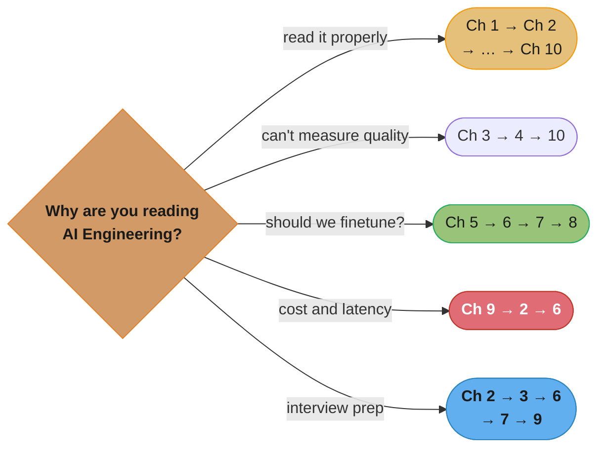

# AI Engineering: Building Applications with Foundation Models

> Chip Huyen · **1st edition, O'Reilly, January 2025** · ISBN 9781098166304 · A
> chapter-by-chapter, in-depth summary — read this folder in order and you have read the book.

> **Table of contents established from the author's own companion repository**,
> <https://github.com/chiphuyen/aie-book> (`ToC.md`) — 10 chapters. That file also lists each
> chapter's own top-level sections, which is what the `## N.x` headings in each chapter page
> here are mapped to.

> **This folder summarizes the book as written in 2024-2025.** The field it describes moves
> fast, and this section is deliberately excluded from the repo's currency audit: a claim the
> book makes is reported as the book's claim, not corrected to today. Where the gap between the
> book and now is genuinely instructive, it appears in an explicitly-marked
> `## Beyond the book — <topic>` section, never folded into Huyen's voice.

---

## The Book's Thesis

AI engineering is a discipline in its own right, and it is **not** machine learning engineering
with a new model in the middle. The starting point inverted: an ML engineer collected data,
trained a model, and then found a product for it; an AI engineer starts from a product,
reaches for a model that already exists, and spends their effort on everything *around* the
model — evaluation, context, prompts, data, inference cost, feedback.

Three claims run through the whole book:

- **Evaluation is the hardest part, and the part most teams skip.** Open-ended outputs have no
  ground truth to diff against, so an AI product's real bottleneck is knowing whether a change
  helped. Two of the ten chapters (Ch 3 and Ch 4) are spent on this before a single prompt is
  written.
- **Work outward from the cheapest lever.** Prompting, then context (RAG, then agents), then
  data, then finetuning — in that order, because each step costs more and is harder to reverse
  than the one before it. Finetuning is Chapter 7, not Chapter 2, on purpose.
- **The application, not the model, is the product.** Latency, cost per request, guardrails,
  the feedback loop, and the architecture around the model determine whether it works, and
  those get the last three chapters.

---

## The Shape of the Book

The book has no formal parts, but it moves through four clear movements:

```mermaid
flowchart TD
    classDef io      fill:#61afef,stroke:#2e86c1,color:#1a1a1a,font-weight:bold
    classDef frozen  fill:#c678dd,stroke:#9b59b6,color:#fff
    classDef train   fill:#98c379,stroke:#27ae60,color:#1a1a1a
    classDef mathOp  fill:#d19a66,stroke:#e67e22,color:#1a1a1a,font-weight:bold
    classDef req     fill:#56b6c2,stroke:#0097a7,color:#1a1a1a
    classDef base    fill:#e5c07b,stroke:#f39c12,color:#1a1a1a

    root(["AI Engineering<br/>(Huyen, 2025)"]) --> M1
    root --> M2
    root --> M3
    root --> M4

    subgraph M1["Foundations<br/>what you are building on"]
        C1("Ch 1<br/>Introduction to Building<br/>AI Applications") --> C2("Ch 2<br/>Understanding<br/>Foundation Models")
    end

    subgraph M2["Evaluation<br/>how you know it works"]
        C3("Ch 3<br/>Evaluation<br/>Methodology") --> C4("Ch 4<br/>Evaluate<br/>AI Systems")
    end

    subgraph M3["Adaptation<br/>cheapest lever first"]
        C5("Ch 5<br/>Prompt<br/>Engineering") --> C6("Ch 6<br/>RAG and<br/>Agents") --> C7("Ch 7<br/>Finetuning") --> C8("Ch 8<br/>Dataset<br/>Engineering")
    end

    subgraph M4["Production<br/>what it costs to run"]
        C9("Ch 9<br/>Inference<br/>Optimization") --> C10("Ch 10<br/>Architecture and<br/>User Feedback")
    end

    class root io
    class C1 io
    class C2 frozen
    class C3,C4 req
    class C5 base
    class C6 mathOp
    class C7,C8 train
    class C9 mathOp
    class C10 io
```

*Colour follows the movement: framing in blue, the model itself in purple, the two evaluation
chapters in teal, prompting in gold, context and inference mechanics in orange, and the two
chapters that change model weights or the data behind them in green.*

Note the ordering claim the diagram encodes: **evaluation comes before adaptation.** Huyen puts
Ch 3-4 ahead of prompting deliberately — you cannot tell whether a prompt change helped without
first having built the thing that measures it.

---

## Chapter Index

| # | Chapter | Folder | One-line summary | Repo deep-dive |
|---|---------|--------|------------------|----------------|
| 1 | Introduction to Building AI Applications with Foundation Models | [01_introduction_to_building_ai_applications/](01_introduction_to_building_ai_applications/01_introduction_to_building_ai_applications.md) | The rise of AI engineering, use cases, planning, the three-layer stack | [llm/ai_applications/](../../llm/ai_applications/ai_applications.md) |
| 2 | Understanding Foundation Models | [02_understanding_foundation_models/](02_understanding_foundation_models/02_understanding_foundation_models.md) | Training data, architecture and scale, post-training, sampling | [llm/foundations_and_architecture/](../../llm/foundations_and_architecture/foundations_and_architecture.md) |
| 3 | Evaluation Methodology | [03_evaluation_methodology/](03_evaluation_methodology/03_evaluation_methodology.md) | Perplexity, exact vs subjective eval, AI as a judge, comparative ranking | [llm/evaluation_and_benchmarks/](../../llm/evaluation_and_benchmarks/evaluation_and_benchmarks.md) |
| 4 | Evaluate AI Systems | [04_evaluate_ai_systems/](04_evaluate_ai_systems/04_evaluate_ai_systems.md) | Criteria, model selection, build-vs-buy, designing the eval pipeline | [llm/error_analysis_and_eval_design/](../../llm/error_analysis_and_eval_design/error_analysis_and_eval_design.md) |
| 5 | Prompt Engineering | [05_prompt_engineering/](05_prompt_engineering/05_prompt_engineering.md) | In-context learning, best practices, prompt injection defence | [llm/prompt_engineering/](../../llm/prompt_engineering/prompt_engineering.md) |
| 6 | RAG and Agents | [06_rag_and_agents/](06_rag_and_agents/06_rag_and_agents.md) | Retrieval algorithms, tool use, planning, failure modes, memory | [llm/rag_fundamentals/](../../llm/rag_fundamentals/rag_fundamentals.md) |
| 7 | Finetuning | [07_finetuning/](07_finetuning/07_finetuning.md) | When to finetune, memory math, LoRA and PEFT, model merging | [llm/fine_tuning/](../../llm/fine_tuning/fine_tuning.md) |
| 8 | Dataset Engineering | [08_dataset_engineering/](08_dataset_engineering/08_dataset_engineering.md) | Curation, quality/coverage/quantity, synthesis, processing | [llm/synthetic_data_generation/](../../llm/synthetic_data_generation/synthetic_data_generation.md) |
| 9 | Inference Optimization | [09_inference_optimization/](09_inference_optimization/09_inference_optimization.md) | Latency vs throughput, TTFT/TPOT, batching, quantization, decoding | [llm/inference_and_decoding/](../../llm/inference_and_decoding/inference_and_decoding.md) |
| 10 | AI Engineering Architecture and User Feedback | [10_ai_engineering_architecture_and_user_feedback/](10_ai_engineering_architecture_and_user_feedback/10_ai_engineering_architecture_and_user_feedback.md) | Building the architecture step by step; collecting and using feedback | [llm/deployment_and_mlops/](../../llm/deployment_and_mlops/deployment_and_mlops.md) |

---

## How to Read This (Reading Paths)

- **Cover to cover (recommended):** Ch 1 → … → Ch 10. The order encodes the book's central
  argument about which lever to pull first.
- **"We shipped an LLM feature and can't tell if it's good":** Ch 3 → 4 → 10. Methodology,
  then a pipeline, then the feedback loop that keeps it honest.
- **"Should we finetune?":** Ch 5 → 6 → 7 → 8. Huyen's answer is usually "not yet", and the
  path is the argument for why.
- **Cost and latency crisis:** Ch 9 → 2 (sampling) → 6 (context length drives cost).
- **Interview prep:** Ch 2 → 3 → 6 → 7 → 9. Model internals, evaluation, RAG/agents,
  adaptation, and serving are the five things asked about.

*Every path except the cost-crisis one passes through an evaluation chapter, which is the
book's structural opinion made visible.*

---

## Build Manifest

Per-file build status for this book. Update the row to `done` the moment a chapter file is
completed and diagram-linted.

| # | File | Status |
|---|------|--------|
| 1 | `01_introduction_to_building_ai_applications/01_introduction_to_building_ai_applications.md` | done |
| 2 | `02_understanding_foundation_models/02_understanding_foundation_models.md` | done |
| 3 | `03_evaluation_methodology/03_evaluation_methodology.md` | done |
| 4 | `04_evaluate_ai_systems/04_evaluate_ai_systems.md` | done |
| 5 | `05_prompt_engineering/05_prompt_engineering.md` | done |
| 6 | `06_rag_and_agents/06_rag_and_agents.md` | done |
| 7 | `07_finetuning/07_finetuning.md` | done |
| 8 | `08_dataset_engineering/08_dataset_engineering.md` | done |
| 9 | `09_inference_optimization/09_inference_optimization.md` | done |
| 10 | `10_ai_engineering_architecture_and_user_feedback/10_ai_engineering_architecture_and_user_feedback.md` | done |

---

## Cross-Reference Map (AI Engineering → repo deep dives)

| Book concept | Primary deep-dive module |
|--------------|--------------------------|
| Transformer architecture, scaling laws | [llm/foundations_and_architecture/](../../llm/foundations_and_architecture/foundations_and_architecture.md) |
| Pre-training data and compute | [llm/pre_training/](../../llm/pre_training/pre_training.md) |
| Post-training, RLHF, preference tuning | [llm/alignment_and_rlhf/](../../llm/alignment_and_rlhf/alignment_and_rlhf.md) |
| Sampling, temperature, top-p, structured output | [llm/inference_and_decoding/](../../llm/inference_and_decoding/inference_and_decoding.md) |
| Tokenization and embeddings | [llm/tokenization_and_embeddings/](../../llm/tokenization_and_embeddings/tokenization_and_embeddings.md) |
| Benchmarks, leaderboards, Elo ranking | [llm/evaluation_and_benchmarks/](../../llm/evaluation_and_benchmarks/evaluation_and_benchmarks.md) |
| AI-as-judge, eval pipeline design | [llm/error_analysis_and_eval_design/](../../llm/error_analysis_and_eval_design/error_analysis_and_eval_design.md) |
| Prompt patterns and in-context learning | [llm/prompt_engineering/](../../llm/prompt_engineering/prompt_engineering.md) |
| Prompt injection and jailbreak defence | [llm/llm_security/](../../llm/llm_security/llm_security.md) |
| Guardrails and content safety | [llm/guardrails_and_content_safety/](../../llm/guardrails_and_content_safety/guardrails_and_content_safety.md) |
| Retrieval, chunking, hybrid search | [llm/rag_fundamentals/](../../llm/rag_fundamentals/rag_fundamentals.md) |
| Reranking, query rewriting, advanced retrieval | [llm/advanced_rag/](../../llm/advanced_rag/advanced_rag.md) |
| Vector indexes and ANN | [llm/embeddings_and_similarity_search/](../../llm/embeddings_and_similarity_search/embeddings_and_similarity_search.md) |
| Tool use, planning, agent loops | [llm/agents_and_tool_use/](../../llm/agents_and_tool_use/agents_and_tool_use.md) |
| Agent memory and context management | [llm/context_engineering/](../../llm/context_engineering/context_engineering.md) |
| LoRA, QLoRA, PEFT | [llm/fine_tuning/](../../llm/fine_tuning/fine_tuning.md) |
| Model merging and distillation | [llm/knowledge_distillation_and_model_merging/](../../llm/knowledge_distillation_and_model_merging/knowledge_distillation_and_model_merging.md) |
| Synthetic data and augmentation | [llm/synthetic_data_generation/](../../llm/synthetic_data_generation/synthetic_data_generation.md) |
| Data pipelines, dedup, quality filtering | [ml/data_pipelines_and_processing/](../../ml/data_pipelines_and_processing/data_pipelines_and_processing.md) |
| Quantization and compression | [llm/optimization_and_quantization/](../../llm/optimization_and_quantization/optimization_and_quantization.md) |
| Serving engines, continuous batching, paged KV | [llm/inference_engines/](../../llm/inference_engines/inference_engines.md) |
| Token cost modelling | [llm/token_economics_and_cost_optimization/](../../llm/token_economics_and_cost_optimization/token_economics_and_cost_optimization.md) |
| Caching LLM responses | [llm/llm_caching/](../../llm/llm_caching/llm_caching.md) |
| Model routing and cascades | [llm/llm_routing_and_model_selection/](../../llm/llm_routing_and_model_selection/llm_routing_and_model_selection.md) |
| Monitoring, drift, production observability | [llm/llm_observability_and_monitoring/](../../llm/llm_observability_and_monitoring/llm_observability_and_monitoring.md) |
| Feedback loops and continuous learning | [llm/data_flywheels_and_continuous_learning/](../../llm/data_flywheels_and_continuous_learning/data_flywheels_and_continuous_learning.md) |
| Deployment and LLMOps | [llm/deployment_and_mlops/](../../llm/deployment_and_mlops/deployment_and_mlops.md) |
| Serving AI workloads from a backend | [backend/serving_ai_workloads/](../../backend/serving_ai_workloads/serving_ai_workloads.md) |

---

## Further Reading

- Author's companion repository (ToC, chapter summaries, resource lists):
  <https://github.com/chiphuyen/aie-book>
- Author's book page: <https://huyenchip.com/books/>
- Huyen, *Designing Machine Learning Systems* (O'Reilly, 2022) — the predecessor volume, and
  the book this one assumes you have the option of reading:
  [`designing_machine_learning_systems/`](../designing_machine_learning_systems/designing_machine_learning_systems.md)
- The repo's own LLM-engineering spine: [`llm/`](../../llm/README.md)
