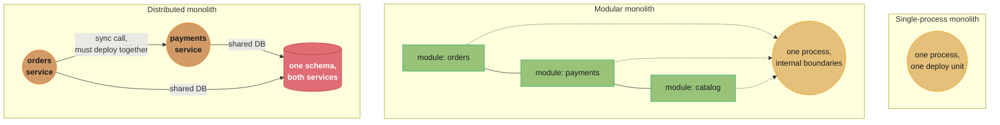
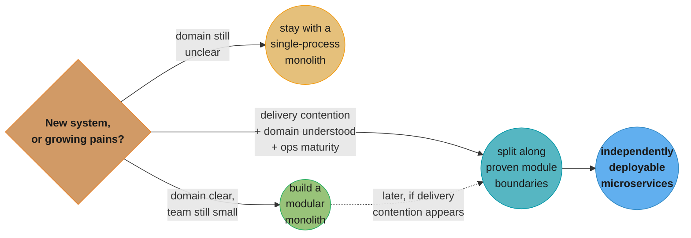

# Chapter 1: What Are Microservices?

> Part I — Foundation · Building Microservices, 2nd ed. (Sam Newman, O'Reilly 2021) · opens the
> book, leads to Ch 2 (how to find service boundaries)

## Chapter Map

The 2nd edition opens with a chapter the 1st edition didn't need: a defense, not just a
definition. In the years between editions, microservices went from novel to overhyped to, in
some organizations, a cautionary tale — so Newman spends this chapter being far more careful
about what a microservice actually is, what a monolith actually is (there is more than one
kind), and — the chapter's real payload — under what conditions you should *not* reach for
microservices at all.

**TL;DR:**
- A microservice is an **independently deployable** service **modeled around a business
  domain**. Independent deployability is the property everything else in the book serves —
  lose it and you have a distributed monolith, not a microservice architecture.
- "The monolith" is not one thing: Newman distinguishes the **single-process monolith**, the
  **modular monolith**, and the **distributed monolith** (many services, but still deployed and
  coupled as one), and argues the first two are frequently the right answer, not a stepping
  stone to be ashamed of.
- A cluster of technology matured over the last decade — log aggregation, distributed tracing,
  containers, Kubernetes, streaming platforms, public cloud, and serverless — is what makes
  running many small services operationally tractable today in a way it wasn't in 2008.
- Microservices trade simplicity for optionality: technology heterogeneity, robustness, scaling,
  ease of deployment, organizational alignment, and composability — each bought at the price of
  a matching pain point (developer experience, cost, monitoring, security, testing, latency,
  data consistency).
- The chapter's spine is its closing question: **should you use microservices at all?** Newman's
  answer is deliberately unfashionable — microservices are not the default choice, and a
  well-factored **modular monolith** is very often the better starting point.

## The Big Question

Every architectural style claims to solve the problem of change: how do you keep a system easy
to understand, safe to modify, and fast to ship, as it — and the organization building it —
grows? A single codebase run as one process is the simplest possible answer, and it is a
genuinely good one for a long time. The question this chapter asks is: what actually breaks as
that codebase and that team grow, and is splitting it into small, independently deployable
services the right response to that specific breakage, or a expensive solution reached for out
of fashion rather than need?

Analogy: a monolith is one large kitchen where every cook can reach every ingredient and every
pan — fast to coordinate when there are three cooks, chaotic once there are thirty and everyone
is bumping into each other reaching for the same knife. Microservices give every cook (or small
team of cooks) their own station, their own ingredients, and a strict rule about how dishes pass
between stations. That isolation is what lets thirty cooks work without stepping on each other —
but now every station needs its own equipment, its own inventory, and a reliable way to hand a
half-finished dish to the next station without it getting cold. The chapter is about deciding
whether your kitchen is actually crowded enough to be worth splitting.

---

## 1.1 Microservices at a Glance

A **microservice** is an independently deployable service modeled around a business domain.
Each one models a business capability end to end — not a technical layer — and communicates
with other services over a network. Newman is explicit that "micro" does not describe a target
line count or a target team size; it describes a design *goal* — services small enough that
each one is genuinely easy to understand, own, and change — not a number to hit for its own
sake. A codebase built as ten enormous, tightly coupled "microservices" fails the definition just
as thoroughly as one built as a single monolith; a codebase built as three well-bounded services
can pass it. The name is unfortunate in exactly this way: it draws attention to size, when size
was never the point.

The definition is deliberately load-bearing for the rest of the book: everything from Chapter 2
onward — how to find a service boundary, how services talk, how they deploy, how they fail
safely — is downstream of what it takes to keep services independently deployable and modeled
around the business, not downstream of any particular size target.

---

## 1.2 Key Concepts of Microservices

Six ideas recur through the whole book; this section fixes their vocabulary early so later
chapters can build on it without redefining terms.

### Independent Deployability

**Independent deployability** is the property that a single microservice can be changed and
deployed into production **on its own**, without requiring any other service to change or
redeploy at the same time. Newman treats this as *the* central property a microservice
architecture must protect — more central than size, more central than which framework a team
picks, more central than whether services are containerized. Everything else in the book that
looks like a technical recommendation (choose asynchronous communication over synchronous where
you can, avoid sharing a database, favor backward-compatible schema changes) is really a
recommendation in service of keeping this property intact.

Losing independent deployability is subtle because the symptoms show up as *slowness*, not as an
obvious outage: a change to one service quietly requires coordinated changes and a synchronized
release of two or three others, a release train forms because nobody trusts deploying just one
service alone, and the organization ends up paying every operational cost of a distributed
system — network calls, partial failure, eventual consistency — while getting none of the
independent-deployment benefit that was supposed to justify paying those costs. That combination
is what the book calls a **distributed monolith** (§1.3), and Newman considers it the single most
common and most damaging way microservice adoption goes wrong.

To keep deployability independent, a microservice must expose a stable, explicit interface and
hide everything else — which is precisely the **information hiding** principle Chapter 2 builds
the rest of service-boundary design around.

### Modeled Around a Business Domain

A microservice's boundary should follow a **business capability** — Order Management, Payments,
Catalog Search — rather than a **technical layer** (a "presentation service," a "business-logic
service," a "database service" shared by everyone). A layered split looks tidy on an
architecture diagram, but it means almost every real feature — "let a customer cancel an order,"
say — requires a coordinated change across the presentation service, the logic service, *and*
the data service, so the technical boundary buys none of the independence a business-capability
boundary buys. Newman traces this preference back to Domain-Driven Design, which Chapter 2 covers
as the primary technique for actually locating those business-capability boundaries.

### Owning Their Own State

A microservice should **own its own data** and expose it only through its service interface —
never let another service, or a human, reach directly into its database. A shared database is
one of the most common ways teams accidentally recreate monolith-style coupling on top of what
looks, superficially, like a microservice architecture: two services sharing a schema must
coordinate every schema change between them, which destroys independent deployability just as
surely as a shared codebase does, while adding network latency and operational complexity the
original monolith never had. State ownership is what makes a microservice a genuine unit of
encapsulation rather than a differently-shaped module sharing a database everyone can see.

### Size

Newman states plainly that he doesn't give a line-count or a byte-count for how "micro" a
service should be, and considers most attempts to do so unhelpful. The right size question isn't
"how many lines of code" but "does this boundary let one small team understand, own, and change
this service without having to coordinate with other teams for most of their day-to-day work."
A service is the right size when a newcomer can hold its purpose in their head, its test suite
runs fast enough to give quick feedback, and its owning team can ship a change to it without
opening a conversation with three other teams first.

### Flexibility

Because each service is independently deployable and hides its internals behind an interface,
teams gain real freedom in how they build what's inside the boundary — different languages,
different frameworks, different datastores, different release cadences per service, informed by
what that specific problem actually needs rather than by an organization-wide standard chosen
for the lowest common denominator. This flexibility is a *consequence* of the first four
properties, not a goal to pursue on its own — heterogeneity used well is an advantage (§1.5);
heterogeneity chosen for its own sake, or run without the operational discipline it demands, is a
pain point (§1.6).

### Alignment of Architecture and Organization

Microservices give an organization a lever it doesn't have with a monolith: the ability to shape
the software's structure to fit the *organization's* structure — and vice versa — deliberately,
rather than having Conway's Law happen to you by accident. **Conway's Law** observes that a
system's design tends to mirror the communication structure of the organization that builds it;
Newman's framing is that with microservices you can use this fact on purpose, drawing service
boundaries that match team boundaries so that most changes stay inside one team's remit,
instead of discovering after the fact that your architecture accidentally mirrors an org chart
nobody chose deliberately.

---

## 1.3 The Monolith

Newman is careful to push back on "monolith" as a single, uniformly bad category — there are (at
least) three meaningfully different things people call a monolith, and only one of them is the
architecture microservices are usually being proposed as a fix for.

### The Single-Process Monolith

The simplest case: all the code for a system runs as **one process**. This is far more common,
and far more often the *right* choice for a new or small system, than microservices advocacy
usually admits — it needs no network calls between its internal parts, is trivial to deploy (one
artifact), and is generally the easiest architecture to reason about, test, and debug.

### The Modular Monolith

A single-process monolith **internally** organized into well-defined, independently-owned
modules, with real boundaries and explicit interfaces between them — but still built, tested, and
deployed as one process. Newman treats this as an underrated middle option: it captures much of
the *design discipline* microservices are meant to enforce (clear boundaries, hidden internals,
one team per module) without paying microservices' distributed-systems tax (network calls,
partial failure, eventual consistency, per-service operational overhead). A well-executed modular
monolith is, in the 2nd edition's more cautious framing, frequently the better starting point —
you can always split a genuinely well-modularized monolith into services later, along boundaries
you've already proven out, far more cheaply than you can un-split a premature microservice
architecture.

### The Distributed Monolith

A system that is **physically** split into multiple deployable services but **behaves** like a
single-process monolith anyway, because those services must nearly always be deployed together
to work correctly. This is the failure mode of a microservice migration that lost independent
deployability along the way — often through a shared database, chatty synchronous call chains
that couple services' release schedules together, or a client library shared everywhere that
forces every service to upgrade in lockstep. A distributed monolith is, in Newman's view, close
to the *worst* place to end up: you pay every operational cost of a distributed system — network
latency, partial failure, harder debugging, harder testing — while getting none of the
independent-deployability benefit that was supposed to justify paying those costs in the first
place.

### Monoliths and Delivery Contention

As a single-process monolith's codebase and team both grow, **delivery contention** sets in:
more engineers competing to change the same codebase means more merge conflicts, more
coordination overhead before a release, and slower average time from "change written" to "change
in production," even though no individual engineer got slower at writing code. This is the real
force pushing organizations toward splitting a system — not an abstract preference for small
services, but a concrete, measurable slowdown in how fast *changes ship* as more people work in
the same codebase at once.

### Advantages of Monoliths

Newman is explicit that a monolith is not merely "microservices you haven't gotten to yet" — it
has real, durable advantages a team should weigh honestly: **simpler deployment topology** (one
thing to deploy, version, and roll back); **simpler monitoring and troubleshooting** (one process
to observe, one log stream to read, one call stack a debugger can walk end to end); **simpler
code reuse** (a shared library call, not a network call with its own failure modes); and
generally lower operational overhead across the board — no service mesh, no distributed tracing
infrastructure, no cross-service schema-compatibility discipline to maintain. Any argument for
microservices has to overcome this baseline, not just the marketing case for microservices in
the abstract.



Caption: three systems that all have "more than one box" somewhere in the picture, but only the
modular monolith and a genuine microservice architecture actually get independent deployability
— the distributed monolith looks like the third but behaves like the first, at higher cost.

---

## 1.4 Enabling Technology

Microservices as an idea are old; what changed between the mid-2000s and today is the maturity
of the technology needed to *operate* dozens or hundards of small, independently deployed
processes without drowning in the operational overhead. Newman names four clusters as
particularly load-bearing.

### Log Aggregation and Distributed Tracing

With one process, "read the log" means opening one file. With many independently deployed
services, a single user request can cross a dozen of them, so a **log aggregation** system that
collects every service's logs into one searchable place, and **distributed tracing** that
stitches a single request's path across every service it touched into one connected trace, stop
being nice-to-haves and become the only realistic way to answer "why did this request fail" at
all.

### Containers and Kubernetes

**Containers** package a service with its dependencies into one deployable, immutable artifact,
making "works on my machine" a rare complaint rather than a constant one; **Kubernetes** (and
container orchestration generally) then automates placing those containers on machines,
restarting failed ones, and scaling them up and down — the operational work that running dozens
of independently-deployed services by hand would otherwise demand from a human.

### Streaming

Mature **streaming platforms** (event logs a service can publish to and durably replay from)
make asynchronous, event-driven communication between services (Ch 4) practical at scale in a
way that was much harder to build reliably a decade earlier — durable delivery, replay for new
consumers, and ordered per-partition delivery all being infrastructure a team used to have to
build for themselves.

### Public Cloud and Serverless

**Public cloud** turns "provision a new machine" from a multi-day procurement process into an
API call, which matters enormously once "how many services do we run" is measured in dozens
rather than a handful; **serverless** platforms go further, removing server management from the
equation for at least some workloads entirely. Both lower the marginal operational cost of
running *one more* small service, which is exactly the cost microservice adoption otherwise
multiplies.

---

## 1.5 Advantages of Microservices

### Technology Heterogeneity

Because each service is deployed independently and communicates over an explicit interface, one
team can pick the language, framework, or datastore that best fits their specific problem —
a graph-heavy recommendation service reaching for a graph database, a high-throughput ingestion
service reaching for a language built for concurrency — without that choice becoming an
organization-wide standard everyone else must also live with.

### Robustness

A single-process monolith's failure modes are frequently all-or-nothing: one unhandled
exception, one memory leak, one runaway thread, and the whole process — and every capability it
hosts — goes down together. A well-designed microservice architecture can **isolate** failure to
the one capability that failed, so a struggling recommendations service doesn't have to take
checkout down with it. This isolation is a design *opportunity* microservices create, not a
guarantee they hand you automatically — Chapter 12 (Resiliency) is the whole rest of the story of
actually earning it.

### Scaling

With a monolith, scaling means running more copies of the *entire* application, even though
usually only one or two hot capabilities actually need the extra capacity. Microservices let you
scale exactly the services under load — independently, and by exactly the amount each one needs
— rather than paying to scale everything else along for the ride.

### Ease of Deployment

A one-line change to a well-isolated microservice can go through its own build, test, and deploy
pipeline and reach production in minutes, entirely independent of every other service's release
schedule — none of the coordination, regression risk, or "wait for the next release train"
overhead that changing one small corner of a large monolith often carries with it.

### Organizational Alignment

Smaller codebases owned by smaller teams tend to let people work more productively — matching
service boundaries to team boundaries keeps the majority of a team's day-to-day changes inside
code that team already owns and understands, reducing the cross-team coordination that scales
worse than almost anything else as an organization grows.

### Composability

Once a capability is exposed as a well-defined service, it becomes reusable by more than the
original consumer — a mobile app, a web frontend, a partner integration, and an internal
back-office tool can all call the same Payments service rather than each reimplementing payment
logic, or all being forced through the one monolithic application that originally hosted it.

---

## 1.6 Microservice Pain Points

Every advantage in §1.5 is bought with a matching cost — Newman pairs them deliberately so
neither list can be read in isolation.

| Advantage (§1.5) | Its matching pain point (§1.6) |
|---|---|
| Technology heterogeneity | **Technology overload** — too many languages/stores for any one engineer to be productive across, and for the org to hire, support, and secure them all |
| Robustness (failure isolation) | **Data consistency** — no more free ACID transactions spanning what used to be one process |
| Scaling per service | **Cost** — many small deployables each carry a baseline resource/ops overhead a single deployable didn't |
| Ease of independent deployment | **Testing** — verifying one service in isolation is easy; verifying the whole system's behavior needs a much harder cross-service testing strategy (Ch 9) |
| Organizational alignment | **Developer experience** — a newcomer now has to understand a whole ecosystem of services, not one codebase, before they can be productive |
| Composability | **Reporting / Monitoring and troubleshooting** — the data (and the failure) that used to live in one place is now scattered across many services and many logs |

Two further pain points recur across the whole book: **latency**, since a call that used to be
an in-process method call is now a network call, with all the added time and failure modes that
implies (Ch 4 examines exactly this trade in depth); and **security**, since every one of those
new network calls is a new attack surface that a single-process monolith simply didn't have
(Chapter 11 covers this fully).

None of these pain points is a reason to reject microservices outright — they're the honest
price list the rest of the book spends its remaining fifteen chapters showing you how to pay
down.

---

## 1.7 Should I Use Microservices?

This is the section the 2nd edition adds real weight to, and it is the chapter's central
argument. Newman's answer is deliberately unfashionable: **microservices are not the default
architectural choice**, and choosing them because they are currently the industry's fashionable
answer, rather than because your specific system and organization actually need what they buy,
is a mistake he has watched play out repeatedly. The honest starting recommendation for most new
systems is a well-factored **modular monolith** — cheaper to build, cheaper to run, and, if your
module boundaries turn out to be right, no harder to split into services *later* than it would
have been to get those same boundaries right up front in a premature microservice architecture.

### When They May Be a Bad Idea

Microservices are a poor fit when:

- **The domain is not yet well understood.** You cannot draw a good service boundary around a
  business capability you don't yet understand well enough to name — and getting a boundary
  wrong is far more expensive to fix across a network than inside one codebase's module system.
  A **startup** validating a new product is usually the clearest case: the domain model is still
  actively changing week to week, so any boundary drawn today is likely to be wrong soon, and a
  monolith's boundaries are far cheaper to redraw than a live service's public interface.
- **The team is too small to staff many independent services.** Each service is an ongoing
  operational and cognitive burden — someone has to own its on-call, its dependency upgrades, its
  security patching — and a small team spread across dozens of tiny services pays that overhead
  n times over for capacity it may not need at all.
- **The software is shipped to customers to run themselves**, rather than operated by the team
  that builds it — an on-premises product a customer installs and runs on their own
  infrastructure gets little benefit from independent deployability the vendor can't actually
  exercise once it's in the customer's hands, while the customer inherits all the operational
  complexity of running a distributed system they didn't ask to run.

### Where They Work Well

Microservices earn their cost when an organization has **outgrown** what a monolith (even a
well-modularized one) can comfortably support: enough engineers that delivery contention (§1.3)
is measurably slowing releases; a domain understood well enough that real, durable service
boundaries can be drawn with confidence; and enough operational maturity — log aggregation,
tracing, container orchestration, an on-call culture — to actually run many independently
deployed services rather than merely deploy them once and hope. The organizations Newman keeps
coming back to as success cases (large-scale consumer platforms operating hundreds of services,
each owned by a small team with full deployment autonomy) got there by growing into
microservices as delivery contention became a real, felt problem — not by adopting them on day
one because a monolith seemed old-fashioned.

---

## Visual Intuition



Caption: the decision the whole chapter is building toward — microservices are the destination
of a path that starts with an honestly assessed monolith, not the default first move; the arrow
that matters most is the dashed one, split *later*, from proven boundaries, not guessed ones.

```
  Delivery contention vs. team size (illustrative, not a formula from the book)

  time-to-ship
  one small change
      ^
      |                                              .  monolith, many teams
      |                                         .
      |                                    .
      |                               .
      |                          .
      |                     .            _______________  microservices,
      |                .          _______                 many teams
      |           . ___
      |___________
      +--------------------------------------------------> team size
        small          growing            large

  the crossover point is where a monolith's coordination cost starts to exceed
  a microservice architecture's per-service operational overhead -- exactly
  where that point sits is organization-specific, and the book's whole caution
  is: most teams estimate it too early, not too late.
```

Caption: the shape of the argument in §1.7, not a number from the book — the monolith line rises
with team size because of delivery contention (§1.3); the microservices line starts higher
because of the fixed per-service operational cost §1.6 describes, and stays flatter as team size
grows because that cost is mostly paid once, not per engineer.

---

## Key Concepts Glossary

- **Microservice** — an independently deployable service modeled around a business domain.
- **Independent deployability** — the ability to change and deploy one service into production
  without requiring any other service to change or redeploy alongside it.
- **Business domain modeling** — drawing a service boundary around a business capability rather
  than a technical layer.
- **Owning your own state** — a service exposes its data only through its interface, never a
  shared database.
- **Single-process monolith** — an entire system built and deployed as one process.
- **Modular monolith** — a single-process monolith with well-defined internal module boundaries.
- **Distributed monolith** — multiple deployable services that must nearly always ship together,
  losing independent deployability without losing distributed-systems complexity.
- **Delivery contention** — the slowdown in shipping changes as more engineers work in the same
  codebase.
- **Log aggregation** — collecting every service's logs into one searchable place.
- **Distributed tracing** — stitching one request's path across every service it touched into a
  single connected trace.
- **Conway's Law** — a system's design tends to mirror the communication structure of the
  organization that builds it.
- **Technology heterogeneity** — different services free to use different languages, frameworks,
  or datastores.
- **Two-pizza team** *(beyond the book — Amazon's own stated heuristic, referenced widely in
  microservices literature)* — a team small enough to be fed by two pizzas, often cited alongside
  independently-owned-service organizational design.

---

## Tradeoffs & Decision Tables

| | Single-process monolith | Modular monolith | Microservices |
|---|---|---|---|
| Deployment unit | One | One | Many, independent |
| Failure isolation | None — one crash takes everything down | None at the process level | Possible, if designed for it (Ch 12) |
| Cross-cutting refactor | Easy — one codebase, one compiler | Easy within discipline of module boundaries | Hard — spans services, interfaces, and teams |
| Operational overhead | Lowest | Low | Highest — per-service build, deploy, monitor, secure |
| Best team-size fit | Small | Small-to-medium | Medium-to-large, with real operational maturity |
| Data consistency | Free (one transaction) | Free (one transaction) | Must be designed for (Ch 6, Ch 8) |

| Should-I-use-microservices signal | Favors monolith / modular monolith | Favors microservices |
|---|---|---|
| Domain understanding | Still forming (startup, new product) | Well understood, boundaries proven |
| Team size | Small, single team | Large enough to feel delivery contention |
| Deployment model | Shipped to customers to self-host | Operated by the team that builds it |
| Operational maturity | Limited log/trace/orchestration tooling | Mature log aggregation, tracing, container orchestration |
| Scaling need | Uniform across the whole system | Concentrated in specific capabilities |

---

## Common Pitfalls / War Stories

- **Splitting before the domain is understood.** A team draws service boundaries around a
  business domain that is still actively changing week to week; every subsequent domain
  discovery forces a boundary redraw that now has to cross a network and a team boundary instead
  of a module boundary, which is far more expensive to fix than it would have been inside a
  monolith.
- **The distributed monolith trap.** A team ships "microservices" that still share a database or
  must nearly always deploy together — they pay every operational cost of a distributed system
  (network calls, partial failure, harder debugging) while getting none of the independent
  deployability that was supposed to justify paying those costs.
- **Adopting microservices for résumé-driven or fashion-driven reasons.** A team splits a
  perfectly healthy, well-understood monolith into services because microservices are the
  industry's current default answer, not because delivery contention or a genuine scaling need
  made the split necessary — and inherits every pain point in §1.6 without the matching benefit.
- **Underestimating the operational baseline cost per service.** Adding a new microservice adds
  its own build pipeline, deployment, monitoring, on-call rotation, and security surface — a team
  that treats "spin up one more tiny service" as free ends up with dozens of services nobody has
  the staffing to actually operate well.
- **Shipping a distributed system to a customer who has to run it themselves.** A vendor builds
  their product as microservices because that's how they'd want to operate it internally, then
  ships it to a customer's own infrastructure — the customer, who never asked to run a
  distributed system, now has to.

---

## Real-World Systems Referenced

Newman draws on his own consulting experience and the broader industry conversation around
microservices to illustrate the chapter's arguments — the two organizational patterns he returns
to repeatedly across the book are the **two-pizza team** model associated with Amazon (small,
independently-owned teams each responsible for a service end to end, including its operation)
and **Conway's Law**, Mel Conway's 1968 observation that system design mirrors organizational
communication structure. *(Beyond the book: Netflix and Monzo are widely cited public examples of
large-scale, many-hundreds-of-services microservice estates in the broader industry literature
Newman's writing and conference talks engage with; this file does not attribute specific figures
about either company to this chapter.)*

---

## Summary

A microservice is an independently deployable service modeled around a business domain — a
definition built around what it takes to keep services genuinely independent, not around a size
target. "The monolith" splits into at least three distinct things: the single-process monolith,
the modular monolith, and the distributed monolith, and only the last of these is the failure
mode microservices are meant to fix — the first two are frequently the right architecture,
full stop. A cluster of enabling technology — log aggregation and tracing, containers and
Kubernetes, streaming, public cloud and serverless — is what makes running many independently
deployed services operationally realistic today. Microservices buy technology heterogeneity,
robustness, scaling, ease of deployment, organizational alignment, and composability, each at the
cost of a matching pain point around developer experience, technology overload, cost, reporting
and monitoring, security, testing, latency, and data consistency. The chapter's real argument is
its last one: microservices are not the default architectural choice, and a well-built modular
monolith is very often a better place to start — split later, once delivery contention is real
and the domain is well understood, rather than because microservices are the fashion of the
moment.

---

## Interview Questions

**Q: What is the single property Newman treats as most central to a microservice architecture?**
**Short:** Independent deployability — changing and shipping one service without touching others.
Independent deployability is the ability to change and deploy a single microservice into
production on its own, with no other service needing to change or redeploy at the same time.
Newman treats it as more central than size, language choice, or containerization, because nearly
every other recommendation in the book — favoring asynchronous communication, avoiding shared
databases, keeping backward-compatible interfaces — exists specifically to protect this property.
Losing it produces a distributed monolith: every cost of a distributed system, none of the
benefit that was supposed to justify paying those costs.

**Q: What is a distributed monolith, and why does Newman consider it worse than a plain monolith?**
**Short:** Multiple services that must almost always deploy together, so no true independence exists.
A distributed monolith is a system physically split into multiple deployable services that
nonetheless behave like a single-process monolith, because they nearly always have to be
deployed together to work correctly — commonly caused by a shared database, tightly-coupled
synchronous call chains, or a shared client library forcing lockstep upgrades. It's worse than a
plain monolith because it pays every operational cost of a distributed system (network latency,
partial failure, harder debugging and testing) while getting none of the independent-deployment
benefit that was supposed to justify the split in the first place.

**Q: Why does the 2nd edition spend an entire closing section asking "should I use microservices?"**
**Short:** Because Newman argues microservices should not be the default architectural choice.
The 2nd edition is markedly more cautious than the 1st: having watched years of organizations
adopt microservices because they were fashionable rather than because their system and team
actually needed what they buy, Newman devotes §1.7 to arguing that a well-factored modular
monolith is frequently the better starting point, and that microservices only earn their cost
once delivery contention is real, the domain is well understood, and the organization has the
operational maturity to run many independently deployed services well.

**Q: What's the difference between a single-process monolith and a modular monolith?**
**Short:** A modular monolith adds real internal boundaries but is still built and deployed as one process.
A single-process monolith runs all its code as one process with no particular internal
boundaries; a modular monolith is also one deployed process, but organized internally into
well-defined modules with explicit interfaces and hidden internals between them. The modular
monolith captures much of the design discipline microservices are meant to enforce — clear
boundaries, one team per module — without paying the distributed-systems tax of network calls,
partial failure, and per-service operational overhead, which is why Newman treats it as an
underrated middle option rather than a lesser stepping stone.

**Q: When does Newman say microservices are a bad idea?**
**Short:** When the domain isn't understood yet, the team is too small, or software ships to run elsewhere.
Three cases stand out: when the business domain is still actively changing (a startup validating
a new product), because you can't draw a durable service boundary around a domain you don't yet
understand well enough to name; when the team is too small to staff the ongoing operational
burden — build pipeline, monitoring, on-call, security patching — that each additional service
adds; and when the software is shipped to customers to run themselves rather than operated by
the team that built it, since the customer inherits all the distributed-system complexity with
none of the independent-deployability benefit the vendor could actually exercise.

**Q: What does "modeled around a business domain" mean, and why is it preferred over a layered split?**
**Short:** Service boundaries follow business capabilities, not technical layers like UI or data access.
It means a service's boundary follows a business capability — Order Management, Payments,
Catalog Search — rather than a technical layer such as "presentation," "business logic," or
"data access." A layered split looks clean on a diagram but means most real features require a
coordinated change across several layer-services at once, defeating independent deployability;
a business-capability boundary keeps a whole feature's logic inside one team's service, which is
why Newman points to Domain-Driven Design (Ch 2) as the primary technique for locating these
boundaries.

**Q: Why does "owning your own state" matter so much for independent deployability?**
**Short:** A shared database forces every sharing service to coordinate schema changes together.
If two services share a database, any schema change to a table one of them uses has to be
coordinated with every other service that also touches it, which destroys independent
deployability in exactly the way a shared codebase does, while adding the network latency and
operational complexity of a distributed system that a true monolith never had. Owning your own
data and exposing it only through your service's interface is what makes a microservice an
actual unit of encapsulation, not just a differently-shaped module reading from a database
everyone else can also see.

**Q: How does Conway's Law relate to the "alignment of architecture and organization" concept?**
**Short:** It lets an organization deliberately shape service boundaries to match team boundaries.
Conway's Law observes that a system's design tends to mirror the communication structure of the
organization that builds it. Newman's point is that microservices let you use this fact
deliberately rather than have it happen to you by accident: draw service boundaries that match
team boundaries, so that most day-to-day changes stay inside one team's remit, instead of
discovering after the fact that your architecture has silently mirrored an org chart nobody
actually chose.

**Q: Name three enabling technologies the chapter says made microservices operationally practical.**
**Short:** Log aggregation/tracing, containers/Kubernetes, and mature streaming platforms, among others.
Log aggregation and distributed tracing make it possible to answer "why did this request fail"
once a single user request crosses a dozen independently deployed services instead of one
process; containers package a service and its dependencies into one deployable artifact while
Kubernetes automates placing, restarting, and scaling those containers, removing operational work
a human previously had to do by hand; and mature streaming platforms make durable, replayable,
asynchronous communication between services (Ch 4) practical at scale. Public cloud and
serverless round out the list by making it cheap and fast to provision the infrastructure that
one more small service needs.

**Q: Why does robustness through failure isolation not come "for free" with microservices?**
**Short:** Microservices only create the opportunity for isolation; earning it needs deliberate design.
Splitting a system into services creates the *opportunity* to isolate a struggling capability's
failure from the rest of the system — a recommendations service having a bad day doesn't have to
take checkout down with it — but that isolation isn't automatic. Without deliberate resiliency
patterns (timeouts, circuit breakers, bulkheads — the subject of Chapter 12), a synchronous call
chain across services can propagate a failure just as badly as, or worse than, a single process
crashing, because now the failure has to cross a network with its own latency and partial-failure
modes on top.

**Q: What's the trade in "ease of deployment" that microservices offer, and what does it cost?**
**Short:** Independent, fast releases per service, paid for with per-service build/deploy/monitor overhead.
A well-isolated microservice can move through its own build, test, and deploy pipeline and reach
production in minutes, entirely independent of every other service's release schedule — no
coordinated release train, no waiting on an unrelated team's change to also be ready. The cost is
that every one of those independent pipelines, deployment targets, and monitoring setups has to
be built and maintained separately, which is exactly the "technology overload" and "cost" pain
points in §1.6 that scale with the number of services you run.

**Q: How does data consistency change once a system is split into microservices?**
**Short:** Cross-service operations lose the free ACID transaction a single process used to give them.
Inside one process, an operation touching several logically distinct pieces of data can usually
be wrapped in a single database transaction, guaranteeing all-or-nothing consistency for free.
Once that operation spans several independently-owned services, no single transaction can span
all of them, so consistency has to be designed for explicitly — through patterns the book covers
later (sagas and workflow orchestration in Chapter 6, distributed transaction patterns in
Chapter 8) rather than assumed as a baseline the platform provides.

**Q: Why does testing get harder with microservices, according to this chapter's pain-point list?**
**Short:** Verifying one service alone is easy; verifying the whole system's cross-service behavior is hard.
Testing any single microservice in isolation is straightforward — it's not meaningfully harder
than testing a well-isolated module in a monolith. What gets hard is verifying the emergent
behavior of the *whole system*, since a user-visible feature may now depend on the correct
interaction of several independently-deployed, independently-versioned services, each of which
can change on its own schedule. Chapter 9 is the book's full answer to this — consumer-driven
contract testing in particular exists specifically to catch a breaking interface change before
it reaches production, without requiring a slow, brittle, full end-to-end test suite.

**Q: Why does latency become a first-class concern that a monolith never had to think about?**
**Short:** A call that used to be an in-process method call is now a network round trip.
In a single process, calling into another module costs essentially nothing — a function call
with no network involved. Once that same call crosses a service boundary, it becomes a network
call: it can be slow, it can time out, and it can fail in ways a local call never could. A chain
of several such calls to satisfy one user request compounds this cost, which is why Chapter 4's
whole subject — choosing communication styles deliberately, and understanding the trade of
synchronous versus asynchronous calls — exists.

**Q: What is technology overload, and why is it the direct cost of technology heterogeneity?**
**Short:** Too many languages and datastores for engineers, hiring, and security to keep up with.
Technology heterogeneity lets each team pick the best-fit language, framework, or datastore for
their specific service — a genuine advantage when used well. Left unchecked, though, an
organization running a dozen different languages and half a dozen different datastores across
its services makes it hard for any one engineer to move productively between services, hard to
hire and train for, and hard to keep secure and patched consistently, since every additional
technology is another thing the whole organization now has to support indefinitely.

**Q: Give a concrete example of when a modular monolith is preferable to going straight to microservices.**
**Short:** A startup with an evolving domain model and a small team, where boundaries aren't proven yet.
A startup still iterating on product-market fit has a domain model that changes meaningfully
from week to week, so any service boundary drawn today is likely to be wrong soon — and
redrawing a boundary is far cheaper inside one codebase's module system than it is across a
network and a team boundary once services are live. Building a well-factored modular monolith
first lets the team discover the real, durable domain boundaries cheaply, and split into services
later along boundaries that have actually proven stable — which is exactly the path Newman
recommends over guessing the right boundaries up front.

---

## Cross-links in this repo

- [backend/microservices_fundamentals/ — core microservice patterns and terminology](../../../backend/microservices_fundamentals/microservices_fundamentals.md)
- [hld/microservices/ — microservices in the wider system-design context](../../../hld/microservices/microservices.md)
- [hld/scalability/ — scaling a system as load and team size grow](../../../hld/scalability/scalability.md)
- [devops/containers_and_docker/ — the containerization enabling technology this chapter names](../../../devops/containers_and_docker/containers_and_docker.md)
- [devops/kubernetes_architecture/ — the orchestration layer this chapter names](../../../devops/kubernetes_architecture/kubernetes_architecture.md)
- [devops/observability_tracing_and_otel/ — the distributed tracing this chapter names as enabling technology](../../../devops/observability_tracing_and_otel/observability_tracing_and_otel.md)
- Next chapter: [Ch 2 How to Model Microservices](../02_how_to_model_microservices/02_how_to_model_microservices.md)

## Further Reading

- Conway, Melvin E., "How Do Committees Invent?", Datamation, 1968 — the original statement of
  Conway's Law.
- Fowler, Martin, and Lewis, James, "Microservices", martinfowler.com, 2014 — the widely-cited
  essay that popularized the term and its defining characteristics.
- Newman, Sam, *Building Microservices*, 1st ed., O'Reilly, 2015 — the book this 2nd edition
  revises, for readers who want to compare the two editions' framing directly.
- Newman, Sam, *Monolith to Microservices*, O'Reilly, 2019 — Newman's dedicated book on migration
  strategy, which Chapter 3 draws on.
