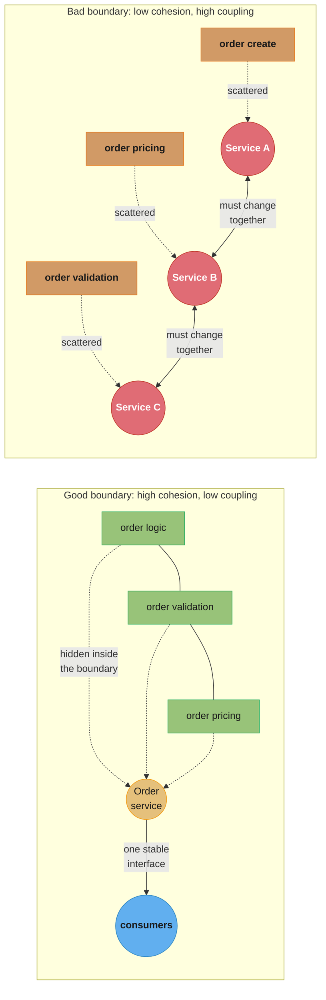
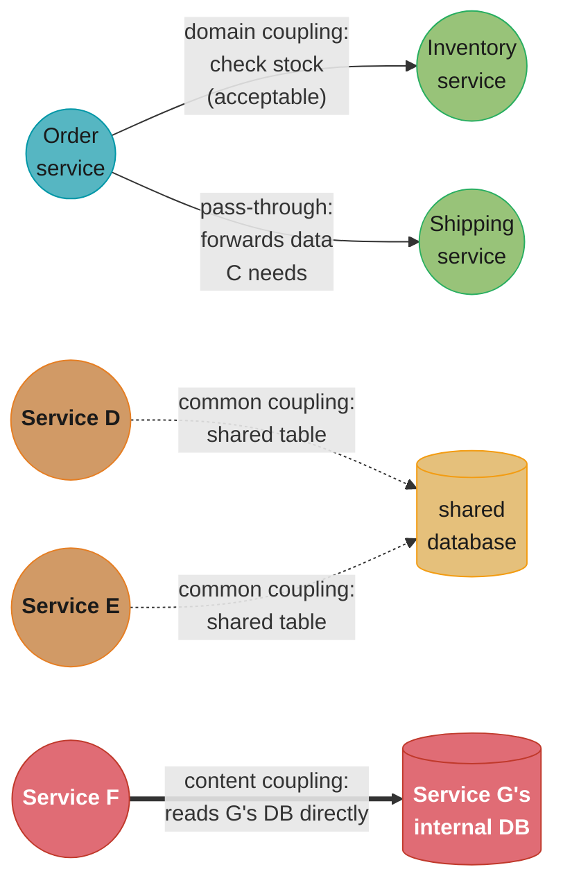
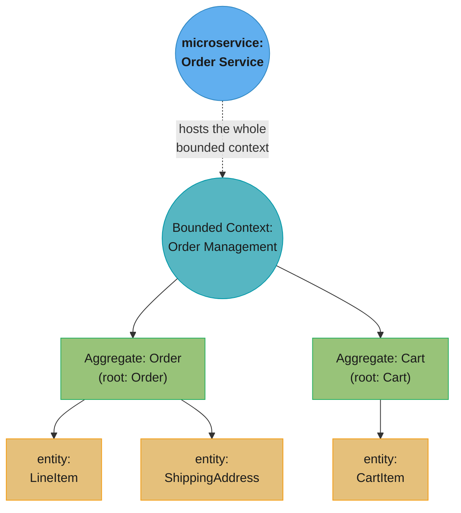

# Chapter 2: How to Model Microservices

> Part I — Foundation · Building Microservices, 2nd ed. (Sam Newman, O'Reilly 2021) · builds on
> Ch 1 (why boundaries matter), leads to Ch 3 (splitting an existing monolith along them)

## Chapter Map

Chapter 1 established that independent deployability is the property a microservice
architecture must protect. This chapter answers the question that leaves open: **where, exactly,
do you draw the line** between one service and the next, so that independence actually holds?
Newman introduces a fictional retailer, MusicCorp, as a running example, then builds a toolkit
for finding good boundaries out of two classic software-design ideas — information hiding and
the coupling/cohesion trade-off — before showing that Domain-Driven Design is the primary
technique he reaches for to apply that toolkit to a real business domain.

**TL;DR:**
- A good microservice boundary follows the same rule as a good module boundary: **strong
  cohesion** inside it, **loose coupling** across it — achieved primarily through
  **information hiding**, hiding a service's internal implementation behind a stable interface.
- Four kinds of coupling recur between services, in ascending order of how dangerous they are:
  **domain coupling** (usually fine, and often unavoidable), **pass-through coupling**,
  **common coupling**, and **content coupling** (the worst — one service reaching directly into
  another's internal state).
- **Domain-Driven Design**, and specifically its **bounded context**, is the chapter's primary
  technique for locating durable service boundaries: a bounded context wraps one or more
  **aggregates**, each a boundary within which a business invariant is enforced, described in
  the domain's own **ubiquitous language**.
- **Event Storming** is the practical, collaborative technique Newman recommends for
  discovering aggregates and bounded contexts together with the domain experts who actually
  understand the business.
- DDD is the *default* technique, not the *only* one — volatility, data, technology, and
  organizational structure are all legitimate alternative forces for drawing a boundary, and
  real systems usually mix models rather than applying one dogmatically everywhere.

## The Big Question

Chapter 1 said a microservice should be "modeled around a business domain," but that phrase
hides the hardest design decision in the whole book: **exactly where does one service end and
the next begin?** Draw the line in the wrong place and every one of Chapter 1's promised
benefits — independent deployment, isolated failure, team autonomy — quietly fails to
materialize, because features keep needing changes that span two or three "independent"
services at once.

Analogy: think of carving a large cooked fish into portions. Cut along the natural seams — where
the bones already separate one section of meat from the next — and each portion lifts away
clean, with nothing left dangling. Cut across the grain instead, ignoring where the bones
actually are, and every portion you try to serve drags stray bone and torn flesh from its
neighbor along with it. A microservice boundary works the same way: some places in a domain are
natural seams (an order and its own line items, a customer's own profile); others only *look*
separable until you try to actually operate on one part without the other coming along
too.

---

## 2.1 Introducing MusicCorp

Newman anchors the whole book — starting here and continuing through the following chapters —
around a single running fictional example: **MusicCorp**, an online retailer that started out
selling CDs and is expanding into digital music. MusicCorp gives every abstract boundary-drawing
principle a concrete shape: a **Catalog** of what's for sale, **Orders** customers place,
**Inventory** tracking what's actually in stock, **Payment** processing, and **Recommendation**
of what a customer might buy next. Each of those looks, at a glance, like an obvious service —
the rest of the chapter is about the more disciplined reasoning that confirms or corrects that
first instinct.

---

## 2.2 What Makes a Good Microservice Boundary?

Newman roots the whole chapter in ideas that predate microservices entirely — they're the same
ideas that make a well-designed module, class, or library boundary good, applied at the scale of
a network-separated service.

### Information Hiding

**Information hiding**, a term coined by David Parnas in 1972, is the practice of a module (or
service) exposing only what its consumers genuinely need, and hiding every other implementation
detail behind that boundary. A well-hidden service can change its internal implementation freely
— swap its datastore, refactor its internal code, change its language — without any consumer
needing to know or care, as long as the exposed interface doesn't change. This is the mechanism
that actually delivers independent deployability from Chapter 1: a service whose internals leak
through its interface (a raw database schema exposed to callers, an internal data structure
returned verbatim) can no longer change that leaked detail without also changing every consumer
that depends on it.

### Cohesion

**Cohesion** describes how well the things *inside* a boundary belong together — do they change
for the same reasons, at the same time, for the same business purpose? A highly cohesive service
groups related behavior so that a single business change usually touches code in only one place.
Newman's target for a microservice: everything related to a single business capability lives
inside the service boundary, not scattered across several services that all have to change
together whenever that capability's logic changes.

### Coupling

**Coupling** describes how much one service's design decisions constrain another's — how much
change on one side forces a change on the other. Newman's target is the opposite of cohesion's:
**low** coupling, so that most changes to one service ripple to as few other services as
possible. Coupling isn't binary; §2.3 breaks it into four distinct kinds, some far more dangerous
than others.

### The Interplay of Coupling and Cohesion

Cohesion and coupling aren't independent knobs — they trade against each other, and a boundary
that gets one wrong usually gets the other wrong too. Put things that change together *inside*
one boundary (high cohesion) and you automatically reduce how often a change has to cross a
service boundary at all (low coupling); split things that change together across multiple
services, and every one of those changes now has to be coordinated across a network and,
usually, across team lines — which is exactly the distributed-monolith failure mode from
Chapter 1. A stable architecture, in Newman's framing, is one with **strong cohesion and low
coupling** — the two properties reinforce each other, and neither can really be judged in
isolation from the other.



Caption: the same business logic, split two ways — inside a cohesive boundary, changing "how
order pricing works" touches one service; scattered across three services with high coupling,
the same change ripples across all three, and their teams, together.

---

## 2.3 Types of Coupling

Newman ranks four kinds of coupling from least to most dangerous — a service architecture rarely
avoids coupling entirely, so the practical goal is to prefer the safer kinds and actively design
away the dangerous ones.

### Domain Coupling

**Domain coupling** happens when one service needs to talk to another because the *business
domain itself* requires the interaction — an Order service has to call an Inventory service to
check stock, because in the real business, checking stock really is part of placing an order.
This is the mildest, most acceptable kind of coupling: it's driven by the domain, not by an
accident of implementation, and Newman treats a moderate amount of it as simply unavoidable in
any system of more than one service. The warning sign to watch for is a service that has to call
out to an unusually large number of other services just to do its own job — a symptom the
boundary itself may be drawn wrong, even though each individual call is domain-coupled.

### Pass-Through Coupling

**Pass-through coupling** occurs when one service passes data through to another purely because
a *third* service further down the chain needs it — service A doesn't use the data itself, but
has to know its shape well enough to accept it and forward it on to service C. This couples A to
a piece of C's interface that A has no actual business reason to know about; if C's data
requirement changes, A often has to change too, purely as a conduit. Newman's usual fix: let the
original caller talk to C directly if it can, or have the intermediate service treat the passed
data opaquely, wherever domain rules genuinely require it to pass through an intermediary at all.

### Common Coupling

**Common coupling** happens when two or more services depend on a single shared resource, most
often a shared database — one team's schema change can silently break another team's service
that reads the same tables. This is the same failure mode as the shared-database version of
Chapter 1's distributed monolith: the coupling isn't visible in any API contract, so it's easy to
introduce by accident and hard to detect until something breaks in production. Newman's guidance
is direct: avoid common coupling through a shared datastore wherever possible, and if a shared
resource genuinely must exist, make the contract around it as explicit and narrow as you would
make a service's own API.

### Content Coupling

**Content coupling** — the worst kind — happens when one service reaches directly into another
service's internal state or implementation, bypassing its published interface entirely: a
service querying another's database tables directly rather than calling its API, or two services
sharing internal code in a way that lets one reach into the other's private implementation
details. This breaks information hiding outright — the "hidden" internals are no longer hidden
from at least one consumer — and it means the exposing service can no longer safely change that
internal detail, because some consumer now silently depends on it. Newman treats content coupling
as something to actively design against from day one, never something to accept as a pragmatic
shortcut, because by the time it's discovered it's usually already load-bearing for whoever built
on top of it.



Caption: the same four kinds of coupling ranked left to right by how dangerous they are — domain
coupling is the price of doing business, content coupling is a boundary that has already failed.

---

## 2.4 Just Enough Domain-Driven Design

**Domain-Driven Design (DDD)**, from Eric Evans's 2003 book of the same name, is the primary
toolkit Newman reaches for to actually locate microservice boundaries in a real business domain,
rather than guessing.

### Ubiquitous Language

A **ubiquitous language** is a shared vocabulary, developed jointly by domain experts and
engineers, used consistently in conversation, code, and documentation alike — the same word
means the same thing whether a domain expert is speaking or a variable is being named in code.
Building this shared language is valuable on its own even before any service boundary is drawn,
because it surfaces exactly the places where the business uses one word for two different
concepts (or two words for the same concept) — and those hidden ambiguities are frequently early
signals of where a real domain boundary belongs.

### Aggregate

An **aggregate** is a cluster of domain objects treated as one unit for the purpose of data
changes — an Order together with its own line items, for instance — with a single **aggregate
root** as the only object outside the cluster is allowed to reference directly, and inside whose
boundary a business invariant (a rule that must always hold, such as "an order's total must equal
the sum of its line items") is enforced. Newman treats the aggregate as the natural, minimal unit
of consistency for a microservice: a single aggregate should typically be owned entirely by one
service, since splitting an aggregate's invariant across two services means that invariant can no
longer be enforced by one atomic transaction.

### Bounded Context

A **bounded context** is a boundary within which a particular domain model, and its ubiquitous
language, applies consistently — the same term can mean something different in a different
bounded context without contradiction, because each context has its own internally consistent
model. "Product" inside the Catalog bounded context (with a description, a price, images) is a
meaningfully different concept from "Product" inside the Shipping bounded context (with a
weight, dimensions, a fragility flag) — DDD's insight is that this isn't a modeling mistake to
resolve by picking one true definition, but two legitimately different models that happen to
share an English word, each valid inside its own context.

### Mapping Aggregates and Bounded Contexts to Microservices

Newman's central recommendation: a **bounded context is a good candidate for a microservice
boundary**, and each aggregate inside it is a good candidate for the unit a service actually
manages transactionally. A bounded context frequently contains more than one aggregate, and it's
entirely reasonable — especially early on — for a single microservice to host an entire bounded
context's worth of aggregates together, splitting individual aggregates into their own services
later only if a real, felt reason (independent scaling need, a different team wanting ownership,
a different release cadence) actually justifies the split. Going the other way — splitting a
single aggregate's invariant across two services — is the mistake to avoid, since it's the
surest way to lose the free, atomic consistency a single aggregate is supposed to guarantee.

### Event Storming

**Event Storming** is the collaborative workshop technique Newman recommends for actually
discovering a domain's aggregates and bounded contexts together with the people who understand
the business — not a solo architectural exercise done at a whiteboard by engineers alone.
Participants — domain experts and engineers together — cover a large surface (traditionally
a long roll of paper) with sticky notes representing **domain events** ("Order Placed,"
"Payment Captured," "Stock Reserved") in the order they happen, then cluster related events, the
commands that trigger them, and the aggregates those commands act on. The boundaries that emerge
from where those clusters naturally separate are strong candidates for bounded contexts — because
they were found by watching where the domain experts' own conversation naturally split into
different topics, not imposed from outside by an architect's guess.

---

## 2.5 The Case for Domain-Driven Design for Microservices

Newman's argument for DDD as the *default* technique, rather than one option among equals: it
locates boundaries around **business capability** rather than around a technical concern, which
is precisely the target Chapter 1 set (§1.2, "Modeled Around a Business Domain"). A boundary
found this way tends to be more stable over time than a boundary found by, say, splitting along
existing technical layers, because business capabilities generally change less often, and less
unpredictably, than the technical implementation underneath them does. DDD also directly produces
the ubiquitous language a well-run microservice team needs day to day — API names, event names,
and even service names that read the same way to an engineer and to the business stakeholder they
work with, reducing the everyday translation cost of talking across that gap.

---

## 2.6 Alternatives to Business Domain Boundaries

DDD is the default lens, not the only legitimate one — Newman names four other forces that can
justifiably reshape a boundary away from a pure business-capability split.

- **Volatility.** A part of the domain that changes far more often than its neighbors — a pricing
  engine under constant experimentation, say — can be worth isolating into its own service purely
  so that constant change doesn't force redeployment of a much more stable neighbor, even if the
  two would otherwise sit naturally in one bounded context.
- **Data.** Different parts of a domain sometimes have genuinely different data-handling needs —
  different retention requirements, different regulatory or privacy obligations, different
  read/write access patterns at very different scale — strong enough reasons on their own to
  justify a service boundary that doesn't perfectly track the business-capability split.
- **Technology.** A capability with a real, specific technology need — GPU-backed inference, a
  specialized graph datastore for recommendations — is sometimes worth isolating into its own
  service purely to contain that technology choice, even where the business logic itself would
  otherwise sit comfortably alongside a neighboring capability.
- **Organizational.** Sometimes the deciding force is simply which team should own a piece of
  functionality — Conway's Law working in the direction Chapter 1 recommended (§1.2), drawing a
  boundary to match a real team structure rather than purely to match the domain model.

---

## 2.7 Mixing Models — and the Exception, Not the Rule

Newman closes the chapter with a caution against dogmatism: real systems rarely apply one single
boundary-finding technique uniformly everywhere. Most of a system's services will map cleanly
onto bounded contexts found through DDD and Event Storming — that should be the default,
unremarked-upon case. Where volatility, data, technology, or organizational forces from §2.6
justify a different cut, that's a legitimate, deliberate **exception** to the default — made
consciously, for a specific and namable reason, not a pattern to be applied everywhere out of
convenience. The discipline Newman is asking for isn't "always use pure DDD boundaries"; it's
"know exactly *why* you deviated, every time you do."

---

## Visual Intuition



Caption: the mapping §2.4 recommends — a bounded context becomes the microservice boundary, each
aggregate inside it stays a unit only that one service ever writes to, and only the aggregate
root is ever referenced from outside its own aggregate.

```
  Coupling danger, low to high (Newman's own ordering)

  domain coupling      |####                              | mild — often unavoidable
  pass-through coupling|########                           | moderate — an unnecessary conduit
  common coupling       |##############                    | serious — invisible, easy to break
  content coupling      |########################          | severe — breaks information hiding

                        least dangerous -------------> most dangerous
```

Caption: not a metric from the book — a visual ranking of §2.3's own ordering. The further right,
the more a change on one side of the boundary forces an unplanned change on the other, and the
harder that dependency is to see just by reading each service's published interface.

---

## Key Concepts Glossary

- **Information hiding** — exposing only what consumers need and hiding every other
  implementation detail behind a stable interface.
- **Cohesion** — how strongly the things inside a boundary belong together, changing for the
  same reasons at the same time.
- **Coupling** — how much one service's design decisions constrain another's.
- **Domain coupling** — coupling required by the business domain itself (e.g., checking stock).
- **Pass-through coupling** — one service forwarding data it doesn't use, purely for a third
  service further down the chain.
- **Common coupling** — two or more services depending on a shared resource, most often a shared
  database.
- **Content coupling** — one service reaching directly into another's internal state, bypassing
  its interface entirely.
- **Domain-Driven Design (DDD)** — a design approach that models software around the business
  domain and its own language.
- **Ubiquitous language** — a shared vocabulary used consistently by domain experts and engineers
  alike, in conversation and in code.
- **Aggregate** — a cluster of domain objects treated as one unit for data changes, with a single
  aggregate root and an enforced invariant.
- **Aggregate root** — the only object in an aggregate that may be referenced directly from
  outside the aggregate.
- **Bounded context** — a boundary within which one domain model and its language apply
  consistently.
- **Event Storming** — a collaborative workshop technique for discovering domain events,
  aggregates, and bounded contexts together with domain experts.
- **Domain event** — something that happened in the business domain, worth naming and reacting
  to ("Order Placed").
- **Volatility (as a boundary force)** — isolating a fast-changing part of the domain so its
  churn doesn't force redeployment of a stable neighbor.

---

## Tradeoffs & Decision Tables

| Coupling type | Visible in the API contract? | Typical fix |
|---|---|---|
| Domain coupling | Yes | Usually accept it — it's the cost of the domain interacting with itself |
| Pass-through coupling | Partially | Let the original caller talk to the downstream service directly, or pass data opaquely |
| Common coupling | No — hidden in shared infrastructure | Give each service its own datastore; make any shared resource's contract explicit |
| Content coupling | No — invisible until it breaks | Design against it from day one; expose an interface instead of internal state |

| Boundary-finding force | What it optimizes for | When to prefer it over pure DDD |
|---|---|---|
| Domain-Driven Design (default) | Stability, business alignment | The default choice for most services |
| Volatility | Isolating high-churn logic | A sub-area changes far more often than its neighbors |
| Data | Retention, privacy, access-pattern fit | A sub-area has genuinely different data requirements |
| Technology | Containing a specialized tech need | One capability needs specialized infrastructure (GPU, graph DB) |
| Organizational | Team ownership, Conway's Law | Ownership clarity matters more than a pure domain split |

| DDD concept | Maps to (Newman's recommendation) |
|---|---|
| Bounded context | The microservice boundary |
| Aggregate | The transactional unit a single service manages |
| Aggregate root | The only entry point external callers use |
| Ubiquitous language | Shared naming across API, events, code, and conversation |

---

## Common Pitfalls / War Stories

- **Splitting a single aggregate across two services.** A team splits an Order aggregate's line
  items into a separate service from the Order itself, believing it's a natural boundary — the
  "order total must equal the sum of line items" invariant can no longer be enforced by a single
  transaction, and now needs distributed coordination for something that used to be free.
- **Common coupling through a shared database mistaken for a clean architecture.** Several
  services read and write the same tables, each believing its own service boundary is well
  defined because its *code* is organized cleanly — the coupling is real but invisible in any API
  contract, so it's discovered only when one team's schema migration silently breaks another
  team's service.
- **Content coupling accepted as a pragmatic shortcut.** A team lets one service query another's
  database directly "just for now, we'll fix it later" — by the time anyone tries to fix it, a
  downstream consumer has quietly come to depend on the exposed internal shape, and removing the
  shortcut now requires a coordinated migration nobody budgeted for.
- **Drawing boundaries around technical layers instead of business capabilities.** A team splits
  "the API layer," "the business logic layer," and "the data layer" into separate services,
  believing this is a microservice architecture — nearly every real feature change now has to
  touch all three, which is pass-through and common coupling dressed up as separation of
  concerns.
- **Running Event Storming with engineers only, no domain experts.** A workshop meant to surface
  the business's own understanding of its domain events is run entirely by the engineering team,
  producing a technically tidy but business-naive model — the same failure DDD's ubiquitous
  language is meant to prevent, just moved one step earlier in the process.

---

## Real-World Systems Referenced

Newman's own MusicCorp example (Catalog, Orders, Inventory, Payment, Recommendation) carries this
chapter and recurs through the rest of the book. The chapter's theoretical grounding draws
explicitly on two named sources: **David Parnas**'s 1972 paper on information hiding, and
**Eric Evans**'s 2003 book *Domain-Driven Design*, from which bounded context, aggregate, and
ubiquitous language are drawn directly.

---

## Summary

A good microservice boundary is a module boundary applied at network scale: strong cohesion
inside it, loose coupling across it, achieved primarily through information hiding — a service
exposes only what consumers need and hides everything else, so its internals can change freely
without breaking anyone downstream. Coupling comes in four kinds of increasing danger — domain
coupling is usually the acceptable cost of a real domain interaction; pass-through coupling is an
avoidable conduit; common coupling, most often a shared database, hides real dependencies outside
any API contract; content coupling, reaching directly into another service's internals, breaks
information hiding outright and should never be treated as a pragmatic shortcut. Domain-Driven
Design is the chapter's default toolkit for locating durable boundaries: a bounded context wraps
one or more aggregates, each aggregate the natural unit of transactional consistency a single
service should own whole; Event Storming is the collaborative technique for discovering both
together with the domain experts who actually understand the business. DDD is the default lens,
not the only one — volatility, data, technology, and organizational structure are all legitimate
reasons to deviate, made deliberately and for a namable reason, not applied as convenient
shortcuts everywhere. Chapter 3 picks this up directly: having found a good boundary, how do you
actually split an existing monolith along it?

---

## Interview Questions

**Q: What is information hiding, and why does Newman treat it as the foundation of a good service boundary?**
**Short:** Exposing only what's needed and hiding internals so they can change freely behind the interface.
Information hiding, from David Parnas's 1972 work, is exposing only what consumers genuinely
need and hiding every other implementation detail behind a stable interface. Newman treats it as
foundational because it's the mechanism that actually delivers independent deployability from
Chapter 1: a service that hides its internals well can change its datastore, refactor its code,
or even change language, without any consumer needing to know or care, as long as the exposed
interface stays the same — a service that leaks internals through its interface can't make that
same change without breaking every consumer depending on the leaked detail.

**Q: How do cohesion and coupling trade against each other, and why can't you optimize one without the other?**
**Short:** Grouping things that change together (cohesion) automatically reduces how often changes cross boundaries.
Putting things that change together for the same business reason inside one boundary — high
cohesion — automatically reduces how often a change needs to cross a service boundary at all,
which is exactly low coupling. Splitting things that change together across separate services
does the opposite: every one of those changes now has to be coordinated across a network and,
usually, across team lines. That's why Newman treats a stable architecture as one with strong
cohesion *and* low coupling together, not as two independent knobs to tune separately.

**Q: Rank the four kinds of coupling from least to most dangerous, and explain why content coupling is worst.**
**Short:** Domain, pass-through, common, then content coupling — content coupling breaks information hiding directly.
From least to most dangerous: domain coupling (a genuine, usually unavoidable domain interaction,
like Order calling Inventory to check stock), pass-through coupling (forwarding data a service
doesn't use, purely for a third service downstream), common coupling (services sharing a
resource, most often a database, with the dependency invisible outside that shared
infrastructure), and content coupling (one service reaching directly into another's internal
state, bypassing its interface entirely). Content coupling is worst because it breaks information
hiding outright — the "hidden" internals are no longer hidden from at least one consumer, so the
exposing service can no longer safely change that detail without breaking that consumer.

**Q: Why is common coupling especially dangerous compared to domain coupling, even though both involve two services depending on each other?**
**Short:** Common coupling hides in shared infrastructure, invisible outside any API contract.
Domain coupling is visible in the API contract — a call from Order to Inventory shows up as an
explicit dependency anyone reading the code or the architecture diagram can see. Common coupling,
most often a shared database, is invisible outside that shared resource — nothing in either
service's own published interface reveals that a schema change to a shared table will break the
other service, which is exactly why it's often discovered only when a migration breaks something
in production rather than being caught during design or review.

**Q: What is a bounded context, and why does Newman recommend it as the default microservice boundary?**
**Short:** A boundary within which one domain model and language apply consistently, matching a service.
A bounded context is a boundary within which a particular domain model and its own ubiquitous
language apply consistently — the same term ("Product") can legitimately mean something
different in a different bounded context without contradiction, since each context has its own
internally consistent model. Newman recommends it as the default microservice boundary because it
groups business capability the way Chapter 1 asked services to be modeled, and because a boundary
found this way tends to be more stable over time than one found by splitting along technical
layers, since business capabilities generally change less often and less unpredictably than
implementation details do.

**Q: What is an aggregate, and why should a single aggregate's data typically live inside one microservice?**
**Short:** A cluster of domain objects with one enforced invariant; splitting it loses atomic consistency.
An aggregate is a cluster of domain objects treated as one unit for data changes, with a single
aggregate root as the only externally referenceable object, and a business invariant enforced
inside its boundary — for instance, an order's total must always equal the sum of its line
items. If that aggregate's data is split across two services, the invariant can no longer be
enforced by a single atomic transaction, and now needs distributed coordination for something
that used to be free — which is why Newman treats keeping a whole aggregate inside one service as
close to a hard rule, even when splitting individual aggregates into separate services later is
entirely reasonable.

**Q: What is Event Storming, and why does Newman recommend it over a purely architect-driven modeling exercise?**
**Short:** A collaborative workshop with domain experts that surfaces boundaries from real conversation.
Event Storming is a collaborative workshop technique where domain experts and engineers together
map out domain events in the order they happen, using sticky notes on a large shared surface,
then cluster related events, the commands that trigger them, and the aggregates those commands
act on. Newman recommends it specifically because the boundaries that emerge come from watching
where the domain experts' own conversation naturally splits into different topics, rather than
being guessed by an architect working alone — which tends to produce boundaries that actually
match how the business itself understands its own domain.

**Q: Under what conditions does Newman say it's fine to deviate from a pure Domain-Driven Design boundary?**
**Short:** When volatility, data, technology, or organizational needs give a specific, namable reason.
Four legitimate alternative forces: volatility, isolating a part of the domain that changes far
more often than its neighbors so that churn doesn't force redeployment elsewhere; data, where a
sub-area has genuinely different retention, privacy, or access-pattern needs; technology, where a
capability needs specialized infrastructure worth containing in its own service; and
organizational, where team ownership and Conway's Law justify a different cut. The discipline
Newman asks for is that any such deviation be made deliberately, for a specific reason you could
name if asked — not applied everywhere as a convenient shortcut.

**Q: Why does Newman warn against drawing microservice boundaries around technical layers (presentation, logic, data)?**
**Short:** Nearly every real feature then requires a coordinated change across all three layers.
A layered split looks clean on an architecture diagram, but a layer doesn't correspond to a
business capability — it's a technical concern that cuts across nearly every feature. Almost any
real change ("let a customer cancel an order") now requires a coordinated change across the
presentation-layer service, the logic-layer service, and the data-layer service simultaneously,
which is exactly the pass-through and common coupling this chapter warns about, dressed up as
separation of concerns rather than actually delivering it.

**Q: What is the ubiquitous language, and why is building it valuable even before any service boundary exists?**
**Short:** A shared vocabulary between domain experts and engineers, used consistently everywhere.
The ubiquitous language is a shared vocabulary, developed jointly by domain experts and
engineers, used consistently in conversation, code, and documentation — the same word means the
same thing regardless of who's using it. Building it is valuable on its own because the process
of building it surfaces exactly the places where the business silently uses one word for two
different concepts, or two different words for the same concept — and those hidden ambiguities
are frequently early, reliable signals of where a real domain boundary actually belongs, well
before any formal boundary-finding exercise happens.

**Q: How does an aggregate root relate to information hiding?**
**Short:** It's the aggregate's only exposed entry point, hiding every other object inside the cluster.
The aggregate root is the single object inside an aggregate that any code outside the aggregate
is allowed to reference directly — every other object inside the cluster (a line item, a
shipping address attached to an order) is accessed only through the root, never referenced or
modified directly from outside. This is information hiding applied one level down from the
service boundary itself: the aggregate's internal structure can change freely as long as the
root's own interface stays stable, exactly mirroring how a service hides its internals behind its
own published API.

**Q: Give an example of pass-through coupling and explain how you'd remove it.**
**Short:** A service forwarding data it doesn't use for a downstream service; let the caller talk directly instead.
If an Order service receives shipping preferences from a client purely to forward them, unused,
to a Shipping service further down the chain, Order is pass-through coupled to a piece of
Shipping's interface it has no actual business reason to know about — if Shipping's data
requirement changes, Order often has to change too, purely as a conduit. The usual fix is letting
the original caller talk to the downstream service directly where domain rules allow it, or, if
an intermediary genuinely must pass the data along, having it treat that data opaquely rather
than parsing or validating a shape it doesn't actually use.

**Q: Why does Newman recommend hosting an entire bounded context inside one microservice initially, rather than one service per aggregate from the start?**
**Short:** Splitting prematurely risks separating aggregates that should stay together, without a proven reason.
A bounded context frequently contains more than one aggregate, and it's entirely reasonable for a
single microservice to host all of them together at first. Splitting individual aggregates into
their own services should wait for a real, felt reason — an independent scaling need, a
different team wanting clear ownership, a different release cadence — rather than being done
speculatively on day one, since a premature split risks separating aggregates that turn out to
need to change together, recreating exactly the coordination cost the boundary was supposed to
avoid.

**Q: What role does the fictional MusicCorp example play across the book, and why introduce it here specifically?**
**Short:** A running concrete example — Catalog, Orders, Inventory, Payment, Recommendation — used through the book.
MusicCorp is a fictional online music retailer Newman introduces in this chapter and reuses
across the rest of the book, giving every abstract principle — boundary-finding, communication
styles, testing, deployment — a shared, concrete domain to apply to rather than a fresh invented
example each time. Introducing it here specifically lets the chapter's boundary-finding
techniques (cohesion, coupling, DDD, Event Storming) be demonstrated against a domain readers can
follow, with capabilities (Catalog, Orders, Inventory, Payment, Recommendation) that look like
obvious service candidates at a glance — setting up the more disciplined reasoning the chapter
then applies to confirm or correct that first instinct.

**Q: How does the "interplay of coupling and cohesion" argument connect back to independent deployability from Chapter 1?**
**Short:** High cohesion and low coupling together are what keep a service's changes from spilling outward.
Independent deployability requires that changing one service doesn't force a change to any
other. A boundary with high cohesion keeps the logic that changes together for one business
reason inside one service, so most changes stay contained; a boundary with low coupling means
that on the rare occasion a change does need to cross the boundary, it does so through a narrow,
stable interface rather than an implicit dependency. Get either one wrong — scatter cohesive logic
across services, or couple services through shared internals — and changes start spilling across
service (and team) lines, which is precisely how a distributed monolith forms.

---

## Cross-links in this repo

- [backend/microservices_fundamentals/ — service boundary and decomposition patterns](../../../backend/microservices_fundamentals/microservices_fundamentals.md)
- [hld/microservices/ — bounded contexts and service boundaries in system design](../../../hld/microservices/microservices.md)
- [database/schema_design_and_normalization/ — data modeling that underlies aggregate design](../../../database/schema_design_and_normalization/schema_design_and_normalization.md)
- [backend/event_driven_fundamentals/ — domain events, the output of Event Storming](../../../backend/event_driven_fundamentals/event_driven_fundamentals.md)
- Previous chapter: [Ch 1 What Are Microservices?](../01_what_are_microservices/01_what_are_microservices.md)
- Next chapter: [Ch 3 Splitting the Monolith](../03_splitting_the_monolith/03_splitting_the_monolith.md)

## Further Reading

- Parnas, David L., "On the Criteria to Be Used in Decomposing Systems into Modules," CACM,
  1972 — the origin of information hiding.
- Evans, Eric, *Domain-Driven Design: Tackling Complexity in the Heart of Software*,
  Addison-Wesley, 2003 — the source of bounded context, aggregate, and ubiquitous language.
- Vernon, Vaughn, *Implementing Domain-Driven Design*, Addison-Wesley, 2013 — a practitioner's
  guide to applying Evans's ideas.
- Brandolini, Alberto, *Introducing EventStorming*, Leanpub — the technique's originator's own
  book-length treatment.
- Newman, Sam, *Building Microservices*, 1st ed., O'Reilly, 2015 — this chapter's predecessor,
  for readers comparing the two editions' treatment of boundary-finding.
