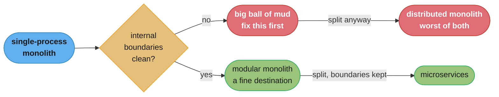
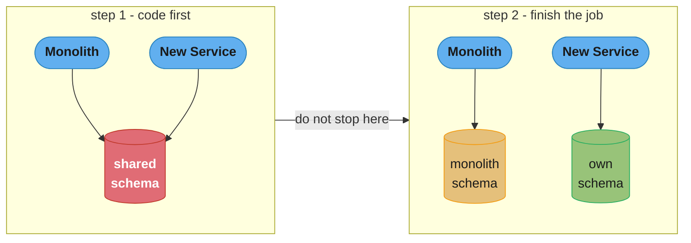
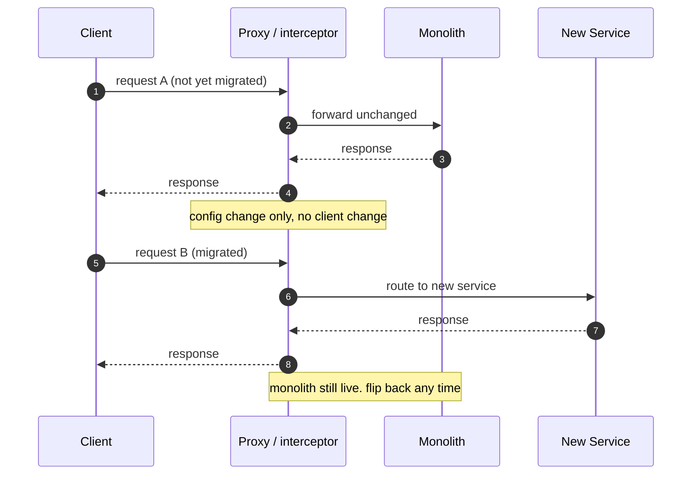
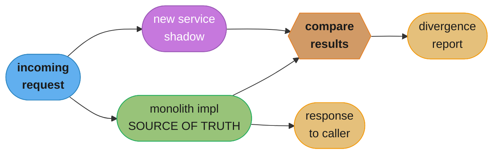
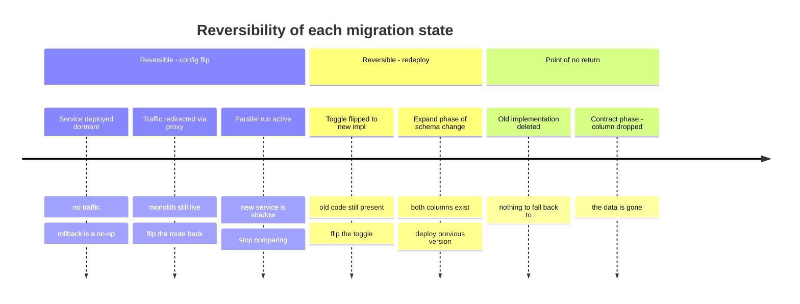
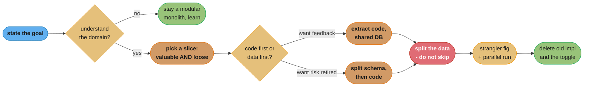

# Chapter 3: Splitting the Monolith

> Part I — Foundation · Building Microservices, 2nd Edition (Sam Newman, O'Reilly 2021) ·
> builds on Ch 2 (How to Model Microservices), leads to Ch 4 (Microservice Communication Styles)

## Chapter Map

Chapter 2 answered *where* the seams in a system should be — information hiding, cohesion,
coupling, and just enough domain-driven design to find bounded contexts. This chapter answers the
much less glamorous question of what to do when those seams sit inside a running system that is
already making money. Newman is explicit that the overwhelming majority of microservice work in
the world is not greenfield: it is a migration, performed on a codebase nobody wants to stop
shipping features from, under a deadline nobody chose. The chapter's tone is therefore markedly
conservative for a book about microservices — it spends its first three sections arguing you may
not want to do this at all, and only then hands over the tools. It is also the shortest treatment
of the topic Newman has written, because he wrote an entire companion volume about it
(*Monolith to Microservices*, O'Reilly 2019) and repeatedly points the reader there for the fuller
catalogue.

*Section structure: the `## 3.x` headings below follow the chapter's printed section list as
published (Have a Goal; Incremental Migration; The Monolith Is Rarely the Enemy; What to Split
First?; Decomposition by Layer; Useful Decompositional Patterns; Data Decomposition Concerns).
The `###` sub-headings mix the book's own sub-sections with the summarizer's grouping where a
sub-heading was needed for readability.*

**TL;DR:**
- **Microservices are not the goal.** Decomposition is a means to some outcome — independent
  deployability, team autonomy, scaling one hot component, a technology swap — and if you cannot
  name the outcome, the chapter's advice is to not start.
- **Migrate incrementally.** A big-bang rewrite gives you no feedback until the end, which is the
  worst possible moment to discover your boundaries were wrong. Extract one service, run it in
  production, learn, repeat.
- **The monolith is rarely the enemy.** "Monolith" is a deployment topology, not a moral failing;
  a well-structured modular monolith is a perfectly reasonable destination, and a distributed
  monolith is strictly worse than the thing it replaced.
- **Decomposing by layer is a trap unless you decide code-first or data-first deliberately.**
  Splitting the code but leaving one shared database produces something that looks decomposed and
  behaves exactly like the monolith.
- **Three patterns do most of the work:** the **strangler fig** (intercept, redirect, retire),
  the **parallel run** (run old and new side by side and compare), and the **feature toggle**
  (switch between implementations at runtime). All three exist to make a migration *reversible*.
- **The database is the hard part.** Performance, referential integrity, transactions, tooling
  and reporting are each things a single relational database gave you for free and that you now
  have to rebuild, badly, by hand.

---

## The Big Question

You have a working monolith. It serves real customers, it has ten years of accumulated behaviour
nobody fully documented, and half of that behaviour is load-bearing. You have concluded — for a
reason you can state out loud — that some part of it needs to become an independently deployable
service. How do you get from here to there without a period of months in which the system is
neither the old thing nor the new thing, and without discovering at cutover that your beautifully
reasoned boundary cuts straight through a transaction that must not be split?

Analogy: the chapter's own image is a **strangler fig**, the tropical plant that germinates in the
canopy of a host tree, sends roots down around the trunk, and slowly grows into a self-supporting
structure while the host is still alive inside it. Nothing is felled. There is no day on which the
tree is replaced by the fig. At every point in the process there is exactly one living structure
holding up the canopy, and the transfer of load happens gradually enough that a failure at any
step is survivable. That is the property every technique in this chapter is chasing: not speed,
but the ability to stop, or to reverse, at any moment without an outage.

---

## 3.1 Have a Goal

The chapter opens by refusing to start. Microservices, Newman insists, are not a goal — nobody
gets a promotion for having services. They are a way of buying specific properties, each of which
has a specific price, and if you cannot name which property you are buying then you have no way
to tell whether the migration succeeded and no way to decide any of the hundreds of judgement
calls it will require.

The goals the chapter treats as legitimate reasons to split are concrete and testable:

| Stated goal | What "done" looks like | The wrong split still passes review without this |
|---|---|---|
| Improve **team autonomy** | Team A ships without waiting on Team B's release train | You split by technical layer and both teams still coordinate every release |
| Reduce **time to market** | Lead time for a change to one area drops measurably | You extract the stable, boring part and the busy part still queues behind everything |
| **Scale** a specific bottleneck cost-effectively | The hot component scales independently of the cold ones | You scale the whole monolith horizontally anyway |
| Improve **robustness** | A failure in one area degrades rather than takes the system down | You extract a service every request path depends on synchronously |
| Adopt **new technology** | The new runtime/language/store is in production for one bounded area | You rewrite in the new stack and keep the same coupling |

The practical discipline the chapter presses is to write the goal down, agree it with the people
paying for the work, and then *measure against it*. "We want to be able to deploy the checkout
flow without a full regression cycle, and today that cycle takes three days" is a goal you can
verify in six months. "We want microservices" is not, and a migration with an unverifiable goal
has no defensible stopping point — which is how organisations end up two years in with forty
services and no answer to whether it worked.

The corollary is that the goal determines *what you extract*, not the org chart and not the
elegance of the domain model. If the goal is scaling a hot path, extract the hot path even if it
is an ugly bounded context. If the goal is autonomy for a team that is being blocked, extract what
that team owns. A migration that optimises for domain purity while the stated goal was lead time
will produce a beautiful architecture that nobody can point at a business outcome for.

---

## 3.2 Incremental Migration

The chapter's single strongest structural recommendation is that decomposition happens in small,
independently valuable, independently reversible steps — never as a rewrite. Newman's framing is
that a big-bang rewrite defers *all* learning to the end. You find out whether your service
boundaries were right at the moment you cut over, which is simultaneously the moment you have the
least ability to change them and the most people watching.

The unit of progress is: extract one microservice, get it into production, run it under real
traffic, and learn from it. That "into production" clause is doing the work — a service that is
written and merged but not serving live traffic has taught you nothing about its boundary, its
latency, its failure modes, or its data. A migration measured in "services written" is measuring
the wrong thing; the one that matters is "services in production carrying real load."

Two consequences follow, and both are uncomfortable:

- **You will run a hybrid system for a long time.** The monolith and the extracted services coexist,
  possibly for years. This is not a failure state to be minimised out of embarrassment; it is the
  normal condition of the whole exercise, and the tooling, monitoring and on-call arrangements need
  to be designed for it rather than treated as a temporary inconvenience.
- **Small steps make mistakes cheap, which is the whole point.** If extracting one service takes two
  weeks and turns out to be wrong, you have lost two weeks. If it was step four of a fourteen-step
  rewrite with no intermediate releases, you find out at month nine and you have lost nine months.

A worked illustration of the difference in blast radius:

| | Big-bang rewrite | Incremental extraction |
|---|---|---|
| First production feedback | Month 9 (cutover day) | Week 3 (first service live) |
| Cost of a wrong boundary | Whole architecture, discovered at the worst moment | One service, discovered while it is still cheap to move |
| Ability to stop | None — the half-built system serves nobody | Any time — every intermediate state is a working system |
| Feature work during migration | Frozen, or duplicated into both codebases | Continues in the monolith, which is still the system of record |

That last row is the one that kills rewrites in practice. A rewrite forces an impossible choice
between freezing the product for nine months and implementing every new feature twice, and
whichever the organisation chooses, the rewrite loses the resulting political argument.

---

## 3.3 The Monolith Is Rarely the Enemy

The chapter goes out of its way to defend the monolith, and this is not throat-clearing — it is a
direct correction to the way the first edition was read. "Monolith" describes a unit of
deployment, not a quality judgement. A single-process application whose internal modules have
clean, information-hiding boundaries is a **modular monolith**, and Newman treats it as a
genuinely good architecture and often the correct destination, not merely a waypoint on the road
to services. It gives you the boundaries without the network.

What is actually the enemy is *coupling*, and the microservices version of that enemy has a name:
the **distributed monolith**. This is a system that has paid every cost of distribution — network
calls, partial failure, independent deployment pipelines, distributed debugging — and collected
none of the benefits, because its services still have to be released together. Newman is blunt
that a distributed monolith is worse than the monolith it replaced, on every axis, because you
have added the failure modes of a distributed system to a codebase that still cannot be deployed
in pieces.



*Splitting a system whose internal boundaries are already wrong does not fix the boundaries — it
freezes them into a network topology, which is where they become expensive to change. The modular
monolith is the checkpoint you have to pass through, and it is a legitimate place to stop.*

### The Dangers of Premature Decomposition

The sharpest version of the argument concerns new products and unfamiliar domains. Service
boundaries drawn around a domain you do not yet understand will be wrong, and the cost of moving a
boundary once it is a network interface — with its own repository, pipeline, database, on-call
rotation and consumers — is enormous compared with moving a boundary that is currently a package
name and a refactor away.

The guidance that follows is deliberately unfashionable: for a genuinely new product, start with a
monolith. Let the domain teach you where its seams actually are by making them cheap to get wrong.
Split when you have both the understanding *and* a stated goal from §3.1. Newman notes real cases
of teams that decomposed a startup product early, then spent longer undoing and reshuffling
service boundaries than they would have spent building the thing as one deployable and splitting
it later with knowledge in hand.

The counter-case the chapter allows: if you already understand the domain deeply — because you are
rebuilding something you have run for a decade, or because the seams are unambiguous — the
argument for waiting is much weaker. The rule is about *knowledge*, not about company age.

---

## 3.4 What to Split First?

Once you have a goal and have decided to proceed, the chapter's advice on ordering is to let the
goal choose the first extraction, and then bias toward whatever is easiest to remove.

The two forces to balance:

- **Value** — which extraction actually advances the stated goal. If the goal is deployment
  independence for the team that is blocked most often, extract what that team owns, even if it is
  entangled.
- **Ease** — which extraction you can actually complete. Early in a migration you are also
  building the *capability* to do migrations: the pipelines, the deployment platform, the
  observability, the operational habits. Doing that learning on an easy, low-risk extraction is far
  better than doing it on the payment path.

The chapter's practical resolution is to look for something that is both reasonably valuable and
genuinely loosely coupled from the rest of the monolith — a component with few inbound
dependencies, little shared data, and no participation in the system's critical transactions. It is
common and correct for the very first extraction to be something modest whose real purpose is to
prove the pipeline end to end.

A useful concrete signal is the *dependency direction*. A component that many parts of the
monolith call, but which itself calls almost nothing, is a good early candidate: extracting it
means the monolith gains one outbound network dependency and nothing else changes shape. A
component that calls half the monolith is a bad early candidate, because extracting it means every
one of those inward calls becomes a network hop or a data duplication decision.

The chapter also endorses static-analysis tooling to make this judgement empirically rather than
from memory — dependency graphs over the codebase, and (Newman notes he has used this himself)
visualisation of which packages call which. The point of the tooling is not the pretty picture; it
is that a ten-year-old codebase's real dependency structure is reliably different from what the
team believes it to be, and the difference is exactly where migrations go wrong.

---

## 3.5 Decomposition by Layer

Having chosen *what*, the chapter turns to *in what order within that thing* — because almost
every candidate for extraction has a user-interface part, an application-code part, and a data
part, and you have to move them one at a time.

The trap it names first is the layered split: extracting "the web tier", or "the service tier", or
"the data access layer" as a service. That produces a three-tier distributed architecture in which
every business change still requires coordinated changes across all three tiers, which is
precisely the coupling microservices were supposed to remove. Boundaries should be vertical
slices through the layers (a bounded context, top to bottom), and the layer question is only about
*sequencing the extraction of one vertical slice*.

### Code First

Extract the application code first, and leave it talking to the monolith's existing database for a
while.

- **Advantage:** you get something useful into production quickly, and you get short-term feedback
  on whether the code boundary is right. The extracted service is real, deployable and observable
  before you have touched the schema.
- **Advantage:** the code is where most of the behaviour you are unsure about lives; getting it
  isolated first tells you what data it actually needs, rather than what you guessed it needs.
- **The danger:** the shared database is still there, so you have not yet achieved independent
  deployability — a schema change still couples the service and the monolith. Teams routinely stop
  here, declare victory, and ship a distributed monolith. The chapter is explicit that code-first
  is only safe if the data split is genuinely scheduled and not merely intended.



*Code-first leaves a shared schema in place, which means the extraction is not finished — the two
deployables still cannot change independently. The pattern is fine as a step and dangerous as a
destination.*

### Data First

Split the data first: carve the tables the future service owns out into their own schema, make the
monolith reach them through a narrow, deliberate interface, and only afterwards move the code.

- **Advantage:** you find out early whether the data can even be split. Referential integrity,
  transaction boundaries and join-heavy reporting queries are the things most likely to make a
  proposed boundary impossible, and data-first surfaces them before you have written a service
  around an assumption that turns out to be false.
- **Advantage:** if it turns out the split is a bad idea, you have changed one schema and can
  revert; you have not stood up a service, a pipeline and an on-call rotation.
- **The cost:** there is no short-term benefit to show. You have done weeks of invasive database
  work and the running system looks and behaves exactly as it did before, which is a difficult
  thing to defend to a stakeholder halfway through.

The chapter's own leaning is toward doing the harder, less rewarding data work early precisely
because it is where the migration-killing surprises live — but it presents both as legitimate, and
the choice as a trade between fast feedback (code first) and early risk retirement (data first).

---

## 3.6 Useful Decompositional Patterns

Three patterns carry most of the chapter's practical weight. All three share one property, and it
is the property that matters: **they let you change your mind.** Each provides a moment at which
the old implementation is still live and the new one can be switched off without a deploy.

### Pattern: Strangler Fig

Named after the plant, the strangler fig application wraps the existing system rather than
modifying it. You place an interception point in front of the monolith, and for the functionality
being migrated you redirect calls to the new microservice while everything else continues
untouched into the monolith. Over time more calls are redirected; eventually nothing routes to the
old implementation and it can be deleted.

The three steps, in order:

1. **Identify** the functionality to migrate — and critically, verify it can be *cleanly
   intercepted*. This is the step teams skip. If the functionality is only reachable deep inside
   the monolith's own call stack rather than at an addressable boundary, there is nowhere to put
   the interceptor and the pattern does not apply as-is.
2. **Implement** the functionality in the new microservice, deployed to production but with no
   traffic. Deployment and release are separated here, exactly as in Chapter 7's pipeline
   discipline: the artifact can be live and dormant.
3. **Redirect** calls from the monolith to the new service, by changing the interception point.



*The interception point is the whole pattern. Because redirection is a routing decision rather
than a code change in the caller, rollback is a config flip and the monolith stays warm as a
fallback until the very end.*

The usual interceptor for an HTTP system is a proxy or the existing API gateway, which is why the
pattern is easiest when the monolith already speaks HTTP at an addressable boundary. Newman is
careful to note that the proxy should stay **dumb** — routing only. The moment it starts doing
protocol translation or response aggregation you have moved business behaviour into the
interception layer, which is the same anti-pattern Chapter 5 warns about for API gateways and
enterprise service buses.

Two limits of the pattern:

- It works badly when the functionality is not cleanly interceptable — deep internal calls, a
  scheduled job buried in the monolith's own process, an event consumer with no external entry
  point.
- It says nothing about the data. A strangler fig migration of *behaviour* still leaves the
  question of which side owns the state, which is §3.7's problem.

### Pattern: Parallel Run

Where the strangler fig switches from old to new, the parallel run refuses to switch until it has
evidence. Both implementations execute the same request, and the results are compared. One of them
is the **source of truth** whose result is actually returned to the caller; the other is executing
purely to be checked.

The mechanics that matter:

- Only one implementation's result is used. The other is a shadow. Getting this backwards — using
  the new result while "verifying" the old — inverts the entire risk profile of the exercise.
- Comparison is on both **correctness** (did the two produce the same answer?) and **non-functional**
  behaviour (did the new one do it in acceptable time, without excessive resource use?).
- Any operation with a side effect has to be handled explicitly. If both implementations of "issue
  refund" run in parallel and both actually call the payment provider, you have refunded twice. In
  practice the shadow path either stubs the side effect or the comparison is restricted to the
  read-only portion of the calculation.

The chapter frames this as a heavyweight technique reserved for functionality where being wrong is
genuinely expensive — Newman cites its use in high-risk domains such as medical records systems,
where an incorrect result is not an inconvenience. For an ordinary CRUD extraction it is
over-engineering; for a pricing engine, a billing calculation or a clinical rules engine it is
proportionate.



*The caller only ever sees the old implementation's answer during a parallel run. The new service's
output is evidence, not behaviour — which is what makes running it in production safe.*

A broken version, then the fix. **Broken:** a team parallel-runs a new tax-calculation service,
compares results, sees a 0.4% divergence rate, decides that is "close enough", and cuts over. The
0.4% turns out to be every transaction in one jurisdiction, and the divergence rate was low only
because that jurisdiction is small. **Fix:** divergences are not a rate to be thresholded, they are
a set to be explained. Each distinct divergence class gets a root cause before cutover, because
"rare" and "unimportant" are unrelated properties.

### Pattern: Feature Toggle

A feature toggle is a runtime switch that changes which implementation a call path uses, without a
deployment. In migration terms it is the mechanism that makes the other two patterns operable:
the strangler fig's redirection can be a toggle, and a parallel run's promotion of the new
implementation to source-of-truth can be a toggle.

Its value in a migration is precisely that **switching and rolling back cost a config change, not a
release**. When a newly promoted service starts throwing errors at 02:00, the difference between
flipping a flag and running a rollback deployment is the difference between a two-minute
degradation and a thirty-minute one.

Toggles are the same mechanism Chapter 7 relies on to make trunk-based development possible, and
the same trade applies: they are cheap to add and expensive to leave behind. A toggle that
survives the migration becomes a permanently untested code path — the old implementation is still
compiled in, still has to be maintained, and is quietly rotting behind a flag nobody has flipped
in a year. Removing the toggle *and* the dead implementation is part of finishing the migration,
not optional cleanup.

---

## 3.7 Data Decomposition Concerns

This is where migrations actually fail. Splitting code is a refactoring problem; splitting data
means giving up guarantees a single relational database was providing for free, and rebuilding
weaker versions of them in application code. The chapter walks the five costs.

### Performance

A join that the database performed in-process now becomes a network call, and the pattern that
replaces it is usually worse than it looks. The classic shape: the monolith used to run one query
joining orders to catalogue items; after extraction it fetches the order rows, then calls the
catalogue service once per row.

```sql
-- before: one query, one round trip, the database does the join
SELECT o.id, o.qty, c.name, c.price
FROM   orders o
JOIN   catalog_item c ON c.id = o.item_id
WHERE  o.customer_id = ?;
```

```text
-- after (broken): N+1 over the network
rows = orderService.query("SELECT id, qty, item_id FROM orders WHERE customer_id = ?")
for r in rows:                        # 100 rows
    item = catalogClient.get(r.item_id)   # 100 HTTP calls
```

With a 1 ms in-database join replaced by 100 sequential calls at ~5 ms each, a request that took
single-digit milliseconds now takes half a second — and that is on a healthy network, before any
retry or timeout behaviour is involved.

The fixes, in the order the chapter's logic prefers them:

1. **Batch the call** — `catalogClient.getAll(ids)` turns 100 round trips into 1. Cheapest fix,
   almost always available, and it changes the interface in the right direction (coarse-grained,
   not chatty).
2. **Cache** — if catalogue data is slow-changing, cache it on the consumer side and accept
   staleness. Now you own an invalidation problem.
3. **Reconsider the boundary** — if two things must be joined on every single request, the split
   may simply be in the wrong place. Newman's position throughout is that a performance problem
   this severe is evidence about the boundary, not merely a tuning task.

### Data Integrity

A foreign key is a database-enforced promise that a referenced row exists. Split the two tables
across two services and the database can no longer enforce it, because it no longer sees both
sides. Nothing stops the catalogue service deleting an item that ten thousand order rows still
reference.

The options the chapter lays out, none of them free:

| Approach | What it gives you | What it costs |
|---|---|---|
| Check before acting (soft reference) | Reads validate the reference at call time | Extra call per read; a race window remains; the dangling row still exists |
| **Soft delete** | The referenced row is marked deleted, never removed | Data grows forever; every reader must honour the flag |
| Handle the dangling reference gracefully | UI shows "item no longer available" | Requires every consumer to have a defined behaviour for the missing case |
| Don't allow the delete | Catalogue refuses to delete referenced items | Requires the catalogue to know about orders — reintroduces coupling |

The honest summary is that you are trading a hard, cheap, database-level guarantee for a soft,
expensive, application-level convention. The chapter's practical guidance is to decide *explicitly*
what happens when a reference dangles, rather than discovering the answer in production, and to
prefer soft deletes where the referencing data is long-lived.

### Transactions

A single ACID transaction spanning two tables cannot span two services' databases. This is the
constraint that most often reveals a boundary as wrong.

The chapter's position on **two-phase commit (2PC)** is unenthusiastic and specific: it is possible,
but it holds locks across the whole prepare-commit window, its coordinator is a failure point that
can leave participants locked, and latency scales with the slowest participant. Long-lived locks
across a network is exactly the combination that produces cascading stalls under load.

The alternative the chapter directs the reader toward is the **saga** — decomposing the business
operation into a sequence of local transactions, each atomic within one service, with
**compensating transactions** to undo earlier steps when a later one fails. The critical
conceptual shift is that a compensation is a *business* action, not a rollback: you do not un-charge
a card, you issue a refund; you do not un-send an email, you send a correction. Sagas are the
subject of Chapter 6 (Workflow), and this section's job is to establish why you will need them.

The chapter's blunt first recommendation, though, is to **avoid splitting the transaction at all**
where you can. If two pieces of state must change atomically as a matter of business rule, the
strongest evidence available is that they belong in the same service. Reaching for a saga should
be a decision, not a reflex to rescue a boundary you have already committed to.

### Tooling

Application code has excellent tooling for incremental, versioned, reversible change; databases
historically had almost none, and this asymmetry is a real cost of the migration. Schema changes
have to be scripted, version-controlled alongside the code, and applied automatically as part of
the deployment pipeline, or the migration will be gated on a DBA running a script by hand at 3am.

The chapter names schema-migration tooling in the Flyway / Liquibase family, and treats
"migrations live in version control and run in the pipeline" as a precondition for doing any of
this safely. The mechanism that makes a schema change deployable without downtime is expand and
contract: add the new structure, migrate readers and writers across, then remove the old
structure — three separate deployments, each individually reversible, rather than one destructive
change.

```sql
-- expand: additive, safe to deploy alone, old code unaffected
ALTER TABLE orders ADD COLUMN customer_ref VARCHAR(64) NULL;

-- (deploy code that writes both columns, backfill, deploy code that reads the new one)

-- contract: only after nothing reads the old column
ALTER TABLE orders DROP COLUMN customer_id;
```

Skipping the middle phase — dropping the old column in the same release that adds the new one — is
the change that cannot be rolled back, because the rollback of the application does not restore
the dropped data.

### Reporting Database

The section the chapter uses to make the point that data decomposition breaks things you were not
thinking about. In a monolith, reporting and analytics teams simply query the database directly,
joining freely across every table in the system. That access pattern is enormously convenient and
it is also, in Newman's framing, coupling of the worst kind: an unknown number of external
consumers depend on the *internal schema*, so no table can be renamed without breaking a report
nobody told you about.

Splitting the monolith breaks all of it at once, because the joins those reports rely on now cross
service boundaries. The replacement is that the reporting need becomes an explicit, designed
interface rather than an accident of shared storage: services publish the data downstream — as
events, as a periodic export, as a dedicated read model — into a reporting store that is
maintained on purpose and versioned like any other contract.

The organisational point the chapter makes is the important one: reporting users are *real*
consumers with real requirements, and a migration that treats them as an afterthought will either
be blocked by them late or will silently break the business's ability to see itself. Bring them in
at the design stage, not at cutover.

---

## Beyond the book — the fuller pattern catalogue

> Chapter 3 of *Building Microservices, 2nd Edition* names exactly three decompositional
> patterns — strangler fig, parallel run, and feature toggle — and three data-related ones only in
> passing. The chapter explicitly tells the reader that the full treatment lives in Newman's
> companion book, **Monolith to Microservices** (O'Reilly, 2019). The patterns listed below come
> from that companion volume, **not** from this chapter; they are included because the chapter
> points at them and a reader working through a real migration will need the names. Do not
> attribute their treatment here to Chapter 3.

Migration patterns from *Monolith to Microservices*:

| Pattern | What it does |
|---|---|
| **Branch by abstraction** | Introduce an abstraction over the existing implementation *inside* the monolith, add a second implementation calling the new service behind it, switch, then delete the old one. The answer for functionality with no external interception point, where a strangler fig cannot get a hold. |
| **Decorating collaborator** | Attach a proxy that observes calls to the monolith and triggers new-service behaviour based on what it sees, without the monolith knowing. Useful when you need to add behaviour rather than move it. |
| **Change data capture (CDC)** | React to changes in the monolith's database — via the transaction log, triggers, or a batch delta — instead of changing the monolith's code at all. The escape hatch when you cannot modify the monolith. |

Database decomposition patterns from the same book: **shared database**, **database view**,
**database wrapping service**, **database-as-a-service interface**, **aggregate exposing
monolith**, **change data ownership**, plus the transactional pair **split table** and **move
foreign-key relationship to code**. Each is a staged position on the path from one shared schema
to true data ownership, and the ordering matters more than the individual pattern: they exist so
that a database split can be done in reversible steps rather than one cutover.

---

## Visual Intuition



*Every pattern in this chapter exists to keep you in the top two bands for as long as possible.
The two entries in the bottom band are the only genuinely irreversible acts in a well-run
migration — which is why both belong at the very end, long after the new path has proved itself.*

```
  cost of moving a boundary, by how far the migration has progressed

  package boundary in a monolith |#                                  |  1x
  module with its own schema     |####                               |  4x
  service, shared database       |###########                        | 11x
  service, own database          |######################             | 22x
  service, external consumers    |###################################| 35x+

  each step adds artefacts that must ALSO move: schema migration, repo,
  pipeline, dashboards, alerts, runbooks, rotas, consumer contracts
```

*This is the whole argument for §3.3's "don't decompose prematurely" in one picture. The values are
illustrative, not the book's, but the shape is the point: the expensive part of moving a boundary
is never the code, it is everything that accumulated around the boundary once it became a service.*



*The whole chapter as one path. Note that the only red box is the data split — it is the step
teams skip, and skipping it is exactly what produces a distributed monolith.*

---

## Key Concepts Glossary

- **Monolith** — a unit of deployment in which all functionality is deployed together; a topology,
  not a quality judgement.
- **Modular monolith** — a single deployable whose internal modules have clean, information-hiding
  boundaries; the chapter treats it as a legitimate destination, not merely a waypoint.
- **Distributed monolith** — services that must be deployed together; pays every cost of
  distribution and collects none of the benefits.
- **Big ball of mud** — a system with no discernible internal boundaries; splitting it distributes
  the mud rather than removing it.
- **Incremental migration** — extracting one service at a time into production and learning from
  it, as opposed to a big-bang rewrite.
- **Premature decomposition** — drawing service boundaries around a domain that is not yet
  understood, so that the boundaries are wrong when they are most expensive to move.
- **Decomposition by layer** — splitting along technical tiers (UI, logic, data) rather than
  vertical business slices; the trap the chapter warns against.
- **Code first** — extract the application code, leave it on the shared database temporarily; fast
  feedback, deferred risk.
- **Data first** — split the schema before the code; no visible short-term win, but retires the
  migration's biggest risk early.
- **Strangler fig application** — intercepting calls in front of the monolith and progressively
  redirecting them to new services until the old implementation can be deleted.
- **Interception point** — the addressable boundary (usually a proxy or gateway) at which a
  strangler fig redirects calls; if one does not exist, the pattern does not apply.
- **Parallel run** — executing old and new implementations against the same input and comparing
  results, with only one designated the source of truth.
- **Source of truth (in a parallel run)** — the implementation whose result is actually returned to
  the caller; the other runs purely for comparison.
- **Feature toggle** — a runtime switch selecting between implementations without a deployment,
  making both switch-over and rollback a config change.
- **Soft delete** — marking a row deleted rather than removing it, so cross-service references do
  not dangle.
- **Two-phase commit (2PC)** — a distributed transaction protocol; possible, but holds locks across
  a network and has a coordinator that can fail mid-protocol.
- **Saga** — a business operation decomposed into local transactions with compensating
  transactions for failure; the alternative to 2PC, treated in depth in Chapter 6.
- **Compensating transaction** — a business action that semantically undoes a completed step (a
  refund, not a rollback).
- **Expand and contract** — making a schema change additively, migrating readers and writers, then
  removing the old structure, so every step is individually reversible.
- **Reporting database** — direct external access to the monolith's schema for analytics; enormous
  hidden coupling that decomposition breaks all at once.

---

## Tradeoffs & Decision Tables

| | Big-bang rewrite | Incremental extraction |
|---|---|---|
| First real feedback | At cutover, when change is most expensive | Within weeks, when change is cheap |
| Intermediate states | Not shippable | Every one is a working system |
| Feature work meanwhile | Frozen or duplicated | Continues in the monolith |
| Failure mode | All-or-nothing | One service at a time |

| | Code first | Data first |
|---|---|---|
| Short-term visible value | High — a real service in production | None — the system looks unchanged |
| Risk retired early | Boundary of behaviour | Boundary of *data*, which is the harder one |
| Independent deployability achieved | Not yet — shared schema remains | Yes, once code follows |
| Main danger | Stopping here and shipping a distributed monolith | Losing stakeholder patience mid-way |

| Pattern | Use when | Cost | Rollback |
|---|---|---|---|
| Strangler fig | Functionality is cleanly interceptable at a boundary | Needs a proxy/gateway; says nothing about data | Change the route back |
| Parallel run | Being wrong is expensive (billing, clinical, pricing) | Double compute; side effects need special handling | Stop comparing; nothing changed |
| Feature toggle | You want switch-over and rollback without a deploy | Dead code and untested paths if left behind | Flip the flag |
| Branch by abstraction *(companion book)* | No external interception point exists | Requires modifying the monolith | Switch the abstraction back |
| Change data capture *(companion book)* | You cannot modify the monolith at all | Couples to the monolith's schema | Stop the capture pipeline |

| Integrity approach after splitting a foreign key | Read cost | Write cost | Leaves bad data |
|---|---|---|---|
| Check at read time | One extra call per read | None | Yes — race window |
| Soft delete | None | Flag on delete; every reader honours it | No, but storage grows |
| Graceful degradation in the UI | None | None | Yes, but handled |
| Refuse the delete | None | Owning service must know its consumers | No — at the cost of coupling |

| Transaction strategy | Consistency | Latency | Operational risk |
|---|---|---|---|
| Keep in one service | ACID, free | Lowest | Lowest — the chapter's first recommendation |
| Two-phase commit | Strong | Bounded by slowest participant | Coordinator failure leaves locks held |
| Saga with compensations | Eventual | Low per step | Compensation logic must itself be correct and idempotent |

---

## Common Pitfalls / War Stories

- **Splitting the code and calling it done.** The single most common outcome of a code-first
  extraction that lost its sponsor's attention: two deployables, one schema, and a rule that
  neither can be released without the other. The team has taken on network calls, a second
  pipeline and a second on-call rotation, and has bought no independent deployability at all.
  Every symptom of a distributed monolith traces back to this.
- **The N+1 that only appears at production data volumes.** A catalogue lookup extracted from a
  join tests beautifully against the 20-row fixture dataset and collapses against the customer
  with 4,000 order lines. Batch endpoints are cheap to design in from the start and awkward to
  retrofit once three consumers have adopted the per-item call.
- **A parallel run whose shadow path has side effects.** Both implementations of an order-placement
  path run for verification, and both hit the payment gateway — duplicate charges in production
  from a mechanism installed specifically to *reduce* risk. Every side effect on the shadow path
  must be stubbed or the comparison restricted to the pure calculation.
- **Thresholding parallel-run divergences instead of explaining them.** "99.6% match, ship it"
  hides a systematic failure affecting one whole category of input. Divergences are a set to be
  classified, not a percentage to be tolerated.
- **Toggles that outlive the migration.** Two years after cutover the old implementation is still
  compiled in behind a flag nobody has flipped since the migration, has drifted from the new one,
  and would fail immediately if anyone ever flipped it back — a rollback path that exists on
  paper and not in reality. Deleting the toggle and the dead branch is part of the work.
- **Discovering the reporting consumers at cutover.** Nobody knew that finance ran a nightly job
  joining six tables directly against the production schema until the split broke the month-end
  close. The unknown consumers of a shared database are found by asking, in advance, not by
  waiting for the complaint.
- **The irreversible schema change.** Adding the new column and dropping the old one in the same
  release means the application rollback no longer has its data. Expand and contract exists
  precisely so that the destructive step happens in its own deployment, long after the readers
  have moved.
- **Extracting the hardest thing first to prove the team can.** The payments path is not where you
  learn how your deployment pipeline, service-to-service auth and distributed tracing behave. Do
  that learning on something with a low blast radius, then spend the earned capability on the
  hard extraction.
- **Optimising the migration for domain purity when the stated goal was lead time.** Six months of
  beautiful bounded-context work that did not touch the component the blocked team was actually
  waiting on. §3.1's written-down goal exists to make this argument winnable before the work
  starts.

---

## Real-World Systems Referenced

The chapter is deliberately light on vendor specifics and heavy on named patterns. It uses the
running **MusicCorp** example established in Chapter 2 for its illustrations of extraction and
data splitting. The **strangler fig** is credited to Martin Fowler's writing on the strangler
application, itself named after the tropical strangler fig observed in Queensland rainforests. The
**parallel run** is discussed with reference to high-stakes domains where an incorrect result
carries real harm, medical-records systems among them, as the justification for a technique too
heavyweight for routine use. Schema-change tooling is referenced through the **Flyway** and
**Liquibase** family of database-migration tools, treated as the mechanism that makes versioned,
pipeline-applied schema change possible. Interception for a strangler fig is described in terms of
ordinary **HTTP proxies** and existing API gateways rather than any named product. Throughout, the
chapter directs readers to Newman's own **Monolith to Microservices** for the full pattern
catalogue it does not have room for.

---

## Summary

The chapter's argument is that decomposition is a migration problem, not an architecture problem,
and that migrations are won or lost on reversibility. It begins by trying to talk you out of it:
have a stated, measurable goal, or do not start; understand the domain before you freeze its
boundaries into network interfaces; and recognise that a well-structured modular monolith is a
good architecture rather than a failure, while a distributed monolith is strictly worse than the
system it replaced. If you proceed, proceed incrementally — one service at a time, into
production, learning as you go — because a big-bang rewrite defers every lesson to the moment you
can least afford to learn it, and forces an unwinnable choice between freezing the product and
building it twice. Choose the first extraction for a combination of value against the stated goal
and looseness of coupling, sequence it deliberately as code-first (fast feedback, risk deferred)
or data-first (no visible win, risk retired), and never let code-first become the destination. The
three patterns the chapter equips you with — strangler fig, parallel run, feature toggle — all
purchase the same thing: a system in which the old implementation stays live and the new one can
be switched off with a config change rather than a deployment. And the genuinely hard part is the
data, where splitting means surrendering joins, foreign keys, ACID transactions, mature tooling and
free reporting access, and rebuilding each of them by hand as an explicit, weaker, deliberately
designed contract. That the data work is unglamorous and produces no demo is precisely why it is
the step teams skip, and skipping it is exactly what produces the distributed monolith the chapter
spends its first three sections warning about.

---

## Interview Questions

**Q: Why does Newman insist you state a goal before splitting a monolith?**
**Short:** Newman argues microservices are a means to a nameable outcome, and without one a migration has no defensible stopping point.
Decomposition buys specific properties — independent deployability, team autonomy, targeted scaling, technology adoption — and each has a specific price, so without naming which property you are buying there is no way to judge whether the migration worked or to decide the hundreds of judgement calls it requires. The goal also determines what you extract first: a lead-time goal points at the component blocking a team, while a scaling goal points at the hot path regardless of how ugly its bounded context is. Write the goal down with the people funding the work and measure against it, or you will be two years and forty services in with no answer to whether it succeeded.

**Q: What is a distributed monolith and why is it worse than the monolith it replaced?**
**Short:** It is a set of services that must be deployed together, paying every cost of distribution while collecting none of the benefits.
The services have separate repositories, pipelines and network hops, but a change to one still forces a coordinated release of the others, so nothing has been gained on the deployability axis that motivated the split. Meanwhile the system has acquired partial failure, network latency, distributed debugging and multiple on-call surfaces that the single deployable never had. Newman is explicit that this is strictly worse than the original monolith, which is why he treats the data split — not the code split — as the step that determines whether a migration actually succeeded.

**Q: Why does the chapter defend the monolith rather than treating it as a problem to be eliminated?**
**Short:** Newman treats "monolith" as a deployment topology rather than a quality judgement, and a modular monolith as a legitimate destination.
A single-process application whose internal modules have clean, information-hiding boundaries gives you the boundaries without the network, and for many organisations that is the right architecture permanently rather than a waypoint. The actual enemy is coupling, and coupling is not cured by distribution — splitting a big ball of mud produces a distributed big ball of mud with worse failure modes. The practical test is whether your internal boundaries are already clean, because if they are not, fixing them inside the monolith is far cheaper than fixing them once they are network interfaces.

**Q: Why is a big-bang rewrite treated as the wrong way to decompose?**
**Short:** It defers every lesson about your boundaries to cutover day, the moment you have least ability to change them.
Incremental extraction puts one service into production within weeks and lets real traffic tell you whether the boundary, the latency and the data assumptions were right while the cost of moving them is still one service. A rewrite also forces an unwinnable choice between freezing feature work for months and implementing every new feature twice, and whichever the organisation picks, the rewrite loses the resulting argument. Measure progress in services carrying real production load, not services written, because a merged-but-dormant service has taught you nothing.

**Q: What does "premature decomposition" mean and what is its specific cost?**
**Short:** Drawing service boundaries around a domain you do not yet understand, so the boundaries are wrong exactly when they are most expensive to move.
While a boundary is a package name inside a monolith, moving it is a refactor; once it is a service it has a repository, a pipeline, dashboards, alerts, runbooks, an on-call rotation and external consumers, all of which must move with it. Newman therefore advises starting a genuinely new product as a monolith and letting the domain teach you where its seams are while getting them wrong is cheap. The rule is about knowledge, not company age — if you are rebuilding something you have operated for a decade, the argument for waiting is much weaker.

**Q: How does the strangler fig pattern work, and what is its precondition?**
**Short:** You intercept calls in front of the monolith and progressively redirect them to new services, which requires a clean interception point.
The three steps are identify the functionality to migrate, implement it in a new service deployed to production but taking no traffic, and then redirect calls at the interception point — usually a proxy or existing API gateway. Because redirection is a routing decision rather than a code change in callers, rollback is a config flip and the monolith stays live as a fallback until the very end. The precondition teams skip is verifying the functionality is actually reachable at an addressable boundary: if it is only invoked deep inside the monolith's own call stack, there is nowhere to put the interceptor.

**Q: What is a parallel run and what makes it different from simply cutting over?**
**Short:** Both old and new implementations execute the same request and their results are compared, but only one is the source of truth returned to callers.
The new service runs as a shadow whose output is evidence rather than behaviour, so it can be exercised against real production traffic with no risk to the caller, and comparison covers both correctness and non-functional properties like latency and resource use. Newman treats it as a heavyweight technique justified where being wrong is genuinely expensive — billing, pricing, clinical systems — rather than for routine CRUD extraction. The trap is side effects: if both implementations of a refund actually call the payment provider, the verification mechanism itself causes the incident.

**Q: Why is a low divergence rate in a parallel run not sufficient evidence to cut over?**
**Short:** Divergences are a set of failure classes to be explained, not a percentage to be thresholded.
A 0.4% mismatch can be evenly distributed noise or it can be one whole category of input failing systematically — every transaction in one jurisdiction, every order above a certain value — and the rate alone cannot distinguish them. Because "rare" and "unimportant" are unrelated properties, each distinct divergence class needs a root cause before promotion rather than a tolerance band. Classify the divergences, explain each one, and only then flip the source of truth.

**Q: What role do feature toggles play in a monolith migration specifically?**
**Short:** They make switching to the new implementation and rolling back a config change rather than a deployment.
A toggle is what operationalises the other two patterns — the strangler fig's redirection can be a toggle, and promoting a parallel run's new implementation to source of truth can be a toggle — so the cutover and its reversal both cost seconds instead of a release cycle. That is the difference between a two-minute degradation and a thirty-minute one when the new path starts failing at 02:00. The cost is that a toggle left behind after the migration becomes a permanently untested code path guarding a rotting implementation, so deleting both is part of finishing the work.

**Q: What is the difference between code-first and data-first decomposition, and when would you pick each?**
**Short:** Code-first extracts the application logic onto the shared database for fast feedback; data-first splits the schema before the code to retire the biggest risk early.
Code-first gets a real, deployable, observable service into production quickly and tells you what data it actually needs rather than what you guessed, but leaves a shared schema in place, so independent deployability has not yet been achieved. Data-first surfaces the referential-integrity, transaction and reporting problems that most often prove a boundary impossible, before you have built a service around a false assumption — at the price of weeks of invasive work with nothing visible to show. Pick code-first when you need feedback or stakeholder confidence, data-first when you suspect the boundary may not survive contact with the data.

**Q: Why is decomposing a monolith by technical layer considered a trap?**
**Short:** Splitting into UI, logic and data tiers leaves every business change requiring coordinated releases across all three.
A three-tier distributed architecture reproduces exactly the coupling microservices were meant to remove, because no single team owns a change end to end and every feature crosses all the boundaries you just made expensive. Boundaries should be vertical slices through the layers — a bounded context from interface to storage — and the layer question is only about the order in which you extract one such slice. If a typical change to your new services requires touching more than one of them, the split was horizontal when it should have been vertical.

**Q: What happens to foreign keys when the two tables they relate end up in different services?**
**Short:** The database can no longer enforce the reference, so integrity becomes an explicit, weaker application-level convention.
Nothing prevents the catalogue service deleting an item that thousands of order rows still reference, and the options are all trade-offs: check the reference at read time and accept an extra call plus a race window, use soft deletes and accept unbounded storage growth plus a flag every reader must honour, degrade gracefully in the UI, or refuse the delete at the cost of the owning service having to know its consumers. The chapter's practical guidance is to decide explicitly what a dangling reference does rather than discovering it in production. Soft deletes are the usual answer where the referencing data is long-lived.

**Q: Why does the chapter steer away from two-phase commit for cross-service transactions?**
**Short:** Newman notes 2PC holds locks across a network for the whole prepare-commit window and its coordinator can fail mid-protocol.
Locks held across the slowest participant's latency is exactly the combination that produces cascading stalls under load, and a coordinator failure between prepare and commit can leave participants locked with no autonomous way to resolve. The alternative is a saga: the operation becomes a sequence of local transactions, each atomic in one service, with compensating transactions — real business actions like issuing a refund, not database rollbacks — to undo earlier steps. But the chapter's first recommendation is stronger than either: if two pieces of state must change atomically as a business rule, that is evidence they belong in the same service.

**Q: What performance problem does splitting a join across services create, and how do you fix it?**
**Short:** An in-database join becomes an N+1 pattern over the network, turning a single-digit-millisecond query into hundreds of milliseconds.
Fetching 100 order rows and then calling the catalogue service once per row at roughly 5 ms each costs about half a second on a healthy network, before any retries or timeouts. The fixes in order of preference are batching the call into one coarse-grained request, caching slow-changing data on the consumer side and accepting staleness plus an invalidation problem, and finally reconsidering the boundary. That last option matters: if two things must be joined on every single request, the severity of the performance problem is evidence about the boundary rather than a tuning task.

**Q: Why does the chapter treat reporting as a first-class data-decomposition concern?**
**Short:** Direct analytics access to a monolith's schema is hidden coupling that decomposition breaks all at once.
An unknown number of reports, jobs and dashboards depend on the internal schema and its cross-table joins, which means no table can be renamed safely and every one of those consumers breaks the moment the tables live in different services. The replacement is to make the reporting need an explicit designed interface — events, periodic exports, or a purpose-built read model feeding a maintained reporting store versioned like any other contract. The organisational point matters more than the technical one: reporting users are real consumers with real requirements, so involve them at design time rather than discovering them when month-end close fails.

**Q: What is expand and contract, and what goes wrong if you skip the middle phase?**
**Short:** It is making a schema change additively, migrating readers and writers, then removing the old structure, so each step is individually reversible.
Adding a new column, deploying code that writes both, backfilling, deploying code that reads the new one, and only then dropping the old column means every intermediate state runs correctly under both the old and new application versions. Collapsing that into one release — add and drop together — produces a change the application rollback cannot undo, because reverting the code does not restore the dropped data. This is also why database migrations need to live in version control and run automatically in the pipeline rather than being applied by hand.

**Q: How should you choose which part of the monolith to extract first?**
**Short:** Balance value against the stated goal with looseness of coupling, and bias early extractions toward proving the pipeline.
Look for a component with few inbound dependencies, little shared data and no participation in critical transactions, because extracting it means the monolith gains one outbound dependency and nothing else changes shape. Early in a migration you are also building the capability to migrate — pipelines, deployment platform, observability, on-call habits — and doing that learning on a low-blast-radius component is far better than doing it on the payment path. Use static analysis to derive the real dependency graph rather than working from memory, because a ten-year-old codebase's actual structure reliably differs from what the team believes.

**Q: Is it acceptable for a monolith and extracted services to coexist for a long time?**
**Short:** Yes — the chapter treats a long-lived hybrid system as the normal condition of an incremental migration, not a failure state.
Because progress is measured one production service at a time, the monolith remains the system of record for everything not yet extracted, potentially for years, and continues to receive feature work throughout. That means monitoring, deployment tooling and on-call arrangements need to be designed for the hybrid rather than treated as a temporary inconvenience to be endured. Teams that regard the hybrid as embarrassing tend to compress the schedule, which is how an incremental migration turns back into a big bang.

---

## Cross-links in this repo

- [backend/microservices_fundamentals/ — service boundaries, decomposition strategies, the distributed monolith](../../../backend/microservices_fundamentals/microservices_fundamentals.md)
- [hld/microservices/ — system-design view of decomposition and the monolith-first argument](../../../hld/microservices/microservices.md)
- [database/database_migrations_zero_downtime/ — expand and contract, backfills, reversible schema change](../../../database/database_migrations_zero_downtime/database_migrations_zero_downtime.md)
- [technologies/debezium_change_data_capture/ — CDC as a migration mechanism when you cannot change the monolith](../../../technologies/debezium_change_data_capture/debezium_change_data_capture.md)
- [backend/event_driven_fundamentals/ — publishing state downstream instead of sharing a schema](../../../backend/event_driven_fundamentals/event_driven_fundamentals.md)
- Sibling chapters: [Ch 2 How to Model Microservices](../02_how_to_model_microservices/02_how_to_model_microservices.md) · [Ch 4 Microservice Communication Styles](../04_microservice_communication_styles/04_microservice_communication_styles.md)

## Further Reading

- Newman, *Monolith to Microservices: Evolutionary Patterns to Transform Your Monolith*
  (O'Reilly, 2019) — the companion volume this chapter repeatedly defers to for the full migration
  and database-decomposition pattern catalogue.
- Fowler, "StranglerFigApplication" (martinfowler.com) — the origin of the pattern and its name.
- Evans, *Domain-Driven Design* (Addison-Wesley, 2003) — the source of the bounded contexts that
  determine where the seams are, carried in from Chapter 2.
- Ambler and Sadalage, *Refactoring Databases: Evolutionary Database Design* (Addison-Wesley,
  2006) — the standard reference for incremental, reversible schema change.
- Hohpe and Woolf, *Enterprise Integration Patterns* (Addison-Wesley, 2003) — background for the
  integration mechanisms a hybrid monolith-plus-services system ends up relying on.
