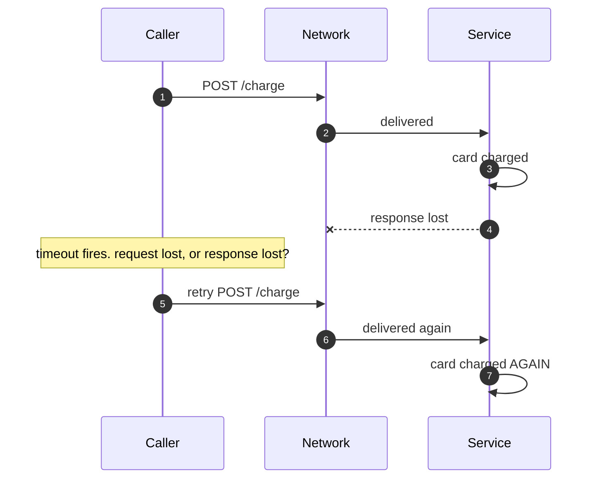
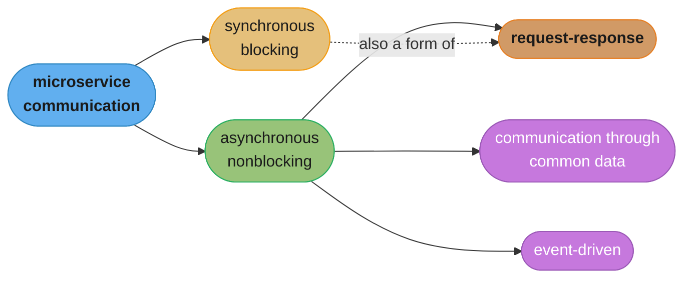
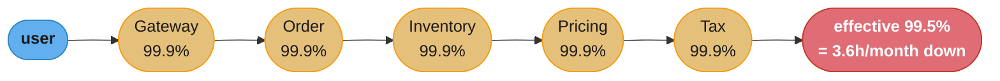
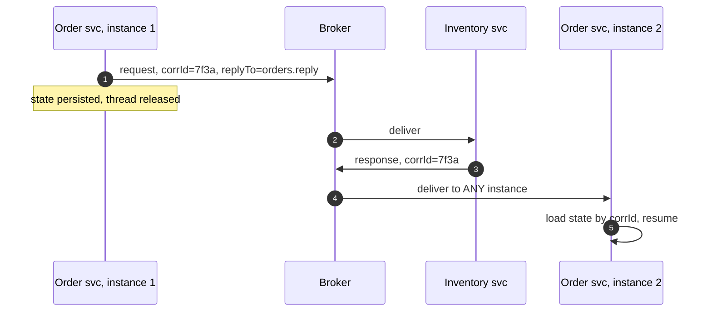
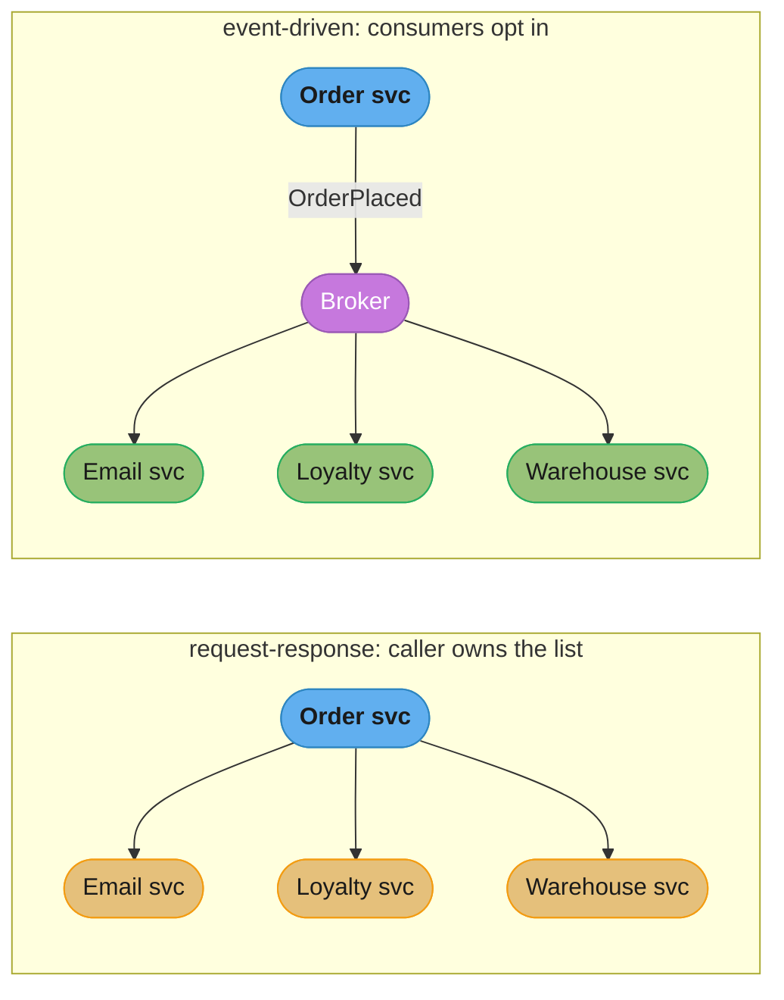
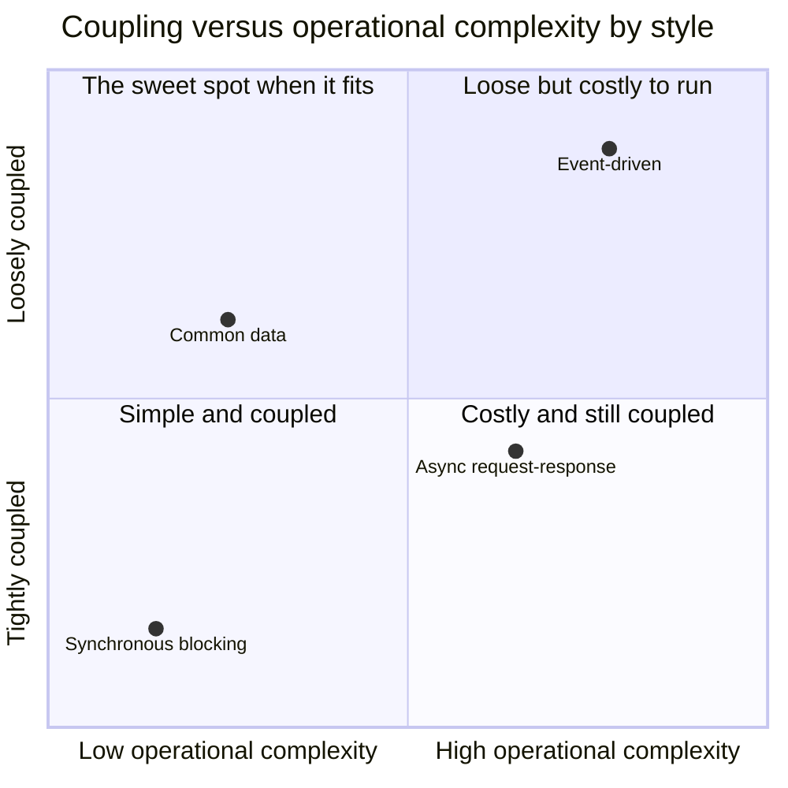
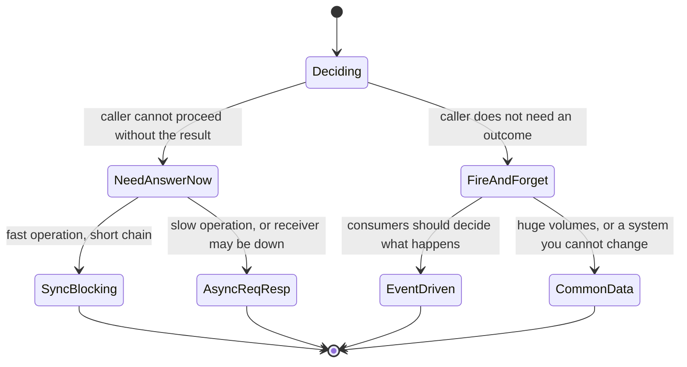

# Chapter 4: Microservice Communication Styles

> Part I — Foundation · Building Microservices, 2nd Edition (Sam Newman, O'Reilly 2021) ·
> builds on Ch 3 (Splitting the Monolith), leads to Ch 5 (Implementing Microservice Communication)

## Chapter Map

Chapter 3 left you with services that need to talk to each other, and with the uncomfortable
discovery that a method call which used to be free is now a network hop. This chapter is the
foundation section's last, and it is deliberately a chapter about *styles* rather than
technologies. Newman's structural argument is that the industry consistently gets this backwards:
teams pick gRPC or Kafka or REST first and then discover what interaction model they have bought,
when the correct order is to decide the interaction model the problem actually calls for and let
that narrow the technology shortlist. Chapter 5 does the technologies; this chapter does the
decision that should precede them. It opens with a hard look at what changes when a call crosses a
process boundary, then lays out a taxonomy of five patterns and, for each, its advantages,
disadvantages, and where to use it.

*Section structure: the `## 4.x` headings below follow the chapter's printed section list as
published (From In-Process to Inter-Process; Technology for Inter-Process Communication: So Many
Choices; Styles of Microservice Communication; and then the five `Pattern:` sections). The `###`
sub-headings mix the book's own sub-sections with the summarizer's grouping.*

**TL;DR:**
- **An inter-process call is not a slow in-process call — it is a different thing.** Cost, interface
  evolution and failure semantics all change qualitatively, not just quantitatively.
- **Decide the style before the technology.** "When you buy into a specific tech choice, you are
  buying into a set of ideas and constraints that come with it," so choosing the technology first
  means letting the tool choose your architecture.
- The taxonomy is two-level: **synchronous blocking** versus **asynchronous nonblocking**, with
  asynchronous splitting into **communication through common data**, **request-response**, and
  **event-driven**.
- **Synchronous blocking** is simple and familiar and creates **temporal coupling**; its real
  danger is the long call chain, where availability multiplies down and latency adds up.
- **Event-driven** communication inverts responsibility — the emitter broadcasts a fact and knows
  nothing about consumers — which is what makes it the most decoupled and the hardest to reason
  about.
- **Keep your middleware dumb and the smarts in the endpoints.** Business logic that migrates into
  the broker or the bus is the enterprise-service-bus failure repeating itself.
- **Mix and match.** No real microservice architecture uses one style throughout, and expecting one
  is itself an error.

---

## The Big Question

Two services need to collaborate. Before you choose a protocol, a serialization format or a
broker, there is a prior question that determines every one of those choices: does the caller need
to stop and wait for an answer, and does the caller need to know who is on the other end at all?
Those two bits — blocking or not, addressed or broadcast — produce four very different systems
from what looks like the same requirement, and choosing wrongly is not a performance problem you
can tune away later, it is a coupling problem baked into the shape of the architecture.

Analogy: the difference is the difference between a phone call, a letter, and a noticeboard. A
phone call (synchronous blocking) is immediate, unambiguous and requires both parties present at
the same moment — if the other person does not pick up, you are stuck holding the receiver. A
letter with a return address (asynchronous request-response) lets you get on with your day and
guarantees you will eventually hear back, but you have to remember why you wrote and be prepared
for the reply to arrive when you are somewhere else entirely. A notice pinned to a public board
(event-driven) is the cheapest of all for the poster — they say what happened and walk away,
knowing nothing about who reads it — and it is the hardest to reason about, because nobody,
including the poster, can tell you what the system will actually do in response.

---

## 4.1 From In-Process to Inter-Process

The chapter's opening move is to insist that calling a method in another process is categorically
unlike calling one in your own. In-process calls are, in Newman's framing, essentially free, and
three properties change the moment a boundary is crossed.

### Performance

An in-process method call costs on the order of nanoseconds and passes arguments by reference —
handing over a pointer, no copying, no encoding. An inter-process call has to marshal the payload
into a wire format, push it through the operating system's networking stack, cross a physical
network, and be unmarshalled at the other end, and every one of those steps costs real time.

| | In-process call | Inter-process call (same datacenter) |
|---|---|---|
| Typical latency | ~1 ns to ~100 ns | ~0.5 ms to ~10 ms |
| Argument passing | By reference — a pointer | By value — serialize, transmit, deserialize |
| Cost of a large payload | Effectively zero | Proportional to size, at both ends and on the wire |
| Failure of the callee | Your process crashes too | Your process is fine and holding an unanswered request |

The ratio matters more than the absolute numbers: a network call is roughly four to six orders of
magnitude more expensive than a local one. That gap has a direct design consequence — the chatty,
fine-grained interfaces that are perfectly idiomatic inside a process become pathological across
one. A loop that calls a method a thousand times is invisible in-process and is a five-second
request over the network.

The second, subtler consequence is about payload size. Passing a large object graph by reference
costs nothing locally; sending it over the wire costs serialization time, bandwidth and
deserialization time, so a network interface has to be deliberate about how much it hands over.
This cuts both ways, and the chapter is careful to say so: sending *too little* is what produces
the chatty N+1 pattern, so the goal is coarse-grained calls that fetch what is actually needed,
not maximally small ones.

### Changing Interfaces

Inside a process, changing a method signature is a compile-time event: the compiler finds every
caller and the change is deployed atomically because there is only one deployable. Across a
process boundary, neither of those holds. There is no compiler that can see the consumers, and
even if you could find them all, they deploy on their own schedules — so at some point during any
rollout, old callers and new providers coexist.

The consequence is that **backward compatibility stops being a courtesy and becomes a structural
requirement**. Either you make changes that old consumers can tolerate, or you accept a lockstep
deployment in which provider and all consumers must be released together — which is exactly the
distributed monolith Chapter 3 warned about. The full toolkit for this (expansion changes,
tolerant readers, emulating the old interface) is Chapter 5's subject; this section's job is to
establish that it is unavoidable.

### Error Handling

This is the section with the sharpest teeth. In-process, the failure modes are simple and mostly
your own: an exception is thrown, and if the process dies, both caller and callee die together, so
there is no state of partial failure to reason about. Across a network, the caller and callee fail
*independently*, and the chapter borrows the distributed-systems failure taxonomy to enumerate
what that produces:

| Failure mode | What it looks like | Why it is hard |
|---|---|---|
| **Crash failure** | The server was healthy, now it is gone | Detectable, but only by timeout |
| **Omission failure** | You sent a request and got nothing back | Cannot distinguish "lost request" from "lost response" |
| **Timing failure** | The response came, but too late to be useful | The caller may already have given up and retried |
| **Response failure** | A response arrived, but it is wrong or incomplete | Looks like success to every transport-level check |
| **Arbitrary (Byzantine) failure** | Components disagree about what happened | No single participant's view can be trusted |

The one that reliably surprises people is the omission failure, because it destroys a comfortable
assumption. If a request times out, the caller genuinely cannot tell whether the request never
arrived, or arrived and was processed and the *response* was lost. Those two cases demand opposite
responses — retry in the first, do not retry in the second — and there is no local information
that distinguishes them.



*The omission failure in one picture. A timeout tells the caller only that no answer arrived, and
because the two indistinguishable causes demand opposite reactions, the only safe resolution is to
make the operation idempotent so that retrying is harmless.*

The practical consequences the chapter draws: timeouts are not optional (a call with no timeout is
a call that can hang forever), retries need idempotent operations to be safe, and error semantics
have to be richer than a local exception — a caller needs to distinguish "this will never work" from
"this might work if you try again in a moment," because those warrant completely different
behaviour. Chapter 12 (Resiliency) takes this further; Chapter 4's job is to establish that the
network has made these your problem.

---

## 4.2 Technology for Inter-Process Communication: So Many Choices

Having established the costs, the chapter refuses to rank the technologies. Its argument is
structural: the space of options — HTTP APIs, gRPC, message brokers, shared data, GraphQL, and
whatever appeared this quarter — is bewildering, and the reason teams pick badly is that they
start from the technology.

The key sentence, and the one worth carrying out of the chapter: **when you buy into a specific
technology choice, you are buying into a set of ideas and constraints that come with it.** Adopting
Kafka is not a neutral decision to use a queue; it commits you to log-structured, replayable,
partition-ordered, consumer-driven semantics and to the operational reality of running it.
Adopting gRPC commits you to a schema-first, RPC-shaped, tightly-typed interaction and to
generated client stubs in every consumer's language. Neither is wrong. But both bring an
architecture along with them, and if you did not choose that architecture deliberately, the tool
chose it for you.

So the chapter's method is to work through the *styles* first, then let the chosen style narrow
the technology shortlist — which is precisely the handoff into Chapter 5, whose opening section is
about what an ideal technology would give you.

---

## 4.3 Styles of Microservice Communication

The taxonomy is the chapter's spine, and it is two levels deep. The first split is whether the
caller blocks. The second, within the nonblocking branch, is *how* the information travels.



*The taxonomy is not a clean partition — request-response can be implemented synchronously or
asynchronously, which is why the dotted edge exists. Blocking and interaction shape are two
independent axes that people habitually conflate.*

That dotted edge is worth dwelling on, because conflating the two axes is the most common
conceptual error in this area. "Synchronous versus asynchronous" is about whether the caller's
thread waits. "Request-response versus event-driven" is about whether the sender addresses a
specific recipient and expects an answer. You can do request-response over a message broker
(asynchronous request-response, using a correlation identifier and a reply queue) and it is still
request-response. You can, less usefully, do something event-shaped over HTTP. The axes are
orthogonal.

### Mix and Match

The chapter is explicit that a microservice architecture will use several of these styles at once,
and that this is normal rather than a sign of inconsistency. A single service commonly exposes a
synchronous API for the queries its callers need answered right now, *and* emits events about
state changes it wants the wider system to know about, *and* consumes events from elsewhere. The
mistake is not mixing; the mistake is mixing without noticing, so that nobody can say which
interactions are temporally coupled and which are not.

---

## 4.4 Pattern: Synchronous Blocking

The caller sends a request over a network and blocks — its thread waits — until the response comes
back or the call times out. This is the shape of an ordinary HTTP call or a standard gRPC unary
call, and it is what most developers reach for by default.

### Advantages

**Simplicity and familiarity** are the honest headline. The call reads exactly like a local method
call, control flow is linear and easy to follow, debugging is direct, and every developer already
understands it. There is no correlation identifier to track, no reply queue, no state machine
spread across handlers.

Just as important, **the caller knows whether the call worked**. When the operation's outcome is
needed to decide what to do next — did the payment authorize, is this user permitted, is the item
in stock — having the answer in hand at the point of decision is not a convenience, it is the
requirement.

### Disadvantages

The core cost is **temporal coupling**: the caller and callee must both be up, reachable and
responsive at the same instant. If the downstream service is down, the upstream operation simply
cannot proceed. That is sometimes acceptable and sometimes catastrophic, and the point is to know
which.

The disadvantage the chapter emphasises most, though, is what happens as call chains grow. A
synchronous chain composes badly in two independent ways.



*Five services at a very respectable 99.9% each compose to roughly 99.5% for the chain, because
availabilities multiply along a synchronous path. The chain is less available than any component
in it, and no single team's dashboard shows the problem.*

- **Availability multiplies.** Five hops at 99.9% each gives 0.999^5 ≈ 99.5%, which is about 3.6
  hours of downtime per month rather than 43 minutes. Every service on the path is a hard
  dependency of the request.
- **Latency adds.** Five hops at 20 ms each is 100 ms before any service does any work, and the
  *tail* is worse than the sum of the medians: the slowest of five independent calls dominates, so
  a p99 of 200 ms on each hop produces a chain p99 far above 200 ms.
- **Resources are held the whole time.** Each service in the chain is holding a thread, a
  connection and possibly a database transaction while it waits for everything downstream. When
  the deepest service slows down, every service above it exhausts its thread pool, and the failure
  propagates *upward* — the classic cascading failure.

A broken shape, then the fix. **Broken:** the order service, handling a checkout, synchronously
calls inventory, then pricing, then tax, then the loyalty-points service, then the email service,
and returns only when all five have answered. **Fix:** the calls whose results actually change what
is returned to the user (inventory, pricing, tax) stay synchronous; loyalty points and the
confirmation email become events emitted after the order is committed. Checkout latency drops by
the cost of the two removed hops and, more importantly, the email service being down no longer
prevents anyone from buying anything.

### Where to Use It

When the result is genuinely needed before proceeding, when the call chain is short, and when the
simplicity is worth the temporal coupling — which is a great deal of ordinary request handling.
The chapter's caution is specifically about depth: watch for long chains, and treat every
additional synchronous hop as a decision rather than a detail.

---

## 4.5 Pattern: Asynchronous Nonblocking

The sender emits its message and carries on without waiting; the receiver processes it at some
later point. The sender's thread is not parked, and in most implementations the sender does not
require the receiver to be running at the moment of sending at all.

### Advantages

**Temporal decoupling** is the whole point. If the downstream service is down or slow, the message
waits — in a broker, in a file, in a shared store — and is processed when the service returns. The
sender's availability is no longer a product of its dependencies' availability.

This makes asynchronous communication the natural fit for **long-running processes**. If an
operation takes thirty seconds, or an hour, holding a synchronous connection open for it is
wasteful at best and impossible at worst (proxies and load balancers will time it out).
Asynchronous messaging simply does not have this constraint.

It also handles **slow consumers** gracefully: a broker absorbs a burst that would otherwise
overwhelm the receiver, letting it drain at its own pace instead of failing under load.

### Disadvantages

The cost is complexity, and it is not a small one. There are more moving parts — a broker to
operate, monitor and understand — and the operational literacy required to run one well is real.
Control flow becomes non-linear: the logic for a single business operation is spread across
handlers that are not connected by a call stack, which makes both reading the code and debugging a
production problem substantially harder. Newman is direct that this is where teams underestimate
the cost.

And it forces a further choice, which is why the taxonomy has a second level: having decided to be
asynchronous, you still have to decide *how* — common data, request-response, or event-driven —
and those three produce very different systems.

---

## 4.6 Pattern: Communication Through Common Data

One service writes data to a shared location; another reads it later. This is the least
fashionable pattern in the chapter and, as Newman points out, by far the most widely deployed in
the industry.

### Implementation

The canonical form is the **data lake** or **data warehouse**: producers write files or records in
a known format, consumers read them on their own schedule, and the store itself is dumb — no
routing, no delivery semantics, just persistence. The most primitive and still extremely common
form is a scheduled file drop: a producer writes a CSV to a shared directory or an object store at
02:00, and a consumer picks it up at 03:00.

The pattern's minimum requirements are a location both sides agree on, an agreed data format, and
some way for the consumer to know new data is available — which in practice is usually **polling**,
because that is what a dumb store supports.

### Advantages

**Simplicity** — you need a filesystem or an object store, nothing else. **Universality** — every
technology in existence can read a file, which makes this the pattern of choice for integrating
legacy or third-party systems you cannot modify. And **large volumes** — this is genuinely the best
of the patterns for shipping enormous datasets, where a message broker would be an inappropriate
and expensive transport.

### Disadvantages

**Latency** is the big one, and it is structural rather than tunable. Consumers poll, so the delay
between a write and its processing is at least the polling interval — hours, in the nightly-batch
case. Polling faster reduces the delay and increases the cost, and no polling frequency turns this
into a real-time mechanism.

**Coupling to the data format** is the second cost. Because the store is dumb, there is nothing to
enforce or validate the contract; the shared format becomes a de-facto interface that anyone can
depend on and nobody owns. This is precisely the reporting-database problem from Chapter 3
reappearing, and it goes wrong the same way.

There are also unglamorous operational questions the pattern forces you to answer explicitly and
that no infrastructure will answer for you: who deletes the old files, how a consumer knows a file
is complete rather than half-written, and what happens when a consumer needs to reprocess.

### Where to Use It

Interoperating with systems you cannot change, moving very large volumes, and anywhere the
latency genuinely does not matter. Do not use it where the freshness of the data is part of the
requirement.

---

## 4.7 Pattern: Request-Response Communication

A service sends a request to a *specific* other service and expects a response. The defining
feature is that the sender knows who it is talking to and cares about the answer — which is exactly
what distinguishes it from event-driven communication, and the distinction survives whichever
transport you use.

### Implementation: Synchronous Versus Asynchronous

Synchronous request-response is the §4.4 pattern: an HTTP call, a gRPC unary call, a blocked
thread waiting on a socket.

Asynchronous request-response usually runs over a message broker. The sender publishes a request
message including a **correlation identifier** and a reply destination, then moves on; the receiver
processes it and publishes a response to that destination, tagged with the same correlation
identifier; some instance of the sending service picks the response up and matches it back to the
original request.



*The instance that receives the response is not the instance that sent the request. This is the
detail that breaks naive implementations: any state needed to resume the operation must be
persisted somewhere both instances can reach, never held in the sender's memory.*

The chapter is emphatic on that last point. An asynchronous request-response implementation that
keeps the in-flight operation's state in a local map works perfectly in development with one
instance, and loses requests in production the moment the service is scaled out or restarted.

The trade between the two implementations is straightforward: synchronous is simpler and gives an
immediate answer; asynchronous survives the receiver being down at the moment of sending, and
handles operations that take too long for a held connection.

### Where to Use It

Whenever the caller needs the result before it can continue, or needs to know the operation
succeeded. Newman's example shape is an order that cannot be marked as placed until stock has
actually been reserved — the reservation's outcome determines what happens next, so the caller
must have it. The choice of synchronous or asynchronous implementation then follows from how long
the operation takes and how much you care about the receiver's availability at send time.

---

## 4.8 Pattern: Event-Driven Communication

The inversion. A service **emits an event** — a statement that something happened — and knows
nothing about who, if anyone, consumes it. There is no addressee, no expected response, and
critically no instruction: an event says "an order was placed", not "send a confirmation email".
What happens next is entirely the consumers' business.

This is the chapter's most important conceptual shift, because it moves responsibility from the
sender to the receiver. In a request-response system, the caller must know every downstream effect
its operation should trigger, so adding a new effect means changing the caller. In an event-driven
system the emitter is unchanged forever; a new consumer subscribes and the emitter never learns of
its existence.



*Adding a fourth downstream effect means editing the order service on the left and touching nothing
on the right. That is the coupling difference the pattern buys, and the price is that no single
place tells you what the system does when an order is placed.*

### Implementation

Two things are needed: a way for the emitter to broadcast, and a way for consumers to discover
what happened.

**Message brokers** are the usual answer, and here the chapter delivers its most-quoted line on the
subject: **keep your middleware dumb, and keep the smarts in the endpoints.** The historical
cautionary tale is the enterprise service bus, where routing rules, transformations and eventually
business logic accumulated inside proprietary middleware until the bus became the single most
critical, least testable, least version-controlled component in the enterprise — and the one team
that understood it became the bottleneck for every change. A broker should move messages. It
should not decide what they mean.

**HTTP-based** propagation is the alternative Newman notes: events published as a feed (Atom being
the classic form) that consumers poll. It scales less well and reintroduces polling latency, but it
requires no broker and rides on infrastructure everyone already has.

### What's in an Event?

The chapter's sharpest practical question, with two poles and a real trade between them.

**Just an identifier.** The event carries the fact and a reference: `OrderPlaced { orderId: 1234 }`.
Consumers that need details call back to the emitting service to fetch them.

- Small, cheap, and leaks nothing sensitive.
- But every consumer must call back, which reintroduces request-response coupling and puts the
  emitter back on the critical path.
- And it creates a load spike: one event fanning out to eight consumers produces eight simultaneous
  callbacks to the service that just emitted it, at exactly the moment it is busiest.

**Fully detailed events (state transfer via events).** The event carries everything a consumer is
likely to need: `OrderPlaced { orderId, customerId, lines[], total, shippingAddress, ... }`.

- Consumers are genuinely autonomous — they can act with no callback at all, and continue working
  even while the emitter is down.
- But the events are larger, sometimes much larger.
- Sensitive fields are now broadcast to every consumer, including ones that have no business seeing
  them.
- And the event's shape becomes a contract with many independent consumers, so changing it is a
  versioning exercise.

Newman's heuristic for navigating this is the one worth memorising: **prefer to put into an event
what you would be happy to share via an API.** An event is a published interface. If a field would
not survive the scrutiny you would apply to putting it in a public API response, it does not belong
in a broadcast event either.

### Where to Use It

When you want maximum decoupling between emitter and consumers, when the set of things that should
happen in response is expected to grow, and when the emitter genuinely should not need to know what
downstream effects exist. It fits poorly where the emitter needs to know the outcome — that is
request-response wearing an event costume, and the correlation-identifier machinery of §4.7 is the
honest way to express it.

### Proceed with Caution

The chapter closes the pattern with a warning proportionate to the pattern's appeal.
Event-driven systems are harder — harder to understand, harder to debug, harder to reason about
than a synchronous call chain, because there is no stack trace spanning the interaction and no
single artefact that describes what the system does when an order is placed. Newman's advice is to
adopt the style incrementally and build the operational muscle for it, rather than committing an
entire architecture to a model the team has not yet run in production. Chapter 10's observability
material exists in large part because this style makes the naive approaches to monitoring
insufficient.

---

## Visual Intuition



*Nothing sits in the bottom-right by accident — a style that is both hard to operate and tightly
coupled is one you have built by mistake. Common data is unfashionable precisely because it lands
in a genuinely good quadrant while looking primitive.*

```
  latency and availability of a 5-hop synchronous chain

  hops   |  added latency (20ms/hop)  |  composed availability (99.9%/hop)
  -------+----------------------------+----------------------------------
   1     |  20 ms   |##              |  99.900%   ~43 min/month down
   2     |  40 ms   |####            |  99.800%   ~86 min/month down
   3     |  60 ms   |######          |  99.700%   ~2.2 h/month down
   4     |  80 ms   |########        |  99.601%   ~2.9 h/month down
   5     | 100 ms   |##########      |  99.501%   ~3.6 h/month down

  latency grows linearly. availability decays multiplicatively.
  the chain is ALWAYS less available than its weakest member.
```

*Every synchronous hop is a hard dependency. The numbers are illustrative, but the asymmetry is
the lesson: you notice the latency long before you notice the availability, and the availability is
the one that pages you.*



*The decision tree the chapter implies. The first question is never "which technology" — it is
whether the caller needs an outcome, and only then how quickly and how reliably.*

---

## Key Concepts Glossary

- **In-process call** — a method call within one process; nanoseconds, by reference, compile-time
  interface checking, shared fate on failure.
- **Inter-process call** — a call across a process boundary; requires marshalling, costs orders of
  magnitude more, and introduces independent failure.
- **Marshalling / serialization** — converting an in-memory structure into a wire format so it can
  cross a network, and back at the other end.
- **Crash failure** — the callee was running and has stopped; detectable only by timeout.
- **Omission failure** — a message was sent and nothing came back; the caller cannot tell whether
  the request or the response was lost.
- **Timing failure** — a correct response that arrived too late to be useful.
- **Response failure** — a response arrived and is wrong or incomplete; passes every transport-level
  check.
- **Arbitrary (Byzantine) failure** — participants disagree about what happened; no single view is
  trustworthy.
- **Idempotency** — the property that applying an operation more than once has the same effect as
  applying it once; what makes retrying after an omission failure safe.
- **Synchronous blocking** — the caller's thread waits for the response or the timeout.
- **Asynchronous nonblocking** — the sender continues immediately; the receiver processes later.
- **Temporal coupling** — the requirement that two parties be available at the same instant for an
  interaction to succeed.
- **Communication through common data** — the sender writes to a shared store, the receiver reads
  later, typically by polling.
- **Request-response** — the sender addresses a specific service and expects an answer; implementable
  synchronously or asynchronously.
- **Correlation identifier** — a token carried on an asynchronous request and echoed on its response
  so the two can be matched.
- **Reply queue / reply destination** — where an asynchronous response is sent, read by any instance
  of the requesting service.
- **Event-driven communication** — the emitter broadcasts a statement of fact and knows nothing
  about consumers.
- **Event** — a record that something happened, containing no instruction about what should be done
  about it.
- **State transfer via events** — putting enough detail in an event that consumers need not call
  back to the emitter.
- **Dumb middleware, smart endpoints** — the principle that brokers should move messages while
  business logic stays in services.
- **Enterprise service bus (ESB)** — the cautionary counter-example, where logic accumulated inside
  middleware until the bus became the bottleneck.

---

## Tradeoffs & Decision Tables

| | Synchronous blocking | Asynchronous nonblocking |
|---|---|---|
| Caller's thread | Parked until response or timeout | Released immediately |
| Requires callee up now | Yes — temporal coupling | No |
| Long-running operations | Poorly (connections time out) | Naturally |
| Debugging | Linear, single stack trace | Spread across handlers, needs tracing |
| Failure blast radius | Propagates up the chain | Absorbed by the broker or store |
| Operational burden | Low | A broker to run, monitor and understand |

| | Common data | Async request-response | Event-driven |
|---|---|---|---|
| Sender knows the recipient | No | Yes | No |
| Sender expects a reply | No | Yes | No |
| Typical latency | Minutes to hours (polling) | Milliseconds to seconds | Milliseconds to seconds |
| Volume ceiling | Very high — its best property | Moderate | Moderate |
| Works with unmodifiable systems | Yes — everything reads files | No | No |
| Main coupling risk | Undocumented shared data format | Contract on request and response | Contract on event payload, plus invisible consumers |

| Event payload style | Size | Emitter load after fan-out | Sensitive data exposure | Consumer autonomy |
|---|---|---|---|---|
| Identifier only | Tiny | High — every consumer calls back at once | Minimal | Low — must call back |
| Fully detailed | Large | None | Broadcast to all consumers | High — acts without the emitter |

| Symptom | Likely style mismatch | Move toward |
|---|---|---|
| Checkout is slow and touches six services | Synchronous chain doing non-essential work | Emit events for the non-essential effects |
| Adding a downstream effect means editing the upstream service | Request-response used where events fit | Event-driven |
| Consumers constantly call back after every event | Events too thin | Richer event payloads |
| Nobody can say what happens when an order is placed | Event-driven adopted without observability | Distributed tracing, per Ch 10 |
| Async request-response loses replies after a restart | State held in sender memory | Persist state keyed by correlation identifier |

---

## Common Pitfalls / War Stories

- **Treating a network call as a slow local call.** A loop that calls a collaborator once per item
  is invisible in-process and is a multi-second request across one. The chatty interface is not a
  performance bug to be profiled away later; it is the wrong granularity, and the fix is a
  coarse-grained batch call designed in from the start.
- **The retry that double-charges.** A timeout is an omission failure, and the caller cannot know
  whether the request or the response was lost. Retrying a non-idempotent operation after a
  timeout is how one payment becomes two, and the only real defence is making the operation
  idempotent — usually via a client-supplied request identifier the server deduplicates on.
- **The call with no timeout.** A synchronous call without a timeout can hang for as long as the
  operating system's default allows, holding a thread the entire time; a few thousand of those
  exhaust the pool and the service stops serving anything, including the endpoints that have
  nothing to do with the slow dependency.
- **The five-deep synchronous chain nobody designed.** Each hop was added by a different team, each
  addition was locally reasonable, and the composed availability is now worse than any single
  team's SLO — with no dashboard anywhere showing the composed number.
- **Cascading failure upward from a slow leaf.** The deepest service slows from 20 ms to 2 s;
  every service above it holds threads waiting; thread pools exhaust from the bottom up; the
  outage is reported as "the gateway is down". The gateway is fine.
- **Asynchronous request-response with in-memory state.** Correlation identifiers matched against a
  local hash map work perfectly with one instance and silently drop responses as soon as the
  service is scaled out or restarted mid-flight, because the reply is delivered to a different
  instance than the one that sent the request.
- **Business logic creeping into the broker.** Routing rules become content-based routing, which
  becomes transformation, which becomes a workflow — and now the most business-critical logic in
  the company lives in a middleware configuration that is not in version control, has no tests,
  and is understood by one person. This is the ESB failure repeating with new branding.
- **Events that are really commands.** `SendConfirmationEmail` published to a topic is not an
  event, it is a remote procedure call with extra steps; the emitter still knows exactly what
  should happen, so none of the decoupling was actually purchased. An event names something that
  happened, in the past tense, with no instruction attached.
- **Sensitive fields in a broadcast event.** Putting the full customer record in `OrderPlaced`
  makes every consumer — including the analytics pipeline and the third-party integration — a
  handler of personal data. Newman's test applies directly: if you would not put the field in a
  public API response, it does not belong in the event.
- **The identifier-only event that stampedes the emitter.** One event fanning out to eight
  consumers produces eight simultaneous callbacks to the service that just emitted it, converting
  a decoupling mechanism into a self-inflicted load spike at the worst possible moment.
- **Adopting event-driven architecture everywhere at once.** The style's difficulty is
  concentrated in operations and debugging, which is exactly where a team has no experience until
  it has run one in production. The chapter's own advice is incremental adoption, not a
  wholesale commitment.

---

## Real-World Systems Referenced

The chapter deliberately holds technology at arm's length — that is Chapter 5's job — but it does
name categories and cautionary examples. **Message brokers** are discussed generically as the
implementation vehicle for both asynchronous request-response and event-driven communication, with
the products deferred to the next chapter. The **enterprise service bus** appears as the historical
warning behind "keep your middleware dumb, keep the smarts in the endpoints", standing for the
generation of proprietary integration middleware that accumulated business logic until it became
an organisational bottleneck. **Atom** feeds over HTTP are cited as the way to do event propagation
without a broker, at the cost of polling. **Data lakes and data warehouses** are named as the
mature forms of communication through common data, alongside the humbler file drop that remains
ubiquitous in enterprise integration. The distributed-systems failure taxonomy — crash, omission,
timing, response and arbitrary failures — is borrowed from the standard distributed-systems
literature rather than invented here. And the running **MusicCorp** example continues from earlier
chapters for the order, inventory and warehouse illustrations.

---

## Summary

The chapter's argument is that communication style is an architectural decision that must be made
before, and independently of, the technology that implements it — because every technology arrives
carrying an architecture, and a team that chooses the tool first has let the tool choose the
system. It begins by establishing why the decision matters at all: an inter-process call differs
from an in-process one in kind rather than degree, costing four to six orders of magnitude more,
losing the compiler's ability to police interface changes, and introducing failure modes — crash,
omission, timing, response, arbitrary — that have no in-process equivalent, of which the omission
failure is the most consequential because a timeout cannot distinguish a lost request from a lost
response. It then lays out the taxonomy: synchronous blocking versus asynchronous nonblocking on
one axis, and within the asynchronous branch, communication through common data, request-response,
and event-driven. Synchronous blocking is simple, familiar and gives the caller certainty, at the
price of temporal coupling and, in long chains, multiplied unavailability, additive latency and
upward-cascading resource exhaustion. Asynchronous nonblocking decouples in time and handles slow
or long-running work, at the price of real operational and cognitive complexity. Common data is
unglamorous, universal, unbeatable for volume and structurally high-latency. Request-response —
whichever way it is implemented — is for when the caller needs the outcome, and its asynchronous
form demands correlation identifiers and externalised state because the responding instance is not
the requesting one. Event-driven communication inverts responsibility entirely, letting consumers
decide what a fact means, which buys the most decoupling available and costs the most in
comprehensibility; its two design questions are keeping the middleware dumb and deciding how much
to put in an event, for which the guiding heuristic is to include only what you would be happy to
expose through an API. And the closing position is that real systems mix all of these, that mixing
is correct, and that the error is mixing without knowing which of your interactions are temporally
coupled and which are not.

---

## Interview Questions

**Q: Why does Newman insist an inter-process call is not just a slower in-process call?**
**Short:** Newman argues cost, interface evolution and failure semantics all change in kind, not merely in degree.
An in-process call takes nanoseconds and passes arguments by reference, while a network call must serialize, traverse the OS stack and the wire, and deserialize, costing four to six orders of magnitude more — which makes chatty interfaces that are idiomatic locally pathological remotely. The compiler can no longer find your callers, so backward compatibility becomes a structural requirement rather than a courtesy, and callers deploy on their own schedule so old and new coexist during every rollout. Most importantly, caller and callee now fail independently, producing partial-failure states that simply do not exist inside one process.

**Q: What is an omission failure and why is it the hardest failure mode to handle?**
**Short:** It is sending a request and getting nothing back, with no way to tell whether the request or the response was lost.
The two possible causes demand opposite reactions — retry if the request never arrived, do not retry if it arrived and was processed — and no information available locally to the caller distinguishes them. This is why a timeout on a payment call is dangerous: retrying may double-charge, and not retrying may drop a legitimate order. The practical resolution is not better detection but idempotency, usually via a client-supplied request identifier the server deduplicates on, so that retrying is harmless regardless of which case actually occurred.

**Q: Why does the chapter say to choose a communication style before choosing a technology?**
**Short:** Newman argues that buying into a technology means buying into the set of ideas and constraints that come with it.
Adopting Kafka commits you to log-structured, replayable, partition-ordered semantics and to running it operationally; adopting gRPC commits you to schema-first, RPC-shaped, tightly-typed interaction with generated stubs in every consumer. Neither is wrong, but both bring an architecture along, and a team that picks the tool first has let the tool make an architectural decision it never consciously took. Decide whether the caller needs an outcome and whether it should know its recipients, then let those answers narrow the technology shortlist.

**Q: What is temporal coupling and which style creates it?**
**Short:** It is the requirement that both parties be available at the same instant, and synchronous blocking communication creates it.
When a caller blocks on a response, the downstream service being down or unreachable means the upstream operation simply cannot proceed, so the caller's availability becomes a function of its dependencies' availability. Asynchronous styles remove this by letting the message wait in a broker or a shared store until the receiver returns. The point is not that temporal coupling is always bad — for a stock check that must complete before an order is confirmed it is exactly right — but that it should be a deliberate choice rather than a default inherited from the transport.

**Q: Why do long synchronous call chains fail badly, specifically?**
**Short:** Availability multiplies down the chain while latency adds up, and every hop holds resources waiting on everything below it.
Five hops at 99.9% each compose to roughly 99.5% — about 3.6 hours of downtime a month instead of 43 minutes — because every service on the path is a hard dependency, and no single team's dashboard shows the composed number. Latency adds linearly, and the tail is worse than the sum of medians because the slowest hop dominates. Worst is the resource behaviour: each service holds a thread and connection while waiting, so a slow leaf exhausts thread pools upward through the chain and the outage gets reported against the gateway rather than the actual cause.

**Q: How do the synchronous-versus-asynchronous and request-response-versus-event-driven axes relate?**
**Short:** They are orthogonal — blocking is about whether the thread waits, and interaction shape is about whether the sender addresses a recipient.
Request-response can be implemented synchronously over HTTP or asynchronously over a broker using a correlation identifier and a reply queue, and it is request-response either way because the sender knows who it is asking and wants an answer. Conflating the two axes leads to the common error of calling anything on a message broker "event-driven" when a great deal of broker traffic is request-response. Ask the two questions separately: does the caller need an outcome, and does the caller need to know the recipient.

**Q: What distinguishes an event from a command, and why does it matter?**
**Short:** An event states that something happened with no instruction attached, while a command tells a specific recipient what to do.
Publishing `SendConfirmationEmail` to a topic is a remote procedure call with extra steps — the emitter still knows exactly what should happen downstream, so none of the decoupling was actually purchased and adding a new effect still means changing the emitter. A real event, `OrderPlaced`, says nothing about consequences, so consumers decide independently what an order being placed means to them. The test is whether adding a new downstream behaviour requires touching the emitter: if it does, you published a command.

**Q: What does "keep your middleware dumb, and keep the smarts in the endpoints" protect against?**
**Short:** Newman warns against business logic migrating into the broker, repeating the enterprise service bus failure.
Routing rules become content-based routing, which becomes transformation, which becomes workflow, until the most business-critical logic in the organisation lives in a middleware configuration that is not version-controlled, has no tests, and is understood by one team who become the bottleneck for every change. A broker's job is to move messages reliably; deciding what a message means is a service's job. Judge any proposed broker feature by whether adopting it would put behaviour somewhere your normal build, test and review pipeline cannot see.

**Q: What are the trade-offs between identifier-only events and fully detailed events?**
**Short:** Thin events keep payloads small and data private but force callbacks, while detailed events make consumers autonomous at the cost of size and exposure.
An event carrying only an order identifier means every consumer must call back to the emitter for details, reintroducing request-response coupling and producing a load spike when eight consumers all call back at once immediately after emission. A fully detailed event lets consumers act with no callback at all, even while the emitter is down, but the payload is larger, sensitive fields are broadcast to consumers with no business seeing them, and the shape becomes a contract with many independent consumers. Newman's heuristic resolves most cases: put into an event what you would be happy to share via an API.

**Q: Why is asynchronous request-response harder to implement correctly than it looks?**
**Short:** The instance that receives the response is generally not the instance that sent the request, so in-memory state is lost.
The sender publishes a request with a correlation identifier and a reply destination, and the response is later delivered to whichever instance of the sending service happens to consume it — possibly a different pod, possibly after a restart. An implementation that tracks in-flight requests in a local hash map works flawlessly with one instance in development and silently drops replies in production the moment the service scales out. Any state needed to resume the operation must be persisted somewhere all instances can read, keyed by the correlation identifier.

**Q: When is communication through common data the right choice despite being unfashionable?**
**Short:** When you must integrate systems you cannot modify, or move very large volumes, and latency genuinely does not matter.
Every technology in existence can read a file, which makes a shared store the only viable integration point for legacy or third-party systems whose code you cannot touch, and it is by far the best of the patterns for shipping enormous datasets where a broker would be an inappropriate transport. Its structural cost is latency: consumers poll, so the delay is at least the polling interval, and no polling frequency turns it into a real-time mechanism. Its hidden cost is that the shared format becomes an interface nobody owns, which is Chapter 3's reporting-database problem reappearing.

**Q: What operational questions does communication through common data force you to answer explicitly?**
**Short:** Who deletes old data, how a consumer knows a write is complete, and what happens when a consumer must reprocess.
Because the shared store is deliberately dumb it provides no delivery semantics, no completeness signal and no retention policy, so each of those becomes an application-level convention that must be designed rather than inherited. A consumer that reads a half-written file processes truncated data and usually does so silently; the common fixes are writing to a temporary name and renaming atomically, or writing a separate marker once the payload is complete. Decide these up front, because every one of them is discovered in production otherwise.

**Q: What is the practical advice when a checkout flow synchronously calls five downstream services?**
**Short:** Keep synchronous only the calls whose results change the response, and turn the rest into events emitted after commit.
Inventory, pricing and tax determine what the user sees and must be answered before responding, but loyalty points and the confirmation email do not — they are consequences, not inputs. Emitting an event after the order commits removes those hops from the request path, cutting latency, and more importantly removes them as hard dependencies, so the email service being down no longer prevents anyone from buying anything. The general rule is that a synchronous hop is justified only when its result changes what the caller does next.

**Q: Why does the chapter warn against adopting event-driven architecture wholesale?**
**Short:** Newman notes event-driven systems are harder to understand and debug, and the difficulty concentrates where teams have no experience.
There is no stack trace spanning an event-driven interaction and no single artefact describing what the system does when an order is placed, so both reasoning about the design and diagnosing a production incident get substantially harder. The skills that make it manageable — distributed tracing, correlation across handlers, thinking in eventual consistency — are operational and are only acquired by running such a system. The advice is therefore incremental adoption on a bounded part of the system, building the muscle before committing an entire architecture to a model nobody has yet operated.

**Q: Why is a timeout mandatory on every synchronous call?**
**Short:** A call without one can block indefinitely, holding a thread and connection until the pool is exhausted and the whole service stops.
Default socket timeouts are typically far longer than anything a request path can tolerate, so a single degraded dependency can accumulate thousands of parked threads, at which point the service fails to serve even endpoints that have nothing to do with that dependency. Setting an explicit timeout converts an unbounded hang into a bounded, handleable failure that circuit breakers and fallbacks can act on. Chapter 12 develops the resiliency patterns, but the timeout itself is the precondition for all of them.

**Q: What does mixing communication styles in one architecture indicate?**
**Short:** Newman treats mixing as normal and correct — the error is mixing without knowing which interactions are temporally coupled.
A single service commonly exposes a synchronous API for queries its callers need answered immediately, emits events about state changes for the wider system, and consumes events from elsewhere, and all three can be the right choice for their respective interactions. What causes trouble is when nobody can say which of a system's interactions require both parties to be up simultaneously, because that is the information needed to predict how the system degrades. Document the style of each interaction explicitly, since it determines availability and failure behaviour more than any other single property.

**Q: How does event-driven communication change where responsibility lives?**
**Short:** It moves responsibility from the sender to the receiver — the emitter states a fact and consumers decide what it means.
In request-response, the caller must know every downstream effect its operation should trigger, so adding an effect means changing the caller and redeploying it. In an event-driven system the emitter is unchanged forever: a new consumer subscribes and the emitter never learns it exists, which is the strongest form of decoupling available. The price is that no single place in the codebase tells you what actually happens when an order is placed, which is why this style makes observability a first-class requirement rather than an operational afterthought.

**Q: Why do payload size and interface granularity matter more across a process boundary?**
**Short:** Arguments cross by value rather than by reference, so both payload size and call count now carry real cost.
Passing a large object graph locally costs a pointer copy, while sending it over the wire costs serialization, bandwidth and deserialization at both ends, so an interface has to be deliberate about how much it transfers. But the pressure runs both ways: making calls too fine-grained to keep payloads small produces the N+1 pattern where a hundred small calls cost far more than one larger one. The target is coarse-grained calls that return what the caller actually needs, which is a different goal from either minimising payload or minimising call count in isolation.

---

## Cross-links in this repo

- [backend/microservices_fundamentals/ — service interaction models and the coupling they create](../../../backend/microservices_fundamentals/microservices_fundamentals.md)
- [backend/event_driven_fundamentals/ — events versus commands, fan-out, event payload design](../../../backend/event_driven_fundamentals/event_driven_fundamentals.md)
- [backend/messaging_patterns/ — correlation identifiers, reply queues, idempotent consumers](../../../backend/messaging_patterns/messaging_patterns.md)
- [hld/message_queues/ — broker semantics, delivery guarantees, backpressure](../../../hld/message_queues/message_queues.md)
- [hld/microservices/ — composed availability and synchronous call-chain risk at system-design scale](../../../hld/microservices/microservices.md)
- Sibling chapters: [Ch 3 Splitting the Monolith](../03_splitting_the_monolith/03_splitting_the_monolith.md) · [Ch 5 Implementing Microservice Communication](../05_implementing_microservice_communication/05_implementing_microservice_communication.md)

## Further Reading

- Hohpe and Woolf, *Enterprise Integration Patterns* (Addison-Wesley, 2003) — the source of the
  correlation identifier, the reply queue and most of the vocabulary this chapter uses for
  asynchronous messaging.
- Deutsch, "The Eight Fallacies of Distributed Computing" — the classic enumeration of the
  assumptions this chapter's error-handling section exists to dismantle.
- Tanenbaum and Van Steen, *Distributed Systems: Principles and Paradigms* — the standard source
  for the crash, omission, timing, response and arbitrary failure taxonomy.
- Fowler, "MicroservicesAndTheFirstLaw" and the "smart endpoints, dumb pipes" writing on
  martinfowler.com — the principle the chapter restates for message brokers.
- Newman, *Monolith to Microservices* (O'Reilly, 2019) — companion treatment of how these styles
  are introduced into an existing system rather than a greenfield one.
