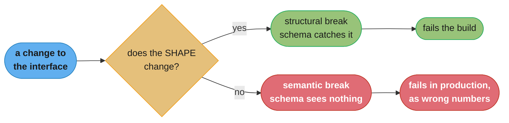
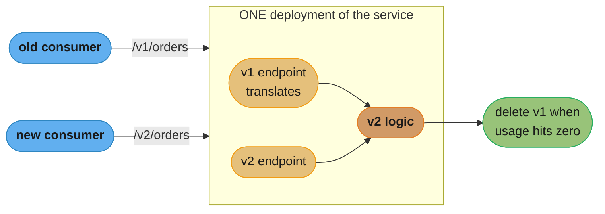
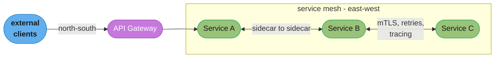
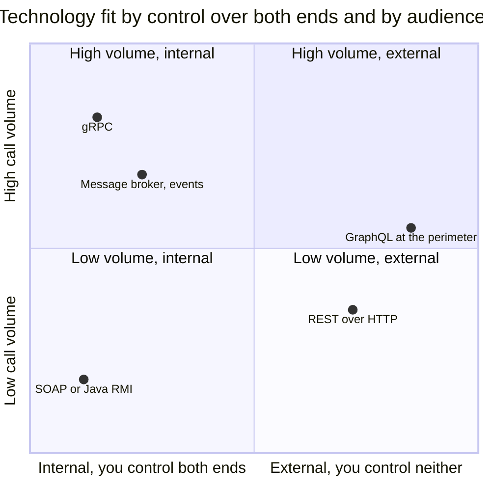
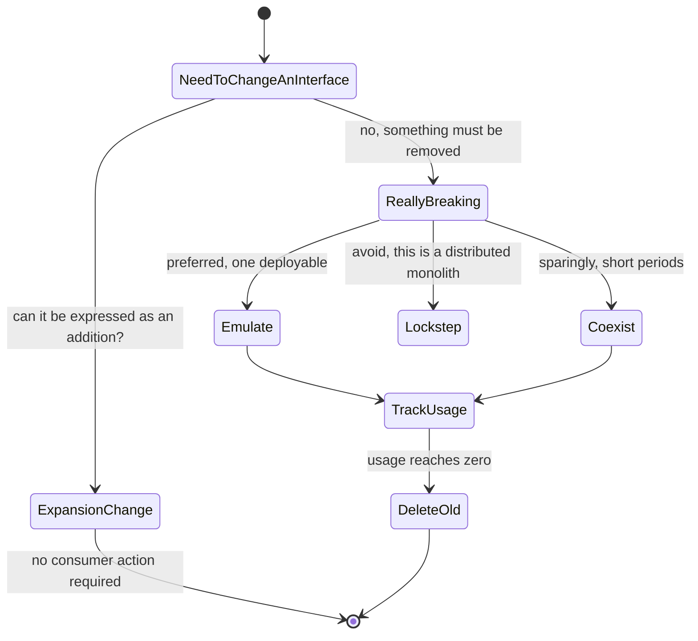

# Chapter 5: Implementing Microservice Communication

> Part II — Implementation · Building Microservices, 2nd Edition (Sam Newman, O'Reilly 2021) ·
> builds on Ch 4 (Microservice Communication Styles), leads to Ch 6 (Workflow)

## Chapter Map

Chapter 4 ended Part I by insisting you choose the interaction style before the technology.
Chapter 5 opens Part II by finally naming the technologies — and it is the longest and most
concretely opinionated chapter in the book so far. Newman's structure is deliberate: rather than
starting with a product comparison, he first derives five properties an *ideal* inter-process
communication technology would have, then evaluates RPC, REST, GraphQL and message brokers against
them. The second half of the chapter is where its real value sits, and it is not about
technology at all: serialization, schemas, and the mechanics of changing an interface without
breaking the consumers you cannot see. The chapter closes with three topics that are technically
about communication but practically about operating a fleet — code reuse across service
boundaries, service discovery, and the gateway/mesh layer — plus documentation.

*Section structure: the `## 5.x` headings below follow the chapter's printed section list as
published (Looking for the Ideal Technology; Technology Choices; Serialization Formats; Schemas;
Handling Change Between Microservices; DRY and the Perils of Code Reuse in a Microservice World;
Service Discovery; Service Meshes and API Gateways; Documenting Services). The `###` sub-headings
mix the book's own sub-sections with the summarizer's grouping.*

**TL;DR:**
- **Five properties define a good IPC technology:** make backward compatibility easy, make the
  interface explicit, keep APIs technology agnostic, make the service simple for consumers, and
  hide internal implementation detail.
- **REST is the sensible default**, especially for anything external; **gRPC** is the good RPC
  option for internal, performance-sensitive, both-ends-controlled calls; **GraphQL** belongs at
  the perimeter, aggregating for clients, not between services; **message brokers** are for the
  asynchronous styles and demand you read the delivery-semantics documentation very carefully.
- **Use explicit schemas.** You have a schema whether you write one down or not — the only question
  is whether it lives in a file or in your consumers' heads. Schemas catch *structural* breakages
  and cannot catch *semantic* ones.
- **Avoid breaking changes** with expansion changes (just add, never remove) and tolerant readers.
  When you cannot, **emulate the old interface** — Newman's preferred option — rather than
  deploying in lockstep.
- **DRY across service boundaries is coupling.** Share code via libraries only if you accept
  multiple versions running simultaneously; a shared library that must be upgraded everywhere at
  once is a distributed monolith with extra steps.
- **Keep API gateways and service meshes generic.** No call aggregation, no protocol rewriting, no
  business logic — the ESB lesson from Chapter 4 applied to the newer infrastructure.

---

## The Big Question

You have decided a given interaction should be synchronous request-response, or event-driven, or
whatever Chapter 4's taxonomy pointed at. Now: which wire protocol, which payload format, which
schema language — and, far more consequentially, how do you ever *change* that interface again
once services you did not write and teams you have never met depend on it? Any technology can
carry version one. The question the chapter is really answering is what carries version fourteen
without a coordinated release.

Analogy: publishing an inter-service interface is like publishing a paper form that other
organisations have built their own processes around. Adding a new optional box at the bottom is
harmless — everyone's existing process keeps working and ignores it. Renaming box 4, or reusing
box 7 for a different meaning, breaks every process out there, and you will not find out until
someone's month-end fails. The entire second half of this chapter is a set of techniques for only
ever adding boxes, and for what to do on the rare occasion you genuinely must move one.

---

## 5.1 Looking for the Ideal Technology

Rather than opening with products, Newman derives the criteria first. Five properties, and every
technology in §5.2 is judged against them.

### Make Backward Compatibility Easy

The single most important property, because it is what determines whether services can be
deployed independently at all. If adding a field to a response requires every consumer to
regenerate stubs and redeploy, you do not have independently deployable services — you have a
distributed monolith with a code generator. A good technology makes the common change (adding
something) invisible to existing consumers by default.

### Make Your Interface Explicit

A consumer, and just as importantly a *maintainer*, should be able to see what the interface is
without reading the provider's implementation. Explicitness is what lets a change be recognised as
breaking before it ships, rather than after a consumer's integration test fails. This is the
argument that leads directly to §5.4's position on schemas.

### Keep Your APIs Technology Agnostic

The chapter is blunt that this is one of the most important things about a microservice
architecture: the interface must not dictate the implementation technology of either side. An
interface that requires the consumer to run a JVM has quietly removed the "use the right tool for
the job" benefit that partly motivated microservices in the first place, and has made every future
consumer's technology choice your problem.

### Make Your Service Simple for Consumers

Consumers should be able to use the service easily. But — and this is the sting in the tail —
this must not come at the cost of the previous property. The classic mistake is shipping a
convenient client library in one language, which makes life easy for consumers in that language
and impossible for everyone else, and which drags §5.6's coupling problems in with it.

### Hide Internal Implementation Detail

The interface must not expose how the service works inside, or consumers will bind to those
details and internal change becomes externally breaking. The canonical violation is exposing the
database schema — directly or via an ORM-generated representation — which is Chapter 2's
information-hiding principle and Chapter 3's shared-database problem showing up as an API design
rule.

---

## 5.2 Technology Choices

### Remote Procedure Calls

RPC makes a remote call look like a local method call. The lineage runs from SOAP through Java RMI
to Thrift and gRPC, and typically involves an interface definition compiled into client and server
stubs.

**The advantages** are real: code generation makes the developer experience excellent, the schema
is explicit by construction, and modern binary RPC is fast.

**The problems** the chapter enumerates:

- **Technology coupling.** Java RMI ties both ends to the JVM. This violates §5.1's
  technology-agnostic property outright, and the chapter treats it as disqualifying for anything
  crossing a team or organisational boundary.
- **The local call illusion.** This is the deepest objection. An RPC that looks exactly like a
  local call encourages developers to *treat* it like one — chatty, fine-grained, no timeout, no
  thought about partial failure. But as Chapter 4 established, a remote call differs in kind, and
  an abstraction that hides that fact is hiding the thing you most need to see.
- **Brittleness.** The classic failure is generated-stub brittleness: change the server's
  interface definition and clients must regenerate and redeploy, even for a change that ought to
  be harmless. Older RPC mechanisms were brittle to the point that adding a field broke every
  client. This is a direct hit on §5.1's most important property.

**Newman's verdict:** gRPC is good; other RPC implementations largely are not. gRPC pairs
protocol buffers with HTTP/2, supports streaming, is well supported across languages, and — crucially —
protobuf's field-number-based encoding makes additive change genuinely backward compatible. Use
RPC where you have a good deal of control over both client and server, which in practice means
internal, same-organisation communication.

### REST

REST exposes **resources** manipulated through a uniform interface, and in practice means HTTP.
Newman's verdict is unambiguous: **REST is the sensible default choice**, particularly for anything
exposed outside your own organisation, because of two properties nothing else matches — universal
support (every language, every platform, every tool speaks HTTP) and the HTTP ecosystem itself:
caching via `Cache-Control` and ETags, proxies, load balancers, gateways, and a body of
operational tooling nothing else can draw on.

The **Richardson Maturity Model** is the standard ladder for how RESTful an HTTP API actually is:
level 0 (one URI, one verb — RPC over HTTP), level 1 (resources), level 2 (HTTP verbs and status
codes), level 3 (**HATEOAS** — hypermedia controls in responses letting clients discover
transitions).

On HATEOAS, Newman is notably candid: in the first edition he was enthusiastic, and by the second
he reports having found **no practical advantage** to justify the effort in real systems. It is a
conceptually attractive idea that has not paid its way, and the chapter says so plainly rather
than quietly dropping it.

The **downsides** of REST: JSON over HTTP/1.1 is verbose and slower than a binary protocol, which
matters at high call volumes; there is no standard, universally good way to generate client stubs
the way RPC frameworks do; and the flexibility that makes it universal also means less
enforcement — nothing stops a team shipping level-0 RPC and calling it REST.

### GraphQL

GraphQL lets the *client* specify exactly what data it wants in one query, and the server assembles
it. Its home ground is the problem it was built for: a mobile or web client that would otherwise
make many round trips over a high-latency connection to assemble one screen, and would over-fetch
on every one of them.

The chapter's positioning is precise — GraphQL belongs at the **perimeter**, aggregating for
external clients, not as the protocol between microservices. And the downsides are substantial:

- **Dynamic queries can cause stability problems** exactly analogous to resource-intensive ad-hoc
  SQL. A client can compose a query whose cost the server's authors never anticipated, and the
  service has no easy way to refuse it without breaking legitimate clients. Query depth limits,
  complexity budgets and persisted queries are the mitigations.
- **CDN and HTTP caching become much harder.** REST's cacheability comes from resources having
  stable URIs; GraphQL typically POSTs a query to a single endpoint, so the entire HTTP caching
  layer stops helping and caching has to be rebuilt inside the application.
- **Writes are awkward.** GraphQL's design centre is querying; mutations exist but feel bolted on
  compared with how naturally the read side works.

### Message Brokers

Brokers are the implementation vehicle for Chapter 4's asynchronous styles. The two core
distribution shapes:

- **Queues** — point-to-point. One consumer group processes each message; used for asynchronous
  request-response.
- **Topics** — publish-subscribe. Multiple independent consumers each see every message; used for
  event-driven communication.

The chapter's operational warnings are specific and hard-won:

- **Read the guaranteed-delivery documentation extremely carefully.** Vendors' guarantees differ,
  and many are conditional on configuration you have to set explicitly (acknowledgement modes,
  replication factors, durable subscriptions). A guarantee you have not configured is not a
  guarantee.
- **Be sceptical of exactly-once delivery.** Newman's advice is to pay careful attention to how any
  implementation claims to achieve it, and to prefer designing for at-least-once with **idempotent
  consumers** — because expecting duplicates and handling them is robust regardless of what the
  broker actually does.
- **Ordering guarantees are usually narrower than they sound**, typically holding only within a
  partition or a single queue, so any consumer that depends on global ordering is depending on
  something it does not have.

Products named: **RabbitMQ** and **ActiveMQ** as established brokers, and **Kafka** as a distinct
thing — designed for very large scale, with **message permanence** (messages are retained rather
than deleted on consumption, so a new consumer can replay history from the beginning) and stream
processing built on top. That retention property is what makes Kafka usable as an event store, and
it is a genuinely different capability rather than a bigger queue.

---

## 5.3 Serialization Formats

### Textual Formats

**JSON** has displaced XML as the default, largely on browser-friendliness and lower ceremony.
**XML** is the interesting case: Newman states he is *still a fan*, and the reason is
tooling — XPath and equivalent tools make it straightforward to implement a **tolerant reader**
(§5.5) that extracts only the fields it cares about and ignores everything else, including
everything added since it was written. JSON's ecosystem has equivalents (JSON Path), but the
tolerant-reader pattern was better served historically by XML, and the chapter's point is that
this specific property matters more than format fashion. Text formats are human-readable, easy to
debug, and comparatively large on the wire.

### Binary Formats

**Protocol Buffers**, **Avro** and **Thrift** trade human readability for compactness and speed,
and matter once payload size and serialization cost become a genuine constraint — high-throughput
internal traffic rather than an occasional external API call. A concrete sense of the difference: a
JSON payload of a few hundred bytes commonly compresses to well under half that as protobuf, and
the parsing cost drops by a larger factor still. Avro is notable for carrying the schema with the
data, which makes it a natural fit for large data-processing pipelines where the reader may not
know in advance what version it is reading.

The chapter's guidance is to reach for binary when you have measured a reason to, not by default —
because the debuggability of a text format has real, daily value that a compactness win only
outweighs at volume.

---

## 5.4 Schemas

A schema is an explicit, machine-readable description of an interface: OpenAPI for REST, protobuf
`.proto` files for gRPC, Avro or JSON Schema for messages, AsyncAPI for event-driven APIs.

### Structural Versus Semantic Contract Breakages

The chapter's most useful distinction in this area, and the one that keeps teams honest about what
schemas can do.

A **structural breakage** changes the shape of the interface: a field is removed, renamed, or
changes type; a required parameter is added. Consumers break because the data no longer matches
what they expect to parse.

A **semantic breakage** leaves the shape identical and changes the *meaning*. The field is still
called `amount` and is still a number — but it now holds cents rather than dollars, or excludes tax
where it used to include it, or counts only active users where it used to count all of them.



*A schema is a structural guard, and structural breaks are the ones a machine can find. Semantic
breaks pass every automated check and surface as quietly wrong data, which is why contract tests
and consumer conversations remain necessary.*

A worked example of a semantic break that no schema can catch:

```json
// v1 - amount is dollars, tax included
{ "orderId": "1234", "amount": 108.00, "currency": "USD" }

// v2 - same shape, same types, same schema. amount is now PRE-tax.
{ "orderId": "1234", "amount": 100.00, "currency": "USD" }
```

Every schema validator passes. Every consumer's parser succeeds. The accounting reconciliation is
wrong by 8% and nobody notices for a month. The defence is not a better schema; it is naming
fields unambiguously (`amountIncludingTaxCents`), and it is the contract testing of Chapter 9.

### Should You Use Schemas?

Yes, and Newman's argument is that the choice is not whether to have a schema but where it lives.
If you do not write one down, consumers still form expectations about the fields and types you
return — so you have an **implicit schema**, distributed across every consumer's codebase and
several developers' memories, that nobody can inspect and nothing can validate against.

The costs of writing it explicitly are the effort of maintaining it and the version-management
process it implies. The benefits are that a structural breakage becomes a build failure rather than
a production incident, that the interface is documentable and discoverable, and that
tooling — code generation, mocks, contract tests — becomes possible at all. The chapter treats the
trade as clearly favouring explicit schemas.

---

## 5.5 Handling Change Between Microservices

The chapter's centre of gravity. Because consumers deploy on their own schedules, there is no
moment at which you can change everyone at once; the whole discipline is about avoiding that need.

### Avoiding Breaking Changes

Five techniques, in the order the chapter's logic prefers them:

**Expansion changes — just add, never remove.** The foundational rule. Adding an optional field to
a response, or an optional parameter to a request, does not break a consumer that does not know
about it. Removing or renaming does. Almost every interface change can be expressed as an addition
if you are willing to tolerate the old field continuing to exist.

```json
// v1
{ "id": "u-9", "name": "Ada Lovelace" }

// v2 - additive, no consumer breaks
{ "id": "u-9", "name": "Ada Lovelace",
  "givenName": "Ada", "familyName": "Lovelace" }

// v2-broken - a rename is a removal plus an addition
{ "id": "u-9", "fullName": "Ada Lovelace" }
```

**Tolerant reader.** The consumer side of the same discipline, and an application of Postel's
law — be conservative in what you send, liberal in what you accept. A tolerant reader extracts
only the fields it actually needs and ignores everything else, so a provider adding fields, or
reordering them, changes nothing. The anti-pattern is deserializing into a strict, generated,
whole-payload object that fails on any unrecognised field, which converts every additive provider
change into a consumer outage.

```python
# brittle: any new field the provider adds explodes here
order = StrictOrderModel.parse(payload)   # unknown field -> error

# tolerant: take what you need, ignore the rest
order_id = payload["orderId"]
total    = payload["totalCents"]
```

**Right technology.** Some technologies make backward compatibility natural (protobuf's field
numbers, HTTP's tolerance of extra headers and body fields) and others make it painful (RPC
frameworks that regenerate the entire client from an interface definition). §5.1's first property,
applied.

**Explicit interface.** Being explicit about the contract makes it possible to see that a change is
breaking before shipping it. For events, the chapter points to **AsyncAPI** and **CloudEvents** as
the emerging ways to be explicit about event schemas, which historically lagged well behind
request-response API documentation.

**Avoid unnecessary breaking changes.** The cheapest breaking change is the one you did not make.
A great deal of interface churn is aesthetic — a better name, a tidier structure — and is not worth
the coordination cost it imposes on consumers.

### Managing Breaking Changes

Sometimes the change is genuinely necessary. Three options, and the chapter ranks them.

**Lockstep deployment.** Provider and all consumers are released together. This works, and it
destroys the property the whole architecture exists for: independent deployability. **Avoid.** If
you are doing this routinely, you have a distributed monolith.

**Coexist incompatible microservice versions.** Run v1 and v2 of the service side by side and route
consumers accordingly. It works, but you now operate two versions of everything — two deployments
to monitor, two sets of bugs to fix, and, if the service is stateful, two versions writing to a
shared store. Newman's guidance is to use this **sparingly and for short periods**, typically as a
transitional measure, not as a standing versioning strategy.

**Emulate the old interface — the preferred approach.** Deploy the new version of the service, and
have it *also* expose the old interface, internally translating old-shaped requests into new-shaped
behaviour. One deployment, one codebase, one set of running instances, and consumers migrate at
their own pace. When usage of the old interface reaches zero, delete the emulation.



*Emulation keeps one deployable, one codebase and one operational surface, while letting consumers
migrate independently. Coexisting versions doubles all three, which is why it is the fallback
rather than the default.*

**The social contract.** Whichever mechanism you use, the chapter insists the hard part is
organisational, not technical: provider and consumers need an explicit agreement on how change is
notified, how much notice is given before an old interface is withdrawn, and whose job it is to do
the update. Without that agreement, the old interface is supported forever by default, because no
mechanism exists to end its support.

**Tracking usage** is what makes the social contract enforceable. If you can see that three
consumers still call `/v1/orders` and identify who they are, "we are removing this in ninety days"
becomes a conversation with three named teams rather than a broadcast into the dark. This is the
concrete argument for logging consumer identity on every call.

**Extreme measures** exist for the case where a consumer will not move despite everything — the
chapter mentions options up to and including making the old interface deliberately unpleasant to
keep using — but the framing is that reaching for them is a symptom of the social contract having
failed earlier.

---

## 5.6 DRY and the Perils of Code Reuse in a Microservice World

DRY — don't repeat yourself — is good advice inside a service and dangerous advice across service
boundaries. The chapter's position is direct: **sharing code between microservices couples them**,
and coupling is the thing the architecture exists to control. A duplicated fifty-line helper in two
services is cheap; a shared library that both services must upgrade in step is a lockstep
deployment wearing a different hat.

### Sharing Code via Libraries

Libraries are not forbidden. The condition is that you must **accept that multiple versions will
coexist in production**. Service A runs v1.4 of the shared library, service B runs v2.0, and that
is fine — it is what preserves independent deployability. What is not fine is a policy that all
services upgrade together, because that is a coordinated release across the fleet, which is
precisely what you were avoiding.

The consequence, and it is uncomfortable: any behaviour that genuinely must be identical everywhere
and must change everywhere at once cannot live in a shared library. It has to live in one service
that everyone calls, or be accepted as eventually consistent across the fleet.

### Client Libraries

The pattern where a service team ships a library that consumers use to call them. It is genuinely
useful — it removes boilerplate around HTTP transport, serialization, service discovery, retries
and timeouts — and it is genuinely dangerous, because *server-side logic leaks into it*. Once the
client library contains business rules, every consumer must upgrade to get correct behaviour, and
you are back to lockstep.

The chapter's mitigation, drawn from how Netflix approached this, has two parts:

1. **Keep the client library to transport concerns only** — discovery, connection handling, retries,
   circuit breaking, serialization. No business logic, no interpretation of results.
2. **Have the client library written by a team other than the one that owns the server API**, so
   the incentive to slip server logic into the client is structurally absent.

And critically: **the consumer must be able to choose when to upgrade**. A client library that
consumers are forced to update in step with the server has undone the whole point.

---

## 5.7 Service Discovery

Once you have more than a handful of services and instances come and go, "where is the inventory
service right now?" stops having a static answer.

### Domain Name System (DNS)

The obvious first answer, and it has enormous advantages: it is a standard, everything supports it,
it needs no new infrastructure, and it works across every language and platform without a library.

Its problems are all about **change propagation**. DNS entries carry a TTL, and the ecosystem
honours TTLs inconsistently — JVMs have historically cached DNS results well beyond the TTL,
sometimes indefinitely — so an instance that moves may keep receiving no traffic, or worse, keep
being sent traffic, long after the record changed. DNS also expresses "a name maps to addresses"
poorly when what you actually have is many instances on varying ports that appear and disappear
continuously.

The usual resolution, and the one the chapter endorses as pragmatic: point DNS at a **load
balancer** rather than at instances, and let the load balancer track instance membership. DNS
changes rarely, the load balancer changes constantly, and the propagation problem stops mattering.

### Dynamic Service Registries

Purpose-built systems where instances register on start-up, deregister (or fail health checks) on
stop, and consumers query for current membership.

- **ZooKeeper** — a general-purpose distributed coordination system that many teams pressed into
  service discovery. Newman's advice is to **avoid it for this purpose**: it is a powerful,
  operationally demanding tool for a job that now has purpose-built alternatives, and using a
  general coordination primitive where a specialised service exists is unnecessary complexity.
- **Consul** — the chapter's positive example. Purpose-built for service discovery, with health
  checking, a key-value store for configuration, and — importantly — a **DNS interface**, so
  consumers that cannot or will not use a client library can still resolve services by name through
  the mechanism they already have. Consul Template lets conventional configuration files be
  regenerated as membership changes, which brings systems that know nothing about discovery into
  the fold.
- **etcd and Kubernetes** — where the platform already provides discovery. If you are running on
  Kubernetes, its own service abstraction handles this and adding a separate registry is usually
  redundant.

### Don't Forget the Humans!

The chapter's closing point on discovery, and an easy one to skip. All of this machinery is aimed
at *programs* finding services, but the harder organisational problem is **people** finding
services: which services exist, who owns them, what they do, where their documentation lives, and
whether the one you are about to build already exists somewhere. Registry data is a natural source
for a human-facing catalogue, and §5.9 picks this up directly.

---

## 5.8 Service Meshes and API Gateways

Both exist to handle cross-cutting communication concerns outside individual services, and the
chapter's central organising idea is the traffic-direction distinction.

### Where Do We Use Them?

- **North-south traffic** — entering or leaving the system's perimeter. An **API gateway** sits
  here.
- **East-west traffic** — between microservices inside the perimeter. A **service mesh** sits here.



*The gateway guards the perimeter and the mesh handles everything inside it. Using a gateway for
east-west traffic is the misuse the chapter calls out, because it funnels internal calls through a
component whose purpose is perimeter concerns.*

### API Gateways

Legitimate gateway responsibilities are perimeter concerns: API key management, rate limiting,
authentication and authorisation at the edge, logging and metrics for external traffic, and routing
to the right internal service.

The chapter is emphatic about what to **avoid**, and every item is the ESB lesson from Chapter 4
recurring:

- **Call aggregation.** Having the gateway fan out to five services and compose one response puts
  business logic into infrastructure. It is not version-controlled with any service, not covered by
  any service's tests, and owned by whichever team runs the gateway — who become the bottleneck for
  everyone's changes. If you need aggregation, build a service that aggregates (a backend for
  frontend, which Chapter 14 covers) so it lives in normal code with normal tests.
- **Protocol rewriting.** Translating between protocols in the gateway hides a real interface
  mismatch behind an invisible layer and puts the translation logic somewhere nobody reviews.
- **Using API gateways between microservices.** This is east-west traffic through a north-south
  component: extra hops, extra latency, and a single shared choke point recreated in the middle of
  a system that was decomposed specifically to avoid one.

The rule underneath all three: **the gateway's behaviour must remain generic and agnostic.** The
moment it knows something about a specific business operation, it has become an ESB.

### Service Meshes

A mesh moves cross-cutting concerns — mutual TLS, retries, timeouts, circuit breaking, load
balancing, and observability instrumentation — into a **sidecar proxy** deployed alongside every
service instance, with a control plane configuring them all.

The motivating problem is real and expensive: without a mesh, every one of those behaviours must be
implemented in a library in every language your organisation uses, and kept consistent across all
of them. That is either a serious ongoing cost or a strong pressure toward a single language, which
undermines the technology-choice benefit of microservices. A mesh delivers them in one place,
uniformly, with no per-language work.

The costs the chapter names: an extra proxy process per instance (memory and CPU), an extra network
hop's latency on every call, real operational complexity in the control plane, and — noted with
some caution — a fast-moving, then-immature product landscape.

### What About Other Protocols?

The practical caveat. Mesh and gateway implementations have historically been strongly HTTP-centric,
so their richer features — retries, circuit breaking, header-based routing, detailed telemetry —
are much better developed for HTTP than for other protocols. Traffic that is not HTTP tends to get
plain TCP proxying and little else, which is worth knowing before assuming a mesh covers everything
your services do.

---

## 5.9 Documenting Services

Having built interfaces, someone has to be able to find and understand them.

### Explicit Schemas

Schemas do a lot of the documentation work when the tooling renders them. **OpenAPI** (formerly
Swagger) is the standard for REST APIs, generating browsable, try-it-out documentation directly
from the specification. For event-driven interfaces, historically the poor relation, **AsyncAPI**
and **CloudEvents** are the corresponding efforts — the chapter's point being that events deserve
the same explicit, documented contract as request-response APIs and have rarely received it.

The advantage of documentation generated from a schema is that it cannot drift from the interface
the way hand-written documentation always eventually does.

### The Self-Describing System

The organisational problem is larger than any individual API's documentation: in a system of
hundreds of services, developers need to know what exists, who owns it, whether it is healthy, and
where its documentation is — otherwise they build a service that already exists, or page the wrong
team at 3am.

The chapter's answer is a **service catalogue** that aggregates live system data: registry
membership, health checks, schemas, ownership, links to documentation and dashboards. It cites
real examples — the **Financial Times**' internal system for tracking service ownership across a
large estate, and **Spotify**'s internal developer portal work — as evidence that organisations at
scale build this because they must, not because it is a nice extra.

The property that makes such a catalogue work is that it is **derived from live data rather than
hand-maintained**. A wiki page listing services is out of date within weeks; a catalogue populated
from the service registry, the deployment pipeline and the schema files reflects what is actually
running.

---

## Visual Intuition



*gRPC's strength and its limitation are the same fact: it assumes control of both ends. REST wins
the right-hand side because universal support matters more than efficiency once you no longer own
the consumer.*

```
  what each defence actually stops

                          | additive | rename | type   | meaning
                          | field    | field  | change | change
  ------------------------+----------+--------+--------+---------
  explicit schema in CI   |   pass   |  STOP  |  STOP  |  pass
  tolerant reader         |   pass   |  break |  break |  pass
  expansion-only policy   |   pass   |  STOP  |  STOP  |  pass
  contract tests (Ch 9)   |   pass   |  STOP  |  STOP  |  STOP
  unambiguous field names |   pass   |  pass  |  pass  |  STOP

  "pass" = the change goes through. "STOP" = it is caught before production.
  "break" = the consumer fails at runtime.

  Only the bottom two rows see a SEMANTIC change at all.
```

*Schemas are a structural guard and nothing more. The rightmost column — a field whose shape is
unchanged and whose meaning is not — is invisible to every automated structural check, which is why
naming and contract testing carry the load there.*



*The chapter's decision path for interface change. Nearly everything should terminate in the top
branch, and the value of tracking usage is that it is what eventually lets you delete the old
interface rather than supporting it forever.*

---

## Key Concepts Glossary

- **Backward compatibility** — a change a provider can make without existing consumers needing to
  change; the property that makes independent deployability possible.
- **Technology agnostic API** — an interface that does not constrain the implementation technology
  of either side.
- **Remote procedure call (RPC)** — making a remote call look like a local method call, usually via
  generated client and server stubs.
- **The local call illusion** — the RPC risk that hiding the network encourages developers to treat
  a remote call as if it were free and reliable.
- **gRPC** — protocol buffers over HTTP/2 with streaming support; the RPC option the chapter
  endorses for internal use where both ends are controlled.
- **REST** — resources manipulated through HTTP's uniform interface; the chapter's sensible default,
  especially externally.
- **Richardson Maturity Model** — levels 0 to 3 describing how RESTful an HTTP API is, culminating
  in HATEOAS.
- **HATEOAS** — hypermedia controls letting clients discover available transitions; Newman reports
  finding no practical advantage in real systems.
- **GraphQL** — client-specified queries assembled by the server; suited to the perimeter, awkward
  for caching and writes.
- **Queue** — point-to-point broker distribution; one consumer group processes each message.
- **Topic** — publish-subscribe broker distribution; every subscriber sees every message.
- **Message permanence** — retaining messages after consumption so new consumers can replay
  history; Kafka's distinguishing property.
- **Idempotent consumer** — a consumer for which processing the same message twice has the same
  effect as processing it once; the practical answer to at-least-once delivery.
- **Textual format** — JSON, XML; human-readable, easy to debug, larger on the wire.
- **Binary format** — protobuf, Avro, Thrift; compact and fast, opaque without tooling.
- **Schema** — an explicit machine-readable description of an interface (OpenAPI, `.proto`, Avro,
  JSON Schema, AsyncAPI).
- **Implicit schema** — the expectations consumers hold when no schema is written down; you have
  one whether you want it or not.
- **Structural breakage** — a change to the shape of an interface; catchable by a schema.
- **Semantic breakage** — a change to meaning with the shape unchanged; invisible to schemas.
- **Expansion change** — adding to an interface without removing or renaming anything.
- **Tolerant reader** — a consumer that reads only the fields it needs and ignores everything else;
  Postel's law applied.
- **Lockstep deployment** — releasing provider and all consumers together; works, and destroys
  independent deployability.
- **Coexisting versions** — running two versions of a service side by side; acceptable sparingly and
  briefly.
- **Emulating the old interface** — one deployment exposing both old and new interfaces, translating
  internally; the chapter's preferred way to manage a breaking change.
- **Social contract** — the explicit agreement on notification, notice periods and responsibility
  when an interface changes.
- **Client library** — a library shipped by a service team for consumers to call them; safe only if
  it holds transport concerns and consumers control when they upgrade.
- **Service discovery** — determining where the current instances of a service are.
- **Dynamic service registry** — a system instances register with on start-up and that consumers
  query for live membership.
- **North-south traffic** — traffic crossing the system perimeter; the API gateway's domain.
- **East-west traffic** — traffic between internal services; the service mesh's domain.
- **Sidecar proxy** — a proxy deployed alongside each service instance, through which the mesh
  applies cross-cutting behaviour.
- **Self-describing system** — a catalogue derived from live data showing which services exist, who
  owns them, and how they are doing.

---

## Tradeoffs & Decision Tables

| | RPC (gRPC) | REST over HTTP | GraphQL | Message broker |
|---|---|---|---|---|
| Interaction style | Synchronous request-response (plus streaming) | Synchronous request-response | Synchronous query aggregation | Asynchronous, both req-resp and events |
| Explicit schema | Yes, by construction | Optional (OpenAPI) | Yes, by construction | Optional (Avro, AsyncAPI) |
| Backward compatibility | Good with protobuf field numbers | Good if you only add | Good — clients request fields explicitly | Depends entirely on payload format |
| Performance | Best in class | Moderate — verbose text | Moderate, plus server-side query cost | Not the relevant axis |
| Caching | Application-level only | HTTP caching, CDNs, ETags | Hard — single POST endpoint | N/A |
| Best fit | Internal, both ends controlled, high volume | Default, especially external | Perimeter aggregation for UI clients | Anything asynchronous |
| Main risk | Stub brittleness, hidden network | Level-0 RPC pretending to be REST | Unbounded client-composed queries | Misread delivery guarantees |

| Handling a breaking change | Independent deployability | Operational burden | When |
|---|---|---|---|
| Expansion change (not actually breaking) | Preserved | None | Almost always — try this first |
| Emulate the old interface | Preserved | One deployable, some translation code | The preferred way to make a real break |
| Coexist versions | Preserved | Two deployments, two bug surfaces, shared state risk | Sparingly, short transitional periods |
| Lockstep deployment | Destroyed | A coordinated release every time | Avoid |

| Service discovery option | Setup cost | Change propagation | Language independence |
|---|---|---|---|
| DNS to instances | Lowest | Poor — TTL caching, JVM caches beyond TTL | Total |
| DNS to a load balancer | Low | Good — the balancer tracks membership | Total |
| ZooKeeper | High — general coordination system | Good | Needs a client library; avoid for this job |
| Consul | Moderate | Good, with health checks | Total via its DNS interface |
| Kubernetes built-in | None if already on Kubernetes | Good | Total |

| Gateway or mesh responsibility | Legitimate? | Why |
|---|---|---|
| API keys, rate limits, edge auth | Yes | Generic perimeter concerns |
| Routing to internal services | Yes | Generic, no business knowledge |
| mTLS, retries, circuit breaking, tracing (mesh) | Yes | Cross-cutting, per-language cost otherwise |
| Call aggregation | No | Business logic in infrastructure — build a BFF service |
| Protocol rewriting | No | Hides a real mismatch in an unreviewed layer |
| Gateway used between microservices | No | East-west traffic through a north-south choke point |

---

## Common Pitfalls / War Stories

- **A strict generated deserializer that fails on unknown fields.** The provider adds one optional
  field, and every consumer using whole-payload strict parsing starts rejecting valid responses.
  The provider made a change the rules say is safe; the consumer made it unsafe. Tolerant readers
  exist precisely to keep additive change additive.
- **The rename that was "obviously harmless".** Changing `name` to `fullName` because it reads
  better is a removal plus an addition, and it breaks every consumer that has not been told. The
  cheapest breaking change remains the one you did not make.
- **The semantic break nobody caught.** `amount` stays a number and quietly switches from
  tax-inclusive to tax-exclusive. Every schema validates, every parser succeeds, and the
  reconciliation is 8% wrong for a month. Name fields so the unit and inclusion are in the name,
  and rely on contract tests rather than structural validation.
- **Business logic in the client library.** The service team ships a client that computes
  eligibility rules, and now a rule change requires every consumer to upgrade the library and
  redeploy — a lockstep release with a friendly interface. Keep client libraries to transport, and
  have a different team write them.
- **A shared library that must be upgraded everywhere at once.** The moment a policy says all
  services run the same version of the common library, you have reintroduced fleet-wide
  coordinated release. Sharing code is only safe when multiple versions coexisting in production is
  acceptable.
- **Trusting exactly-once delivery.** A consumer built on the assumption of exactly-once processing
  double-applies on the first broker failover or rebalance. Design for at-least-once with idempotent
  consumers and duplicates become a non-event regardless of what the broker actually does.
- **Ordering assumed across partitions.** A consumer relies on message order that the broker only
  guarantees within a single partition or queue, and behaves correctly until the topic is scaled
  out. Read the guarantee's scope, not its headline.
- **The API gateway that grew a brain.** It starts as routing, gains one aggregation for the mobile
  team, then a protocol translation, then a business rule — and now the most critical logic in the
  organisation is a gateway configuration with no tests, no code review and one owning team who
  gate every change. Chapter 4's ESB warning, with newer packaging.
- **A GraphQL query that takes the database down.** A client composes a legitimate-looking nested
  query whose resolvers produce thousands of underlying calls. Depth limits, complexity budgets and
  persisted queries are the defences, and they need to be in place before the first external client
  arrives, not after the first incident.
- **DNS TTL ignored by a long-lived JVM.** An instance is replaced, the DNS record updates, and a
  JVM that cached the resolution indefinitely keeps sending traffic to an address that no longer
  answers. Fronting instances with a load balancer removes the class of problem rather than
  fighting each instance of it.
- **A mesh assumed to cover non-HTTP traffic.** Retries, circuit breaking and telemetry are far
  richer for HTTP than for other protocols, so services using a different protocol quietly get
  plain TCP proxying and none of the behaviour the mesh was adopted for.
- **The wiki page of services.** A hand-maintained list is stale within weeks and is then worse
  than nothing, because people trust it. A catalogue derived from the registry, the pipeline and
  the schemas reflects what is actually running.
- **Removing an old endpoint without knowing who calls it.** Without per-consumer usage tracking,
  deprecation is a broadcast into the dark and the old interface is supported forever by default.
  Log consumer identity so the removal conversation has names in it.

---

## Real-World Systems Referenced

The chapter names technologies freely, which is its job. On RPC: **SOAP**, **Java RMI** and
**Thrift** appear largely as cautionary history, with **gRPC** and **protocol buffers** as the
endorsed modern option. On REST: **HTTP** itself and its caching machinery, with the **Richardson
Maturity Model** and **HATEOAS** as the conceptual frame, and **OpenAPI/Swagger** for
documentation. **GraphQL** is discussed as a perimeter technology. Brokers: **RabbitMQ** and
**ActiveMQ** as established options, **Kafka** as the large-scale, message-permanence and
stream-processing option, with **KSQL**-style stream querying mentioned as part of that ecosystem.
Serialization: **JSON**, **XML** (which Newman notes he remains a fan of, for tolerant-reader
tooling), **Protocol Buffers**, **Avro** and **Thrift**. Event documentation: **AsyncAPI** and
**CloudEvents**. Service discovery: **DNS**, **ZooKeeper** (advised against for this purpose),
**Consul** with Consul Template, **etcd**, and **Kubernetes**' built-in service abstraction.
Meshes and gateways are discussed in terms of the sidecar-proxy pattern rather than a single
product. The client-library discipline is drawn from **Netflix**'s practice of separating the team
writing the client from the team owning the server. And the self-describing-system section cites
the **Financial Times**' internal service-ownership tooling and **Spotify**'s internal developer
portal work as examples of catalogues built from live data.

---

## Summary

The chapter's argument moves from criteria to technologies to the thing that actually determines
whether a microservice architecture survives contact with time. The criteria come first
deliberately: an inter-process technology should make backward compatibility easy above all else,
make the interface explicit, stay technology agnostic, be simple for consumers without sacrificing
that agnosticism, and hide internal implementation detail. Judged against those, REST over HTTP is
the sensible default and the clear choice for anything external, because universal support and the
HTTP caching ecosystem outweigh its verbosity; gRPC is the good RPC option where you control both
ends and volume justifies it, while older RPC mechanisms fail on technology coupling and stub
brittleness, and RPC as a style carries the standing hazard of making a remote call look local;
GraphQL earns a place at the perimeter aggregating for clients and struggles with caching, writes
and unbounded client-composed queries; and message brokers implement the asynchronous styles while
demanding real care about delivery guarantees, a healthy scepticism about exactly-once, and
idempotent consumers as the robust default. Serialization is a text-versus-binary trade to be made
on measurement rather than fashion. Schemas should be explicit, because the alternative is not "no
schema" but an implicit one scattered through consumers' code — while remembering that a schema
guards structure only, and a change of meaning inside an unchanged shape passes every automated
check. The heart of the chapter is change management: prefer expansion changes and tolerant readers
so that most changes are not breaking at all; when a break is genuinely necessary, emulate the old
interface in a single deployable rather than coexisting versions, and never lockstep; and
underpin all of it with a social contract about notice and responsibility, made enforceable by
tracking who actually calls what. The closing sections generalise the same instinct: share code
across service boundaries only if multiple versions may coexist, keep client libraries to transport
and let consumers choose when to upgrade, prefer purpose-built or platform-provided service
discovery over general coordination systems, keep gateways and meshes rigorously generic so no
business logic settles into infrastructure, and make the system describe itself from live data so
that humans, not just programs, can find their way around it.

---

## Interview Questions

**Q: What five properties does Newman say an ideal inter-process communication technology should have?**
**Short:** Make backward compatibility easy, make the interface explicit, stay technology agnostic, be simple for consumers, and hide internal implementation detail.
Backward compatibility comes first because it is what makes independent deployability possible at all — if adding a field forces every consumer to regenerate and redeploy, you have a distributed monolith with a code generator. Technology agnosticism matters because an interface that requires a specific runtime removes the right-tool-for-the-job benefit that partly motivated the architecture, and the "simple for consumers" property must never be bought at its expense. Hiding implementation detail is Chapter 2's information hiding restated as an API rule, and its canonical violation is exposing the database schema through the interface.

**Q: Why is Newman critical of RPC generally while endorsing gRPC specifically?**
**Short:** Newman objects to technology coupling, stub brittleness and hiding the network, none of which gRPC suffers from as badly.
Java RMI ties both ends to the JVM, which fails the technology-agnostic test outright, and older RPC mechanisms were brittle enough that adding a field forced every client to regenerate and redeploy in lockstep. The deeper objection applies to the style itself: an abstraction that makes a remote call look exactly like a local one encourages chatty, fine-grained, timeout-free code, hiding precisely the difference that Chapter 4 spent its opening insisting on. gRPC survives because protobuf's field-number encoding makes additive change genuinely compatible, it works across many languages, and it is fast — so use it where you control both ends.

**Q: Why does the chapter call REST the sensible default, especially for external APIs?**
**Short:** Universal support and the HTTP ecosystem — caching, proxies, tooling — outweigh its verbosity when you do not control the consumer.
Every language and platform speaks HTTP with no client library, which matters enormously when consumers are outside your organisation and you cannot dictate their technology. REST also inherits HTTP caching through `Cache-Control` and ETags, plus the whole operational estate of proxies, load balancers and gateways that nothing else can draw on. The costs are real — JSON over HTTP is verbose and slower than binary, there is no universally good stub generation, and nothing stops a team shipping level-0 RPC and calling it REST — but they lose to universality once you no longer own both ends.

**Q: What is Newman's position on HATEOAS in the second edition?**
**Short:** Newman reports finding no practical advantage to HATEOAS in real systems, having been enthusiastic about it in the first edition.
HATEOAS sits at level 3 of the Richardson Maturity Model, where responses carry hypermedia controls so clients discover available transitions rather than hard-coding URIs, and the conceptual appeal is that clients decouple from the provider's URI structure. In practice the effort of implementing it has not paid back in reduced coupling or easier evolution, and the chapter says so directly rather than quietly dropping the topic. It is a notable example of the book revising a previous recommendation on evidence.

**Q: Where does GraphQL fit, and what are its main downsides?**
**Short:** Newman places GraphQL at the perimeter aggregating for clients, with caching, query cost and writes as its weak points.
Its strength is exactly the problem it was built for: a mobile or web client that would otherwise make many round trips over a high-latency link and over-fetch on each one can request precisely the fields it needs in a single query. The downsides are substantial — a client can compose a legitimate-looking query whose server-side cost nobody anticipated, much like resource-intensive ad-hoc SQL; CDN and HTTP caching largely stop working because queries are POSTed to a single endpoint; and mutations feel bolted on beside how naturally the read side works. It is a perimeter technology, not a service-to-service protocol.

**Q: What is the difference between a structural and a semantic contract breakage?**
**Short:** A structural break changes the shape of the interface and a schema catches it; a semantic break changes meaning with the shape unchanged and no schema can see it.
Removing a field, renaming it, or changing its type breaks consumers' parsing and can be caught in CI by comparing schemas. But a field called `amount` that stays a number while switching from tax-inclusive to tax-exclusive passes every validator, every parser and every automated check, and surfaces only as quietly wrong data downstream. The defences for semantic breaks are different in kind: unambiguous field naming that puts unit and inclusion in the name, and the consumer-driven contract testing of Chapter 9.

**Q: Should you use explicit schemas, and what is the argument?**
**Short:** Yes — Newman argues the real choice is whether the schema is written down or lives implicitly in your consumers' code and memories.
If you publish no schema, consumers still form firm expectations about fields and types, so an implicit schema exists distributed across every consumer's codebase where nobody can inspect it and nothing can validate against it. Writing it down costs maintenance effort and a version-management process, and buys a structural breakage becoming a build failure instead of a production incident, plus documentation, code generation, mocks and contract tests that are impossible otherwise. The chapter treats the trade as clearly favouring explicitness.

**Q: What is an expansion change and why is it the first tool for interface evolution?**
**Short:** It is adding to an interface without removing or renaming anything, so existing consumers are unaffected and need no coordination.
An optional new field in a response, or an optional new parameter in a request, is invisible to a consumer that does not know about it, which means the change ships with no notice period, no migration and no coordination. Almost any interface change can be expressed additively if you accept the old field continuing to exist alongside the new one — a rename becomes an addition plus an eventual, separate removal. This is why "just add, never remove" is the foundational rule rather than one option among several.

**Q: What is a tolerant reader and what does it protect against?**
**Short:** A consumer that extracts only the fields it needs and ignores everything else, so additive provider changes cannot break it.
It is Postel's law applied to service consumption: be conservative in what you send and liberal in what you accept. The anti-pattern is deserializing an entire payload into a strict generated object that rejects unknown fields, which converts every safe additive change on the provider side into a consumer outage — the provider followed the rules and the consumer made them unsafe. Newman notes XML's tooling, XPath in particular, has historically made this pattern especially easy to implement.

**Q: How should you handle a genuinely necessary breaking change?**
**Short:** Newman prefers emulating the old interface in one deployable, using coexisting versions sparingly, and avoiding lockstep deployment entirely.
Emulation means deploying the new service and having it also expose the old interface, translating old-shaped requests internally, so there is one codebase, one running deployment and one operational surface while consumers migrate at their own pace. Coexisting two full versions side by side works but doubles the deployments to monitor and the bugs to fix, and creates real hazards if both write to shared state, so it belongs to short transitional periods. Lockstep deployment — releasing provider and all consumers together — works technically and destroys the independent deployability the whole architecture exists for.

**Q: Why does the chapter say the hard part of interface change is social rather than technical?**
**Short:** Without an explicit agreement on notification, notice periods and responsibility, an old interface is supported forever by default.
The mechanisms — emulation, versioning, expansion changes — all work, but none of them answers who tells consumers a change is coming, how much warning they get, or whose job the migration is, and in the absence of that agreement nobody ever removes anything. Tracking usage is what makes the contract enforceable: knowing that three named teams still call the old endpoint turns "we are removing this in ninety days" into a conversation rather than a broadcast into the dark. Log consumer identity on every call for exactly this reason.

**Q: Why is DRY dangerous across microservice boundaries?**
**Short:** Newman argues sharing code between services couples them, and a library that must be upgraded everywhere at once is lockstep deployment in disguise.
A shared library is acceptable only if you genuinely accept that service A runs version 1.4 while service B runs 2.0 in production, because that divergence is what preserves independent deployability. The uncomfortable consequence is that any behaviour which must be identical across the fleet and must change everywhere simultaneously cannot live in a library at all — it has to be a service everyone calls, or be accepted as eventually consistent. A modest amount of duplicated code inside two services is cheaper than the coordination a shared dependency imposes.

**Q: What makes client libraries risky, and what are the mitigations?**
**Short:** Server-side logic leaks into them, so every consumer must upgrade to get correct behaviour, which is lockstep with a friendly interface.
The legitimate value is real — removing boilerplate around transport, serialization, discovery, retries and timeouts is worth having — but the moment business rules move into the client, a rule change requires the whole fleet to redeploy. The chapter's mitigation, drawn from Netflix's practice, is twofold: keep the library strictly to transport concerns, and have it written by a team other than the one owning the server API so the incentive to slip logic in is structurally absent. Above all, consumers must control when they upgrade.

**Q: What are the trade-offs between DNS and a dynamic service registry for service discovery?**
**Short:** DNS is universal and needs no new infrastructure but propagates change badly; a registry propagates well at the cost of running it.
DNS works from every language with no client library, but TTLs are honoured inconsistently — long-lived JVMs have cached resolutions well past expiry — and it expresses many short-lived instances on varying ports poorly. The pragmatic resolution the chapter endorses is pointing DNS at a load balancer that tracks membership, so DNS rarely changes and the propagation problem stops mattering. Where a registry is warranted, Newman recommends Consul for its health checking and DNS interface, notes Kubernetes and etcd already provide this on-platform, and advises against ZooKeeper because a general coordination system is unnecessary complexity for a job that has purpose-built alternatives.

**Q: What is the difference between where an API gateway and a service mesh belong?**
**Short:** The gateway handles north-south traffic crossing the system perimeter, and the mesh handles east-west traffic between internal services.
A gateway's legitimate concerns are perimeter ones — API keys, rate limiting, edge authentication, external logging, routing inward — while a mesh delivers cross-cutting behaviour like mutual TLS, retries, circuit breaking and tracing through a sidecar proxy beside every instance. Using a gateway between microservices is the misuse the chapter calls out, because it routes internal calls through a component built for perimeter concerns and recreates a shared choke point in the middle of a decomposed system. Keeping the distinction clear also keeps each component's behaviour generic.

**Q: What must an API gateway never do, and why?**
**Short:** No call aggregation, no protocol rewriting, and no use between microservices — all three put business behaviour into infrastructure.
Aggregating five service calls into one response in the gateway means that logic is not version-controlled with any service, not covered by any service's tests, and owned by whichever team runs the gateway, who become the bottleneck for everyone's changes. Protocol rewriting hides a real interface mismatch in a layer nobody reviews. If aggregation is genuinely needed, build a backend-for-frontend service so the logic lives in ordinary code with ordinary tests — the underlying rule being that the gateway's behaviour must stay generic and agnostic or it becomes an enterprise service bus.

**Q: Why adopt a service mesh, and what does it cost?**
**Short:** It delivers cross-cutting behaviour uniformly without per-language libraries, at the cost of a proxy per instance, added latency and control-plane complexity.
Without a mesh, mutual TLS, retries, timeouts, circuit breaking and tracing instrumentation must be implemented and kept consistent in a library for every language the organisation uses, which is either an expensive ongoing burden or strong pressure toward a single language that undermines the technology-choice benefit of microservices. A mesh provides all of it once, through sidecar proxies configured by a control plane. The costs are an extra process consuming memory and CPU beside every instance, an extra hop's latency on every call, real operational complexity, and the caveat that the richer features have historically been much better developed for HTTP than for other protocols.

**Q: Why be sceptical of a broker's exactly-once delivery claim?**
**Short:** Newman advises examining how any implementation claims to achieve it and designing for at-least-once with idempotent consumers instead.
Delivery guarantees differ between products and are frequently conditional on configuration you must set explicitly — acknowledgement modes, replication factors, durable subscriptions — so a guarantee you have not configured is not a guarantee you have. Consumers built on an exactly-once assumption typically double-apply at the first failover or consumer-group rebalance, which is precisely when you least want it. Expecting duplicates and making processing idempotent means correctness no longer depends on what the broker actually delivers, which is robust regardless.

**Q: What is a self-describing system and why does the chapter say it must be derived from live data?**
**Short:** It is a catalogue of what services exist, who owns them and how they are doing, built from registry and pipeline data rather than maintained by hand.
In an estate of hundreds of services, developers need to know what already exists before building it again, who to contact when something breaks, and where a service's schema and dashboards live — and a hand-written wiki page is stale within weeks and then worse than useless because people still trust it. Populating the catalogue from the service registry, the deployment pipeline and the schema files means it reflects what is actually running. The chapter cites the Financial Times' internal ownership tooling and Spotify's developer-portal work as organisations that built this because scale forced them to.

---

## Cross-links in this repo

- [backend/rest_api_design/ — resources, verbs, versioning, the Richardson maturity model in practice](../../../backend/rest_api_design/rest_api_design.md)
- [backend/grpc_and_protobuf/ — protobuf field numbers, HTTP/2 streaming, stub generation](../../../backend/grpc_and_protobuf/grpc_and_protobuf.md)
- [backend/graphql/ — query cost, persisted queries, caching strategies at the perimeter](../../../backend/graphql/graphql.md)
- [backend/api_contracts_and_schema_governance/ — OpenAPI, AsyncAPI, compatibility checking in CI](../../../backend/api_contracts_and_schema_governance/api_contracts_and_schema_governance.md)
- [backend/messaging_patterns/ — idempotent consumers, delivery semantics, dead-letter handling](../../../backend/messaging_patterns/messaging_patterns.md)
- [backend/kafka_deep_dive/ — message permanence, partitions and ordering scope, replay](../../../backend/kafka_deep_dive/kafka_deep_dive.md)
- [backend/rabbitmq_deep_dive/ — queues versus topics, acknowledgement modes, durability](../../../backend/rabbitmq_deep_dive/rabbitmq_deep_dive.md)
- [hld/message_queues/ — broker selection and delivery guarantees at system-design scale](../../../hld/message_queues/message_queues.md)
- Sibling chapters: [Ch 4 Microservice Communication Styles](../04_microservice_communication_styles/04_microservice_communication_styles.md) · [Ch 6 Workflow](../06_workflow/06_workflow.md)

## Further Reading

- Fielding, "Architectural Styles and the Design of Network-based Software Architectures" (2000) —
  the dissertation that defines REST and the constraints the chapter's level-2 and level-3
  discussion rests on.
- Fowler, "RichardsonMaturityModel" and "TolerantReader" (martinfowler.com) — the two patterns the
  chapter leans on most heavily by name.
- Hohpe and Woolf, *Enterprise Integration Patterns* (Addison-Wesley, 2003) — the reference for
  queue and topic semantics and the broker vocabulary used throughout §5.2.
- The OpenAPI, AsyncAPI and CloudEvents specifications — the explicit-schema and documentation
  standards the chapter recommends for request-response and event-driven interfaces respectively.
- Newman, *Monolith to Microservices* (O'Reilly, 2019) — companion treatment of introducing these
  interfaces into an existing system while the monolith is still serving traffic.
