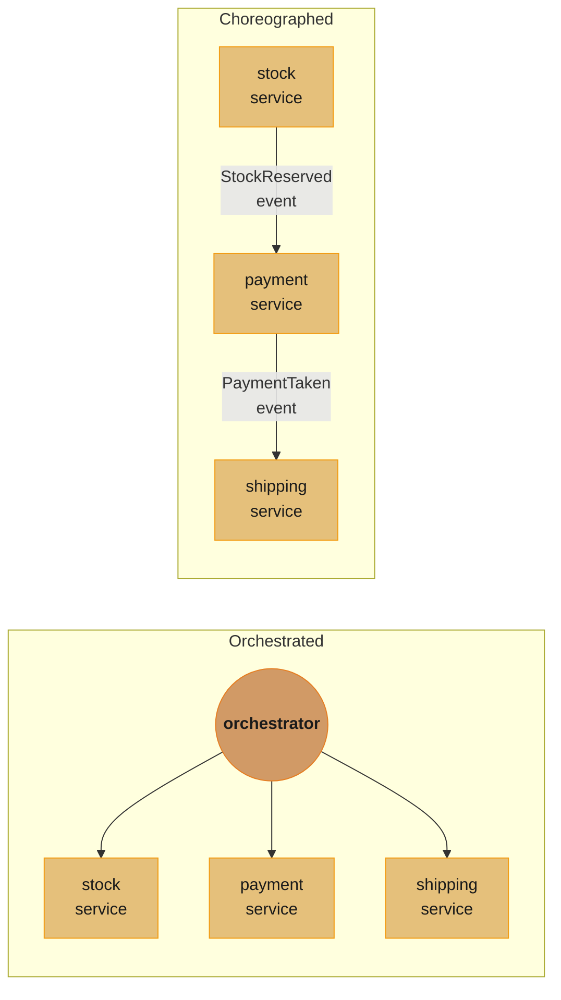
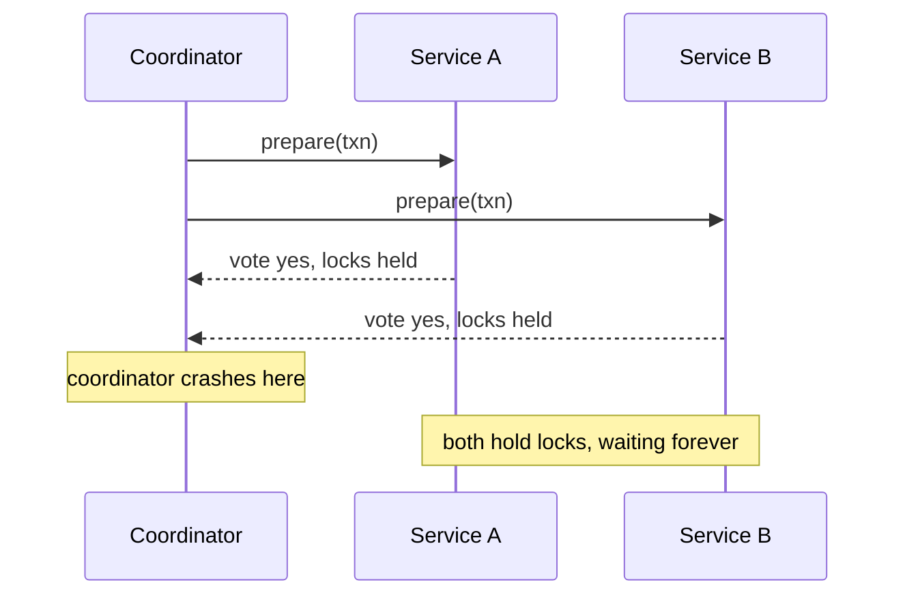
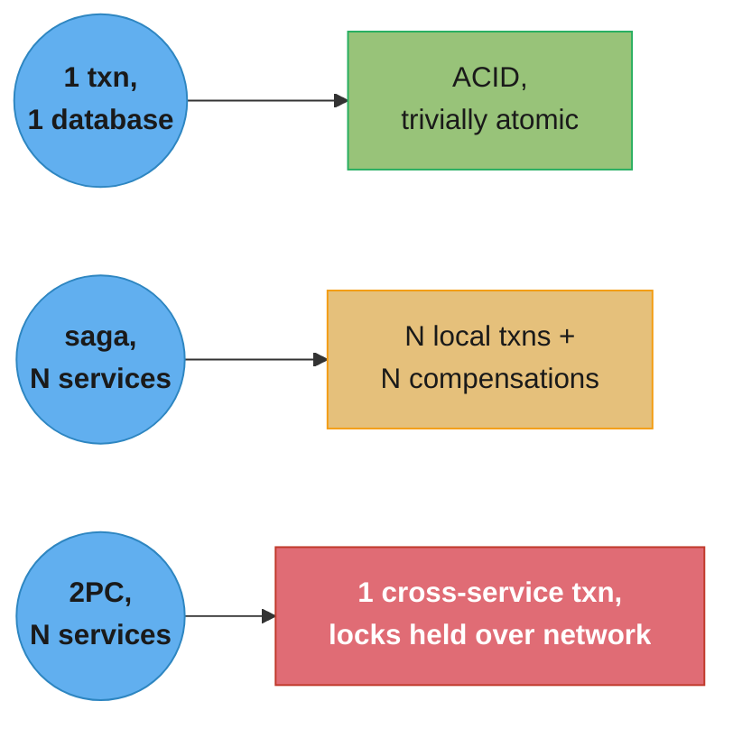

# Chapter 6: Workflow

> Part II — Implementation · Building Microservices, 2nd Edition (Sam Newman, O'Reilly 2021) ·
> builds on Ch 5 (Implementing Microservice Communication), leads to Ch 7 (Build)

## Chapter Map

Chapter 5 settled how two services talk to each other for a single call. This chapter asks the
harder question: what happens when a single *business* action — "place an order," "book a
trip" — has to touch several services, and some of those touches fail partway through? A
monolith answers this with a database transaction: wrap every write in `BEGIN`/`COMMIT`, and
either all of it happens or none of it does. Split the same action across five services with
five databases, and that guarantee evaporates — there is no single database left to wrap a
transaction around. Newman's chapter walks through the two ways people have tried to restore
some version of that guarantee: stretching the old transactional model across a network with a
**distributed transaction** (specifically **two-phase commit**), and abandoning atomicity in
favor of an explicitly modeled, resumable, compensatable business process — a **saga**.

**TL;DR:**
- A single-node ACID transaction gives you a clean way to reason about failure: apply every
  change, or roll all of it back, with nothing in between. Spread the same writes across
  several microservices and there is no longer one database to make that promise.
- **Two-phase commit (2PC)** tries to recreate atomicity anyway, by having a coordinator ask
  every participant to *vote* on a transaction before anyone commits — but it does this by
  **holding locks across a network call**, which trades throughput and availability for a
  guarantee that turns out to be weaker than advertised the moment the coordinator itself fails.
- Newman's blunt recommendation, stated as its own section heading: **distributed
  transactions — just say no.** Don't reach for 2PC as your default answer to "how do these five
  services agree" in a microservice architecture.
- A **saga** breaks the business process into a sequence of local transactions, one per service,
  each with a paired **compensating transaction** that semantically (not literally) undoes it if
  a later step fails. Sagas can be **orchestrated** (one component tells every service what to
  do) or **choreographed** (services react to each other's events with no central conductor),
  and each style trades explicitness for coupling in the opposite direction.

## The Big Question

How do you keep a multistep business process consistent when the steps live in different
services, on different databases, connected by an unreliable network — without giving up the
independent deployability that was the whole point of splitting the monolith apart?

Analogy: a monolith's transaction is a single clerk filling out one form in one office — either
the whole form gets filed, or the clerk tears it up and nothing happened. A saga is the same
process routed through five different departments in five different buildings, each with its own
filing cabinet. Nobody can reach into another department's cabinet to undo their entry directly;
if department three refuses the request, departments one and two have to be sent a *cancellation
notice* asking them to reverse what they already filed. That cancellation is never as clean as
tearing up the original form — money already refunded, an email already sent, a seat already
released back into inventory — which is exactly why sagas are harder to reason about than a
single transaction, and exactly why they are unavoidable once the departments are separate
services.

---

## 6.1 Database Transactions

A **database transaction** groups a set of operations that should be treated as a single unit:
the database applies all of them, or (on any failure) none of them, and the application never has
to handle a state where only some of a multi-write operation stuck. This is the baseline every
later section is measured against — it's the guarantee that gets harder to reproduce, and
eventually has to be replaced with something structurally different, once a business operation
stops living inside one database.

The trouble starts the moment "one business operation" needs to update rows that live in more
than one service's database. In a monolith that's still one transaction against one schema. In a
microservice architecture, order placement might need to reserve stock in an inventory service,
charge a customer in a payment service, and schedule a shipment in a logistics service — three
separate databases, three separate transaction boundaries, and no built-in way to make the three
of them succeed or fail together.

## 6.2 ACID Transactions

**ACID** — **Atomicity**, **Consistency**, **Isolation**, **Durability** — names the specific
guarantees a database transaction is expected to provide. Atomicity is the one this chapter
cares about most: a transaction's writes are indivisible, either all committed or all rolled
back. Consistency means a transaction moves the database from one valid state to another,
respecting whatever constraints (foreign keys, uniqueness) are defined. Isolation controls what
concurrently running transactions can see of each other's uncommitted work — with weaker
isolation levels a common, deliberate performance trade-off (Chapter 4's material on eventual
consistency across service boundaries is the distributed-systems version of the same trade-off).
Durability means a committed transaction survives a crash immediately afterward.

Every one of the four properties is easy to state and, in various ways, hard to get for free once
the data a "transaction" touches is spread across independently owned services. Atomicity is
where the chapter focuses, because it's the property people reach hardest to preserve, and the
one whose preservation (via 2PC) turns out to be the most expensive.

## 6.3 Still ACID, but Lacking Atomicity?

A tempting middle ground: keep writing to several services' databases, but give up specifically
on cross-service atomicity while trying to hold on to everything else ACID promised. In practice
this means each service still runs a perfectly ordinary local ACID transaction against its own
database — so an individual write to inventory, or to payments, is atomic, consistent, isolated,
and durable *within that service* — but nothing binds the two service-local transactions
together. Either write can succeed while the other fails, and the application is left holding a
partially applied business operation with no database-level mechanism to detect or repair it.

This is the situation every technique in the rest of the chapter is responding to. You can't get
distributed atomicity by simply refusing to think about it — the failure mode (some services
committed, others didn't) doesn't go away, it just becomes the application's problem instead of
the database's. The chapter's answer is not "find a database clever enough to fix this
transparently" but "change the way the business process itself is modeled" — which is where
sagas eventually land — after first showing why the obvious network-level fix, distributed
transactions, is not a clean substitute.

---

## 6.4 Distributed Transactions — Two-Phase Commits

**Two-phase commit (2PC)** is the classic algorithm for making a transaction atomic across
multiple independent resources (here, multiple services' databases). A **transaction manager**
(coordinator) drives two rounds with every **participant** (called a **cohort** in some
literature):

1. **Voting phase.** The coordinator asks every participant to prepare the transaction — do
   everything short of committing, and lock whatever rows/records are involved so no other
   transaction can interleave. Each participant replies "yes, I can commit" or "no."
2. **Commit phase.** If every participant voted yes, the coordinator tells all of them to commit
   for real. If even one voted no (or didn't answer in time), the coordinator tells all of them
   to roll back instead.

The mechanism works, in the narrow sense that it does deliver atomicity across participants who
follow the protocol correctly and stay reachable. The costs are what make Newman steer readers
away from it as a default:

- **Locks are held across a network round trip.** Between the vote and the final decision, every
  participant must keep its locks in place — meaning any other transaction that wants to touch
  the same rows has to wait, potentially for as long as the coordinator takes to hear back from
  the *slowest* participant. Throughput on a busy, highly contended dataset degrades sharply,
  because 2PC turns "a single service's lock duration" into "the slowest service in the whole
  transaction's lock duration."
- **A participant that never responds blocks the whole transaction.** The coordinator has no
  choice but to wait; there's no correct way to time out and guess, because it might be about to
  hear "yes."
- **The coordinator is a single point of failure at exactly the wrong moment.** If it crashes
  after collecting votes but before broadcasting the final decision, every participant is stuck
  holding its locks indefinitely, unsure whether to commit or roll back — this is the protocol's
  well-known **blocking** failure mode, and it is not a corner case, it is 2PC's structural
  weak point.
- Every participating service now has an availability dependency on every *other* participating
  service, for the duration of the transaction — precisely the coupling microservice
  architectures are trying to remove.

## 6.5 Distributed Transactions — Just Say No

Having laid out what 2PC actually costs, the chapter's position is direct: treat a distributed
transaction as a tool of last resort, not a default answer to "how do several services agree."
The reasoning isn't that 2PC is *incorrect* — under the right conditions it does deliver
atomicity — it's that the price (locked resources across a slow network hop, a blocking failure
mode centered on the one component everyone depends on, and services newly coupled at runtime in
exactly the way splitting them apart was meant to avoid) is rarely worth paying compared to
designing the business process so it doesn't need cross-service atomicity in the first place.
Newman notes this isn't a universal prohibition — there are systems, and vendor-specific
protocols, built around distributed transactions successfully — but for the common case of
independently deployed, independently owned microservices, the chapter treats it as the wrong
tool, and spends the rest of its pages on the alternative that has actually caught on in this
space: the saga.

---

## 6.6 Sagas

A **saga** models a long-running business process as a *sequence of local transactions*, one per
participating service, each of which is a completely ordinary ACID transaction scoped to that one
service's own database. There is no cross-service lock, no coordinator holding participants
hostage mid-protocol, and no attempt to make the overall process atomic in the database sense.
Instead, every step that changes state defines a paired **compensating transaction** — a step
that semantically reverses it — and if a later step in the sequence fails, the saga runs the
compensating transactions for every step that already succeeded, in reverse order.

The crucial word is *semantically*. A compensating transaction doesn't restore the exact prior
database row values the way a database rollback does — it issues a new, forward-moving business
operation whose effect is "undo the meaning of the earlier one." Refunding a payment is the
compensation for charging it, not a literal deletion of the charge record (which would usually
violate an audit trail anyway); releasing a reserved seat back into inventory is the compensation
for reserving it, not erasing the fact the reservation was ever attempted.

```
  order saga: reserve stock -> take payment -> schedule shipment

  happy path:
    [reserve stock] --ok--> [take payment] --ok--> [schedule shipment] --ok--> DONE

  step 3 fails (no shipping slot available):
    [reserve stock] --ok--> [take payment] --ok--> [schedule shipment] --FAILS
                                    |
                                    v
                     compensate: [refund payment]
                                    |
                                    v
                     compensate: [release stock reservation]
                                    |
                                    v
                                  DONE (business operation abandoned, cleanly)
```

Because every step and every compensation is an ordinary local transaction, no service is ever
asked to hold a lock waiting on a network call to a different service. What the saga gives up, in
exchange, is atomicity in the classic sense: for a window of real time, the order genuinely *is*
partially applied — stock reserved, no payment taken yet — and any other part of the system
reading that state during the window sees it. Designing a saga means designing for that visible,
temporary inconsistency, not pretending it isn't there.

## 6.7 Saga Failure Modes

A failed step forces a choice between two directions of recovery:

- **Backward recovery** undoes the work already done, via compensating transactions, and reports
  the overall business operation as failed — this is the path in the diagram above. It's the
  natural fit when a step's failure means the business goal genuinely cannot be completed (no
  shipping slot exists anywhere), and it's the direction every compensating-transaction discussion
  in this chapter assumes by default.
- **Forward recovery** instead retries the failed step (or a substitute for it) until it
  eventually succeeds, and only then lets the saga continue forward. This only makes sense when
  the failure is plausibly transient — a downstream service being briefly overloaded, not a
  business rule that will never be satisfied — and it depends on the step being safely retryable,
  which usually means the step, and the retry logic driving it, must be **idempotent**.

Choosing between the two isn't a one-time architectural decision made once for a whole saga —
different steps in the *same* saga can reasonably use different recovery strategies. A
transient network blip talking to the shipping service might warrant a few forward-recovery
retries before giving up; running out of stock entirely never will, and should trigger backward
recovery immediately.

### Saga Rollbacks

Even committing to backward recovery leaves real design work: compensating transactions must be
issued in the *reverse* order the original steps ran in, and — because other parts of the system
may have already observed and acted on the partially applied state — a compensation is not
guaranteed to be trivially safe. Refunding a payment is usually clean; "un-sending" a
notification email that already reached the customer's inbox is not literally possible, so the
compensation for a step like that has to be a different kind of corrective action (a follow-up
"please disregard" message) rather than a true reversal. Some steps, in other words, don't have a
compensation that fully undoes their real-world effect, and a saga design has to reckon with that
honestly rather than assume every step is reversible by construction.

## 6.8 Implementing Sagas

Two structurally different ways to coordinate the steps of a saga:

### Orchestrated Sagas

An **orchestrated saga** puts a single component — the **orchestrator** — explicitly in charge:
it calls each participating service in turn, tracks which steps have completed, and on failure it
is the orchestrator that decides whether to compensate and in what order. This makes the process
*visible* — the entire sequence of steps for "place an order" lives in one place, readable as a
single piece of logic (often literally expressed as a state machine or workflow definition), which
is a real advantage for understanding and debugging a specific saga run. The trade-off is
coupling: the orchestrator has to know about every participant it calls, which risks becoming a
"god component" that centralizes too much business logic and creates a runtime dependency from
every step back to the orchestrator itself.

### Choreographed Sagas

A **choreographed saga** has no central conductor. Each service publishes events describing what
it did ("stock reserved," "payment taken"), and other services subscribe to the events relevant
to them and react by performing their own step, publishing their own event in turn. Nobody holds
the whole sequence in one place — the process emerges from the sum of every service's individual
reactions to events it cares about. This trades away the orchestrator's single point of coupling
(and its single point of failure) for a harder debugging problem: understanding "why didn't step
four run" now means tracing a chain of events across several services' logs instead of reading one
orchestrator's state, and there's a real risk of **cyclic dependencies** between services that
each react to each other's events without anyone having drawn the whole picture.



Caption: orchestration centralizes the sequence in one readable place at the cost of a hub every
participant depends on; choreography removes that hub but scatters the sequence across every
service's event reactions, so understanding the whole process means reconstructing it from parts.

### Mixing Styles

Real systems rarely commit to one style for every saga in the codebase, and a single saga can mix
both: an orchestrator can drive most of a process while a couple of participating services react
to each other's events directly for a tightly coupled sub-step, or a mostly choreographed flow
can insert a small orchestrator for one particularly intricate piece of sequencing. The right
default leans choreographed for simpler, more decoupled flows and orchestrated once a process
has enough steps and enough conditional branching that "read the orchestrator's definition" is
genuinely easier than "trace the event chain" — there's no formula, only a judgment call that
should be revisited as a given saga's complexity grows.

### A Worked Saga: Order Placement in Numbers

To make the trade-offs concrete, walk the order-placement saga from the diagram above with
representative numbers for a mid-size e-commerce system:

- **Local transaction latency** per step (reserve stock, take payment, schedule shipment):
  typically 20-80 ms each, dominated by the service's own database round trip, not the network
  between services.
- **End-to-end saga duration**, happy path: roughly 100-300 ms across three sequential steps —
  close to what a single-database transaction touching three tables would cost, because no
  cross-service lock is ever held waiting on another service's response.
- **Compensation cost on failure**: refunding a payment through a third-party processor can add
  200 ms-2 s of its own (a real network call to an external system, not a local rollback), so a
  saga's failure path is often *slower* than its happy path, not faster — a detail that's easy to
  overlook when only the happy path gets load-tested.
- **Contrast with 2PC** on the same three services: the coordinator's voting round alone adds one
  full network round trip per participant *before* any commit happens, and every participant's
  locks stay held for the coordinator's total round-trip time across all three — under load, this
  can turn a 100 ms local-transaction-equivalent operation into multiple seconds of held locks,
  which is the concrete shape of the throughput cost §6.4 describes.

## 6.9 Sagas Versus Distributed Transactions

The chapter's closing comparison is not "sagas are strictly better" — each makes a fundamentally
different trade. A distributed transaction (2PC) preserves atomicity as the database understands
it, at the cost of holding cross-service locks and introducing a coordinator whose failure blocks
everyone. A saga gives up atomicity — a partially applied business operation is visibly,
observably real for a window of time — in exchange for never holding a cross-service lock and
never having any one component's failure block every other participant indefinitely. For
independently deployed, independently owned microservices, the chapter's guidance from §6.5
still holds: reach for sagas as the default way to keep a multiservice business process
consistent, and treat 2PC as a niche tool for the rare case where you control every participant
tightly enough to accept its costs.

---

## Visual Intuition



Caption: the moment 2PC's coordinator dies between collecting votes and broadcasting the
decision, every participant is stuck holding locks with no way to know whether to commit or roll
back — the protocol's blocking failure mode, and the structural reason Newman steers readers
away from it.

```
  saga step outcomes and their required response

  step result              recovery direction      what actually runs
  ------------------------ ------------------------ --------------------------------
  transient failure        forward recovery         retry the SAME step (idempotent)
  business rule violated   backward recovery         compensate every PRIOR step
  compensation itself      no clean answer            escalate: manual, or a
    fails                                             corrective, non-reversing action
```

Caption: not every saga failure gets the same treatment — only a genuinely transient failure is
worth retrying forward; a real business-rule failure needs the prior steps unwound, and a failed
compensation is the one case the chapter has no tidy algorithmic answer for.



Caption: a monolith's single transaction, a saga's chain of local transactions, and 2PC's single
cross-service transaction are three different answers to the same "how many writes must succeed
together" question — only the middle one avoids holding a lock across a network hop.

---

## Key Concepts Glossary

- **Database transaction** — a group of writes applied atomically: all of them, or none.
- **ACID** — Atomicity, Consistency, Isolation, Durability; the guarantee set a transaction offers.
- **Atomicity** — a transaction's writes are indivisible: fully committed or fully rolled back.
- **Isolation** — what one transaction can see of another's uncommitted writes.
- **Distributed transaction** — an attempt to make writes atomic across multiple independent
  resources or services.
- **Two-phase commit (2PC)** — a protocol coordinating a distributed transaction in a voting
  phase followed by a commit/rollback phase.
- **Transaction manager (coordinator)** — the component driving 2PC's voting and commit rounds.
- **Participant (cohort)** — one resource/service taking part in a 2PC transaction.
- **Blocking (2PC failure mode)** — participants hold locks indefinitely if the coordinator dies
  between collecting votes and broadcasting the decision.
- **Saga** — a business process modeled as a sequence of local transactions, each with a paired
  compensating transaction.
- **Local transaction** — an ordinary ACID transaction scoped to a single service's own database.
- **Compensating transaction** — a step that semantically reverses an earlier saga step's effect.
- **Backward recovery** — undoing completed saga steps via compensation after a failure.
- **Forward recovery** — retrying a failed saga step until it succeeds, then continuing forward.
- **Idempotent (retry context)** — safe to retry without changing the outcome beyond the first
  successful application.
- **Orchestrated saga** — a single orchestrator component explicitly sequences and compensates
  every step.
- **Orchestrator** — the component driving an orchestrated saga.
- **Choreographed saga** — services react to each other's published events with no central
  conductor.
- **Cyclic dependency (choreography)** — services indirectly depending on each other's event
  reactions in a loop, making the overall flow hard to trace.

---

## Tradeoffs & Decision Tables

| | Two-Phase Commit | Saga |
|---|---|---|
| Cross-service locks held | Yes, across a network round trip | Never |
| Atomicity | Preserved (if participants stay reachable) | Given up — partial state is visibly real |
| Coordinator/orchestrator failure | Blocks every participant indefinitely | Orchestrated: retry/resume; choreographed: no single point |
| Throughput under contention | Degrades — locks held as long as the slowest participant | Each local transaction is short and independent |
| Reversal mechanism | Native rollback | Explicitly authored compensating transaction |
| Best fit | Tightly controlled participants, rare in independent microservices | Default choice across independently owned services |

| | Orchestrated saga | Choreographed saga |
|---|---|---|
| Where the sequence lives | One orchestrator component | Distributed across every service's event handlers |
| Debuggability of one saga run | High — read the orchestrator's state | Lower — reconstruct from event traces across services |
| Coupling | Every participant coupled to the orchestrator | Participants coupled only to event contracts |
| Risk | Orchestrator becomes a "god component" | Cyclic, hard-to-trace event dependencies |
| Best fit | Complex, branchy processes | Simple, mostly linear processes |

| Recovery direction | When it applies | Cost |
|---|---|---|
| Backward | Business rule genuinely violated | Every prior step needs a working compensation |
| Forward | Transient, retryable failure | Requires idempotent retries; wrong choice for a permanent failure |

---

## Common Pitfalls / War Stories

- **Reaching for 2PC out of habit.** Teams that grew up on single-database transactions often
  try to preserve that mental model across services by bolting on a distributed transaction
  coordinator, only to discover the coordinator itself becomes the new outage source, and the
  cross-service locking tanks throughput exactly when load is highest.
- **A compensation that isn't actually safe.** Treating "refund the payment" as equivalent to
  "the charge never happened" ignores that a customer may have already seen the charge, spent
  against the expectation of a shipment, or received a receipt email — the compensation has to
  account for what's already visible outside the database, not just inside it.
- **An orchestrator that grows into a monolith.** Once an orchestrator accumulates enough
  business rules for enough sagas, it can end up as the de facto center of the architecture,
  quietly reintroducing the tight coupling splitting the services apart was meant to remove.
- **Choreography nobody can trace.** Without documentation or tracing tying events together
  across services, "why didn't the shipment get scheduled" turns into a multi-service log
  archaeology exercise, because no single place shows the whole sequence.
- **Forward recovery retried against a non-transient failure.** Retrying a step that's failing
  for a genuine business reason (the item is actually out of stock everywhere) just delays the
  business-correct outcome — backward recovery, not retry — while looking like the system is
  "working on it."
- **Skipping idempotency on a retried step.** A step that both charges a payment and isn't
  idempotent can double-charge a customer the moment a retry fires after a response was merely
  lost on the way back, not because the original charge actually failed.

---

## Real-World Systems Referenced

Two-phase commit as a general distributed-transaction pattern, contrasted with saga-style
compensation as popularized in microservice architectures; the chapter frames both as patterns
rather than naming a single canonical product for either. Orchestrated sagas are commonly built
today with dedicated workflow/orchestration engines; choreographed sagas are commonly built on
event-streaming or message-broker infrastructure, both covered from the platform side in this
repo's `backend/durable_execution_and_workflows` and `backend/event_driven_fundamentals` modules.

---

## Summary

A single-node database transaction gives atomicity for free; splitting a business process across
independently owned microservices takes that guarantee away, because there's no longer one
database transaction can wrap. Two-phase commit tries to recreate it by holding locks across a
network call and centralizing the commit decision in a coordinator — a coordinator whose own
failure leaves every participant blocked indefinitely, which is why the chapter's guidance is to
avoid distributed transactions as a default. Sagas offer a structurally different answer: break
the process into local, single-service transactions, pair each with a compensating transaction,
and choose backward or forward recovery per step depending on whether a failure is a genuine
business-rule violation or a transient blip. Sagas can be orchestrated (one component sequences
everything, trading coupling for visibility) or choreographed (services react to each other's
events, trading visibility for decoupling), and real systems often mix both. None of this
restores atomicity in the database sense — a saga's partial state is real and visible while it's
in flight — but it avoids the coupling and blocking failure modes that make distributed
transactions a poor fit for independently deployable services.

---

## Interview Questions

**Q: Why does Newman recommend against reaching for a distributed transaction as your default answer to cross-service consistency?**
**Short:** 2PC holds locks across the network and its coordinator can block every participant on failure.
Two-phase commit does preserve atomicity when it works, but the cost is holding every participant's locks for the duration of a network round trip to a coordinator, so throughput under contention degrades to the speed of the slowest participant. Worse, if the coordinator crashes between collecting votes and broadcasting the final decision, every participant is left holding its locks with no safe way to know whether to commit or roll back — a structural blocking failure mode, not a rare edge case — which is why the chapter's own section heading states the position bluntly: distributed transactions, just say no.

**Q: What actually gets "undone" by a compensating transaction, and why isn't it the same as a database rollback?**
**Short:** A compensating transaction semantically reverses a step's business effect, not its literal database rows.
A database rollback restores the exact prior state because nothing outside the transaction ever saw the uncommitted write; a saga's steps are ordinary committed local transactions, so by the time a later step fails, earlier steps' effects may already be visible elsewhere in the system. Refunding a payment is the compensation for charging it, not erasing the charge record, and some effects — a notification email already delivered — have no true reversal at all, only a corrective follow-up action.

**Q: How do you decide whether a failed saga step should use backward or forward recovery?**
**Short:** Forward recovery only fits a transient, retryable failure; backward recovery fits a real rule violation.
Forward recovery retries the failed step (or a substitute) until it succeeds and then continues the saga forward, which only makes sense if the failure is plausibly temporary and the retry is idempotent — a payment service being briefly overloaded is a reasonable case. Backward recovery instead runs compensating transactions for every step that already completed and abandons the business operation, which is the right call whenever the failure reflects a genuine business-rule violation, such as no shipping slot existing anywhere, that retrying will never fix.

**Q: What's the core trade-off between orchestrated and choreographed sagas?**
**Short:** Orchestration centralizes the sequence for visibility; choreography decentralizes it to cut coupling.
An orchestrated saga has one component explicitly call each service in turn and decide on compensation, which makes the entire sequence readable in one place but couples every participant to that orchestrator and risks it growing into a de facto architectural hub. A choreographed saga instead has services publish and react to events with no central conductor, removing that coupling but making the full sequence something you can only reconstruct by tracing events across every participating service's logs.

**Q: Why can choreographed sagas end up with cyclic dependencies, and why does that matter?**
**Short:** Services reacting to each other's events can form an implicit loop nobody explicitly designed.
Because each service only knows the events it subscribes to and the events it publishes in response, nothing forces anyone to draw the whole flow, so two or more services can end up indirectly triggering each other in a cycle that only becomes visible when you trace actual event traffic. That matters because a cyclic dependency undermines the very decoupling choreography was chosen for, and it's much harder to spot in a distributed event flow than it would be in a single orchestrator's linear definition.

**Q: What is the fundamental thing a saga gives up compared to a real ACID transaction?**
**Short:** Atomicity — a saga's partial state is genuinely visible to the rest of the system while in flight.
An ACID transaction guarantees nobody outside it ever observes a partially applied set of writes; a saga is built from committed, independent local transactions, so between "stock reserved" and "payment taken" the order really is in a partially applied state, and anything reading it during that window sees exactly that. Designing a saga therefore means designing the rest of the system to tolerate that visible in-between state, not assuming it can be hidden the way a database transaction hides its own uncommitted work.

**Q: Why does 2PC hurt throughput specifically, beyond just "it's slower"?**
**Short:** Every participant holds its locks for as long as the slowest participant takes to respond.
During the voting phase every participant locks the rows involved in the transaction and keeps them locked until the coordinator's final commit/rollback message arrives, which means the lock duration for the fastest participant is dragged out to match whichever participant (or network hop) is slowest to respond. Any other transaction competing for those same rows has to wait the entire time, so contention-heavy workloads see throughput collapse in a way a single-node transaction, whose lock duration is bounded by local disk and CPU, never would.

**Q: Is a saga's compensating transaction guaranteed to always be possible? What's the honest answer?**
**Short:** No — some real-world effects, like a delivered notification, have no true reversal.
The chapter is explicit that not every step has a compensation that fully undoes its effect: refunding money is clean, but "un-sending" an email a customer already read isn't literally achievable, so the best you can do is issue a corrective follow-up rather than a genuine reversal. A saga design has to identify these steps up front and decide what an honest, non-reversing compensation looks like for them, rather than assuming every step is reversible by construction.

**Q: When, according to the chapter, might a distributed transaction actually be the right tool?**
**Short:** When you tightly control every participant and can accept the locking/coupling cost.
The chapter's "just say no" is a default, not an absolute ban — there are systems, and vendor-specific transaction protocols, where the participants are small in number, tightly controlled, and the cost of holding cross-resource locks is genuinely acceptable for the workload. For independently deployed, independently owned microservices — the normal target of this book — that situation is rare, which is why sagas, not 2PC, are the pattern the rest of the chapter, and later chapters, build on.

**Q: What does "still ACID, but lacking atomicity" actually describe?**
**Short:** Each service keeps ordinary local ACID transactions, but nothing binds them across services.
It describes the situation you get by default once a business operation spans several services: each individual write to inventory or payments is still a normal, fully ACID transaction within its own service's database, but no mechanism ties the two service-local transactions together, so one can succeed while the other fails. That's not a database feature you can turn on — it's the starting condition every technique in the chapter, distributed transactions and sagas alike, exists to respond to.

**Q: Why is an idempotent step a prerequisite for safe forward recovery?**
**Short:** Without idempotency, retrying a step that already partially succeeded can double-apply it.
Forward recovery means retrying a failed (or seemingly failed) step, but a response can be lost on the way back to the caller even though the underlying operation actually succeeded — retrying a non-idempotent payment charge in that situation charges the customer twice. Idempotency means the operation can be safely reapplied any number of times with the same end effect as applying it once, which is exactly what makes "just retry it" a safe default instead of a data-corruption risk.

**Q: How does a saga's compensating transaction differ from event sourcing's approach to reversing state?**
**Short:** A compensation issues a new forward-moving business action; it isn't a stored-event replay trick.
A saga's compensating transaction is an ordinary, explicitly authored operation that reverses the meaning of an earlier step — refund, release, cancel — executed as a fresh local transaction in its own right. It's a different mechanism from event sourcing's practice of reconstructing state by replaying a log of past events, though the two often appear in the same system, since a service already storing state as a sequence of events can make writing a compensating "reversal" event a natural fit.

**Q: What real risk does an orchestrator introduce that a choreographed design avoids?**
**Short:** The orchestrator becomes a single component every participating service depends on at runtime.
Because the orchestrator explicitly calls each participant and holds the authoritative view of saga progress, every step's execution runs through it, making it both a potential availability bottleneck and a natural place for unrelated business logic to accumulate over time until it functions like a shared, tightly coupled hub. Choreography has no equivalent single component, at the cost of losing the orchestrator's readable, centralized view of the whole process.

**Q: Give a concrete example of the difference between backward and forward recovery in the same saga.**
**Short:** Retry a slow shipping API call forward; roll back stock and payment if there's truly no stock.
If the shipping service is briefly timing out under load, retrying the "schedule shipment" call a few times (forward recovery) is reasonable, because the failure is plausibly transient and retrying doesn't change the outcome if it eventually succeeds. If instead the shipping service reports that no delivery slot exists anywhere for the requested item, retrying accomplishes nothing — the correct response is backward recovery: compensate the payment (refund) and compensate the stock reservation (release), abandoning the order cleanly.

**Q: Why can't you simply time out and assume "no" during 2PC's voting phase to avoid the blocking problem?**
**Short:** A slow but eventually "yes" response would be wrongly treated as a failed transaction.
If the coordinator gave up early and assumed a non-responding participant had voted no, it would risk rolling back a transaction that the slow participant was actually about to approve, silently discarding work that should have committed. There's no way to distinguish "about to say yes, just slow" from "genuinely unable to commit" without waiting, which is exactly the trade-off that produces 2PC's blocking behavior in the first place — there's no safe shortcut around it.

**Q: What does it mean to "mix styles" within a single saga, and why would a team do that?**
**Short:** Use orchestration for a saga's complex branches and choreography for its simpler, decoupled steps.
A team might drive most of a saga's steps through an orchestrator for visibility and easy debugging, while letting two tightly related services react to each other's events directly for a small, self-contained sub-step where a central conductor would add nothing but overhead. The choice isn't an all-or-nothing architectural commitment — as a specific saga's complexity and branching grow, it's reasonable to introduce orchestration for just the parts that need it, or to strip an orchestrator down where it's proven unnecessary.

**Q: Why can a saga's failure path be slower than its happy path, and why does that matter operationally?**
**Short:** Compensations often call external systems (payment processors) that add real latency of their own.
A compensating transaction is not a cheap local rollback — refunding a payment usually means a genuine network call to a third-party processor, which can add hundreds of milliseconds to seconds on top of whatever the original charge took. It matters operationally because teams often load-test only the happy path, leaving the compensation path's latency and failure modes (what happens if the refund call itself times out) undiscovered until a real outage forces every in-flight saga to compensate at once.

**Q: What single number best captures why 2PC hurts throughput more than latency alone suggests?**
**Short:** Lock hold time equals the coordinator's full round trip to every participant, not just one.
Under 2PC, every participant's locks stay held from the moment it votes until it receives the coordinator's final commit/rollback message, which spans at least one full round trip to the coordinator plus however long the slowest other participant took to vote — turning what might be a 20-80 ms local-transaction-equivalent operation into a multi-second lock hold under real load. Any other transaction wanting the same rows queues behind that entire window, which is why contention-heavy 2PC workloads degrade sharply rather than gracefully.

---

## Cross-links in this repo

- [backend/distributed_transactions_and_consistency/ — 2PC, sagas, and consistency patterns in depth](../../../backend/distributed_transactions_and_consistency/distributed_transactions_and_consistency.md)
- [backend/durable_execution_and_workflows/ — orchestration engines that implement orchestrated sagas](../../../backend/durable_execution_and_workflows/durable_execution_and_workflows.md)
- [backend/event_driven_fundamentals/ — the event backbone choreographed sagas run on](../../../backend/event_driven_fundamentals/event_driven_fundamentals.md)
- [backend/event_sourcing_and_cqrs/ — modeling state as events, a natural fit for compensations](../../../backend/event_sourcing_and_cqrs/event_sourcing_and_cqrs.md)
- [backend/fault_tolerance_patterns/ — retries, idempotency, and compensation-adjacent resilience patterns](../../../backend/fault_tolerance_patterns/fault_tolerance_patterns.md)
- [hld/distributed_transactions/ — 2PC and saga theory from the HLD perspective](../../../hld/distributed_transactions/distributed_transactions.md)
- Sibling chapters: [Ch 5 Implementing Microservice Communication](../05_implementing_microservice_communication/05_implementing_microservice_communication.md) · [Ch 12 Resiliency](../12_resiliency/12_resiliency.md) · [Ch 13 Scaling](../13_scaling/13_scaling.md)

## Further Reading

- Garcia-Molina and Salem, "Sagas," ACM SIGMOD 1987 — the original saga paper, framing sagas as
  a way to handle long-lived transactions within a single database before microservices existed.
- Gray and Lamport, "Consensus on Transaction Commit," ACM TODS 2006 — a formal treatment of
  two-phase and three-phase commit and their failure modes.
- Richardson, *Microservices Patterns* (Manning, 2018) — a companion treatment of saga
  orchestration and choreography patterns Newman's chapter references by name.
- Fowler, "Event Collaboration" and related writing on choreographed, event-driven service
  interaction, cited as background for the choreography style.
