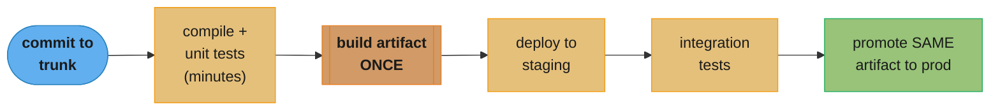
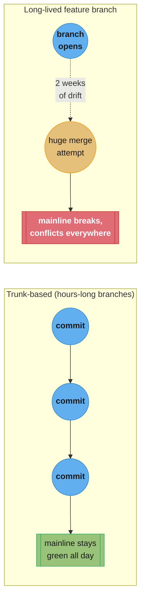

# Chapter 7: Build

> Part II — Implementation · Building Microservices, 2nd Edition (Sam Newman, O'Reilly 2021) ·
> builds on Ch 6 (Workflow), leads to Ch 8 (Deployment)

## Chapter Map

Chapter 6 dealt with keeping a business process consistent once it's split across services;
this chapter deals with the equally practical question of getting the *code* for those services
from a developer's change into something deployable. Newman treats continuous integration (CI)
as the load-bearing practice underneath everything else in Part II — not because CI is exotic,
but because it's astonishingly easy to claim you're doing it while actually doing something else,
and every later chapter (Deployment, Testing) assumes a working CI habit as a prerequisite. The
chapter's second half asks a question unique to microservices: given N services, do you want N
repositories, one giant repository, or something in between — and that decision, once made,
tends to be expensive to reverse.

**TL;DR:**
- **Continuous integration** means every developer merges to a shared mainline frequently — at
  least daily — and a fast, automated build proves the result is good after every merge. Many
  teams that believe they practice CI are actually running long-lived feature branches with
  infrequent, painful merges, which the chapter treats as a distinct and inferior practice.
- **Trunk-based development**, working directly (or via very short-lived branches) against one
  shared mainline, is the branching model that makes CI's "integrate frequently" promise
  achievable; long-lived feature branches structurally work against it.
- A **build pipeline** turns "did the build pass" into a staged **continuous delivery** process —
  compile, test, package, promote through environments — culminating in an **artifact** that is
  built once and promoted unchanged, never rebuilt per environment.
- The repository question — **one repository per microservice (multirepo)** versus a **single
  monorepo** for everything — is a genuine, consequential trade-off between team autonomy and
  cross-cutting refactorability, and the chapter declines to declare a universal winner.

## The Big Question

How do you keep dozens (or hundreds) of independently owned microservices individually buildable,
individually releasable, and collectively coherent — without either forcing every team through
one shared, slow build, or losing all visibility into how a cross-cutting change ripples across
services?

Analogy: think of a large newsroom publishing many separate stories every day. Continuous
integration is the norm that every reporter files small, frequent updates to a shared draft
rather than disappearing for two weeks to write an epic and then dumping it on the editor all at
once — the shared draft stays coherent because nobody lets their private version drift far from
it. The repository question is then a question about desks: does every reporter get a private
office (multirepo — total autonomy, but a style-guide change means visiting every office), or does
the whole newsroom share one floor (monorepo — a style-guide change touches everyone in one
sweep, but so does anyone's chair scraping the floor)? Neither answer is wrong; it depends on how
often the newsroom actually needs to touch every story at once.

---

## 7.1 A Brief Introduction to Continuous Integration

**Continuous integration (CI)** is the practice of merging every developer's work into a shared
mainline frequently — the chapter's benchmark is **at least once a day per developer** — with an
automated build (compile, run tests, produce a deployable artifact) running after every merge to
confirm the mainline still works. The payoff is that integration problems surface in small,
fast-to-diagnose pieces instead of accumulating into a giant, hard-to-untangle merge days or
weeks later. CI predates microservices by a long way, but the chapter treats it as more, not
less, important once a system is decomposed into many independently deployable services, because
a slow or broken feedback loop on any one service quietly undermines the "independently
deployable" promise the whole architecture is built on.

A defining, easy-to-miss detail: CI requires a **fast** build. If the automated build takes 45
minutes, "integrate and get feedback several times a day" becomes physically impossible for a
developer working at a normal pace, so build speed isn't a nice-to-have, it's a precondition for
CI actually functioning as intended.

## 7.2 Are You Really Doing CI?

The chapter's pointed diagnostic question exists because "we use a CI server" and "we practice
continuous integration" are not the same claim. A team can run Jenkins or GitHub Actions on every
push and still not be doing CI, if what triggers those builds is a two-week-old feature branch
being merged all at once. Newman's checklist for genuinely practicing CI:

- Developers commit to mainline **at least daily**.
- A **suite of automated tests** validates every commit — without tests, a fast green build
  proves only that the code compiles, not that it works.
- When the build breaks, **fixing it is the team's top priority**, ahead of new feature work,
  because a broken mainline blocks everyone else's integration too.

Miss any of these and what's actually happening is closer to **continuous building** (an
automated build server exists, but integration is still rare and large) than continuous
integration, and the two produce very different outcomes: continuous building still lets
integration pain accumulate for weeks before it's paid down all at once.

## 7.3 Branching Models

### Short-Lived Branches

A branch that lives for hours, not days, and merges back to mainline as soon as its small change
is ready keeps CI's daily-integration promise intact — the branch is really just a brief staging
area for a commit that's about to be integrated, not an alternative to integrating.

### Trunk-Based Development

**Trunk-based development** takes this further: developers commit directly to a single shared
mainline (**trunk**), or use branches so short-lived they're functionally equivalent to direct
commits, and rely on techniques like **feature toggles** (covered again in Chapter 8) to keep
unfinished work from affecting production behavior while it's still merged into trunk. This is
the branching model the chapter treats as the natural fit for CI, precisely because it can't
structurally drift into "long branch, painful merge" the way feature-branch workflows can. Teams
practicing trunk-based development commonly report merge conflicts measured in minutes, not the
multi-day merge efforts that accumulate on branches left open for a sprint or more.

Long-lived feature branches aren't presented as forbidden — a team can use them deliberately for
genuinely experimental or high-risk work — but the chapter is clear that as a *default* workflow
for ordinary day-to-day changes, they work directly against the integration frequency CI depends
on, because the longer a branch lives, the more mainline drifts underneath it and the more
expensive the eventual merge becomes.

---

## 7.4 Build Pipelines and Continuous Delivery

A single "build" step (compile, test) is only the first stage of getting code into production
safely. A **build pipeline** breaks that path into a sequence of stages — a fast initial build and
unit-test pass, then progressively slower and more expensive stages (integration tests, artifact
packaging, deployment to a staging environment) — so that cheap, fast checks fail early and expensive
checks only run once the cheap ones have already passed. **Continuous delivery (CD)** is the
discipline this pipeline exists in service of: keeping the software in a state where it *could* be
released to production at any time, whether or not every change is actually released immediately.

### Tooling

Pipeline tooling ranges from general-purpose CI/CD platforms configured with a pipeline-as-code
file checked into the repository, to systems purpose-built around multistage pipeline
visualization. The chapter's interest isn't in recommending a specific product — the landscape
shifts constantly — but in the properties a pipeline tool needs regardless of vendor: fast
feedback on early stages, a clear view of which stage a given commit is sitting in, and the
ability to model a genuinely staged, promote-forward flow rather than one flat list of steps.

### Trade-Offs and Environments

Every pipeline stage that runs against a real environment (a staging deployment, an
integration-test environment) adds both confidence and cost — more infrastructure to maintain,
more places a flaky test can block the pipeline, and more elapsed time between a commit and its
being provably production-ready. The chapter frames this as a genuine trade-off to be tuned
deliberately per team, not a checklist to maximize: more environments and more stages are not
automatically better if they mostly add latency without catching real problems.

### Artifact Creation

The pipeline should build the deployable **artifact** — a container image, a package, a
binary — exactly **once**, early in the pipeline, and then promote that same, unchanged artifact
through every later stage and environment. Rebuilding per environment (even from identical
source) reintroduces the risk that what gets tested in staging isn't bit-for-bit what reaches
production — a subtly different compiler flag, dependency resolution, or base image could produce
a different artifact from ostensibly the same commit. "Build once, promote everywhere" is the
guarantee that whatever passed every gate is exactly what runs in production.



Caption: the artifact is built once, right after the fast checks pass, and every later stage
promotes that identical artifact forward — nothing downstream ever rebuilds from source, which is
what makes "it passed staging" mean something about production.

---

## 7.5 Mapping Source Code and Builds to Microservices

Everything above answers "how does one build pipeline work"; this section answers a question
specific to having many services: how many source repositories, and how many pipelines, do you
actually run?

### One Giant Repo, One Giant Build

The naive starting point some teams drift into: every microservice's source lives in one
repository, and one pipeline builds and tests the entire thing on every commit, regardless of
which single service actually changed. This scales badly in a very concrete way — a one-line
change to a single service triggers a build and test run across services that weren't touched at
all, so build time grows with the *total* system's size rather than with the size of what
changed, and a flaky test anywhere in the repository can block every team's unrelated release.

### Pattern: One Repository per Microservice (aka Multirepo)

Giving each microservice its **own** repository, with its own independent pipeline, means a
change to one service triggers exactly one build, scoped exactly to that service — build time
tracks the size of the change, not the size of the whole system. This maps cleanly onto
independent team ownership (a team owns its repository and its pipeline outright) and keeps a
service's release cadence fully decoupled from every other service's. The cost shows up on
cross-cutting changes: a change that has to touch ten services' code (a shared library upgrade, a
API contract change) now means ten separate commits, ten separate pull requests, and ten separate
pipeline runs to coordinate, with no single commit that captures "this is one logical change."

### Pattern: Monorepo

The alternative: **all** microservices' source lives in a single repository, still normally with
per-service build tooling smart enough to build and test only what a given commit actually
touched (so a monorepo doesn't have to mean "one giant build" — that's the naive pattern above,
not an inherent property of a single repo). A monorepo's advantage is exactly where multirepo's
weakness is: a cross-cutting change — bumping a shared library, renaming an API used by six
services — can land as **one atomic commit** across every affected service, reviewed and merged
together, with nobody able to merge a service update against a stale version of a dependency
because everything lives at one revision. The costs are tooling and scale: a monorepo needs
build tooling sophisticated enough to determine what actually needs building from a given commit
(a naive "build everything" monorepo degenerates straight back into the giant-build pattern above)
and, as the repository and commit history grow, ordinary version-control operations (`clone`,
`status`, blame) can become measurably slower without investment in scaling the tooling — a cost
companies running monorepos at very large scale (in the tens of thousands of engineers) have had
to build custom tooling to manage.

### The Tradeoff Between the Two

Neither pattern dominates the other; the chapter frames the choice around how often the
organization genuinely needs atomic cross-service changes versus how much it values fully
independent, decoupled team ownership. A small number of tightly collaborating teams that
frequently need to change a shared contract across several services in lockstep lean toward the
monorepo's atomic-commit advantage; a larger, more loosely coupled organization where teams
rarely need to touch each other's services leans toward multirepo's clean ownership boundaries
and independent build/release cadence. The chapter is explicit that this decision, once an
organization has built tooling and habits around it, is expensive to reverse — which is exactly
why it deserves a deliberate choice rather than defaulting to whichever pattern the first few
services happened to fall into.

```
  cross-cutting change: bump a shared library used by 6 services

  MULTIREPO                              MONOREPO
  ---------------------------            ---------------------------
  6 separate commits                     1 atomic commit
  6 separate PRs to review               1 PR touching 6 service dirs
  6 separate pipeline runs               1 pipeline run, scoped to
  risk: services merge out of order        the 6 changed services
  risk: a stale service silently         no service can reference a
    depends on the old library version     stale version - it's the
    until its own team gets to it          same commit, same revision
```

Caption: the same change costs one commit in a monorepo and six coordinated commits in a
multirepo — but the monorepo's build tooling has to be smart enough to scope that one commit's
build to only the six services it touched, or it degenerates into the "one giant build" pattern.

---

## Visual Intuition



Caption: trunk-based commits integrate small and often, so mainline never drifts far from any one
developer's work; a feature branch left open for weeks accumulates drift silently until one large,
painful merge surfaces all of it at once.

```
  build time as system size grows

  ONE GIANT BUILD                 MULTIREPO / SCOPED MONOREPO
  -----------------------         -----------------------
  services: 5   -> build: 5m      services: 5   -> build: 1m (1 service changed)
  services: 20  -> build: 20m     services: 20  -> build: 1m (still 1 service changed)
  services: 100 -> build: 90m+    services: 100 -> build: 1m (still 1 service changed)

  build time tracks TOTAL system size          build time tracks CHANGE size
```

Caption: a one-line change to a single service costs the same build time whether the system has 5
services or 100, as long as the pipeline is scoped to what actually changed — the giant-build
pattern is the one where system growth directly taxes every single commit.

---

## Key Concepts Glossary

- **Continuous integration (CI)** — merging every developer's work to a shared mainline
  frequently, with an automated build validating each merge.
- **Mainline (trunk)** — the single shared branch every developer integrates against.
- **Continuous building** — an automated build server runs, but integration is still rare and
  large; often mistaken for CI.
- **Short-lived branch** — a branch merged back within hours, functioning as a brief staging area
  rather than an alternative to integration.
- **Trunk-based development** — committing directly (or via very short-lived branches) to one
  shared mainline.
- **Feature toggle** — a runtime switch letting unfinished code sit in mainline without affecting
  behavior; enables trunk-based development.
- **Build pipeline** — a staged sequence from fast checks through slower checks to a promotable
  artifact.
- **Continuous delivery (CD)** — keeping software releasable at any time, whether or not every
  change is released immediately.
- **Artifact** — the deployable unit (image, package, binary) built once and promoted, never
  rebuilt per environment.
- **Build once, promote everywhere** — the discipline of never rebuilding an artifact after its
  first build.
- **One giant repo, one giant build** — every service's source and pipeline unified, rebuilding
  everything on every commit.
- **Multirepo** — one repository, and one independent pipeline, per microservice.
- **Monorepo** — all microservices' source in a single repository, ideally with change-scoped
  build tooling.

---

## Tradeoffs & Decision Tables

| | Trunk-based development | Long-lived feature branches |
|---|---|---|
| Integration frequency | At least daily by design | Drifts further apart the longer the branch lives |
| Merge pain | Small, frequent, cheap | Large, infrequent, expensive |
| Requires | Feature toggles for incomplete work | Nothing extra, but undermines CI's premise |
| Fit with CI | Natural fit | Structurally works against it as a default |

| | Multirepo | Monorepo |
|---|---|---|
| Ownership boundary | Clean — one team, one repo, one pipeline | Shared repository, needs enforced ownership conventions |
| Cross-cutting change | Many coordinated commits/PRs | One atomic commit |
| Build scope | Naturally scoped to the one repo that changed | Needs tooling to scope to what changed, or degenerates into one giant build |
| VCS tooling at scale | Standard tooling suffices | Needs investment as history/size grows |
| Best fit | Loosely coupled teams, independent cadence | Frequent cross-service atomic changes |

| Pipeline stage | Typical cost | What it catches |
|---|---|---|
| Compile + unit tests | Fast (seconds-minutes) | Syntax errors, logic bugs in isolation |
| Package artifact | Fast, runs once | Nothing new — just produces the promotable unit |
| Deploy to staging + integration tests | Slower (minutes) | Cross-service contract breaks |
| Promote to production | Fast (same artifact, no rebuild) | Nothing — nothing left to catch if earlier stages passed |

---

## Common Pitfalls / War Stories

- **Calling long feature branches "CI" because a build server exists.** The build server running
  green on a two-week-old branch's eventual merge says nothing about how much integration pain
  quietly accumulated while the branch was open — the automated build is necessary but not
  sufficient for the practice actually being CI.
- **A slow build silently disabling CI.** Once a build takes 30-45 minutes, developers stop
  running it before every small commit, and integration frequency degrades even though nobody
  changed the branching model — the slow build itself becomes the thing undermining CI.
- **Rebuilding the artifact per environment.** A subtly different dependency resolution or base
  image between the "staging build" and the "production build" from the same commit means a bug
  can appear in production that staging never had the chance to catch, defeating the point of
  the staging gate entirely.
- **A monorepo that builds everything on every commit.** Adopting a monorepo without
  change-scoped build tooling reproduces the one-giant-build pattern's worst property — build
  time that grows with total system size — while additionally taking on the monorepo's VCS
  scaling costs, the worst of both patterns at once.
- **A multirepo cross-cutting change that ships out of order.** Six services depending on a
  shared library get their six coordinated PRs merged and deployed in a different order than
  planned, leaving some services running the old contract against others already on the new one
  for an uncomfortable window.
- **Treating the repository split as a one-time decision.** Teams that pick multirepo or monorepo
  early and never revisit it as team structure and cross-cutting-change frequency change end up
  fighting their tooling instead of the tooling supporting how the organization actually works
  now.

---

## Real-World Systems Referenced

The chapter discusses CI/CD platform tooling and pipeline-as-code approaches generically rather
than endorsing one vendor, noting the landscape changes quickly; it references large
organizations known publicly for running monorepos at scale (companies whose engineering
population runs into the tens of thousands) as the concrete case for why monorepo tooling
investment becomes necessary past a certain size, and treats one-repository-per-service as the
default multirepo pattern most microservice teams reach for first.

---

## Summary

Continuous integration only delivers its promised benefit — small, fast, frequent integration
that surfaces problems while they're still cheap to fix — if a team is actually integrating
daily against a fast, automated build with real test coverage; a CI *server* running against
long-lived branches is a different, weaker practice wearing the same name. Trunk-based
development, supported by feature toggles for incomplete work, is the branching model that makes
genuine CI achievable by construction. A build pipeline turns that single build into a staged
continuous-delivery process, culminating in an artifact built exactly once and promoted unchanged
through every environment. Multiplying this across many microservices raises a repository
question with no universally correct answer: multirepo gives each service (and team) a clean,
independently paced build and ownership boundary at the cost of coordinating cross-cutting
changes across many repositories, while a monorepo lets a cross-cutting change land as one atomic
commit at the cost of needing change-scoped build tooling and, at scale, real investment in
version-control performance. The choice compounds over time and is expensive to reverse, which is
the chapter's real argument for making it deliberately.

---

## Interview Questions

**Q: What's the concrete difference between "running a CI server" and "practicing continuous integration"?**
**Short:** CI requires daily merges to mainline with real tests; a build server alone doesn't guarantee that.
A build server that runs automatically on every push proves nothing about integration frequency if what triggers it is a feature branch merged once every two weeks — the automated build is necessary but not sufficient. Genuine CI requires developers committing to mainline at least daily, a real automated test suite validating each commit, and fixing a broken build as the team's top priority, because without all three, integration pain still accumulates for weeks before being paid down all at once, which is exactly what CI exists to prevent.

**Q: Why does trunk-based development fit continuous integration better than long-lived feature branches by construction?**
**Short:** Short-lived branches can't structurally drift far from mainline; long branches can drift for weeks.
Trunk-based development keeps branches (if used at all) alive for hours, so they function as a brief staging area for a commit about to be integrated rather than an alternative to integrating — mainline never has time to drift meaningfully underneath any one developer's work. A feature branch left open for two weeks accumulates drift the whole time it's open, so its eventual merge concentrates integration pain into one large, expensive event instead of spreading it across many small, cheap ones.

**Q: Why is feature-toggling necessary for trunk-based development to work in practice?**
**Short:** It lets unfinished code sit merged in mainline without changing production behavior yet.
Committing directly to trunk means an in-progress feature's code has to live in mainline before it's actually ready for users, and a feature toggle is what makes that safe — the code merges and gets built/tested alongside everything else, but a runtime flag keeps it from executing until the team is ready to turn it on. Without toggles, trunk-based development would force a choice between exposing half-finished work to users or reverting to the long-branch pattern it's meant to replace.

**Q: What does "build once, promote everywhere" actually guard against?**
**Short:** It prevents a rebuild introducing a subtle difference between what was tested and what ships.
If an artifact is rebuilt from the same source for each environment, even a small nondeterminism — a slightly different dependency resolution, a different base image layer, a different compiler flag — can produce a build that passed staging but isn't bit-for-bit what reaches production, silently invalidating every earlier test result. Building the artifact exactly once and promoting that identical binary/image through every later stage is what makes "it passed staging" mean something concrete about what will run in production.

**Q: What is the core cost multirepo pays that monorepo avoids, and vice versa?**
**Short:** Multirepo pays for cross-cutting changes; monorepo pays for VCS scale and build-scoping tooling.
Multirepo gives each microservice its own repository and independent pipeline, so a one-line change to one service triggers exactly one scoped build — but a change touching ten services' code needs ten coordinated commits and PRs with no single revision capturing it as one logical change. A monorepo lets that same cross-cutting change land as one atomic commit across every affected service, but only stays fast if its build tooling can scope a build to just what a commit actually touched, and its ordinary version-control operations need real investment to stay fast as the repository and its history grow large.

**Q: Why does the "one giant repo, one giant build" pattern scale badly, specifically?**
**Short:** Build time tracks total system size, not the size of what actually changed, on every commit.
A single pipeline rebuilding and retesting the entire system on every commit means a one-line change to one service pays the same build cost as a change touching every service, so as the system grows from 5 services to 100, every single commit's feedback loop gets slower even though most commits only touch a small part of the codebase. It also means a flaky test anywhere in the system can block every team's unrelated release, coupling teams' release cadences together in exactly the way splitting into microservices was meant to avoid.

**Q: Can a monorepo avoid the "one giant build" problem, and how?**
**Short:** Yes, with build tooling that scopes each build to only the services a given commit actually touched.
A monorepo doesn't inherently mean rebuilding everything on every commit — that's the naive "one giant build" pattern, not a required property of using a single repository. Sophisticated monorepo tooling determines which services a commit's changed files actually affect and builds and tests only those, which is what lets large organizations run monorepos with build times that track the size of a change rather than the size of the whole codebase; without that tooling investment, a monorepo degenerates straight back into the giant-build pattern while also taking on monorepo-scale version-control costs.

**Q: What real risk does a multirepo cross-cutting change create that a monorepo's atomic commit avoids?**
**Short:** Services can end up deployed out of order, briefly running mismatched versions of a shared contract.
When a shared library or API contract change requires six separate PRs across six repositories, nothing guarantees those six changes merge and deploy in the intended order, so some services can end up running the new contract while others are still on the old one for an uncomfortable window. A monorepo's atomic commit removes this risk structurally — every affected service's code changes together in one revision, so there's no window where some services see the change and others don't.

**Q: Why does build speed matter to whether CI is achievable, not just to developer convenience?**
**Short:** A slow build makes running it before every small commit impractical, cutting integration frequency.
CI depends on developers integrating small changes frequently and getting fast feedback on each one; if the automated build takes 30-45 minutes, developers naturally stop running it before every small commit because doing so would make normal-paced work impossible. That degrades integration frequency even if nobody consciously changed the branching model, which is why the chapter treats fast builds as a precondition for CI actually functioning, not an optional nice-to-have.

**Q: How does a build pipeline's staging (fast checks first, slow checks later) serve the goal of continuous delivery?**
**Short:** Cheap checks fail fast and cheaply; expensive checks only run once cheap ones already passed.
Running compile and unit tests first means the majority of broken commits are caught and reported within minutes, before any time is spent on slower integration tests or environment deployments that would take much longer to fail on the same underlying bug. This staged structure is what lets continuous delivery keep software provably releasable at any time without every commit paying the full cost of every possible check regardless of whether the change was ever likely to pass them.

**Q: Is the multirepo-versus-monorepo choice something the chapter says every team should make the same way?**
**Short:** No — it depends on how often the organization needs atomic cross-service changes versus independent cadence.
The chapter frames it as a genuine trade-off rather than declaring a universal winner: a small number of tightly collaborating teams that frequently need coordinated cross-service changes benefit more from a monorepo's atomic commits, while a larger, more loosely coupled organization where teams rarely touch each other's services benefits more from multirepo's clean, independent ownership and build boundaries. It also stresses the decision is expensive to reverse once tooling and habits build up around it, which is the real argument for choosing deliberately rather than by default.

**Q: What's the difference between continuous integration and continuous delivery, precisely?**
**Short:** CI is about merging and validating frequently; CD is about staying releasable at any time.
Continuous integration is specifically about developers merging to a shared mainline frequently with an automated build confirming the result works, which is a practice about the *source code's* state. Continuous delivery is the broader discipline of keeping the software in a state where it *could* be deployed to production at any moment — CI's fast, frequent validation is what continuous delivery's build pipeline relies on to know a given commit is actually safe to promote toward production, but the two names describe different (if closely related) commitments.

**Q: Why might a short-lived feature branch still be acceptable inside a trunk-based workflow?**
**Short:** Because it merges back within hours, functioning as staging rather than as an alternative to integration.
A branch that opens in the morning and merges back that same day never accumulates enough drift from mainline for the merge to become painful — it's really just a brief workspace for a change that's about to be integrated, not a parallel line of development competing with mainline. The distinction the chapter draws isn't "branches are forbidden," it's that a branch's *lifetime* is what determines whether it supports or undermines CI's integration-frequency requirement.

**Q: What's a concrete failure mode of skipping automated tests in a "CI" pipeline?**
**Short:** A fast green build only proves the code compiles, not that it behaves correctly.
Without a real automated test suite running on every commit, a fast, green build tells you the artifact was successfully produced, but says nothing about whether the code inside it actually does what it's supposed to — regressions can merge to mainline undetected as long as they don't break compilation. This is why the chapter's checklist for genuine CI explicitly includes an automated test suite validating every commit, not just a build step that produces an artifact.

**Q: Why does the chapter treat the repository-mapping decision as consequential rather than a minor tooling preference?**
**Short:** It shapes team ownership boundaries and cross-cutting-change cost, and is expensive to reverse.
Choosing multirepo or monorepo doesn't just pick a version-control layout — it determines whether a team can release its service fully independently of others, how expensive a shared-library upgrade across many services turns out to be, and what kind of build tooling investment the organization needs to make as the system grows. Because teams build habits, tooling, and even organizational structure around whichever pattern they land on, switching later means unwinding all of that, which is why the chapter frames it as a decision worth making deliberately rather than by whatever the first few services happened to default to.

---

## Cross-links in this repo

- [devops/ci_cd_fundamentals/ — pipelines, stages, and the mechanics of continuous delivery](../../../devops/ci_cd_fundamentals/ci_cd_fundamentals.md)
- [devops/ci_cd_platforms/ — concrete pipeline tooling and platform trade-offs](../../../devops/ci_cd_platforms/ci_cd_platforms.md)
- [devops/version_control_and_git_workflows/ — trunk-based development, branching models in depth](../../../devops/version_control_and_git_workflows/version_control_and_git_workflows.md)
- [devops/artifact_and_registry_management/ — build-once artifact promotion and registries](../../../devops/artifact_and_registry_management/artifact_and_registry_management.md)
- Sibling chapters: [Ch 6 Workflow](../06_workflow/06_workflow.md) · [Ch 8 Deployment](../08_deployment/08_deployment.md)

## Further Reading

- Duvall, Matyas, and Glover, *Continuous Integration: Improving Software Quality and Reducing
  Risk* (Addison-Wesley, 2007) — the foundational CI text the chapter's checklist echoes.
- Humble and Farley, *Continuous Delivery* (Addison-Wesley, 2010) — the source of the build
  pipeline and "build once, promote everywhere" discipline.
- Fowler, "Continuous Integration" (martinfowler.com) and "TrunkBasedDevelopment," the widely
  cited articles distinguishing genuine CI from continuous building.
- Various public engineering-blog write-ups from large organizations running monorepos at scale,
  cited as the practical case for change-scoped monorepo build tooling.
