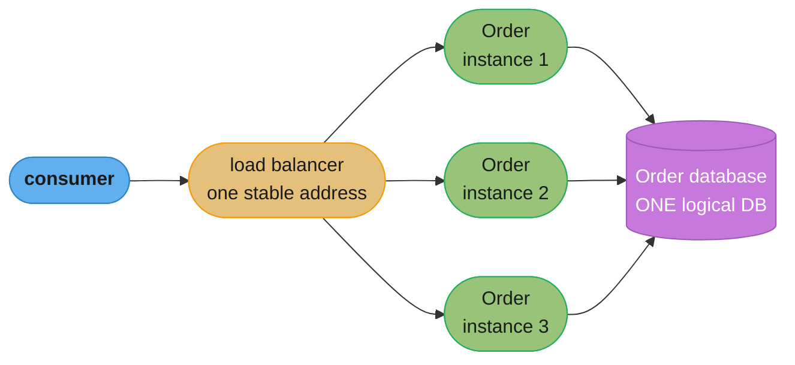
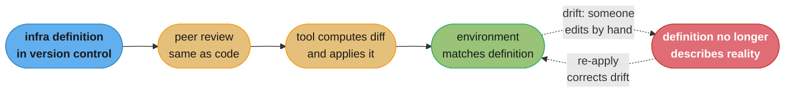
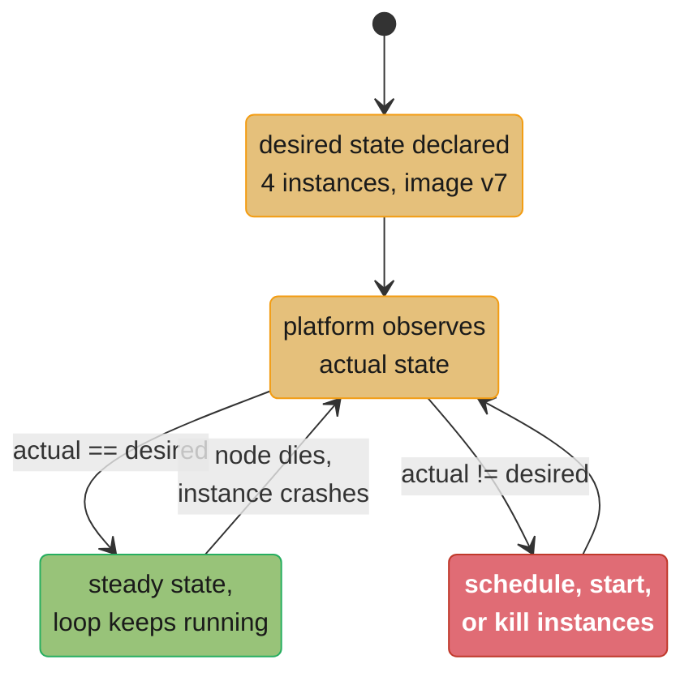
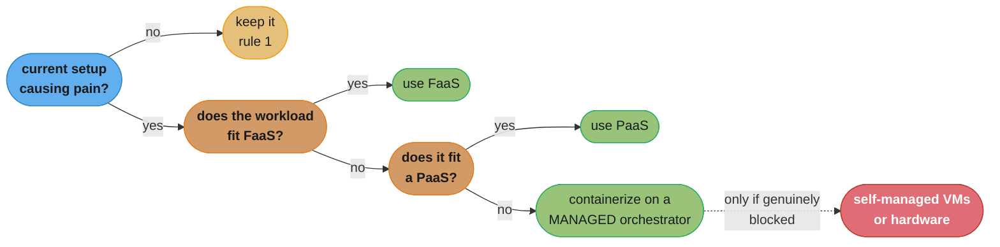
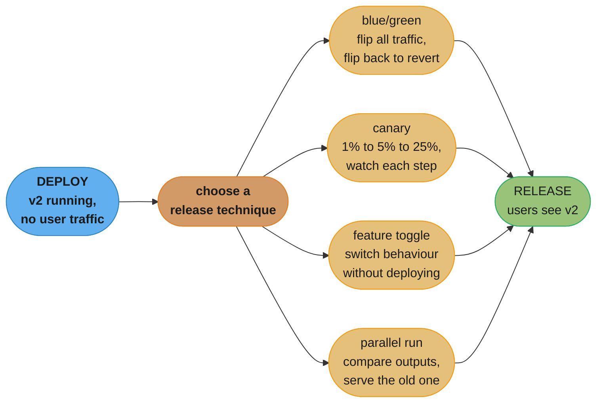
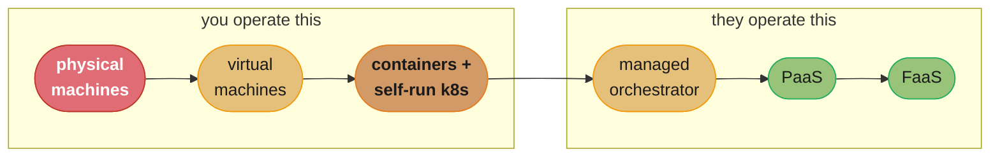

# Chapter 8: Deployment

> Part II — Implementation · Building Microservices, 2nd Edition (Sam Newman, O'Reilly 2021) ·
> builds on Ch 7 (Build), leads to Ch 9 (Testing)

## Chapter Map

Chapter 7 ended with an artifact: something built once by a pipeline and ready to be promoted.
This chapter is about what happens to that artifact next — where it actually runs, what it runs
*on*, and what has to be true about the platform underneath it before "independently deployable"
stops being a slogan and becomes an operational fact. Newman opens by insisting on a distinction
that quietly wrecks a lot of architecture diagrams: the microservice you drew on the whiteboard is
a *logical* thing, and it maps to some number of *physical* things — processes, machines,
database nodes — and the mapping is neither one-to-one nor fixed. From there the chapter builds a
set of five deployment principles, walks the full ladder of deployment substrates from bare metal
to Function as a Service, and closes with an opinionated answer to "which one should I pick?"
that boils down to *give up as much control as you can stand.*

The chapter is unusually opinionated for this book. Newman is normally careful to present both
sides; here he is willing to say that FaaS is worth trying before Kubernetes, that application
containers are a bad fit for microservices, and that running your own Kubernetes cluster is a
mistake most organizations should not make.

**TL;DR:**
- A logical microservice maps to **many** physical instances, and its logical database may itself
  be many physical nodes — but multiple instances of *one* service sharing *one* database is
  entirely different from two different services sharing a database, and only the second is the
  coupling problem Chapter 2 warned about.
- Five principles govern microservice deployment: **isolated execution**, **focus on
  automation**, **infrastructure as code**, **zero-downtime deployment**, and **desired state
  management**. They are ordered by how early they matter, not by importance.
- The deployment ladder runs physical machines → virtual machines → containers → application
  containers → PaaS → FaaS, and each rung trades **control** for **operational burden** in a way
  that is mostly monotonic. Application containers are the one rung Newman argues against outright
  for microservices.
- Kubernetes solves desired state management for containers and has effectively won that
  category, but it is a **platform for building platforms**, not a developer experience — and the
  chapter's strongest operational advice is not to run the cluster yourself.
- **Progressive delivery** — separating deployment from release, then rolling the release out
  gradually via blue/green, canary, feature toggles, or parallel runs — is what makes frequent
  deployment safe, and it is the bridge into Chapters 9 and 10.

Sections 8.1 through 8.4 follow the chapter's own printed section titles and order. Sections 8.5
and 8.6 group the Kubernetes/orchestration and progressive-delivery material the chapter also
carries; the grouping under those two headings is this summary's arrangement of that material.

## The Big Question

If you have fifty microservices and each one is supposed to be independently deployable, what
does the thing underneath them have to provide so that deploying any one of them is a
five-minute, self-service, no-downtime, no-coordination-meeting event — and how much of that
platform should you build yourself versus rent?

Analogy: think about the difference between owning a car, leasing a car, taking a taxi, and
taking a bus. Owning gives you total control — you choose the engine, the tyres, when it gets
serviced — and total responsibility for all of it. Leasing hands the maintenance burden over but
constrains the model. A taxi means you don't think about the vehicle at all, but you pay per trip
and you go where the roads go. A bus is cheapest per passenger and requires you to be going
roughly where everyone else is going. Physical machines are ownership; FaaS is the taxi. Newman's
argument is that most teams are driving a fleet of owned cars out of habit, paying the full
maintenance cost, when the taxi would have gotten them there — and that you should climb toward
the taxi end of that ladder until something genuinely stops you.

---

## 8.1 From Logical to Physical

The whiteboard box labelled `Order` is a *logical* microservice. It is a unit of ownership, a unit
of deployment, and a boundary in the domain model. It is not a process, a machine, or a database.
The moment you deploy it, the logical box explodes into a set of physical things, and most of the
confusion in microservice operations comes from conflating the two levels.

### Multiple Instances

The most obvious expansion: one logical microservice runs as **N physical instances** behind a
load balancer. Two instances is the practical minimum for anything that must survive a single
machine failing or a single process being restarted during a deployment; more instances is how you
scale throughput. The load balancer (or the platform's equivalent — a Kubernetes `Service`, a
cloud load balancer, a service mesh sidecar) gives consumers one stable address so that adding,
removing, or replacing instances is invisible to callers.

This matters for two reasons the chapter draws out. First, it is the precondition for
zero-downtime deployment: you cannot roll instances one at a time if there is only one. Second, it
means that every consumer of the service is *already* talking to a shifting set of physical
endpoints, so the endpoint set changing during a deploy is not a new class of event — it is
Tuesday.



*Caption: three physical instances of one logical microservice, all sharing the single logical
database that microservice owns. Nothing here violates the "don't share a database" rule — the
sharing is between instances of the same service, not between different services.*

### The Database

This is the distinction the chapter is most anxious that readers not lose. Chapter 2's rule is
that **two different microservices must not share a database**, because that shared schema becomes
an invisible, un-versioned contract that couples their release cycles together. That rule says
nothing at all about **multiple instances of the same microservice** sharing one database — which
is not only allowed but is the normal arrangement, because those instances are all the same
service, deployed together, owned by one team, changing the schema in one commit.

The logical/physical split runs the other way too. One logical database can be many physical
nodes: a primary with read replicas, a multi-node cluster, a sharded set. From the microservice's
point of view it is still one database that it alone owns; from the operator's point of view it is
several machines with their own failure modes and their own replication lag. The chapter's point
is that these two levels of "how many databases do I have" answer different questions, and mixing
them up produces both bad architecture diagrams and bad capacity plans.

```
  the two things people confuse

  FINE: one service, many instances, one DB     BAD: two services, one DB
  ------------------------------------------    ------------------------------------------
    Order inst 1  \                               Order  ----\
    Order inst 2   >---> [ Order DB ]                          >---> [ shared DB ]
    Order inst 3  /                               Shipping ---/

    one team owns the schema                      two teams own one schema, invisibly
    schema change = one commit                    schema change = coordinated release
    deploy independently: yes                     deploy independently: no

  ALSO FINE: one logical DB, many physical nodes
    [ Order DB ] = primary + 2 read replicas + failover
    still ONE logical database, owned by ONE service
```

*Caption: the sharing that matters is sharing between services, not between instances. The third
case shows the split running in the other direction — one logical database that is physically
several machines.*

### Environments

The same artifact, built once by Chapter 7's pipeline, gets deployed into a sequence of
**environments**: a developer's laptop, a CI build agent, an integrated test environment, a
preproduction environment, production. Each environment is a different *physical* topology hosting
the same *logical* architecture, and the differences between those topologies are deliberate
trade-offs rather than sloppiness.

The tension is **production-likeness versus cost and speed**. An environment that exactly mirrors
production — same instance counts, same multi-node database cluster, same network topology, same
data volumes — gives the highest-fidelity signal about whether a change will work in production,
and it costs roughly what production costs to run, takes a long time to provision, and is slow to
deploy into. An environment that runs a single instance of each service against an in-memory
database on one small machine costs almost nothing and gives you an answer in seconds, but it will
never catch a bug that only appears under replication lag or during a rolling restart.

Newman's guidance is to make the fidelity increase as you move along the pipeline: cheap,
low-fidelity, fast environments early where most failures are caught anyway, expensive
high-fidelity environments late where only the residual failures remain. The one thing that must
*not* vary is the artifact itself — the same image or package moves through every environment, with
environment-specific behaviour supplied by configuration injected at deploy time, never by
rebuilding.

| Environment | Typical topology | Fidelity | Cost / speed |
|---|---|---|---|
| Local dev | 1 instance, in-memory or containerized DB | Low | Free, seconds |
| CI build agent | 1 instance, ephemeral DB per run | Low | Cheap, seconds-minutes |
| Integrated test | 1-2 instances per service, shared DB instance | Medium | Moderate, minutes |
| Preproduction | Production-shaped: multi-instance, clustered DB | High | Expensive, minutes |
| Production | The real thing | — | — |

---

## 8.2 Principles of Microservice Deployment

Five principles, in the order Newman presents them. They are cumulative in practice: automation is
what makes isolated execution affordable at scale, infrastructure as code is what makes automation
reproducible, and desired state management is what automation becomes once the platform can act on
its own.

### Isolated Execution

**Run each microservice instance in isolation, with its own resources, so that its behaviour
cannot affect another service's.** The failure mode this prevents is the classic multitenanted
host: five services on one box, one of them leaks memory or spins the CPU, and the other four
degrade for reasons entirely outside their own code. Debugging that is miserable precisely because
the symptom appears in a service that did nothing wrong.

Isolation is a spectrum with a cost gradient, and this is the chapter's actual point rather than a
binary rule:

| Isolation mechanism | Strength | Cost per instance | Provisioning time |
|---|---|---|---|
| Separate physical machines | Strongest — nothing shared | Highest | Days to weeks |
| Separate virtual machines | Strong — hypervisor boundary, own kernel | High (full OS per VM) | Minutes |
| Containers | Good — namespaces + cgroups, shared kernel | Low | Seconds |
| Separate processes on one host | Weak — shared kernel, shared OS resources | Very low | Sub-second |
| Threads inside one process | None — one leak kills everything | Negligible | Instant |

Isolation also costs more than resources. Every isolated unit is another thing to provision,
monitor, patch, and pay for, and the more isolated units you have, the more you need the next
principle to survive them. Newman's framing is that you should push isolation as far as your
tooling and budget allow, and that containers happen to sit at a genuinely good point on that
curve — near-VM isolation semantics at near-process cost.

### Focus on Automation

The chapter's arithmetic is blunt: as the number of services grows, any per-deployment manual step
multiplies by that number. Newman notes that **three services per developer is not an uncommon
ratio** — so a fifty-developer organization can plausibly be operating 150 services, and a
fifteen-minute manual deployment checklist becomes something like 37 hours of pure ceremony per
full-system release.

Broken, then fixed:

```
  BROKEN: manual deployment, 150 services
    raise a ticket to the ops team               ~1 day queue
    ops engineer SSHes to the host               15 min
    stops the service, copies the artifact       10 min
    edits config by hand                         10 min
    restarts, eyeballs the log                   10 min
    -> 45 min of human time + a day of latency, per service, per deploy
    -> a cross-cutting change across 20 services = 15 hours of ops time
    -> teams batch changes to avoid the pain, so each deploy gets bigger and riskier

  FIXED: automated, self-service deployment
    developer merges to trunk
    pipeline builds the artifact once, promotes it
    deployment is a scripted, idempotent operation the team triggers itself
    -> minutes of elapsed time, zero human steps, no ticket, no ops queue
    -> deploys get smaller because they are cheap, so each one is less risky
```

The critical word is **self-service**. Automation that still routes through another team's ticket
queue has removed the typing but not the coupling: the team's ability to release is still gated on
someone else's schedule, which is exactly the property microservices were supposed to buy back.

### Infrastructure as Code

**Define your infrastructure in machine-readable files, keep those files in version control, and
apply them with a tool rather than by hand.** The immediate benefits are reproducibility (the same
definition produces the same environment twice) and reviewability (an infrastructure change goes
through the same pull request and history that a code change does). The deeper benefit is
recoverability: if the definition is the source of truth, rebuilding a lost environment is
running the tool again rather than an archaeology exercise.

The chapter groups the tooling into a couple of generations. The configuration-management tools —
Chef, Puppet, Ansible — describe the desired configuration *of a machine*. The provisioning tools
— Terraform being the reference example — describe the desired set *of cloud resources*, and are
declarative: you state what should exist, the tool computes the difference from what does exist.
Newman also notes the newer approach of defining infrastructure in a general-purpose programming
language rather than a bespoke DSL, with Pulumi as the example, which trades the DSL's guardrails
for real types, loops, and testability.



*Caption: the value is not the file format, it is the loop — every change goes through review, and
re-applying the definition is what pulls a hand-edited environment back to the state the
repository says it should be in.*

### Zero-Downtime Deployment

**Deploying a new version of a microservice should not require taking it offline.** The chapter's
practical warning is about ordering: this is far easier to build in from the start than to retrofit
later, because retrofitting it means changing your contracts, your clients, and your operational
tooling all at once, usually under pressure.

Zero-downtime deployment is not one technique but a stack of preconditions:

- **More than one instance**, so traffic can be served by the old instances while the new ones come
  up. With one instance there is no arrangement that avoids a gap.
- **A load balancer or equivalent that can drain connections** — stop sending new requests to an
  instance, let its in-flight requests finish, then stop it. Killing an instance with 200 requests
  in flight is 200 errors, however brief.
- **Backward-compatible contracts** (Chapter 5). During a rolling deploy, old and new versions run
  *simultaneously* and serve the same consumers. If version N+1 removes a field version N's
  consumers still read, the deploy is an outage regardless of how carefully you drained
  connections.
- **Backward-compatible schema changes**, for the same reason applied to the database: during the
  rollout, both versions are hitting the same schema. This forces the expand-then-contract
  discipline — add the new column, deploy code that writes both, backfill, deploy code that reads
  the new one, then and only then drop the old.

The chapter makes one architectural observation that is easy to miss: **asynchronous,
broker-mediated communication makes zero-downtime deployment much easier**, because a consumer
being briefly absent means messages accumulate in the queue rather than requests failing. The
broker absorbs the deployment window. With synchronous request/response, there is no buffer and
the availability has to be engineered explicitly.

### Desired State Management

**You declare the state the system should be in — four instances of this image, this much memory,
these ports — and a platform continuously works to make reality match.** This is the step beyond
automation: an automated deployment script runs when you run it, whereas desired state management
is a control loop that keeps running. If a node dies at 3am and takes three instances with it, a
deployment script does nothing; a desired-state platform notices the gap and schedules replacements
before anyone is paged.

The mechanism is a reconciliation loop:



*Caption: the loop never exits. A crashed instance and a deliberate version change are the same
event to the platform — actual has diverged from desired, so act.*

Kubernetes and Nomad are the chapter's named examples of platforms that provide this. Newman adds
an important prerequisite: desired state management is worth adopting once you have enough
services and instances to justify the platform's own operational cost. For a handful of services on
a few machines, the platform is more complexity than it removes.

The chapter also connects this to **GitOps** — the practice of storing the desired state in a git
repository and having an agent continuously reconcile the cluster against that repository, with
Flux as the named tool. The appeal is that it collapses "infrastructure as code" and "desired state
management" into one mechanism: the repository is simultaneously the reviewed, version-controlled
definition and the live source of truth the control loop is chasing.

---

## 8.3 Deployment Options

Six rungs, presented roughly in order of how much of the stack you manage yourself.

### Physical Machines

Deploying microservice instances directly onto physical hardware, with no virtualization layer.
The isolation is perfect if you put one service per machine — and that is exactly the problem,
because a physical machine sized for peak load sits mostly idle at normal load, and you cannot slice
it any finer without giving up the isolation you bought it for. Provisioning is measured in days or
weeks, which makes elastic scaling impossible and makes every capacity decision a long-lead
commitment. Newman treats this as largely historical for most organizations, surviving where
regulatory constraints, extreme performance requirements, or existing datacentre investment make it
necessary.

### Virtual Machines

A **hypervisor** slices one physical machine into multiple virtual machines, each with its own
kernel and operating system. The isolation is strong — the hypervisor boundary is a genuine
security and resource boundary, which is why public clouds are built on it — and provisioning drops
from weeks to minutes, which is the change that made elastic infrastructure possible at all. AWS
EC2 is the reference.

The cost is the **hypervisor tax**: each VM carries a full operating system, so a meaningful slice
of the host's memory and CPU goes to running N copies of an OS rather than to your services. That
overhead sets a floor on how small a VM can usefully be, which in turn sets a ceiling on density —
you cannot run two hundred tiny services on one host as two hundred VMs and expect it to be
efficient.

VM images can themselves be treated as build artifacts — "baking" a machine image that already
contains the service, so that starting an instance *is* deploying it. The trade-off is
characteristic: image builds are slow (historically on the order of an hour for a full image),
but boot from a baked image is fast and completely reproducible, versus a fast build and a slow,
network-dependent, occasionally-different configuration step at boot.

### Containers

Containers use kernel features — **namespaces** for what a process can see and **cgroups** for what
it can consume — to isolate processes on a *shared* kernel. The consequences are the whole reason
containers took over: no per-instance OS means an image measured in tens or hundreds of megabytes
rather than gigabytes, startup measured in seconds or less rather than tens of seconds, and density
measured in dozens or hundreds of containers per host rather than a handful of VMs.

Docker is the chapter's named tool, and Newman is precise about what Docker actually contributed:
Linux containers existed before it, but Docker made the *image format*, the *registry*, and the
*developer workflow* accessible enough that containers became the default unit of deployment.

The honest caveat is the shared kernel. A container boundary is weaker than a hypervisor boundary,
because a kernel-level exploit crosses it — which is why running genuinely untrusted multi-tenant
workloads in plain containers is a different risk proposition from running your own services.
Newman mentions the emerging responses: lightweight VM technologies such as **Firecracker** (built
by AWS and used underneath Lambda) that provide a hypervisor boundary at container-like startup
speed and density.

```
  density and startup, same physical host

  VIRTUAL MACHINES                    CONTAINERS
  --------------------------          --------------------------
  each VM: full guest OS              each container: process + libs
  image: GBs                          image: tens-hundreds of MB
  boot: tens of seconds               start: seconds or less
  per host: a handful to dozens       per host: dozens to hundreds
  isolation: hypervisor boundary      isolation: shared kernel
  --------------------------          --------------------------
  strong boundary, heavy              light boundary, cheap
```

*Caption: containers buy roughly an order of magnitude in density and startup time by giving up
the per-instance kernel — which is simultaneously the whole benefit and the whole caveat.*

### Application Containers

An **application container** is a long-running host process — a Java servlet container or
application server, IIS, and similar — into which multiple service instances are deployed as
modules sharing one runtime. This was the standard enterprise deployment model for years, and
Newman argues against it for microservices specifically. Four objections, all structural:

1. **It constrains technology choice.** Everything deployed into a JVM application server must be
   a JVM application. One of the reasons for microservices is that a service can pick the right
   runtime for its problem, and this model deletes that option.
2. **Isolation is lost.** Services share a process and a heap, so one service's memory leak, one
   service's runaway thread pool, one service's fatal error takes down every other service in the
   same container. This directly contradicts the isolated-execution principle.
3. **Monitoring is at the wrong granularity.** The runtime reports on the container — its heap, its
   threads, its CPU — not on the individual services inside it, so attributing a resource problem
   to the service causing it becomes guesswork.
4. **Automation is harder and startup is slow.** These runtimes were built around an operator
   deploying artifacts into a running server, and their startup times can be significant, which
   works against both the automation and the zero-downtime principles.

### Platform as a Service

With **PaaS**, you hand the platform an artifact — often just source code — and it handles
building, running, scaling, and routing. Heroku is the chapter's reference implementation and, in
Newman's assessment, still the one that got the developer experience right; Google App Engine and
AWS Elastic Beanstalk are the other named examples.

When your application fits the platform's model, PaaS is extraordinarily good value: you write
code, you push, it runs, and you have delegated essentially the entire operational stack. The
failure mode is what happens when you don't fit, and Newman's line is worth quoting for the general
principle it captures: **the smarter the platform tries to be, the worse it goes wrong when it
guesses incorrectly about your application.** A PaaS that auto-scales on a heuristic it inferred
from your traffic is wonderful when the heuristic matches your workload and maddening when it does
not — and the abstraction that made it easy is exactly what stops you from overriding it.

### Function as a Service

**FaaS** — AWS Lambda, Azure Functions, Google Cloud Functions — takes the abstraction one step
further. You supply a function; the platform runs it in response to an event (an HTTP request, a
queue message, a file upload, a timer); you are billed for invocations and execution time rather
than for provisioned capacity; and it scales to zero when nothing is happening. There is no server
in your mental model at all.

The chapter treats this as a genuine step change and is warmer toward it than most 2021 writing
was, while being specific about the limits:

- **Cold starts.** The first invocation after a period of inactivity pays the cost of the platform
  provisioning a runtime. Newman's assessment is that this concern is frequently overstated: the
  providers have invested heavily in reducing it, and for many workloads it is no longer the
  blocker people assume.
- **Limited runtime control.** You do not get to tune the machine. On Lambda in particular, the
  dial you turn is **memory**, and CPU is allocated proportionally to it — so a CPU-bound function
  is tuned by over-provisioning memory it does not need. If your service genuinely requires
  independent control over CPU, memory, and I/O, FaaS is the wrong rung.
- **Execution limits.** Functions have a maximum execution duration, which rules out long-running
  work and forces it into a different shape.
- **Statelessness.** A function invocation is not guaranteed any surviving local state, so all
  state has to live somewhere else — a database, a cache, an object store.

The design warning is the one most worth internalizing: **a function is not a microservice.** A
microservice might be implemented as one function, or as several functions plus a datastore that
together constitute the service. Mapping every single operation to its own independently deployed
function produces a swarm of nanoservices with all of a distributed system's failure modes and none
of the coherent ownership boundaries a microservice was supposed to provide. The unit of ownership
and deployment stays the microservice; functions are an implementation detail inside it.

Newman's practical recommendation is unambiguous and slightly provocative: **explore FaaS before
you reach for Kubernetes.** If the workload fits, you have skipped an entire category of
operational work.

---

## 8.4 Which Deployment Option Is Right for You?

The chapter's answer is a short set of rules rather than a decision matrix, and they are ordered.

**1. If it ain't broke, don't fix it.** If your existing deployment approach works and is not the
thing causing you pain, migrating it is a large project with no user-visible benefit. The most
common failure here is a team with twelve services and a functioning deployment script deciding
they need Kubernetes because everyone else has it.

**2. Give up as much control as you are happy giving up, and then give up a bit more.** This is the
chapter's central heuristic and it deliberately pushes past the comfortable answer. Every rung of
control you retain is a rung of operational work you own forever — patching, scaling, capacity
planning, on-call. Most teams' instinct is to keep control they never actually exercise. The rule
says to start at the most managed option that could plausibly work and only step back down the
ladder when something concrete stops you.

**3. Containerize if you can.** If FaaS and PaaS genuinely do not fit, containers on a managed
orchestration platform is the next rung, and it is a good one — near-VM isolation, high density,
fast startup, and a mature ecosystem. The emphasis is on *managed*: see 8.5.



*Caption: the ladder is walked top-down, not bottom-up. Every downward step is a deliberate
concession made because something concrete blocked the rung above, not a default.*

---

## 8.5 Kubernetes and Container Orchestration

Once you have containers, you need something to decide which container runs on which machine, to
restart the ones that die, to route traffic to them, and to hold the desired state. That is
container orchestration, and Kubernetes has effectively won the category — the chapter notes that
the interesting question is no longer *which orchestrator* but *how much of it should you own*.

The core concepts, in the order they build:

- A **cluster** is a set of machines managed as one pool.
- A **node** is one machine in that pool.
- A **pod** is the scheduling unit: one or more containers that are always placed together and share
  a network namespace. The common case is a single container per pod; the multi-container case is a
  primary container plus a helper (a log shipper, a proxy sidecar).
- A **service** is a stable name and address in front of a changing set of pods — the load-balancer
  role from 8.1, provided by the platform.
- A **replica set**, usually managed by a **deployment**, holds the desired instance count and the
  image version, and is what the reconciliation loop of 8.2 is actually reconciling.

Three cautions the chapter is specific about:

**Multitenancy is weak.** A Kubernetes namespace is an organizational boundary, not a hard security
boundary — it does not give you the isolation you would want between genuinely untrusting tenants.
Organizations needing that reach for a distribution that layers stronger controls on top (OpenShift
is the named example) or run federated, per-tenant clusters, both of which cost more than the
single-cluster mental model suggests.

**Kubernetes is not a developer experience.** It is a platform for *building* platforms. Handing
raw Kubernetes to product teams means every team learns pods, services, ingress, resource limits,
and YAML indentation — which is a large tax paid many times over. The pattern that works is a thin
internal platform layer on top, exposing the small set of operations product teams actually need.
Newman notes **Knative** as a project aiming to provide a FaaS/PaaS-shaped developer experience over
Kubernetes, while flagging that adopting it at the time of writing carried real maturity risk.

**Do not run the cluster yourself.** This is the chapter's blunt operational advice. Running a
production Kubernetes control plane — upgrades, etcd, certificates, networking, the security
surface — is a specialist, full-time job, and every major cloud provider will do it for you. The
teams that get hurt are the ones that adopt Kubernetes for the developer benefits and inherit the
control-plane operations as an unbudgeted surprise.

---

## 8.6 Progressive Delivery

The final move in the chapter is to separate two things that a naive deployment conflates:

- **Deployment** is getting the new version installed and running somewhere.
- **Release** is making that new version serve real user traffic.

Once these are separate, deploying stops being the scary event, because deploying no longer exposes
anyone to the change. All the risk moves to release, and release becomes something you can do
*gradually*, watch, and reverse. Newman credits the term **progressive delivery** to industry
analyst James Governor, and it is the umbrella for four techniques.

**Blue/green deployment.** Run two complete environments. Blue is serving production traffic; green
is the new version, deployed and warmed but receiving nothing. When you are ready, switch the load
balancer to green. Rollback is switching back — seconds, not a redeploy. The cost is running two
full environments simultaneously, and the constraint is that anything shared between them (most
obviously the database) still has to be compatible with both versions.

**Canary release.** Route a small fraction of traffic — 1%, then 5%, then 25% — to the new version,
and compare its error rate and latency against the old version at each step before widening. This
gives you real production signal on real traffic while bounding the blast radius of a bad version
to the fraction you routed. It requires the observability of Chapter 10 to be in place first: a
canary you cannot measure is just a slower way to break production. Spinnaker is the chapter's
named tooling example.

**Feature toggles.** A runtime switch that decides whether the new behaviour executes. This is the
same mechanism Chapter 7 relied on for trunk-based development, now used at release time — the code
ships dark, and turning it on is a configuration change independent of any deployment. It is also
what lets you turn a feature off without rolling back a deployment that contains ten other changes.

**Parallel run.** Run the old and the new implementation *side by side against the same request*,
compare their outputs, but only ever return the old implementation's result to the user. This gives
you production-traffic verification of a rewrite with zero user-visible risk, and it is the strongest
tool available when replacing a piece of critical logic whose edge cases nobody fully remembers.
The costs are real: doubled work per request, and you must ensure the new implementation has no
side effects, or the comparison run will send the customer two emails.



*Caption: deployment happens once and is boring, release happens gradually and is where the risk
lives. Every technique on the middle row is a different way of buying back the ability to reverse.*

---

## Beyond the book — where the deployment landscape moved after 2021

> The chapter was written in 2021. It names Kubernetes, Knative, Firecracker, Terraform, Pulumi,
> Flux, and Spinnaker, and it argues FaaS is worth trying before Kubernetes. It does **not**
> discuss anything below; the following is this repo's editorial note, not Newman's.

Newman's caution that Knative "carries adoption risk" and his broader observation that future
platforms will hide Kubernetes behind a developer-friendly interface both aged well — the
internal-developer-platform category the chapter gestures at has since become a named, tooled
category in its own right, and "Kubernetes as a substrate you never look at" is now a common target
state rather than an aspiration. The cold-start concern he calls overstated has continued to shrink
as providers added pre-warmed execution environments and faster runtime initialization. His
argument against running your own control plane has, if anything, strengthened as managed
offerings matured. Readers should treat the chapter's *reasoning* as current and any specific
product capability, limit, or pricing figure as a 2021 snapshot to re-check.

---

## Visual Intuition



*Caption: the same ladder, drawn as a boundary rather than a list. Newman's rule 2 says to start at
the right-hand end and walk left only when something concrete blocks you — not to start on the left
because that is where you already are.*

```
  the zero-downtime deploy that isn't

  BROKEN
    t0   3 instances running v1, all serving traffic
    t1   deploy v2: kill instance 1 immediately   -> 140 in-flight requests error
    t2   v2 starts, DROPS column `legacy_status`  -> v1 instances 2,3 now 500 on every read
    t3   kill instance 2, kill instance 3         -> more errors
    t4   all v2, "zero downtime deploy complete"  -> ~4 minutes of partial outage, unlogged

  FIXED
    t0   3 instances running v1
    t1   drain instance 1: stop new traffic, let 140 requests finish, then stop  -> 0 errors
    t2   start v2 instance 1. v2 ADDS a column, reads both, drops nothing        -> v1 unaffected
    t3   health check passes, add to load balancer, repeat for instances 2 and 3
    t4   all v2. LATER, separate deploy: stop writing legacy_status, then drop it
```

*Caption: the two things that actually break a rolling deploy are undrained connections and a
schema change that old instances cannot survive. Both versions run at once for the whole rollout,
which is what forces expand-then-contract.*

---

## Key Concepts Glossary

- **Logical microservice** — the unit of ownership and deployment on the architecture diagram, as
  distinct from any physical process or machine that runs it.
- **Physical instance** — one running copy of a microservice; a logical service normally maps to
  several.
- **Environment** — a physical topology hosting the logical architecture, from a laptop to
  production, varying in fidelity and cost.
- **Isolated execution** — running each microservice instance with its own resources so it cannot
  affect another service's behaviour.
- **Multitenanted host** — a machine running several different services together, the arrangement
  isolated execution exists to avoid.
- **Self-service deployment** — a team can deploy its own service without raising a request against
  another team.
- **Infrastructure as code** — infrastructure defined in version-controlled, machine-readable files
  and applied by a tool.
- **Zero-downtime deployment** — releasing a new version without a service interruption, requiring
  multiple instances, connection draining, and backward-compatible contracts and schemas.
- **Desired state management** — declaring the intended state and letting a platform continuously
  reconcile reality toward it.
- **GitOps** — desired state held in a git repository, with an agent reconciling the running system
  against it.
- **Hypervisor** — the layer that slices a physical machine into virtual machines, each with its
  own kernel.
- **Container** — a process isolated by kernel namespaces and cgroups, sharing the host kernel.
- **Image baking** — building a machine or container image that already contains the service, so
  starting an instance is deploying it.
- **Application container** — a runtime hosting multiple service instances in one process; argued
  against for microservices.
- **Platform as a Service (PaaS)** — you supply an artifact or source, the platform builds, runs,
  scales, and routes it.
- **Function as a Service (FaaS)** — event-triggered functions billed per invocation, with no
  server model and scale-to-zero.
- **Nanoservice** — the anti-pattern of mapping every operation to its own deployable unit, losing
  the microservice's ownership boundary.
- **Cluster / node / pod** — the machine pool, one machine in it, and the co-scheduled container
  group that is Kubernetes' unit of scheduling.
- **Deployment vs release** — installing a version versus exposing it to user traffic; separating
  them is the basis of progressive delivery.
- **Progressive delivery** — releasing gradually and reversibly, via blue/green, canary, feature
  toggles, or parallel runs.
- **Blue/green deployment** — two complete environments, with traffic switched from one to the
  other and switchable back.
- **Canary release** — routing a small, widening fraction of traffic to the new version while
  comparing its behaviour to the old.
- **Parallel run** — executing old and new implementations against the same request and comparing
  results, while serving only the old one's.

---

## Tradeoffs & Decision Tables

| | Physical machines | Virtual machines | Containers | PaaS | FaaS |
|---|---|---|---|---|---|
| Isolation strength | Total | Strong (hypervisor) | Good (shared kernel) | Platform-managed | Platform-managed |
| Density per host | 1 service | A handful to dozens | Dozens to hundreds | N/A | N/A |
| Provisioning time | Days-weeks | Minutes | Seconds | Seconds | Instant |
| Operational burden | Highest | High | Medium | Low | Lowest |
| Runtime control | Total | High | High | Low | Very low |
| Cost model | Capex, always-on | Provisioned capacity | Provisioned capacity | Per app/dyno | Per invocation, scales to zero |
| Newman's stance | Historical | Fine, heavier than needed | Good default if FaaS/PaaS don't fit | Great when you fit the model | Try this first |

| Release technique | Rollback speed | Infrastructure cost | Best for |
|---|---|---|---|
| Blue/green | Seconds (flip back) | 2x environments during release | Whole-version cutover with a clean revert |
| Canary | Minutes (shift traffic back) | Marginal | Changes whose risk shows up under real traffic |
| Feature toggle | Instant (flip the flag) | Negligible | Behaviour changes decoupled from deploys |
| Parallel run | N/A — never served | 2x compute per request | Rewrites of critical logic with unknown edge cases |

| Principle | What it prevents | What it costs |
|---|---|---|
| Isolated execution | Noisy neighbours, coupled failures | Resources and instances to manage |
| Focus on automation | Manual work multiplying by service count | Up-front tooling investment |
| Infrastructure as code | Unreproducible, un-reviewable environments | Learning a tool, keeping definitions honest |
| Zero-downtime deployment | Deploys becoming scheduled outages | Multiple instances, compatible contracts and schemas |
| Desired state management | Failures needing a human to notice them | A platform with its own operational cost |

---

## Common Pitfalls / War Stories

- **Confusing "instances share a database" with "services share a database."** A team enforces
  the no-shared-database rule so literally that they give each *instance* its own database, and
  spend the next quarter reconciling three divergent copies of the same service's data. The rule
  was always about service boundaries, never about instance counts.
- **Retrofitting zero-downtime deployment under pressure.** The deploy that finally forced the
  issue is the one where a column was dropped mid-rollout and every not-yet-upgraded instance
  started returning 500s on read. Nothing about the deployment tooling was wrong — the contract
  was, and by then both versions were already live.
- **Automation that still needs a ticket.** The scripts are excellent, the pipeline is green, and
  the team still waits two days for the platform group to approve a production apply. Every
  keystroke was automated and none of the coupling was removed.
- **Adopting Kubernetes for the developer experience and inheriting the control plane.** A team
  wanting declarative deployments ends up owning etcd backups, certificate rotation, CNI upgrades,
  and a quarterly cluster-version migration — all work that a managed offering would have absorbed
  and none of which the original decision accounted for.
- **The nanoservice explosion.** Every operation gets its own Lambda function on the theory that
  smaller is more microservice-y. Six months later the "service" is forty functions with no
  coherent owner, no shared contract, and a distributed transaction across half of them.
- **Trusting a PaaS's cleverness for a workload it never anticipated.** The auto-scaler's
  heuristic is tuned for request-driven web traffic and the workload is a nightly batch, so it
  scales down mid-job every night, and the abstraction that made the platform easy is exactly what
  prevents overriding it.
- **A canary with no observability.** Five per cent of traffic goes to the new version, nobody has
  a per-version error-rate breakdown, and the aggregate dashboard stays green because 95% of traffic
  is still healthy. The canary ran for two hours and taught nobody anything.
- **A parallel run with side effects.** The comparison implementation is invoked on live requests
  as intended, and it also sends the confirmation email — so every customer gets two, and the
  zero-risk verification technique becomes a customer-facing incident.
- **One environment per team, none of them production-like.** Fidelity was traded away everywhere
  at once, so the first environment that behaves like production is production, and every
  environment-specific bug is discovered by users.

---

## Real-World Systems Referenced

The chapter names AWS EC2 as the reference virtual-machine platform and Docker as the tool that
made container images and registries mainstream; **Firecracker**, built by AWS and used underneath
Lambda, is cited as the lightweight-VM answer to the container isolation caveat. On infrastructure
as code it names Chef, Puppet, and Ansible as configuration-management tools, **Terraform** as the
declarative provisioning reference, and **Pulumi** as the general-purpose-language alternative. For
desired state management it names **Kubernetes** and **Nomad**, with **Flux** as the GitOps
implementation and **OpenShift** as the distribution reached for when Kubernetes' native
multitenancy is insufficient; **Knative** appears as the attempt to put a FaaS-like developer
experience on top of Kubernetes. For PaaS the reference is **Heroku**, with **Google App Engine**
and **AWS Elastic Beanstalk** alongside it; for FaaS, **AWS Lambda**, **Azure Functions**, and
**Google Cloud Functions**. **Spinnaker** is named for canary releasing, and the term *progressive
delivery* is credited to industry analyst **James Governor**.

---

## Summary

The chapter's argument runs from a distinction to a recommendation. The distinction is logical
versus physical: one microservice on a diagram is many instances in production, its one logical
database may be many nodes, and the environments it passes through are different physical
topologies of the same logical shape — which is why "multiple instances sharing a database" is
normal and "two services sharing a database" is not. The five principles then say what the
substrate has to provide: isolation so services cannot damage each other, automation because
per-deployment manual work multiplies by a service count that can reach three per developer,
infrastructure as code so environments are reproducible and reviewable, zero-downtime deployment
because it is far cheaper to build in than to retrofit, and desired state management because a
control loop notices a dead instance at 3am and a deployment script does not.

The deployment options are a ladder from physical machines to FaaS, and the ladder is essentially
a trade of control for operational burden. Containers sit at a genuinely good point — near-VM
isolation at near-process cost — with the shared kernel as the honest caveat. Application
containers are the one rung Newman argues against for microservices, because sharing a process
destroys isolation, constrains technology choice, and puts monitoring at the wrong granularity.
PaaS is excellent where you fit its model and frustrating where you don't, because the same
cleverness that removes work removes control. FaaS goes further still, and Newman's advice —
explore it before reaching for Kubernetes — is the chapter's most quotable line, qualified by the
warning that a function is not a microservice and that mapping every operation to its own function
manufactures nanoservices.

The selection rules are: don't fix what isn't broken; give up as much control as you are happy
giving up and then a bit more; containerize if you can, on a managed orchestrator rather than a
cluster you run. And whichever substrate you land on, separating deployment from release is what
makes frequent change safe — blue/green for a reversible cutover, canary for graduated exposure,
feature toggles for behaviour independent of deploys, parallel runs for verifying a rewrite against
live traffic without serving its results. Progressive delivery is also the handoff: canaries need
the tests of Chapter 9 and the observability of Chapter 10 to mean anything at all.

---

## Interview Questions

**Q: Is it a violation of microservice principles for three instances of the same service to share one database?**
**Short:** No — Newman's rule forbids sharing between different services, not between instances of one service.
The coupling problem is that a shared schema becomes an un-versioned contract between two teams, forcing their release cycles together. Three instances of the Order service are the same service, deployed together, owned by one team, and changing the schema in one commit, so none of that coupling exists. The rule to remember is that the boundary is the logical microservice, not the process.

**Q: Why is zero-downtime deployment much harder to retrofit than to build in from the start?**
**Short:** Retrofitting means changing contracts, clients, and tooling simultaneously, usually under pressure.
Zero-downtime deployment is not a deployment-tool setting; it requires multiple instances, connection draining, backward-compatible service contracts, and backward-compatible schema changes, because old and new versions serve traffic simultaneously during any rolling deploy. A system built without those properties has consumers depending on fields you now cannot remove and a schema that no rollout can survive. Design contracts as additive from day one and the deployment mechanics become almost trivial.

**Q: What does "desired state management" give you that a good automated deployment script does not?**
**Short:** A continuous reconciliation loop that acts on failures nobody triggered, not just on deploys you run.
A deployment script executes when you execute it, so a node dying at 3am and taking three instances with it produces an outage until a human notices. A desired-state platform observes that actual state has diverged from declared state and schedules replacements on its own, treating a crash and a deliberate version change as the same kind of event. The trade is that the platform has real operational cost of its own, so it earns its place once you have enough services and instances to justify it.

**Q: Why does Newman argue against application containers for microservices specifically?**
**Short:** Sharing one runtime process destroys isolation, constrains technology choice, and puts monitoring at the wrong granularity.
Deploying several services as modules inside one application server means they share a heap and a process, so one service's memory leak or fatal error takes down every other service beside it — a direct contradiction of the isolated-execution principle. It also forces every service onto the same runtime, removing the per-service technology choice that motivates microservices, and the runtime reports metrics for the container rather than for each service inside it. Newman also notes their startup times work against both automation and zero-downtime deployment.

**Q: What is the practical difference between deployment and release, and why does separating them matter?**
**Short:** Deployment installs a version, release exposes it to users; separating them moves all the risk to a reversible step.
When deploying and releasing are the same event, every deployment is a user-facing risk, so teams deploy less often and each deployment gets larger and more dangerous. Separating them makes deployment boring — the new version is running but serving nobody — and turns release into something you can do gradually via canary or a feature toggle and reverse in seconds. This is the foundation of progressive delivery and the reason frequent deployment stops being frightening.

**Q: Newman says a function is not a microservice — what goes wrong if you treat them as equivalent?**
**Short:** Mapping every operation to its own deployable function produces nanoservices with no coherent ownership boundary.
A microservice is a unit of ownership and deployment that may be implemented as one function or as several functions plus a datastore; the function is an implementation detail inside that boundary. Splitting each operation into its own independently deployed function gives you all of a distributed system's failure modes — network calls, partial failures, versioning across dozens of units — without the coherent domain boundary that made the microservice worth having. Keep the microservice as the unit of ownership and let the function count vary inside it.

**Q: Why is a canary release worthless without observability in place first?**
**Short:** You cannot compare the canary's behaviour to the baseline if nothing breaks metrics down per version.
The entire mechanism is routing a small fraction of traffic to the new version and comparing its error rate and latency against the old one before widening. If your dashboards only show aggregate numbers, 5% of traffic failing completely still leaves the aggregate looking healthy, so the canary runs its full duration and tells you nothing. Establish per-version metric breakdowns before you rely on canarying, which is one reason this chapter hands off to Chapter 10.

**Q: What is the container isolation caveat, and what mitigates it?**
**Short:** Containers share the host kernel, so a kernel-level exploit crosses the boundary a hypervisor would hold.
Namespaces and cgroups isolate what a process can see and consume, but every container on a host runs against the same kernel, which makes the boundary weaker than a virtual machine's hypervisor boundary — a meaningful difference when the workloads do not trust each other. Newman points to lightweight virtual-machine technologies such as Firecracker, built by AWS and used underneath Lambda, as the response: a real hypervisor boundary at container-like startup speed and density. For running your own trusted services, ordinary containers remain a good trade.

**Q: What is the "hypervisor tax" and why does it cap density?**
**Short:** Every virtual machine carries a full guest OS, so a slice of the host runs operating systems rather than services.
A VM is a complete machine including its own kernel, so running N virtual machines means running N operating systems' worth of memory and CPU overhead on top of your actual workload. That overhead sets a floor on how small a useful VM can be, which caps how many you can pack onto one host — you cannot run two hundred tiny services as two hundred VMs efficiently. Containers remove the per-instance kernel, which is exactly where their order-of-magnitude density advantage comes from.

**Q: What does Newman mean by "give up as much control as you are happy with, and then a bit more"?**
**Short:** Start at the most managed deployment option that could work and step down only when something concrete blocks you.
Every rung of control you retain on the deployment ladder is operational work you own permanently — patching, capacity planning, scaling, on-call — and teams routinely keep control they never actually exercise. The heuristic deliberately pushes past the comfortable answer because the comfortable answer is usually the status quo, and it pairs with his advice to explore FaaS before reaching for Kubernetes. Step down a rung when a real constraint appears, not because the managed option feels unfamiliar.

**Q: Why does asynchronous, broker-based communication make zero-downtime deployment easier?**
**Short:** Messages queue while a consumer restarts, so the broker absorbs the deployment window instead of requests failing.
With synchronous request/response, an instance that is briefly unavailable produces failed calls that the caller has to handle, so availability during a deploy must be engineered explicitly with draining and rolling updates. With a broker in between, a consumer being absent for thirty seconds means thirty seconds of messages accumulate and are processed on restart, with no error visible to the producer. This is one of the operational advantages Chapter 4's communication-style choice quietly buys you.

**Q: Why is self-service the critical word in "focus on automation"?**
**Short:** Automation that still routes through another team's ticket queue removes the typing but not the coupling.
The point of automating deployment is that a team can release its own service independently, and a scripted deployment still gated on a platform team's approval queue leaves the release cadence controlled by someone else's schedule. That is precisely the coupling microservices were meant to eliminate, so the automation has delivered efficiency without delivering autonomy. Measure success by whether a team can deploy without asking anyone, not by how few keystrokes the deploy takes.

**Q: What is a parallel run and what is the trap when using one?**
**Short:** Run old and new against the same request, compare, serve only the old result — but side effects break it.
A parallel run verifies a rewrite against genuine production traffic with no user-visible risk, because the new implementation's output is compared and logged but never returned, which is uniquely valuable when replacing critical logic whose edge cases nobody fully remembers. The trap is that "never returned" only covers the response — if the new implementation also writes to a database or sends an email, the customer gets those effects twice. Verify the new path is side-effect-free before running it in parallel, and expect to pay double the compute per request.

**Q: How should environments differ from each other along the pipeline, and what must never differ?**
**Short:** Fidelity should rise as the pipeline progresses; the artifact must be identical in every environment.
Early environments should be cheap, small, and fast — a single instance against an ephemeral database — because most failures are caught there anyway and feedback speed matters more than realism. Later environments should approach production's topology because the residual failures are the ones that only appear under replication lag or during a rolling restart. What must never change is the artifact itself: the same image or package moves through every environment with configuration injected at deploy time, or every earlier test result stops meaning anything.

**Q: What does Newman mean by "the smarter the PaaS tries to be, the worse it goes wrong"?**
**Short:** The heuristics that remove operational work also remove your ability to override them when they guess wrong.
A platform that infers your scaling policy from your traffic pattern is extraordinarily good value when your application matches the model it was built around, and frustrating when it does not — an auto-scaler tuned for request-driven web traffic will scale a nightly batch job down mid-run. The abstraction that made the platform easy is exactly the thing preventing you from correcting it. Evaluate a PaaS on how your actual workload behaves under its assumptions, not on how little work it removes in the happy case.

**Q: Why is running your own Kubernetes control plane the mistake Newman warns about most directly?**
**Short:** Cluster operations is a specialist full-time job that teams inherit unbudgeted when adopting Kubernetes for its developer benefits.
Teams adopt Kubernetes for declarative deployments and desired state management, then discover they also own etcd backups, certificate rotation, networking plugins, security patching, and a recurring control-plane version migration. None of that work delivers anything to users, and every major cloud provider will absorb it for a fee that is almost always less than the engineering time it consumes. Take the managed offering unless a specific, named constraint genuinely rules it out.

**Q: Is a Kubernetes namespace a sufficient boundary between untrusting tenants?**
**Short:** No — Newman treats namespaces as an organizational boundary, not a hard security or isolation boundary.
Namespaces scope names and provide a place to attach quotas and policies, but they do not deliver the isolation you would want between tenants that genuinely do not trust each other, which is why multitenancy is one of the chapter's named Kubernetes cautions. Organizations needing real tenant separation reach for a distribution layering stronger controls on top, OpenShift being the named example, or run federated per-tenant clusters. Both cost considerably more than the single-cluster mental model implies, and that cost should be in the decision up front.

---

## Cross-links in this repo

- [devops/deployment_strategies/ — blue/green, canary, rolling, and progressive delivery in depth](../../../devops/deployment_strategies/deployment_strategies.md)
- [devops/containers_and_docker/ — namespaces, cgroups, images, registries](../../../devops/containers_and_docker/containers_and_docker.md)
- [devops/kubernetes_architecture/ — control plane, scheduler, and the reconciliation loop](../../../devops/kubernetes_architecture/kubernetes_architecture.md)
- [devops/kubernetes_workloads_and_objects/ — pods, deployments, services, replica sets](../../../devops/kubernetes_workloads_and_objects/kubernetes_workloads_and_objects.md)
- [devops/infrastructure_as_code_terraform/ — declarative provisioning, state, and drift](../../../devops/infrastructure_as_code_terraform/infrastructure_as_code_terraform.md)
- [devops/serverless_and_faas/ — FaaS execution model, cold starts, and its real limits](../../../devops/serverless_and_faas/serverless_and_faas.md)
- [devops/gitops_argocd_flux/ — desired state in a repository, reconciled continuously](../../../devops/gitops_argocd_flux/gitops_argocd_flux.md)
- Sibling chapters: [Ch 7 Build](../07_build/07_build.md) · [Ch 9 Testing](../09_testing/09_testing.md)

## Further Reading

- Humble and Farley, *Continuous Delivery* (Addison-Wesley, 2010) — the source of the
  deployment-pipeline and build-once discipline this chapter deploys from.
- Kim, Debois, Willis, and Humble, *The DevOps Handbook* — the automation and self-service
  arguments in their fuller organizational form.
- Beyer, Jones, Petoff, and Murphy, *Site Reliability Engineering* (O'Reilly, 2016) — the
  operational counterpart to the desired-state and zero-downtime principles.
- Morris, *Infrastructure as Code* (O'Reilly) — the book-length treatment of the third principle.
- James Governor's writing on **progressive delivery**, credited in the chapter as the origin of
  the term.
- Vendor documentation for Kubernetes, Knative, Terraform, Pulumi, Flux, and AWS Lambda, which the
  chapter points to for specifics precisely because they change faster than a book can.
