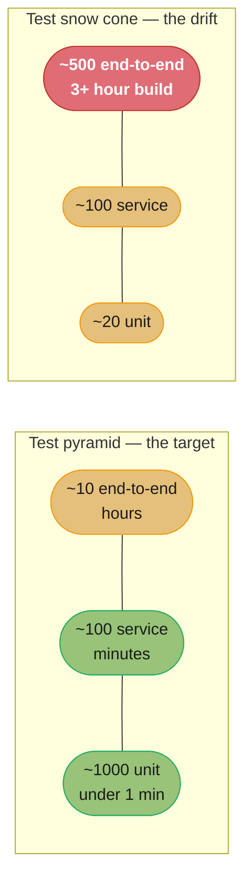
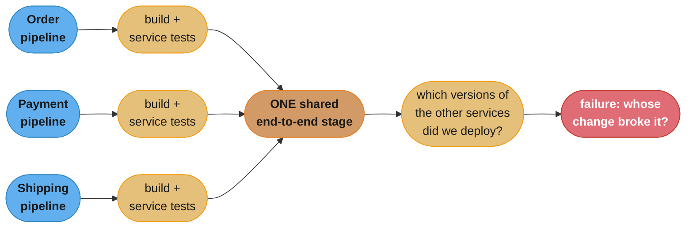
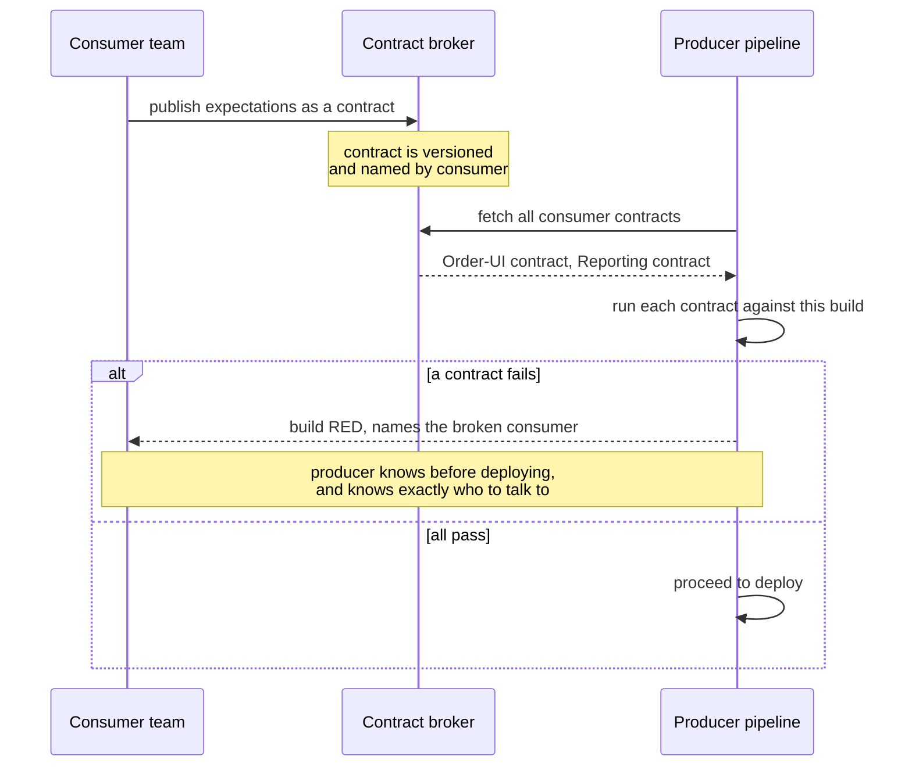
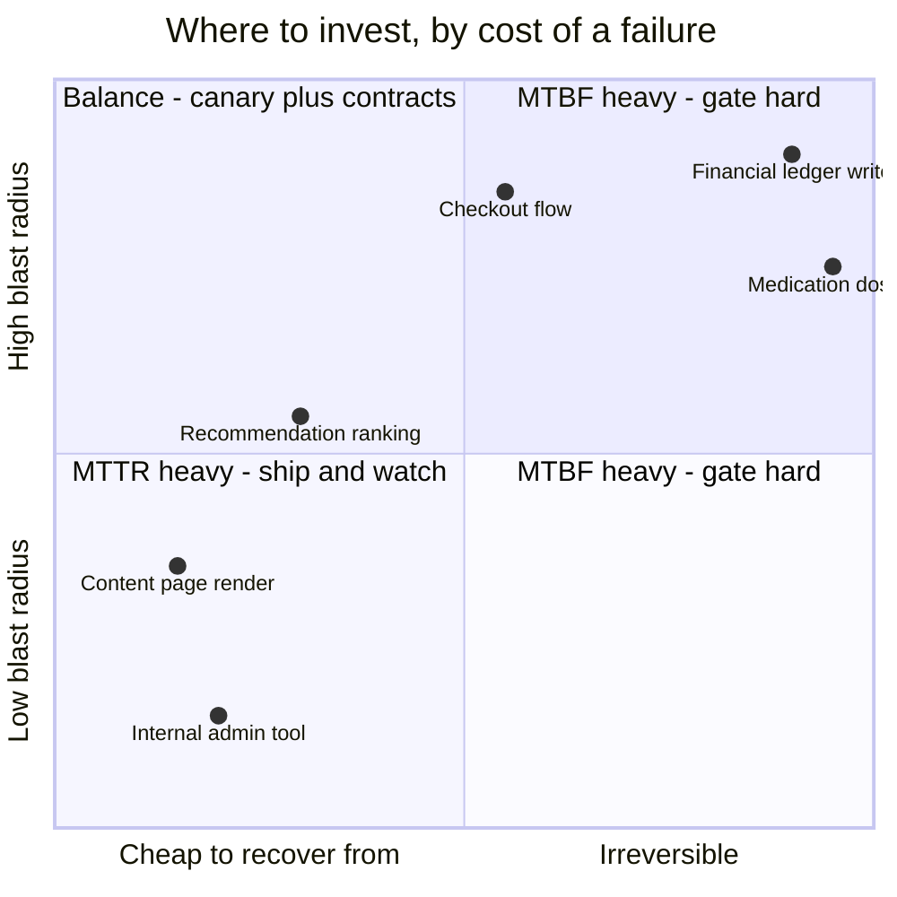

# Chapter 9: Testing

> Part II — Implementation · Building Microservices, 2nd Edition (Sam Newman, O'Reilly 2021) ·
> builds on Ch 8 (Deployment), leads to Ch 10 (From Monitoring to Observability)

## Chapter Map

Chapter 8 got an artifact deployed and gave you the machinery to release it gradually. This
chapter asks the question that machinery presupposes: how do you know the thing you are about to
release works? Newman's answer is unusual among testing chapters in that most of it is spent
arguing *against* the technique everyone reaches for first. End-to-end tests — the ones that spin
up the whole system and drive it the way a user would — give the highest confidence per passing
run and are, in Newman's assessment, the single largest source of wasted effort in
microservice-shaped organizations. The costs grow super-linearly with service count, the failures
are unattributable, nobody owns the suite, and the pressure it creates pushes teams back toward
versioning the entire system together, which is the monolith wearing a microservices costume.

What replaces them is not "less testing" but a different distribution of it: many fast unit tests,
a solid layer of service tests where each service is verified in isolation against stubbed
collaborators, consumer-driven contracts to catch the integration breakages end-to-end tests were
supposed to catch, and a deliberate shift of some testing *into production*, made safe by the
deployment/release separation Chapter 8 established. The chapter closes on cross-functional
testing — performance and robustness — which is the category microservices make both more
important and harder.

**TL;DR:**
- Test **scope** is the axis that matters: as scope widens, confidence per passing test rises but
  feedback time rises and failure localization collapses. The **test pyramid** (many unit, fewer
  service, very few end-to-end) is the shape that balances those; the inverted **test snow cone**
  is the shape teams drift into by accident.
- End-to-end tests across microservices have specific, structural pathologies: **fan-in** from
  many pipelines, **brittleness** that trains teams to ignore failures, no clear **owner**, run
  times measured in hours, **the great pile-up** of batched changes, and the pull toward a
  **metaversion** that destroys independent deployability.
- **Consumer-driven contracts** (CDCs) capture each consumer's expectations as tests that run
  against the producer's build, so the producer learns *before deploying* exactly which consumer
  they would break — and, Newman insists, the real value is the conversation the contract forces.
- Some testing belongs **in production**, because you can never fully replicate production before
  production. Smoke tests, synthetic transactions, canaries, and parallel runs are the techniques,
  and making them safe is mostly about side effects and data pollution.
- Newman argues for shifting some investment from **MTBF** (fewer failures, via ever more
  pre-production testing) to **MTTR** (faster recovery, via detection and rollback) — as a
  rebalance, calibrated to what a failure actually costs you, not as permission to skip testing.

## The Big Question

If you cannot run the whole system on a laptop, cannot get a reliable answer out of a test that
spans twelve services, and cannot deploy anything until that answer arrives — how do you get
enough confidence to deploy a single service, on its own, several times a day, without asking
eleven other teams anything?

Analogy: think about how an airline verifies a plane is safe to fly. It does not, before each
flight, assemble a complete replica aircraft, fly it around, and check that nothing fell off. It
tests components exhaustively on a bench, tests each subsystem against a rig that simulates
everything it connects to, verifies the *interfaces* between subsystems against a specification
both sides agreed to, and then instruments the real aircraft heavily enough that a developing
problem is caught in flight and handled. The full-system integration flight happens, but rarely,
and it is not what gives day-to-day confidence. Newman's testing strategy is that shape: bench
tests, rig tests, interface specifications, and instrumentation in the air.

---

## 9.1 Types of Tests

Before the pyramid, the chapter borrows Brian Marick's **testing quadrant** to lay out what tests
are actually *for*. Two axes: whether a test is **technology-facing** or **business-facing**, and
whether it exists to **support the team** as it builds or to **critique the product** once built.

|  | Supporting the team | Critiquing the product |
|---|---|---|
| **Business-facing** | Acceptance tests — "did we build the right thing?" | Exploratory testing, usability testing — humans probing the product |
| **Technology-facing** | Unit tests — "did we build it right?" | Performance tests, robustness tests, security testing |

The distinction earns its place because it stops the word "testing" from collapsing into one
activity with one answer. The automated tests a pipeline runs on every commit live almost entirely
in the left column — they support the team by giving fast feedback that a change did not break
something. Exploratory testing, in the top right, is inherently human and cannot be automated away;
what automation buys you there is *time*, by taking the repetitive regression checking off a
tester's plate so their judgement goes to the things only judgement can find. The bottom right —
performance and robustness — is where microservices change the picture most, and the chapter
returns to it at the end.

Most of this chapter concerns the two automated boxes, because those are the ones that sit in the
build pipeline and gate a deployment.

---

## 9.2 Test Scope

### Unit Tests

A unit test exercises a single function or class with everything around it stubbed out: no
network, no database, no filesystem, no other service. That constraint is what buys the speed —
a unit test runs in milliseconds, so a suite of thousands runs in well under a minute, which is
what makes it viable to run the whole suite before every commit. When one fails, the scope is one
class, so the failure *is* the diagnosis: you know exactly what broke without reading a stack
trace across four systems.

In Marick's terms these are technology-facing tests that support the team. They tell you whether
you built the thing right, not whether it was the right thing. They catch the overwhelming
majority of ordinary defects, and they are the layer every other layer's efficiency depends on,
because anything a unit test can catch is enormously cheaper to catch there.

### Service Tests

A service test bypasses the user interface and exercises **one microservice** directly through its
external interface — its HTTP API, its message handlers — with its downstream collaborators
replaced by stubs. This is the layer where "did this service, as a whole, behave correctly" gets
answered.

It is slower than a unit test because it involves real infrastructure: the service actually starts,
it probably talks to a real (if ephemeral) database, and requests go over a real socket even if
only to localhost. Seconds rather than milliseconds. But the scope is still **one service**, and
that is the property that matters: a failure points at one codebase owned by one team, which is
almost as good as a unit test's localization at a substantially higher level of confidence.

This layer is also the one that most directly serves the architecture. If a service can be tested
on its own, it can be deployed on its own — the same independence, verified.

### End-to-End Tests

An end-to-end test runs against the whole deployed system, frequently through the user interface,
exercising a complete journey the way a user would. A passing end-to-end test is the strongest
single signal available: it says the real services, the real network, the real database, and the
real UI worked together for that journey.

Everything else about it is bad, and the badness scales with the number of services. It is slow
(minutes per test, hours per suite). It requires a deployed environment holding every service. When
it fails, the failure could be in any of the twelve services in the path, in the environment, in
the data, or in the test. And — the pathology sections below are entirely about this — in a
microservice organization it has no natural owner.

### Trade-Offs

The three layers sit on one axis, and every property moves together along it:

```
  scope ------------------------------------------------------------->
  unit tests            service tests              end-to-end tests

  confidence per pass   LOW  ---------------------------------->  HIGH
  feedback time         ms   ---------------------------------->  hours
  failure localization  EXACT -------------------------------->  USELESS
  cost to write         LOW  ---------------------------------->  HIGH
  cost to maintain      LOW  ---------------------------------->  HIGH
  brittleness           LOW  ---------------------------------->  HIGH
  number you can afford MANY ---------------------------------->  FEW
```

*Caption: there is exactly one knob — scope — and turning it up improves precisely one property
while degrading five. That asymmetry is the whole argument for the pyramid's shape.*

The trap this creates is that the one improving property, confidence, is the one that is easiest to
feel and hardest to argue with in a meeting. Nobody has ever been criticized for adding another
end-to-end test, which is exactly how the shape inverts.

### How Many?

The **test pyramid**, from Mike Cohn: many tests at the bottom, fewer in the middle, very few at
the top. Newman's rule of thumb is roughly an **order of magnitude** difference between adjacent
layers — if you have a thousand unit tests, expect on the order of a hundred service tests and ten
end-to-end tests.

The failure mode has a name: the **test snow cone** (or inverted pyramid). A team accumulates
large-scope tests because each individual one felt valuable when added, ends up with a handful of
unit tests and hundreds of end-to-end tests, and now the build takes hours, every failure requires
an investigation rather than a glance, and the flakiness rate is high enough that people stop
trusting red builds.



*Caption: the same total test count, distributed two ways. The snow cone is not the result of a
decision — it is what accumulates when every individual "let's add an end-to-end test for this"
is judged on its own merits.*

---

## 9.3 Implementing Service Tests

A service test needs the service's collaborators to be there without actually being there. That is
the whole implementation problem.

### Mocking or Stubbing

The distinction is precise and worth keeping:

- A **stub** returns canned responses for the calls it receives, and does not care how many times
  it was called or in what order. It exists to let the code under test proceed.
- A **mock** additionally asserts on the *interaction* — that a particular call was made, with
  particular arguments, a particular number of times. It is part of the assertion, not just part
  of the setup.

Newman's preference is stubs, with mocks used sparingly. The reason is brittleness: a mock encodes
an expectation about *how* the code under test achieves its result, so a refactoring that changes
the call pattern while preserving behaviour breaks the test. That is a test failing for a reason
unrelated to correctness, which is exactly the property the chapter spends its second half fighting.
Over-mocked test suites become an anchor that makes the code harder to change, which inverts what
tests are for.

For the mechanics, the chapter names **Mountebank** — a standalone stub/mock server that can be
programmed over the wire and speaks HTTP, HTTPS, TCP, and SMTP, so one tool covers a service's
various downstream protocols. The pattern is: start Mountebank, program it with the responses this
test needs, point the service under test at it, run the test.

```java
// Service test: Order service, with the Payment service stubbed.
// The stub returns a canned response. It does NOT assert on how it was called.
@Test
void rejectsOrderWhenPaymentDeclined() {
    stubServer.forPath("/charge")
              .respondWith(402, "{\"status\":\"DECLINED\",\"reason\":\"insufficient_funds\"}");

    var response = orderService.submit(orderFor("SKU-1182", 2));

    assertThat(response.status()).isEqualTo(REJECTED);
    assertThat(response.reason()).isEqualTo("payment_declined");
    // Note what is NOT asserted: that /charge was called exactly once, or with
    // a particular payload. That would be a mock, and it would break the next
    // time someone adds a legitimate retry.
}
```

### A Smarter Stub Service

A hand-written stub encodes *your understanding* of how the downstream service behaves, and your
understanding can be wrong or can go stale. The chapter walks up a ladder of increasingly faithful
alternatives:

1. **A hand-written stub** in the consumer's test code. Cheapest, fastest, and drifts from reality
   silently as the producer evolves.
2. **A programmable stub server** such as Mountebank, shared across tests. Same fidelity problem,
   better ergonomics and protocol coverage.
3. **A stub published by the producing team as an artifact.** Now the fidelity is the producer's
   responsibility rather than a guess, and it versions alongside the real service. This is a
   meaningful jump: the stub becomes part of the producer's deliverable.
4. **Running the real downstream service in a container** with a known dataset. Highest fidelity —
   it is literally the real code. The cost is that the test now needs that container, its
   database, and its startup time, and if the real service has its *own* downstreams you have
   started sliding toward an end-to-end test by accident.

The chapter's warning about option 4 is the important one. Each downstream you make real drags in
its own downstreams, and there is no natural stopping point on that slope. The service test's whole
value is that its scope is one service, so anything that widens the scope is spending the property
you came for.

---

## 9.4 Implementing (Those Tricky) End-to-End Tests

The structural problem with end-to-end tests in a microservice architecture is **fan-in**. Each
service has its own build pipeline. Each pipeline, near its end, wants to know that its change
works with everything else. So each pipeline triggers the same shared end-to-end stage — and now
one test suite is fed by many independent sources of change.



*Caption: fan-in is why an end-to-end failure is not attributable. Three pipelines feed one stage,
so a red result is a question about the whole system's current combination, not about the commit
that triggered it.*

Two questions fall out immediately and neither has a clean answer. **Which versions of the other
services do you deploy** alongside the change under test — the latest built, the latest that
passed, the ones currently in production? Each choice tests something different, and only one of
them tells you about production. And when it fails, whose change broke it, given that three
services changed since the last green run?

---

## 9.5 Flaky and Brittle Tests

A **brittle** test is one that fails for reasons unrelated to the functionality it claims to
verify: a slow environment, a timing assumption, leftover data from another run, another team's
unrelated deploy. End-to-end tests are brittle by construction, because the surface area over which
something unrelated can go wrong is the entire system.

The corrosive part is not the individual failed build; it is what repeated unexplained failures do
to a team. The chapter invokes Diane Vaughan's **normalization of deviance** — the process by which
an organization comes to treat a warning sign as normal because it has appeared so often without
catastrophe. A suite that is red 30% of the time for reasons nobody can explain teaches everyone to
re-run it, and once re-running is reflex, the suite has stopped being a signal. A genuine
regression now sails through, because it looks exactly like the noise.

The remedy is deliberate and slightly ruthless. Track flaky tests down; if you can fix one, fix it.
If you cannot fix it immediately, **quarantine** it — move it into a separate suite that does not
gate the build, so it stops training people to ignore red. And be willing to reach the end of that
process: a quarantined test nobody fixes is providing no value while consuming attention, and the
chapter's position is that **a test you cannot fix should be deleted**. Keeping it is not caution,
it is superstition with a maintenance cost.

### Who Writes These End-to-End Tests?

For unit and service tests the answer is obvious: the team that owns the service. For a suite that
spans services, there is no owning team, and every arrangement organizations try has a
characteristic failure:

- **Everyone writes into a shared suite.** Nobody understands the whole thing, tests accumulate
  faster than they are curated, and — the failure Newman specifically calls out — a team blocked by
  someone else's failing test deletes it to unblock their release. That is not malice; it is the
  only lever they have.
- **A dedicated testing team owns it.** This is the worse option, because it recreates the siloed QA
  function microservices were partly meant to dissolve. The people writing the tests are furthest
  from the code, so their feedback loop is longest, their tests encode the least domain knowledge,
  and the team becomes a bottleneck every other team queues behind.
- **Joint ownership, or split the suite.** The workable arrangements. Either the suite is genuinely
  co-owned with the same discipline a shared codebase needs, or it is partitioned so each team
  owns the subset of journeys that primarily exercise its service.

### How Long Should End-to-End Tests Run?

Hours is normal for a real suite. Days is not unheard of once it has grown for a couple of years.
The chapter's point is not that this is inefficient — it is that duration crosses a threshold past
which the suite stops functioning as a gate at all, because nobody can wait for it, so it gets run
nightly, so it stops being connected to any particular change.

### The Great Pile-Up

Here is the mechanism, with numbers. Suppose the end-to-end stage takes 60 minutes and, across all
teams, a change reaches it every 5 minutes. The stage can process one run at a time against a shared
environment, so changes queue. By the time a run completes, twelve more changes are waiting, and the
pragmatic response is to batch them into the next run.

Now the next run goes red. Twelve changes from four teams are in it. Nobody knows which one broke
it, so somebody spends the afternoon bisecting, during which the queue grows further.

This is precisely the failure Chapter 7 diagnosed for continuous integration — infrequent, large
integrations concentrating pain into one hard-to-diagnose event — reproduced at the system level by
a slow gate. Trunk-based development fixed it for source; nothing fixes it here except making the
gate faster or making it smaller.

```
  the pile-up, with numbers

  end-to-end stage duration: 60 min
  change arrival rate:        1 per 5 min, across 4 teams
  -----------------------------------------------------------------
  t=0     run starts with change #1
  t=60    run finishes. Changes #2-#13 are queued (12 changes, 4 teams)
  t=60    batch them: run #2 contains all 12
  t=120   run #2 is RED
          -> which of 12 changes, from which of 4 teams, broke it?
          -> bisecting 12 changes at 60 min per run = up to 4 more hours
          -> meanwhile 48 more changes have arrived

  the smaller the gate, the smaller the batch, the cheaper the diagnosis
```

*Caption: the pile-up is arithmetic, not discipline. Any gate slower than the change arrival rate
forces batching, and batching is what makes a failure unattributable.*

### The Metaversion

The pressure the previous sections create has an obvious-looking release valve: if you can only get
a trustworthy answer about a *combination* of service versions, then treat that combination as the
unit. Test Order 4.2 with Payment 3.9 and Shipping 7.1, call the result "platform release 1.4," and
deploy the whole set together.

Newman treats this as the most dangerous idea in the chapter, because it is a step directly back to
the monolith. The moment the system has a single version number, no service can be deployed alone —
every release is a coordinated event across every team, every team's cadence is the slowest team's
cadence, and the independent deployability that justified the entire architecture is gone. The
architecture is still distributed; only the benefits have been removed.

If you find yourself wanting to version the whole system together, the correct reading is that your
services are too coupled to release independently, and the fix is in the contracts (Chapter 5) and
the boundaries (Chapter 2) — not in a release-train process that formalizes the coupling.

### Lack of Independent Testability

The generalization: **if you cannot test a service independently, you cannot deploy it
independently.** Independent testability is not a nice property that accompanies good architecture;
it is the same property, observed from the test suite instead of the deployment pipeline. A team
that must book a shared integration environment and coordinate with three other teams to verify its
change has, in practice, a coordinated release process regardless of what the architecture diagram
says.

The practical consequence is that teams should own their own test environments and be able to spin
up what they need to verify their service on their own schedule. That is an argument for stubs and
contracts over shared environments, and it is where the chapter turns next.

---

## 9.6 Should You Avoid End-to-End Tests?

Newman's answer is close to yes, and the argument is about how the costs scale. Adding a service
adds journeys, adds a pipeline feeding the fan-in, adds a version to the combination question, and
adds surface area for brittleness — so the suite's cost grows faster than linearly in service
count while the confidence it delivers grows much more slowly. At some scale the curves cross, and
past that point the suite is consuming more than it returns.

But you cannot simply delete the suite and keep the confidence, because it was catching something
real: the integration breakages, where one service changed in a way another service could not
handle. Something has to catch those.

### Contract Tests and Consumer-Driven Contracts (CDCs)

A **contract test** is written by the *consumer* and expresses what the consumer needs from the
producer: these fields, these types, this status code for this input. A **consumer-driven contract**
takes the further step of running those consumer-authored tests **against the producer's build**,
so the producer's pipeline goes red the moment a change would break a real consumer.

The inversion is the whole point. An end-to-end test tells you *after* deploying everything that
something in a twelve-service path broke. A CDC tells the producer, in their own pipeline, before
anything is deployed, that *this specific change* breaks *this specific named consumer* — a
localized, attributable, fast signal that arrives at the person who can act on it.



*Caption: the signal arrives in the producer's pipeline, names the consumer, and arrives before
deployment — three properties an end-to-end failure has none of.*

The named tooling is **Pact**, with the **Pact Broker** as the service that stores and distributes
contracts between the two sides' pipelines, and **Spring Cloud Contract**, which is JVM-only and
therefore a poorer fit for a polyglot estate.

**It's about conversations.** Newman is emphatic that the tooling is the smaller half. A
consumer-driven contract is a written record of what one team needs from another, which means
producing it requires the two teams to actually discuss it. His concrete recommendation is to pair
a member of the consuming team with a member of the producing team to write the contract together.
Where that conversation does not happen, the contracts get written as a guess by one side, drift,
and become another brittle suite. The contract's durable value is that it makes an implicit
expectation explicit and gives it a name and an owner.

### The Final Word

The chapter's synthesis: keep at most a very small number of end-to-end tests covering the handful
of journeys whose failure would be catastrophic, replace the rest with contract tests, and move the
remaining confidence into production via the techniques in 9.8. And if you do keep an end-to-end
suite, **timebox the investment and be genuinely prepared to remove it** — the failure mode is not
having the suite, it is having it and never being willing to re-examine whether it is still paying
for itself.

---

## 9.7 Developer Experience

A problem the second edition raises that the first did not have to: at some service count, a
developer cannot run the system on their machine any more. Twenty services, each with a runtime and
a database, exceeds what a laptop has, and the ones that do fit take long enough to start that the
edit-run-check loop becomes unusable. This is not a testing problem in the strict sense, but it
determines how much testing developers actually do, because a slow or impossible local loop pushes
verification later into the pipeline.

The workable responses:

- **Run a subset locally, point the rest at a shared remote environment.** You develop and debug
  the one or two services you are changing locally, and their downstreams are the real deployed
  ones. Cheap and effective, with the caveat that you are now sharing an environment whose state
  other people also change.
- **Develop against a remote cluster.** Tooling that connects a locally running process into a
  remote environment as though it were deployed there — **Telepresence** is the chapter's named
  example for Kubernetes — so the local process sees the cluster's services and the cluster routes
  the relevant traffic to the local process.

The underlying observation is that developer experience deserves to be an explicit architectural
concern rather than something left to whoever notices it hurts. If verifying a one-line change
takes twenty minutes, that cost is paid by every developer on every change forever, and it will
quietly shape behaviour more than any policy does.

---

## 9.8 From Preproduction to In-Production Testing

The premise is simple and hard to argue with: **you cannot fully replicate production before
production**. Not its data volumes, not its traffic patterns, not its third-party integrations, not
its hardware failures, not the specific sequence of events that will occur at 14:20 next Thursday.
Every preproduction environment is an approximation, and effort spent making the approximation
closer has diminishing returns. So some testing should happen where the real conditions are.

Chapter 8's separation of deployment from release is what makes this respectable rather than
reckless: a new version can be running in production, tested against production conditions, and
serving no users at all.

### Types of In-Production Testing

- **Smoke tests.** Run against the newly deployed version *after deployment and before release* — a
  short suite verifying the service starts, connects to its dependencies, and answers correctly.
  This is the technique that most directly depends on deployment/release separation, because
  without it there is no window in which the new version exists but no user can reach it.
- **Synthetic transactions.** A fake user journey executed against production on a schedule: create
  an order, pay for it, check it appears. This is the highest-value form in the chapter's view,
  because it verifies the *business operation* end to end rather than the health of individual
  components — and a service can be perfectly healthy on every metric while the journey through it
  is broken. Chapter 10 picks this up as **semantic monitoring**.
- **Canary release.** From Chapter 8: a small fraction of real traffic on the new version, compared
  against the old. This is testing with real users, which is why it is bounded and monitored.
- **Parallel run.** Old and new implementations both execute against the same request, outputs are
  compared, only the old one's result is served.
- **A/B testing.** Two variants served to two user cohorts, compared on a business metric rather
  than a correctness metric.
- **Chaos engineering.** Deliberately injecting failure into production to verify the system's
  resilience behaviour matches the belief about it. Chapter 12 develops this.

### Making Testing in Production Safe

Two risk categories, and both have concrete mitigations.

**Side effects.** A synthetic transaction that creates an order can also charge a real card, ship
real goods, email a real customer, and fire a real webhook to a partner. The mitigations are to
route synthetic activity through dedicated test accounts that downstream systems recognize, to
ensure the test path is reversible or idempotent so it can be cleaned up, and to review the *whole*
downstream chain rather than just the service you are testing — the surprise is almost always three
hops away, in a system whose team was not in the conversation.

**Data and metric pollution.** Synthetic orders land in the orders table, so revenue reports
overcount, recommendation models train on fake behaviour, and capacity plans are built on inflated
numbers. The mitigation is to mark test data unmistakably at creation — a flag on the record, a
reserved account range, a dedicated tenant — so every reporting and analytics path can exclude it
by construction rather than by someone remembering to.

```
  BROKEN: a synthetic transaction with real side effects
    every 5 min, a synthetic order is placed in production
    -> the payment service charges a real test card               (~$0.30 fee each time)
    -> the warehouse system picks and ships a real item           (288 shipments/day)
    -> the CRM emails a real address                              (288 emails/day)
    -> the order lands in the orders table, unmarked
       -> daily revenue report overstated by 288 orders
       -> the recommendation model trains on 288 fake purchases/day
    caught 6 weeks later by a warehouse manager, not by monitoring

  FIXED: same test, contained
    synthetic orders use account SYNTH-0001, flagged is_synthetic = true
    -> payment service recognizes the account, runs the full code path, settles nothing
    -> warehouse system filters is_synthetic before picking
    -> CRM suppresses email for synthetic accounts
    -> every reporting and training query excludes is_synthetic BY DEFAULT
    -> and the flag is set at creation, so nothing downstream has to remember
```

*Caption: the fix is not "test less in production", it is a flag set at the point of creation that
every downstream system filters on by default. Opt-out filtering is what fails six weeks later.*

---

## 9.9 Mean Time to Repair over Mean Time Between Failures?

Two dials, and a finite budget to spend across them:

- **MTBF** — mean time between failures. You raise it by preventing failures: more tests, more
  environments, more review, more gates before production.
- **MTTR** — mean time to repair. You lower it by detecting and recovering faster: better
  observability, faster rollback, canaries, feature toggles, smaller deployments.

Traditional practice pours nearly everything into MTBF, and Newman's argument is that for
distributed systems the marginal return there falls off sharply. The tenth end-to-end test catches
much less than the first did, and it catches only failures your preproduction environment can
reproduce — which excludes the entire class of failures caused by production's real data, real
traffic, and real dependencies. Meanwhile the same effort spent on being able to *detect a problem
in ninety seconds and roll back in thirty* covers every failure class including the ones you could
never have anticipated.

The chapter is careful about the boundary, and the care matters. This is a **rebalance**, not a
licence to stop testing, and where the balance sits depends entirely on what a failure costs. A
content site where a bad release means a degraded page for four minutes can lean hard toward MTTR.
A system where a bad release means an incorrect financial ledger entry, a mis-dosed patient, or a
regulatory breach cannot buy the failure back with a fast rollback, so its investment belongs
further toward MTBF. Ask what an actual failure costs before deciding where the money goes.



*Caption: the MTBF/MTTR balance is not a company-wide policy — it is a per-capability decision, and
the axis that decides it is whether a failure can be bought back after the fact.*

---

## 9.10 Cross-Functional Testing

Newman prefers **cross-functional requirements (CFRs)** to the conventional "non-functional
requirements," and the rename carries an argument: these properties — latency, throughput,
availability, durability, security — are not an absence of function, they are qualities that cut
*across* services. In a microservice system that is literally true. A single user operation may
traverse six services, so no one service owns the latency of the journey, and each service's
individual budget is a fraction of a whole that nobody is looking at.

### Performance Tests

Microservices make performance testing both more necessary and harder. More necessary because
decomposition converts what were in-process method calls into network calls, so an operation that
was one function invocation is now six round trips, each with serialization, connection handling,
and a tail latency of its own. Harder because when the journey slows down, attributing the slowdown
to a service requires the tracing of Chapter 10.

The chapter's practical guidance:

- **Run them regularly, not once before a release.** The point is to detect a regression close to
  the change that caused it, which is the same argument continuous integration makes for
  correctness tests. Nightly is a reasonable baseline for a suite too slow to run per commit.
- **Use a consistent, production-shaped environment.** Absolute numbers from an undersized
  environment are not meaningful, but a *trend* on a consistent environment is, and the trend is
  what catches regressions.
- **Set explicit targets and alert on them.** This is where the guidance gets pointed: a
  performance test whose results nobody looks at is a machine burning money on a graph nobody
  opens. If a run does not have a threshold that can fail it and a person who is told when it does,
  it is not a test.
- **Remember the fan-out.** With six hops in a journey, a per-service target of "99th percentile
  under 50ms" does not produce a journey at 50ms — the journey's tail is worse than any individual
  service's, because the slowest hop in each request dominates.

### Robustness Tests

The second edition's addition, and the one that most obviously belongs to a distributed system. A
robustness test verifies how a service behaves **when its dependencies misbehave**: a downstream
that returns errors, a downstream that is slow rather than down, a connection that hangs, a
dependency that is unreachable entirely.

These are unusual to write because the test has to *manufacture* the failure — a stub configured to
delay 30 seconds, to return 503s, to accept the connection and never respond. And they are worth
writing precisely because those paths are the ones that never execute in normal operation, so their
bugs sit undiscovered until the day the downstream actually degrades, which is the worst possible
moment to discover that a missing timeout turns one slow dependency into a thread-pool exhaustion
across your entire service.

The slow-dependency case deserves singling out, because it is far more dangerous than the
dependency being down. A down dependency fails fast and your error handling runs. A dependency
answering in 30 seconds instead of 30 milliseconds holds every calling thread hostage, and a
service with a 200-thread pool serving 100 requests per second exhausts it in two seconds. Chapter
12 develops the remedies — timeouts, bulkheads, circuit breakers — and this is the testing that
proves they work.

```java
// Robustness test: what does Order do when Payment is SLOW, not down?
// This is the case that takes services out, and the one nobody tests.
@Test
void failsFastWhenPaymentIsSlow() {
    stubServer.forPath("/charge").delayResponse(Duration.ofSeconds(30));

    var start = Instant.now();
    var response = orderService.submit(orderFor("SKU-1182", 1));
    var elapsed = Duration.between(start, Instant.now());

    // The service must give up long before the caller does.
    assertThat(elapsed).isLessThan(Duration.ofSeconds(2));
    assertThat(response.status()).isEqualTo(PAYMENT_UNAVAILABLE);
    // Without a configured timeout this test hangs for 30s and passes nothing.
    // That hang IS the production incident, discovered cheaply.
}
```

---

## Beyond the book — contract testing and local-dev tooling since 2021

> The chapter names Pact, the Pact Broker, Spring Cloud Contract, Mountebank, and Telepresence,
> and it treats running the whole system locally as an emerging pain point. Everything in this
> section is this repo's editorial note about how that tooling landscape has moved; none of it is
> Newman's, and the chapter makes no claims about it.

The schema-first end of contract testing — verifying compatibility directly from an interface
definition rather than from consumer-authored example interactions — has become considerably more
tooled since publication, and for estates already using a schema registry it now covers a slice of
what CDCs were reached for. It does not replace them: a schema check verifies structural
compatibility, whereas a consumer-driven contract records *semantic* expectations about behaviour
and, more importantly, names a specific consumer. Newman's "it's about conversations" argument
survives the tooling change intact, because a registry check does not put two teams in a room.

The developer-experience problem the chapter raises has since grown into a named category of its
own, with ephemeral per-branch environments and remote development becoming ordinary rather than
exotic. Treat the chapter's framing of the problem as current and its specific tool names as a 2021
snapshot.

---

## Visual Intuition


*Caption: the replacement for a large end-to-end suite is not one thing but a chain — each stage
narrow, fast, and attributable, with the last two stages running against production because that is
the only place the remaining failure classes exist.*

```
  what each layer can and cannot tell you

                      | catches       | blames          | costs      | scales with
  --------------------+---------------+-----------------+------------+---------------
  unit test           | logic bugs    | one class       | ms         | code size
  service test        | service bugs  | one service     | seconds    | code size
  consumer contract   | broken        | one named       | seconds    | consumer count
                      |  integration  |  consumer       |            |  (linear)
  end-to-end test     | anything      | NOTHING         | hours      | service count
                      |               |                 |            |  (worse than linear)
  smoke test (prod)   | bad deploy    | this deploy     | seconds    | flat
  synthetic txn (prod)| broken        | one journey     | continuous | journey count
                      |  journey      |                 |            |

  the end-to-end row is the only one whose "blames" column is empty
  AND whose "scales with" column gets worse as the architecture succeeds
```

*Caption: read the last two columns together. Every other layer stays affordable as the system
grows and points at something specific when it fails; the end-to-end row does neither, which is the
entire case against leaning on it.*

---

## Key Concepts Glossary

- **Testing quadrant (Marick)** — classifying tests on two axes: technology-facing versus
  business-facing, and supporting the team versus critiquing the product.
- **Unit test** — exercises one function or class with no network, database, or filesystem, running
  in milliseconds.
- **Service test** — exercises one microservice through its external interface with its downstreams
  stubbed, bypassing the UI.
- **End-to-end test** — exercises a complete journey across the whole deployed system, often through
  the user interface.
- **Test scope** — how much of the system a test covers; the single axis along which confidence,
  feedback time, and failure localization all move together.
- **Test pyramid (Cohn)** — many unit tests, fewer service tests, very few end-to-end tests, with
  roughly an order of magnitude between layers.
- **Test snow cone** — the inverted pyramid: many large-scope tests and few unit tests, producing a
  slow, flaky, unattributable suite.
- **Stub** — a test double returning canned responses without asserting on how it was called.
- **Mock** — a test double that additionally asserts on the interaction, and is therefore brittle
  under refactoring.
- **Brittle test** — a test that fails for reasons unrelated to the functionality it verifies.
- **Normalization of deviance (Vaughan)** — an organization coming to treat a recurring warning sign
  as normal, which is what a persistently flaky suite teaches.
- **Quarantine** — moving a flaky test into a separate non-gating suite so it stops training people
  to ignore red builds.
- **Fan-in** — many service pipelines feeding one shared end-to-end stage, which is why its failures
  are unattributable.
- **The great pile-up** — a gate slower than the change arrival rate forcing changes to be batched,
  so failures cover many changes from many teams.
- **Metaversion** — versioning the whole system as one unit because that is the combination you
  tested; it eliminates independent deployability.
- **Independent testability** — being able to verify a service on its own, which is the same
  property as being able to deploy it on its own.
- **Contract test** — a consumer-authored test expressing what the consumer needs from a producer.
- **Consumer-driven contract (CDC)** — a contract test run against the producer's build, so the
  producer learns before deploying which named consumer a change would break.
- **Smoke test** — a short suite run against a newly deployed version before it is released to
  users.
- **Synthetic transaction** — a fake user journey executed against production on a schedule, to
  verify the business operation rather than component health.
- **MTBF / MTTR** — mean time between failures versus mean time to repair; the two dials a finite
  testing and operations budget is split across.
- **Cross-functional requirement (CFR)** — Newman's preferred term for latency, durability,
  availability, and security, because they cut across services rather than lacking function.
- **Robustness test** — a test verifying a service's behaviour when a dependency errors, hangs, or
  responds slowly.

---

## Tradeoffs & Decision Tables

| | Unit | Service | End-to-end |
|---|---|---|---|
| Scope | One class | One microservice | The whole system |
| Runtime | Milliseconds | Seconds | Minutes to hours |
| Failure points at | The class | The service | Anything, including the test |
| Needs an environment | No | A local/ephemeral one | A full deployed one |
| Owner | The service's team | The service's team | Nobody, by default |
| Suggested count | ~1000 | ~100 | ~10 |

| | Hand stub | Programmable stub server | Producer-published stub | Real service in a container |
|---|---|---|---|---|
| Fidelity | Lowest — your guess | Low — still your guess | High — producer owns it | Highest — it is the real code |
| Drift risk | High and silent | High and silent | Versioned with the producer | None |
| Setup cost | Trivial | Low | Requires producer buy-in | Container plus its database |
| Scope creep risk | None | None | None | High — drags in its downstreams |

| | End-to-end tests | Consumer-driven contracts |
|---|---|---|
| When you find out | After deploying everything | In the producer's build, before deploy |
| What you learn | "Something in the path broke" | "This change breaks the Reporting consumer" |
| Scales with | Service count, worse than linearly | Consumer count, linearly |
| Needs | A full shared environment | A broker and the two pipelines |
| Requires | Coordination between teams | A conversation between two teams |

| Failure cost | Lean toward | Because |
|---|---|---|
| Cheap and reversible (a degraded page) | MTTR | A fast rollback fully buys the failure back |
| Moderate (a broken checkout for 1% of users) | Balanced — canary plus contracts | Bounded exposure plus fast detection |
| Irreversible (a wrong ledger entry, a dosing error) | MTBF | No rollback undoes what already happened |

---

## Common Pitfalls / War Stories

- **The suite that trained everyone to press re-run.** An end-to-end suite fails 30% of the time
  for environmental reasons, so re-running becomes reflex, and the one genuine regression in six
  months goes to production because it looked exactly like the noise. The tests were all still
  there; the signal was not.
- **A team deleting another team's failing test to unblock a release.** In a shared suite with no
  owner, this is the only lever a blocked team has, and it is entirely rational from where they sit.
  The coverage loss is discovered months later, by an incident.
- **The dedicated testing team as a bottleneck.** Test authorship is moved to a specialist group,
  who are furthest from the code and now sit in the path of every team's release. Feedback loops
  lengthen for everyone, and the tests encode less domain knowledge than the ones the owning teams
  wrote.
- **The metaversion release train.** Cross-service testing gets hard, so releases are bundled into
  "platform 1.4," and within two quarters no service can ship alone, every team moves at the
  slowest team's cadence, and the organization is operating a distributed monolith with all the
  distribution costs and none of the autonomy.
- **Over-mocking that freezes the code.** A test suite asserting on every interaction means a pure
  refactoring — same behaviour, different call pattern — breaks four hundred tests. The suite that
  was supposed to make change safe is now the main reason change is expensive.
- **A synthetic transaction that ships real goods.** The test order looked harmless in the service
  it was aimed at, and three hops downstream the warehouse picked and shipped an item every five
  minutes for six weeks. Nobody in the conversation owned that system.
- **Unmarked synthetic data in the reporting path.** Test orders land in the orders table without a
  flag, revenue is overstated, and a recommendation model trains on fabricated purchases — because
  the exclusion was a query somebody was supposed to remember rather than a default.
- **Performance tests nobody reads.** A nightly suite runs for two years, publishes a dashboard, and
  has no threshold and no owner, so a 40% latency regression sits on the graph for four months
  until a customer reports it.
- **Robustness tested only against a dependency being down.** The error path for a 500 is well
  tested; the path for a downstream that answers in 30 seconds is not, so the first real slowdown
  exhausts the thread pool and takes the service out entirely.
- **The service test that quietly became an end-to-end test.** One downstream is run for real
  because the stub kept drifting, then its downstream, then a third — and the suite that ran in
  seconds now needs six containers, twelve minutes, and a database seed.

---

## Real-World Systems Referenced

The chapter draws its conceptual scaffolding from named practitioners: **Brian Marick's** testing
quadrant, **Mike Cohn's** test pyramid (from *Succeeding with Agile*), **Diane Vaughan's**
normalization of deviance (from her study of the Challenger launch decision), and **Martin
Fowler's** recommendation to quarantine flaky tests rather than tolerate them. For tooling it names
**Mountebank** as a multi-protocol programmable stub server, **Pact** with the **Pact Broker** as the
consumer-driven-contract implementation, and **Spring Cloud Contract** as the JVM-only alternative.
**Telepresence** appears as the tool for developing a local process against a remote Kubernetes
cluster. Canary releasing, parallel runs, and chaos engineering are carried forward from Chapter 8
and toward Chapter 12 rather than introduced here.

---

## Summary

The chapter's shape is an argument about scope. Widening a test's scope improves exactly one thing
— confidence that the real system works — while degrading feedback time, failure localization, cost,
maintenance burden, and brittleness. Because the improving property is the one that is easiest to
feel, teams accumulate large-scope tests until the pyramid inverts into a snow cone, and then
discover that their build takes three hours and nobody trusts a red result.

In a microservice architecture, end-to-end tests acquire pathologies that are structural rather
than incidental. Fan-in means many pipelines feed one suite, so no failure is attributable to a
commit. Brittleness trains teams into normalized deviance until the suite stops carrying
information. No team naturally owns it, and both obvious ownership models — a free-for-all and a
dedicated testing team — fail in characteristic ways. A gate slower than the change arrival rate
forces batching, which is Chapter 7's integration problem reproduced at the system level. And the
pressure all this creates pushes toward a metaversion, which trades away independent deployability
and leaves an organization operating a distributed monolith. Underneath all of it sits one
principle: if you cannot test a service independently, you cannot deploy it independently.

The replacement is a chain rather than a single technique. Unit and service tests carry the bulk of
the load with exact attribution. Consumer-driven contracts catch the integration breakages that
justified the end-to-end suite, but they catch them in the producer's own pipeline, before
deployment, naming the specific consumer at risk — and their deeper value is that writing one
requires two teams to have a conversation they were not otherwise having. What remains moves into
production: smoke tests in the window between deployment and release, synthetic transactions
verifying the business journey rather than component health, canaries and parallel runs bounding
the exposure of real users. Making that safe is mostly about side effects three hops downstream and
about marking test data at creation so every report excludes it by default.

Newman's closing rebalance is from MTBF toward MTTR — accepting that the marginal end-to-end test
catches less than better detection and faster rollback would, while insisting this is calibrated to
what a failure costs rather than applied uniformly. And the cross-functional work is not optional:
performance testing matters more once a single operation crosses six network hops, and robustness
testing is the only thing that exercises the error paths on which a slow, not-quite-dead dependency
will otherwise take a service down.

---

## Interview Questions

**Q: Why does Newman argue against relying on end-to-end tests in a microservice architecture?**
**Short:** Their costs scale worse than linearly with service count while the confidence they add grows far slower.
Each new service adds journeys, another pipeline feeding the shared fan-in, another version to the combination question, and more surface area for brittleness, so the suite gets slower and flakier faster than it gets more useful. Meanwhile the failures it reports name no commit and no team, so diagnosing one is an investigation rather than a glance. Newman's replacement is unit and service tests for the bulk, consumer-driven contracts for integration breakages, and a deliberate shift of the remainder into production.

**Q: What is the test snow cone, and why do teams end up with one without deciding to?**
**Short:** It is the inverted pyramid — many end-to-end tests, few unit tests — and it accumulates one reasonable decision at a time.
Widening a test's scope improves confidence per passing run, which is the one property people can feel, while degrading feedback time, failure localization, cost, and brittleness, which are only felt in aggregate. So every individual "let's add an end-to-end test for this bug" is defensible, and after two years the build takes three hours and every failure needs an investigation. The pyramid is a shape you have to maintain deliberately, because the drift is always toward the cone.

**Q: What does a consumer-driven contract give you that an end-to-end test does not?**
**Short:** A pre-deployment failure in the producer's own pipeline that names exactly which consumer would break.
An end-to-end test tells you, after everything is deployed, that something somewhere in a twelve-service path is wrong, with no attribution to a commit or a team. A CDC runs the consumer's expectations against the producer's build, so a producer about to remove a field learns immediately that the Reporting consumer depends on it, before anything reaches an environment. It is faster, cheaper, attributable, and it scales linearly with consumer count instead of super-linearly with service count.

**Q: Why is the metaversion the most dangerous idea in this chapter?**
**Short:** Versioning the whole system as one unit destroys independent deployability, which is the point of the architecture.
When cross-service testing gets painful, treating a tested combination as "platform release 1.4" looks like the pragmatic answer, but the moment the system has one version number no service can ship alone. Every release becomes a coordinated event, every team moves at the slowest team's cadence, and you are running a distributed monolith with all of distribution's costs and none of its autonomy. Wanting a metaversion is a signal that services are too coupled, and the fix belongs in the contracts and boundaries, not in a release train.

**Q: What is the great pile-up, and why is it arithmetic rather than a discipline problem?**
**Short:** Any gate slower than the change arrival rate forces batching, and batching makes failures unattributable.
If the end-to-end stage takes 60 minutes and a change arrives every 5 minutes, twelve changes queue during each run, so the next run inevitably contains twelve changes from several teams. When that run goes red, nobody knows which change caused it, and bisecting at 60 minutes per attempt costs an afternoon while the queue keeps growing. This is exactly Chapter 7's continuous-integration failure reproduced at the system level, and no amount of team discipline changes the queueing maths.

**Q: What is the difference between a stub and a mock, and why does Newman prefer stubs?**
**Short:** A stub returns canned responses, a mock also asserts on the interaction — and that assertion makes tests brittle.
A mock encodes an expectation about how the code under test achieves its result, so a pure refactoring that changes the call pattern while preserving behaviour breaks the test. That is a failure unrelated to correctness, which trains teams to distrust red builds and makes the suite an obstacle to the change it was supposed to make safe. Reach for a mock only when the interaction genuinely is the behaviour being verified, and use stubs everywhere else.

**Q: What is normalization of deviance and how does a flaky test suite cause it?**
**Short:** It is an organization coming to treat a recurring warning sign as normal, which is what a routinely-red suite teaches.
Diane Vaughan's term describes how repeated warnings without catastrophe get reclassified as ordinary, and a suite failing 30% of the time for environmental reasons does exactly that — re-running becomes reflex, and once it is reflex the suite has stopped carrying information. The genuine regression then goes to production because it is indistinguishable from the noise. The response is to fix flaky tests, quarantine the ones you cannot fix so they stop gating, and delete the ones nobody will ever fix.

**Q: Why does Newman say a test you cannot fix should be deleted?**
**Short:** A permanently-broken test provides no signal while still consuming attention and eroding trust in the suite.
A test that fails unpredictably and that nobody is going to repair is not conservative caution — it is a maintenance cost with a negative return, because its noise makes real failures harder to see. Quarantining it into a non-gating suite is the first step, but a quarantine that fills up and is never emptied is just a slower version of the same problem. Deleting it is an honest acknowledgement that it is not providing coverage, and it can always be rewritten properly if the coverage genuinely matters.

**Q: Who should own the end-to-end test suite, and why is a dedicated testing team the worst answer?**
**Short:** Joint ownership or a per-team split works; a dedicated testing team recreates siloed QA as a bottleneck.
A dedicated group is furthest from the code, so their tests encode the least domain knowledge and their feedback arrives latest, and because every team's release passes through them they become a queue everyone waits in. The free-for-all alternative is also bad, in a different way: nobody understands the whole suite, and a team blocked by another team's failing test will delete it because that is the only lever they have. Newman's workable options are genuine joint ownership with shared-codebase discipline, or partitioning the suite so each team owns the journeys that mainly exercise its own service.

**Q: What does "if you cannot test a service independently, you cannot deploy it independently" mean in practice?**
**Short:** Independent testability and independent deployability are the same property observed from two different places.
A team that must book a shared integration environment and coordinate with three other teams to verify a change has a coordinated release process in practice, whatever the architecture diagram claims — the coupling has simply moved into the test process. So the ability to spin up what you need and verify your service alone is not a testing convenience, it is the architecture working. This is the argument for stubs, contracts, and team-owned test environments over shared integration environments.

**Q: Why can't you simply make the preproduction environment production-like enough and skip testing in production?**
**Short:** No preproduction environment can replicate production's data, traffic, dependencies, and failure timing.
Every environment is an approximation, and the effort of making it a closer approximation has sharply diminishing returns — you can match the topology but not the ten years of accumulated real data, the actual traffic mix, the third-party integrations, or the specific sequence of events that will occur next Thursday. Those are entire classes of failure that only exist where the real conditions are. Chapter 8's separation of deployment from release is what makes production testing safe, because a version can run there and serve nobody.

**Q: What are the two main risks of testing in production, and how do you contain them?**
**Short:** Real side effects and polluted data and metrics — contained by test accounts and by flagging test data at creation.
A synthetic order can charge a card, ship goods, and email a customer, and the surprise is almost always three hops downstream in a system whose team was never in the conversation, so the mitigation is dedicated test accounts that every downstream recognizes plus a review of the whole chain. Pollution is worse because it is silent: unmarked synthetic orders inflate revenue reports and train recommendation models on fake behaviour. Set an unmistakable flag at creation so every reporting and analytics path excludes it by default, rather than relying on someone remembering to filter.

**Q: What is a synthetic transaction and why is it more valuable than a health check?**
**Short:** It runs a whole fake user journey against production, verifying the business operation rather than component health.
Every service in a path can report healthy — process up, database connected, CPU fine — while the journey through them is broken by a contract mismatch, a bad configuration, or a logic error nobody's health check can see. A synthetic transaction that creates an order, pays for it, and checks it appears exercises what the user actually cares about, on a schedule, in production. Chapter 10 develops this as semantic monitoring, and it is one of the highest-value forms of in-production testing the chapter describes.

**Q: What is the MTBF versus MTTR trade, and when should you not take it?**
**Short:** Newman argues for shifting effort from preventing failures to recovering fast — but only where a failure can be bought back.
The marginal preproduction test catches steadily less, and it only catches failures a fake environment can reproduce, whereas the same effort spent on detection and rollback covers every failure class including the unanticipated ones. That reasoning holds where a failure is cheap and reversible, like a degraded page for four minutes. It does not hold where the failure is irreversible — a wrong ledger entry, a mis-dosed patient, a regulatory breach — because no rollback undoes what already happened, so ask what a failure actually costs before moving the money.

**Q: Why does Newman prefer "cross-functional requirements" to "non-functional requirements"?**
**Short:** Latency, availability, and durability are not an absence of function — they are qualities that cut across services.
In a microservice system the rename is literally accurate: a single user operation may traverse six services, so no one service owns the journey's latency, and each service's budget is a fraction of a whole nobody is watching. Calling these properties "non-functional" makes them sound like a secondary category, which is exactly how they end up unowned. Treating them as cross-cutting makes it clear that someone has to hold the end-to-end target, not just the per-service ones.

**Q: What is a robustness test, and why is the slow-dependency case the one that matters most?**
**Short:** It verifies behaviour when a dependency errors, hangs, or is slow — and slowness is far more dangerous than being down.
A dependency that is down fails fast and your error handling runs, whereas a dependency answering in 30 seconds instead of 30 milliseconds holds every calling thread hostage, so a service with a 200-thread pool at 100 requests per second exhausts it in about two seconds and dies entirely. These paths never execute in normal operation, so their bugs sit undiscovered until the worst possible moment. Writing the test requires manufacturing the failure with a stub that delays or refuses to respond, and the assertion is that the service gives up long before its callers do.

**Q: Why do performance regressions matter more in a microservice system, and what makes a performance test worthless?**
**Short:** Decomposition turns method calls into network hops, and a test with no threshold and no owner is a machine burning money.
An operation that was one in-process call may now be six round trips, each with serialization, connection handling, and its own tail latency, so a small per-hop regression compounds across the journey and the journey's tail is worse than any individual service's. That makes running performance tests regularly — nightly at minimum, on a consistent production-shaped environment — a regression-detection practice rather than a pre-release ritual. But a suite with no explicit target that can fail it and no person who is told when it does is not a test, and a 40% regression will sit on its dashboard for months.

**Q: When is running a real downstream service in a container the wrong choice for a service test?**
**Short:** When that downstream has its own downstreams — you have started sliding into an end-to-end test by accident.
Using the real service gives perfect fidelity and eliminates stub drift, which is genuinely attractive, but the real service needs its own database, its own startup time, and its own collaborators, and there is no natural stopping point on that slope. Each one you make real widens the scope, which spends exactly the property that made the service test worth having: a failure that points at one service owned by one team. Prefer a stub the producing team publishes as a versioned artifact, which buys most of the fidelity without any of the scope creep.

---

## Cross-links in this repo

- [backend/backend_testing_strategies/ — the pyramid, test doubles, and service-level testing in depth](../../../backend/backend_testing_strategies/backend_testing_strategies.md)
- [backend/api_contracts_and_schema_governance/ — contract testing, schema registries, and compatibility rules](../../../backend/api_contracts_and_schema_governance/api_contracts_and_schema_governance.md)
- [backend/chaos_engineering/ — deliberate failure injection, and testing resilience in production](../../../backend/chaos_engineering/chaos_engineering.md)
- [devops/deployment_strategies/ — canary, blue/green, and the smoke-test window between deploy and release](../../../devops/deployment_strategies/deployment_strategies.md)
- [devops/sre_principles_and_slos/ — the MTBF/MTTR balance expressed as error budgets](../../../devops/sre_principles_and_slos/sre_principles_and_slos.md)
- Sibling chapters: [Ch 8 Deployment](../08_deployment/08_deployment.md) ·
  [Ch 10 From Monitoring to Observability](../10_from_monitoring_to_observability/10_from_monitoring_to_observability.md)

## Further Reading

- Cohn, *Succeeding with Agile* (Addison-Wesley, 2009) — the origin of the test pyramid the chapter
  builds on.
- Marick's writing on the **testing quadrant**, the source of the technology-facing versus
  business-facing framing in 9.1.
- Vaughan, *The Challenger Launch Decision* (University of Chicago Press, 1996) — where
  **normalization of deviance** comes from.
- Fowler, "Eradicating Non-Determinism in Tests" (martinfowler.com) — the quarantine recommendation
  for flaky tests.
- The **Pact** documentation and Pact Broker, the reference implementation of consumer-driven
  contracts.
- Humble and Farley, *Continuous Delivery* (Addison-Wesley, 2010) — the pipeline context these test
  layers sit inside.
