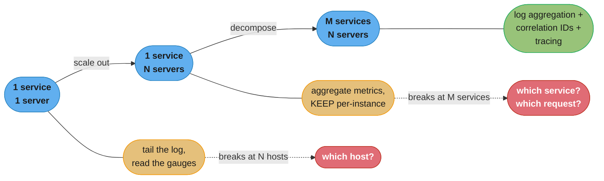
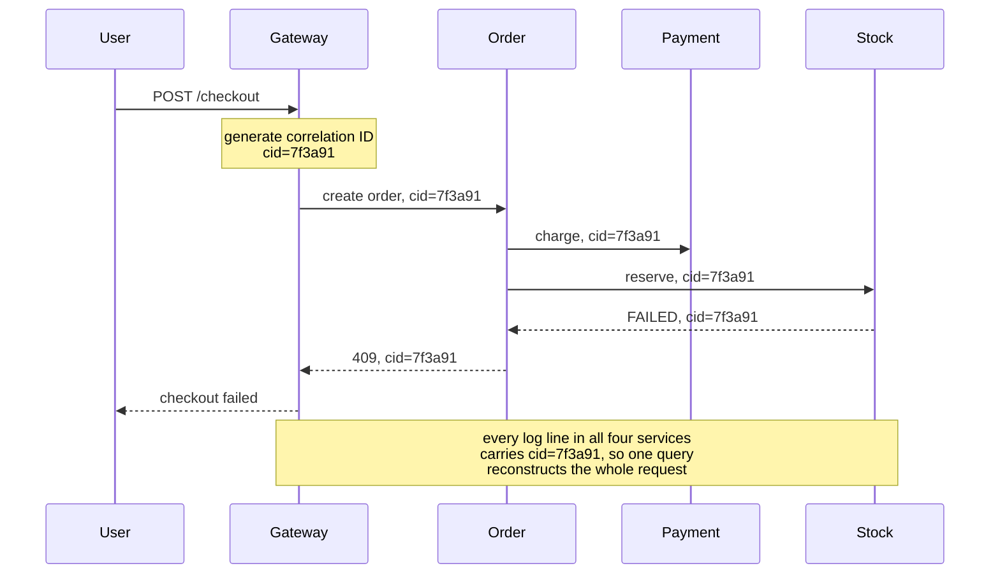
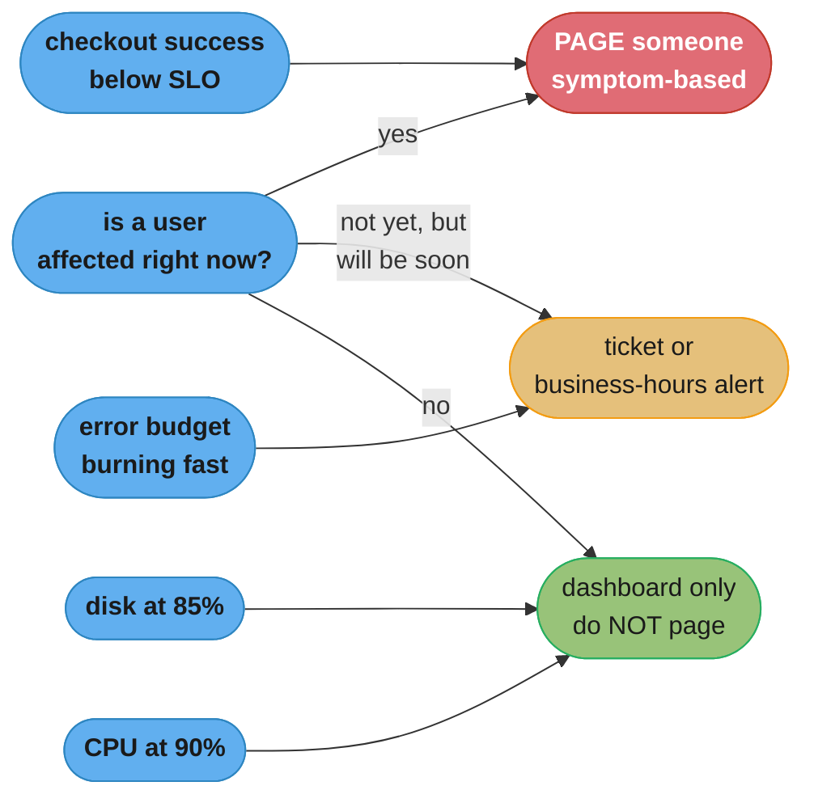
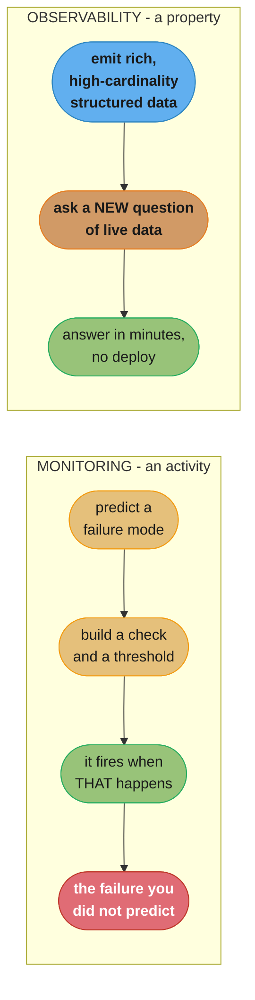

# Chapter 10: From Monitoring to Observability

> Part II — Implementation · Building Microservices, 2nd Edition (Sam Newman, O'Reilly 2021) ·
> builds on Ch 9 (Testing), leads to Ch 11 (Security)

## Chapter Map

Chapter 9 ended by moving part of the verification burden into production — canaries, smoke
tests, synthetic transactions — and by arguing for shifting investment from preventing failures
toward recovering from them quickly. Both of those moves write a cheque that this chapter has to
cash. A canary is worthless if you cannot tell how it is behaving. A fast mean time to repair
depends entirely on how fast you can *understand* a novel failure. So this chapter is about what
the running system tells you about itself.

The title is the argument. **Monitoring** is an activity: something you do to a system, usually by
deciding in advance what could go wrong and building a dashboard and an alert for each. That works
when you can enumerate the failure modes, which you could with one application on one server.
**Observability** is a property of the system: the extent to which you can understand its internal
state from its external outputs — and crucially, the extent to which you can ask a question nobody
anticipated, right now, without shipping new code. Distributed systems fail in combinations nobody
enumerated, which is why the shift is not a fashion but a necessity.

Newman structures the chapter as an escalation. One service on one server, then one service on
many servers, then many services on many servers — with each step breaking a technique that worked
at the previous one. Then the conceptual distinction, then the building blocks (log aggregation,
metrics, tracing, SLOs, alerting, semantic monitoring), then the practical questions of
standardization and tool selection, and a pointed warning about vendors promising that machine
learning will do your thinking for you.

**TL;DR:**
- Monitoring handles **known unknowns** — failure modes you anticipated well enough to build a
  check for. Observability is about **unknown unknowns**: being able to ask a new question of a
  running system without deploying anything.
- **Log aggregation is the prerequisite.** Newman treats it as the readiness test for
  microservices: if your organization cannot get logs off every host into one queryable place, it
  is not ready to run many services. And it is nearly useless without **correlation IDs**, which
  are agonizing to retrofit.
- **Cardinality** is the metric concept that decides what questions you can ask. A low-cardinality
  system tells you the error rate; a high-cardinality one tells you *which customer, on which
  build, in which region*. The tool you pick decides which of those you get.
- **Distributed tracing** productizes the correlation ID into spans and traces, with **sampling**
  as the cost control — and the advice that matters most is to instrument against
  **OpenTelemetry** rather than a vendor's API.
- **Alert on symptoms users feel, not on causes.** Newman's highest-value technique is **semantic
  monitoring** — alerting on whether the business operation is working — and his tool-selection
  advice is to buy rather than build, choose something everyone can use, and be sceptical of any
  product claiming its machine learning will find your root cause for you.

## The Big Question

At 02:47 a small fraction of checkouts start failing. No service is down, every health check is
green, CPU and memory look normal everywhere, and the failure only affects customers whose orders
contain a particular combination of items. Nobody built a dashboard for this, because nobody
imagined it. How long does it take you to find out what is happening — and is that number
determined by your skill, or by whether your system can answer questions you did not anticipate?

Analogy: consider the difference between a car's dashboard and a mechanic's diagnostic port. The
dashboard shows a fixed set of gauges chosen by the designer: speed, fuel, engine temperature, an
oil light. It answers the questions someone anticipated, and it answers them at a glance. When the
car makes an odd noise only when turning left on a cold morning, the dashboard has nothing —
there is no gauge for that, and there never will be. The diagnostic port lets a mechanic ask the
car questions nobody thought to put on the dash. Monitoring is the dashboard. Observability is the
port. You want both, but as the machine gets more complicated the dashboard covers a shrinking
fraction of what can go wrong.

---

## 10.1 Disruption, Panic, and Confusion

The chapter opens with the situation everyone recognizes. Something is wrong. The alerts that fired
are not the ones that explain it, or nothing fired at all and a customer told you. People pile into
a channel, several theories are proposed, three engineers start SSHing to different machines, and
the first forty minutes go to establishing what is actually happening rather than to fixing it.

Newman's point in opening this way is that the panic is not a people problem or a process problem.
It is a direct consequence of a system that cannot be asked questions. When the only way to
investigate is to guess a cause and then go looking for evidence of it, an incident becomes a
sequence of guesses, and the time to resolution is set by how lucky the guessing order was. Every
technique in the rest of the chapter exists to replace guessing with querying.

---

## 10.2 Single Microservice, Single Server

Start at the easy end. One service, one machine. Monitoring here is genuinely straightforward, and
it is worth being precise about *why*, because each reason is what breaks in the next section.

You watch three things:

- **Host metrics** — CPU, memory, disk, network. One machine, one set of numbers.
- **The log file** — it is on that host. You can `tail -f` it and read what the service is doing.
- **The service's own behaviour** — response times, error rates, request volume.

The property that makes this easy is that all three come from one place, so **correlating them is
trivial**. Response times spiked at 14:20 and CPU hit 100% at 14:20 on the same box; the connection
is obvious. There is exactly one candidate for "where do I look," and no question about whether the
metric and the log line describe the same machine.

---

## 10.3 Single Microservice, Multiple Servers

Now the same service runs on ten hosts behind a load balancer. Two things break.

**The log is now ten logs.** You can still SSH to each host and grep, and for ten hosts on a bad
day that technically works. It degrades badly and quickly — it does not survive an instance being
replaced mid-investigation, it does not survive fifty hosts, and it does not survive needing to
answer "how many times did this happen today" across all of them.

**Aggregate metrics start hiding things.** This is the more subtle failure and it deserves numbers.
Suppose one of ten hosts has a failing disk and is answering in 2,000ms while the other nine answer
in 50ms. The *average* across the fleet is 245ms — elevated, mildly alarming, easy to attribute to
"general load." The 99th percentile across all traffic is dominated by that one host, but the
average is not, and the average is what most dashboards show. Meanwhile 10% of your users are
having a terrible time.

```
  one bad host in ten, seen three ways

  per-host p50 response time (ms)
    host-1  ###                                              50
    host-2  ###                                              50
    host-3  ###                                              50
    host-4  ###                                              50
    host-5  ###                                              50
    host-6  ###                                              50
    host-7  ###                                              50
    host-8  ###                                              50
    host-9  ###                                              50
    host-10 ##################################################  2000   <- obvious

  fleet average:  245 ms      "a bit slow today"             <- invisible
  fleet p50:       50 ms      "everything is fine"           <- invisible
  fleet p99:     1900 ms      "something is very wrong"      <- visible, but WHAT?

  the aggregate can tell you a problem EXISTS. only the per-instance
  breakdown tells you WHERE, and only the average hides it completely.
```

*Caption: you need both views and the ability to move between them. An average across instances is
the single most effective way to conceal a single sick instance, and a percentile tells you
something is wrong without telling you where.*

So the requirement at this step is: **aggregate host and service metrics centrally, but keep the
per-instance dimension**, so you can see the fleet view and then drill into the instance that is
misbehaving. Collapsing to an aggregate at collection time throws away the answer before anyone
asks the question.

---

## 10.4 Multiple Services, Multiple Servers

The real situation: dozens of services, each on several hosts, with a single user request touching
six of them. Everything from 10.3 still applies, and two genuinely new requirements appear.

**You must be able to search across all services at once.** An investigation now starts without
knowing which service is at fault, so "which log do I look at" is itself the question. Per-service
log stores answer questions you already know the answer to.

**You must be able to reconstruct one request's path.** A user reports a failed checkout. Somewhere
in the logs of six services there are lines belonging to that checkout, interleaved with a million
lines from other requests. Without something tying them together they are unrecoverable in
practice.

This is the point at which Newman makes his sharpest operational claim in the chapter: **log
aggregation is a prerequisite for microservices.** He frames it as a readiness test rather than a
best practice. If an organization cannot get logs off every host into one central, queryable place,
that is evidence it lacks the operational maturity to run a microservice architecture at all — and
the correct response is to fix that first, or reconsider the architecture, not to proceed and
discover it during an incident.



*Caption: each step invalidates the previous step's technique rather than merely straining it. The
question changes from "what is wrong" to "which host" to "which service, and which request".*

---

## 10.5 Observability Versus Monitoring

Newman is careful with the two words because they are routinely used interchangeably and they name
different kinds of thing.

**Monitoring is something you do.** It is an activity: you decide what to watch, you build the
check, you set the threshold, you look at the dashboard. It is inherently *anticipatory* — every
monitor exists because someone predicted a failure mode.

**Observability is a property the system has.** The chapter's definition: the extent to which you
can understand the internal state of a system from its external outputs. It is not a product you
buy or an activity you schedule; it is a characteristic your system either has or lacks, and you
find out which during an incident.

The distinction cashes out as **known unknowns versus unknown unknowns**:

| | Known unknowns | Unknown unknowns |
|---|---|---|
| What it is | A failure mode you anticipated | A failure nobody imagined |
| Handled by | A dashboard, a threshold, an alert | Asking a new question of live data |
| Cost of coverage | One monitor per known mode | Rich enough data to query arbitrarily |
| Where it fails | The failure you did not predict | Nowhere — but only if the data is there |
| Example | Disk above 90%, error rate above 1% | "Checkouts fail only for orders with a gift card and a backordered item, since Tuesday" |

For a single application on a single server, enumerating the failure modes was tractable, so
monitoring was close to sufficient. For a distributed system, the number of distinct ways a
combination of services, versions, network conditions, and data states can interact is not
enumerable, so the fraction of real incidents covered by pre-built dashboards falls steadily as the
system grows. The practical test Newman offers is this: when something novel happens, can you form
a hypothesis and check it against live data in minutes — or do you have to write code, deploy it,
and wait for the problem to recur?

### The Pillars of Observability? Not So Fast

The popular framing is that observability has **three pillars** — metrics, logs, and traces. Newman
pushes back, and the objection is not pedantry.

The three-pillars model implies that observability is achieved by acquiring three things, which
turns an outcome into a shopping list. Organizations buy a metrics product, a logging product, and
a tracing product, from three vendors, and end up with three silos that cannot be queried together
— so during an incident you look at a latency graph in one tool, search logs in a second, and open
traces in a third, doing the correlation in your head. Having all three pillars and no ability to
join them is not observability; it is three dashboards.

Newman's reframing is that observability is defined by the *outcome* — can you understand the
system's internal state, can you ask new questions — and the artifacts are means to it. The
question to ask of a tooling decision is therefore not "do we have all three?" but "when something
we did not anticipate happens, can we investigate it?" A system that gets there with rich
structured events and no formal separation between the categories is more observable than one with
three immaculate silos.

---

## 10.6 Building Blocks for Observability

### Log Aggregation

Ship logs from every instance to a central store where they can be queried across services and
across hosts. As 10.4 established, this is the prerequisite rather than one option among several.

Three implementation details the chapter is specific about:

**Use a consistent format across services.** The aggregation tool has to parse the lines, and every
service inventing its own layout means either a fragile per-service parsing rule or unparsed text
you can only substring-search. Newman's related advice is about *where* the normalization happens:
do it in the service, not in the log-forwarding agent. Agents that reformat or reparse on the host
are fragile — they break when a service changes its output, and they burn CPU on the machine that
should be serving requests. Have services emit a structured, consistent format directly and let the
agent do nothing but ship bytes.

**Correlation IDs, from day one.** Generate a unique identifier at the system's first entry point,
propagate it through every downstream call, and log it on every line. It is the thing that turns a
million interleaved lines into one recoverable request. Newman is emphatic that this is agonizing
to retrofit — retrofitting means touching every service's inbound handling, outbound calls, logging
setup, and async boundaries at once, across teams — and that the way to make it stick is to put it
in a shared library or service template so it happens automatically rather than being remembered by
each developer.

**Be careful with timestamps.** Clocks on different machines drift. If service A logs at 14:20:03.100
and service B logs at 14:20:03.050, you cannot conclude B happened first, because their clocks may
differ by more than the interval. This produces genuinely confusing artifacts — a response logged
before the request that caused it — and it means cross-host ordering derived from wall-clock
timestamps should be treated as approximate. Keep clocks synchronized and stay sceptical of
fine-grained cross-service ordering.



*Caption: the correlation ID is generated once at the edge and carried everywhere. One query across
the aggregated logs then returns the complete story of a single failed checkout, in order, across
four services.*

```
  the same incident, with and without correlation IDs

  WITHOUT
    "customer 88213 says checkout failed around 14:20"
    -> grep the gateway log for 14:20      -> 4,100 lines
    -> find their session, get an order id -> 12 min
    -> grep Order for that order id        -> 900 lines, one useful
    -> it called Payment and Stock. which requests were theirs?
       -> no shared identifier. match by timestamp +/- clock drift
       -> ~40 min, two engineers, moderate confidence in the answer

  WITH
    -> one query: cid = 7f3a91
    -> 23 lines, four services, in order
    -> ~30 seconds, one engineer, certain
```

*Caption: this is the whole return on a correlation ID, and it is why the chapter insists on adding
it before you need it. The "without" column does not get better with more log storage.*

### Metrics Aggregation

Collect numeric time series from every instance — request rates, latencies, error counts, queue
depths, plus host-level resource metrics — into a central store that can query across them.

The property that decides how useful this is, and the term to remember, is **cardinality**. A
metric's cardinality is the number of distinct combinations of labels attached to it.

- `http_requests_total` with a `status` label: cardinality about 5. Trivially cheap.
- Add `service` (40 values) and `endpoint` (20 values): cardinality about 4,000. Still fine.
- Add `customer_id` (2 million values): cardinality in the billions. This is what most time-series
  systems are not built for.

Cardinality matters because it is exactly the axis along which interesting questions live. "What is
the error rate?" is a low-cardinality question. "Which customers are seeing errors, on which build,
in which region, with which feature flag?" is a high-cardinality question, and it is the kind you
need during a novel incident — precisely the unknown-unknowns case from 10.5.

The chapter is direct that this is a **product selection constraint, not a configuration setting**.
It names **Prometheus** as designed around relatively low-cardinality data — excellent at what it
does, and not the tool for attaching a customer ID to every event — and points to **Honeycomb** and
**Lightstep** as products built specifically for high-cardinality data. Choosing a low-cardinality
system is a decision that certain questions will be unanswerable, and it is much easier to make
that decision knowingly than to discover it at 03:00.

The 10.3 lesson also carries forward: keep the per-instance dimension, and keep enough history to
know what normal looks like. You cannot tell whether today's latency is unusual without weeks of
comparison, and capacity planning is a trend question, not a snapshot question.

```
  cardinality, and the questions each level can answer

  labels                                  cardinality   question it answers
  --------------------------------------- ------------  ------------------------------
  status                                  ~5            "are we erroring?"
  + service, endpoint                     ~4,000        "which endpoint is erroring?"
  + instance, version                     ~400,000      "which build, on which host?"
  + region, feature_flag                  ~4,000,000    "is it the new flag in eu-west?"
  + customer_id                           billions      "WHICH customers, exactly?"
                                          ^
                                          most time-series stores stop being
                                          viable somewhere around here
```

*Caption: every label you can afford to attach is a question you can afford to ask. The tool you
choose sets a ceiling on this table, and that ceiling is the real limit on what incidents you can
investigate.*

### Distributed Tracing

Tracing is the correlation ID grown into a first-class model of a request's journey.

- A **span** represents one unit of work — one service handling one operation — with a start time,
  an end time, an identifier, and a reference to its parent.
- A **trace** is the tree of spans belonging to one request across every service it touched.

The payoff over raw correlated logs is that you get *structure and timing*, not just co-membership.
A trace view shows which call took the 800ms out of a 950ms request, whether two downstream calls
ran in parallel or serially, and where a request stopped. That turns "the checkout is slow" into
"the checkout is slow because Stock's inventory lookup is serial and takes 780ms" without anyone
reading a log.

```
  one trace: checkout, 950 ms total

  gateway            |==========================================|  950 ms
    order            | =======================================|     920 ms
      payment        |  ====|                                        60 ms
      stock          |       ==================================|    780 ms
        stock-db     |        ===|                                   85 ms
        stock-db     |            ===|                               82 ms
        stock-db     |                ===|                           88 ms
        ... 9 total serial lookups
      notify         |                                        =|     15 ms

  the shape IS the diagnosis: nine serial database lookups inside stock,
  each ~85 ms, where one batched query would do. no log line says this.
```

*Caption: a trace's value is the shape, not the total. The nested serial bars are visible at a
glance and are effectively invisible in aggregated latency metrics, which would show only that
checkout is slow.*

**Sampling** is the cost control. Capturing, transmitting, and storing a trace for every request at
high volume is expensive in bandwidth, storage, and the overhead added to the request path, so
tracing systems record only a fraction. The chapter notes that Google's Dapper, the system that
established the model, ran at a very low sampling rate and still delivered the value — because for
understanding *typical* behaviour, a small sample is statistically sufficient. Start with sampling
and adjust; the trade is that a low rate makes it less likely that the one specific failed request
you care about was captured, which is why sampling strategies that preferentially keep errors and
slow requests are worth having.

**The advice that matters most here is about lock-in.** Instrumentation is invasive — it lives in
every service, on every code path — so instrumenting against a vendor's proprietary API means
changing tools later requires touching every service. Newman's guidance is to choose tooling that
supports **OpenTelemetry**, the vendor-neutral standard for instrumentation and telemetry data, so
that the instrumentation is an asset you own rather than a commitment to one supplier.

### Are We Doing OK?

Borrowed from site-reliability practice, four terms that answer "is the system acceptable?"
quantitatively rather than by feel:

- **SLI — service level indicator.** A measurable thing: 99th-percentile response time, the
  proportion of requests returning 5xx, availability of a specific endpoint. It is a number you
  actually collect.
- **SLO — service level objective.** The target you set for an SLI: "99.9% of checkout requests
  succeed over a rolling 30 days." Internal, and chosen by the team.
- **SLA — service level agreement.** A contractual commitment to a customer, with consequences for
  breaching it. SLAs are normally looser than SLOs, so that you notice you are in trouble before a
  contract is broken.
- **Error budget.** The complement of the SLO. A 99.9% objective over 30 days permits roughly 43
  minutes of failure, and that budget is a *resource you are allowed to spend*.

The error budget is the concept that changes behaviour, because it converts a permanent argument
into an arithmetic one. "Should we ship this risky change or spend the sprint on stability?" has no
resolution as a values debate between a product manager and an engineer. "We have used 6 of our 43
minutes this month, so we can ship it" or "we burned 40 minutes last week, so this sprint is
stability work" is a shared, checkable answer. The budget also gives explicit permission for
failure that stays within it — a team at 99.95% against a 99.9% objective is arguably being too
conservative and shipping too slowly.

### Alerting

The chapter's central rule: **alert on symptoms, not on causes.** A disk at 85%, a CPU at 90%, a
pod restarting — these are causes, and most of the time they cause nothing, so alerting on them
produces pages that resolve themselves and teach people to ignore pages. Alert on the thing a user
would notice: checkout success rate falling, latency exceeding the SLO, orders per minute dropping
below the floor. The cause is then something you *investigate* using everything in this section,
not something you get woken for.

The chapter also carries a list of properties a good alert should have, drawn from research into
alerting in control rooms of other safety-critical industries — a domain that has thought harder
about this than software has:

| Property | The alert should… |
|---|---|
| **Relevant** | Be about something that actually matters |
| **Unique** | Not duplicate another alert firing for the same event |
| **Timely** | Arrive fast enough to act on |
| **Prioritized** | Convey how urgent it is relative to others |
| **Understandable** | Say clearly what is wrong, in plain language |
| **Diagnostic** | Point toward what the problem actually is |
| **Advisory** | Suggest what action might be needed |
| **Focusing** | Direct attention to what matters most, not everything at once |

The failure mode is over-alerting, and it is the same one Chapter 9 described for flaky tests. A
pager that fires forty times a night for conditions that resolve themselves trains its recipients
into **normalization of deviance**, and the one page that mattered arrives into a context where
everyone has learned that pages do not matter. Fewer, better alerts is not a compromise on
diligence; it is the only arrangement in which alerts work at all.



*Caption: the routing question is whether a human being is currently having a bad time. Causes go
to a dashboard where they inform an investigation, symptoms go to a pager.*

### Semantic Monitoring

The highest-signal technique in the chapter, and the one most often missing. **Semantic monitoring
asks whether the business is working**, rather than whether the components are healthy.

Every service can report perfectly healthy — process alive, database connected, memory fine,
endpoints returning 200 — while the *business operation* is broken, because a configuration change
routed orders to the wrong queue, or a contract mismatch means a field arrives null, or a feature
flag is inverted. No component check can see any of those. An alert on "orders per minute has been
below 40 for five minutes, against a normal of 300" sees all of them.

Two implementations, and the chapter recommends both:

- **Real user monitoring** — measure what actual users are actually achieving: completed checkouts
  per minute, successful logins, searches returning results.
- **Synthetic transactions** — the technique from Chapter 9, run continuously as monitoring rather
  than as a test: a scripted fake user places an order every few minutes and the result is an alert
  source. This covers the low-traffic case where real-user volume is too thin to detect a problem
  quickly, and it exercises the journey even when no real user happens to be trying it at 04:00.

Newman's practical point is that this is where alerting effort has the best return. One
well-constructed semantic alert covers an enormous class of failures that no amount of
component-level checking would catch, and it is by construction a symptom rather than a cause.

### Testing in Production

The chapter restates Chapter 9's in-production techniques here because they are as much
observability practices as testing practices — each one is a source of information about the
running system:

- **Synthetic transactions** — as above, continuous verification of the business journey.
- **Smoke tests** — run against a newly deployed version in the window before it is released.
- **Canary release** — a small fraction of real traffic on the new version, with per-version metrics
  as the entire point.
- **Parallel run** — old and new executing against the same request, outputs compared.
- **A/B testing** — variants compared on a business metric.
- **Chaos engineering** — deliberately injecting failure to check whether the system's resilience
  behaves as believed. Chapter 12 develops it.

The common thread is that each generates signal that only exists in production, which is the same
argument Chapter 9 made from the testing side.

---

## 10.7 Standardization

Observability creates a real tension with team autonomy. Chapter 15's whole argument is that teams
should own their services and make their own technical choices — but a system is only observable if
its telemetry can be *joined across services*, and joining requires agreement.

Newman's resolution is to standardize narrowly and specifically. Standardize the things that must
match for cross-service investigation to work at all:

- **Log format** — so one query parses every service's output.
- **Correlation ID propagation** — the header name, the generation rule, the propagation
  obligation. This one is non-negotiable, because a single service that drops the header breaks
  every trace passing through it.
- **Metric naming and labelling** — so that "error rate" means the same thing everywhere and can be
  compared.
- **The instrumentation standard** — OpenTelemetry, so telemetry from every service is
  interoperable and portable.

And leave everything else to teams: language, framework, storage, internal structure.

The other half of the answer is *how* to make a standard stick, and Newman's position is that
mandates enforced by a central team age badly — they get resented, worked around, and become a
bottleneck. The mechanism that works is to make the standard path the **easy** path: ship a service
template or shared library that generates correlation IDs, propagates them, emits the agreed log
format, and registers the standard metrics, all by default. A team then gets compliance by using the
thing that was already the fastest way to start a service, and nobody has to be policed. The
template should be something teams *want*, and if it is not, that is information about the template
rather than about the teams.

---

## 10.8 Selecting Tools

Five criteria, and the chapter frames them as questions to ask a vendor rather than features to
tick.

### Democratic

**Everyone who might need to investigate must be able to use the tool.** If querying requires
learning a specialist language that only three people know, or if per-seat licensing means only the
platform team has logins, then the organization's observability is bounded by those few people's
availability. During an incident at 03:00 that bound is what determines your mean time to repair.
Newman singles out pricing models that discourage access as an anti-pattern worth actively avoiding
— a licence that makes you ration who can look at your own system's data is working against the
thing you bought it for.

### Easy to Integrate

Prefer tools with first-class **OpenTelemetry** support. Instrumentation touches every service and
every code path, so it is the most expensive thing to redo and therefore the worst place to accept
lock-in. If your services emit OpenTelemetry, changing vendors is a configuration change at the
collector rather than a multi-quarter programme across every team.

### Provide Context

A number on its own is not information. The tool has to supply context in three forms:

- **Temporal context** — what did this look like an hour ago, yesterday, last Tuesday? 500ms is
  alarming if it was 50ms yesterday and normal if it has always been 500ms.
- **Relative context** — how does this instance, this customer, this region compare to the others?
  This is where the cardinality discussion pays off.
- **Proportional context** — how big is this? Is it one customer or forty per cent of them? This is
  what decides whether you wake somebody up.

A tool that shows an anomaly without letting you establish these three is generating work, not
answers.

### Real Time

Information that arrives an hour late is useless during an incident. The chapter makes the useful
secondary point that you do not need perfect accuracy in real time: an approximate answer available
now is worth more than an exact one available later, and a tool that trades some precision for
immediacy is making the right trade for the incident use case. Reconciled, exact numbers matter for
billing and for capacity planning, not for deciding whether to roll back.

### Suitable for Your Scale

Match the tool to your actual size in both directions. A platform engineered for hyperscale brings
operational complexity and cost that a twelve-service organization will pay for and never use. A
tool that works fine for twelve services may fall over at four hundred. And look specifically at how
the pricing model behaves as *your* data grows — many observability products price on ingest volume
or on cardinality, which means the exact thing that makes them valuable is the thing that makes them
expensive, and a bill that punishes rich data will quietly push teams toward instrumenting less.

**Build versus buy.** Newman's position is clear: observability tooling is not your competitive
differentiator, so **buy it**. The comparison people get wrong is licence fee versus zero, when the
real comparison is licence fee versus the fully loaded cost of engineers building and — far more
expensively — *operating* a log and metrics platform indefinitely, including its own on-call
rotation, its own scaling problems, and its own outages that happen, by construction, at exactly the
moment you need it most. Self-hosting is defensible where a hard regulatory constraint or a genuinely
unusual scale requires it, and the decision should be made on those grounds rather than on an
instinct that free software is free.

---

## 10.9 The Expert in the Machine

A short, pointed section aimed at vendor claims that machine learning will identify your problems
for you.

Newman's assessment is that anomaly detection has real, narrow value: a metric with a strong,
stable seasonal pattern is a case where an algorithm can reasonably flag a deviation, and that is
useful. What he treats as unsupported at the time of writing is the larger claim — that a product
will determine the *root cause* of a novel failure in a distributed system. That requires
understanding the system's semantics, the business context, the deployment history, and the
intent behind the code, and a model watching time series has none of those.

The deeper warning is about substitution. The danger is not that anomaly detection is useless; it
is that believing a tool will do the analysis becomes a reason not to invest in the ability to ask
your own questions. An organization that buys the promise and skips the correlation IDs, the
high-cardinality events, and the tracing has traded a capability it would have owned for one that
turns out to be a slightly smarter threshold. Keep the ability to investigate; treat automated
analysis as an assistant to it rather than a replacement for it.

---

## 10.10 Getting Started

The chapter closes with an ordering, which is useful precisely because the building blocks are
listed in a way that can read as "do all of this."

1. **Get log aggregation working.** It is the prerequisite and the readiness test, it is the
   cheapest of the blocks, and every incident investigation starts there.
2. **Add correlation IDs immediately** — before you think you need them, because retrofitting is
   the painful path and because their value is retrospective. The day you want them is a day it is
   too late to add them.
3. **Aggregate metrics**, keeping the per-instance dimension, and keep enough history to establish
   what normal looks like.
4. **Define SLOs for a small number of things users actually care about.** Small is doing work
   here — a handful of meaningful objectives beats fifty nobody reads.
5. **Alert on those, and on semantic signals.** Symptoms, not causes. Resist the urge to add an
   alert for every cause you can measure.
6. **Add distributed tracing**, with sampling, once the request paths are deep enough that the
   correlation ID alone stops answering the timing questions.
7. **Use OpenTelemetry throughout**, from the start, so none of the above is a commitment to one
   vendor.

The sequencing is the advice. Teams that start at step 6 because tracing is the interesting one end
up with beautiful traces and no way to search logs during the incident where the trace was not
sampled.

---

## Beyond the book — the observability landscape after 2021

> The chapter names Prometheus, Honeycomb, Lightstep, OpenTelemetry, and the SLI/SLO/SLA/error-budget
> vocabulary, and it is sceptical of vendor claims about machine learning finding root causes. It
> does **not** discuss anything below; this section is this repo's editorial note, not Newman's.

Newman's bet on OpenTelemetry as the instrumentation standard to build against was the right call
and has since become substantially less of a bet — the tracing side reached broad stability and the
metrics and logging sides followed, so "instrument against OpenTelemetry, choose your backend
separately" is now ordinary practice rather than forward-looking advice. The cardinality problem he
describes has been attacked from several directions since, both by storage engines designed for
wider label sets and by wide-event approaches that sidestep the pre-aggregated-metric model
entirely, so a 2026 reader should re-check the specific per-product cardinality limits the chapter
implies rather than treating them as fixed. His scepticism in 10.9 is worth re-reading rather than
discarding: the capability of automated analysis has moved considerably since 2021, and his actual
argument — do not let a vendor's promise substitute for your own ability to ask questions — is
about organizational dependence rather than about model capability, and is unaffected.

---

## Visual Intuition



*Caption: monitoring runs left to right once, at design time, and has nothing to say about the
right-hand box. Observability is a loop you can re-enter with a question nobody wrote down in
advance.*

```
  the four blocks, and what each one alone cannot tell you

                        can tell you            cannot tell you
  --------------------- ----------------------- ------------------------------
  host metrics          this box is unwell      whether users care
  service metrics       error rate is 3%        WHICH 3%, or why
  log aggregation       what each service said  timing, or the shape of the call tree
    + correlation IDs   the whole story of      how long each hop took
                        ONE request
  distributed tracing   where the time went,    what the code was thinking
                        in what order
  semantic monitoring   the BUSINESS is broken  which component broke it

  none of them is optional and none of them substitutes for another.
  the ordering in 10.10 is which one to be missing LAST, not which to skip.
```

*Caption: read the right column. Every block has a specific blind spot that another block covers,
which is why the chapter treats the set as a system rather than as alternatives to choose between.*

---

## Key Concepts Glossary

- **Monitoring** — an activity: deciding in advance what could fail, and building checks and alerts
  for it.
- **Observability** — a property of a system: the extent to which its internal state can be
  understood from its external outputs.
- **Known unknowns** — anticipated failure modes, addressable with a pre-built dashboard or alert.
- **Unknown unknowns** — failures nobody predicted, addressable only by asking new questions of live
  data.
- **Three pillars (metrics, logs, traces)** — the popular framing Newman criticizes for turning an
  outcome into a shopping list and encouraging siloed tooling.
- **Log aggregation** — shipping logs from every instance to one central, queryable store; the
  chapter's stated prerequisite for microservices.
- **Correlation ID** — a unique identifier generated at the entry point and propagated through every
  downstream call, so one request's lines can be recovered.
- **Log forwarding agent** — the process shipping logs off a host; should ship rather than reformat.
- **Metrics aggregation** — centrally collecting numeric time series while retaining the
  per-instance dimension.
- **Cardinality** — the number of distinct label combinations on a metric; it sets the limit on what
  questions can be asked.
- **Span** — one unit of work in a trace, with a start, an end, an id, and a parent.
- **Trace** — the tree of spans belonging to a single request across every service it touched.
- **Sampling** — recording only a fraction of traces to bound the cost of tracing.
- **OpenTelemetry** — the vendor-neutral instrumentation and telemetry standard the chapter
  recommends building against to avoid lock-in.
- **SLI (service level indicator)** — a measured value such as error rate or 99th-percentile latency.
- **SLO (service level objective)** — the internal target set for an SLI.
- **SLA (service level agreement)** — the contractual commitment to a customer, with consequences.
- **Error budget** — the permitted failure implied by an SLO, treated as a resource that may be
  deliberately spent.
- **Alerting on symptoms, not causes** — paging on what a user experiences rather than on an
  underlying condition that usually causes nothing.
- **Alert fatigue / normalization of deviance** — repeated low-value alerts training recipients to
  ignore the pager.
- **Semantic monitoring** — alerting on whether the business operation works, via real user
  monitoring and synthetic transactions.
- **Real user monitoring** — measuring what actual users actually achieve in production.
- **Synthetic transaction** — a scripted fake user journey run continuously against production as a
  monitoring signal.
- **Democratic tooling** — observability tools everyone who might investigate can actually access
  and use.

---

## Tradeoffs & Decision Tables

| | Monitoring | Observability |
|---|---|---|
| Kind of thing | An activity you perform | A property the system has |
| Addresses | Known unknowns | Unknown unknowns |
| Built when | Before the failure, by prediction | Continuously, by emitting rich data |
| Fails when | The failure was not anticipated | The data was too coarse to query |
| Typical artifact | A dashboard and a threshold | A query against high-cardinality events |
| Still needed? | Yes — cheap and effective for known modes | Yes — everything else |

| Building block | Answers | Cost | Adopt when |
|---|---|---|---|
| Log aggregation | "What did each service say?" | Low | First — it is the prerequisite |
| Correlation IDs | "What happened to THIS request?" | Low if early, brutal if retrofitted | Immediately, before you need them |
| Metrics aggregation | "What is the rate, and is it normal?" | Low-medium | Early, with per-instance retained |
| SLOs and error budgets | "Is this acceptable, and by how much?" | Low, mostly agreement | Once you have reliable SLIs |
| Distributed tracing | "Where did the time go, in what order?" | Medium — instrumentation plus storage | Once request paths are deep |
| Semantic monitoring | "Is the business working?" | Low per alert, very high value | As soon as you can define a journey |

| Cardinality level | Example labels | Questions you can ask | Typical tooling fit |
|---|---|---|---|
| Low | status, service | "Are we erroring?" | Classic time-series systems, Prometheus |
| Medium | + endpoint, instance, version | "Which endpoint, which build?" | Most metric platforms, with care |
| High | + region, feature flag, customer | "Which customers, under which flag?" | Purpose-built high-cardinality tools |

| Signal | Page someone? | Why |
|---|---|---|
| Checkout success rate below SLO | Yes | A user is affected right now |
| Orders per minute far below normal | Yes | Semantic — the business is broken |
| Error budget burning unusually fast | Ticket, not a page | Will matter, is not yet an outage |
| Disk at 85%, CPU at 90% | No — dashboard | A cause that usually causes nothing |
| One instance restarted | No — dashboard | The platform is doing its job |

---

## Common Pitfalls / War Stories

- **The average that hid a dying host.** One of ten instances answers in 2,000ms while the rest
  answer in 50ms. The fleet average reads 245ms — "a bit slow today" — and 10% of users have a
  broken experience for three days until someone happens to look per-instance.
- **Retrofitting correlation IDs during an incident.** The need becomes obvious at the worst
  possible moment, and adding them means touching inbound handling, outbound calls, logging setup,
  and async boundaries across every service, coordinated across every team. It is a quarter of work
  that would have been a day at the start.
- **One service that drops the header.** Correlation IDs are propagated by every service except one
  in the middle of the main path, so every trace through that path is severed in two and nobody
  notices until they need the trace. This is exactly why propagation belongs in a shared library
  rather than in each team's discretion.
- **Three pillars, three vendors, three silos.** Metrics in one product, logs in a second, traces in
  a third, none of them able to join on anything, so an incident is spent doing the correlation
  manually in a notes file. All three boxes are ticked and the system is not observable.
- **Discovering a cardinality ceiling at 03:00.** The question is "which customers are affected,"
  the metric has no customer dimension because the platform could not carry one, and finding out
  means writing and deploying code while the incident continues.
- **A pager that fires forty times a night.** Every cause is alerted on, most resolve themselves,
  and within a month the team has learned that pages do not indicate problems. The one page that
  mattered arrives into that context and is acknowledged and ignored.
- **Every service healthy, no orders taken.** Health checks green across the board while a
  configuration change routes orders to a queue nobody consumes. Discovered four hours later by the
  finance team, and it would have been a two-minute alert with semantic monitoring.
- **Instrumenting against a vendor's proprietary API.** Two years later the pricing changes and the
  migration requires touching every code path in every service, so the organization stays with a
  vendor it no longer wants — the lock-in was bought at instrumentation time.
- **Log lines with no shared format.** Twelve services, twelve layouts, so the aggregation platform
  can only substring-search, and "show me all 5xx across the estate in the last hour" is not a query
  anyone can write.
- **Trusting cross-host timestamps.** An investigation concludes service B caused the failure
  because its log line is 50ms earlier than service A's, and the two hosts' clocks differ by 200ms.
  The conclusion is confidently wrong and the real cause is found three days later.
- **Buying the AI that finds root causes.** The product flags anomalies on seasonal metrics, which
  is real value, and the organization skips correlation IDs and tracing on the strength of the
  larger promise. The first novel incident finds them with an anomaly alert and no way to
  investigate it.

---

## Real-World Systems Referenced

The chapter names **Prometheus** as the widely used metrics system designed around relatively
low-cardinality data, with **Honeycomb** and **Lightstep** as products built for high-cardinality
telemetry. **OpenTelemetry** is named as the vendor-neutral instrumentation standard to build
against, and **Google's Dapper** is cited as the system that established the distributed-tracing
model and demonstrated that a very low sampling rate is sufficient for understanding typical
behaviour. The SLI, SLO, SLA, and error-budget vocabulary comes from Google's site-reliability
practice as published in the **Site Reliability Engineering** book. The properties of a good alert
are drawn from research into alerting and control-room design in other safety-critical industries,
which the chapter presents as a field that has studied the problem more rigorously than software
has. **Charity Majors** is the practitioner most associated with the observability-versus-monitoring
framing the chapter adopts and with the critique of the three-pillars model.

---

## Summary

The chapter is a progression and an argument. The progression is one service on one server, where
you tail a log and read a gauge and correlation is trivial; then one service on many servers, where
per-host logs stop scaling and aggregate metrics start actively concealing a single sick instance;
then many services on many servers, where you no longer know which log to open and cannot recover a
single request's story at all. Each step does not strain the previous technique, it invalidates it.
And at the third step Newman states the chapter's firmest operational position: log aggregation is
a prerequisite for microservices, and an organization that cannot achieve it should treat that as
evidence about its readiness rather than as a detail to sort out later.

The argument is the title's. Monitoring is an activity built on prediction, and it works to the
extent that failure modes are enumerable — which they are for one application on one server and are
not for a distributed system. Observability is a property: can you understand the internal state
from the outputs, and can you ask a question nobody anticipated without shipping code. Newman
declines the three-pillars framing because it turns that outcome into a procurement exercise and
delivers three silos that cannot be joined, which is worse than it sounds during an incident.

The building blocks then each cover a specific blind spot. Log aggregation needs a consistent format
emitted by services rather than reconstructed by agents, and it needs correlation IDs generated at
the edge, propagated everywhere, and put in a shared library because retrofitting them is a quarter
of work that would have been a day. Metrics need the per-instance dimension retained and enough
history to define normal, and their usefulness is bounded by cardinality — a product decision that
silently determines whether "which customers are affected" is answerable. Tracing turns correlation
into spans and traces with real timing, bought with sampling, and should be instrumented against
OpenTelemetry so the investment is not a commitment to one vendor. SLIs, SLOs, SLAs, and error
budgets convert "is this acceptable" from a values argument into arithmetic. Alerts should fire on
symptoms users feel rather than causes that usually cause nothing, because a pager that fires forty
times a night has trained its recipients not to answer it. And semantic monitoring — asking whether
orders are being taken rather than whether processes are alive — catches an entire class of failures
in which every component reports healthy and nothing works.

The practical closing advice is to standardize only what must be joinable across services and to
make that standard the easy path via a template rather than a mandate; to buy the tooling rather
than build it, choosing something everyone can access, integrated via OpenTelemetry, that supplies
temporal, relative, and proportional context in near real time at your actual scale; to stay
sceptical of products claiming to find root causes for you, not because automated analysis is
worthless but because believing in it is a reason to skip building the capability to investigate;
and to sequence adoption starting with log aggregation and correlation IDs, because those are the
ones you cannot add usefully after you need them.

---

## Interview Questions

**Q: What is the difference between monitoring and observability, and why does the distinction matter?**
**Short:** Monitoring is an activity based on predicting failures; observability is a system property letting you ask unanticipated questions.
Monitoring means deciding in advance what could go wrong and building a dashboard or alert for each case, which works while the failure modes are enumerable. Observability is the extent to which you can understand a system's internal state from its external outputs, including questions nobody wrote down beforehand. The distinction matters because a distributed system's failure modes are combinatorial and not enumerable, so the fraction of real incidents covered by pre-built dashboards falls steadily as the system grows.

**Q: Why does Newman call log aggregation a prerequisite for microservices rather than a best practice?**
**Short:** He treats it as a readiness test — an organization that cannot centralize logs is not ready to run many services.
With many services on many hosts, an investigation begins without knowing which service is at fault, so per-host and per-service log stores can only answer questions you already know the answer to. Log aggregation is also the cheapest of the observability building blocks and the first place every incident investigation goes. His guidance is that failing this test should prompt fixing it or reconsidering the architecture, rather than proceeding and discovering the gap during an outage.

**Q: Why are correlation IDs so painful to retrofit, and what makes them stick once adopted?**
**Short:** Retrofitting means changing inbound handling, outbound calls, logging, and async boundaries in every service at once, across teams.
The value is entirely retrospective — you want the ID for a request that already happened — so the day you realize you need them is the day it is too late for the incident in front of you. Adding them later is a cross-team programme touching every service's request path simultaneously, where adding them at the start is close to free. The mechanism that makes them reliable is putting generation and propagation in a shared library or service template so it happens automatically, because a single service in the middle of a path that drops the header severs every trace through it.

**Q: What is cardinality, and why is it a tool-selection decision rather than a configuration setting?**
**Short:** Cardinality is the number of distinct label combinations on a metric, and most time-series stores have a hard ceiling on it.
Adding a status label gives cardinality around five, adding service and endpoint gives a few thousand, and adding a customer identifier gives billions — and that last level is exactly where interesting incident questions live, like which customers are affected under which feature flag. Newman notes Prometheus is designed for relatively low cardinality while Honeycomb and Lightstep are built for high cardinality, so the choice determines which questions are answerable at all. Discovering the ceiling during an incident means writing and deploying code while the incident continues.

**Q: Why does Newman push back on the "three pillars of observability" framing?**
**Short:** It turns an outcome into a shopping list, and buying three products from three vendors produces three silos you cannot join.
Observability is defined by whether you can understand the system's internal state and investigate something unanticipated, and the metrics, logs, and traces are means to that rather than the thing itself. Organizations that treat them as three purchases end up looking at a latency graph in one tool, searching logs in a second, and opening traces in a third while doing the correlation mentally under incident pressure. The better question of any tooling decision is "when something novel happens, can we investigate it," not "do we have all three."

**Q: Why does alerting on symptoms beat alerting on causes?**
**Short:** Most causes cause nothing, so alerting on them produces self-resolving pages that train people to ignore the pager.
A disk at 85% or a CPU at 90% usually resolves without any user ever noticing, and a pager firing forty times a night for such conditions teaches its recipients that pages do not indicate problems — the same normalization of deviance that flaky tests cause. Alerting instead on what a user experiences, like checkout success rate falling below its objective, means every page corresponds to someone actually having a bad time. The causes still belong on a dashboard, where they inform the investigation rather than triggering it.

**Q: What is semantic monitoring, and why does Newman consider it the highest-value alerting source?**
**Short:** It alerts on whether the business operation works, catching failures where every component reports perfectly healthy.
A configuration change routing orders to an unconsumed queue, an inverted feature flag, or a contract mismatch producing null fields will leave every process alive, every database connected, and every health check green while no orders are taken. An alert on "orders per minute below 40 against a normal of 300" catches all of them, and by construction it is a symptom rather than a cause. It is implemented with real user monitoring plus synthetic transactions, the latter covering low-traffic periods when real-user volume is too thin to detect a problem quickly.

**Q: What do SLIs, SLOs, SLAs, and error budgets each mean, and which one changes team behaviour?**
**Short:** They are the measured value, the internal target, the contractual promise, and the permitted failure — and the budget is what changes behaviour.
An SLI is something you measure such as 99th-percentile latency, an SLO is your own target for it, and an SLA is a customer commitment with consequences, normally set looser than the SLO so you notice trouble before breaching a contract. The error budget is the SLO's complement — 99.9% over 30 days permits about 43 minutes of failure — and it is a resource you are allowed to spend. It changes behaviour because "ship the risky change or do stability work" stops being a values argument between product and engineering and becomes arithmetic both sides can check.

**Q: What does a distributed trace give you that correlated logs do not?**
**Short:** Structure and timing — which hop consumed the time, and whether calls ran serially or in parallel.
Correlated logs tell you that a set of lines belong to one request and roughly what each service said, but not how long each step took or how the calls nested. A trace's spans carry start and end times and parent references, so a 950ms checkout resolves visually into nine serial 85ms inventory lookups inside one service, which no log line states and which aggregated latency metrics cannot show. The shape of the trace is frequently the entire diagnosis.

**Q: Why is sampling necessary in tracing, and what does it cost you?**
**Short:** Capturing every trace at volume is expensive in bandwidth, storage, and request-path overhead, so systems record a fraction.
Google's Dapper established that a very low sampling rate still delivers the value, because understanding typical behaviour is a statistical question that a small sample answers well. The cost is that the one specific failed request you care about may not have been captured, which is exactly the case where you most wanted it. That is why sampling strategies that preferentially retain errors and slow requests are worth having, rather than sampling uniformly at random.

**Q: Why does Newman insist on instrumenting against OpenTelemetry?**
**Short:** Instrumentation lives on every code path in every service, so it is the worst possible place to accept vendor lock-in.
Changing an observability backend should be a configuration change at the collector, but if services emit a vendor's proprietary format then changing vendors means touching every service, which in practice means never changing vendors. Organizations in that position stay with a supplier whose pricing or product they no longer want because the exit cost was quietly paid at instrumentation time. Emitting a vendor-neutral standard makes the instrumentation an asset you own rather than a commitment.

**Q: Why does an average across instances hide problems, and what should you collect instead?**
**Short:** An average dilutes one sick instance into the healthy ones — collect aggregates while retaining the per-instance dimension.
If one of ten hosts answers in 2,000ms and the other nine in 50ms, the fleet average reads 245ms, which looks like general slowness rather than a specific failing machine, while 10% of users have a broken experience. Percentiles reveal that something is wrong but still do not say where. The requirement is to aggregate centrally without collapsing the instance dimension at collection time, so you can see the fleet view and then drill into the outlier — collapsing early throws the answer away before anyone asks the question.

**Q: What should be standardized across teams for observability, and what should be left alone?**
**Short:** Standardize only what must be joined across services — log format, correlation IDs, metric naming, and OpenTelemetry.
Cross-service investigation requires that telemetry from different services can be queried together, which requires agreement on format, on the correlation header and its propagation, and on what metric names mean. Everything else — language, framework, storage, internal structure — stays a team decision, because that autonomy is the point of the architecture. The way to make the standard hold is to make it the easy path via a service template or shared library that does the right thing by default, rather than a mandate a central team polices.

**Q: What is Newman's build-versus-buy position on observability tooling, and what does the comparison usually get wrong?**
**Short:** Buy it — observability is not your differentiator, and the real comparison is licence fee versus operating a platform indefinitely.
Teams compare a licence fee against zero, when the honest comparison is against engineers building and then permanently operating a log and metrics platform, including its own scaling problems, its own on-call rotation, and its own outages that occur at exactly the moment you need it most. Self-hosting is defensible where a genuine regulatory constraint or unusual scale requires it, and that should be the stated reason. Newman's broader point is that engineering effort spent here produces nothing a customer will ever notice.

**Q: What does "democratic" mean as a tool-selection criterion, and why does licensing matter to it?**
**Short:** Everyone who might investigate must be able to use the tool, or your recovery time is bounded by a few specialists' availability.
If querying requires a specialist language only three people know, or per-seat pricing means only the platform team has logins, then at 03:00 your ability to understand the system depends on who happens to be reachable. A pricing model that makes you ration access to your own system's data is working directly against the reason you bought it. This is the criterion that most directly determines mean time to repair, which is the dial Chapter 9 argued for investing in.

**Q: What three kinds of context should an observability tool provide, and why is a bare number insufficient?**
**Short:** Temporal, relative, and proportional context — otherwise a value cannot be judged as normal, localized, or important.
Temporal context says what this looked like an hour or a week ago, which is what makes 500ms either alarming or unremarkable. Relative context compares this instance, customer, or region against the others, which is where cardinality pays off. Proportional context says how big the problem is — one customer or forty per cent of them — which is what decides whether anyone gets woken up. A tool that surfaces an anomaly without supporting all three is generating work rather than answers.

**Q: How sceptical should you be of a vendor claiming machine learning will find your root cause, according to the chapter?**
**Short:** Newman accepts narrow anomaly detection as useful and treats automated root-cause analysis of novel distributed failures as marketing.
Flagging a deviation on a metric with a strong, stable seasonal pattern is a real capability, whereas determining the cause of an unanticipated distributed failure requires understanding the system's semantics, deployment history, business context, and intent — none of which a model watching time series has. His deeper concern is substitution rather than capability: an organization that believes the promise and therefore skips correlation IDs, high-cardinality events, and tracing has traded a capability it would have owned for a smarter threshold. Treat automated analysis as an assistant to investigation, never a replacement for the ability to investigate.

**Q: In what order should an organization adopt the observability building blocks, and why does the order matter?**
**Short:** Log aggregation, then correlation IDs, then metrics, SLOs, symptom alerts, and tracing last — because the early ones cannot be added usefully later.
Log aggregation comes first because it is the prerequisite, the cheapest block, and where every investigation starts, and correlation IDs come immediately after because their value is retrospective and retrofitting them is a cross-team programme. Metrics with the instance dimension retained, a small number of meaningful SLOs, and symptom-based alerts follow, with tracing added once request paths are deep enough that correlation alone stops answering timing questions. Teams that start with tracing because it is the interesting one end up with beautiful traces and no way to search logs during the incident where the trace was never sampled.

---

## Cross-links in this repo

- [hld/observability/ — the system-design view of logs, metrics, traces, and their interaction](../../../hld/observability/observability.md)
- [backend/observability_and_monitoring/ — instrumenting a service, and what to measure](../../../backend/observability_and_monitoring/observability_and_monitoring.md)
- [devops/observability_logging/ — log aggregation, structured logging, and forwarding agents](../../../devops/observability_logging/observability_logging.md)
- [devops/observability_metrics_prometheus/ — time series, labels, and the cardinality ceiling in practice](../../../devops/observability_metrics_prometheus/observability_metrics_prometheus.md)
- [devops/observability_tracing_and_otel/ — spans, traces, sampling, and OpenTelemetry](../../../devops/observability_tracing_and_otel/observability_tracing_and_otel.md)
- [devops/sre_principles_and_slos/ — SLIs, SLOs, SLAs, and error budgets in depth](../../../devops/sre_principles_and_slos/sre_principles_and_slos.md)
- [devops/incident_management_and_oncall/ — alerting policy, paging, and alert fatigue](../../../devops/incident_management_and_oncall/incident_management_and_oncall.md)
- Sibling chapters: [Ch 9 Testing](../09_testing/09_testing.md) · [Ch 11 Security](../11_security/11_security.md)

## Further Reading

- Beyer, Jones, Petoff, and Murphy, *Site Reliability Engineering* (O'Reilly, 2016) — the source of
  the SLI/SLO/SLA and error-budget vocabulary, and of the alert-on-symptoms rule.
- Majors, Fong-Jones, and Miranda, *Observability Engineering* (O'Reilly) — the book-length
  treatment of the observability-versus-monitoring argument this chapter adopts.
- Sigelman et al., "Dapper, a Large-Scale Distributed Systems Tracing Infrastructure" (Google,
  2010) — the paper that established the span-and-trace model and the case for low sampling rates.
- The **OpenTelemetry** specification and documentation, the vendor-neutral standard the chapter
  recommends instrumenting against.
- Ligus, *Effective Monitoring and Alerting* (O'Reilly) — a fuller treatment of alert design and the
  properties of a good alert.
- The human-factors literature on alarm design in safety-critical control rooms, which the chapter
  draws its list of good-alert properties from.
