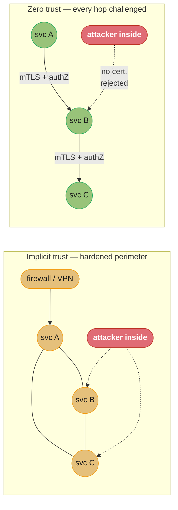
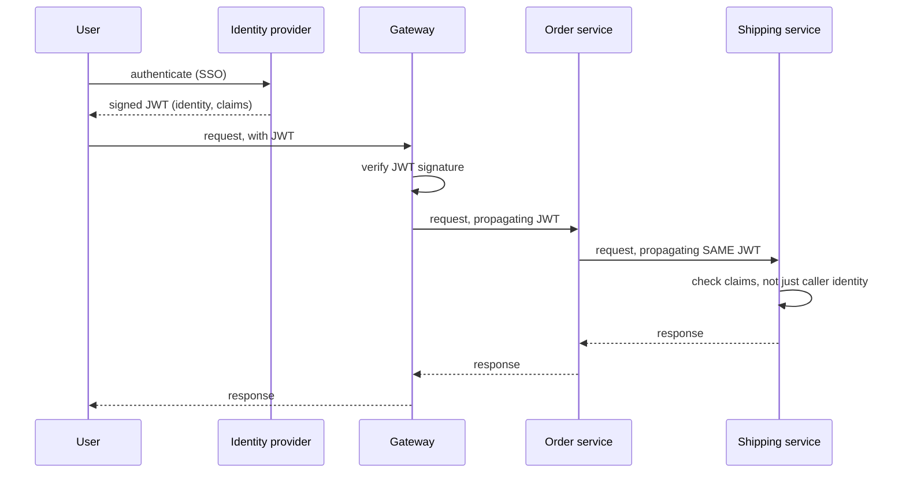
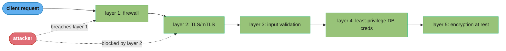

# Chapter 11: Security

> Part II — Implementation · Building Microservices, 2nd ed. (Newman, O'Reilly 2021) · builds on Ch 10 (observability), leads to Ch 12 (resiliency)

## Chapter Map

Splitting a monolith into microservices multiplies the number of network calls, the number of
data stores, and the number of places a credential or a secret can leak — the attack surface
grows even as each individual service gets simpler. This chapter is Newman's answer to that
trade: security in a microservice architecture is not one big wall around the perimeter, it is
many small, deliberate decisions repeated at every service boundary. The chapter builds from
mindset (a handful of durable principles) down to mechanism (how a request actually proves who
it is, twice — once for the human, once for every hop after that).

**TL;DR:**
- Four **core principles** — least privilege, defense in depth, automation, and building security
  into delivery — do more work than any single tool, because they shape every later decision.
- The old model, **implicit trust** inside a hardened perimeter, breaks down once a single
  compromised service sits on the same "trusted" network as everything else; **zero trust**
  verifies every call, every time, but it is a spectrum you dial in, not a binary switch.
- Securing **data in transit** (TLS, mTLS) and **data at rest** (well-known crypto, targeted
  encryption, encrypted backups) are separate problems with separate failure modes.
- **Authentication** answers "who are you," **authorization** answers "what are you allowed to
  do" — and microservices need both a human-facing answer (SSO) and a service-to-service answer
  (mTLS, API keys, JWTs), which are easy to conflate and dangerous to.
- The **confused deputy problem** is the chapter's central authorization trap: a service acting
  with its *own* identity instead of the calling user's ends up doing things on the user's behalf
  that the user was never actually allowed to do.

## The Big Question

> How do you keep a system secure when it is made of dozens (or hundreds) of independently
> deployed services, each one a potential entry point, each one talking to several others over a
> network you don't fully control?

Analogy: a monolith's security model is a single building with one front door, one guard, and a
lot of internal hallways nobody bothers to lock — get past the guard and you can walk anywhere.
A microservice architecture is a campus of many small buildings. You could keep the single-guard
model and just build a fence around the whole campus (implicit trust, perimeter security) — cheap,
but one gap in the fence, or one visitor badge stolen inside it, and every building is exposed.
Or you could put a lock and an ID check on every single door (zero trust) — more friction, more
infrastructure, but a stolen badge only opens the one door it was actually issued for. Newman's
chapter is about deciding, deliberately, how many of those doors actually need their own lock.

---

## 11.1 Core Principles

Newman opens with principles precisely because tools and threats both change constantly while
the underlying reasoning doesn't; a team that internalizes these four keeps making reasonable
security decisions even against a threat nobody has named yet.

### Principle of Least Privilege

Every human, service, and credential should be granted the *minimum* access it needs to do its
job — nothing more, "just in case." A reporting service that only ever reads order totals should
hold a database credential that can `SELECT` from an `orders` table and nothing else: it should
not be able to `DROP TABLE`, and it should not be able to read the `customers` table just because
the same database happens to host it. The payoff shows up after a compromise, not before: if that
reporting service is popped, the blast radius is capped at whatever narrow slice of the system it
was ever allowed to touch. In practice this means many narrowly scoped database users and IAM
roles instead of one shared "app" credential — more setup work, dramatically smaller compromise.

### Defense in Depth

No single control is assumed to be perfect, so several independent layers of protection are
stacked so that one layer failing doesn't mean the whole system fails. A network firewall, TLS on
every hop, input validation at each service boundary, least-privilege database credentials, and
encrypted-at-rest storage are each individually breakable — the point is that an attacker who gets
past one still has to get past the next, and the next. Newman is explicit that this is not
"add more tools"; it is choosing controls that fail *independently*, so a single misconfiguration
(a firewall rule left open) doesn't cascade into a full compromise.

### Automation

Manually run security processes — a person clicking through a checklist to patch a server, a
person remembering to rotate a credential — decay over time as the system grows and the checklist
gets longer than anyone actually follows. Automating provisioning, patching, and credential
rotation makes the secure path the *default* path rather than a discipline someone has to
remember to exercise under deadline pressure, and it makes the state of the system auditable: an
automated pipeline that rebuilt every node last Tuesday is a fact you can check, "someone probably
patched it" is not.

### Build Security into the Delivery Process

Security reviewed only at the end, right before a release, is security that gets cut when the
deadline slips — it becomes a gate people route around rather than a property of the system.
Newman's alternative is folding security work into the normal delivery pipeline: static analysis
and dependency scanning on every commit, security requirements captured alongside functional ones,
and security specialists embedded with delivery teams rather than sitting in a separate
gatekeeping function that only sees the system once it's "done." This is the same argument DevOps
makes for testing and operations — the practice works better woven into the pipeline than bolted
on at the end.

---

## 11.2 The Five Functions of Cybersecurity

Newman borrows a widely used framework (from the U.S. NIST Cybersecurity Framework) that groups
security work into five functions, useful because it makes explicit that "security" is not only
prevention — most of a team's actual effort over a system's lifetime goes into the other four.

| Function | Question it answers | Typical activity |
|---|---|---|
| **Identify** | What do we have, and what could go wrong? | Asset inventories, threat modeling, risk assessment |
| **Protect** | How do we stop it happening? | Least privilege, encryption, TLS, patching |
| **Detect** | How do we know it's happening? | Logging, intrusion detection, anomaly alerting |
| **Respond** | What do we do once we know? | Incident response plans, runbooks, containment |
| **Recover** | How do we get back to normal? | Backups, rebuild automation, post-incident review |

The framework's real value for a microservices team is a reminder that *Protect* is only one-fifth
of the job. A team that pours all its effort into firewalls and encryption but has no logging
(Detect), no incident plan (Respond), and no tested backups (Recover) will still be caught flat
when — not if — something eventually gets through.

---

## 11.3 Foundations of Application Security

Before reaching for exotic controls, Newman argues most of the value comes from getting four
unglamorous basics right, since these are what real-world breaches most often exploit.

### Credentials

Weak, reused, or hardcoded credentials remain one of the most common root causes of a breach.
Practical minimums: unique credentials per service (never one shared "app" password), secrets
pulled from a dedicated secrets store (HashiCorp Vault, AWS Secrets Manager) rather than committed
to source control or baked into a container image, and short-lived credentials rotated
automatically rather than long-lived ones rotated "when someone remembers." A credential checked
into a Git repository is compromised the moment it's pushed, whether or not anyone notices —
history doesn't forget, and scanning tools that hunt for exposed secrets in public repos run
continuously and fast.

### Patching

Unpatched software with known vulnerabilities is a standing invitation — most breaches exploit a
vulnerability that already had a published fix. Automating the patch pipeline (rebuilding
container images against updated base images, restarting instances that pick up OS patches)
converts "we should patch" into "we patch every week whether or not a human remembers to ask,"
closing the gap between disclosure and exposure.

### Backups

A backup that has never been restored is a hypothesis, not a plan. Newman's point is specifically
about *testing* restores — a corrupted, incomplete, or unreadable backup only reveals itself as
useless during the recovery you actually needed it for, which is the worst possible time to find
out. Regularly rehearsing a full restore (not just verifying a backup job "succeeded") is what
turns Recover from a checkbox into a real capability.

### Rebuild

The ability to rebuild any given service or environment quickly and repeatably is itself a
security control: if a node is compromised, the fastest safe response is often "destroy it and
build a fresh one from a known-good pipeline" rather than trying to manually clean an
already-compromised machine, whose actual state you can no longer fully trust. This only works if
rebuilding is already fast and routine — exactly what a mature CI/CD pipeline (Ch 7, Ch 8) gives
you for free.

---

## 11.4 Implicit Trust Versus Zero Trust

### Implicit Trust

The traditional model: anything inside a defined network perimeter (a corporate network, a VPC) is
trusted by default, and security effort concentrates on hardening the boundary — firewalls,
VPNs, a DMZ. Once inside, a service can typically call any other service with little further
challenge. It's cheap to build and easy to reason about, but its central weakness is structural:
the perimeter is a single point of failure for the *entire* trust model. One phished credential,
one misconfigured security group, one compromised service inside the boundary, and the attacker
inherits the same broad trust every legitimate internal service enjoys — lateral movement becomes
easy precisely because nothing internal expected to be challenged.

### Zero Trust

The opposite model assumes the network is *already* hostile — that an attacker may already be
inside it — so no request is trusted merely because of where it came from. Every call, whether
it crosses the internet or moves between two services in the same data center, is authenticated
and authorized on its own merits: verify the caller's identity, verify what it's allowed to do,
every time, regardless of network location. Concretely this usually means mutual TLS (mTLS)
between every service (so both ends prove their identity, not just the server), short-lived
credentials, and fine-grained authorization checks at each service boundary rather than only at
the edge.

### It's a Spectrum

Newman is careful not to present zero trust as a mandatory finish line — it's a substantially
higher-cost model, in both infrastructure (a service mesh or equivalent to issue and rotate
per-service certificates) and latency (every hop now does its own crypto handshake and auth
check), and few organizations need or can justify pushing all the way to the far end. Most
real systems land somewhere in between: full zero trust for the highest-value services (payments,
credential stores, PII), lighter implicit trust for low-risk internal calls between services that
handle nothing sensitive. The right question isn't "implicit or zero" but "how much of this
spectrum does *this particular boundary* actually need."



Caption: implicit trust checks identity once at the perimeter, so a foothold anywhere inside
grants broad lateral movement; zero trust re-checks identity at every hop, so the same foothold
gets rejected at the very next call it tries to make.

---

## 11.5 Securing Data in Transit

Newman breaks "secure the network call" into four distinct sub-problems, because TLS alone only
solves the first two.

### Server Identity

The client needs proof it's actually talking to the real server, not an impostor — this is what
a TLS certificate, issued by a trusted certificate authority, provides. Without it, a client has no
way to detect a man-in-the-middle silently substituting itself between client and server.

### Client Identity

The server, symmetrically, often needs to know who the client is — plain TLS only authenticates
the server by default. **Mutual TLS (mTLS)** closes this gap: both ends present certificates, so
each side cryptographically proves its identity to the other, which is exactly the mechanism zero
trust leans on to authenticate service-to-service calls without a shared network perimeter to
lean on instead.

### Visibility of Request Contents

Even with both ends authenticated, request *contents* are readable in transit unless encrypted —
this is what TLS's encryption (as opposed to its authentication) provides, keeping request and
response bodies unreadable to anyone who intercepts the traffic, including anyone on a shared or
compromised network segment in between.

### Manipulation of Request Contents

Beyond eavesdropping, an attacker positioned in the network path could try to *alter* a request or
response in flight — TLS's integrity checking (message authentication codes baked into the
protocol) detects tampering, so a modified payload is rejected rather than silently accepted.
Together, server identity + client identity + confidentiality + integrity is what "just use TLS
everywhere, and mTLS between services" is actually buying you — four separate guarantees bundled
into one widely deployed protocol.

---

## 11.6 Securing Data at Rest

### Go with the Well-Known

Rolling your own encryption is a well-worn trap — cryptography is subtle enough that even experts
get it wrong, and a homegrown scheme has had far less scrutiny than an algorithm that's survived
years of public cryptanalysis. Newman's guidance: use established, vetted encryption (AES for
symmetric encryption, well-known libraries and key-management services) rather than inventing
anything, and lean on your cloud provider's or database's built-in encryption-at-rest support
where it exists.

### Pick Your Targets

Not everything needs the same protection, and encrypting indiscriminately adds real operational
cost (key management, slower queries against encrypted columns, more moving parts to get wrong).
Prioritize by sensitivity: PII, credentials, and payment data justify targeted, deliberate
encryption; a public product catalog usually doesn't need column-level encryption on top of normal
disk-level protection.

### Decrypt on Demand

Data should stay encrypted until the exact moment it's actually needed, and be decrypted for the
smallest possible scope and duration — not decrypted once at ingestion and cached in the clear for
convenience. This limits the value of a compromise: if an attacker gets read access to storage but
not the decryption keys (Ch 11's least-privilege principle applied to keys), the data they see is
still ciphertext.

### Encrypt Backups

A backup extends your data's attack surface to wherever it's stored, however long it's retained —
so a backup deserves the same encryption discipline as the live database, and often the same
access controls too. An unencrypted backup sitting in an S3 bucket is frequently how "we encrypted
the production database" turns out not to have actually protected the data.

---

## 11.7 Authentication and Authorization

This is the chapter's longest section, and the one with the most moving parts, because
microservices need two distinct answers to "who is this" — one for a human at the edge, one for
every service call after that — and conflating them is where most of the chapter's traps live.

### Service-to-Service Authentication

When service A calls service B, B needs to know A's identity before deciding whether to serve the
request. Options include mTLS (each service holds a certificate proving its identity), API keys
(simpler, but a shared secret rather than a cryptographic proof, and easy to leak), and JWTs issued
by a trusted identity provider and validated by the receiving service. mTLS is the strongest
option and the one zero-trust architectures lean on, at the cost of needing certificate issuance
and rotation infrastructure — typically a service mesh (Ch 5's territory) handling it transparently
so individual services don't hand-roll their own TLS handshakes.

### Human Authentication

A person needs to prove who they are once, ideally, rather than re-entering credentials at every
service their request touches — this is the job of **single sign-on** (SSO), which authenticates
the human once at a central identity provider and issues a token the rest of the system can trust
without re-prompting for a password.

### Common Single Sign-On Implementations

Two dominant open standards implement SSO in practice: **SAML** (XML-based, older, still common
in enterprise contexts) and **OpenID Connect** (built on top of OAuth 2.0, JSON/JWT-based, the
more common choice for newer systems and the one that plays best with web and mobile clients).
Both delegate authentication to a central identity provider (Okta, Azure AD, Auth0, Keycloak)
rather than every service implementing its own login.

### Single Sign-On Gateway

One architectural pattern places a gateway at the edge that handles the SSO handshake itself,
authenticates the user once there, and forwards a simpler internal token (or nothing but a
validated header) to downstream services — the individual microservices never talk to the identity
provider directly. This centralizes the SSO integration in one place, but concentrates trust
there too: every downstream service now implicitly trusts whatever the gateway asserts about the
caller, so the gateway itself needs to be a hardened, carefully guarded component.

### Fine-Grained Authorization

Authentication answers "who are you"; authorization answers "what are you allowed to do," and
microservices generally need this decided far more granularly than "logged in or not" — can *this*
user cancel *this specific* order, view *this specific* record. Fine-grained authorization checks
typically need context the identity token alone doesn't carry (the resource being acted on, its
current state, the relationship between the user and that resource), which is why authorization
logic tends to live closer to the service that owns the resource rather than purely at the edge.

### The Confused Deputy Problem

A classic security trap, and the section's central gotcha: a service (the "deputy") acts using its
*own* broad permissions rather than the calling user's narrower ones, so it ends up performing an
action on the user's behalf that the user was never actually authorized to do themselves. Example:
an order service with database write access calls a shipping service; if the shipping service
trusts *any* call from the order service as automatically authorized — rather than checking what
the original end user is actually allowed to do — a bug or compromise in the order service can
trigger shipping actions no legitimate user request would ever have been permitted to trigger. The
fix is propagating the original caller's identity and permissions through the whole call chain,
not collapsing every downstream call down to "trusted service, therefore allowed."

### Centralized Upstream Authorization

One mitigation: make authorization decisions once, early (often at a gateway or edge layer), and
pass the *decision* — not just the identity — downstream. This simplifies downstream services (they
don't each need full authorization logic) but reintroduces a single point of both failure and
trust: every downstream service now blindly honors whatever the upstream decided, so a bug in the
centralized authorizer can incorrectly grant access system-wide, and it can't easily account for
authorization rules that genuinely depend on state only the downstream service holds.

### Decentralizing Authorization

The alternative pushes authorization checks out to each individual service, using policy engines
(Open Policy Agent is the widely used example) that let services share a common policy language and
sometimes a common policy store, without funneling every decision through one central chokepoint.
This scales authorization logic more naturally to services that need resource-specific context to
decide, at the cost of more places policy has to be kept consistent and correctly enforced.

### JSON Web Tokens

**JWTs** are the practical mechanism that makes propagating identity (and often authorization
claims) downstream tractable: a JSON payload — containing claims like the user's identity, roles,
and an expiry — is signed (and optionally encrypted) by the issuing identity provider, so any
downstream service holding the provider's public key can verify the token wasn't tampered with,
without calling back to the identity provider on every single request. The trade-offs matter in
practice: a JWT is normally *not* revocable before its expiry (you can't "unsign" a token already
handed out), so expiry times are usually kept short — commonly minutes for an access token, hours
to days for a longer-lived refresh token — and any claim baked into the JWT (a role, a permission)
is only as current as the moment it was issued, which is exactly the trade Newman flags: convenient
stateless verification, in exchange for staleness risk on anything that changes between issuance
and expiry.



Caption: propagating the original JWT all the way to the shipping service — instead of the order
service calling with its own service identity alone — is what prevents the confused deputy
problem: the shipping service can check what the *user* was actually allowed to do, not just
whether the caller was a trusted internal service.

---

## Visual Intuition



Caption: defense in depth means an attacker breaching one layer (a misconfigured firewall rule)
still has to defeat every remaining layer independently — no single failure is fatal on its own.

```
  confused deputy — WRONG                      confused deputy — FIXED

  user (can cancel OWN orders only)             user (can cancel OWN orders only)
       |  request: cancel order #42                  |  request: cancel order #42, + JWT
       v                                              v
  order service                                  order service
       |  calls shipping with ITS OWN                 |  calls shipping, PROPAGATES
       |  service identity                            |  the user's JWT unchanged
       v                                              v
  shipping service                               shipping service
       |  sees "order service", trusts it             |  sees the JWT, checks:
       |  fully -> cancels ANY shipment               |  does #42 belong to this user?
       v                                              v
  order #99 (not the user's!) cancelled          only order #42 can be cancelled
  by a bug in order service's request            even by the same bug, because the
                                                  claim itself is scoped to the user
```

Caption: the fix is not "trust the order service less" — it is never collapsing the call down to
"a trusted service asked," and instead checking what the original human was actually allowed to
do, at the service that owns the resource being acted on.

---

## Key Concepts Glossary

- **Principle of least privilege** — grant only the minimum access a human, service, or credential
  needs, nothing more.
- **Defense in depth** — stack independent security layers so one failing doesn't compromise the
  whole system.
- **Five functions of cybersecurity** — Identify, Protect, Detect, Respond, Recover (NIST
  framework Newman applies to services).
- **Implicit trust** — trusting a request because of where it came from (inside the perimeter).
- **Zero trust** — authenticating and authorizing every request regardless of network location.
- **Mutual TLS (mTLS)** — both client and server present certificates, proving identity in both
  directions.
- **Data in transit** — data moving over a network; secured for server identity, client identity,
  confidentiality, and integrity.
- **Data at rest** — stored data; secured with well-known encryption, targeted scope, and encrypted
  backups.
- **Single sign-on (SSO)** — authenticating a human once at a central identity provider for the
  whole system.
- **SAML** — an older, XML-based SSO standard, still common in enterprise identity systems.
- **OpenID Connect** — a JSON/JWT-based SSO standard built on OAuth 2.0.
- **SSO gateway** — an edge component that performs the SSO handshake and forwards a simpler token
  downstream.
- **Fine-grained authorization** — deciding access at the level of a specific resource and action,
  not merely "logged in."
- **Confused deputy problem** — a service acting with its own privileges instead of the calling
  user's, doing something the user was never authorized to do.
- **Centralized upstream authorization** — making the authorization decision once, early, and
  passing the result downstream.
- **Decentralized authorization** — pushing authorization checks out to each service, often via a
  shared policy engine.
- **Open Policy Agent (OPA)** — a widely used policy engine for decentralized authorization
  decisions.
- **JSON Web Token (JWT)** — a signed, self-contained token carrying identity and claims, verifiable
  without calling back to the issuer.
- **Access token / refresh token** — a short-lived token for calling services, and a longer-lived
  token used to obtain new access tokens.

---

## Tradeoffs & Decision Tables

| | Implicit trust | Zero trust |
|---|---|---|
| Setup cost | Low — perimeter controls only | High — per-service certs, policy infra |
| Per-call overhead | None | mTLS handshake + authZ check every hop |
| Blast radius of one compromised service | Large — broad lateral movement | Small — every further hop re-checked |
| Best fit | Low-risk internal calls, small systems | High-value services, regulated data, larger systems |

| | Centralized upstream authorization | Decentralized authorization |
|---|---|---|
| Consistency | High — one decision point | Requires shared policy discipline |
| Resource-specific context | Hard to incorporate | Natural — decided where the context lives |
| Failure mode | One bug can wrongly grant access everywhere | A bug is scoped to one service's policy |
| Operational simplicity for downstream services | High | Lower — each service owns its own checks |

| Service-to-service auth mechanism | Strength | Overhead | Revocable before expiry? |
|---|---|---|---|
| Shared API key | Weak — a leaked secret grants full access | Low | Yes, by rotating the key |
| mTLS | Strong — cryptographic proof both ways | Medium — cert issuance/rotation infra | Yes, by revoking the cert |
| JWT | Strong integrity, no callback needed | Low per call | No — only by waiting out a short expiry |

---

## Common Pitfalls / War Stories

- **The shared "app" database credential.** One credential, used by every service that touches the
  database, means a single leak (or a single compromised service) grants access to everything
  every other service could also reach — least privilege exists specifically to prevent this, and
  it's the single most common finding in a real security review.
- **Secrets committed to source control.** A credential pushed to Git is compromised the instant
  it's pushed, whether or not anyone notices — history doesn't forget, and automated scanners
  hunting for exposed secrets across public repos run continuously.
- **The confused deputy in the wild.** A downstream service that trusts "the order service called
  me" as sufficient authorization, without checking what the *original user* was allowed to do,
  turns any bug or compromise in the order service into a privilege escalation for whoever
  triggered it.
- **JWTs that never expire, "for convenience."** A long-lived, unrevocable token is a standing
  liability — if it leaks, an attacker holds valid credentials until the token's (distant) expiry,
  with no way to cut it off early short of rotating the signing key for everyone.
- **Perimeter-only security with no internal checks.** Once an attacker is inside a perimeter that
  grants implicit trust, they can move laterally to any service with no further friction — the
  entire security model rested on one boundary holding, and it didn't.
- **Backups left unencrypted "because the primary database is encrypted."** A backup extends the
  system's attack surface wherever it's stored and however long it's retained; skipping it is a
  common gap that a security review — not day-to-day operations — is what usually catches.
- **Rolling your own crypto.** A homegrown encryption scheme, however well-intentioned, has had far
  less scrutiny than an algorithm that survived years of public cryptanalysis — it's the classic
  way a well-meaning team introduces a vulnerability nobody would have shipped on purpose.

---

## Real-World Systems Referenced

**Identity providers / SSO:** Okta, Azure AD, Auth0, Keycloak. **SSO standards:** SAML, OpenID
Connect (built on OAuth 2.0). **Decentralized authorization / policy engines:** Open Policy Agent
(OPA). **Secrets management:** HashiCorp Vault, AWS Secrets Manager. **Framework referenced:** the
NIST Cybersecurity Framework's five functions (Identify, Protect, Detect, Respond, Recover).
**Encryption:** AES as the well-known standard Newman points teams toward instead of custom crypto.

---

## Summary

Security in a microservice architecture is not a single wall — it's a discipline applied
repeatedly at every service boundary, guided by four durable principles: least privilege, defense
in depth, automation, and building security into delivery rather than bolting it on afterward. The
five functions of cybersecurity (Identify, Protect, Detect, Respond, Recover) are a reminder that
prevention is only one-fifth of the job. The old implicit-trust model, secure only as long as its
perimeter holds, is giving way to zero trust, which authenticates and authorizes every call
regardless of where it came from — though most real systems land somewhere on the spectrum between
the two rather than at either extreme. Securing data means treating transit and rest as separate
problems, each with its own checklist. And authentication and authorization together are the
chapter's deepest well: human authentication via SSO, service-to-service authentication via mTLS
or JWTs, and — the chapter's sharpest trap — authorization that must track the *original caller's*
permissions all the way through a call chain, or a confused deputy ends up doing things on a
user's behalf that the user was never actually allowed to do.

---

## Interview Questions

**Q: What is the confused deputy problem, and why is it specifically a microservices risk?**
**Short:** A service acting with its own privileges, not the caller's, does something the user was never allowed to do.
It happens when a service (the "deputy") uses its own broad permissions to act on a downstream resource, rather than checking what the *original calling user* was actually authorized to do — so a request that should have been rejected for that user instead succeeds because the deputy service itself was trusted. It's a distinctly microservices-shaped risk because a single user request now typically fans out across several services, and every hop is a place the original caller's identity can get silently dropped in favor of "this call came from a trusted internal service." The fix is propagating the original caller's identity and permissions through the whole call chain, not collapsing authorization down to service-to-service trust.

**Q: Why does zero trust exist, and what specifically does implicit trust get wrong?**
**Short:** Implicit trust makes the network perimeter a single point of failure for the whole trust model.
Implicit trust grants broad access to anything inside a defined perimeter and concentrates defense at the boundary — which works only as long as the boundary never gets breached, and once a single credential leaks or one internal service is compromised, the attacker inherits the same broad trust every legitimate service enjoys, making lateral movement easy. Zero trust instead authenticates and authorizes every single request on its own merits, regardless of network location, so a foothold anywhere inside doesn't automatically grant access anywhere else — at the cost of real infrastructure (certificate issuance, per-hop authorization checks) most implicit-trust systems don't need.

**Q: Is zero trust an all-or-nothing architectural decision?**
**Short:** No — it's a spectrum, and most systems only push the highest-value services close to the far end.
Newman is explicit that zero trust is a spectrum rather than a binary switch: full zero trust (mTLS and fine-grained authorization on every single hop) carries real cost in both infrastructure and per-call latency, so most organizations apply it selectively — heavily for payments, credential stores, and PII, more lightly for low-risk internal calls between services handling nothing sensitive. Treating it as mandatory everywhere is a common overcorrection that adds cost without a matched security benefit.

**Q: Why does TLS alone not authenticate the client, and what closes that gap?**
**Short:** Standard TLS only proves the server's identity to the client; mTLS proves both directions.
Plain TLS gives the client cryptographic proof it's talking to the real server (via the server's certificate), but by default the server has no equivalent proof of who the client is. Mutual TLS closes this by having the client also present a certificate, so both ends authenticate each other — which is exactly the mechanism zero-trust architectures lean on for service-to-service authentication, since there's no shared network perimeter to substitute for it.

**Q: What are the four separate guarantees "just use TLS" is actually bundling together?**
**Short:** Server identity, client identity (with mTLS), confidentiality, and integrity of the request.
The chapter breaks "secure the network call" into proving the server's identity, proving the client's identity (which needs mTLS specifically, not plain TLS), keeping request and response contents unreadable to an eavesdropper (confidentiality), and detecting any in-flight tampering with the contents (integrity). Treating "we use TLS" as a single checkbox obscures that these are four distinct properties, and a deployment can accidentally get some of them without the others — plain TLS with no client certs, for instance, gets three of the four but not client identity.

**Q: Why is a JWT normally not revocable before it expires, and what does that force on you?**
**Short:** A JWT is verified by signature alone, so nothing downstream can retroactively invalidate one already issued.
Because downstream services verify a JWT by checking its signature against the issuer's public key rather than calling back to the identity provider, there's no built-in mechanism to invalidate a specific token early — "unsigning" an already-issued token isn't something the protocol supports. This forces expiry times to be kept short (commonly minutes for an access token) as the practical mitigation, accepting some risk window on a leaked token in exchange for not needing a revocation check on every single call.

**Q: What's the practical difference between centralized upstream authorization and decentralized authorization?**
**Short:** Centralized decides once at the edge and passes the result down; decentralized checks at each service.
Centralized upstream authorization makes the access decision once, typically at a gateway, and forwards the decision (or a token asserting it) to every downstream service — simple for those services to consume, but a single point of both failure and trust, since a bug there can incorrectly grant access system-wide and it struggles to account for authorization rules that depend on state only a downstream service holds. Decentralized authorization pushes the check out to each service, often via a shared policy engine like Open Policy Agent, trading that single point of failure for more places policy has to be defined and kept consistent.

**Q: Why does Newman list four core principles instead of a specific set of tools?**
**Short:** Tools and threats keep changing; principles like least privilege still hold regardless.
Least privilege, defense in depth, automation, and building security into delivery are durable reasoning tools rather than point solutions, so a team that internalizes them keeps making reasonable security decisions even against threats or technologies that didn't exist when the principles were written down. A tool-first approach ages badly as the threat landscape and the available tooling both shift; a principle-first approach doesn't.

**Q: What does "the ideal number of unencrypted backups is zero" actually protect against?**
**Short:** A backup extends the attack surface to wherever it's stored, for however long it's retained.
An unencrypted backup is a full, often long-lived copy of sensitive data sitting somewhere (object storage, tape, another region) that may have weaker access controls or monitoring than the production database it was copied from — encrypting the primary database and then treating its backups as an afterthought is a common, and commonly exploited, gap. Backups deserve the same encryption discipline, and often the same access controls, as the live system they were taken from.

**Q: Why does Newman insist on testing backup *restores*, not just backup jobs succeeding?**
**Short:** A backup that has never been restored is untested — corruption only shows up when you actually need it.
A backup job reporting "success" only confirms that bytes were written somewhere; it says nothing about whether those bytes are complete, uncorrupted, and actually restorable into a working system. That gap only reveals itself during a real recovery, which is the worst possible moment to discover it — regularly rehearsing full restores is what turns "we have backups" from an untested hope into a demonstrated capability.

**Q: What's the security argument for automating patching rather than relying on a manual process?**
**Short:** A manual patch process decays as the system grows; automation makes patching the default.
Most real breaches exploit a vulnerability that already had a published fix, so the gap between disclosure and exposure is largely a function of how fast an organization actually patches — a manual checklist that grows past what any one person reliably follows under deadline pressure closes that gap slowly and inconsistently. Automating the patch pipeline (rebuilding images against updated bases, restarting instances that pick up OS patches) makes patching the default behavior of the system rather than a discipline someone has to remember to exercise.

**Q: Why does "rebuild" count as a security control, not just an operational one?**
**Short:** Destroying and rebuilding a compromised node is faster and safer than trying to manually clean it.
Once a machine is suspected compromised, its actual state can no longer be fully trusted — a manual cleanup attempt risks missing something the attacker planted. If rebuilding from a known-good pipeline is already fast and routine (a property of a mature CI/CD setup), the safest response to a suspected compromise becomes "destroy it and stand up a fresh one," turning disaster recovery infrastructure into an active security tool rather than something reached for only after data loss.

**Q: What are the five functions of cybersecurity, and why does Newman emphasize that Protect is only one of them?**
**Short:** Identify, Protect, Detect, Respond, Recover — most breach cost sits in the other four.
The five functions — Identify (know your assets and risks), Protect (prevent), Detect (notice when prevention fails), Respond (contain and remediate), Recover (get back to normal) — make explicit that prevention is only one-fifth of the real work. A team that invests everything in Protect but has no logging to Detect an intrusion, no plan to Respond once they know, and no tested backups to Recover with will still be caught flat when a breach eventually gets through prevention entirely.

**Q: What's the difference between securing data in transit and securing data at rest, and why treat them separately?**
**Short:** Transit protection covers the network hop; at-rest protection covers where data is stored afterward.
Data in transit is protected against interception and tampering while moving across a network (TLS/mTLS handling server identity, client identity, confidentiality, and integrity); data at rest is protected while sitting in a database, file store, or backup, using well-known encryption, scoped to the data that actually needs it, decrypted only on demand, with backups covered too. They're genuinely separate problems with separate failure modes — encrypting every network hop says nothing about whether the data sitting in storage afterward is protected, and vice versa, so a real security posture needs both addressed explicitly rather than assuming one implies the other.

**Q: What's a fine-grained authorization decision, and why can't it usually be made at the network edge alone?**
**Short:** It's a resource-and-action-specific check that needs context only the owning service usually has.
Fine-grained authorization decides not just "is this user logged in" but "can this specific user perform this specific action on this specific resource" — for example, canceling one particular order rather than any order. That decision typically needs context (the resource's current owner, its state) that an edge gateway authenticating the user doesn't hold, which is why authorization logic for resource-specific decisions tends to live closer to the service that actually owns the resource, rather than being fully resolved once at the perimeter.

**Q: Why is "go with the well-known" the chapter's guidance for encryption specifically, more than for other tooling choices?**
**Short:** Cryptography is subtle enough that even experts get custom implementations wrong.
Unlike most engineering decisions, a flaw in a homegrown encryption scheme is often invisible until someone with the right expertise specifically looks for it — a scheme can look correct, pass every functional test, and still be cryptographically broken in a way ordinary testing would never surface. Established algorithms like AES, implemented through well-known, widely audited libraries, have had years of public cryptanalysis behind them; a custom scheme has had none, which is why "don't roll your own crypto" is treated as close to an absolute rule rather than a normal build-vs-buy trade-off.

---

## Cross-links in this repo

- [backend/backend_security_owasp/ — OWASP-driven application security fundamentals underlying §11.3](../../../backend/backend_security_owasp/backend_security_owasp.md)
- [backend/auth_and_authorization_systems/ — OAuth2/OIDC, SSO, and service-to-service auth patterns from §11.7](../../../backend/auth_and_authorization_systems/auth_and_authorization_systems.md)
- [hld/security_and_auth/ — zero trust, mTLS, and JWT mechanics referenced across §11.4-11.7](../../../hld/security_and_auth/security_and_auth.md)
- [devops/secrets_management/ — Vault/Secrets Manager patterns underlying §11.3's credentials guidance](../../../devops/secrets_management/secrets_management.md)
- Sibling chapters: [Ch 10 From Monitoring to Observability](../10_from_monitoring_to_observability/10_from_monitoring_to_observability.md) · [Ch 12 Resiliency](../12_resiliency/12_resiliency.md)

## Further Reading

- NIST Cybersecurity Framework — the source of the five functions (Identify, Protect, Detect,
  Respond, Recover) applied throughout §11.2.
- OWASP (Open Web Application Security Project) resources — the practical checklist behind §11.3's
  application-security foundations.
- Tanenbaum and van Steen, *Distributed Systems* — background on trust models underlying the
  implicit trust vs. zero trust discussion.
- RFC 7519 — JSON Web Token (JWT), the specification behind §11.7's JWT discussion.
- OAuth 2.0 (RFC 6749) and OpenID Connect Core specifications — the standards underlying SSO
  implementations discussed in §11.7.
