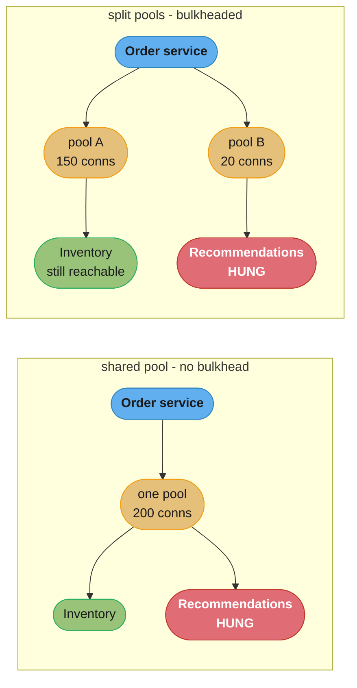
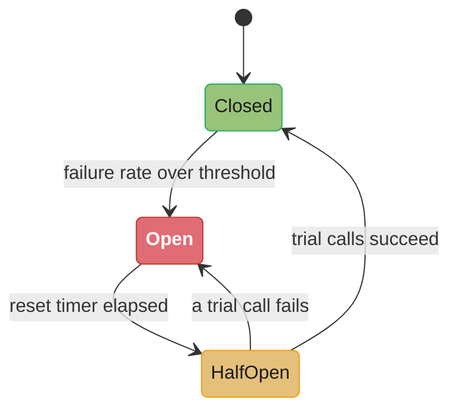
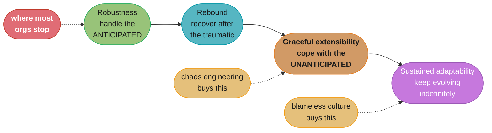
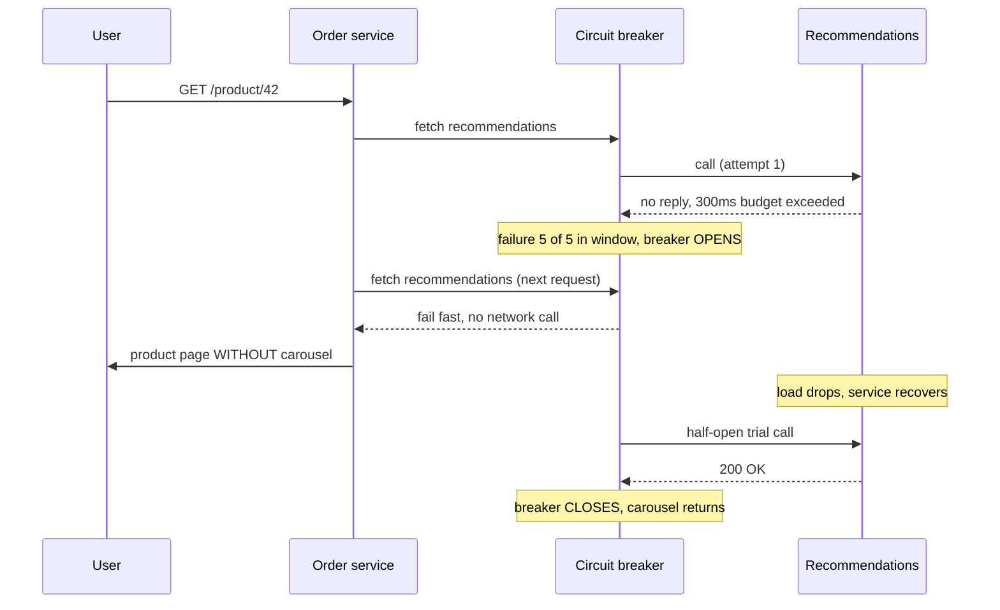

# Chapter 12: Resiliency

> Part II — Implementation · Building Microservices, 2nd Edition (Sam Newman, O'Reilly 2021) ·
> builds on Ch 11 (Security), leads to Ch 13 (Scaling)

## Chapter Map

Chapter 11 asked how to stop a system being harmed on purpose; this chapter asks how it survives
being harmed by accident — by a slow disk, a saturated network link, a dependency that stopped
answering, a deploy that went out at the wrong moment. Newman opens by refusing the industry's
usual framing. Most conversations that call themselves "resiliency" are really conversations
about *robustness*: enumerate the failures you already know about, and handle each one. He borrows
David Woods' four-part breakdown — robustness, rebound, graceful extensibility, sustained
adaptability — to argue that robustness is only the first of four, that it is the only one most
organizations invest in, and that the remaining three are where the interesting (and much harder)
work lives, because they are about the failures nobody wrote a ticket for. Everything else in the
chapter sits underneath that frame: the stability patterns from Nygard's *Release It!* are tools
for robustness, chaos engineering is a way of buying graceful extensibility, and the closing
discussion of blame is about whether the organization is even capable of sustained adaptability.

**TL;DR:**
- **Resilience is four things, not one.** Robustness (handle the anticipated), rebound (recover
  after the traumatic), graceful extensibility (cope with the *un*anticipated), and sustained
  adaptability (keep evolving as the world changes). Newman's charge is that the industry says
  "resilience" and delivers only robustness.
- **Failure is inevitable at scale**, so the chapter argues for spending less effort preventing
  every failure and more effort on degrading gracefully when one lands. **Slow is worse than
  down** — a dead dependency fails cleanly, a slow one takes its callers with it.
- **Degrading functionality is a per-feature business decision, not a technical default.** Which
  page still works when the recommendations service is down is a question for the people who own
  the page.
- **The stability patterns** — time-outs, retries, bulkheads, circuit breakers, isolation,
  redundancy, middleware, idempotency — are a toolkit, not a checklist. Applying all of them
  everywhere is its own failure mode.
- **CAP is real but narrower than it's used**, and in practice you're choosing between AP and CP,
  because partition tolerance is not something a distributed system gets to give up.
- **Blame is an anti-pattern.** If one person's mistake can take down the whole system, the
  finding is about the system, not the person.

The `## 12.x` headings below follow the chapter's own printed section structure (What Is
Resiliency?, Failure Is Everywhere, How Much Is Too Much?, Degrading Functionality, Stability
Patterns, Spreading Your Risk, CAP Theorem, Chaos Engineering, Blame).

---

## The Big Question

If a distributed system with a hundred services has a hundred separate opportunities to fail on
every user request, and if you cannot possibly enumerate every way those hundred things can go
wrong, what exactly are you building toward when you say you want the system to be "resilient" —
and how would you know whether you got there?

Analogy: consider a hospital. Robustness is the crash cart on every floor — you thought about
cardiac arrest in advance, stocked for it, and drilled it. Rebound is the plan for the day after
a fire: how the ward gets back to normal operation. Graceful extensibility is what happens the
night the ambulance bay fills with casualties from an incident nobody had a protocol for, and the
staff improvise a triage system in the corridor that works. Sustained adaptability is the hospital
still being effective twenty years later, after the diseases, the technology, the funding model,
and the staff have all changed. A hospital that has only stocked crash carts is not a resilient
hospital; it is a hospital that is good at cardiac arrest. Newman's argument is that most software
organizations are exactly that hospital, and do not realize it because they have never named the
other three.

---

## 12.1 What Is Resiliency?

Newman takes his definition from **David Woods**, a researcher in resilience engineering, whose
work concerns systems that include humans and machines together — aviation, medicine, power grids
— rather than software specifically. Woods' observation is that "resilience" in ordinary usage
collapses four genuinely different capabilities into one word, and that conflating them causes
organizations to invest in one and believe they have bought all four.

The chapter's structural point is worth stating before the four concepts themselves: they are
ordered by how much of the future you are trying to handle. Robustness handles the failures you
listed. Rebound handles the aftermath of a failure you listed being worse than expected. Graceful
extensibility handles the failures you *didn't* list. Sustained adaptability handles the fact that
the list keeps changing, forever.

### Robustness

**Robustness** is the capacity to handle *expected* perturbation — a disruption you already know
about, and have designed for. A machine dies, so you run more than one. A datacenter loses power,
so you run in more than one. A disk fills, so you alert on disk usage at 80%. Every mitigation in
the robustness bucket has the same shape: someone anticipated a specific failure mode and put a
specific countermeasure in place.

Two things about robustness recur through the rest of the chapter. First, it is fundamentally
*reactive to imagination* — you can only be robust against what somebody thought of. Second, and
less obviously, **every increase in robustness increases complexity**, and complexity is itself a
source of new failure. Adding a second instance behind a load balancer means adding the load
balancer, which is a new thing that can fail, be misconfigured, or run out of connections. This is
the chapter's first real trade-off and it never goes away: robustness is not free, and it is not
free specifically in the currency that causes outages.

### Rebound

**Rebound** is the ability to recover *after* a traumatic event. Robustness is about not falling
over; rebound is about getting back up. The distinction matters because the two need different
investments. Backups are a rebound investment, not a robustness one — a backup does not stop the
database being corrupted, it shortens the time between the corruption and normal service.

Newman's practical framing here is that you improve rebound before the event, not during it. The
things that make recovery fast — a tested restore procedure, a runbook someone has actually read,
a rehearsed incident process, the knowledge of who to call — are all things you either did in
advance or did not. The worst moment to discover your backup has never been restored is during the
incident that requires restoring it, and the same applies to every other piece of the recovery
path. Expecting failure and preparing for it is what rebound *is*.

### Graceful Extensibility

**Graceful extensibility** is how well the system deals with the situation nobody anticipated —
the failure that is not on the list because it was not conceivable when the list was written. By
definition you cannot pre-build a specific countermeasure for it, so the investment has to be in
something more general: people who understand the system deeply enough to reason about a novel
failure, and enough slack in the organization for them to act.

This is where the chapter gets pointed about organizational shape. Newman observes that systems
optimized purely for the known — every buffer squeezed out, every role narrowly specialized, every
decision escalated upward — become **brittle** precisely because that optimization removes the
capacity to improvise. A flatter organization, where the people closest to the problem are
authorized to act on it, tends to handle the unanticipated better than a hierarchy where the
person who understands the failure needs three approvals to touch anything. The trade-off is real
and uncomfortable: the same efficiency drive that makes a system cheap to run in the expected case
is what makes it fragile in the unexpected one.

### Sustained Adaptability

**Sustained adaptability** is the capacity to keep adapting indefinitely, as the environment, the
stakeholders, the technology, and the demands all change. It is the only one of the four that is
not about a single event at all — it is about whether the organization can still be effective in
five years.

Newman's guidance here is almost entirely about *learning*: no part of the system can be treated
as separately optimizable, because sustained adaptability is a property of the whole
socio-technical system (software, infrastructure, people, process) rather than of any layer of it.
Concretely, it means creating a culture where incidents are discussed openly rather than
minimized, where the near-miss that did not cause an outage is still examined, and where the
knowledge gained is spread rather than staying with whoever was on call. An organization that
handles each incident competently and then forgets it has rebound but not sustained adaptability.

**The chapter's headline claim:** when most software people say "resilience," they mean
robustness. Newman is explicit that this is a problem — a system that is highly robust and has
none of the other three is a system that survives exactly the failures its designers already
imagined, and no others.

---

## 12.2 Failure Is Everywhere

Failure stops being a hypothetical at scale. Newman's framing is statistical: a hard drive with a
mean time between failures measured in years is effectively reliable when you own one, and
effectively guaranteed to be failing constantly when you own tens of thousands. The same
arithmetic applies to everything else in the stack — machines, network links, racks, whole
datacenters. Once a system is large enough, a failure somewhere in it is not an event, it is a
steady-state condition.

The chapter's practical conclusion follows directly, and it is the sentence the rest of the
chapter builds on: **spend less time trying to stop the inevitable and more time dealing with it
gracefully.** An organization that treats each individual failure as a preventable defect will
spend its entire budget on prevention and still have outages; one that assumes failures will land
and designs for what happens next gets more out of the same effort.

Newman is particularly sharp about one failure mode being much worse than the others. **A slow
system is more damaging than a system that is down.** A downed dependency fails immediately: the
connection is refused, the caller finds out in milliseconds and can do something else. A slow
dependency accepts your connection, holds it, and returns nothing — and while it holds it, the
caller is holding a thread, a connection from a pool, and some memory. The failure propagates
*upward*, and it propagates quietly, because every individual call still looks like it is working.
By the time the symptom is visible, the caller has usually exhausted its thread pool and is now
failing requests that had nothing to do with the slow dependency at all.

```
  FAST FAILURE (dependency down)          SLOW FAILURE (dependency degraded)

  caller thread pool: 200                 caller thread pool: 200
       |                                       |
  call rec-service --> conn refused       call rec-service --> accepted, no reply
       |  ~1 ms                                |  ...30 s, thread held
       v                                       v
  thread returned to pool                 thread NOT returned
  199 threads still free                  next request takes another thread
       |                                       |  and another, and another
  degrade the page, serve it              at ~7 req/s, 200 threads gone in ~30 s
       |                                       |
  everything else keeps working           EVERY endpoint now fails, including
                                          the ones that never touched rec-service
```

The asymmetry is why time-outs are the first stability pattern in the chapter: without one, a slow
dependency is a resource leak with a clock on it.

---

## 12.3 How Much Is Too Much?

Before choosing any technique, the chapter insists on a prior question: what does this particular
system actually need? Resilience work has cost — in infrastructure, in complexity, in engineering
time — and the right amount differs enormously between two services in the same architecture. The
chapter frames this through **cross-functional requirements**, and picks out three that matter
most for resiliency decisions:

| Requirement | The question it answers | Consequence of over-specifying |
|---|---|---|
| **Response time / latency** | How fast must this be, and at what percentile, at what load? | Buying capacity and caching layers nobody needed |
| **Availability** | Can this be down? For how long? Is a scheduled window acceptable? | Multi-region infrastructure for a service nobody would notice was down overnight |
| **Durability of data** | How much data loss is acceptable, and over what window? | Synchronous cross-region replication on data that could be recomputed |

The crucial move is that these are specified **per service, not per system**. An architecture's
value is partly that it lets you spend differently in different places: the payment path can be
multi-region with synchronous replication, while the "customers who bought this also bought"
service runs on a single instance and is allowed to be down for an hour. Applying one global
availability target across every service is how organizations end up paying multi-region prices
for recommendation engines.

Newman also pushes on making the targets *precise*. "It has to be highly available" is not a
requirement; "no more than 30 minutes of unavailability per month, measured on the checkout
endpoint" is one, because it can be designed for, measured, and — importantly — argued about with
the people paying the bill. Availability targets are also load-dependent: a service that meets its
latency target at 1,000 requests per second and misses it at 5,000 has not been specified until
the load figure is attached to the number.

---

## 12.4 Degrading Functionality

Once you accept that individual services will fail, the design question becomes: what should the
*user* see when one does? The chapter's answer is that a microservice architecture gives you a
much richer set of options than a monolith did, and that failing to use them is a choice.

Newman's running example is MusicCorp's web shop. A single product page might be assembled from
several services: the catalog service (name, description, price), the inventory service (in stock
or not), the recommendation service ("customers also bought"), and a reviews service. If the page
is written so that any one of those failing fails the whole render, then a recommendation service
outage takes down the ability to sell anything — which is an absurd trade, because the
recommendation carousel is the least valuable thing on the page.

The **broken → fixed** shape:

```python
# BROKEN: one dependency's failure fails the entire page
def product_page(sku):
    product = catalog.get(sku)               # essential
    stock   = inventory.get(sku)             # important
    recs    = recommendations.get(sku)       # nice to have
    reviews = reviews_svc.get(sku)           # nice to have
    return render(product, stock, recs, reviews)
    # recommendations 500s -> exception -> 500 for the whole page -> no sales

# FIXED: each non-essential dependency degrades independently
def product_page(sku):
    product = catalog.get(sku, timeout=1.0)          # if this fails, we genuinely have no page
    stock   = safe(inventory.get, sku, timeout=0.5,  fallback="Check availability at checkout")
    recs    = safe(recommendations.get, sku, timeout=0.3, fallback=[])   # carousel just hides
    reviews = safe(reviews_svc.get, sku, timeout=0.5, fallback=None)     # section just hides
    return render(product, stock, recs, reviews)
```

The essential point the chapter makes about this code is that **the fallback values are not a
technical decision.** Whether a product page with no stock indicator should still be shown, and
whether an order should be accepted when the stock check is unavailable, are business questions
with real money attached — the second one in particular trades a small risk of overselling against
a certain loss of every sale during the outage. Engineers guessing at these in isolation is how
systems end up refusing orders they could have safely taken, or cheerfully taking orders they
cannot fulfil.

The chapter's second warning is about scope. These decisions have to be made **per feature**, not
once for the whole system, and they have to be made deliberately — a system where nobody ever
asked the question has still answered it, and the answer is almost always "everything fails
together," because that is what unhandled exceptions do by default.

---

## 12.5 Stability Patterns

The stability patterns are drawn largely from **Michael Nygard's *Release It!***, which the chapter
treats as the canonical source. All of them are robustness tools — they handle failures you have
anticipated — and the chapter is careful to present them as a toolkit from which you select, not a
list you implement in full.

### Time-Outs

A time-out is a decision about how long you are willing to wait before giving up on a downstream
call, and it is the direct answer to the "slow is worse than down" problem from §12.2. Without
one, a hung dependency holds your resources indefinitely.

Getting the value right is genuinely hard, and the chapter says so plainly. Too long and you have
not solved the problem — a 30-second time-out on a call the user abandoned after 10 seconds means
20 seconds of held resources doing work nobody will read. Too short and you fail calls that were
about to succeed, converting a slow-but-working dependency into a broken one and, if retries are
enabled, adding load to a system that was already struggling.

Newman's operational guidance is concrete and pragmatic rather than analytical:

- **Put a time-out on every out-of-process call.** Not "the important ones" — every one. Most
  HTTP clients and database drivers default to no time-out or an effectively infinite one, which
  means the default behavior of an unconfigured system is the worst behavior.
- **Pick a default value for everything**, apply it globally, and treat it as a starting point
  rather than a considered per-call answer.
- **Log every time-out**, look at what actually happened, and adjust from the data. The right
  value is discovered from observed latency distributions, not derived at design time.

There is a subtlety worth pulling out: time-outs need to be reasoned about **end to end**, not
per-hop. If a user-facing request has a 3-second budget and it traverses three services, a
uniform 5-second time-out at each hop is meaningless — the user is gone long before any of them
fires. The budget has to be allocated down the call chain, so an inner call gets whatever remains
of the outer deadline rather than a fixed value it invented locally.

### Retries

Retries handle *transient* failure — the packet that got dropped, the instance that was cycling,
the momentary blip. When the failure is transient, a retry converts an error into a success at
almost no cost. When it is not, a retry does something much worse than nothing: it multiplies load
against a component that is already failing, which is precisely the condition under which extra
load is most harmful. A dependency degrading under load, being retried three times by every
caller, receives four times its normal traffic at exactly the moment it can least handle it.

The two constraints the chapter puts on retries:

1. **Only retry operations that are safe to repeat.** Which is why idempotency (below) is on the
   same list — retries and idempotency are the same design decision viewed from two sides.
2. **Bound the retries and space them out.** A capped number of attempts with backoff between
   them, rather than an unbounded tight loop.

The interaction between retries and time-outs is the part that bites in production: a 5-second
time-out with 3 retries is a 15-second worst case, which almost certainly blows an outer deadline
somebody else set. The retry policy and the time-out budget have to be designed together or the
combination produces a latency nobody signed off on.

### Bulkheads

The term comes from shipbuilding: a hull divided into watertight compartments so that a breach
floods one compartment rather than sinking the ship. In software the bulkhead is any mechanism
that keeps one failing dependency's resource consumption from starving everything else.

The canonical implementation, and the one the chapter leads with, is **a separate connection pool
per downstream service**. If the ordering service talks to both the inventory service and the
recommendation service out of a single shared pool of 200 connections, then a recommendation
service that hangs will consume the whole pool and the ordering service can no longer reach
inventory either — a failure in the least important dependency has taken out the most important
one. Split the pool (say 150 for inventory, 20 for recommendations, 30 held for everything else)
and the recommendation failure is confined to its own 20 connections. Everything else keeps
running.



*Caption: with one shared pool, a hung recommendations service drains all 200 connections and
takes inventory calls down with it; with split pools the damage is capped at the 20 connections
that pool was ever allowed to hold.*

The chapter treats the bulkhead as the most important of these patterns, and the reasoning is
worth internalizing: time-outs and circuit breakers *react* to a failure that is already
propagating, while a bulkhead structurally prevents it from propagating at all. Bulkheads also
generalize well beyond connection pools — separate thread pools per concern, separate instances or
clusters per workload class, and separate queues per message type are all bulkheads, and so is
the microservice boundary itself.

### Circuit Breakers

A circuit breaker sits in front of a downstream call and watches the failure rate. Below a
threshold, calls pass through normally (**closed**). Once failures exceed the threshold, the
breaker **opens** and every subsequent call fails immediately, without touching the network. After
a configured interval it moves to **half-open**, letting a limited number of trial calls through:
if they succeed it closes again, if they fail it re-opens and waits longer.



*Caption: the half-open state is what makes the breaker self-healing — it probes with a few calls
rather than either staying open forever or slamming full traffic back onto a service that has not
recovered.*

Two properties are doing the real work. First, **fail fast**: an open breaker returns in
microseconds, so callers stop accumulating held threads and the "slow is worse than down" cascade
never starts. Second, **the downstream service gets breathing room**: a service failing under load
recovers much faster when the load stops, and an open breaker is the only mechanism in this
chapter that actually removes load from a struggling dependency rather than adding to it.

The parameters — how many failures in what window trip it, how long it stays open, how many trial
calls — are, like time-outs, discovered empirically. The chapter's caution is that a breaker tuned
too aggressively will trip during ordinary latency spikes and turn a brief wobble into a
self-inflicted outage; one tuned too conservatively never trips when it matters. It also matters
what happens on an open breaker: returning an error is the minimum, but the combination that
actually pays off is an open breaker *plus* a degraded-functionality fallback from §12.4, so the
user sees a page without a recommendations carousel rather than an error.

### Isolation

Isolation is the general principle underneath bulkheads: the more isolated two services are, the
less either can hurt the other, and the less they need to coordinate. Two services sharing a
database are not isolated — one can lock a table, exhaust connections, or fill the disk and take
the other down. Two services on the same host are not isolated from a kernel panic or a noisy
neighbor. Two services deployed together in the same process are not independently deployable at
all.

Isolation is not free, and the chapter is careful to name the price: more isolated services mean
more machines or containers to run and pay for, more network hops (and therefore more latency and
more failure modes), and more moving parts to operate and understand. This is the same trade-off
robustness always carries — the mitigation is itself new complexity — and the chapter's guidance
is to buy isolation where the coupling actually hurts rather than maximizing it everywhere on
principle.

### Redundancy

More of a thing means the loss of one of them matters less. Run three instances of a service
behind a load balancer and losing one costs a third of capacity rather than all of it. Redundancy
is the simplest robustness technique and often the cheapest.

The trap the chapter flags is **shared failure modes**: redundancy only helps when the copies fail
independently. Three instances on one host are not redundant against host failure. Three instances
in one rack are not redundant against a top-of-rack switch. Three instances all reading from one
primary database are not redundant against that database. And more instances is not automatically
better — each one adds cost, and at some point another replica buys almost no additional
availability while continuing to bill you monthly. Redundancy also has to be sized against the
*failure* case: three instances that each run at 70% utilization cannot absorb the loss of one,
because the survivors would need 105% of their capacity.

### Middleware

Message brokers and similar middleware can take on some of this work for you: a broker that
guarantees delivery handles the retry, holds the message while the consumer is down, and lets the
producer stop caring whether the consumer is up right now. That is a genuine resilience benefit
and it is why asynchronous messaging appears in so many robust architectures.

The chapter's counterweight is that middleware **moves complexity rather than removing it**. The
broker becomes a shared dependency that everything relies on — a component whose own failure is
now systemic, and whose delivery semantics (at-least-once, at-most-once, ordering guarantees,
poison-message handling) are subtle enough to be a frequent source of production surprises.
At-least-once delivery in particular hands the idempotency problem straight back to you.

### Idempotency

An operation is **idempotent** if applying it multiple times produces the same result as applying
it once. Idempotency is what makes retries and at-least-once delivery safe: if the caller does not
know whether its first attempt landed, it can simply try again.

The failure mode is easy to state and easy to ship by accident:

```java
// BROKEN: not idempotent. A retry (or a redelivered message) awards the points twice.
public void handle(OrderPlaced event) {
    int points = event.getValue() / 10;
    loyaltyRepo.addPoints(event.getCustomerId(), points);   // blind increment
}

// FIXED: dedupe on a stable event identifier, inside the same transaction as the effect.
public void handle(OrderPlaced event) {
    if (processedRepo.exists(event.getId())) return;        // already applied, no-op
    int points = event.getValue() / 10;
    transactionally(() -> {
        loyaltyRepo.addPoints(event.getCustomerId(), points);
        processedRepo.record(event.getId());                // same transaction, or it is a lie
    });
}
```

Two details deserve emphasis. The dedupe record and the effect must commit **atomically** — record
the event ID in a separate transaction and a crash between the two puts you right back where you
started, either double-applying or losing the effect. And the event needs a **stable identifier**
assigned by the producer, because deduplicating on a hash of the payload breaks the moment two
legitimately identical events occur.

The chapter also connects this to HTTP verb semantics: `GET`, `PUT`, and `DELETE` are defined as
idempotent, `POST` is not. That is useful shorthand, but Newman's warning is that these are
*contracts*, not enforcement — nothing stops a service implementing a `PUT` that increments a
counter, and clients that trust the verb will then retry it into corruption. The property has to
be true in your implementation, not merely implied by the method name.

---

## 12.6 Spreading Your Risk

Redundancy only pays off if the copies do not share a failure mode, which turns availability into
a question about *placement*. The chapter walks the hierarchy: multiple instances on one host
share the host; multiple hosts in one rack share the power and the switch; multiple racks in one
datacenter share the building, the power feed, and the network egress; multiple datacenters in one
region may still share a region-wide control-plane failure.

Cloud providers formalize this into **availability zones** (physically separate facilities within
a region, with independent power and networking) and **regions** (geographically separate, with
independent everything). The distinction is what lets you buy exactly as much independence as your
availability requirement justifies.

The detail Newman singles out — and the one that catches teams — is that a cloud provider's
compute SLA is typically **conditional on how you deploy**. The published availability figure is
offered for instances spread across multiple availability zones; running everything in one zone
gets you a weaker guarantee, or none at all, no matter how many instances you run. Teams
frequently read the headline SLA number, assume it applies to their deployment, and discover
during the outage that it never did.

The other side of the trade-off is that spreading costs money and latency. Multi-AZ deployments
pay cross-zone data transfer and a small latency penalty on every inter-zone call; multi-region
deployments pay much more of both, and force genuinely hard consistency decisions on any data that
has to exist in both places. This is why §12.3's per-service requirements matter: the right
placement for the payment service and the right placement for the recommendation service are
different, and paying multi-region prices for both is a straightforward waste.

---

## 12.7 CAP Theorem

The **CAP theorem** states that a distributed system can guarantee at most two of three properties:
**consistency** (every read sees the most recent write), **availability** (every request to a
non-failed node receives a response), and **partition tolerance** (the system continues to operate
despite the network dropping messages between nodes).

Newman's treatment is deliberately deflationary. CAP is frequently invoked in architecture
discussions as if it were a menu of three options, and the chapter's job is to explain why it is
really a menu of two, and why even that is coarser than reality.

### Sacrificing Consistency

An **AP** system stays available under partition and accepts that reads may return stale data.
Take a two-datacenter deployment of an inventory service where the link between them fails. Both
sides keep serving. Both sides keep accepting writes. Both sides may now be telling customers
about stock levels that the other side has already changed, and when the link comes back the
divergent writes have to be reconciled — which is application-specific work, not something the
database does for you.

This is what **eventual consistency** means, and Newman is careful about the word: it guarantees
the copies converge *at some point*, not that any read you perform is correct now. The design
question AP forces on you is what happens during the window, and that is a business question —
how wrong is a stock count allowed to be, and what does the business do when two datacenters both
sold the last item?

### Sacrificing Availability

A **CP** system refuses to serve rather than serve inconsistent data. Under the same partition,
the minority side stops answering — it cannot confirm it has current data, so it declines. The
majority side (if there is a quorum) keeps working.

The chapter's warning here is that CP is much harder than it looks in a microservice architecture.
Achieving genuine consistency across a partition means distributed coordination — a consensus
protocol, quorum reads and writes, multi-node agreement on every operation — and all of it costs
latency on the happy path, not just during failures. Teams routinely believe they have built a CP
system when in fact they have built an AP system with an unexamined reconciliation gap, because
the coordination they would have needed is not there.

### Sacrificing Partition Tolerance?

The chapter's blunt answer: **you cannot.** If two services communicate over a network, that
network can partition, and if it does, the system either keeps working in some degraded form or it
does not — there is no third option in which the partition simply does not happen. A system that
genuinely sacrifices partition tolerance is a system with a single node, which is to say not a
distributed system.

So "CA" is not an available choice for a microservice architecture. The real decision is **AP or
CP**, and the theorem's practical content is that a partition forces you to choose between
answering possibly-wrong and not answering at all.

### AP or CP?

Neither is universally correct; the answer follows from what the data is for. The chapter's lean
is toward **AP being the right default for more services than teams assume**, precisely because CP
is expensive to build and expensive to run, and because a great many pieces of business data
tolerate staleness perfectly well. A product description that is thirty seconds out of date harms
nobody. A recommendation carousel built on yesterday's data is fine. A "last seen" timestamp being
approximate is what everyone already expects.

Where CP earns its cost is a narrower set: data where serving a stale value causes real,
hard-to-reverse harm — an account balance used to authorize a withdrawal, a seat reservation, a
uniqueness constraint that matters legally.

### It's Not All or Nothing

The choice is **per service, and often per operation within a service** — not a single system-wide
setting. A single architecture can perfectly reasonably run the catalog service AP, the payment
ledger CP, and the inventory service AP for reads while requiring CP semantics for the specific
operation that decrements stock at checkout. Insisting on one answer across the whole system
either overpays enormously (everything CP) or accepts risk in the one place it actually mattered
(everything AP).

### And the Real World

The chapter closes the CAP discussion by pointing out that the theorem describes a formal model,
and the real system includes people and business processes that CAP says nothing about.
Newman's argument is that businesses have always run on eventual consistency and have always had
compensating processes for it. A physical shop's inventory count is wrong the moment someone
shoplifts, and the correction mechanism is a periodic stock-take, not a distributed transaction. A
bank's ledger does not settle instantly; it reconciles. Overselling an item is handled with an
apology, a refund, and a back-order — a business process, not a technical guarantee.

The practical consequence is that the right question is rarely "how do I make this strongly
consistent." It is "what does the business already do when this is wrong, and can the system lean
on that instead of buying coordination it cannot afford?" Very often the answer is yes, and the
strongly consistent design was solving a problem the business had already solved.

---

## 12.8 Chaos Engineering

**Chaos engineering** is the discipline of running experiments on a system in order to build
confidence in its ability to withstand turbulent conditions in production. The definition matters:
it is *experimentation*, which means a hypothesis about how the system will behave, a deliberate
perturbation, and an observation of what actually happened — not randomly breaking things and
seeing who shouts.

The best-known example is **Netflix's Chaos Monkey**, which terminates production instances during
business hours, and the broader **Simian Army** that grew around it, extending the same idea to
larger blast radii — losing an entire availability zone, or an entire region. The point of running
it during business hours rather than overnight is deliberate: the failure happens when the people
who understand the system are awake and can learn from it.

### Game Days

A **game day** is a planned exercise in which a failure scenario is injected — sometimes into
production, sometimes into a realistic copy — and the team responds as if it were a real incident.
Google's Disaster Recovery Testing (DiRT) programme is the reference example, and the chapter's
framing is that a game day tests the *people and process* as much as the software. What is
actually being measured is whether the runbook is accurate, whether the dashboards show what is
needed, whether the on-call engineer can find the right people, and whether the recovery procedure
works when performed by someone who did not write it.

Newman's memorable observation is that game days routinely surface problems that have nothing to
do with the injected failure: the runbook references a tool that was decommissioned, the alert
routes to a team that no longer exists, the credentials needed for recovery are in a system that
is itself down. None of these would be found by testing the software, and all of them extend an
incident by hours.

### Production Experiments

Running these experiments in production rather than staging is uncomfortable and, in the chapter's
view, the point. A staging environment differs from production in traffic pattern, data volume,
configuration, scale, and the presence of real users — so a resilience property demonstrated in
staging is evidence about staging. The failures worth finding are usually emergent properties of
the real environment.

The discipline that makes this defensible rather than reckless is **blast radius control**: start
with the smallest experiment that could teach you something, have a tested way to stop it
immediately, run it when the people who understand the system are available, and expand the scope
only after the small version has passed.

### From Robustness to Beyond

The chapter's most interesting turn is a critique of how chaos engineering is usually sold. If you
inject a failure you already anticipated, and the system handles it, you have verified
**robustness** — useful, but only confirming a property you designed for. The deeper value is what
the experiment teaches you about the system's actual behavior, which almost always includes things
nobody predicted: an unexpected dependency, a retry storm, a dashboard that goes blank exactly
when you need it. That learning is an investment in **graceful extensibility** and, through the
organizational habits it builds, in **sustained adaptability**.

Newman's point, drawing on practitioners in the resilience-engineering community, is that a team
running chaos experiments purely to tick a robustness box is extracting the least valuable part of
the practice. The value is in the humans getting better at reasoning about the system, not in the
green check mark.

---

## 12.9 Blame

The chapter's final section is about people, and it is the section that ties back to sustained
adaptability. Newman observes that incident investigations frequently terminate at "human error" —
someone ran the wrong command, someone skipped a step, someone deployed on a Friday — and that
this is almost always the wrong place to stop.

The argument is structural rather than sentimental: **if one person's single mistake can take down
the entire system, that is a fact about the system, not about the person.** The absence of a
confirmation step, the absence of a staged rollout, the absence of an undo, the absence of a
review — those are the conditions that turned a normal human error into an outage, and they are
the things that can actually be changed. The next person will make a mistake too.

Blame is also actively corrosive to everything else in the chapter. An organization that assigns
blame teaches its engineers that reporting a mistake is dangerous, which means near-misses go
unreported, incident timelines get sanitized, and the learning that graceful extensibility and
sustained adaptability depend on simply does not happen. The information that would have prevented
the next outage exists, and someone has decided it is safer to keep it to themselves.

The alternative the chapter points at is a **blameless post-mortem** and, more broadly, a **just
culture**: an investigation whose stated purpose is understanding the conditions rather than
identifying a responsible party, on the assumption that people act sensibly given the information
and constraints they had at the time. The test of whether an organization has one is not what its
post-mortem template says — it is whether an engineer who has just caused an outage feels able to
say so immediately.

---

## Visual Intuition



*Caption: the four concepts are ordered by how much of the future they cover, and Newman's charge
is that the industry invests almost entirely in the leftmost box while using a word that names all
four.*



*Caption: the breaker plus a degraded-functionality fallback is the combination that matters — the
open breaker protects the caller's threads while the empty-carousel fallback keeps the page
selling.*

```
  SPREADING RISK — what each level of redundancy actually protects against

  4 instances, 1 host      host dies          -> total outage
  ---------------------------------------------------------------
  4 instances, 4 hosts     host dies          -> 25% capacity lost   ✓
  same rack                switch dies        -> total outage        ✗
  ---------------------------------------------------------------
  4 instances, 2 AZs       AZ loses power     -> 50% capacity lost   ✓
                           region control     -> total outage        ✗
                           plane fails
  ---------------------------------------------------------------
  4 instances, 2 regions   region fails       -> 50% capacity lost   ✓
                           cost + latency + consistency problem      $$$

  The question is never "how many instances" — it is "which shared thing
  do they still all depend on, and does my availability target care?"
```

*Caption: each row buys independence from exactly one more shared failure mode, and the
per-service requirements of §12.3 are what decide how far down the table you should pay to go.*

---

## Key Concepts Glossary

- **Resilience (Woods' four concepts)** — the umbrella term Newman decomposes into robustness,
  rebound, graceful extensibility, and sustained adaptability.
- **Robustness** — the capacity to handle *anticipated* disruption via pre-designed
  countermeasures; the only one of the four most organizations actually invest in.
- **Rebound** — the ability to recover after a traumatic failure; bought in advance through
  tested backups, runbooks and rehearsed incident process.
- **Graceful extensibility** — how well the system copes with situations nobody anticipated;
  depends on deep system knowledge and organizational slack.
- **Sustained adaptability** — the capacity to keep adapting indefinitely as environment,
  stakeholders and technology change; a property of the whole socio-technical system.
- **Cross-functional requirements** — per-service targets for response time/latency, availability,
  and durability of data, used to decide how much resilience to buy where.
- **Degrading functionality** — deliberately serving a reduced but useful experience when a
  non-essential dependency fails, rather than failing the whole request.
- **Time-out** — a bound on how long a caller waits for a downstream call before giving up; the
  direct defense against "slow is worse than down."
- **Retry** — re-issuing a failed call to ride out transient failure; safe only for idempotent
  operations, and dangerous without bounds and backoff.
- **Bulkhead** — resource partitioning (separate connection pools, thread pools, instances) so one
  failing dependency cannot starve the others.
- **Circuit breaker** — a closed/open/half-open state machine that fails fast once a downstream
  failure rate is exceeded, and probes for recovery before restoring traffic.
- **Isolation** — the degree to which two services can fail independently; increases robustness
  and reduces coordination, at the cost of infrastructure and latency.
- **Redundancy** — running more copies so losing one matters less; only effective when the copies
  do not share a failure mode.
- **Idempotency** — the property that applying an operation multiple times has the same effect as
  applying it once; what makes retries and at-least-once delivery safe.
- **Availability zone** — a physically separate facility within a cloud region with independent
  power and networking; spreading across zones is often a condition of the provider's SLA.
- **CAP theorem** — at most two of consistency, availability, and partition tolerance; in a real
  distributed system the choice is between AP and CP.
- **AP system** — stays available under partition, serving possibly-stale data; converges via
  eventual consistency.
- **CP system** — refuses to serve rather than serve inconsistent data under partition; requires
  distributed coordination and pays latency for it.
- **Eventual consistency** — the guarantee that replicas converge at some future point, with no
  guarantee about any individual read now.
- **Chaos engineering** — experimenting on a system to build confidence in its ability to
  withstand turbulent production conditions.
- **Game day** — a planned failure-injection exercise that tests the people, runbooks and process
  as much as the software.
- **Blast radius** — the scope of damage an experiment can cause; controlled by starting small and
  keeping a tested abort mechanism.
- **Blameless post-mortem** — an incident investigation aimed at understanding the conditions that
  allowed the failure, rather than identifying a responsible individual.

---

## Tradeoffs & Decision Tables

| Stability pattern | Protects against | Primary cost | Fails badly when |
|---|---|---|---|
| Time-out | A hung dependency holding your resources | Too-short values fail healthy calls | Set per-hop without an end-to-end budget |
| Retry | Transient, momentary failure | Multiplies load on a struggling dependency | The operation is not idempotent |
| Bulkhead | One dependency starving all the others | Lower peak utilization per pool | Pools sized without knowing real traffic mix |
| Circuit breaker | Cascading failure from a persistent outage | Trips during ordinary latency spikes | No fallback behind it, so it just fails faster |
| Isolation | Shared-resource contention and blast radius | More infrastructure, more hops, more latency | Maximized on principle rather than where coupling hurts |
| Redundancy | Loss of an individual instance | Linear cost per copy | The copies share a failure mode |
| Middleware | Consumer downtime, delivery guarantees | A new systemic dependency | At-least-once delivery meets non-idempotent handlers |
| Idempotency | Duplicate application from retries/redelivery | Dedupe store and transactional discipline | The dedupe record commits separately from the effect |

| | AP | CP |
|---|---|---|
| Behavior under partition | Answers, possibly with stale data | Minority side refuses to answer |
| Consistency model | Eventual — converges later | Strong — always current or nothing |
| Happy-path latency cost | Low | Coordination overhead on every operation |
| Build difficulty | Moderate; reconciliation is the hard part | High; needs consensus/quorum machinery |
| Right for | Catalog, recommendations, most read paths | Balances, reservations, legally binding uniqueness |
| Common mistake | Never designing the reconciliation | Believing you built it when you did not |

| Resilience concept | Typical investment | How you'd know you have it |
|---|---|---|
| Robustness | Redundancy, stability patterns, multi-AZ | Anticipated failures are handled in a drill |
| Rebound | Tested restores, runbooks, incident process | Time-to-recover is short and predictable |
| Graceful extensibility | Chaos experiments, deep system knowledge, autonomy | A novel failure was handled well by the people on call |
| Sustained adaptability | Blameless culture, open incident sharing, learning loops | The organization is still effective years later |

| Failure shape | Detection speed | Damage to caller |
|---|---|---|
| Dependency down (connection refused) | Immediate | Low — thread returned at once, fallback runs |
| Dependency slow (accepts, never replies) | Slow — looks healthy per call | High — thread pool exhaustion, cascade |
| Dependency returning errors fast | Immediate | Low, unless retries amplify the load |
| Dependency returning wrong data | Often never | Highest — silent corruption downstream |

---

## Common Pitfalls / War Stories

**The unbounded HTTP client.** The single most common resilience defect is a service using an HTTP
client with its default (absent or effectively infinite) time-out. The system runs fine for
months, because nothing has ever hung. Then one downstream dependency starts accepting connections
without replying, and within a minute the caller's entire thread pool is held by requests that
will never complete — at which point *every* endpoint on that service is failing, including the
ones that never touched the slow dependency. The fix is not clever: a default time-out applied
globally to every out-of-process call, logged when it fires, tuned from the observed data.

**Retry storms turning a wobble into an outage.** A dependency degrades under load and starts
returning errors on 10% of calls. Every caller retries three times. The dependency now sees
roughly four times its normal traffic precisely when it is least able to serve it, so the error
rate climbs, so more calls are retried, and the system converges on total failure — from a
condition that would have self-healed in thirty seconds. Retries need caps, backoff, and ideally a
circuit breaker in front so the retries stop entirely once the failure is clearly not transient.

**A circuit breaker with nothing behind it.** A team adds breakers everywhere and ships. The next
outage, the breaker opens correctly, fails fast correctly, and the user still sees a 500 — because
nobody decided what the page should show when the carousel is unavailable. The breaker did its job
(the caller's threads are safe) but delivered no user-visible benefit, because the
degraded-functionality decision from §12.4 was never made. Breakers are only half a design; the
fallback is the other half.

**Redundancy that shares a failure mode.** Six instances, an impressive-looking dashboard, and all
six scheduled onto hosts in one availability zone because nobody set an anti-affinity rule. The
zone loses power and the service is entirely down, in an architecture that was documented as
highly available. The same story recurs with six instances all reading from a single database
primary, and with two "independent" regions whose deployments both depend on one CI system.

**The dedupe table that wasn't transactional.** An at-least-once broker redelivers on consumer
restart, so the team adds a processed-events table. The handler applies the effect, commits, then
records the event ID in a second transaction. Under normal conditions this works. Under a crash
between the two commits — which is exactly the condition redelivery exists for — the effect is
applied twice, and the bug only manifests during the incidents that make it hardest to diagnose.

**Chaos engineering as theater.** A team runs Chaos Monkey, everything survives, and the exercise
is reported as proof of resilience. What was actually demonstrated is that the system handles
instance termination, which it was explicitly designed to handle. Nothing was learned, because no
hypothesis was stated and no surprise was investigated. The value of the practice lives in the
experiments whose result was unexpected, and a programme that only runs experiments it is
confident about has optimized that value away.

**The post-mortem that found "human error."** The root cause is recorded as an engineer running a
migration against the wrong environment. Nothing changes. Four months later a different engineer
does the same thing, because the two environments still have near-identical connection strings,
there is still no confirmation prompt, and there is still no way to undo it. The information
needed to prevent the second incident was present in the first investigation and was discarded
when it stopped at the person.

---

## Real-World Systems Referenced

- **MusicCorp** — the book's running fictional retailer, used here for the degrading-functionality
  discussion (catalog, inventory, recommendations, reviews on one product page).
- **Netflix — Chaos Monkey and the Simian Army** — the origin of production chaos experiments,
  including tooling that removes whole availability zones and regions.
- **Google — DiRT (Disaster Recovery Testing)** — the reference example of an organization-wide
  game-day programme testing people and process alongside systems.
- **Amazon Web Services — availability zones and regions** — the model the risk-spreading
  discussion is built on, including SLAs conditional on multi-AZ deployment.
- **Michael Nygard, *Release It!*** — the source of the stability patterns (time-outs, retries,
  bulkheads, circuit breakers) as a named set.
- **David Woods** — resilience engineering researcher whose four concepts frame the entire chapter.
- **Sidney Dekker** — the human-factors work behind the chapter's position on blame and just
  culture.
- **Circuit-breaker and resilience libraries** — Netflix's Hystrix as the widely known early
  implementation, with resilience4j named as the successor once Hystrix stopped active development.

---

## Summary

The chapter's closing argument is that resilience is not a feature you add but a property of a
whole socio-technical system, and that the industry has been buying one quarter of it while
believing it bought all four. Robustness — redundancy, time-outs, bulkheads, circuit breakers,
multi-AZ deployment — is necessary, well-understood, and the easiest quarter to purchase, because
it can be specified, delegated and ticked off. But it only ever addresses failures somebody
already imagined, and every unit of robustness added is also a unit of complexity added, which is
itself a source of failure nobody imagined.

Underneath the patterns sits a simpler claim: failure is inevitable, so the useful question is not
how to prevent it but what happens next. That reframing is what makes degrading functionality a
first-class design activity rather than an error handler, and it is what makes the business — not
the engineering team alone — the right owner of the decision about which parts of a page still
work when a service is down. The stability patterns are the tools for executing those decisions,
and Newman is consistent that they are a toolkit to select from, since each carries costs that
make applying it universally a bad trade.

CAP gets deflated to its practical content: partition tolerance is not optional, so the choice is
AP or CP, it is made per service and often per operation, and the strongly consistent answer is
frequently solving a problem the business had already solved with a reconciliation process. Chaos
engineering gets reframed from a robustness test into a learning practice, valuable mainly for the
experiments that surprise you. And the chapter ends on blame because everything above it depends
on information flowing freely after things go wrong — a system where one person's mistake can
cause an outage has a systems problem, and an organization that responds by finding the person has
just guaranteed it will not hear about the next one.

Chapter 13 picks up the thread from a different direction: several of the techniques here —
redundancy, isolation, functional decomposition — are also scaling techniques, and the next
chapter organizes them into four axes and asks which one to reach for first.

---

## Interview Questions

**Q: Why does Newman argue that most teams claiming to build resilient systems are only building robust ones?**
**Short:** Newman argues robustness only covers anticipated failures, which is one of Woods' four concepts, not all four.
Borrowing David Woods' framework, the chapter separates robustness (handling failures you anticipated), rebound (recovering after a traumatic event), graceful extensibility (coping with the unanticipated), and sustained adaptability (continuing to evolve indefinitely) — and observes that essentially all industry investment goes into the first. The consequence is a system that survives precisely the failure modes its designers already listed and has no particular capacity for anything else, which is exactly the failure that matters most because it is the one nobody prepared for. Practically, this means asking of any resilience investment which of the four it actually buys, rather than assuming a redundancy or circuit-breaker project has bought resilience in general.

**Q: Why is a slow service more dangerous than one that is completely down?**
**Short:** A downed dependency fails in milliseconds and frees the caller's thread; a slow one holds it until the pool is exhausted.
When a dependency refuses connections the caller finds out almost immediately, returns the thread to the pool, and runs its fallback — the damage is contained to that one feature. When the dependency accepts the connection and never replies, the caller holds a thread, a pooled connection and memory for the full time-out duration, and at any meaningful request rate the thread pool drains within seconds, at which point every endpoint on that service fails including ones with no relationship to the slow dependency. This is precisely why the chapter treats a time-out on every out-of-process call as non-negotiable rather than an optimization.

**Q: Why does Newman say bulkheads are the most important of the stability patterns?**
**Short:** A bulkhead structurally prevents failure from propagating, while time-outs and breakers only react once it already is.
Time-outs and circuit breakers respond to a failure that is already in progress, limiting how long the damage lasts; a bulkhead partitions resources in advance so a failing dependency can never consume more than the share it was allocated, meaning the failure has no path to other parts of the service at all. The canonical form is a separate connection pool per downstream — a hung recommendations service drains its own 20 connections instead of the shared 200 that inventory calls also needed. The idea generalizes: separate thread pools, separate instances, separate queues, and the microservice boundary itself are all bulkheads.

**Q: What makes a retry dangerous rather than helpful?**
**Short:** Retrying a non-transient failure multiplies load onto a dependency at exactly the moment it can least absorb it.
Retries convert transient errors into successes cheaply, but when the underlying failure is a dependency degrading under load, three retries per caller turns normal traffic into roughly four times normal traffic against a service already at its limit — the classic retry storm, where a condition that would have self-healed in seconds converges on total outage instead. The second danger is non-idempotent operations, where a retry after a time-out may apply the same effect twice because the caller cannot tell whether the first attempt landed. Cap the attempts, add backoff, put a circuit breaker in front so retries stop once the failure is clearly persistent, and only retry operations that are genuinely safe to repeat.

**Q: What does the half-open state of a circuit breaker actually accomplish?**
**Short:** It probes recovery with a few trial calls instead of slamming full traffic back onto a service that may still be failing.
An open breaker eventually has to find out whether the downstream recovered, and the naive options are both bad: stay open forever and the feature never comes back, or close blindly and send full production load at a service that may still be struggling, re-breaking it instantly. Half-open lets a small number of trial calls through — if they succeed the breaker closes and normal traffic resumes, if any fails it re-opens and waits longer. That probing behavior is what makes a breaker self-healing rather than something an engineer has to reset manually at 3am.

**Q: Why does the chapter insist that degrading functionality is a business decision, not a technical one?**
**Short:** What a page should show when a dependency fails has money attached, so engineers guessing at it in isolation is the wrong owner.
Whether to display a product page with no stock indicator, and whether to accept an order when the inventory check is unavailable, are trade-offs between a small risk of overselling and a certain loss of every sale during the outage — questions whose answers belong to whoever owns the revenue, not to whoever is writing the exception handler. The decisions also have to be made per feature rather than once for the whole system, because the right answer for the recommendations carousel and the right answer for the payment step are nothing alike. The trap is that a system where nobody asked has still answered: unhandled exceptions default to "everything fails together."

**Q: In practice, why is CAP a choice between AP and CP rather than three options?**
**Short:** Partition tolerance is not optional — a system whose nodes talk over a network cannot opt out of the network partitioning.
If two services communicate over a network, that network can drop messages, and when it does the system either continues in some degraded form or it stops; there is no configuration in which the partition simply does not occur. A system that genuinely sacrifices partition tolerance is a single-node system, which is not a distributed system at all, so "CA" is not on the menu for a microservice architecture. What CAP actually tells you is that a partition forces a choice between answering with possibly-stale data (AP) and declining to answer (CP), and that choice is made per service and often per operation.

**Q: What does Newman mean by saying the real world has always been eventually consistent?**
**Short:** Businesses already run compensating processes — stock-takes, reconciliation, refunds — for the inconsistency CAP describes.
A physical shop's inventory count is wrong the moment someone shoplifts, and the correction is a periodic stock-take rather than a distributed transaction; a bank's ledger reconciles rather than settling instantly; overselling is handled with an apology, a refund and a back-order. Newman's point is that CAP describes a formal model while the real system includes people and business processes that already absorb this kind of divergence, so the honest question is usually "what does the business already do when this is wrong" rather than "how do I make this strongly consistent." Very often the strongly consistent design is buying expensive coordination to solve a problem the business had solved decades ago.

**Q: Why does idempotency need to be designed rather than inherited from the HTTP verb?**
**Short:** The verbs define a contract, not enforcement — nothing stops a PUT incrementing a counter, and clients that trust it will retry into corruption.
HTTP defines GET, PUT and DELETE as idempotent and POST as not, which is useful shorthand for API design, but it describes an obligation on the implementer rather than a guarantee the protocol provides. A handler that blindly increments loyalty points on every message is not idempotent regardless of what verb or broker delivered it, and under at-least-once delivery it will double-apply on the first consumer restart. Make it real with a stable producer-assigned event identifier and a dedupe record written in the same transaction as the effect — separate transactions reintroduce the exact bug the dedupe was meant to fix.

**Q: What does the chapter say about how you should choose a time-out value?**
**Short:** Apply a default everywhere, log every firing, then tune from observed latency rather than deriving a value at design time.
Newman's guidance is deliberately empirical: put a time-out on every out-of-process call, pick one default value and apply it globally as a starting point, log when it fires, and adjust from what the data shows about real latency distributions. Too long fails to solve the problem at all — a 30-second time-out on a call the user abandoned after 10 seconds still holds resources for 20 seconds of pointless work — while too short converts a slow-but-working dependency into a broken one and, with retries enabled, adds load to a struggling service. The subtlety teams miss is that the budget is end-to-end: a uniform 5-second per-hop time-out across a three-service chain is meaningless if the user-facing request only had 3 seconds.

**Q: Why does increasing robustness sometimes make a system less reliable overall?**
**Short:** Every robustness mechanism adds complexity, and that complexity is itself a new source of unanticipated failure.
Adding a second instance behind a load balancer means adding the load balancer, which can be misconfigured, exhaust its connections, or fail on its own; adding a circuit breaker adds parameters that can trip during an ordinary latency spike and manufacture an outage; adding a broker for delivery guarantees adds a systemic dependency with subtle semantics. The chapter is explicit that robustness is not free and is not free specifically in the currency that causes outages. The practical guidance is to buy robustness where the failure it prevents actually matters against the per-service requirements, rather than maximizing every technique everywhere on principle.

**Q: What separates chaos engineering from randomly breaking things in production?**
**Short:** Chaos engineering is experimentation — a stated hypothesis, a controlled perturbation, and an observation of what actually happened.
The definition the chapter uses centers on building confidence in the system's ability to withstand turbulent production conditions through experiments, which means each one starts with a prediction about how the system will behave and ends with an investigation of any gap between that prediction and reality. The discipline that makes it defensible is blast-radius control: start with the smallest experiment that could teach something, keep a tested abort mechanism, run it when the people who understand the system are awake, and expand scope only after the small version passes. An exercise with no hypothesis and no surprise investigated is theater, not engineering.

**Q: If a chaos experiment passes, what has actually been demonstrated?**
**Short:** Only robustness against a failure you already designed for — the real value is in the experiments that surprise you.
Injecting an anticipated failure and watching the system handle it verifies a property that was deliberately built, which is worth something but confirms nothing about the unanticipated failures that cause the worst incidents. The chapter's argument is that the deeper payoff is what the exercise teaches about the system's actual behavior — the undocumented dependency, the retry storm, the dashboard that goes blank exactly when needed — and that this learning is an investment in graceful extensibility rather than robustness. A programme that only runs experiments it is confident about has optimized away the part that was valuable.

**Q: Why does the chapter treat game days as testing people rather than software?**
**Short:** Game days routinely surface broken runbooks, stale alert routing and missing credentials that no software test would find.
A planned failure-injection exercise measures whether the runbook is accurate, whether the dashboards show what the responder needs, whether on-call can reach the right people, and whether the recovery procedure works when performed by someone who did not write it — all of which are properties of the organization, not the code. Newman notes these exercises regularly uncover problems unrelated to the injected failure entirely: a decommissioned tool referenced in the runbook, an alert routing to a team that no longer exists, recovery credentials stored in a system that is itself down. Each of those extends a real incident by hours, and none of them would ever appear in a test suite.

**Q: What is Newman's argument against recording "human error" as a root cause?**
**Short:** If one person's mistake can take down the whole system, that is a finding about the system, not about the person.
Stopping at the individual discards the actual causes — the missing confirmation step, the absent staged rollout, the lack of an undo, the near-identical connection strings for production and staging — which are the conditions that turned an ordinary human error into an outage and are the only things that can actually be changed before the next person makes the same mistake. Blame is also corrosive to everything else the chapter argues for: an organization that assigns it teaches engineers that reporting mistakes is dangerous, so near-misses go unreported and incident timelines get sanitized, destroying exactly the information flow that graceful extensibility and sustained adaptability depend on. The test of a just culture is not the post-mortem template but whether an engineer who just caused an outage feels able to say so immediately.

**Q: How does spreading instances across availability zones interact with a cloud provider's SLA?**
**Short:** The published compute SLA is typically conditional on multi-AZ deployment, so a single-zone architecture may have no guarantee at all.
Cloud providers offer their headline availability figure for instances distributed across multiple availability zones, on the reasoning that a single zone is a shared failure domain the provider does not undertake to keep running; teams that read the number and assume it covers their single-zone deployment find out during the outage that it never did. Spreading is not free either — cross-zone traffic costs money and adds latency on every inter-zone call, and multi-region costs far more of both plus genuine consistency decisions on any shared data. Which is why the per-service cross-functional requirements matter: payment and recommendations should almost certainly not be placed the same way.

**Q: How should availability and latency requirements be specified so they are actually designable?**
**Short:** Per service, with a number, a measurement window, a named endpoint and the load at which it must hold.
"It has to be highly available" cannot be designed for, measured, or argued about with whoever pays the bill, whereas "no more than 30 minutes of unavailability per month, measured on the checkout endpoint" can be all three. Latency targets additionally need a percentile and a load figure attached, because a service that meets its target at 1,000 requests per second and misses it at 5,000 has not actually been specified. Specifying these per service rather than system-wide is what lets an architecture spend multi-region money on the payment path while running the recommendation service on a single instance that is allowed to be down overnight.

---

## Cross-links in this repo

- [backend/fault_tolerance_patterns/ — time-outs, retries, bulkheads and circuit breakers in implementation detail, extending §12.5](../../../backend/fault_tolerance_patterns/fault_tolerance_patterns.md)
- [hld/resilience_patterns/ — the same stability patterns from a system-design viewpoint](../../../hld/resilience_patterns/resilience_patterns.md)
- [backend/connection_pooling_deep_dive/ — pool sizing and exhaustion, the mechanism behind §12.5's bulkhead discussion](../../../backend/connection_pooling_deep_dive/connection_pooling_deep_dive.md)
- [backend/chaos_engineering/ — experiment design, blast-radius control and game days, extending §12.8](../../../backend/chaos_engineering/chaos_engineering.md)
- [hld/cap_theorem/ — CAP formally, plus PACELC and the consistency models behind §12.7](../../../hld/cap_theorem/cap_theorem.md)
- [backend/distributed_system_operational_patterns/ — idempotency keys, dedupe stores and at-least-once delivery from §12.5](../../../backend/distributed_system_operational_patterns/distributed_system_operational_patterns.md)
- [backend/rate_limiting_in_depth/ — load shedding and admission control, the complement to §12.5's client-side patterns](../../../backend/rate_limiting_in_depth/rate_limiting_in_depth.md)
- [devops/disaster_recovery_and_resilience/ — rebound in practice: RTO/RPO, tested restores and multi-AZ placement from §12.6](../../../devops/disaster_recovery_and_resilience/disaster_recovery_and_resilience.md)
- [hld/cell_based_architecture/ — bulkheading taken to its architectural conclusion](../../../hld/cell_based_architecture/cell_based_architecture.md)
- Sibling chapters: [Ch 11 Security](../11_security/11_security.md) · [Ch 13 Scaling](../13_scaling/13_scaling.md)

## Further Reading

- Michael Nygard, *Release It!* — the source of the stability patterns set out in §12.5, and the
  origin of the bulkhead and circuit-breaker terminology as used here.
- David Woods, "Four Concepts for Resilience and the Implications for the Future of Resilience
  Engineering" — the framework the whole chapter is built on (§12.1).
- Sidney Dekker, *The Field Guide to Understanding 'Human Error'* — the human-factors basis for
  §12.9's position on blame and just culture.
- Casey Rosenthal and Nora Jones, *Chaos Engineering* — the practice described in §12.8, including
  experiment design and production experimentation.
- Eric Brewer's CAP conjecture and Gilbert and Lynch's proof — the formal background to §12.7.
- Netflix technology blog on Chaos Monkey and the Simian Army — the production-experiment tooling
  referenced throughout §12.8.
