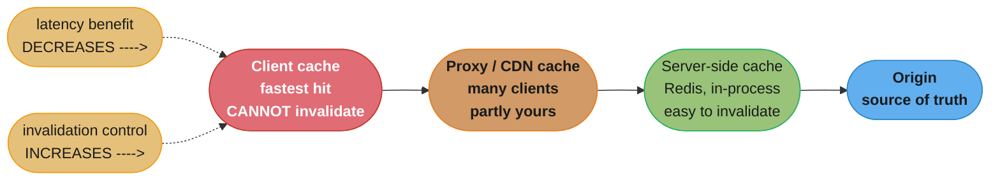
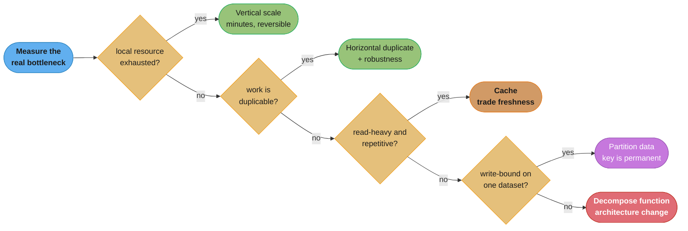
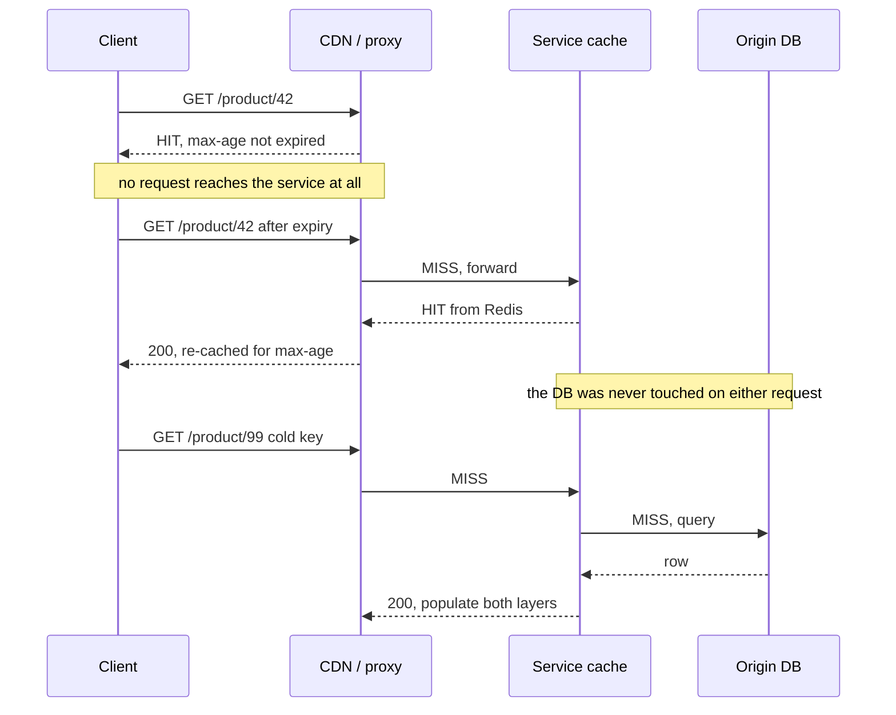

# Chapter 13: Scaling

> Part II — Implementation · Building Microservices, 2nd Edition (Sam Newman, O'Reilly 2021) ·
> builds on Ch 12 (Resiliency), leads to Ch 14 (User Interfaces)

## Chapter Map

Chapter 12 was about a system surviving failure; this chapter is about a system surviving success.
Newman opens by separating the two reasons anyone scales — **performance** (handle more load, or
serve each request faster) and **robustness** (survive losing part of the system) — and then
observes that the techniques usually discussed under one heading, "scaling," buy those two things
in very different proportions. A bigger machine buys performance and no robustness at all. A
second copy buys both. Splitting the data buys performance and, on its own, little robustness.
Splitting the *functionality* buys both, plus the ability to pick different technology for
different workloads, and is of course the thing this entire book is about. The chapter's spine is
a four-axis model — inspired by the scaling cube from Abbott and Fisher's *The Art of Scalability*
— that makes those differences explicit so a team can pick the axis that addresses its actual
bottleneck rather than the one it read about most recently.

The second half is dominated by caching, which gets more pages than any of the four axes, because
caching is the technique teams reach for first, get wrong most often, and find hardest to undo.
Newman's position is unusually blunt for a chapter otherwise full of trade-offs: the ideal number
of places to cache is zero, and every cache you add is a place where the system can be confidently
wrong. The chapter closes with autoscaling and with the acknowledgement that no amount of
incremental scaling saves an architecture forever.

**TL;DR:**
- **Scaling is done for two different reasons** — performance and robustness — and confusing them
  leads to buying a technique that does not address the problem you have.
- **Four axes:** vertical scaling (bigger), horizontal duplication (more copies), data
  partitioning (split by key), functional decomposition (split by concern). They are combinable,
  and each has a different cost/benefit profile.
- **Reach for them roughly in that order.** Vertical scaling and horizontal duplication are cheap,
  fast and low-risk; partitioning and decomposition are architectural commitments that are
  expensive to reverse.
- **Start small.** Measure the actual bottleneck before scaling anything — scaling the wrong
  component costs money and buys nothing.
- **Caching trades freshness for load**, and it can be applied for performance, for scale, or for
  robustness — three different goals with three different failure modes. **The ideal number of
  places to cache is zero**, and the further from the origin a cache sits, the less able you are to
  invalidate it.
- **Autoscaling** is worth having, but prove it works for replacing failed instances before you
  trust it with load, and predictive scaling beats reactive scaling wherever the pattern is known.
- **Eventually you have to rearchitect.** The design that got you to today's scale is not
  automatically the design that gets you to ten times it.

The `## 13.x` headings below follow the chapter's own printed section structure (The Four Axes of
Scaling, Combining Models, Start Small, Caching, Autoscaling, Starting Again).

---

## The Big Question

Given a system that is falling over under load, how do you work out *which* of four fundamentally
different scaling techniques addresses the bottleneck you actually have — and how do you avoid
paying the architectural price of the expensive ones before you have exhausted the cheap ones?

Analogy: a restaurant whose kitchen cannot keep up has four moves available. Buy a bigger stove
(vertical scaling — fast, cheap, low-risk, and useless once you buy the biggest stove that
exists). Hire a second identical chef and duplicate the line (horizontal duplication — more
throughput, and now one chef being ill is survivable). Split the customers so one line serves
tables 1-20 and another serves 21-40 (data partitioning — each line handles less, but a line
going down still strands its own tables). Or split by dish: a dedicated pastry section with its
own oven, its own specialist, and its own equipment (functional decomposition — the pastry section
now scales independently and can use tools the main line never needed). The mistake the chapter
exists to prevent is buying a second oven when the actual queue is at the single dishwasher.

---

## 13.1 The Four Axes of Scaling

Before the axes, the chapter insists on naming the goal. **You scale for performance, or for
robustness, or for both**, and the distinction is not academic — two of the four axes deliver
essentially no robustness benefit at all, so a team scaling in the hope of surviving an instance
failure can spend a great deal of money on an axis that cannot possibly deliver it.

Within performance, there are also two distinct sub-goals worth separating: increasing
**throughput** (serve more requests per second) and decreasing **latency** (serve each request
faster). They are not the same problem and frequently do not have the same solution — adding
instances raises throughput while doing nothing whatsoever for the latency of an individual slow
request.

### Vertical Scaling

**Vertical scaling** means giving the existing thing more resources: a bigger machine, more CPU,
more memory, faster disk. In a cloud environment this is often a configuration change and a
restart, which makes it by far the fastest and lowest-risk of the four.

What makes it attractive is exactly that low friction. It requires no code change, no
architectural commitment, no new failure modes, and it can usually be reversed as easily as it was
applied — which makes it an excellent *experiment*. If quadrupling the instance size fixes the
problem, you have learned something about the bottleneck cheaply; if it does nothing, you have
learned something even more useful, because you now know the bottleneck is not local resource.

Its limits are real and worth stating precisely:

- **It does nothing for robustness.** A bigger single machine is still a single machine, and it
  fails in exactly the same circumstances the small one did. This is the single most important
  property to internalize about this axis.
- **Not every workload benefits.** A single-threaded process on a 64-core machine uses one core;
  a service bottlenecked on network I/O gains nothing from more RAM. The resource you add has to
  be the resource you were short of.
- **Cost is not linear at the top of the range.** The largest instance types typically cost
  disproportionately more per unit of capacity than mid-range ones, so the last doubling is much
  more expensive than the first.
- **There is a ceiling.** Eventually you are running on the largest machine available, and the
  axis is exhausted.

The chapter's practical guidance is that this should usually be the *first* thing tried, precisely
because it is quick and reversible, while being clear-eyed that it is a way of buying time rather
than a durable answer.

### Horizontal Duplication

**Horizontal duplication** means running multiple copies of the same thing and spreading work
across them. The three familiar shapes are a load balancer in front of several stateless service
instances, competing consumers pulling from one queue, and read replicas serving read traffic
while a primary handles writes.

This axis is the one that delivers **both** performance and robustness. More instances means more
aggregate capacity, and it also means losing one instance costs a fraction of capacity rather than
all of it — which is why so much of Chapter 12's redundancy discussion is really about this axis
viewed from the resilience side.

The requirements it imposes are where teams get caught:

- **The work has to be duplicable.** A service holding per-user state in local memory cannot
  simply be doubled, because the second instance does not have the state. Sticky sessions are the
  usual workaround and are a partial one — they reintroduce the coupling between a user and a
  specific instance that horizontal duplication was meant to remove.
- **Something has to distribute the work**, and that something (the load balancer, the queue) is
  now a component that can fail, be misconfigured, or become the bottleneck itself.
- **A shared downstream becomes the new bottleneck.** Ten instances of a service all reading and
  writing one database primary have moved the problem, not solved it. This is the most common
  outcome of naively applying this axis, and it is exactly what pushes teams toward the next one.

Read replicas deserve a specific note because they are the cheapest partial win available on this
axis: they scale reads only, they add replication lag (so reads may be stale, which is the AP
choice from §12.7 arriving through the back door), and they do nothing for write throughput.

### Data Partitioning

**Data partitioning** splits the data itself across multiple instances by some key — customers
A-M here, N-Z there, or by region, or by a hash of the customer ID. Each partition handles a
subset of the work, so unlike read replicas this scales **writes** as well as reads.

The chapter's most important correction here is about robustness: **partitioning on its own does
not improve robustness.** Losing one partition does not take down the whole system, but it takes
down every customer whose data lives on it — and unless partitions are themselves horizontally
duplicated, the loss of one is a hard outage for that subset of users. Partitioning reduces blast
radius; it does not provide redundancy.

The costs are what make this the axis to defer:

- **The partition key is a decision that is very expensive to reverse.** Partition on customer ID
  and any query that spans customers becomes a scatter-gather across every partition, aggregated
  in application code.
- **Cross-partition operations are hard.** A transaction spanning two partitions is a distributed
  transaction, with everything Chapter 6 said about why you probably do not want one.
- **Rebalancing is painful.** Adding a partition typically means moving data, and moving data
  while serving traffic is a genuinely difficult operation to perform without downtime.
- **Reporting and analytics get harder**, because "count all orders this month" is now a query
  against N databases.

Newman does note a benefit that is not about scale at all: partitioning by geography is often the
cleanest way to satisfy **data residency** requirements, keeping a jurisdiction's data physically
within that jurisdiction. Where regulation demands it, that alone can justify the axis.

### Functional Decomposition

**Functional decomposition** splits by *concern*: extract a piece of functionality into its own
service so that it can be scaled, deployed, and operated separately. This is, of course, the
microservice move itself, which is why the chapter can lean on the rest of the book for the
mechanics and concentrate here on what it buys.

It buys the most of any axis:

- **Independent scaling.** The order service and the recommendation service almost certainly need
  different amounts of capacity, and while they share a process they must be scaled together —
  which means over-provisioning one of them permanently.
- **Robustness**, because the extracted service can now fail without taking the rest down, given
  the degrading-functionality work from §12.4.
- **Technology choice per workload.** A service doing heavy numerical work can use a runtime
  suited to it; a service that is mostly I/O can use one suited to that. Sharing a process forces
  one choice on both.

And it costs the most: every distributed-system problem in the preceding twelve chapters — network
calls that fail, data that has to be consistent across a boundary, deployment and monitoring of
more moving parts, and the organizational overhead of another owned thing. This is why it is the
axis of last resort *for scaling purposes specifically*, even though it may be entirely justified
for other reasons.

```mermaid
flowchart LR
    classDef io      fill:#61afef,stroke:#2e86c1,color:#1a1a1a,font-weight:bold
    classDef frozen  fill:#c678dd,stroke:#9b59b6,color:#fff
    classDef train   fill:#98c379,stroke:#27ae60,color:#1a1a1a
    classDef mathOp  fill:#d19a66,stroke:#e67e22,color:#1a1a1a,font-weight:bold
    classDef lossN   fill:#e06c75,stroke:#c0392b,color:#fff,font-weight:bold
    classDef req     fill:#56b6c2,stroke:#0097a7,color:#1a1a1a
    classDef base    fill:#e5c07b,stroke:#f39c12,color:#1a1a1a

    P(["Problem:<br/>system under load"]) --> V(["1. Vertical<br/>bigger box"])
    V -->|"cheap, fast<br/>no robustness"| H(["2. Horizontal<br/>more copies"])
    H -->|"perf + robustness<br/>shared DB now hot"| D(["3. Partitioning<br/>split the data"])
    D -->|"scales writes<br/>key hard to change"| F(["4. Functional<br/>split the concern"])
    F -->|"scales everything<br/>costs everything"| END(["distributed<br/>system"])

    class P lossN
    class V base
    class H train
    class D mathOp
    class F frozen
    class END io
```



*Caption: the axes are ordered by increasing cost and decreasing reversibility, which is why the
chapter's advice is to walk left to right and stop as soon as the bottleneck is gone.*

| Axis | Improves performance | Improves robustness | Reversibility | Main cost |
|---|---|---|---|---|
| Vertical scaling | Yes, up to a ceiling | **No** | Trivial — resize back | Superlinear cost at the top; hard ceiling |
| Horizontal duplication | Yes (throughput) | **Yes** | Easy — remove instances | Needs stateless work; shared DB becomes hot |
| Data partitioning | Yes (reads **and** writes) | **No**, on its own | Very hard — key change means migration | Cross-partition queries and transactions |
| Functional decomposition | Yes, independently per service | **Yes** | Hard — it is an architecture change | Every distributed-systems problem in the book |

---

## 13.2 Combining Models

The axes are not alternatives; a mature system uses several at once, and the chapter's point is
that they compose in a specific and fairly natural order.

A worked progression for MusicCorp's order path:

1. **Start**: one service, one database, one instance. Load doubles; latency degrades.
2. **Vertical**: resize the instance from 2 vCPU to 8. Latency recovers. This bought perhaps six
   months and cost an afternoon.
3. **Horizontal**: load grows again and one instance is no longer enough — and separately, a
   single instance has become an unacceptable availability risk. Run four instances behind a load
   balancer across two availability zones. Now performance *and* robustness improve together.
4. **Horizontal, read side**: the four instances are now hammering one database. Add read
   replicas and route read-only queries to them, accepting replication lag on those reads.
5. **Functional**: writes are still all going to one primary, and profiling shows the write load
   is dominated by order-event writes that have nothing to do with the customer profile data in
   the same schema. Extract the ordering concern into its own service with its own store, so the
   two workloads stop competing.
6. **Partitioning**: order writes alone now exceed what one primary can take. Shard orders by
   customer ID across four partitions, each of which is itself horizontally duplicated so that
   losing one partition's primary is survivable.

Step 6 is where the composition point lands hardest: **partitioning and horizontal duplication are
routinely combined precisely because partitioning alone provides no robustness.** Four shards with
one node each is four single points of failure; four shards with three nodes each is a system that
scales writes *and* survives node loss.

Two other combinations the chapter draws out:

- **Functional decomposition then vertical scaling** is often the cheapest big win available,
  because once workloads are separated you can size each one for what it actually needs instead of
  provisioning every instance for the most demanding thing in the process.
- **Functional decomposition unlocks per-service axis choice** — the catalog service may need
  aggressive horizontal duplication and caching, while the reporting service needs one very large
  machine and no duplication at all. While they share a process, they must share an answer.

---

## 13.3 Start Small

The chapter's discipline section, and the one most likely to save money. Newman's argument is that
scaling work is frequently undertaken before anyone has established what the bottleneck actually
is, with the result that the team buys capacity for a component that was never the constraint.

The rules:

**Measure before you scale.** Not "the system feels slow" but a specific, measured constraint:
which endpoint, at what percentile, at what load, saturating what resource. Without that, the
choice between the four axes is a guess — and the axes address genuinely different bottlenecks, so
a guess has roughly a one-in-four chance of addressing the real one. If the constraint is a single
lock in the application, none of the four helps at all.

**Scale for the load you have plus a margin, not the load you imagine.** Designing today for
traffic a hundred times current volume means paying today for complexity that may never earn its
keep, and — worse — committing to an architecture chosen for a scale profile that may turn out to
be nothing like the one that arrives. The chapter's preference is to solve the problem in front of
you and keep the ability to solve the next one.

**Prefer the cheap, reversible experiment.** Vertical scaling first, because resizing an instance
takes minutes and can be undone in minutes, and because its result is diagnostic either way. Data
partitioning last, because the partition key is close to permanent.

**Know what you are optimizing.** Throughput and latency are different targets. Adding instances
raises throughput and does nothing for the latency of a single slow request; caching may cut
latency dramatically while doing nothing for a write-bound system. Naming which one is failing
narrows the four axes considerably before any money is spent.

**Confirm it worked.** The same measurement that identified the bottleneck should be re-run after
the change, because a surprisingly large fraction of scaling work moves the bottleneck rather than
removing it — the classic being ten service instances that now saturate the database that was
previously idle.

---

## 13.4 Caching

Caching gets the most space in the chapter, for a reason Newman states directly: it is enormously
effective, it is the first thing most teams reach for, and it is the technique whose failure modes
are hardest to see and hardest to reverse. A cache stores the result of a previous operation so
that a later request can be served without repeating it — but every cache is also a second copy of
the truth, and the entire difficulty of caching is about what happens when the two disagree.

The chapter frames caching first by **why** you are doing it, because the three motivations imply
different designs and different acceptable failure modes.

### For Performance

The straightforward case: serving from a cache is faster than recomputing or refetching. A cached
result avoids a network round trip, a database query, or an expensive computation, and the
difference is typically orders of magnitude — a local in-memory hit measured in microseconds
against a database query measured in milliseconds.

A subtlety the chapter draws out is that caching can also let you **fetch many results in one go**
rather than one at a time. In a microservice architecture where a page assembles data from several
services, a cache that holds a batch of results can collapse what would have been N chatty calls
into one, and the win there is about round trips rather than about any single lookup being faster.

### For Scale

Caching reads takes load off the origin, which lets a fixed-size origin serve more traffic. This
is the axis-adjacent use: rather than partitioning the database to handle read load, put a cache
in front of it and serve the repeated reads from there.

The chapter's caution is that this works well for read-heavy workloads with high repetition and
poorly for anything else. If every request asks for different data, the hit rate is low, and the
cache has added latency and complexity for nothing. Cache effectiveness is a measurable property —
hit rate — and a cache whose hit rate nobody has looked at is a cache nobody knows is working.

### For Robustness

The third use is serving stale data from the cache when the origin is unavailable, so the system
keeps functioning through a downstream outage. This is genuinely valuable and Newman is
noticeably more cautious about it than about the other two.

The problems he raises:

- **You are now serving data you know may be wrong**, for an unbounded period, since the origin's
  outage has no defined end. Whether that is acceptable is a business decision of the same shape
  as §12.4's degrading-functionality decision, and needs the same owners.
- **It masks the problem.** A system that quietly rides out an origin outage on cached data may
  not alert anyone, and the failure is discovered when the cache eventually expires — potentially
  much later, and now with a much bigger backlog.
- **The recovery path is untested.** Running entirely from cache is a mode the system almost never
  operates in, and when the origin comes back, the thundering herd of every cache entry expiring
  at once can knock it straight back over.

### Where to Cache

The single most consequential caching decision is *where*, and the trade-off is a straight line:
**the closer the cache is to the client, the better the latency benefit and the worse your ability
to invalidate it.**

### Client-Side, Proxy, and Server-Side Caching

**Client-side caching** puts the cache in the caller — a browser cache, a mobile app's local
store, or a caching layer inside a consuming service. It is the fastest possible option, because a
hit avoids the network entirely, and it reduces load on everything downstream.

Its defining weakness is that **you cannot reach in and clear it.** Once data is in a client you
do not control, it is there until whatever expiry you set elapses, and you have no mechanism to
change your mind. The chapter's warning is to think carefully about how long you are willing to be
unable to correct data, and to remember that old clients can persist far longer than anyone
planned for.

**Proxy caching** puts a cache between client and server — a reverse proxy, a CDN, an ISP's
transparent cache. It is generally invisible to both sides, serves many clients from one cached
copy, and requires no code change on either end, which makes it a common first move for static or
near-static content. The cost is another network hop and, importantly, that some of these proxies
are **not yours**: a CDN you can purge, but an ISP-level cache or a corporate proxy you cannot.

**Server-side caching** puts the cache at or inside the origin — an in-process cache, or a shared
Redis or memcached cluster the service consults before hitting its database. This is where
invalidation is easiest, because the thing that changes the data is right next to the thing
holding the copy, and it is also where cache hit rates are easiest to observe and optimize. The
trade-off is that the client still pays the full network round trip; server-side caching reduces
load, but it does not remove the call.



*Caption: every step toward the origin costs you latency benefit and buys you control — which is
why a cache placed for maximum speed is exactly the cache you will be unable to fix.*

### Caching in HTTP

HTTP already provides the vocabulary for most of this, which is a large part of why the chapter
favours it. The two mechanisms that matter:

**Cache-Control and Expires** let the server state how long a response may be reused.
`Cache-Control: max-age=300` tells any cache — browser, CDN, proxy — that the response is good for
300 seconds. This is the TTL mechanism, expressed in a standard every intermediary already
understands, which means a single header propagates the caching policy to layers you did not
write.

**ETag and conditional GETs** address the case where the client has a copy and wants to know
whether it is still valid. The server returns an `ETag` — an opaque identifier for that version of
the resource — and the client sends it back on the next request in `If-None-Match`. If the
resource has not changed, the server replies `304 Not Modified` with no body.

The property worth being precise about: **a conditional GET saves bandwidth, not the round trip.**
The client still makes the request and still waits for the response; what it avoids is
transferring the payload. For a large resource over a slow link that is a large win; for a small
resource where the round trip dominates, it is close to no win at all. Confusing the two is a
common source of disappointing cache results.

```
  TTL vs CONDITIONAL GET — what each actually saves

  max-age=300, within the window        ETag / If-None-Match
  ------------------------------        --------------------
  client: (no request at all)           client: GET + If-None-Match: "v7"
  network: 0 bytes, 0 ms                network: request out, 304 back
  server:  never sees it                server: computes/looks up the ETag
                                        client: reuses its local copy

  saves: round trip AND bandwidth       saves: bandwidth ONLY
  costs: data may be up to 300s stale   costs: still one round trip, every time

  Use TTL when a bounded staleness is acceptable. Use conditional GETs when
  it is not, and the payload is big enough that the saved bytes matter.
```

*Caption: teams reach for ETags expecting TTL-like savings and are surprised by unchanged latency;
the round trip is only removed by an expiry the client can evaluate locally.*

### Invalidation

Invalidation is the hard half of caching, and the chapter cites Phil Karlton's line — that the two
hard things in computer science are cache invalidation and naming things — not as a joke but as an
accurate summary of where the difficulty lives. The available mechanisms, in rough order of
increasing timeliness and increasing cost:

**Time to live (TTL).** The simplest: attach a lifetime to the cached item and discard it when the
lifetime expires. Everything understands it, nothing needs to coordinate, and it works with caches
you do not control. Its weakness is that the value is a guess — a 5-minute TTL means accepting up
to 5 minutes of staleness *and* refetching every 5 minutes whether or not anything changed. A
secondary trap is **synchronized expiry**: if a large batch of items is cached at the same moment
with the same TTL, they all expire at the same moment and the origin takes the entire load at once.
Jittering the TTL across items avoids this.

**Conditional GETs.** As above — the cache asks whether its copy is still current. More timely
than a long TTL because the check happens on every request, at the cost of a round trip every
time.

**Notification-based invalidation.** The source of the data actively tells consumers when
something changed, typically by publishing an event. This is by far the most timely mechanism —
staleness is bounded by delivery latency rather than by a guessed TTL — and it fits naturally into
an event-driven architecture where those events already exist.

Its failure mode is specific and nasty: **if a notification is missed, the consumer is stale
forever**, and has no way to know. A cache waiting for an invalidation that was dropped will hold
wrong data indefinitely, which is strictly worse than a TTL that would at least have eventually
corrected itself. The chapter's mitigation is a **heartbeat**: the source periodically emits a
message even when nothing has changed, so a consumer that stops hearing anything can tell the
difference between "nothing changed" and "I have lost the channel," and fall back to refetching.
A conservative belt-and-braces approach combines notification for timeliness with a long TTL as a
backstop.

**Write-behind caching.** The write goes to the cache first and is flushed to the origin
asynchronously. This is a write-path technique rather than a read-path one, and it can absorb very
large write bursts by decoupling the write rate the client sees from the rate the origin has to
sustain. The risk is equally clear: **data acknowledged to the client but not yet flushed is lost
if the cache dies**, so this is only acceptable for data whose loss is tolerable, or with a
durable cache that can survive a restart.

**Event-driven updates.** A variant of the notification approach in which consumers subscribe to
the source's events and maintain their own local copy, updating it as events arrive rather than
invalidating and refetching. This works well when the events carry enough information to apply the
change directly, and it turns the cache into a materialized projection — which is also the point
at which the design starts shading into CQRS, one of the more demanding patterns in this space.

### Caching for Writes

Worth separating from the read-path discussion because the semantics differ. A write-behind cache
is a **buffer**: it accepts the write, tells the client it succeeded, and reconciles with the
origin later. That is exactly what makes it powerful for absorbing spikes and exactly what makes
it dangerous, because the acknowledgement the client received was a promise about durability that
had not yet been kept.

The decision is the same one Chapter 12 framed around AP and CP: how much recently written data
can this system afford to lose, and does the write path have a compensating process if it does?
For a counter of page views, the answer is comfortably "some." For an order, it is not.

### Caching for Resilience

Revisiting §12's territory from the caching side: a cache that can serve stale data through an
origin outage converts a hard failure into a degraded one. The mechanics usually involve serving
past the nominal expiry when the origin is unreachable — the entry is stale by the TTL's terms,
but stale data is better than no data for this particular resource.

The two operational points that decide whether this pays off:

- **Bound the staleness anyway.** "Serve stale indefinitely" and "serve stale for up to an hour,
  then fail" are very different promises, and the second is usually the one the business actually
  wants.
- **Plan the recovery.** When the origin returns, every cache entry that has been held past expiry
  wants refreshing at once. Without staggered refresh or some form of request coalescing, the
  recovering origin receives a thundering herd and fails again, which is a self-inflicted second
  outage on top of the first.

### Hiding the Origin

A related pattern: rather than every caller reaching the origin directly, the cache fronts it
entirely, and on a miss the *cache* is responsible for fetching and populating — asynchronously,
if it can serve something stale in the meantime. The value is that a miss storm never turns into
an origin storm, because the cache mediates and can coalesce many concurrent misses for the same
key into one origin fetch.

This is the pattern that saves a system when a cache is flushed or a cache node is lost. Without
it, an empty cache means every request goes to the origin simultaneously — and an origin that has
been comfortably serving 5% of traffic for months is very unlikely to survive suddenly receiving
100% of it.

### Keep It Simple

The chapter's most quotable line is here: **the ideal number of places to cache is zero.** It is
deliberately overstated, and the point behind it is not that caching is bad but that *each
additional cache multiplies the difficulty of reasoning about the system.*

With one cache, a stale value has one possible source. With a client cache, a CDN, a reverse proxy
and a server-side cache all in the same request path, a user reporting stale data has produced a
question with four candidate answers, and each layer has its own TTL, its own invalidation
mechanism, and its own operational owner. Debugging that is genuinely hard, and it is hard at
exactly the moment somebody is complaining that the price on the page is wrong.

The chapter's concrete guidance is therefore about discipline rather than prohibition: know and
**record** where caching happens in your system, keep the number of layers small, and be able to
say for any given piece of data how stale it can possibly be and by what mechanism it gets
corrected. A cache nobody documented is a cache nobody will think of during the incident.

### Freshness Versus Optimization

Every cache is a purchase of load reduction paid for in freshness, and the chapter's insistence is
that the price be named explicitly rather than absorbed by default. The question to answer per
cached item is: **how stale is this allowed to be?**

The answers vary enormously across a single system, which is the argument against a global caching
policy:

| Data | Acceptable staleness | Reasonable mechanism |
|---|---|---|
| Product images, CSS, JS bundles | Effectively forever | Long TTL + versioned URLs |
| Product description | Minutes to hours | TTL, or notification with TTL backstop |
| Price | Seconds to minutes | Short TTL, or notification-based |
| Stock level | Seconds, or none at checkout | Short TTL for display, no cache at the decrement |
| Account balance for a withdrawal | None | Do not cache |

The two failure modes are symmetrical and both common: caching something that needed to be fresh
(the price is wrong and someone is owed money), and *not* caching something that could have been
stale for a day (the origin is being hammered for a value that changes twice a year). Naming the
acceptable staleness per item is what distinguishes the two.

### Cache Poisoning: A Cautionary Tale

The chapter closes the caching discussion with a war story from Newman's own consulting
experience, and it is included precisely because the failure was not in the caching design but in
how far the consequences reached.

The team was doing a large release of a website. Somewhere in the change, page responses went out
with an expiry far in the future — effectively telling every cache downstream that these pages
never needed to be refetched. The old version of the site was consequently pinned in place for a
subset of users, and the problem was that "downstream" included caches the team had no access to
whatsoever: browser caches on users' machines, and caches operated by internet service providers
sitting between those users and the site. There was no purge to run, no header to change that
would reach an already-cached copy, and no way to tell affected users apart from the rest.

The eventual workaround was to change the **URLs** so that the poisoned entries were simply no
longer requested — new addresses meant new cache keys, so the bad copies became irrelevant rather
than being corrected.

The lessons the chapter draws are worth stating separately because they generalize past HTTP:

1. **Cached data can outlive your ability to fix it.** An expiry you set is a commitment you
   cannot withdraw once the response has left the building.
2. **You do not control every cache in the path.** Browsers, ISP proxies and corporate caches are
   all cache layers with their own behavior, and a design that assumes purge is always available
   is wrong for all of them.
3. **The escape hatch is the key, not the value.** Being able to change the URL — versioned asset
   paths, a cache-busting query parameter, a version segment in the path — is what turns an
   unfixable poisoning into an inconvenience, and it costs nothing to build in advance.

The second point is the one that makes this a scaling chapter's story rather than an operations
anecdote: the more aggressively you push caching toward the client to buy performance, the more
completely you give up the ability to correct what you have cached.

---

## 13.5 Autoscaling

**Autoscaling** adds and removes capacity automatically in response to something the platform can
observe. The chapter separates two kinds, and the distinction is about what triggers the change.

**Reactive autoscaling** responds to observed conditions: CPU above 70% for two minutes, queue
depth over 1,000, request latency past a threshold. It requires no knowledge of the future and
handles unanticipated load, which is exactly its appeal.

Its structural weakness is **lag**. There is a delay between the load arriving and the metric
crossing the threshold, another between the scaling decision and the instance existing, and
another before that instance is warm enough to serve — JVM startup, JIT warm-up, connection pools,
cache priming. If that total is three minutes and the traffic spike arrives in thirty seconds, the
autoscaler will be adding capacity for a spike that is already over, and possibly removing it just
as the next one begins.

```
  REACTIVE AUTOSCALING LAG — why the capacity line trails the load line

  load
   ^        ____________
   |       /            \            spike arrives at t=0
   |      /              \
   |_____/                \_________
   |
   |            . . . . . . . . .    capacity follows, late
   |          .                  .
   |__________.__________________.___________________> time
   0    30s   1m   2m   3m   4m   5m

   t+0s    spike begins, all instances saturate, latency climbs
   t+120s  metric crosses threshold (2-min averaging window)
   t+150s  new instances requested
   t+210s  instances booted and warm, now serving
   t+240s  spike has ended; the new capacity serves an idle system
   t+360s  scale-down triggers, right before the next spike

  The users who hit the spike were all served badly. The capacity
  arrived for the users who came after them.
```

*Caption: the averaging window, the provisioning time and the warm-up all add up, which is why a
reactive autoscaler is a poor defense against a short, sharp spike.*

**Predictive autoscaling** scales ahead of load based on a known pattern: traffic that reliably
triples at 09:00 on weekdays, or a marketing campaign with a launch time, or Black Friday. Because
the capacity is provisioned before the load arrives, the lag problem disappears entirely. It
requires the pattern to actually be known and stable, and it will happily be wrong when something
unexpected happens — which is why the two are usually run together, with predictive scaling
handling the known shape of the day and reactive scaling covering the surprises.

The chapter's operational advice is the part worth remembering:

- **Use autoscaling for failure recovery before you use it for load.** Having the platform notice
  a dead instance and replace it is a simpler, more predictable use of the same machinery, and it
  builds confidence that the mechanism works before anything depends on it reacting to a traffic
  curve correctly.
- **Observe before you automate.** Run with the metrics collected and the rules defined but not
  acting for a while, and check what the rules *would* have done. Automation that scales on a
  badly chosen metric can amplify a problem — a service whose CPU rises because a downstream is
  slow does not need more instances, and adding them puts more load on the struggling downstream.
- **Be more conservative about scaling down than up.** Scaling up too eagerly costs money; scaling
  down too eagerly costs availability, and removes capacity you may be about to need.
- **Test it.** An autoscaling policy that has never been exercised under a realistic load test is
  a hypothesis, and finding out it does not work during a traffic event is the expensive way to
  learn.

---

## 13.6 Starting Again

The chapter's closing move is an acknowledgement that the four axes are not infinite. Every
architecture has a scale at which incremental scaling stops working — where the next factor of ten
cannot be reached by adding instances, partitions, or caches to the current design, because the
design's fundamental assumptions no longer hold.

Newman's framing is that this is normal and expected rather than a failure of the original design.
An architecture chosen for a system serving a thousand users a day was, correctly, chosen for that
system; the fact that it does not serve ten million is not evidence that the original decision was
wrong. It is evidence that the constraints changed. **The architecture that got you here is not
necessarily the architecture that gets you there**, and treating that as a design failure produces
exactly the over-engineering §13.3 argues against — building for a scale that has not arrived and
may never arrive.

The practical consequences:

- **Expect rearchitecture as a periodic event**, not a one-off admission of defeat. Plan for the
  possibility that a component gets rewritten rather than optimized.
- **Some patterns are load-bearing only at the top end.** CQRS — separating the write model from
  one or more read models entirely — is powerful precisely because it lets read and write scale
  independently in ways no amount of replication can, and it is also among the most demanding
  patterns to build and operate correctly. Reaching for it before the simpler axes are exhausted
  buys complexity that is not yet paying for anything.
- **The microservice architecture itself is the enabler here.** Rewriting one service that has hit
  its ceiling is a bounded, comprehensible piece of work; rewriting a monolith that has hit its
  ceiling is a multi-year programme. That difference in the *cost of starting again* is one of the
  more durable arguments for the architecture, and it is the note the chapter ends on.

---

## Visual Intuition



*Caption: the decision walks from cheapest and most reversible to most expensive and most
permanent, and the first box is measurement because none of the branches below it are answerable
without it.*



*Caption: each layer that answers is a layer of load the origin never sees — and equally, a layer
holding a copy that has to be invalidated when the product changes.*

```
  WHAT EACH AXIS BUYS — the property teams most often get wrong

                        performance   robustness   reversible   $ per unit
  --------------------------------------------------------------------------
  Vertical scaling          ✓             ✗            ✓        rises sharply
                                                                at the top end
  Horizontal duplication    ✓             ✓            ✓        roughly linear
  Data partitioning         ✓             ✗            ✗        linear + migration
  Functional decomposition  ✓             ✓            ✗        linear + team cost
  --------------------------------------------------------------------------

  The two ✗ in the robustness column are the trap. A team that scales
  vertically or partitions in order to "make the system more reliable"
  has spent the budget on an axis that cannot deliver it. Pair either
  one with horizontal duplication, or it does not survive node loss.
```

*Caption: partitioning without duplication turns one single point of failure into N smaller ones,
which is why §13.2 pairs them as a matter of course.*

---

## Key Concepts Glossary

- **Vertical scaling** — giving the existing instance more resources (CPU, memory, faster disk);
  fast and reversible, with a hard ceiling and no robustness benefit.
- **Horizontal duplication** — running multiple copies of the same thing behind a load balancer or
  competing on a queue; the only cheap axis that improves both performance and robustness.
- **Data partitioning (sharding)** — splitting data across instances by a key so each handles a
  subset; scales writes as well as reads, but provides no robustness on its own.
- **Partition key** — the attribute determining which partition a record lives on; effectively
  permanent, because changing it means migrating all the data.
- **Functional decomposition** — splitting by concern into separate services so each scales,
  deploys and is operated independently; the microservice move itself.
- **Throughput vs latency** — requests served per unit time versus time to serve one request; two
  different targets with two different sets of solutions.
- **Read replica** — a copy of the database serving read traffic only; scales reads, introduces
  replication lag, does nothing for writes.
- **Data residency** — the requirement that data physically remain in a jurisdiction; often the
  non-scale reason to partition geographically.
- **Cache hit rate** — the fraction of requests served from cache; the measurement that tells you
  whether a cache is doing anything at all.
- **Client-side caching** — a cache in the caller (browser, app, consuming service); fastest, and
  impossible to invalidate from the server.
- **Proxy caching** — a cache between client and server (reverse proxy, CDN, ISP cache); serves
  many clients, and some of these caches are not yours to purge.
- **Server-side caching** — a cache at or inside the origin (in-process, Redis, memcached);
  easiest to invalidate and observe, but the client still pays the round trip.
- **Time to live (TTL)** — an expiry attached to a cached item; the simplest invalidation
  mechanism and a guess by construction.
- **Cache-Control / Expires** — HTTP headers stating how long a response may be reused; a single
  header propagating caching policy to intermediaries you did not write.
- **ETag / conditional GET** — an opaque version identifier the client returns in `If-None-Match`,
  letting the server reply `304 Not Modified`; saves bandwidth, not the round trip.
- **Notification-based invalidation** — the data's source publishes an event on change; the most
  timely mechanism, and permanently stale if a notification is missed.
- **Heartbeat** — a periodic message emitted even when nothing changed, so a consumer can tell
  "no change" apart from "I lost the channel."
- **Write-behind caching** — writes acknowledged at the cache and flushed to the origin
  asynchronously; absorbs write bursts, risks losing acknowledged data.
- **Hiding the origin** — having the cache own the fetch on a miss, coalescing concurrent misses so
  a cache flush cannot become an origin storm.
- **Thundering herd** — many cache entries expiring or refreshing simultaneously, overwhelming the
  origin; mitigated by jittered TTLs and request coalescing.
- **Cache poisoning** — a bad or over-long cached response held in caches you cannot purge; the
  practical escape is changing the URL, not the value.
- **Reactive autoscaling** — adding capacity in response to observed metrics; handles the
  unanticipated, but lags behind short spikes.
- **Predictive autoscaling** — adding capacity ahead of a known pattern (time of day, campaign
  launch); no lag, but only as good as the pattern.
- **CQRS (Command Query Responsibility Segregation)** — separating the write model from one or
  more read models so each scales independently; powerful and among the most demanding patterns to
  operate.

---

## Tradeoffs & Decision Tables

| Bottleneck symptom | Axis that addresses it | Axis that does not |
|---|---|---|
| One instance CPU-bound, plenty of headroom elsewhere | Vertical scaling | Partitioning — nothing is split |
| Enough total capacity but no redundancy | Horizontal duplication | Vertical scaling — still one box |
| Read load saturating the database | Read replicas, then caching | Vertical scaling of the app tier |
| Write load saturating one primary | Data partitioning | Read replicas — they do not take writes |
| Two workloads in one process with different needs | Functional decomposition | More instances of the combined process |
| A single lock inside the application | None of the four — fix the lock | All of them |

| Cache location | Latency win | Invalidation control | Serves many clients | Yours to purge |
|---|---|---|---|---|
| Client-side | Highest — no network at all | None | No, one per client | No |
| CDN | High | Purge API, usually | Yes | Yes |
| ISP / corporate proxy | High | None | Yes | **No** |
| Reverse proxy (yours) | Medium | Full | Yes | Yes |
| Server-side (Redis, in-process) | Lowest — round trip remains | Full, and easiest | Yes | Yes |

| Invalidation mechanism | Staleness bound | Cost | Fails by |
|---|---|---|---|
| TTL | The TTL value | Refetch on every expiry, changed or not | Being a guess; synchronized expiry storms |
| Conditional GET | One request | A round trip every request | Saving bandwidth but not latency |
| Notification-based | Delivery latency | An event channel to build and run | Silent permanent staleness on a missed message |
| Notification + TTL backstop | min(delivery, TTL) | Both of the above | Little — this is the conservative default |
| Write-behind | Flush interval, on the write path | Durability risk | Losing acknowledged writes on cache failure |

| Autoscaling | Handles unexpected load | Handles spikes | Prerequisite |
|---|---|---|---|
| Reactive | Yes | Poorly — metric window plus boot plus warm-up | Fast, reliable instance startup |
| Predictive | No | Yes, for known events | A stable, understood traffic pattern |
| Both together | Yes | Yes | Both of the above; the common production answer |

---

## Common Pitfalls / War Stories

**Scaling the tier that was never the bottleneck.** The classic sequence: latency is bad, the team
scales the application tier from four instances to twenty, latency gets marginally *worse*, and
the actual constraint turns out to be a single database primary that is now receiving five times
the connection count. The money was spent, the complexity was added, and the bottleneck moved
rather than lifting. Measuring first is not process overhead here; it is the difference between
fixing the problem and funding it.

**Partitioning without duplication.** A team shards a database into eight partitions to handle
write load and reports the system as "scaled." One partition's node dies and one eighth of the
customers are hard down, with no failover, because sharding was mistaken for redundancy. The
system now has eight single points of failure where it previously had one. Every partition needs
its own horizontal duplication or the axis has traded a scale problem for an availability one.

**The partition key chosen in an afternoon.** Orders are partitioned by order ID because it was
convenient and evenly distributed. Six months later every meaningful query is "all orders for this
customer," which now scatter-gathers across every partition and aggregates in application code, and
the customer dashboard is slower than it was before sharding. Repartitioning by customer ID means
migrating the entire dataset while live. The key deserves the deliberation of an architectural
decision, because that is what it is.

**Sticky sessions defeating the point of horizontal duplication.** In-memory session state forces
sticky routing, so an instance dying does not cost 25% of capacity, it logs out 25% of users
mid-checkout, and load across instances is uneven because sessions do not distribute the way
requests do. The state has to move somewhere shared before duplication delivers what it promises.

**Four cache layers and nobody knows which one is stale.** A price change goes out, most users see
it, some do not. The request path contains a browser cache, a CDN, a reverse proxy and a
server-side cache, each with a different TTL and a different owner, and there is no document
saying so. Hours are spent bisecting layers during a live incident. This is precisely the cost the
"ideal number of places to cache is zero" line is warning about — not that the caches were wrong,
but that nobody could reason about them together.

**Synchronized TTL expiry taking out the origin.** A deploy warms 50,000 cache entries within the
same minute, all with a 1-hour TTL. An hour later they all expire simultaneously and the origin
receives 50,000 concurrent requests for data it has not served in an hour. The cache is
functioning exactly as designed; the design forgot that expiry time is derived from population
time. Jitter the TTLs and coalesce concurrent misses for the same key.

**Cached data you cannot recall.** A far-future expiry ships by accident and the wrong page is
pinned in browser caches and ISP proxies for users the team cannot identify and cannot reach. No
purge exists for a cache you do not operate. The recovery is to change the URLs so the poisoned
entries are never requested again — which only works if the design allowed for versioned or
cache-busted URLs in the first place.

**Autoscaling on a metric that means something else.** CPU rises on a service, the autoscaler adds
instances, each new instance opens connections to the downstream that was already the problem, and
the downstream degrades further, raising CPU further, adding more instances. The autoscaler has
built a positive feedback loop into an outage. This is why the chapter suggests running the rules
in observation mode first and checking what they would have done.

**Autoscaling that has never been tested.** The policy is configured, the dashboards look right,
and nobody has exercised it under a realistic load test. During the actual traffic event the
instances take four minutes to become healthy because of a warm-up nobody accounted for, and the
scaling that was supposed to protect the launch arrives after it. An untested scaling policy is a
hypothesis, not a capability.

---

## Real-World Systems Referenced

- **MusicCorp** — the book's running fictional retailer, used through the axis and caching
  discussion (catalog, orders, stock, product pages).
- **Newman's own consulting engagement** — the source of the cache-poisoning cautionary tale, in
  which a far-future expiry pinned an old site version in browser and ISP caches beyond the team's
  reach, and the fix was changing URLs.
- **Abbott and Fisher's scaling cube** (*The Art of Scalability*) — the model the four axes are
  adapted from.
- **HTTP caching infrastructure** — `Cache-Control`, `Expires`, `ETag` / `If-None-Match` and
  `304 Not Modified`, plus reverse proxies, CDNs and ISP-level transparent caches as the layers
  that consume those headers.
- **In-memory caching systems** — Redis and memcached as the standard server-side cache stores.
- **Cloud autoscaling machinery** — provider auto-scaling groups and container-platform
  autoscalers as the mechanism behind reactive and predictive scaling.
- **CQRS** — named as one of the more demanding patterns available when the simpler axes have been
  exhausted.

---

## Summary

The chapter's argument is that "scaling" names four genuinely different techniques with four
different cost profiles, and that most bad scaling decisions come from applying one of them
without having established which bottleneck is actually binding. Vertical scaling is fast, cheap
and reversible, and buys no robustness. Horizontal duplication buys performance and robustness
together and is the workhorse of most real systems. Data partitioning is the only axis that scales
writes on a single dataset, and it buys no robustness by itself while committing you to a
partition key that is close to permanent. Functional decomposition buys the most and costs the
most, and is the subject of the rest of the book. The chapter's ordering advice — vertical, then
horizontal, then the architectural ones — is derived directly from how reversible each one is.

Caching gets the most attention because it is the technique with the widest gap between how easy it
is to add and how hard it is to reason about. Newman separates the three motivations (performance,
scale, robustness), insists the placement decision be understood as a trade of latency benefit
against invalidation control, walks the invalidation mechanisms from TTL through conditional GETs
to notification-based schemes with their heartbeat backstop, and lands on the deliberately
overstated rule that the ideal number of places to cache is zero. The cache-poisoning story is
there to make one thing concrete: cached data can outlive your ability to correct it, in caches you
do not own, and the only reliable escape is being able to change the key.

Autoscaling closes the practical material with a caution that is really about trust — prove the
mechanism by using it for failure recovery first, observe what the rules would do before letting
them act, and be more careful scaling down than up. And "Starting Again" reframes the whole thing:
no architecture scales forever, the design that got you here was correct for the constraints it
was chosen under, and the strongest scaling argument for microservices is not that they scale
better in the abstract but that when one piece does hit its ceiling, replacing that one piece is a
bounded job rather than a multi-year programme.

Part II ends here. Chapter 14 turns to the surface all of this scaling has been in service of — the
user interface, and how it composes data from many services without becoming a monolith of its own.

---

## Interview Questions

**Q: Why does Newman insist you name whether you are scaling for performance or robustness?**
**Short:** Two of the four axes deliver no robustness at all, so the wrong choice spends the budget on something that cannot help.
Vertical scaling and data partitioning both improve performance while providing essentially no protection against losing a node — a bigger machine is still one machine, and losing one shard is a hard outage for every customer on it. Horizontal duplication and functional decomposition improve both, which is why a team whose real problem is "we cannot survive an instance dying" must reach for those two specifically. Within performance there is a further split worth naming, between throughput and latency, because adding instances raises throughput and does nothing for the latency of an individual slow request.

**Q: Why does data partitioning not improve robustness on its own?**
**Short:** Sharding creates N smaller failure domains rather than redundancy — losing one shard is a hard outage for its customers.
Partitioning splits the data so each node handles a subset of the load, but each subset then exists in exactly one place, so a node failing takes down every customer whose partition lived on it with no failover available. What it does provide is a reduced blast radius: one eighth of users down beats all of them. The standard production answer is to combine the axes — partition for write scale and horizontally duplicate each partition for redundancy — which is why the two are almost always deployed together.

**Q: Why is vertical scaling the first thing to try even though it does not scale far?**
**Short:** It is minutes of work, fully reversible, and its result is diagnostic whether it fixes the problem or not.
Resizing an instance in a cloud environment requires no code change, no architectural commitment and no new failure modes, and it can be undone as easily as it was applied — which makes it the cheapest possible experiment on a live bottleneck. If it fixes the problem you have bought time for almost nothing; if it does not, you have learned that the constraint is not local resource, which narrows the remaining axes considerably. Its limits are that cost rises sharply at the top of the instance range, some workloads (a single-threaded process, an I/O-bound service) gain nothing from more of the resource added, and there is eventually a largest available machine.

**Q: What is the cost the chapter warns about most in choosing a partition key?**
**Short:** The key is effectively permanent, because changing it means migrating the entire dataset while serving live traffic.
Every query that does not include the partition key becomes a scatter-gather across all partitions with aggregation in application code, so a key chosen for even distribution rather than for the access pattern can make the system's most common query dramatically slower than it was before sharding. Cross-partition transactions become distributed transactions, and rebalancing to add capacity means moving data without downtime, which is genuinely difficult. Treat the key as an architectural decision with the deliberation that implies, because the migration cost of getting it wrong is measured in months.

**Q: What does Newman mean by "the ideal number of places to cache is zero"?**
**Short:** Each additional cache layer multiplies how hard it is to reason about freshness, especially during an incident.
The line is deliberately overstated — the chapter is full of caching techniques — and the point behind it is that a request path containing a browser cache, a CDN, a reverse proxy and a server-side cache gives a report of stale data four candidate explanations, each with its own TTL, invalidation mechanism and operational owner. Debugging that happens under time pressure while someone complains the price on the page is wrong. The practical guidance is discipline rather than prohibition: keep the number of layers small, record where caching happens, and be able to state for any piece of data how stale it can possibly be and what corrects it.

**Q: Why does the position of a cache trade latency benefit against invalidation control?**
**Short:** The closer a cache sits to the client, the less of the network it costs you and the less of it you can reach to purge.
A client-side cache is the fastest possible hit because it avoids the network entirely, and it is also the one you cannot clear — once data is in a browser or a mobile app, it is there until whatever expiry you set elapses, with no mechanism to change your mind. A server-side cache is the opposite: invalidation is trivial because the thing that changes the data sits next to the copy, but the client still pays the full round trip so you have reduced load without reducing latency. Proxy and CDN caches sit in the middle, and the important asymmetry is that some of them — ISP and corporate proxies — are not yours to purge at all.

**Q: What exactly does a conditional GET with an ETag save, and what does it not?**
**Short:** It saves bandwidth by returning 304 with no body, but the client still makes the request and still waits for the round trip.
The client sends its stored `ETag` in `If-None-Match`, and if the resource is unchanged the server replies `304 Not Modified` with no payload, so the transfer is avoided while the request/response cycle is not. For a large resource over a slow link that is a real win; for a small resource where the round trip dominates the latency, it is close to no win at all, which is why teams expecting TTL-like savings from ETags are often disappointed. Only a locally evaluable expiry — `Cache-Control: max-age` — removes the round trip, at the price of accepting bounded staleness.

**Q: What is the specific failure mode of notification-based cache invalidation?**
**Short:** A missed notification leaves the consumer permanently stale, with no way to know it is holding wrong data.
Notification-based invalidation is the most timely mechanism available — staleness is bounded by delivery latency rather than by a guessed TTL — but a consumer waiting for an invalidation that was dropped will hold the wrong value indefinitely, which is strictly worse than a TTL that would eventually have corrected itself. The chapter's mitigation is a heartbeat: the source emits a periodic message even when nothing has changed, so a consumer that stops hearing anything can distinguish "nothing changed" from "I lost the channel." The conservative production pattern is notification for timeliness plus a long TTL as a backstop.

**Q: What lesson does the cache-poisoning story actually teach?**
**Short:** Cached data can outlive your ability to fix it, in caches you do not own, and the escape hatch is the key not the value.
A release accidentally set a far-future expiry, which pinned the old version of the site in browser caches and in ISP-level proxies — layers the team had no purge access to and no way to identify affected users through. No header change reaches a copy that has already been cached, so the eventual fix was to change the URLs, making the poisoned entries irrelevant rather than corrected. The generalizable lesson is to build in versioned or cache-bustable URLs before you need them, and to remember that the harder you push caching toward the client for performance, the more completely you give up the ability to correct what you cached.

**Q: Why is caching for robustness treated more cautiously than caching for performance?**
**Short:** Serving stale through an outage means serving knowingly wrong data for an unbounded period, in a mode that is never tested.
The technique works — a cache that keeps answering when the origin is down converts a hard failure into a degraded one — but the origin's outage has no defined end, so "serve stale" without a bound is a promise to be wrong indefinitely, and that is a business decision with the same owners as the degrading-functionality decision from Chapter 12. It also masks the problem: a system quietly riding out an outage on cached data may alert nobody until the cache finally expires. And the recovery is dangerous, because every entry held past expiry wants refreshing at the moment the origin returns, which is a thundering herd aimed straight at a service that just came back.

**Q: What causes a thundering herd on an origin, and how do you prevent it?**
**Short:** Entries populated together expire together, so the origin gets every request at once; jitter the TTLs and coalesce misses.
A deploy that warms 50,000 cache entries within one minute with an identical one-hour TTL guarantees that an hour later all 50,000 expire simultaneously and the origin receives concurrent requests for data it has not had to serve in an hour. The cache is behaving exactly as configured; the design overlooked that expiry time is derived from population time. Add random jitter to TTLs so expiry spreads out, and have the cache coalesce concurrent misses for the same key into a single origin fetch — which is the "hiding the origin" pattern, and the same mechanism that stops a cache flush becoming an origin outage.

**Q: Why does reactive autoscaling handle short spikes badly?**
**Short:** The metric window, the provisioning time and the instance warm-up all add up, so capacity arrives after the spike has passed.
There is a delay before the load moves the metric past its threshold (a two-minute averaging window is common), another before the requested instances exist, and another before they are warm enough to serve — JVM startup, JIT warm-up, connection pools, cache priming. If that totals three minutes and the spike lasts thirty seconds, every user in the spike was served badly and the new capacity arrives to serve an idle system, possibly scaling back down just as the next spike begins. Predictive autoscaling avoids this entirely for known patterns by provisioning ahead of the load, which is why the two are usually run together.

**Q: What is Newman's advice for introducing autoscaling safely?**
**Short:** Use it for replacing failed instances first, run the load rules in observation mode, and scale down more conservatively than up.
Having the platform notice a dead instance and replace it exercises the same machinery in a simpler, more predictable way, so confidence in the mechanism is built before anything depends on it reacting correctly to a traffic curve. Then define the load-based rules but check what they *would* have done before letting them act, because scaling on a badly chosen metric can amplify an outage — a service whose CPU rises because a downstream is slow does not need more instances, and adding them puts more load on the struggling downstream. Scale up eagerly and down conservatively (eager scale-up costs money, eager scale-down costs availability), and test the policy under a realistic load test, since an unexercised policy is a hypothesis rather than a capability.

**Q: Why does the chapter argue against designing today for a hundred times current load?**
**Short:** You pay immediately in complexity for a scale that may never arrive, and in a shape that may not match what does.
Building for imagined future volume commits the team now to an architecture chosen for a scale profile that is a guess, and the guess is frequently wrong in shape as well as size — the traffic that arrives may be write-heavy where the design assumed read-heavy. Meanwhile the complexity is real from day one, in operations, in debugging and in every future change. The chapter's preference is to solve the problem in front of you, keep the ability to solve the next one, and accept that some rearchitecture later is normal rather than a failure.

**Q: If measurement shows the bottleneck is a lock inside the application, which axis helps?**
**Short:** None of them — the four axes address resource, copy, data and concern boundaries, not contention inside a process.
Adding CPU does nothing because the threads are blocked rather than computing; adding instances raises aggregate throughput but leaves each instance's latency unchanged and may worsen contention on any shared downstream; partitioning and decomposition are architectural changes that do not touch the lock. This is exactly why §13.3 puts measurement before the axis choice: without knowing the specific saturating resource, the choice among four techniques that address four different constraints is close to a guess. Fix the lock, then re-measure to find what the next constraint turns out to be.

**Q: What does "starting again" mean, and why isn't it an admission the original design was wrong?**
**Short:** Every architecture has a scale ceiling; the design that got you here was correct for the constraints it was chosen under.
Incremental scaling eventually stops working because the next order of magnitude cannot be reached by adding instances, partitions or caches to a design whose fundamental assumptions no longer hold — and Newman frames that as normal and expected rather than a design failure. Treating it as a failure produces exactly the over-engineering the "start small" section warns against, building for a scale that has not arrived. The genuinely useful consequence is architectural: rewriting one microservice that has hit its ceiling is bounded work, while rewriting a monolith that has hit its ceiling is a multi-year programme, and that difference in the cost of starting again is one of the more durable arguments for the architecture.

**Q: Why does functional decomposition make the other axes more effective?**
**Short:** Separated workloads can each be sized and scaled for what they actually need instead of sharing one compromise.
While two workloads share a process they must share an instance size, an instance count and a scaling policy, which means permanently over-provisioning whichever one needs less — a reporting workload that wants one very large machine and a catalog workload that wants many small ones cannot both be served well by one answer. Once separated, each service picks its own axis: aggressive horizontal duplication and caching for the catalog, vertical scaling and no duplication for reporting. It also unlocks technology choice per workload, since a numerically heavy service and an I/O-bound one no longer have to agree on a runtime.

---

## Cross-links in this repo

- [hld/scalability/ — the four axes in system-design terms, plus scale-cube framing extending §13.1](../../../hld/scalability/scalability.md)
- [hld/load_balancing/ — the distribution layer horizontal duplication depends on (§13.1)](../../../hld/load_balancing/load_balancing.md)
- [hld/database_sharding/ — partition keys, rebalancing and scatter-gather queries from §13.1](../../../hld/database_sharding/database_sharding.md)
- [database/sharding_and_partitioning/ — the storage-engine mechanics of §13.1's partitioning axis](../../../database/sharding_and_partitioning/sharding_and_partitioning.md)
- [hld/caching/ — cache placement, eviction and invalidation strategies covering all of §13.4](../../../hld/caching/caching.md)
- [backend/caching_strategies_deep_dive/ — cache-aside, read-through, write-behind and thundering-herd mitigation from §13.4](../../../backend/caching_strategies_deep_dive/caching_strategies_deep_dive.md)
- [database/database_caching_patterns/ — origin-side caching and invalidation against a database of record](../../../database/database_caching_patterns/database_caching_patterns.md)
- [devops/kubernetes_scheduling_and_autoscaling/ — HPA, VPA and cluster autoscaling, the machinery behind §13.5](../../../devops/kubernetes_scheduling_and_autoscaling/kubernetes_scheduling_and_autoscaling.md)
- [devops/performance_and_load_testing/ — how to measure the bottleneck §13.3 insists you find first](../../../devops/performance_and_load_testing/performance_and_load_testing.md)
- [hld/rate_limiting/ — the complement to scaling: shedding load you have chosen not to serve](../../../hld/rate_limiting/rate_limiting.md)
- Sibling chapters: [Ch 12 Resiliency](../12_resiliency/12_resiliency.md) · [Ch 14 User Interfaces](../14_user_interfaces/14_user_interfaces.md)

## Further Reading

- Martin L. Abbott and Michael T. Fisher, *The Art of Scalability* — the scaling cube the four
  axes in §13.1 are adapted from.
- RFC 7234 (HTTP/1.1 Caching) and RFC 7232 (Conditional Requests) — the specifications behind
  `Cache-Control`, `Expires`, `ETag` and `304 Not Modified` in §13.4.
- Michael Nygard, *Release It!* — capacity and stability material adjacent to this chapter's
  scaling discussion, and the source of Chapter 12's patterns it leans on.
- Martin Fowler's writing on CQRS — background on the read/write separation named in §13.6 as one
  of the more demanding scaling patterns.
- Cloud provider documentation on auto-scaling groups and instance warm-up behaviour — the
  operational detail behind §13.5's lag discussion.
