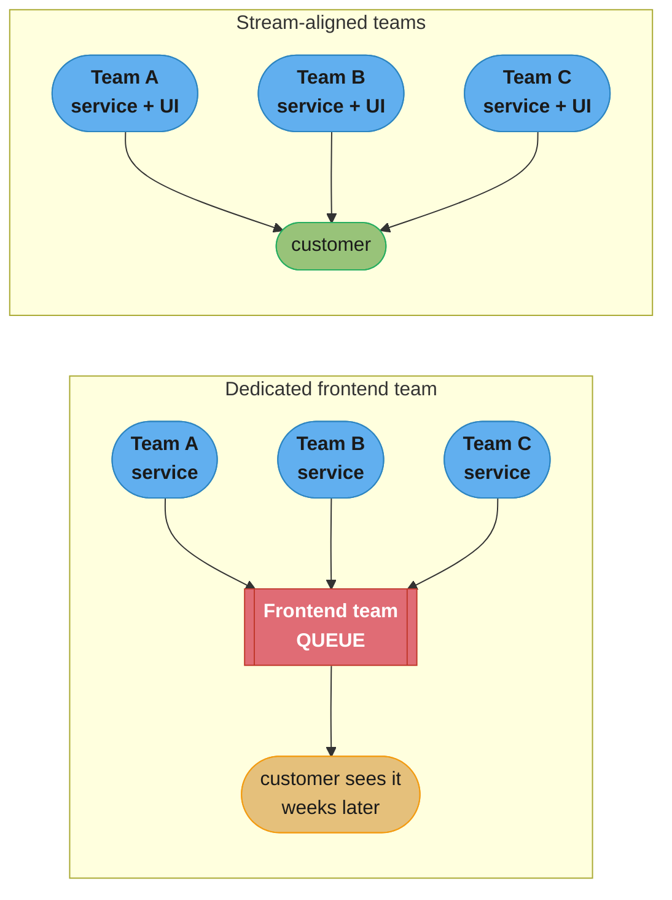
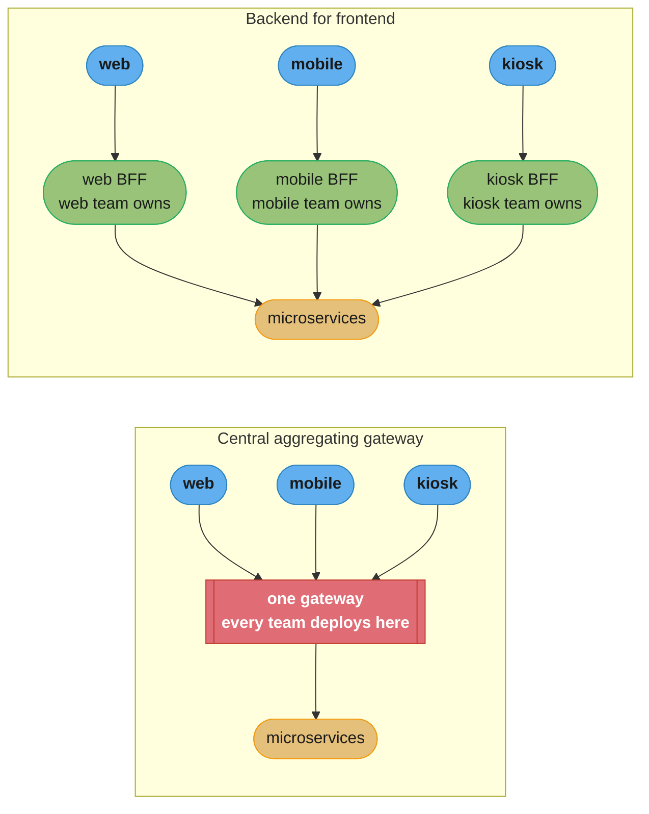
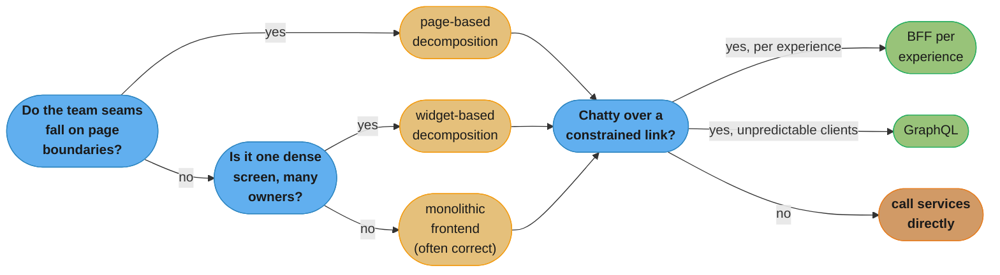
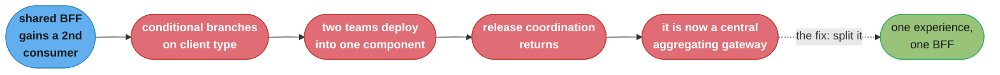

# Chapter 14: User Interfaces

> Part III — People · Building Microservices, 2nd Edition (Sam Newman, O'Reilly 2021) ·
> builds on Ch 13 (Scaling), leads to Ch 15 (Organizational Structures)

## Chapter Map

Chapter 13 closed Part II by asking how a microservice architecture copes with load; this chapter
opens Part III — People — by asking a question the previous thirteen chapters mostly deferred:
what happens at the *top* of the stack, where all those independently deployable services have to
be assembled back into something a human being can actually use. Newman is explicit that the user
interface is where microservices get pulled together into something that makes sense to a
customer, and that a book which spends hundreds of pages decomposing the backend and then leaves
the frontend as one undifferentiated lump has quietly undone most of its own argument. The chapter
is placed in the People part rather than the Implementation part on purpose: its central claim is
that the frontend question is primarily an *ownership* question wearing a technical costume, and
the technical patterns in the chapter's second half exist mainly to make a particular ownership
model — end-to-end, stream-aligned teams — technically achievable.

**TL;DR:**
- The word "website" no longer describes the surface area. An organization delivers through web,
  native mobile, kiosks, voice, third-party APIs and more; the chapter's **toward digital** framing
  argues these are facets of one digital offering, not separate channels each needing its own silo.
- A **dedicated frontend team** is the default most organizations drift into, and Newman argues
  against it: it reintroduces the hand-off and the delivery bottleneck that stream-aligned,
  end-to-end team ownership exists to eliminate.
- The three usual defences of a dedicated frontend team — **scarcity of specialists**, **ensuring
  consistency**, and **technical challenges** — each have an answer that preserves end-to-end
  ownership: embed or share specialists via enabling teams, use a design system, and use the
  chapter's frontend decomposition patterns.
- The pattern catalogue runs **monolithic frontend** → **micro frontends** (via **page-based** or
  **widget-based decomposition**) → **central aggregating gateway** → **backend for frontend
  (BFF)** → **GraphQL**, each fixing a problem the previous one leaves open, and each introducing
  a new cost.
- The chapter's closing position is a **hybrid approach**: real systems mix these patterns per
  experience rather than picking one and applying it uniformly.

## The Big Question

If a customer-facing feature requires changes to three backend microservices *and* to the screen
that shows the result, who has to be involved to ship it — one team, or four? And if the honest
answer is four, in what sense is the architecture "independently deployable"?

An analogy: think of a restaurant that has reorganized its kitchen into specialist stations —
grill, pastry, sauce, cold prep — each able to work at its own pace with its own equipment. That
reorganization buys nothing at all if every plate still has to pass through one single person who
arranges the food and carries it out, because that person is now the constraint on the whole
kitchen's throughput, and every station's improvements queue up behind them. A dedicated frontend
team is that one plating station. The patterns in this chapter are all different ways of letting
each station plate and serve its own dish — sometimes by giving each station its own section of
the dining room (page-based decomposition), sometimes by having each station send out its own
component of a shared plate (widget-based decomposition), and sometimes by giving each station its
own dedicated runner (a BFF).

---

## 14.1 Toward Digital

The chapter opens by dismantling the vocabulary most organizations still use. For a long time
"the website" and "the mobile app" were treated as two separate channels, staffed by two separate
teams, often with two separate roadmaps and two separate backlogs, and frequently with a third
team owning "the API" that both consumed. That model made a kind of sense when the web was the
product and everything else was an add-on. It stopped making sense once the range of interfaces
an organization has to support expanded: responsive web, single-page web applications, native iOS
and Android applications, tablets, in-store kiosks and self-service terminals, interactive voice
response and smart-speaker interactions, wearables, and public APIs consumed by partners who build
interfaces the organization never sees.

Newman's framing is that these are not channels to be staffed separately but **facets of one
digital offering**, and that the correct organizing question is not "which channel is this?" but
"which piece of user-facing functionality is this, and does the same team own it end to end
wherever it surfaces?" The practical consequence is that the frontend cannot be modelled as one
monolithic thing sitting on top of the services — because there is no longer one frontend. There
are many, and they differ in ways that matter technically.

**Constraints differ per interface, and those differences are not cosmetic.** A desktop web
browser on office broadband can comfortably issue a dozen parallel requests, render a large page,
and hold a lot of state in memory. A native mobile application on a congested cellular link is
operating under an entirely different budget: higher and more variable round-trip latency, a
metered and sometimes very slow connection, a much smaller viewport that displays far less of the
data the desktop page shows, and a battery that every extra radio wake-up drains. The same set of
backend microservices, called the same chatty way, produces an acceptable experience on one and an
unusable one on the other.

Here is the shape of the problem as a worked example. Suppose a customer's order-summary screen
needs data from four services — customer, order, inventory, and loyalty. Calling all four
directly from a browser on a fast connection costs roughly one round trip's worth of wall-clock
time if the calls fan out in parallel; on a mobile link where a single round trip is 200 ms, four
parallel calls still cost about 200 ms, but any dependency between them (fetch the order, then
fetch each line item's inventory) serialises into 400 ms, 600 ms, or worse. A screen that needs
twenty line-item lookups turns into twenty round trips, and the interface that felt instant in the
office feels broken on a train. The mobile client also throws away most of what it downloaded,
because its small screen shows three fields per line item where the desktop shows twelve.

This is the pressure that produces every subsequent pattern in the chapter: something, somewhere,
needs to do the aggregating and the trimming, and *where you put that something* determines who
owns it and therefore who becomes a bottleneck.

---

## 14.2 Ownership Models

### Drivers for Dedicated Frontend Teams

Having established that there are many interfaces, the chapter turns to who builds them. The
common industry pattern is a **dedicated frontend team** — a horizontal team that owns the user
interface layer across the product, receiving work from the various backend teams and turning it
into screens. Newman identifies three drivers that push organizations into this shape:

**Scarcity of specialists.** Frontend development is a genuine specialism — accessibility, CSS
architecture, browser compatibility, mobile platform idioms, performance budgets — and an
organization with, say, four such specialists and twelve stream-aligned teams cannot staff every
team with one. Pooling the scarce skill into one team is the obvious-looking response.

**Ensuring consistency.** If eight teams each build their own screens, the product risks looking
like eight different products: eight shades of "primary blue", four different date pickers, three
incompatible ideas of what an error message looks like. A single team owning the UI is an easy way
to guarantee one coherent visual and interaction language.

**Technical challenges.** Even if you wanted every team to own its own slice of UI, it is not
obvious how eight teams independently deploy pieces of what the user experiences as a single page,
particularly for a single-page application compiled into one bundle, and even more particularly
for a native mobile app that ships as one binary through an app store review process.

Each driver is real. The chapter's argument is not that these concerns are imaginary but that the
dedicated-frontend-team response to them is disproportionately expensive.

### Toward Stream-Aligned Teams

The cost is a **hand-off**. A stream-aligned team — the *Team Topologies* term the chapter leans
on throughout, and which Chapter 15 develops in depth — is a team with end-to-end responsibility
for delivering a slice of user-facing functionality. The moment the user-facing part of that slice
belongs to somebody else, the team no longer has end-to-end responsibility; it has responsibility
for a middle segment, plus a dependency on a queue. The backend service can be deployed
independently all day long, and the customer still sees nothing until the frontend team's backlog
reaches the corresponding UI work. All the independent deployability the architecture bought is
spent in the last mile.

The chapter's counter-proposal is that stream-aligned teams should own their functionality
**including the user interface**, and it answers each of the three drivers in turn:

**Sharing specialists.** Rather than concentrating the scarce frontend specialists into a delivery
team that owns work, place them in an **enabling team** whose job is to raise everyone else's
capability: pair with stream-aligned teams, take on the genuinely hard problems, and coach the
generalists through the ordinary ones. The specialist's output stops being "screens I built" and
becomes "screens other teams can now build well". This is the same enabling-team pattern that
Chapter 15 applies to platform and architecture concerns, and it is the chapter's general answer
to every "but we only have three people who can do X" objection.

**Ensuring consistency.** A **design system** — a shared, versioned library of components, tokens
and usage guidance, plus the living documentation that goes with it — encodes the consistency in
an artifact rather than in a team's judgment. Eight teams consuming one component library produce
one date picker because there *is* one date picker, not because one team built every screen. The
enabling team is typically the natural custodian of that library.

**Working through technical challenges.** This is the driver the rest of the chapter is dedicated
to. If independent deployment of UI pieces is genuinely hard, the response is to reach for the
patterns that make it less hard, and to be honest about which ones a given interface can actually
support — a native mobile binary genuinely constrains what is possible in a way a server-rendered
web page does not.



Caption: the dedicated frontend team turns three independently deployable services into one
shared delivery queue, so the last mile re-serialises everything the architecture decoupled.
Stream-aligned ownership removes the queue by moving the UI into the team that owns the change.

---

## 14.3 Pattern: Monolithic Frontend

The **monolithic frontend** is the baseline: one single deployable user interface that calls all
the backend microservices it needs. The backend is decomposed; the frontend is not.

This is not automatically wrong, and the chapter is careful to say so. It is a reasonable choice
when one team genuinely owns the whole user experience — a small organization, or a product with
one screen surface and one team behind it. It is sometimes the *only* choice: a native mobile
application ships as a single binary through an app store, so "independently deployable pieces of
the app" is not something the platform offers for free, and treating that app as a monolithic
frontend is an accurate description of reality rather than a design failure.

The cost appears exactly when ownership is spread. With eight teams behind the services and one
deployable frontend, every UI change lands in one codebase with one release train. Two effects
follow. First, the coordination cost: a team that wants to change its own screen must get its
change merged and released through a pipeline it shares with seven other teams' changes, so its
release cadence is the *slowest* of the eight, not its own. Second, the ownership ambiguity: when
one codebase contains screens for eight different business capabilities, "who owns this file" has
no clean answer, and the answer that emerges in practice is usually "the frontend team", which
reinstates exactly the hand-off the previous section argued against.

```
  MONOLITHIC FRONTEND
  -------------------
                     +---------------------------+
   customer  ------> |   one deployable frontend |
                     +---------------------------+
                        |      |      |      |
                        v      v      v      v
                     [svc A][svc B][svc C][svc D]

   backend release cadence:  A: daily   B: daily   C: weekly   D: daily
   frontend release cadence: ONE train, shared by every team's UI change
   effective cadence for a full user-facing feature: the frontend train
```

Caption: decomposing the backend does not decompose delivery if every user-facing change still
has to board one shared frontend release train.

---

## 14.4 Pattern: Micro Frontends

**Micro frontends** are the architectural response: independently deliverable frontend
applications, composed together into what the user perceives as one product. The concept is a
direct transplant of the microservice idea one layer up — each piece owned by one team, each
piece releasable without coordinating with the others.

The chapter flags a structural mismatch immediately, and it is the single most important caveat in
this part of the chapter: **one micro frontend rarely maps to exactly one microservice**. A
user-facing screen almost always needs data from several services, so a micro frontend that owns a
screen typically ends up making several backend calls — which means micro frontends do not by
themselves solve the chattiness problem from §14.1. They solve the *ownership* problem. The
aggregation problem is solved separately, by the gateway/BFF/GraphQL patterns later in the
chapter, and a real design usually needs one of each.

There are two ways to decompose, and the chapter treats them as genuinely different patterns
rather than variations: **page-based** and **widget-based**.

---

## 14.5 Pattern: Page-Based Decomposition

In **page-based decomposition**, the unit of ownership is a whole page, or a set of pages. Team A
owns the search results pages; Team B owns the product detail pages; Team C owns checkout.
Navigation between them is ordinary navigation — a link, a full page load, a URL under a path the
owning team controls. Each team can build, test and deploy its pages entirely independently, using
whatever frontend technology suits it, because the only contract between teams is the URL and the
shared design system.

This is the simplest micro-frontend pattern by a wide margin, and the chapter goes out of its way
to defend it against the reflex that dismisses it as old-fashioned. Newman's pointed observation is
that the industry has lost a lot by automatically assuming that a web-based UI means a single-page
application: an enormous amount of accidental complexity in modern frontends exists purely to
recreate, in JavaScript, the navigation and state handling that the browser already does natively
and reliably. If a product's pages are genuinely separate tasks — search, then view, then buy —
serving them as separate pages costs the user very little and buys the organization complete
deployment independence.

The limitations are equally honest. Page-based decomposition works only where the seams between
teams genuinely fall on page boundaries. It cannot express a single dense page whose regions
belong to different teams — a dashboard, or a product page whose recommendations, reviews, stock
availability and pricing are each owned elsewhere. And for an application whose value is a highly
interactive, state-heavy single view, forcing page transitions at team boundaries would degrade
the experience to preserve an org chart, which is the wrong trade.

```
  PAGE-BASED DECOMPOSITION
  ------------------------
  /search/*        owned by Team A   deployed independently
  /product/*       owned by Team B   deployed independently
  /checkout/*      owned by Team C   deployed independently

  contract between teams:  the URL  +  the shared design system
  cost to the user:        a page load at each team boundary
  cost to the org:         near zero coordination
```

Caption: when the seams between teams already fall on page boundaries, the URL is the entire
integration contract, and the browser does all the composition work for free.

---

## 14.6 Pattern: Widget-Based Decomposition

**Widget-based decomposition** puts multiple teams' components on the *same* page. A product page
carries a pricing widget owned by the pricing team, a recommendations widget owned by the
recommendations team, a stock-availability widget owned by inventory, and a reviews widget owned
by the reviews team. Each widget is built and deployed by its owning team; something assembles
them into one page.

That something is an **assembly layer**, and the chapter's central point about this pattern is
that the assembly layer is where all its difficulty lives. The mainstream implementation options
each trade differently:

**Server-side template inclusion.** The page is assembled on the server, pulling each widget's
markup in at render time — server-side includes, edge-side includes at a CDN, or a template engine
fetching fragments. The composed page arrives at the browser already whole, which is excellent for
initial render performance and for search-engine indexing. The cost is that a slow or failing
widget provider can delay or break the page render, so each inclusion needs a timeout and a
fallback, and the assembly layer becomes a component with real availability requirements.

**Iframes.** The strongest isolation available in a browser: each widget gets its own document,
its own CSS scope, its own JavaScript context, so one team genuinely cannot break another's
styling or leak global state into it. The chapter treats iframes as a legitimate option rather
than dismissing them, while noting the well-known costs — awkward resizing, poor accessibility
and focus behaviour, difficulty in coordinating navigation, and a per-frame resource overhead.

**Client-side injection.** The page shell loads and each widget's JavaScript mounts itself into a
designated element, via web components, module loading, or a framework-specific mechanism. This is
the most flexible and the most interactive, and it is the one with the two problems the chapter
calls out by name.

The first is **duplication of libraries**. If four widget teams each independently bundle their own
copy of a frontend framework, the browser downloads four copies. A framework runtime in the range
of 40 to 130 KB compressed, shipped four times, is a few hundred kilobytes of pure waste before a
single byte of the actual product loads — and on the constrained mobile connection from §14.1, that
is precisely the budget you could least afford to spend. The counter-measures — a shared runtime
loaded once by the shell, a strict version contract across teams, or a build-time federation
mechanism — all work, and all reintroduce a coordination point between teams, which was the thing
the pattern was adopted to avoid. That tension is inherent and does not fully resolve.

The second is **communication between widgets**. Real pages are not four independent rectangles. If
the user changes the delivery postcode in one widget, the stock widget and the pricing widget both
need to know. Widgets owned by different teams need an agreed mechanism — a browser event bus,
a shared state container, or a callback contract — and whichever is chosen becomes a cross-team
interface that must be versioned and evolved like any other. The chapter's guidance is to keep
that channel deliberately thin: events announcing that something happened, not shared mutable
state, because shared state across independently deployed widgets recreates the coupling of a
monolithic frontend without any of its convenience.

**A broken design, then the fix.** A team ships a widget-based product page where each of the four
widgets fetches its own data on mount, each widget bundles its own framework copy, and the shell
renders nothing until all four have resolved. On a 200 ms-round-trip mobile connection the page
downloads roughly half a megabyte of duplicated runtime and then blocks on the slowest of four
independent fetch chains — so a widget whose backend is having a bad afternoon takes the whole
page down with it, and every team's on-call gets paged for someone else's incident. The fix has
three parts, none of them exotic: hoist the shared framework runtime into the shell so it is
downloaded once; render the shell and each widget's skeleton immediately and let each widget fill
in independently, so a slow widget degrades to a placeholder rather than blocking the page; and
give every widget an explicit timeout and a defined fallback rendering. The page then fails the
way the architecture promised — one region at a time.

---

## 14.7 Pattern: Central Aggregating Gateway

Everything so far has addressed who *builds* the UI. This pattern and the two after it address the
chattiness problem: something has to aggregate many fine-grained service calls into the
coarse-grained response an interface actually wants.

The **central aggregating gateway** is the obvious first answer. One server-side component sits
between all the user interfaces and all the microservices. A UI makes one call; the gateway fans
out to the services, aggregates, trims the payload to what the interface needs, and returns one
response. The round-trip count collapses from a dozen to one, the fan-out happens inside the data
centre where latency is sub-millisecond rather than over a cellular link, and the client gets
exactly the fields it renders.

The mechanics are unarguable. The chapter's objection is entirely about **ownership**, and it is
the reason this pattern is presented as a step on the way to the BFF rather than a destination.

**Ownership.** Who owns the gateway? Every user-facing change now requires a corresponding gateway
change, because the aggregation and trimming for that screen lives there. If a separate team owns
it, that team is a bottleneck on every other team's delivery — structurally the same failure as
the dedicated frontend team, one layer down. If everyone owns it, a single deployable component is
being modified by a dozen teams at once, with all the release-coordination and blast-radius
problems that implies.

**Different types of user interfaces.** The single gateway has to serve the desktop web app, the
mobile app, the kiosk and the partner API simultaneously, and their needs conflict directly. The
desktop wants twelve fields per line item; the mobile app wants three and would rather not pay for
the other nine. The kiosk wants a completely different aggregation. A single endpoint cannot
satisfy all of them, so it grows either a proliferation of near-duplicate endpoints or a set of
conditional branches keyed on client type — the second of which is a maintenance trap, because a
change made for the mobile client silently affects the desktop path.

**Multiple concerns.** Because it is the one component every request passes through, the central
gateway attracts responsibilities that have nothing to do with aggregation: authentication,
authorization, rate limiting, protocol translation, caching, routing. Some of these genuinely
belong at a gateway. But the more concerns accumulate, the more the component becomes critical
shared infrastructure whose failure takes down everything and whose change process gets
correspondingly heavy — which makes the ownership problem worse rather than better.

---

## 14.8 Pattern: Backend for Frontend (BFF)

The **backend for frontend** keeps the aggregation and drops the centralisation. Instead of one
gateway serving every interface, each user-facing experience gets its own dedicated backend,
**owned by the same team that owns that frontend**. The chapter's formulation is: **one
experience, one BFF**.

The ownership problem dissolves immediately. The mobile team's BFF is the mobile team's code, in
the mobile team's pipeline, released on the mobile team's cadence, containing exactly the
aggregation and payload shaping the mobile app needs and nothing else. No conditional branching on
client type, because there is only one client. No cross-team release coordination, because no other
team deploys into it. The team's end-to-end ownership from §14.2 now genuinely extends from the
database to the screen.

**How many BFFs?** The unit is the *experience*, not the device and not the codebase. If the
iOS and Android applications present the same experience with the same data needs, one BFF serving
both is reasonable; if they have diverged enough that the shared BFF is accumulating
platform-specific branches, that divergence is the signal to split. The chapter's warning is
against the drift in the other direction: a BFF that starts serving a second, then a third
experience is gradually turning back into a central aggregating gateway, and it will re-acquire
that pattern's ownership problem the moment a second team needs to deploy into it.

**Reuse and BFFs.** The obvious objection to per-experience BFFs is duplication — the same
aggregation logic appearing in two or three BFFs. The chapter's position is that a modest amount
of duplication between BFFs is an acceptable price for their independence, and that the instinct
to eliminate it by extracting a shared BFF is exactly the move that recreates the central gateway.
When shared behaviour genuinely deserves to be factored out, it should be pushed **down** into a
microservice sitting beneath the BFFs, not **sideways** into a shared BFF layer. That preserves the
rule that each BFF has exactly one consumer and one owning team.

**BFFs for third-party APIs.** The pattern has a second, less-discussed use: a BFF is a good place
to isolate a volatile or awkward external API. Wrapping a third-party integration behind a BFF
means the rest of the system talks to a stable internal shape, the external provider's rate limits
and credentials are handled in one place, and swapping the provider is a change to one component
rather than a change to every client.



Caption: both shapes collapse the client's round trips, but the central gateway makes every team
deploy into one component, while a BFF per experience keeps aggregation inside the team that
already owns the screen.

---

## 14.9 Pattern: GraphQL

**GraphQL** attacks the same problem from a different direction. Rather than the server defining
one aggregated response shape per screen, the backend exposes a typed schema — a graph of the
domain's entities and their relationships — and the *client* specifies, per request, exactly which
fields of which entities it wants. One round trip; no over-fetching; no server-side change needed
when a screen decides it now wants two more fields that are already in the schema.

The appeal for the mobile case from §14.1 is direct: the small-screen client asks for its three
fields and receives three fields, the twelve-field desktop client asks for twelve, and neither
needs a bespoke endpoint. It removes a very common class of trivial backend ticket — "please add
this one field to the order summary response" — because the field is already in the graph.

The chapter presents it as a genuinely useful option and not a universal replacement, with several
specific caveats:

**It is strongest for reads.** Aggregating and shaping queries across a graph is what the
technology is built for. Writes are expressible as mutations, but the chapter's view is that the
model fits read-heavy aggregation considerably better than it fits complex, business-rule-laden
state changes, which usually still want a purpose-built operation on the owning service.

**Caching is harder.** A conventional HTTP API gets a great deal of caching for free: a GET on a
stable URL can be cached by the browser, by a CDN and by a reverse proxy without anyone writing
code. A GraphQL endpoint is typically a POST to one URL whose meaning is entirely in the body, so
none of that infrastructure applies as-is, and caching has to be reintroduced deliberately at
another level.

**A client can write an expensive query.** Handing clients the ability to compose queries means
handing them the ability to compose a query that traverses deeply and fans out into a great many
backend calls. Without query depth limits, cost analysis, or persisted-query allow-lists, a single
badly shaped client query can generate a load pattern on the underlying services that nobody
designed for — and the client that issued it may be a third party you do not control.

**The graph can become an anaemic shared data layer.** If the GraphQL schema is treated as a
generic view over everyone's data, business logic tends to migrate into the clients that assemble
the data, which is precisely the domain-logic-leaking-into-the-UI failure that microservice
boundaries exist to prevent. The schema needs an owner and a design, and it needs to expose
domain concepts rather than raw persistence shapes.

Finally, the two patterns are not exclusive: GraphQL is frequently used *as the implementation
technology inside a BFF*. The BFF then supplies the ownership model — one experience, one team —
while GraphQL supplies the query flexibility within it, which sidesteps the ownership question that
a single organization-wide graph raises.

---

## 14.10 A Hybrid Approach

The chapter closes the catalogue by refusing to declare a winner. Real systems mix these patterns,
and the mixing is a sign of health rather than indecision, because different parts of a product
genuinely have different constraints.

A plausible and entirely reasonable end state for one organization: the public marketing and
catalogue pages use page-based decomposition, because those pages are separate tasks owned by
separate teams and benefit from server-rendered, cacheable, indexable HTML; the logged-in
dashboard uses widget-based decomposition, because it is one dense screen whose regions genuinely
belong to different teams; the native mobile application is a monolithic frontend by platform
necessity, fronted by its own BFF that does the aggregation and trimming the mobile link demands;
and the partner-facing API is a GraphQL graph, because external consumers' data needs cannot be
predicted in advance and per-partner endpoints do not scale.

The selection rule the chapter implies is consistent throughout: choose per experience, choose
whatever keeps the owning team able to deliver its own change end to end, and be honest about the
constraint each interface actually operates under rather than applying one architectural decision
uniformly because it was made once.

---

## Beyond the book — micro frontend tooling after 2021

> The chapter describes widget-based composition in terms of the general mechanisms available —
> server-side template inclusion, iframes, and client-side injection — and names the duplicated-
> library problem as an inherent cost. It does not endorse or evaluate any specific build-tool
> solution to that problem, and the paragraph below is the repo's addition, not Newman's.

The duplicated-runtime cost described in §14.6 has since been attacked at the bundler level by
module federation mechanisms, which let independently built frontend bundles declare shared
dependencies and resolve a single copy of a shared runtime at load time rather than each shipping
its own. Web components have also become a more viable neutral integration boundary as browser
support settled. Neither changes the chapter's analysis: both are ways of buying back the shared
runtime, and both reintroduce a version contract between teams — which is exactly the trade the
chapter says is inherent to the pattern rather than a gap in the tooling of the day.

---

## Visual Intuition



Caption: the ownership question and the aggregation question are answered separately — pick a
decomposition pattern for who builds the UI, then pick an aggregation pattern for how it fetches
data, because neither answer determines the other.

```
  ROUND TRIPS FOR ONE ORDER-SUMMARY SCREEN (4 services, 20 line items)
  --------------------------------------------------------------------
  direct calls from client,   desktop @ 5ms RTT   ~ 24 x 5ms   = 120ms
  direct calls from client,   mobile  @ 200ms RTT ~ 24 x 200ms = 4800ms   <- unusable
  via BFF / GraphQL,          mobile  @ 200ms RTT   1 x 200ms
                                     + in-datacentre fan-out   ~ 215ms

  payload trimmed by the BFF: 12 fields/item -> 3 fields/item  ~ 75% smaller
```

Caption: aggregation moves the fan-out from the expensive side of the network to the cheap side —
the number of backend calls is unchanged, but only one of them crosses the mobile link.



Caption: the BFF's failure mode is gradual, not sudden — each additional consumer looks like a
small reuse win, and the pattern degrades back into the thing it was adopted to replace.

---

## Key Concepts Glossary

- **Toward digital** — the framing that web, mobile, kiosk, voice and partner APIs are facets of
  one digital offering rather than separate channels each needing its own team.
- **Dedicated frontend team** — a horizontal team owning the user interface across the product,
  receiving work from backend teams; the default the chapter argues against.
- **Stream-aligned team** — a team with end-to-end responsibility for a slice of user-facing
  functionality, including its user interface.
- **Enabling team** — a team whose output is other teams' capability, used here to spread scarce
  frontend specialism without owning delivery.
- **Design system** — a shared, versioned library of components, tokens and usage guidance that
  encodes UI consistency in an artifact rather than in one team's judgment.
- **Monolithic frontend** — one single deployable user interface calling many microservices;
  correct for a single-team product or a native mobile binary, costly when ownership is spread.
- **Micro frontends** — independently deliverable frontend applications composed into one product;
  a micro frontend rarely maps one-to-one onto a microservice.
- **Page-based decomposition** — each team owns whole pages, integrated by URL and ordinary
  browser navigation; the simplest micro-frontend pattern.
- **Widget-based decomposition** — one page assembled from components owned by different teams,
  requiring an assembly layer.
- **Assembly layer** — the component that composes widgets into a page, whether server-side
  template inclusion, iframes, or client-side injection.
- **Central aggregating gateway** — one server-side component aggregating service calls for every
  interface; fixes chattiness, creates an ownership bottleneck.
- **Backend for frontend (BFF)** — a dedicated aggregating backend per user-facing experience,
  owned by that experience's team. "One experience, one BFF."
- **GraphQL** — a typed schema over the domain letting clients specify exactly which fields they
  want in one round trip; strongest for reads, harder to cache, needs query cost controls.
- **Hybrid approach** — mixing these patterns per experience rather than applying one uniformly;
  the chapter's closing position.

---

## Tradeoffs & Decision Tables

| | Monolithic frontend | Page-based micro frontends | Widget-based micro frontends |
|---|---|---|---|
| Unit of ownership | Whole UI (usually one team) | A page or set of pages | A component on a shared page |
| Independent deploy | No | Yes | Yes, needs an assembly layer |
| Integration contract | Internal code | URL + design system | Assembly mechanism + event contract |
| Shared-runtime cost | None — one bundle | None — separate pages | Real, unless a shell hoists it |
| Best fit | One team, or a native app binary | Seams fall on page boundaries | One dense screen, many owners |
| Main risk | Delivery bottleneck in one train | Team boundaries force page loads | Payload bloat, cross-widget coupling |

| | Central aggregating gateway | BFF per experience | GraphQL |
|---|---|---|---|
| Who deploys into it | Every team, or one bottleneck team | Exactly one team | The graph's owning team |
| Client-type conflicts | Conditional branches accumulate | None — one consumer | Client picks fields per query |
| Round trips saved | Yes | Yes | Yes |
| HTTP caching | Works (stable URLs) | Works (stable URLs) | Harder — POST to one URL |
| Expensive-query risk | Server controls the shape | Server controls the shape | Real — needs depth/cost limits |
| Write-heavy fit | Fine | Fine | Weaker than its read fit |
| Main risk | Becomes shared infrastructure | Drifts into a shared gateway | Anaemic graph, logic in clients |

| Assembly mechanism | Isolation | Initial render | Main cost |
|---|---|---|---|
| Server-side template inclusion | Weak (shared document) | Best — arrives composed | A slow provider delays the page |
| Iframes | Strongest — separate document | Moderate | Resizing, accessibility, focus, overhead |
| Client-side injection | Weak without discipline | Weakest — needs JS first | Duplicated runtimes, style leakage |

---

## Common Pitfalls / War Stories

- **Decomposing the backend and leaving one frontend team in place.** Eight teams deploy their
  services daily and the customer still waits weeks, because every user-facing change queues
  behind one shared frontend backlog. The architecture's cost was paid in full and its main
  benefit never arrived.
- **Assuming a micro frontend equals a microservice.** Teams adopt micro frontends expecting the
  chattiness to disappear and find it unchanged, because a screen still needs four services'
  worth of data. Micro frontends solve ownership; the aggregation patterns solve chattiness, and
  a real design needs both.
- **Four widgets, four framework copies.** Each widget team bundles its own runtime, the page
  ships several hundred kilobytes of duplicate JavaScript before any product code, and the mobile
  users on whom the product depends experience the worst version of it.
- **A widget-based page that blocks on its slowest widget.** The shell waits for all four regions
  before painting, so a single degraded backend takes the entire page down and pages four teams
  for one team's incident — instead of one region degrading to a placeholder.
- **The shared BFF that quietly became a gateway.** A second experience is pointed at an existing
  BFF because "it already does most of this". Conditional branches on client type appear, then a
  third consumer, then two teams are coordinating releases on a component neither fully owns.
- **A cross-widget shared state container.** Teams agree to share a mutable state store between
  independently deployed widgets, and every team's deploy can now break every other team's widget
  in ways no single team can test — the coupling of a monolith without its convenience.
- **An unbounded public GraphQL endpoint.** A partner writes a deeply nested query against the
  public graph, one request fans out into thousands of backend calls, and the services fall over
  under a load pattern nobody designed for and no rate limit on request *count* would have caught.
- **A design system with no owner.** The component library is created during a migration and then
  nobody is responsible for it; teams fork components locally to unblock themselves, and within a
  year there are five date pickers again — the consistency driver that justified a dedicated
  frontend team returns with the team already disbanded.

---

## Real-World Systems Referenced

The chapter's technical vocabulary is drawn from the frontend and API landscape as it stood in
2021: server-side and edge-side template inclusion, iframes, web components and client-side module
loading as the widget assembly mechanisms; GraphQL as the schema-driven query alternative to
purpose-built aggregation endpoints; and the backend-for-frontend pattern, which the chapter
notes emerged from organizations building for many client types and which Newman has written about
extensively elsewhere. The *Team Topologies* vocabulary of stream-aligned and enabling teams
underpins the ownership argument throughout and is the bridge into Chapter 15. Martin Fowler's
micro frontends write-up is the reference the chapter points readers to for the decomposition
patterns in depth, and self-contained systems appear as the closely related idea of autonomous
vertical slices that own their own UI with no shared frontend layer.

---

## Summary

The user interface is where a microservice architecture either delivers on its promise or quietly
fails to. Newman's argument runs in one direction throughout: the interesting question about
frontends is not which framework or which composition mechanism, but whether the team that owns a
piece of user-facing functionality can ship it all the way to the customer without a hand-off. A
dedicated frontend team fails that test by construction, and the three reasons organizations give
for having one — scarce specialists, consistency, and technical difficulty — each have an answer
that preserves end-to-end ownership: an enabling team, a design system, and this chapter's
patterns respectively.

The patterns divide cleanly into two groups answering two different questions. *Who builds the
UI* is answered by a monolithic frontend (fine for one team or a native binary), page-based
decomposition (simplest, and undervalued because the industry over-assumes single-page
applications), or widget-based decomposition (necessary for one dense screen with many owners, and
the pattern that carries the real assembly-layer complexity). *How the UI gets its data* is
answered by a central aggregating gateway (which fixes chattiness and creates an ownership
bottleneck), a BFF per experience (which fixes chattiness while keeping the aggregation inside the
owning team — one experience, one BFF, with duplication between BFFs preferred over a shared one),
or GraphQL (which pushes shape selection to the client, at the cost of harder caching, expensive-
query exposure, and a weaker fit for writes). The chapter's final position is a hybrid: pick per
experience, honestly, against that interface's real constraints — and keep the ownership boundary
intact, because that is the property everything else in the book was bought to obtain.

---

## Interview Questions

**Q: Why does Newman argue against a dedicated frontend team even when the backend is fully decomposed?**
**Short:** Newman argues it reintroduces the hand-off, so every team's independently deployable service still queues behind one UI backlog.
A dedicated frontend team means the stream-aligned team owning a piece of functionality no longer owns it end to end — it owns a middle segment plus a dependency on another team's queue. The backend service can deploy daily and the customer sees nothing until the frontend team's backlog reaches the corresponding screen work, so the independent deployability the architecture was bought for is spent in the last mile. The chapter's test is whether one team can ship a user-facing change all the way to the customer without a hand-off.

**Q: What are the three drivers for dedicated frontend teams, and what does the chapter propose instead for each?**
**Short:** Scarcity of specialists, ensuring consistency, and technical challenges — answered by enabling teams, a design system, and the chapter's frontend patterns.
Scarce frontend specialists are handled by putting them in an enabling team that pairs and coaches rather than a delivery team that owns screens, so their output becomes other teams' capability. Consistency is handled by a design system — a shared versioned component library that encodes the rules in an artifact instead of in one team's judgment. The technical difficulty of independently deploying UI pieces is what the pattern catalogue exists to address, with the honest caveat that a native app binary genuinely constrains the options.

**Q: Does adopting micro frontends solve the problem of a screen making too many backend calls?**
**Short:** No — one micro frontend rarely maps to one microservice, so micro frontends solve ownership, not chattiness.
A screen almost always needs data from several services, so a micro frontend that owns a screen still makes several backend calls; the chapter flags this mismatch explicitly. Chattiness is addressed separately by the aggregation patterns — a central gateway, a BFF, or GraphQL — and a realistic design combines a decomposition pattern with an aggregation pattern. Treating micro frontends as a fix for round-trip counts is the most common misreading of the pattern.

**Q: What exactly does "one experience, one BFF" rule out?**
**Short:** It rules out a BFF serving a second experience, because a second consumer starts the drift back into a central aggregating gateway.
The BFF's whole value is that exactly one team deploys into it and exactly one client consumes it, which is what removes the conditional branching on client type and the cross-team release coordination. Adding a second consumer looks like a small reuse win, then conditional branches appear, then a third consumer, and the component is a shared gateway again with all its ownership problems. The unit is the experience, not the device — two mobile platforms presenting the same experience can share one, and the moment platform-specific branches accumulate, that is the signal to split.

**Q: Why does the chapter prefer duplication between BFFs over extracting a shared one?**
**Short:** Extracting a shared BFF recreates the central gateway; genuinely shared logic should be pushed down into a service instead.
A modest amount of duplicated aggregation logic across two or three BFFs is cheap and local, whereas a shared BFF layer immediately means multiple teams deploying into one component and coordinating releases. When behaviour really does deserve factoring out, the correct direction is downward — into a microservice beneath the BFFs that all of them can call — not sideways into a shared frontend-facing layer. That keeps the invariant that each BFF has one consumer and one owner.

**Q: What is the central aggregating gateway's core problem, given that its mechanics work fine?**
**Short:** Ownership — every team must deploy into one shared component, so it becomes a bottleneck or a free-for-all.
The aggregation itself is sound: one client call, in-datacentre fan-out, trimmed payload. But every user-facing change needs a matching gateway change, so either a separate team owns it and bottlenecks everyone, or a dozen teams modify one deployable at once. It compounds because a single gateway serving web, mobile, kiosk and partner APIs accretes conditional branches per client type and attracts unrelated cross-cutting concerns, making it critical shared infrastructure with a correspondingly heavy change process.

**Q: What is page-based decomposition, and why does the chapter defend it?**
**Short:** Each team owns whole pages integrated by URL, and Newman argues the industry lost a lot by assuming a web UI means a single-page app.
The only contract between teams is the URL and the shared design system, so each team builds, tests and deploys entirely independently and the browser does all the composition for free. Much of the accidental complexity in modern frontends exists to recreate in JavaScript the navigation and state handling the browser already provides reliably. It works only where team seams genuinely fall on page boundaries and cannot express one dense page whose regions belong to different teams.

**Q: What makes widget-based decomposition harder than page-based decomposition?**
**Short:** It needs an assembly layer, and the assembly layer is where duplicated runtimes and cross-widget communication problems live.
Composing one page from several teams' components requires choosing a mechanism — server-side template inclusion, iframes, or client-side injection — each with different isolation, render-timing and overhead characteristics. Independently bundled widgets duplicate framework runtimes, so four widgets can ship several hundred kilobytes of redundant JavaScript unless a shell hoists a shared copy, which reintroduces a version contract between teams. Widgets also need an agreed communication channel, which should be thin events rather than shared mutable state.

**Q: What is the trade-off between iframes and client-side injection for widget assembly?**
**Short:** Iframes give the strongest isolation at the cost of resizing, accessibility and overhead; client-side injection is flexible but leaks styles and duplicates runtimes.
An iframe gives each widget its own document, CSS scope and JavaScript context, so one team genuinely cannot break another's styling or global state — real isolation with no discipline required. The costs are awkward sizing, poor focus and accessibility behaviour, difficulty coordinating navigation, and per-frame resource overhead. Client-side injection produces the most integrated and interactive result but relies entirely on team discipline to avoid style collisions and duplicated dependencies.

**Q: Why is GraphQL harder to cache than a conventional HTTP API?**
**Short:** GraphQL is typically a POST to a single URL whose meaning is in the body, so URL-keyed browser, CDN and proxy caching does not apply.
A conventional API gets substantial caching for free because a GET on a stable URL can be cached by the browser, a CDN and a reverse proxy with no code written. Because a GraphQL request's identity lives in its body rather than its URL, that infrastructure cannot key on it as-is, and caching has to be reintroduced deliberately at another level. This is one of the specific caveats the chapter raises rather than a reason to avoid GraphQL outright.

**Q: What operational risk does exposing a GraphQL graph to clients introduce?**
**Short:** A client can compose a deeply nested query that fans out into far more backend work than any endpoint was designed for.
Giving clients query composition also gives them the ability to traverse the graph deeply and trigger a load pattern nobody planned, and the client doing it may be a third party outside your control. Query depth limits, query cost analysis and persisted-query allow-lists are the usual defences, and a plain request-count rate limit will not catch it because one request is the problem. The chapter raises this alongside the caching cost as the price of pushing shape selection to the client.

**Q: Are BFFs and GraphQL alternatives, or can they be combined?**
**Short:** They combine — GraphQL is frequently the implementation technology inside a BFF, which supplies the ownership model the graph lacks.
A BFF answers the ownership question (one experience, one team, one consumer) while GraphQL answers the query-flexibility question, and using GraphQL inside a BFF gets both without raising the ownership problem an organization-wide graph creates. That framing also explains the chapter's caution about a single central graph: the technology is fine, but a shared graph with many consumers has the same ownership shape as a central aggregating gateway.

**Q: When is a monolithic frontend the right answer rather than a legacy embarrassment?**
**Short:** When one team genuinely owns the whole experience, or when the platform ships a single binary, as a native mobile app does.
The pattern only becomes expensive when ownership is spread across many teams, because then one shared release train sets everyone's effective cadence and file ownership becomes ambiguous. A small organization or a single-team product has neither problem. A native mobile application shipped through an app store is a monolithic frontend by platform constraint, and calling that a design failure misdescribes the situation — the correct response is to pair it with a BFF that handles aggregation.

**Q: What does the chapter's "toward digital" framing actually change about how you organize?**
**Short:** It replaces per-channel teams with per-functionality ownership, since web, mobile, kiosk and voice are facets of one offering.
Separate web and mobile teams made sense when the web was the product and everything else was an add-on, but an organization now delivers through many interfaces simultaneously. The organizing question becomes which piece of user-facing functionality this is and whether one team owns it wherever it surfaces, rather than which channel it belongs to. It also means there is no single frontend to reason about, which is what forces the pattern catalogue.

**Q: How do the constraints of a mobile interface change the aggregation decision?**
**Short:** High round-trip latency and a small screen make chatty, over-fetching calls unusable, so aggregation must move server-side.
On a link where one round trip costs around 200 ms, any dependent chain of calls serialises into seconds, and a screen needing per-line-item lookups becomes unusable even though the identical call pattern is fine on office broadband. The small viewport also renders a fraction of the fields the desktop shows, so the client pays to download data it discards. A BFF or GraphQL moves the fan-out inside the data centre where latency is sub-millisecond and trims the payload to the fields actually rendered.

**Q: What is the chapter's closing position on choosing between these patterns?**
**Short:** A hybrid — pick per experience against that interface's real constraints rather than applying one pattern uniformly.
One organization can legitimately run page-based decomposition for catalogue pages, widget-based decomposition for a dense logged-in dashboard, a monolithic native app fronted by its own BFF, and a GraphQL graph for unpredictable partner consumers. Mixing is a sign that each choice was made against a real constraint rather than by policy. The consistent selection rule underneath is whichever option keeps the owning team able to ship its change end to end.

**Q: How does a design system substitute for the consistency a dedicated frontend team provides?**
**Short:** It encodes consistency in a shared versioned component library, so eight teams produce one date picker because only one exists.
Consistency delivered by a single team is consistency held in people's judgment, which is exactly why it evaporates when the team is a bottleneck and other teams route around it. A component library with tokens, usage guidance and living documentation makes the consistent choice the path of least resistance for every team independently. It needs a custodian, usually the frontend enabling team, or teams fork components locally to unblock themselves and the divergence returns.

---

## Cross-links in this repo

- [backend/api_gateway_patterns/ — gateway, aggregation and BFF patterns in production detail](../../../backend/api_gateway_patterns/api_gateway_patterns.md)
- [backend/graphql/ — schema design, resolvers, query cost limiting and caching strategies](../../../backend/graphql/graphql.md)
- [backend/rest_api_design/ — the resource-shaped alternative GraphQL is contrasted against](../../../backend/rest_api_design/rest_api_design.md)
- [backend/microservices_fundamentals/ — service boundaries and independent deployability](../../../backend/microservices_fundamentals/microservices_fundamentals.md)
- [hld/api_design/ — API surface design and client-facing contract evolution](../../../hld/api_design/api_design.md)
- [hld/microservices/ — the system-design view of decomposition and its costs](../../../hld/microservices/microservices.md)
- [soft_skills/ — team ownership, hand-offs and cross-functional delivery](../../../soft_skills/README.md)
- Sibling chapters: [Ch 13 Scaling](../13_scaling/13_scaling.md) · [Ch 15 Organizational Structures](../15_organizational_structures/15_organizational_structures.md)

## Further Reading

- Skelton and Pais, *Team Topologies* (IT Revolution, 2019) — the source of the stream-aligned and
  enabling team vocabulary the chapter's ownership argument rests on.
- Fowler et al., "Micro Frontends" (martinfowler.com) — the reference the chapter points to for
  page-based and widget-based decomposition in depth.
- Newman's own writing on the backend-for-frontend pattern, which predates this edition and is the
  fuller treatment of the "one experience, one BFF" rule.
- The self-contained systems (SCS) material, cited as the closely related idea of autonomous
  vertical slices that own their own user interface with no shared frontend layer.
- The GraphQL specification and its ecosystem documentation, for the schema, resolver and query
  cost mechanics the chapter summarizes but does not detail.
