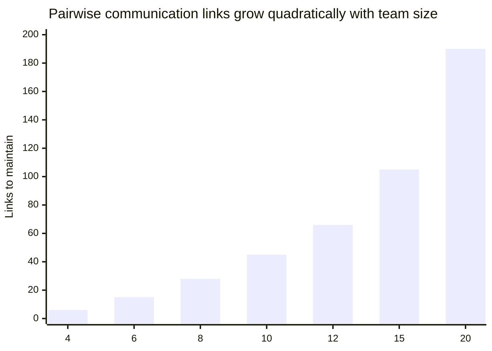
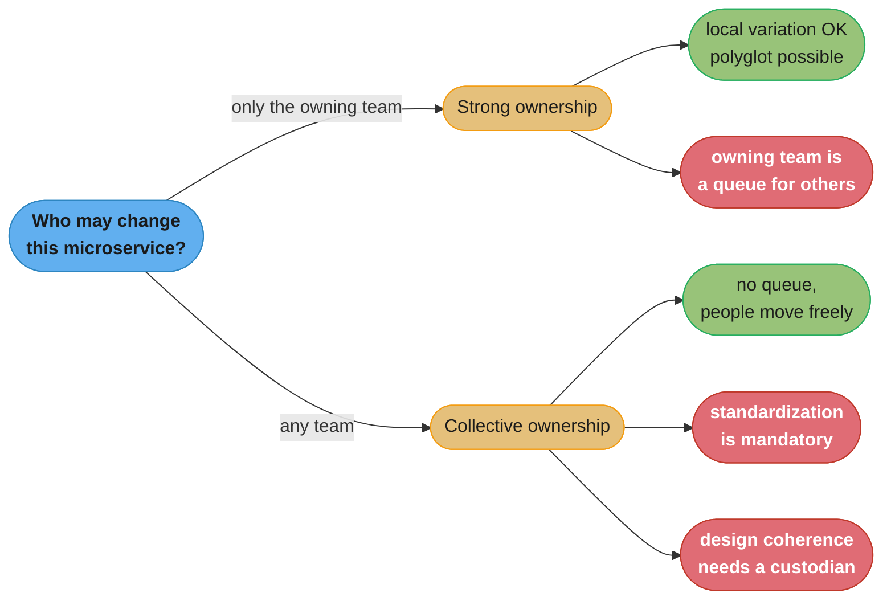
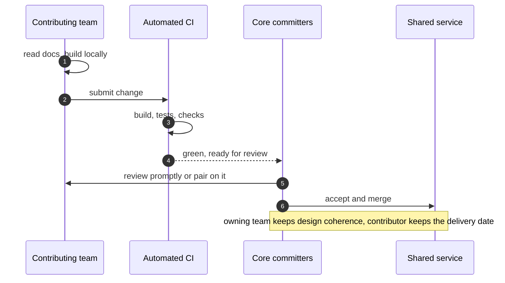
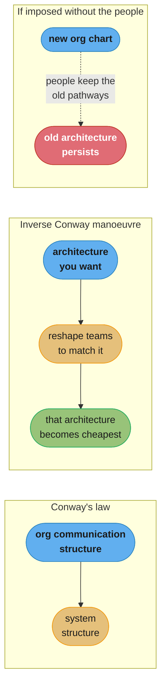
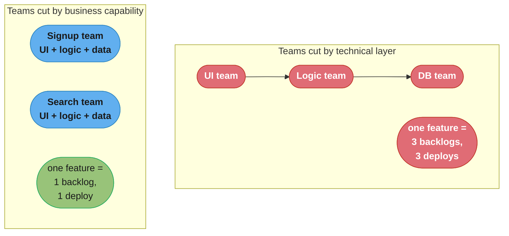
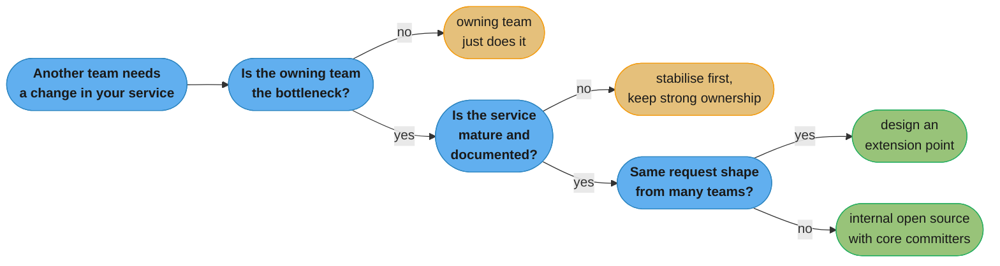

# Chapter 15: Organizational Structures

> Part III — People · Building Microservices, 2nd Edition (Sam Newman, O'Reilly 2021) ·
> builds on Ch 14 (User Interfaces), leads to Ch 16 (The Evolutionary Architect)

## Chapter Map

Chapter 14 argued that the user interface is where end-to-end team ownership either holds or
collapses; this chapter steps back and asks what an organization has to look like for end-to-end
ownership to be possible at all. It is the most direct statement in the book of a claim Newman has
been building toward since Chapter 1: a shift to a microservice architecture without a
corresponding shift in organizational structure will blunt the usefulness of microservices, and an
organization can end up paying the full, considerable cost of the architectural change without
collecting the return on it. The chapter's spine is Conway's law — the observation that a system's
structure mirrors the communication structure of the organization that built it — treated not as a
curiosity but as a design constraint that binds whether or not anyone acknowledges it. Everything
else in the chapter follows from taking it seriously: how big a team should be, what autonomy
actually requires, who owns a service, what to do when a service has to be shared, and what
happens when nobody owns it at all.

**TL;DR:**
- **Loosely coupled organizations** — measured by whether a team can change its system's design,
  deploy, and test without coordinating outside the team — are the organizational counterpart of
  a loosely coupled architecture, and the research the chapter cites ties them to delivery
  performance. The dominant cost at scale is **coordination**.
- **Conway's law** is empirically supported, not folklore, and the evidence the chapter cites
  includes a study finding organizational structure a better predictor of defect-proneness than
  any code metric.
- Teams should be **small** — the chapter's range is roughly five to ten people — because
  communication links grow quadratically with headcount and cognitive load is finite. A large
  organization is fine; large *teams* are not.
- **Strong ownership** (one team owns a microservice) permits local variation and scales with team
  count; **collective ownership** (anyone changes anything) demands standardization and works best
  in smaller, tightly coordinated organizations.
- When a service genuinely must be shared, **internal open source** — trusted core committers
  accepting contributions from other teams — is the chapter's structured alternative to
  free-for-all collective ownership, and it requires maturity and tooling to work.
- **Conway's law in reverse** (the inverse Conway manoeuvre) means reorganizing teams to obtain the
  architecture you want — powerful, and dangerous if imposed on people without regard for how
  they will feel about it.

## The Big Question

You have spent two years decomposing a monolith into forty microservices, and lead time from idea
to production has not improved. Why not — and is the answer to be found anywhere in the code?

The analogy Newman's argument implies is a road network. You can widen every road in a city to
four lanes and still have exactly the same rush hour, because the constraint was never lane count;
it was the four intersections where every route has to converge and take turns. Splitting the
monolith widened the roads. If every change still has to pass through one shared release
committee, one shared frontend team, one shared database team and one architecture review board,
the intersections are untouched and the journey time is unchanged. Conway's law is the observation
that the intersections and the road layout are the same object seen twice — you cannot redraw one
without redrawing the other, and if you try, the organization wins.

---

## 15.1 Loosely Coupled Organizations

Much of the book argues for a loosely coupled *architecture*; this chapter opens by insisting the
same property must hold of the *organization*, and that the two are not independent choices.

The chapter draws on the delivery-performance research popularized in *Accelerate* and the State of
DevOps reports, whose operational definition of a loosely coupled architecture is a set of
statements about what a team can do without asking anyone. A team in such an organization can make
large-scale changes to the design of its system without depending on another team to change theirs
and without creating significant work for other teams; can complete its work without needing
fine-grained communication and coordination with people outside the team; can deploy and release
its product or service on demand, independently of the other services it depends on; can do most of
its testing on demand, without requiring an integrated test environment; and can perform
deployments during normal business hours with negligible downtime.

The important thing about that list is that every item is phrased as an *organizational* capability
even though each is enabled or blocked by technical decisions. "Can deploy on demand" is defeated
equally by a shared database and by a change advisory board that meets on Thursdays. This is why
the chapter treats architecture and organization as one problem rather than two.

Underneath the list is a single economic claim that the chapter returns to repeatedly: **the
biggest cost to working efficiently at scale is the need for coordination**. Every mechanism in
the rest of the chapter — small teams, strong ownership, platforms, internal open source,
geographical alignment — is ultimately a device for reducing the amount of coordination required
to get a change from an idea into production. Where a design reduces coordination, the chapter
favours it; where it adds coordination, the chapter demands a strong justification.

---

## 15.2 Conway's Law

Melvin Conway's 1968 paper, published in *Datamation* after being rejected elsewhere, contains the
sentence that became the law: any organization that designs a system will inevitably produce a
design whose structure is a copy of the organization's communication structure. Fred Brooks quoted
it in *The Mythical Man-Month* and attached Conway's name to it, which is how it entered common
usage.

The formulation matters in two respects that are frequently lost. First, it is about
**communication structure**, not the org chart — two teams that talk constantly are one
communication unit whatever the reporting lines say, and two teams in the same department who never
speak are two. Second, it says *inevitably*. It is not advice about what makes a good design; it is
a claim about what will happen regardless of intent. An organization with three teams will produce
a three-part system, and if the architecture diagram shows seven services, either three of those
services are being changed together as one unit or the diagram is aspirational.

### Evidence

The chapter's insistence that this is evidence-backed rather than a well-liked aphorism rests on
several strands.

Conway's own illustration is the simplest: a contract research organization with eight people
assigned to build a COBOL and an ALGOL compiler. Five were put on the COBOL job and three on
ALGOL, and the result was a five-pass COBOL compiler and a three-pass ALGOL compiler — the number
of passes tracked the number of people, not any property of the languages.

Academic work has since tested the claim at scale. Comparative studies of loosely coupled,
distributed open source development against tightly coupled, co-located commercial development
found the open source products significantly more modular — the same functional problem solved by
differently coupled organizations produced differently coupled software.

The result the chapter treats as most striking comes from research at Microsoft on Windows Vista,
which examined which measurable factors best predicted whether a given software component would
turn out to be error-prone. The candidates included the usual code metrics — complexity, code
churn, coverage, dependency counts — alongside a set of organizational metrics such as how many
engineers touched a component, how many distinct teams they came from, and how far apart in the
reporting hierarchy those engineers sat. The organizational metrics were the better predictor.
Where a component's changes came from is more informative about its defect rate than what the code
looks like.

The practical reading of that finding, and the one the chapter draws, is that a component modified
by many people spread across several teams and several levels of an org chart is a component
nobody is coherently designing — and this is exactly the situation collective ownership produces
if it is adopted without the standardization and coordination that make it work.

---

## 15.3 Team Size

If communication structure determines system structure, team size determines communication
structure, and the chapter is direct about the number: teams should be small — roughly five to ten
people.

The arithmetic behind the guidance is unforgiving. The number of pairwise communication links in a
team of *n* people is n(n-1)/2, which grows quadratically. A team of 4 has 6 links; a team of 8 has
28; a team of 12 has 66; a team of 20 has 190. Adding one person to a team of 4 adds 4 new
relationships to maintain; adding one to a team of 19 adds 19. This is the mechanism behind
Brooks's observation that adding people to a late project makes it later, and it is why a team's
throughput does not scale with its headcount past a fairly modest point.

**Amazon's two-pizza team** is the chapter's canonical illustration of the principle applied
deliberately: a team small enough to be fed by two pizzas, which in practice caps it somewhere
around eight to ten people. Amazon adopted the constraint explicitly to keep teams autonomous, and
the architecture that resulted — many small services each owned by one such team — is Conway's law
running in the intended direction.

**Dunbar's number** provides the outer bounds. The anthropological work suggests humans can
maintain roughly 150 stable social relationships, with tighter inner layers of about 50, 15 and 5 —
the last being the group you trust closely and interact with most. A team of five to ten fits
inside the layer where genuine trust and low-ceremony communication are possible; a "team" of
thirty does not, and will silently fragment into sub-groups that then communicate across a boundary
nobody drew.

Alongside communication cost sits **cognitive load**, the framing the chapter borrows from *Team
Topologies*. A team's capacity to hold a domain in its head is finite. A team owning three
microservices in one bounded context can reason about the whole of what it owns; a team owning
fifteen services spanning four unrelated business capabilities cannot, and it will make worse
decisions not because its members are less capable but because no one is holding the whole picture.
Cognitive load, not headcount, is the real limit on how much a team should own.



Caption: a team of 8 carries 28 relationships and a team of 20 carries 190, which is why the
two-pizza constraint caps team size rather than trusting people to coordinate harder.

---

## 15.4 Understanding Conway's Law

Having established that the law holds, the chapter asks what to do about it, and the answer starts
with understanding *why* it holds — because the mechanism explains which interventions work.

The mechanism is the relative cost of communication. Inside a team, changing a shared interface is
cheap: you turn around, agree it, and change both sides in the same commit. Across a team boundary
it is expensive: you must find the right person, get onto their roadmap, agree a contract, version
it, coordinate the deployment, and wait. Because the cost differential is large, developers
rationally push coupling *inside* team boundaries and interfaces *between* them. A design that
places a chatty, frequently changing interface across a team boundary will be quietly redesigned by
the people doing the work until the chatty part is inside one team — or, if the boundary cannot be
crossed, the interface will simply stop changing and the design will ossify.

This is why the chapter's advice is not "resist Conway's law with governance". Governance is a
coordination mechanism, and coordination is the cost being minimized. The advice is to arrange the
organization so that the boundaries you want in the architecture are the same boundaries where
communication is genuinely expensive, and so that everything that needs to change together sits
inside one team where changing together is cheap. Bounded contexts and team boundaries should
coincide — which is the point at which this chapter and Chapter 2's domain modelling become the
same argument approached from opposite ends.

**A broken structure, then the fix.** An organization decomposes into services along technical
layers and staffs accordingly: a UI team, a business-logic team, and a database team. A single
customer-visible feature — add a field to the signup flow — now requires a change in all three, so
it needs three backlogs, three prioritization conversations, three deployments and an integration
window. Lead time is dominated entirely by the queueing between teams, and no amount of
service-splitting inside any one layer helps, because the change still crosses every boundary. The
fix is to re-cut the teams vertically along business capabilities — a signup team owning its UI,
its logic and its data — at which point the same feature is one team, one backlog and one deploy.
The services may be identical in number; the coordination cost falls by an order of magnitude
because the boundaries moved to where changes are not.

---

## 15.5 Small Teams, Large Organization

An obvious objection to small teams is that some organizations are enormous, and the chapter's
answer is that organizational size and team size are separate variables. A company with 2,000
engineers is not obliged to have large teams; it can have 200 small ones. What determines whether
that works is not the headcount but whether those 200 teams need to coordinate with each other to
get anything done.

The failure mode is the organization that keeps its teams nominally small while making them
mutually dependent — each team of six can only ship by involving four other teams of six, so the
effective unit of delivery is thirty people spread across five backlogs, which is worse than a
single team of thirty because the coordination now happens across boundaries instead of inside one.
Small teams are necessary but not sufficient; the coupling between them is what actually decides
whether the organization is loosely coupled.

The chapter's constructive point is that a large organization gains an advantage a small one does
not have: it can afford dedicated **enabling** and **platform** capabilities (§15.8) whose entire
purpose is to let the many small stream-aligned teams stay independent. In a small organization
that overhead is not affordable and the teams coordinate directly, which is fine at that size. The
error is carrying the small-organization habits — everyone talks to everyone, decisions made in one
room — into a large one, where the same habits produce a coordination bill that grows with the
square of the number of teams.

---

## 15.6 On Autonomy

Autonomy is what all of this is for, and the chapter is careful to describe it as something more
demanding than the absence of instructions.

Autonomy in this sense means a team is given an **outcome** to achieve and the authority to decide
*how*, rather than being handed a specification of the method. The manager's job shifts from
assigning tasks to defining what good looks like, removing obstacles, and then getting out of the
way. The chapter's people-management framing here — catch people doing things right, give them the
confidence, motivation and freedom to reach their potential — is deliberately not a technical
statement, because the failure it guards against is not technical: a team told it is autonomous and
then second-guessed on every decision learns quickly that it is not, and reverts to asking
permission, which reinstates the coordination cost the structure was designed to remove.

Autonomy also requires a supporting structure to be real. A team cannot deploy on demand if it must
raise a ticket with an infrastructure team; it cannot choose its own technology if there is no
mechanism for it to get that technology into production; it cannot own its service in production if
it has no access to production telemetry. This is the argument that leads directly to the platform
discussion in §15.8: a platform exists so that a team's autonomy is exercisable rather than merely
declared.

Finally, autonomy is not unlimited, and the chapter does not pretend otherwise. There are things an
organization legitimately needs to be true everywhere — Chapter 16's "required standard". The
design goal is to make the set of mandated things as small as possible and to deliver the rest as a
**paved road**: a well-supported default that is easier to follow than to deviate from, with
deviation permitted for teams willing to carry the consequences. A paved road persuades; a mandate
coordinates.

---

## 15.7 Strong Versus Collective Ownership

Ownership is the concrete decision that most determines how much coordination a change costs, and
the chapter presents two poles.

### Strong Ownership

Under **strong ownership**, one team owns a microservice. Any change to it either is made by that
team or is submitted to that team for review and acceptance; the owning team controls the roadmap,
the technology choices and the release cadence.

The benefits follow directly. The owning team can reason about its own service in isolation and
has complete context on it. It can evolve the internals freely, since nobody else depends on
anything but the published interface. And critically, it permits **local variation**: because no
other team has to work inside this codebase, the owning team can pick the language, the datastore
and the libraries that fit its problem, taking on the polyglot benefits Chapter 1 claims for
microservices. That freedom is only safe when nobody else has to read the code.

The cost is that the owning team is a queue for anyone who needs a change in that service. If
another team's feature requires a new field on an owned service, that work must be prioritized on
the owning team's backlog. This is tolerable when service boundaries match team boundaries well
enough that most features need only one team's services — and intolerable when they do not, which
is why boundary design and ownership design are the same problem.

### Collective Ownership

Under **collective ownership**, any team can change any service. A team that needs a field adds it
themselves and ships it, which removes the queue entirely and makes the organization very flexible
about moving people between areas of the system.

The chapter's key observation is that this flexibility is bought with **standardization**. If any
engineer might have to work in any codebase tomorrow, the codebases must be broadly alike: a common
or small set of languages, shared conventions, common build and deployment tooling, common
observability. Local variation has to be given up, precisely because it makes each codebase
unfamiliar territory for everyone but its authors. So the very benefit strong ownership provides is
the price collective ownership pays.

The second cost is design coherence, and this is where the Vista finding from §15.2 bites. A
service changed by six teams from four parts of the organization is a service nobody is
coherently designing; each change is locally sensible and the accumulated result drifts. Collective
ownership without a mechanism for maintaining design coherence — a strong review culture, a
custodian, an agreed direction — degrades predictably.

### At a Team Level Versus an Organizational Level

The chapter is careful to note that these are not one global switch. Ownership is normally
**collective within a team and strong at the team boundary**: every member of the owning team can
change any of the team's services freely, while other teams cannot. The interesting question is
almost always about the boundary between teams, not inside one, and conflating the two produces
confused arguments — "we practise collective code ownership" usually describes what happens inside
a team and says nothing about how the organization handles cross-team change.

### Balancing Models

Neither pole is correct everywhere, and the chapter frames the choice by organization size and
coupling. Collective ownership works best where the number of teams is small, people are close
enough to maintain shared context, and the standardization it requires is not experienced as a
loss — a startup with three teams and one language pays almost nothing for it and gains real
flexibility. Strong ownership scales better as the number of teams grows, because the cost of
maintaining shared context across many teams rises while the cost of a clean interface does not.
The chapter's leaning, consistent with the rest of the book, is toward strong ownership as the
default for an organization large enough to be reading this chapter, with the exceptions handled by
the mechanisms in §15.9 and §15.10 rather than by abandoning the model.



Caption: the two models trade the same currency in opposite directions — strong ownership buys
local variation with a cross-team queue, collective ownership buys queue-free change with
enforced sameness.

---

## 15.8 Enabling Teams

Stream-aligned teams cannot be experts at everything, and the chapter takes the *Team Topologies*
answer: an **enabling team** exists to raise other teams' capability rather than to deliver
user-facing work itself. Its success measure is what the stream-aligned teams can now do
unaided — it should be trying to make itself unnecessary for any given capability, then moving on.

The distinction that makes this work is that an enabling team must not become a delivery
dependency. The moment "the security enabling team" is where security work is queued rather than
where security capability is spread, it has become a bottleneck team with a friendlier name, and
the coordination cost is back.

### Communities of Practice

A **community of practice** is the lightweight, cross-cutting version of the same idea: people
doing similar work in different stream-aligned teams meeting to share what they have learned, agree
conventions, and maintain shared standards without anybody leaving their team. It costs a few hours
a month, it has no delivery responsibility, and it is one of the cheapest available mechanisms for
keeping practice coherent across many independent teams. Because it has no authority, its output is
persuasion and shared artifacts — which is exactly the paved-road model at the practice level.

### The Platform

The **platform** is the chapter's most substantial enabling structure. A platform team provides
self-service capabilities — deployment, environments, observability, secrets, CI, standard runtime
services — so that a stream-aligned team can exercise its autonomy without raising a ticket.

Two properties determine whether a platform helps or hurts:

**It must be self-service.** A platform accessed by asking the platform team to do something is not
a platform; it is a shared operations team with a new name, and it is a coordination point on every
deployment. The test is whether a stream-aligned team can go from commit to production without a
human outside the team being involved.

**It should be a paved road, not a mandate.** The platform earns adoption by being genuinely easier
than the alternative. Where teams are forced onto a platform they consider inadequate, they either
work around it or stop taking responsibility for the outcome — and a mandated platform's team has
no feedback signal telling it where the platform is bad, because nobody is allowed to leave. The
chapter accepts that some things will be mandatory (Chapter 16's required standard) and argues for
keeping that set small.

The deeper justification is cognitive load. A stream-aligned team that must also become expert in
Kubernetes, certificate rotation, log pipelines and network policy is a team with less capacity for
its actual domain. The platform's real product is the reduction of that load, which is why a
platform that adds concepts without removing any has failed on its own terms.

---

## 15.9 Shared Microservices

Strong ownership is the model; shared services are what happens anyway. The chapter is pragmatic
about this and works through why a microservice ends up with more than one team changing it.

### Too Hard to Split

Sometimes the service genuinely resists decomposition. The boundary that would separate two teams'
concerns runs through the middle of a tightly interconnected domain, and every attempt to split it
produces two services that must change together, which is worse than one service that two teams
change. The chapter's advice is to be honest when this is the case rather than forcing a split that
produces distributed coupling — but also to keep looking, because "too hard to split" is often
"nobody has yet found the right seam" rather than a permanent property. Chapter 2's domain modelling
and Chapter 3's splitting patterns are the tools for the second attempt.

### Cross-Cutting Changes

Some features intrinsically cut across several services, and if that keeps happening, the service
boundaries are misaligned with the way features actually arrive. Where an organization responds by
forming feature teams that reach into everyone's services, it has chosen collective ownership by
accident. The chapter's preferred response is to treat repeated cross-cutting changes as evidence
about boundaries: if the same three services always change together, they may be one service, or
the team boundary may be in the wrong place.

### Delivery Bottlenecks

The commonest cause is simply that the owning team cannot keep up with demand from other teams. The
service is fine, the boundary is fine, and the queue in front of the owning team is six weeks long.
The available responses are to grow or split the owning team, to accept the queue as a
prioritization signal, or to open the service up to contributions from the teams that are waiting —
which is the subject of the next section, and is the chapter's structured alternative to simply
declaring the service collectively owned.

---

## 15.10 Internal Open Source

**Internal open source** applies the governance model of a public open source project inside an
organization: the service has an owning team acting as **core committers** (or trusted committers),
and any other team may submit a change, which the core committers review and accept or reject. The
owning team retains responsibility for design coherence and quality; the waiting team gets its
change made without waiting for the owning team's roadmap.

The distinction from collective ownership is precisely the review gate. Under collective ownership,
the contributing team merges; under internal open source, the owning team decides. That preserves
the design coherence that §15.2's Vista finding warns about, while removing the delivery bottleneck
that §15.9 describes.

### Role of the Core Committers

The core committers' job is not to write all the code but to guard the design and grow
contributors: reviewing submissions properly and promptly, saying no to changes that damage the
design, and — importantly — helping contributors get their change into an acceptable shape rather
than simply rejecting it. This is a real, ongoing cost on the owning team's capacity, and the
chapter is clear it must be budgeted rather than assumed. A core-committer role that is nobody's
explicit responsibility turns into a queue of stale pull requests, which is the bottleneck the
model was adopted to remove, now with added frustration.

Reviews should happen **promptly** — a contribution sitting for two weeks costs the contributing
team the context it had when it wrote the change, and it will be more expensive to finish than it
was to start. Where teams are close enough, pairing between a contributor and a core committer is
often better than asynchronous review, because it front-loads the design conversation instead of
discovering the disagreement after the code is written.

### Maturity

Internal open source works on a **mature, stable** codebase and fails on one in flux. A service
whose design is changing weekly gives contributors a moving target, and every outside contribution
arrives against assumptions that have already shifted. The chapter's guidance is to let a service
settle before opening it up: early on, the owning team should just own it.

### Tooling

The model needs the infrastructure that makes contribution practical: a documented process for how
to propose a change, discoverable documentation of the service's design and conventions, an
accessible way to build and test the service locally, and automated CI that validates a contribution
before a human looks at it — so review is spent on design rather than on whether the tests pass. A
service with no README, an undocumented local setup and a two-hour manual test suite is not
contributable-to regardless of what policy says.



Caption: the review gate is the entire difference between internal open source and collective
ownership — the queue is removed for the contributor while the design decision stays with the
owner.

---

## 15.11 Pluggable, Modular Microservices

An alternative to accepting contributions into a service's core is to design the service so that
other teams do not need to touch the core at all. If the owning team provides explicit **extension
points** — a plugin interface, a registerable handler, a rules mechanism, a well-defined event other
teams can subscribe to — then another team's requirement can be satisfied by an addition that sits
outside the parts the owning team is responsible for.

The trade is real work up front. Designing a good extension point is harder than accepting a patch,
and a badly guessed one is worse than none — it constrains the owning team's internals for the sake
of flexibility nobody uses. The chapter's framing is that this is worth doing when the *same shape*
of request keeps arriving from different teams, because that recurrence is the evidence that the
extension point is a real seam rather than a speculative one. One team asking for one change is a
pull request; five teams asking for variations on the same change is a missing plugin interface.

---

## 15.12 Change Reviews

Whatever ownership model is chosen, changes get reviewed, and the chapter's guidance on reviews is
short and practical: do them, and do them **promptly**.

The value of a review decays quickly. A change reviewed within hours is reviewed while the author
still holds the context and can act on feedback cheaply; the same change reviewed a week later
arrives when the author has moved on, so the feedback is either expensive to apply or quietly
waved through — and a review that always says yes is a ritual, not a control.

The chapter's preferred alternative, where it is feasible, is **pair programming**, which is
continuous review carried out at the moment the decision is being made rather than after the code
exists. It also spreads context across the team, which reduces the single-point-of-knowledge risk
that produces orphaned services in the first place. Where asynchronous review is used, keeping
changes small is the most effective lever available: a small change gets a real review, and a
2,000-line change gets a thumbs-up.

---

## 15.13 The Orphaned Service

An **orphaned service** is one nobody owns. It is running in production, it is serving traffic, and
there is no team whose backlog it appears on.

Services become orphaned in ordinary ways: the team that built it was disbanded or reorganized, its
last knowledgeable engineer left, or it was written in a language nobody remaining uses. Nothing
dramatic happens immediately, which is what makes it dangerous — an orphaned service keeps working
until it needs a security patch, a dependency upgrade, a certificate rotation, or a change, and at
that point the organization discovers that it has to reverse-engineer a production dependency under
time pressure.

The chapter's remedies are unglamorous and effective. Keep a **service catalogue** recording, at
minimum, every running service and the team that owns it — an ownership field that is *required*
and *checked*, so that an unowned service is visible as a defect rather than as an absence. Make
ownership reassignment an explicit step in any reorganization, so services are handed over
deliberately instead of being left behind. Where the service is genuinely unowned and nobody wants
it, the honest options are to assign it, to fold it into an existing service, or to retire it —
leaving it in production while pretending it is somebody's is the only option that is certain to
fail. A polyglot organization should also recognize that technology diversity increases orphan
risk: a service in a language two people know is one resignation away from being unmaintainable, and
that is a cost to weigh against the local-variation benefit strong ownership grants.

---

## 15.14 Case Study: realestate.com.au

The chapter's worked organizational example is realestate.com.au (REA), an Australian property
portal that moved from a monolithic system to a microservice architecture alongside a deliberate
restructuring of the organization.

The essential move was to structure delivery around independent squads aligned to lines of
business, each with genuine end-to-end responsibility for its part of the product, rather than
around technical layers or a central delivery function. Each squad was small, and each owned its
services through to production. Crucially, the restructuring was not an outcome of the architecture
work but a peer of it — the team structure and the service structure were changed together, which
is exactly what §15.4 says has to happen for either to hold.

Sitting alongside the business-aligned squads was a delivery-services capability providing the
platform and tooling those squads used to get services into production. That is the §15.8 platform
pattern in its natural habitat: a central group whose product is other teams' independence rather
than a share of the feature work. The measurable outcome the case is cited for is delivery speed —
the time from deciding a new service was needed to having it running in production dropped
dramatically once a squad could provision, build and deploy without depending on anyone outside
itself.

The reason the chapter uses REA rather than a larger and more famous example is that the
organization was not exceptional in size or resources. It illustrates that the mechanism is
available to ordinary organizations: align teams to business lines, give them end-to-end ownership,
and build the platform that makes that ownership exercisable.

---

## 15.15 Geographical Distribution

Conway's law is about communication structure, and geography is one of the strongest determinants of
communication structure there is. Two teams in one room communicate constantly and almost for free;
two teams eight time zones apart communicate in a narrow overlap window, asynchronously, with a
day's latency on every question.

The chapter's practical conclusion follows directly: **align service boundaries with geographical
boundaries**. A single service owned jointly by people in London and Sydney will accumulate the
cost of that distance on every design decision, and Conway's law predicts that it will eventually
split along the line the organization actually communicates on — or that one site will
progressively stop contributing. Where a boundary must cross sites, it should be a coarse-grained
one with a stable, well-documented interface, because the interface is the only thing the two
groups will reliably share understanding of.

The corollary is optimistic rather than pessimistic. A distributed organization is not doomed; it
is being told something about which architecture will work for it. Coarser-grained services with
clean contracts, owned wholly within a site, are exactly the shape a geographically distributed
organization can sustain, and attempting a fine-grained, chatty architecture across time zones is
attempting to buy something the communication structure will not support.

---

## 15.16 Conway's Law in Reverse

If organizational structure produces architecture, the manoeuvre suggests itself: change the
organization to obtain the architecture you want. This is the **inverse Conway manoeuvre**, and the
chapter treats it as a legitimate and powerful tool.

The illustration is a medium-sized publishing company that restructured its teams to match the
individual modules of its software system — the org chart was redrawn to reflect the architecture
they intended rather than the one they had, so that subsequent change would flow along the new
lines. Rather than mandating an architecture and hoping teams would conform to it, the organization
arranged the teams so that the desired architecture became the cheapest one to build.

The chapter attaches a serious caution, and it is the human one. Reorganizations are done to
people, not to boxes. Coming up with a vision without considering how your staff will feel about
it is likely to lead to a bad place — an architecturally elegant restructuring that splits up
functioning teams, moves people away from work they care about, or is announced rather than
discussed will produce resistance, attrition and a quiet reversion to the old communication paths
regardless of what the new org chart says. And since the law is about communication structure
rather than reporting lines, a reorganization people route around has changed nothing at all.



Caption: the manoeuvre works because it changes where communication is cheap — which is also why a
reorganization people route around changes the chart and nothing else.

---

## 15.17 People

The chapter's closing section is about the fact that every structural change described above is a
change in what individual people are asked to do, and that this is not a detail.

Moving to stream-aligned teams with end-to-end ownership means asking developers to take on things
many of them did not sign up for: running their service in production, being on call, understanding
the infrastructure, talking to product stakeholders, owning the operational consequences of their
design choices. For some engineers that is exactly the job they wanted. For others it is a
significant and unwelcome expansion of scope, and telling them it is an empowerment does not make it
one. Ignoring that produces the reorganization failure mode from §15.16 in a slower form: the
structure changes, the behaviour does not, and the organization concludes that microservices do not
work.

The chapter's guidance is to treat the people transition as a first-class part of the migration
plan: be explicit about what is changing and why, invest in the training and platform support that
make the new responsibilities tractable rather than terrifying, move incrementally so teams take on
one new responsibility at a time, and be honest that not everyone will want the destination. This is
also the practical argument for the platform in §15.8 — much of what makes end-to-end ownership feel
unreasonable is the accidental complexity a good platform removes.

---

## Visual Intuition



Caption: the same number of services can sit behind either structure — what changes is how many
team boundaries an ordinary feature has to cross, which is where lead time actually goes.

```
  COORDINATION COST OF ONE FEATURE
  --------------------------------
  layered teams:     UI backlog -> logic backlog -> DB backlog -> integration window
                     3 prioritisation conversations, 3 deploys, 1 sync point
                     lead time dominated by QUEUEING, not by work

  stream-aligned:    one backlog -> one deploy
                     0 cross-team prioritisation conversations
                     lead time dominated by the WORK

  Conway's law says: whichever of these you staff, you will get the matching architecture.
```

Caption: coordination is the cost the whole chapter is minimizing — the layered structure does the
same work but spends most of the elapsed time waiting rather than building.



Caption: shared ownership is a last resort reached by elimination — the chapter's ladder keeps the
design decision with the owning team at every rung, including the ones that unblock other teams.

---

## Key Concepts Glossary

- **Loosely coupled organization** — one where a team can change its system's design, deploy, test
  and release without fine-grained coordination outside the team.
- **Coordination cost** — the chapter's central economic claim: the biggest cost to working
  efficiently at scale is the need for coordination.
- **Conway's law** — any organization designing a system inevitably produces a design whose
  structure copies the organization's communication structure.
- **Communication structure** — who actually talks to whom, which is what the law refers to, not
  the reporting hierarchy.
- **Two-pizza team** — Amazon's constraint that a team be small enough to be fed by two pizzas,
  in practice capping it near eight to ten people.
- **Dunbar's number** — the roughly 150 stable relationships a person can maintain, with tighter
  inner layers around 50, 15 and 5.
- **Cognitive load** — the finite capacity of a team to hold its domain in mind; the real limit on
  how much a team should own.
- **Stream-aligned team** — a team with end-to-end responsibility for a slice of user-facing
  functionality.
- **Autonomy** — being given an outcome and the authority to decide how, supported by the tooling
  and access that make the decision exercisable.
- **Paved road** — a well-supported default that is easier to follow than to deviate from, with
  deviation permitted, as opposed to a mandate.
- **Strong ownership** — one team owns a microservice and all changes go through it; permits local
  variation, creates a cross-team queue.
- **Collective ownership** — any team may change any service; removes the queue, requires
  standardization and a mechanism for design coherence.
- **Enabling team** — a team whose output is other teams' capability rather than user-facing
  delivery; must not become a delivery dependency.
- **Community of practice** — a lightweight cross-team group sharing knowledge and conventions with
  no delivery responsibility.
- **Platform** — self-service capabilities that let stream-aligned teams exercise autonomy without
  raising tickets; its product is reduced cognitive load.
- **Shared microservice** — a service changed by more than one team, arising from a hard-to-split
  domain, recurring cross-cutting changes, or a delivery bottleneck.
- **Internal open source** — an ownership model where core committers own the design and other
  teams contribute changes subject to review.
- **Core (trusted) committers** — the owning team members responsible for reviewing contributions,
  guarding the design, and coaching contributors.
- **Pluggable, modular microservice** — a service with explicit extension points so other teams
  extend it without modifying its core.
- **Orphaned service** — a service running in production with no owning team.
- **Service catalogue** — the register of running services and their owners, which makes an
  orphaned service visible as a defect.
- **Inverse Conway manoeuvre (Conway's law in reverse)** — reshaping teams to obtain the
  architecture you want, rather than mandating an architecture and hoping teams conform.

---

## Tradeoffs & Decision Tables

| | Strong ownership | Collective ownership |
|---|---|---|
| Who may merge | Only the owning team | Any team |
| Local variation (language, datastore) | Permitted | Must be given up |
| Cross-team change | Queued on the owner's backlog | Immediate |
| Standardization required | Low | High — tooling, conventions, stack |
| Design coherence | Held by the owning team | Needs an explicit mechanism |
| Scales with team count | Well | Poorly past a modest size |
| Best fit | Many teams, distinct domains | Few teams, close context, one stack |

| Response to a shared-service pressure | What it costs | When it fits |
|---|---|---|
| Owning team absorbs the work | The requester waits | Owner has capacity |
| Split or grow the owning team | Hiring, reorganization | Demand is sustained |
| Internal open source | Review capacity on the owner | Service is mature and documented |
| Pluggable extension points | Up-front design work | Same request shape recurs |
| Declare it collectively owned | Design coherence, standardization | Small organization, one stack |

| Team structure | Cross-boundary crossings per feature | Conway's law prediction |
|---|---|---|
| Layered (UI / logic / data) | 3 | A layered architecture, coupled across layers |
| Stream-aligned by capability | 0-1 | Vertically sliced services, loosely coupled |
| Feature teams over shared services | Many, but with no queue | Collective ownership by default, drifting design |

| Distance between co-owners | Communication cost | Implied service granularity |
|---|---|---|
| Same room | Near zero | Fine-grained, chatty interfaces sustainable |
| Same city, different offices | Low | Fine-grained, with more documentation |
| Different time zones | High, day-latency | Coarse-grained, stable, well-documented contracts |

---

## Common Pitfalls / War Stories

- **Splitting the monolith and leaving the org chart alone.** Forty services, the same layered
  teams, the same change advisory board — lead time is unchanged because the intersections were
  never the code. This is the chapter's headline failure: full cost, no return.
- **Teams that are small on paper and coupled in practice.** Six teams of six, where shipping
  anything needs four of them, is a delivery unit of twenty-four people with the coordination
  happening across boundaries instead of inside one team.
- **A component touched by many teams from many parts of the org chart.** The Vista research says
  this predicts defects better than any code metric does, and collective ownership without a
  coherence mechanism manufactures exactly this condition deliberately.
- **Declaring autonomy while withholding the means.** A team told it owns its service in production
  but which must raise a ticket to deploy, cannot see production telemetry, and needs approval to
  choose a library, has been given the accountability without the authority.
- **A platform team that is really a shared operations queue.** If a stream-aligned team cannot get
  from commit to production without a human outside the team, the platform has not removed a
  coordination point, it has renamed one.
- **Mandating the platform.** Teams forced onto a platform they consider inadequate either work
  around it or stop owning the outcome, and the platform team loses the only feedback signal that
  would have told it what to fix.
- **Internal open source with no budgeted review capacity.** Contributions pile up unreviewed for
  weeks, contributors lose their context, and the model delivers the original bottleneck plus
  additional resentment.
- **Opening up an immature service.** Contributors aim at a design that changes weekly, every
  contribution arrives against stale assumptions, and the owning team spends more effort on reviews
  than the changes would have cost it to write.
- **The service nobody noticed losing its owner.** A reorganization disbands a team, its services
  are not reassigned, and eighteen months later a critical vulnerability lands in a production
  dependency written in a language two former employees knew.
- **A reorganization designed on the architecture diagram.** Elegant on paper, imposed without
  consulting the people in it — functioning teams are split, the old communication paths persist
  informally, and the architecture stays exactly as it was because communication structure, not the
  org chart, is what the law is about.
- **Assuming a distributed organization can run a fine-grained, chatty architecture.** A service
  co-owned across eight time zones pays the distance cost on every design decision, and will
  eventually split along the line the organization actually communicates on.

---

## Real-World Systems Referenced

Melvin Conway's 1968 *Datamation* paper is the chapter's foundation, with Fred Brooks's *The
Mythical Man-Month* as the route by which it entered common usage under Conway's name — including
Conway's own compiler anecdote, where a five-person and a three-person team produced a five-pass
and a three-pass compiler. The empirical strand cites comparative research on loosely coupled
open source versus tightly coupled commercial development finding the former significantly more
modular, and the Microsoft research on Windows Vista finding organizational metrics a better
predictor of a component's error-proneness than code metrics. **Amazon** supplies the two-pizza
team constraint and **Netflix** the deliberate pairing of organizational and architectural design;
Dunbar's anthropological work supplies the outer bounds on team and group size. *Team Topologies*
(Skelton and Pais) supplies stream-aligned teams, enabling teams, platform teams and cognitive
load, and *Accelerate* and the State of DevOps research supply the loosely-coupled-architecture
criteria in §15.1. **realestate.com.au** is the chapter's worked organizational case study.

---

## Summary

The chapter's argument is a single implication carried all the way through. Conway's law says a
system's structure will copy the communication structure of the organization that builds it, and
the evidence — from Conway's compilers to the Vista defect study — says this is a measurable
regularity rather than an aphorism. Therefore an organization that changes its architecture without
changing its communication structure will find the old architecture reasserting itself, and will
have paid the cost of microservices without receiving their benefit.

What follows is a set of levers on communication structure. Keep teams small, because pairwise
communication links grow quadratically and cognitive load is finite. Keep the organization loosely
coupled, using the concrete test of whether a team can design, test, deploy and release without
coordinating outside itself, because coordination is the dominant cost at scale. Give teams real
autonomy — outcomes rather than methods — and make that autonomy exercisable with a self-service
platform offered as a paved road rather than a mandate. Prefer strong ownership as the default,
since it permits the local variation microservices are supposed to enable and scales with the
number of teams, and reach for collective ownership only where the organization is small and
standardized enough to pay its price. When a service must be shared, prefer the structured
alternatives: internal open source with real, promptly exercised core-committer review, or explicit
extension points where the same request keeps recurring. Keep a service catalogue so no service
quietly loses its owner. Align boundaries with geography, because distance is communication
structure. And when using the manoeuvre in reverse — reshaping teams to get the architecture you
want — remember that it is done to people: a vision built without regard for how the staff will
feel about it produces a new org chart, the old communication pathways, and the architecture you
already had.

---

## Interview Questions

**Q: What does Newman say happens if you adopt microservices without changing organizational structure?**
**Short:** Newman argues you pay the full cost of the architectural change without getting the return on the investment.
Conway's law predicts the system's structure will copy the organization's communication structure, so if the communication structure is unchanged, the old architecture reasserts itself regardless of how many services exist on the deployment diagram. The typical symptom is that lead time from idea to production does not improve, because the same cross-team hand-offs, shared release trains and approval boards still sit on the path. The chapter treats architecture and organization as one problem, not two that can be sequenced.

**Q: What exactly does Conway's law claim, and what is most often misread about it?**
**Short:** It claims a system's design inevitably copies the organization's communication structure — communication, not the org chart.
Two teams that talk constantly are one communication unit whatever the reporting lines say, and two teams in one department who never speak are two units. The word "inevitably" is the other half people drop: it is not advice about good design but a prediction about what will happen anyway. That is why a reorganization people route around informally changes nothing, and why governance aimed at forcing a boundary the organization does not communicate along tends to fail.

**Q: What evidence does the chapter give that Conway's law is more than an aphorism?**
**Short:** Research on Windows Vista found organizational metrics predicted a component's error-proneness better than any code metric.
The study weighed code metrics such as complexity, churn and coverage against organizational metrics such as how many engineers and how many distinct teams touched a component and how far apart they sat in the hierarchy, and the organizational ones won. The chapter also cites Conway's own anecdote of a five-person and a three-person team producing a five-pass and a three-pass compiler, and comparative studies finding loosely coupled open source development produced more modular products than tightly coupled commercial development. The practical reading is that a component changed by many scattered teams is one nobody is coherently designing.

**Q: Why does the chapter insist teams stay small, and what is the arithmetic?**
**Short:** Pairwise communication links grow as n(n-1)/2, so a team of 8 carries 28 relationships and a team of 20 carries 190.
Adding one person to a team of four adds four relationships; adding one to a team of nineteen adds nineteen, which is why throughput stops tracking headcount well past a modest size. Amazon's two-pizza constraint operationalizes this at around eight to ten people, and Dunbar's inner layers of roughly five and fifteen suggest the same range for genuine trust and low-ceremony communication. Cognitive load is the second limit: a team owning services across four unrelated business capabilities cannot hold the whole picture regardless of how many people it has.

**Q: What is the difference between strong and collective ownership, and what does each cost?**
**Short:** Strong ownership permits local variation but queues cross-team change; collective ownership removes the queue but demands standardization.
Under strong ownership one team owns a microservice, so it can pick its own language and datastore freely because nobody else reads the code — at the cost of other teams waiting on its backlog. Under collective ownership any team changes any service, which removes the queue but requires broadly identical stacks, conventions and tooling, since any engineer might work anywhere tomorrow. Collective ownership also needs an explicit mechanism for design coherence, because a service changed by many scattered teams is the exact condition the Vista research flags.

**Q: Why is collective ownership incompatible with the polyglot benefit microservices are supposed to offer?**
**Short:** If anyone might work in any codebase, the codebases must be alike, so local technology variation has to be surrendered.
Choosing a language or datastore that fits one service's problem is only safe when nobody outside the owning team has to read that code. The moment the organization commits to any team being able to change any service, unfamiliar stacks become a tax on every engineer rather than a local optimization. That is why the chapter frames the two models as trading the same currency in opposite directions rather than one being strictly better.

**Q: What is internal open source, and how does it differ from collective ownership?**
**Short:** Core committers own the design and review every outside contribution, so the queue is removed without giving up design coherence.
Under collective ownership the contributing team merges its own change; under internal open source it submits the change and the owning team decides whether to accept it. That review gate is the whole distinction — it lets a waiting team get its change made without joining the owning team's roadmap queue, while the owning team stays responsible for the service's coherence. It requires real, budgeted review capacity, or contributions rot in a queue and the bottleneck returns with extra frustration.

**Q: What are the preconditions for internal open source to work?**
**Short:** A mature, stable codebase, real core-committer capacity, prompt reviews, and tooling that makes contributing practical.
A service whose design changes weekly gives contributors a moving target, so every contribution arrives against stale assumptions — early on the owning team should simply own it. Reviews must be prompt, because a contribution sitting for two weeks costs the contributor the context they had when writing it, and pairing is often better than asynchronous review where feasible. Practically it needs documented conventions, a working local build, and CI that validates a contribution before a human looks at it, so review is spent on design rather than on whether the tests pass.

**Q: What is an orphaned service and why is it dangerous rather than merely untidy?**
**Short:** It is a production service with no owning team, and nothing goes wrong until a security patch or change is needed.
Services become orphaned when a team is disbanded or reorganized, its last knowledgeable engineer leaves, or it is written in a language nobody remaining uses — and it keeps serving traffic throughout. The failure surfaces under time pressure, when a vulnerability or certificate expiry forces the organization to reverse-engineer a production dependency it does not understand. The remedies are a service catalogue with a required, checked ownership field, explicit reassignment as a step in every reorganization, and honestly assigning, folding in or retiring anything genuinely unwanted.

**Q: What is the inverse Conway manoeuvre and what is its main risk?**
**Short:** Reshaping teams to obtain the architecture you want; the risk is imposing it on people without regard for how they will feel.
Rather than mandating an architecture and hoping teams conform, the organization arranges teams so the desired architecture becomes the cheapest one to build — the chapter's example is a publishing company that restructured teams around its software's modules. The failure mode is human: a restructuring that splits functioning teams or is announced rather than discussed produces resistance, attrition, and a quiet reversion to the old communication paths. Since the law is about communication structure rather than reporting lines, a reorganization people route around has changed nothing.

**Q: What makes an enabling team different from a bottleneck team with a nicer name?**
**Short:** An enabling team raises other teams' capability and takes no delivery responsibility; a bottleneck team is where work queues.
The success measure for an enabling team is what stream-aligned teams can now do unaided, so it should be trying to make itself unnecessary for a given capability and then moving on. If security work queues on "the security enabling team" rather than security capability spreading into the delivery teams, the coordination cost has simply been relocated. Communities of practice are the lightweight version of the same idea — cross-team knowledge sharing with no delivery responsibility and therefore no queue.

**Q: What are the two properties that determine whether a platform helps or hurts?**
**Short:** It must be genuinely self-service, and it should be a paved road rather than a mandate.
A platform you access by asking the platform team to do something is a shared operations queue on every deployment; the test is whether a stream-aligned team can go from commit to production with no human outside the team involved. Offering it as a paved road means it earns adoption by being easier than the alternative, and teams that deviate carry the consequences — a mandated platform loses the feedback signal that tells its team what is wrong with it. The underlying product is reduced cognitive load, so a platform that adds concepts without removing any has failed on its own terms.

**Q: How does the chapter suggest responding when the same three services always change together?**
**Short:** Treat the recurring cross-cutting change as evidence that the service or team boundaries are in the wrong place.
Features that intrinsically cut across several services are a signal about boundary alignment, not merely an inconvenience to be absorbed. The organization's instinctive response — forming feature teams that reach into everyone's services — is choosing collective ownership by accident, with all its coherence costs. The better response is to revisit the boundaries with the domain modelling and splitting techniques from earlier chapters, since services that always change together may genuinely be one service.

**Q: What does the chapter's operational definition of a loosely coupled organization actually test?**
**Short:** Whether a team can change its design, deploy, release and test without fine-grained coordination outside the team.
The criteria drawn from the delivery-performance research are all phrased as capabilities: make large-scale design changes without depending on other teams, complete work without cross-team coordination, deploy and release on demand independently of dependencies, test on demand without an integrated environment, and deploy in business hours with negligible downtime. Each is defeated equally by a technical cause and an organizational one — "deploy on demand" fails identically to a shared database and to a Thursday change board. That symmetry is why the chapter refuses to separate architecture from organization.

**Q: Why does geographical distribution change what architecture an organization can sustain?**
**Short:** Distance is communication structure, so co-owning a fine-grained service across time zones pays that cost on every decision.
Two teams in one room communicate almost for free; two teams eight hours apart communicate in a narrow window with a day's latency on every question, so Conway's law predicts a jointly owned service will eventually split along the line the organization actually communicates on. The guidance is to align service boundaries with geographical boundaries and, where a boundary must cross sites, to make it coarse-grained with a stable, well-documented interface. Read constructively, this tells a distributed organization which architecture will work for it rather than that it is doomed.

**Q: What is a pluggable, modular microservice and when is it worth the effort?**
**Short:** A service with explicit extension points so other teams extend it without touching the core; worth it when the same request shape recurs.
Designing a good extension point is harder than accepting a patch, and a badly guessed one constrains the owning team's internals for flexibility nobody uses. Recurrence is the evidence that distinguishes a real seam from a speculative one — one team asking for one change is a pull request, while five teams asking for variations on the same change is a missing plugin interface. It keeps the design decision with the owner while removing the owner from the delivery path entirely.

**Q: Why does the chapter treat the people transition as part of the migration rather than an afterthought?**
**Short:** End-to-end ownership asks engineers to take on on-call, infrastructure and operational accountability many never signed up for.
For some engineers that is the job they wanted; for others it is a significant expansion of scope, and calling it empowerment does not make it one. Ignoring that produces a slow version of the failed-reorganization pattern — the structure changes, the behaviour does not, and the organization concludes microservices do not work. The guidance is to be explicit about what is changing and why, move incrementally so teams take on one responsibility at a time, invest in the platform and training that make the new duties tractable, and accept that not everyone will want the destination.

---

## Cross-links in this repo

- [devops/platform_engineering_and_idp/ — self-service platforms, paved roads and developer portals](../../../devops/platform_engineering_and_idp/platform_engineering_and_idp.md)
- [backend/microservices_fundamentals/ — service boundaries and independent deployability](../../../backend/microservices_fundamentals/microservices_fundamentals.md)
- [hld/microservices/ — the system-design view of decomposition and its organizational costs](../../../hld/microservices/microservices.md)
- [soft_skills/scope_impact_and_ownership/ — what ownership means for an individual and a team](../../../soft_skills/scope_impact_and_ownership/scope_impact_and_ownership.md)
- [soft_skills/cross_functional_collaboration/ — working across team boundaries when you must](../../../soft_skills/cross_functional_collaboration/cross_functional_collaboration.md)
- [soft_skills/team_health_and_sustainable_pace/ — cognitive load, on-call and the people transition](../../../soft_skills/team_health_and_sustainable_pace/team_health_and_sustainable_pace.md)
- [soft_skills/mentorship_and_sponsorship/ — the enabling-team and core-committer coaching role](../../../soft_skills/mentorship_and_sponsorship/mentorship_and_sponsorship.md)
- [soft_skills/ — the section index for behaviour, leadership and communication material](../../../soft_skills/README.md)
- Sibling chapters: [Ch 14 User Interfaces](../14_user_interfaces/14_user_interfaces.md) · [Ch 16 The Evolutionary Architect](../16_the_evolutionary_architect/16_the_evolutionary_architect.md)

## Further Reading

- Conway, "How Do Committees Invent?" (*Datamation*, 1968) — the original paper containing the law
  and the compiler anecdote.
- Brooks, *The Mythical Man-Month* (Addison-Wesley, 1975) — where the law acquired Conway's name,
  and the source of the communication-links argument against large teams.
- Skelton and Pais, *Team Topologies* (IT Revolution, 2019) — stream-aligned, enabling, platform and
  complicated-subsystem teams, plus cognitive load as a design constraint.
- Forsgren, Humble and Kim, *Accelerate* (IT Revolution, 2018) — the delivery-performance research
  behind the loosely-coupled-architecture criteria in §15.1.
- MacCormack, Rusnak and Baldwin, "Exploring the Duality Between Product and Organizational
  Architectures" — the comparative modularity study.
- Nagappan, Murphy and Basili, "The Influence of Organizational Structure on Software Quality" —
  the Windows Vista research finding organizational metrics the better predictor of defects.
