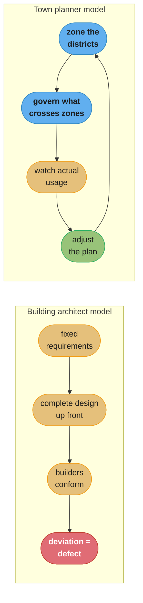
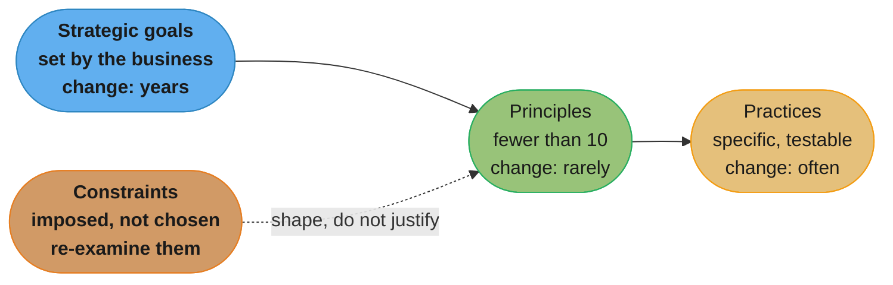
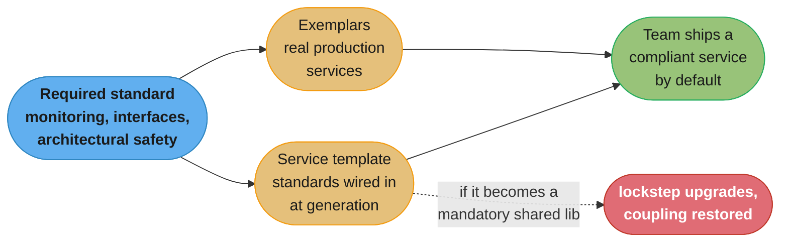
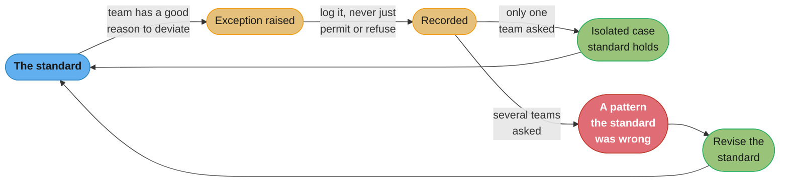
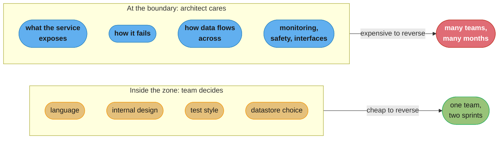
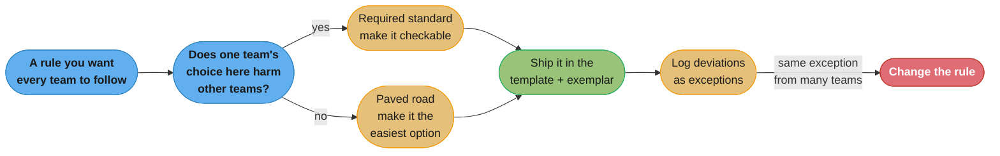

# Chapter 16: The Evolutionary Architect

> Part III — People · Building Microservices, 2nd Edition (Sam Newman, O'Reilly 2021) ·
> builds on Ch 15 (Organizational Structures), closes the book

## Chapter Map

Chapter 15 argued that the organization and the architecture are the same object seen twice, and
that teams must be small, autonomous and strongly owning if a microservice architecture is to
return anything on its cost. This closing chapter asks the question that leaves open: if every team
is autonomous, who is responsible for the system as a whole — and what, concretely, is that person
supposed to do all day? Newman's answer reframes the role rather than defending it. The word
"architect" arrived in software carrying borrowed authority from professions where a design is
finished before construction begins and where the finished thing does not change for fifty years,
and almost nothing about that model survives contact with software. The chapter's replacement image
is the **town planner**: someone who decides how the city is zoned, watches how it is actually
used, and adjusts — rather than someone who specifies what each building will look like. In an
organization built the way Chapter 15 describes, the architect is an enabling role, and the
chapter's second half is a practical toolkit for exercising it without becoming the coordination
bottleneck the whole book has been dismantling.

**TL;DR:**
- The **architect metaphor is inaccurate**; Newman prefers the **town planner**, whose job is
  zoning and adjustment rather than specifying the interior of every building.
- Architecture is **what happens, not what is planned** — the architect's primary responsibility is
  therefore **making change possible**, not producing a design that must be preserved.
- Care intensely about **what happens between the boxes** and be relaxed about what happens inside
  them; the boundaries and their interactions are the architecturally significant decisions.
- Architecture is a **social construct** and a system must be **habitable** — a term the chapter
  takes from Richard Gabriel — which requires the architect to spend real time with the teams and
  the code rather than governing from a distance.
- Direction is expressed as **strategic goals → principles → practices** (with constraints kept
  distinct from principles), with principles few enough to be remembered.
- Standards worth mandating are narrow: **monitoring**, **interfaces**, and **architectural
  safety** — the things where one team's local choice damages everyone else.
- Governance should be delivered through **the paved road** — **exemplars** and a **tailored
  microservice template** — rather than documents, and **exception handling** is the feedback loop:
  repeated exceptions mean the standard is wrong.

## The Big Question

If every team is autonomous and owns its own services end to end, what stops the system as a whole
from becoming forty locally reasonable decisions that do not add up to anything — and how do you
prevent that without reinstating the central approval queue that autonomy exists to remove?

The analogy is the chapter's own. A city is not designed the way a single building is. Nobody
specifies in advance what every structure in a district will contain, how tall it will be, or when
it will be demolished — and any plan that tried would be wrong within a year, because a city's
inhabitants keep deciding things the planner did not anticipate. What a town planner does instead
is decide which district is residential and which is industrial, ensure the utilities cross
district boundaries properly, and then watch what actually happens: when the residential district
turns out to be full of small businesses, the plan gets adjusted rather than the residents
prosecuted. The planner's authority lies at the boundaries and in the connections between zones.
Inside a zone, the people who live there decide.

---

## 16.1 What's in a Name?

The chapter opens by attacking the job title. "Architect" was borrowed from a profession where
the analogy fails at almost every point, and Newman is direct that the comparison flatters software
practitioners more than it describes them.

A building architect works from requirements that are largely fixed, produces a design that is
substantially complete before construction begins, hands it to builders who follow it, and delivers
a structure that will stand for decades essentially unchanged. Their profession is accredited,
their designs are governed by engineering codes with legal force, and the physics they work against
does not change between projects. Software has none of this. Requirements change during
construction and continue changing after delivery; the cost of change after "completion" is the
central economic fact of the discipline rather than an exception; and there is no accreditation,
no code, and no settled body of engineering law behind the title.

The damage is not merely that the metaphor is inexact. It is that the metaphor smuggles in a
working model — design first, then build to the design, and treat deviation as a defect — and that
model produces exactly the behaviours the previous fifteen chapters argue against. An architect who
believes the building analogy will hand teams a specification, expect conformance, and treat
autonomy as an obstacle. If the borrowed authority of the title is going to be used, it should at
least be borrowed from a discipline with a compatible working model, which is where the town
planner comes in.

---

## 16.2 What Is Software Architecture?

Before redefining the role the chapter pins down the noun, and it prefers definitions that are
about *significance* rather than about diagrams.

Ralph Johnson's formulation — architecture is about the important stuff, whatever that is — is
deliberately unhelpful in a useful way: it refuses to enumerate artifacts and instead points at a
judgment call. Grady Booch's sharpens it: architecture is the set of design decisions that shape a
system, where significance is measured by the cost of changing them later. That gives a practical
test. A decision that can be reversed next sprint by one team without telling anyone is not
architecture no matter how many diagrams it appears in; a decision that would take four teams six
months to unwind is architecture even if nobody wrote it down.

The observation the chapter builds on, and which sets up everything after it, is that **architecture
is what happens, not what is planned**. The architecture of a running system is whatever its
components actually do and however they are actually coupled — which may differ substantially from
the intended design, and where the two disagree, reality is the architecture. This is the direct
corollary of Conway's law from Chapter 15: the organization builds what its communication structure
permits, so an intended design the communication structure does not support is a document, not an
architecture.

---

## 16.3 Making Change Possible

If requirements keep changing and the cost of change is the measure of architectural significance,
then the architect's primary job follows: **make change possible**.

This inverts the instinct the building metaphor produces. An architecture is not good because it
anticipated the future correctly — nobody does that reliably — but because when the future arrives
in a shape nobody predicted, the system can accommodate it without a rewrite. The properties that
serve this goal are the ones the book has argued for throughout: clear boundaries so a change is
contained; independent deployability so a change can ship without coordination; loose coupling so a
change does not propagate; and enough observability that the effect of a change is visible.

The practical consequence for the architect's daily behaviour is a shift from producing designs to
producing *optionality*. Deciding something now that could reasonably be decided later, and thereby
foreclosing an option, is a cost to be justified rather than a sign of decisiveness. Conversely,
leaving a boundary undefined because the decision felt premature can be the expensive choice, since
boundaries are precisely the decisions that are costly to move later. The judgment about which
decisions to take now and which to defer *is* the architectural work.

---

## 16.4 An Evolutionary Vision for the Architect

The town planner is the chapter's replacement image, and the analogy is worked out carefully rather
than left as a slogan.

Town planners do not design buildings. They decide how land is **zoned** — this district is
residential, that one industrial, this corridor is transport — and they concern themselves with
what crosses between zones: roads, power, water, drainage. Within a zone, an enormous amount is
left to the people who build and live there. Critically, planners work with a city that already
exists and is already inhabited; they react to how it is actually being used, and adjust the plan
when reality diverges from it. A planner who insisted the district remain residential while it
visibly filled with workshops would be failing at the job, not upholding it.

Mapped onto software: the architect's attention belongs at the **boundaries between services and
the interactions across them**, not inside any one service. Which capabilities are separate, what
they expose to each other, how they fail, how data flows between them — these are the decisions
that are expensive to reverse and whose consequences are felt by every team. What language a team
picks, how it structures its internals, which testing style it prefers: within a strong-ownership
model these are a zone's internal affairs, and an architect spending their attention there is
spending it where it produces the least value and the most friction.

The word **evolutionary** carries the rest of the load. The vision is not a target state to be
reached and then held; it is a direction that is expected to be revised as the organization learns
what its system is actually being used for. An architect who treats last year's vision as a
commitment to defend has become the building architect again.



Caption: the building model treats divergence from the plan as a failure to be corrected; the
planner model treats it as information the plan should absorb, which is why only one of the two
survives a system whose requirements keep moving.

---

## 16.5 Defining System Boundaries

Zoning, made concrete, is the work of **defining system boundaries** — deciding where one service
ends and another begins, and what passes between them.

The chapter's operational rule is one of the most quoted lines of the book's first edition and
survives into this one: **be very concerned about what happens between the boxes, and be liberal
about what happens inside them**. An architect who reviews a team's internal class design has
misallocated their scarce attention; an architect who has no opinion about how two services share
data has abandoned the part of the job nobody else will do.

The reason for the asymmetry is the cost-of-change test from §16.2. A service's internals can be
rewritten by its owning team over a couple of sprints with nobody else affected, so a poor internal
decision is cheap and locally correctable. A boundary decision — this data lives here, these two
capabilities are one service, this contract is synchronous — is expensive to reverse, involves
several teams, and is felt by everyone downstream. Attention should follow reversal cost.

The asymmetry also has an organizational payoff: it is what makes the strong ownership of Chapter
15 safe. A team can be given genuine freedom inside its zone precisely because the things that would
harm other teams are constrained at the boundary. Take away the boundary discipline and autonomy
becomes a hazard; take away the internal freedom and autonomy becomes a fiction.

---

## 16.6 A Social Construct

Architecture, the chapter insists, is not a property of the artifacts. It is a **social construct**:
a shared understanding held by the people building the system, of which the code and the diagrams
are partial and frequently out-of-date expressions.

Two consequences follow, and they are the reason this section sits where it does. First, a design
that exists only in a document or only in one person's head is not the architecture — the
architecture is whatever the forty engineers actually believe about how the system fits together,
because that belief is what determines the decisions they make on Tuesday. Second, changing the
architecture therefore means changing what people understand and agree, which is a communication
problem before it is a technical one. An architect who publishes a decision and is surprised that
the system did not change has confused the two.

This is why so much of the chapter's practical advice is about presence, conversation, exemplars
and coaching rather than about artifacts. An artifact can record a shared understanding; it cannot
create one.

---

## 16.7 Habitability

The chapter borrows **habitability** from Richard Gabriel, and the definition is worth quoting in
full because the whole of the architect's obligation to developers is packed into it: habitability
is the characteristic of source code that enables programmers, coders, bug-fixers and people coming
to the code later in its life to understand its construction and intentions, and to change it
comfortably and confidently.

The choice of word is deliberate. A house can be beautiful, structurally sound and thoroughly
unpleasant to live in, and the same is true of a system: elegant on the diagram, miserable on
Tuesday afternoon when you are trying to add a field and cannot work out where the truth lives.
Habitability is judged by the people who live in the system, not by the person who drew it.

Which produces the chapter's most concrete demand on the architect: **you must live in the system
you create**. An architect who does not spend real time with the teams — pairing, reading code,
sitting through the incidents their design decisions cause, feeling how long the build takes —
has no access to the only evidence that matters about whether the system is habitable. The chapter
is not romantic about this: it does not require the architect to be a full-time contributor, and an
architect who takes on critical-path delivery work is likely to do neither job well. It requires
enough contact for the feedback loop to exist at all. An architect whose contact with the system is
mediated entirely by status reports is optimizing something they cannot observe.

---

## 16.8 A Principled Approach

Having established that the architect's output is direction rather than design, the chapter gives
the structure for expressing that direction: a chain from **strategic goals** through **principles**
to **practices**, with **constraints** kept carefully distinct.

### Strategic Goals

Strategic goals are the organization's direction, stated in business terms, and they are usually
**not the architect's to set**. "Expand into three new countries in the next two years", "move
customers to self-service", "reduce cost-to-serve by a third" — these come from the business, and
the architect's job is to know them, because a technical direction that cannot be traced back to one
of them is a technical direction with no justification. If nobody in the organization can state
them, that is worth discovering: it means every subsequent technical argument will be settled by
preference rather than by fit.

### Principles

Principles are the rules that align what you build with the strategic goals. "Services must be
independently deployable"; "we prefer buying over building for anything that is not our
differentiator"; "customer data is never duplicated outside its owning service". They are stable,
few, and expressed at a level that survives a change of technology.

The chapter is emphatic about the count: keep principles to a number people can actually remember,
which in practice means **fewer than ten**. A list of thirty principles is a document nobody
consults, and a principle nobody can recall does not influence a decision made in a meeting. Heroku's
twelve factors are the chapter's illustration of a well-known set — twelve is at the upper limit,
and they are memorable because each is short and independently meaningful.

Principles should also be *justified* by a goal. A principle whose only defence is that it is good
practice will lose the first argument it has with a delivery deadline; a principle that can be
traced to "we are expanding into three countries, therefore services must not assume one region"
will not.

### Practices

Practices are how principles are carried out, and they are detailed, technical and specific: "all
services expose a health endpoint at a standard path"; "logs are written to standard output as
structured JSON"; "inter-service calls use HTTP with agreed conventions for pagination and
versioning"; "all outbound calls have timeouts". A practice should be concrete enough that two
engineers can agree on whether a given service complies.

The key relationship is that **practices change far more often than principles**. The principle
"we must be able to see the health of the whole system" is stable for a decade; the practice that
implements it will change as tooling changes, and that is correct rather than a sign of instability.
Conflating the two produces the familiar failure where replacing a logging library becomes an
architectural debate.

### Combining Principles and Practices

The chapter is relaxed about the boundary in practice. One person's principle is another's
practice, and for a small organization a single combined list is usually better than a formally
layered one that nobody reads. What matters is that the *justification chain* remains intact —
that someone can ask why a rule exists and receive an answer that reaches a strategic goal within a
step or two — and that things which change on different timescales are not welded together.

**Constraints are not principles**, and the chapter treats the distinction as load-bearing. A
constraint is something you cannot currently change: a regulatory requirement to keep data in a
particular jurisdiction, an existing datacentre contract, a mainframe that will not be retired for
three years. Recording it as a principle is a category error with a real cost — principles are
things you have chosen and should defend, while constraints are things imposed on you and should be
periodically re-examined, because constraints expire. A team that has treated "we must run
on-premises" as a principle for five years may never notice the year it stopped being true.



Caption: the chain gives every technical rule a traceable justification, and separates the layers
by how often they legitimately change — which is why a logging-library swap should never become an
architectural argument.

---

## 16.9 A Real-World Example

The chapter grounds the abstraction with an example drawn from a real client engagement, presented
as a single picture showing the goals at the top, a handful of principles beneath them, and the
practices that implement each principle below that.

The features worth taking from it are structural rather than the specific content. The whole thing
fits on **one page** — deliberately, because a direction that requires a document to explain is a
direction nobody will apply under pressure. The strategic goals are stated in business language
that a non-technical executive would recognize as their own. Each principle sits visibly beneath the
goal that justifies it, so the "why" is never more than one line away. And the practices are
concrete enough to be checked: a specific health-check convention, a specific logging format, a
named set of permitted interface technologies.

The chapter's point in showing a real one is that this artifact is not a governance document in the
usual sense. It is a communication device — the visible form of §16.6's shared understanding —
and its value is measured by whether teams can recall and apply it, not by its completeness.

---

## 16.10 Guiding an Evolutionary Architecture

Direction, once expressed, has to be maintained against a system that is changing continuously, and
the chapter's guidance is about steering rather than controlling.

Guiding an evolutionary architecture means revisiting the vision on a regular cadence and treating
divergence as data. When several teams have independently solved the same problem in the same way
outside the stated direction, that is evidence about the direction, not about the teams. When a
principle keeps being argued about, it is either badly justified or no longer serving its goal. The
architect's job is to run that feedback loop deliberately rather than to notice it accidentally
during an incident review.

It also means accepting that the architect is frequently not the person who will spot the divergence
first. In an organization of many autonomous teams, the people closest to any given problem know
more about it than the architect does, and a role that depends on being the smartest person in the
room scales to about one team. The role that scales is the one that makes good decisions likelier
everywhere — which is the argument for the structures in the next two sections.

---

## 16.11 Architecture in a Stream-Aligned Organization

Chapter 15's organizational model constrains what the architect role can be. In an organization of
autonomous, stream-aligned teams, an architecture function that approves designs is a coordination
point on every piece of work, which is precisely the thing the organization was structured to
eliminate.

The chapter's answer is to make architecture an **enabling team** in the *Team Topologies* sense:
its output is other teams' ability to make good architectural decisions, not a queue of decisions it
makes for them. Concretely, the shape it proposes is a small core of **two or three full-time
architects** working alongside **technical leads drawn from the delivery teams**, meeting as an
architecture group in which decisions are made collectively. The full-timers provide continuity and
the cross-system view; the tech leads provide ground truth from inside the zones and, crucially,
carry the decisions back to their teams as participants rather than as recipients.

Two properties of that structure do the work. It keeps the number of dedicated architects small,
which prevents the group from having enough capacity to review everything and therefore prevents it
from trying. And it means the people who will implement a decision were in the room when it was
made, which is the only reliable mechanism for §16.6's shared understanding actually being shared.

---

## 16.12 Building a Team

The chapter widens the role one more step: the architect's responsibility is not only the system but
the people who will build the next one.

Newman's framing is that helping grow the technical capability of the teams is part of the job
rather than a nice-to-have — finding people opportunities to step up, coaching tech leads, making
sure someone other than the architect can make an architectural argument well. This follows from the
enabling-team model: if the architecture function's output is other teams' capability, then
developing that capability is the output, and an architect whose teams cannot function without them
has failed by their own success criterion.

The chapter also raises accountability for technical quality in a way that surprises people:
technical quality should be something **product owners are accountable for too**, not a concern
quarantined inside engineering. When the person prioritizing work is not accountable for the
system's health, every trade-off between a feature and the system's long-term habitability is made
by someone with no stake in one side of it — and the outcome of that arrangement is entirely
predictable. Making technical quality a shared accountability is what turns the technical-debt
conversation in §16.15 from a plea into a prioritization.

---

## 16.13 The Required Standard

Autonomy needs a boundary, and this section defines it: what must be true of *every* microservice,
regardless of which team owns it. The chapter's discipline is to keep this list short, because
everything on it costs autonomy, and to justify each item by the same test — does one team's local
choice here damage other teams?

The framing question the chapter recommends is to define what a **good service** looks like, so
that "does this comply" has an answer that does not depend on who is asked.

### Monitoring

The organization must be able to see the health of the system as a whole, which is impossible if
every service reports differently. This means agreeing how health is exposed, how metrics are
emitted, and how logs are structured and shipped, so that a cross-service view can be assembled
without a bespoke integration per service.

This is the clearest case of a genuinely non-negotiable standard: a service that emits its logs in a
format nothing else can parse has not made a local choice, it has removed a capability from
everyone. It is also why the standard should specify the *interface* — the format and the
destination — rather than the implementation, so a team remains free in how it produces them.

### Interfaces

The chapter's guidance is to pick a **small number** of interface technologies and stick to them.
The value is not aesthetic: every additional interface technology multiplies what every consuming
team must understand, what the tooling must support, and what the platform must instrument.

Consistency of *style* within a chosen technology matters as much as the technology choice.
Choosing HTTP settles very little on its own — how pagination works, how errors are represented,
how versions are indicated and evolved, whether verbs mean what the specification says — and leaving
those unstated produces a dozen APIs that share a protocol and nothing else, imposing a fresh
learning cost on every consumer.

### Architectural Safety

The third mandatory area is the set of behaviours that stop one service's failure becoming
everyone's failure: timeouts on every outbound call, circuit breakers, bulkheads, and correct
handling of error responses rather than treating any non-success as a generic failure.

The reason this cannot be left to each team's discretion is asymmetric consequence. A team that
chooses not to implement timeouts is not accepting a risk to itself; it is accepting a risk on
behalf of every service upstream of it, which will queue on its slow responses and exhaust their own
resources. Chapter 12's resiliency material supplies the mechanisms; this section supplies the
reason they are mandatory rather than recommended.

**A broken standard, then the fix.** An organization mandates "services must be resilient" as a
principle and leaves the mechanism to teams. Six months later an incident review finds one service
with no client-side timeout on a call to a dependency that has begun taking thirty seconds under
load; its request threads fill, it stops responding, and the three services calling it fail in turn
while their dashboards show them healthy. The principle was correct and unenforceable, because
"resilient" is not a property two engineers can agree on by inspection. The fix is to restate it as
a practice with a checkable shape — every outbound call has an explicit timeout and a defined
failure behaviour — and to ship that behaviour in the service template of §16.14 so that complying
is the default and deviating is the effort.

---

## 16.14 Governance and the Paved Road

**Governance** is the activity of making sure things are actually done the way the organization
agreed. The chapter's position is that it should be a **group activity** carried out by the
architecture group of §16.11 rather than an individual's veto, and — more importantly — that it
should be delivered **through the paved road** rather than through documents and reviews.

The reasoning is the reasoning of the whole book. A document requires a human to read it, remember
it, and choose to comply; a review requires a coordination point on every change. A paved road makes
the compliant path the easiest available path, so compliance is the default outcome of a team
following its own convenience. Governance that persuades scales; governance that gates does not.

### Exemplars

An **exemplar** is a real service, running in production, that embodies the standards. Teams
building a new service look at it and copy what it does.

Its advantage over documentation is that it cannot lie. A document describing how services should
emit metrics can drift out of date silently, and frequently describes an ideal nobody has ever
implemented. A production service is continuously validated by the fact that it runs, and if the
standard it embodies has become impractical, the exemplar's own team discovers that first. The
chapter's guidance is that an exemplar must be a genuine production service rather than a
demonstration project written to illustrate the standards, because a demo has never had to survive
anything.

### Tailored Microservice Template

A **tailored microservice template** is a service starter with the standard behaviours already
wired in: health endpoint, metrics emission, structured logging to the agreed destination, timeouts
and circuit breakers configured, tracing propagated. A team generating a new service from it is
compliant before writing a line of business logic. This is governance through code in its most
direct form — the standard is not described, it is *provided*.

The chapter attaches two serious cautions, and both are about the template turning into something
else.

The first is the **internal framework trap**. A template that teams take a copy of is a starting
point; a shared library that every service must depend on and upgrade in lockstep is a coupling
point that undoes independent deployability — a change to it becomes a change every team must
absorb, and a bug in it is an outage in everything. The chapter's guidance is to keep the template
thin, to keep business logic out of it entirely, and to prefer a service being able to *diverge*
from it after generation over a mechanism that keeps every service pinned to a shared core. Newman's
warning about internal frameworks is that they always start with the best intentions, which is
exactly why the trap is hard to see from inside it.

The second is **cost under polyglot**. A template exists per language stack, so an organization
running four stacks maintains four templates, four sets of standard libraries, and four upgrade
paths. That cost is a legitimate argument for narrowing the set of supported stacks — but the
chapter's framing is that it should be argued explicitly on those grounds rather than a template
being mandated in a language that does not suit a problem.

### The Paved Road at Scale

At a large enough scale one paved road stops fitting everyone: a data-engineering team, a
mobile-backend team and a machine-learning team may have genuinely different needs, and the honest
response is more than one paved road rather than one road that satisfies nobody.

The property that must survive is that the road remains **optional and attractive**. A team that
leaves the paved road takes on the work the road was doing for it — its own monitoring wiring, its
own resilience configuration, its own deployment path — which is a real and visible cost, and that
cost is the only enforcement mechanism a paved road needs. Mandating it converts a persuasion
mechanism into a coordination one and, as Chapter 15 notes, destroys the feedback signal that would
have told the platform team where the road was inadequate.



Caption: the template and the exemplar deliver the same standard by making compliance the default
path — and the dotted edge is the failure that converts the mechanism into the coupling it was meant
to prevent.

---

## 16.15 Technical Debt

The architect's relationship to **technical debt** in the chapter is one of visibility and
management rather than elimination.

Debt in this system is not always a mistake. Taking a shortcut deliberately to meet a date, with the
cost understood and the repayment intended, is a legitimate decision; the failure mode is debt that
nobody recorded, whose interest is being paid daily by every team touching the affected area, and
which nobody can point at when asking for time to fix it. So the architect's contribution is
concrete: keep a visible list of the debt the organization is carrying, so it can be discussed as
one portfolio rather than argued about item by item in whichever team happens to have hit it this
week.

The chapter is also clear that some debt should simply be accepted. A shortcut in a component that
is scheduled for retirement, or in a service that changes twice a year, may never be worth repaying,
and the discipline is to make that a decision rather than an oversight. What makes any of this
possible is §16.12's shared accountability: when product owners are accountable for technical
quality alongside delivery, debt repayment is a prioritization conversation with two informed
parties instead of an engineering request that competes with features and always loses.

---

## 16.16 Exception Handling

The chapter's final mechanism is the one that makes the whole governance model self-correcting.
When a team has a good reason to deviate from the required standard, that is an **exception**, and
exceptions should be **recorded** rather than either silently permitted or reflexively refused.

The value of recording them is not audit. It is the pattern. If the same exception is requested by
one team, it is probably a genuine special case. If it is requested by five teams, the standard is
wrong — either it was based on assumptions that no longer hold, or it never fitted the problem
space as well as its authors believed — and the correct response is to change the standard, not to
keep granting the exception. The chapter's guidance is explicit on this point: repeated exceptions
are evidence about the rule.

This closes the evolutionary loop the chapter opened with. The town planner watches how the city is
actually used and rezones when reality has moved; the architect watches which standards teams keep
needing to escape and revises them. A governance process with no exception mechanism forces teams to
comply visibly and route around invisibly, which destroys the only signal that would have told the
architect the standard needed changing — the same failure as the mandated platform in Chapter 15,
and the same fix.



Caption: the exception log turns governance into a feedback loop — without it, teams comply on paper
and route around in practice, and the architect never learns which rules were wrong.

---

## Visual Intuition



Caption: attention follows reversal cost, which is the whole justification for caring intensely
about the gaps between services and being liberal about what happens inside them.

```
  WHAT THE ARCHITECT'S DAY LOOKS LIKE UNDER EACH MODEL

  BUILDING-ARCHITECT MODEL              TOWN-PLANNER MODEL
  ----------------------------          ----------------------------
  approve 6 team designs                pair with a team for a morning
  review 3 class diagrams               agree one boundary with two tech leads
  write the target-state doc            update the one-page principles
  refuse 1 deviation                    record 1 exception, spot it is the 4th
  -> the architect is a queue           -> the architect is a feedback loop
  -> scales to ~1 team                  -> scales with the number of tech leads
```

Caption: the two models cost the architect the same hours; only one of them puts the architect on
the critical path of every team's delivery.



Caption: the test for mandating anything is whether a local choice imposes a cost on other teams —
everything that fails that test belongs on the paved road, where teams adopt it because it is
easier.

---

## Key Concepts Glossary

- **Town planner (as architect metaphor)** — someone who zones districts and governs what crosses
  between them, reacting to actual use, rather than specifying every building.
- **Architecture is what happens, not what is planned** — the running system's real structure and
  coupling are the architecture; an unsupported intended design is a document.
- **Architecturally significant decision** — one whose significance is measured by the cost of
  changing it later (Booch), which is the test for what deserves the architect's attention.
- **Making change possible** — the architect's primary responsibility: optionality and
  changeability rather than a correct prediction of the future.
- **Zoning** — deciding system boundaries and what passes between them, while leaving a zone's
  internals to its owning team.
- **Between the boxes** — the rule that the architect should be very concerned about interactions
  across boundaries and liberal about what happens inside them.
- **Social construct** — architecture as shared understanding among the people building the system,
  of which code and diagrams are partial expressions.
- **Habitability** (Gabriel) — the characteristic of source code that lets people coming to it later
  understand its construction and intentions and change it comfortably and confidently.
- **Strategic goals** — the organization's business direction, usually not set by the architect, to
  which every technical rule should trace.
- **Principles** — stable rules aligning what is built with the strategic goals; keep them few
  enough to remember, in practice fewer than ten.
- **Practices** — the specific, checkable technical rules that implement a principle; they change
  far more often than principles do.
- **Constraints** — things imposed rather than chosen, which must be recorded separately from
  principles because they expire and should be re-examined.
- **Architecture as an enabling team** — a small core of two or three full-time architects plus tech
  leads from delivery teams, deciding collectively rather than approving designs.
- **Required standard** — the narrow set of things true of every service: monitoring, interfaces,
  architectural safety.
- **Architectural safety** — timeouts, circuit breakers, bulkheads and correct error handling, which
  are mandatory because their absence harms upstream services rather than the omitting team.
- **Governance** — ensuring things are done as agreed; a group activity, best delivered through the
  paved road rather than documents and gates.
- **Paved road** — the compliant path made the easiest path, optional and attractive rather than
  mandated; more than one may be needed at scale.
- **Exemplar** — a real production service embodying the standards, preferred over documentation
  because it cannot silently drift into fiction.
- **Tailored microservice template** — a service starter with the standards already wired in, so a
  new service is compliant before any business logic exists.
- **Internal framework trap** — a template that becomes a mandatory shared library everyone must
  upgrade in lockstep, restoring the coupling it was meant to prevent.
- **Technical debt** — deliberate or accumulated shortcuts, which the architect's job is to keep
  visible and manageable as a portfolio, sometimes accepting rather than repaying.
- **Exception handling (governance)** — recording deviations from the standard, where repeated
  requests for the same exception are evidence the standard is wrong.

---

## Tradeoffs & Decision Tables

| | Building-architect model | Town-planner model |
|---|---|---|
| Unit of decision | The complete design | The zones and what crosses them |
| Response to divergence | Correct it — deviation is a defect | Absorb it — divergence is information |
| Team autonomy | An obstacle to conformance | The point of the structure |
| Architect's position | On the critical path of every change | A feedback loop beside it |
| Scales to | Roughly one team | The number of tech leads |

| Layer | Set by | Changes | Example |
|---|---|---|---|
| Strategic goals | The business | Every few years | "Expand into three new countries" |
| Principles | Architect with the teams | Rarely | "Services must be independently deployable" |
| Practices | Teams and architecture group | Often | "Logs are structured JSON on stdout" |
| Constraints | Imposed externally | Expire — re-examine | "Data must stay in-jurisdiction" |

| Candidate rule | Mandate it? | Why |
|---|---|---|
| Log format and destination | Yes | A unparseable format removes a capability from everyone |
| Timeouts, circuit breakers | Yes | Absence harms upstream services, not the omitting team |
| Interface technology (small set) | Yes | Each addition multiplies consumer and tooling cost |
| Language and framework choice | No | Cost is local; strong ownership makes it safe |
| Internal code structure | No | Cheap to reverse, owned entirely within the zone |
| Testing style inside a service | No | Local decision; the required outcome is the standard, not the method |

| Governance mechanism | Enforcement cost | Failure mode |
|---|---|---|
| Written standards document | Low to produce, high to apply | Drifts, unread, describes an unimplemented ideal |
| Design review gate | High — a coordination point per change | The architect becomes a queue |
| Exemplar service | Low | Needs to be genuinely in production, not a demo |
| Service template | Low, ongoing per stack | Turns into a mandatory shared framework |
| Exception log | Very low | None — its absence is the failure |

---

## Common Pitfalls / War Stories

- **Playing the building architect.** Handing teams a complete design, expecting conformance, and
  treating deviation as a defect — in a system whose requirements change during construction, this
  produces a document that reality has already left behind and an architect on the critical path of
  everything.
- **Reviewing internals instead of boundaries.** An architect who has opinions about a team's class
  design but none about how two services share data has inverted the reversal-cost rule and is
  spending scarce attention where it creates friction and no value.
- **Publishing a decision and expecting the architecture to change.** Architecture is a shared
  understanding; a decision that forty engineers have not internalized will not change the decisions
  they make on Tuesday, however clearly it was written down.
- **Governing at a distance.** An architect whose contact with the system is entirely mediated by
  status reports cannot observe habitability at all, and will optimize confidently for something
  they have no evidence about.
- **Thirty principles.** A list too long to remember is a list nobody consults; the principles that
  influence real decisions are the handful people can recall in a meeting without opening a
  document.
- **Filing a constraint as a principle.** "We run on-premises" recorded as a principle is defended
  for years after the contract that imposed it expired, because principles are things you chose and
  constraints are things you should keep re-examining.
- **A principle that cannot be checked.** "Services must be resilient" survives every review and
  prevents nothing; the service with no client-side timeout still fills its threads, stops
  responding, and takes down the three services calling it while their dashboards show green.
- **The template that became a framework.** A thin starter grows into a mandatory shared library
  every service must upgrade in lockstep — a change to it is a change every team must absorb, and
  independent deployability is gone in exactly the way the template was supposed to protect.
- **The exemplar that was a demo.** A reference project written to illustrate the standards has
  never survived an incident, a dependency upgrade or a load spike, so it demonstrates only that the
  standards can be satisfied under conditions nobody faces.
- **Mandating the paved road.** Teams forced onto it either work around it or stop owning the
  outcome, and the architecture group loses the only feedback signal telling it where the road is
  bad.
- **Governance with no exception mechanism.** Teams comply visibly and route around invisibly, so
  the standard that five teams needed to escape is never revised and the architect never finds out
  it was wrong.
- **Technical debt nobody wrote down.** Interest is paid daily by every team touching the area, and
  when someone finally asks for time to repay it there is nothing to point at — which is why the
  debt list and product-owner accountability for technical quality are the same problem.

---

## Real-World Systems Referenced

The chapter's conceptual references are people rather than products: **Ralph Johnson** for the
definition of architecture as "the important stuff, whatever that is", **Grady Booch** for
significance measured by the cost of later change, and **Richard Gabriel** for habitability, whose
definition the chapter quotes directly. **Heroku's twelve factors** appear as a well-known,
memorable set of principles at the upper limit of a manageable count. The *Team Topologies*
enabling-team model from Chapter 15 supplies the shape of the architecture function — two or three
full-time architects plus tech leads from the delivery teams. The principles-and-practices material
is illustrated with a one-page artifact from a real client engagement, and the resilience mechanisms
named under architectural safety — timeouts, circuit breakers, bulkheads — are the ones Chapter 12
develops, cited here for why they belong in the required standard rather than in each team's
discretion.

---

## Summary

The book closes by rehabilitating a role it first has to demolish. The architect title was borrowed
from a profession whose working model — design fully, build to the design, treat deviation as a
defect — is wrong for software in every particular, and an architect who inherits that model
becomes the coordination bottleneck the previous fifteen chapters were spent removing. The town
planner is the better image: zone the districts, care about what crosses between them, watch how
the city is actually used, and rezone when reality has moved.

From that, everything else follows. Architecture is what happens rather than what is planned, so
the architect's primary job is making change possible rather than making a design correct. Since
significance is measured by cost of change, attention belongs at the boundaries — be very concerned
about what happens between the boxes and liberal about what happens inside them, which is exactly
what makes Chapter 15's strong team ownership safe. Because architecture is a social construct, it
is changed by changing shared understanding, and because a system must be habitable, the architect
has to live in it: enough time with the teams and the code to have evidence about how it feels to
work in, not just how it looks on a diagram.

The practical apparatus is a chain and a loop. The chain runs strategic goals to principles to
practices — the goals from the business, the principles few enough to be remembered, the practices
concrete enough to be checked, and constraints kept separate because they expire. The loop is
governance delivered through the paved road: a narrow required standard covering monitoring,
interfaces and architectural safety, because those are the places one team's local choice damages
everyone else; exemplars and a tailored microservice template that make the compliant path the
easiest path; a small architecture group of full-timers and tech leads deciding collectively rather
than approving individually; a visible technical-debt list with product owners accountable for
technical quality alongside delivery; and an exception log, because five teams asking for the same
exception is not five teams being difficult — it is the standard telling you it was wrong.

---

## Interview Questions

**Q: Why does Newman argue the "architect" metaphor is the wrong one for software?**
**Short:** Newman argues the building analogy assumes fixed requirements and a design finished before construction, which is false for software.
A building architect works from largely fixed requirements, produces a substantially complete design up front, and delivers something that stands unchanged for decades, backed by accreditation and engineering codes software has no equivalent of. The real damage is that the metaphor smuggles in a working model — design first, build to the design, treat deviation as a defect — which turns the architect into an approval queue and treats team autonomy as an obstacle. The chapter's replacement is the town planner, who zones districts and adjusts as the city is actually used.

**Q: What does "architecture is what happens, not what is planned" mean in practice?**
**Short:** The running system's real structure and coupling are the architecture; an intended design the organization cannot support is a document.
Whatever the components actually do and however they are actually coupled is the architecture, and where that disagrees with the design diagram, reality wins. This is the direct corollary of Conway's law from Chapter 15 — the organization builds what its communication structure permits, so a design the communication structure does not support will not be built. It reframes the architect's job from producing a design to be preserved into making change possible.

**Q: What is the "between the boxes" rule and why is the asymmetry justified?**
**Short:** Be very concerned about what happens between services and liberal about what happens inside them, because attention should follow reversal cost.
A service's internals can be rewritten by its owning team in a couple of sprints with nobody else affected, so a poor internal decision is cheap and locally correctable. A boundary decision — where data lives, whether two capabilities are one service, whether a contract is synchronous — involves several teams and is expensive to unwind, which is Booch's test for architectural significance. The asymmetry is also what makes strong team ownership safe: freedom inside the zone is affordable precisely because the cross-team harms are constrained at the edge.

**Q: What are the three areas the chapter says genuinely warrant a required standard?**
**Short:** Monitoring, interfaces, and architectural safety — the places where one team's local choice damages other teams.
Monitoring must be standardized because a cross-system health view is impossible if every service reports differently, so a service emitting unparseable logs has removed a capability from everyone rather than made a local choice. Interfaces should be a small set with consistent style, because each additional technology and each unstated convention multiplies what every consumer and every tool must handle. Architectural safety — timeouts, circuit breakers, bulkheads, correct error handling — is mandatory because its absence risks the services upstream, not the team that omitted it.

**Q: Why is "services must be resilient" a bad standard, and what replaces it?**
**Short:** It is not checkable by inspection, so it survives every review and prevents nothing; restate it as a specific, verifiable practice.
A principle two engineers cannot agree on by looking at a service is unenforceable, and the failure shows up as a service with no client-side timeout whose threads fill under a slow dependency, taking down its callers while their dashboards read healthy. The fix is a practice concrete enough to check — every outbound call has an explicit timeout and a defined failure behaviour — and then shipping that behaviour in the service template so complying is the default. The general rule is that principles are stable and general while practices must be specific enough to be verified.

**Q: What is the difference between a principle and a constraint, and why does the chapter insist on it?**
**Short:** A principle is chosen and defended; a constraint is imposed and expires, so filing one as the other means never re-examining it.
Constraints are things you cannot currently change — a jurisdiction requirement, a datacentre contract, a mainframe with three years left — and they should be recorded separately and periodically revisited because the world that imposed them moves. Recording a constraint as a principle turns it into something the organization defends on principle, so "we run on-premises" gets defended for years after the contract that required it expired. Principles need justification from a strategic goal; constraints need a review date.

**Q: How many principles should an organization have, and why does the number matter?**
**Short:** Few enough to remember — in practice fewer than ten — because a principle nobody can recall never influences a decision.
A list of thirty principles is a document people consult during audits and never during the meeting where the decision is actually made, so it governs nothing. Heroku's twelve factors are the chapter's illustration of a memorable set at the upper limit, memorable because each is short and independently meaningful. Each principle should also trace visibly to a strategic goal, because a principle whose only defence is that it is good practice loses its first argument with a delivery deadline.

**Q: What does habitability mean and what does it demand of the architect?**
**Short:** Gabriel's term for code that lets later readers understand its construction and intentions and change it comfortably and confidently.
The word is chosen because a house can be elegant, structurally sound and unpleasant to live in, and the same is true of a system that looks clean on the diagram and is miserable to add a field to. Habitability is judged by the people living in the system, which means the architect has to spend real time with the teams and the code — pairing, reading, sitting through the incidents their decisions caused. The chapter is not demanding a full-time contributor; it is demanding enough contact for the feedback loop to exist at all.

**Q: Why does the chapter say architecture is a social construct, and what follows from it?**
**Short:** The architecture is the shared understanding the builders hold, so changing it is a communication problem before it is a technical one.
Code and diagrams are partial, frequently stale expressions of what the team actually believes about how the system fits together, and that belief is what determines the decisions people make day to day. An architect who publishes a decision and is surprised the system did not change has confused the artifact with the understanding. This is why the chapter's practical advice leans on presence, conversation, exemplars and coaching — an artifact can record a shared understanding but cannot create one.

**Q: How should the architecture function be structured in a stream-aligned organization?**
**Short:** As an enabling team — a small core of two or three full-time architects plus tech leads from delivery teams, deciding collectively.
An architecture function that approves designs is a coordination point on every piece of work, which is exactly what the organizational structure was built to remove. Keeping the number of dedicated architects small is deliberate: the group never has the capacity to review everything, so it never tries. Having tech leads in the room means the people who will implement a decision participated in making it, which is the only reliable mechanism for the shared understanding to actually be shared.

**Q: Why are exemplars preferred over documentation for communicating standards?**
**Short:** A real production service cannot silently drift into fiction the way a document describing an ideal can.
An exemplar is continuously validated by the fact that it runs — if the standard it embodies has become impractical, its own team is the first to find out, and the exemplar changes. A written standard can describe something nobody has ever implemented and can go stale without anyone noticing, because nothing depends on it being true. The chapter insists the exemplar be a genuine production service rather than a demonstration project, because a demo has never had to survive an incident, an upgrade or a load spike.

**Q: What is the internal framework trap, and how do you keep a service template out of it?**
**Short:** A template that becomes a mandatory shared library everyone upgrades in lockstep restores the coupling it was meant to prevent.
A starter teams copy is a starting point; a shared core every service must depend on means a change to it is a change every team must absorb and a bug in it is an outage everywhere. The guidance is to keep the template thin, keep business logic out of it entirely, and prefer letting a service diverge after generation over any mechanism that pins every service to a common version. Newman's warning is that internal frameworks always begin with the best intentions, which is exactly why the drift is hard to see from inside.

**Q: Why should governance be delivered through the paved road rather than through reviews?**
**Short:** A review is a coordination point on every change, while a paved road makes compliance the default outcome of teams following their own convenience.
Documents require a human to read, remember and choose to comply, and gates put the governing function on the critical path of everything — the failure the entire book is arguing against. A paved road makes the compliant path the easiest available path, so a team ends up compliant by generating a service from the template and leaving the defaults alone. Governance that persuades scales with the organization; governance that gates does not.

**Q: Why must the paved road stay optional, and what enforces it if it is?**
**Short:** Leaving the road means taking on the work it was doing for you, and that real cost is the only enforcement it needs.
A team that goes its own way must wire its own monitoring, configure its own resilience and build its own deployment path, which is visible and expensive without anyone forbidding anything. Mandating the road converts persuasion into coordination and destroys the feedback signal that tells the platform and architecture teams where the road is inadequate, since nobody is permitted to leave it. At a large enough scale, one road stops fitting everyone, and the honest answer is several paved roads rather than one that satisfies nobody.

**Q: What is the exception-handling mechanism and why is it the chapter's self-correcting loop?**
**Short:** Deviations are recorded rather than silently permitted or refused, and the same exception from several teams means the standard is wrong.
One team asking for an exception is probably a genuine special case; five teams asking for the same one is evidence the rule was based on assumptions that do not hold, and the correct response is revising the standard rather than repeatedly granting the escape. Without a recorded exception mechanism, teams comply visibly and route around invisibly, which destroys the only signal that would have told the architect the standard needed changing. It is the same failure and the same fix as the mandated platform in Chapter 15.

**Q: What is the architect's actual role with respect to technical debt?**
**Short:** Keep it visible and managed as a portfolio, deliberately accepting some of it, rather than trying to eliminate it.
Debt taken on knowingly to meet a date, with the cost understood, is a legitimate decision; the failure is debt nobody recorded, whose interest every team pays daily and which nobody can point at when asking for time. Keeping one visible list turns it into a portfolio conversation rather than an argument re-litigated in whichever team hit it this week. Some debt should simply be accepted — in a component scheduled for retirement, repayment may never be worth it — and the discipline is making that a decision rather than an oversight.

**Q: Why does the chapter want product owners accountable for technical quality?**
**Short:** Otherwise the person prioritizing work has no stake in one side of every feature-versus-health trade-off, and the outcome is predictable.
When technical quality is quarantined inside engineering, debt repayment competes with features as an engineering request rather than being weighed by the person doing the weighing, and it loses consistently. Making it a shared accountability turns the debt conversation into a prioritization between two informed parties. It also follows from the enabling-team framing of the architect's role: raising the organization's capability includes making the right people accountable for the right outcomes, not only advising on designs.

---

## Cross-links in this repo

- [devops/platform_engineering_and_idp/ — paved roads, golden paths, templates and self-service platforms](../../../devops/platform_engineering_and_idp/platform_engineering_and_idp.md)
- [devops/policy_as_code_and_compliance/ — encoding a required standard as automated, checkable policy](../../../devops/policy_as_code_and_compliance/policy_as_code_and_compliance.md)
- [backend/microservices_fundamentals/ — boundaries, contracts and independent deployability](../../../backend/microservices_fundamentals/microservices_fundamentals.md)
- [hld/microservices/ — the system-design view of decomposition and architectural evolution](../../../hld/microservices/microservices.md)
- [hld/api_design/ — interface consistency, versioning and evolution as a required standard](../../../hld/api_design/api_design.md)
- [soft_skills/technical_leadership_and_execution/ — leading technically without an approval gate](../../../soft_skills/technical_leadership_and_execution/technical_leadership_and_execution.md)
- [soft_skills/design_docs_rfcs_and_adrs/ — recording decisions, principles and exceptions durably](../../../soft_skills/design_docs_rfcs_and_adrs/design_docs_rfcs_and_adrs.md)
- [soft_skills/staff_plus_archetypes/ — the architect archetype among staff-plus engineering roles](../../../soft_skills/staff_plus_archetypes/staff_plus_archetypes.md)
- [soft_skills/influence_without_authority/ — governance that persuades rather than gates](../../../soft_skills/influence_without_authority/influence_without_authority.md)
- [soft_skills/ — the section index for leadership, influence and communication material](../../../soft_skills/README.md)
- Sibling chapter: [Ch 15 Organizational Structures](../15_organizational_structures/15_organizational_structures.md) · Book index: [Building Microservices](../building_microservices.md)

## Further Reading

- Gabriel, *Patterns of Software* (Oxford University Press, 1996) — the source of habitability,
  quoted directly in the chapter.
- Booch's writing on architecture as the significant design decisions measured by the cost of
  change, and Ralph Johnson's "the important stuff, whatever that is" formulation.
- Skelton and Pais, *Team Topologies* (IT Revolution, 2019) — the enabling-team model the chapter
  applies to the architecture function.
- Wiggins, "The Twelve-Factor App" (12factor.net) — the chapter's example of a memorable,
  well-known set of principles.
- Ford, Parsons and Kua, *Building Evolutionary Architectures* (O'Reilly) — the fuller treatment of
  guiding an architecture that is expected to change.
- Conway, "How Do Committees Invent?" (*Datamation*, 1968) — carried forward from Chapter 15, and
  the reason an intended design the organization cannot support never becomes the architecture.
