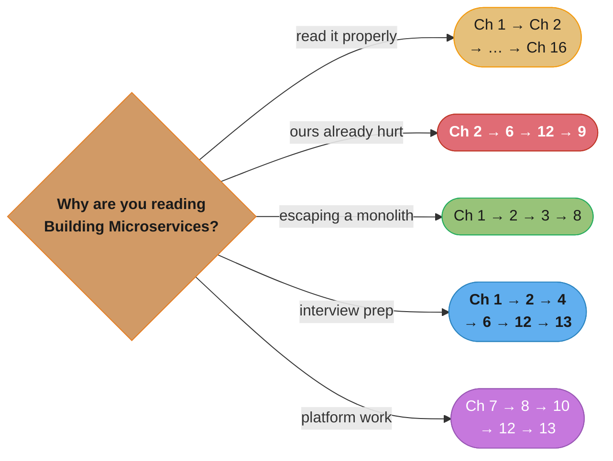

# Building Microservices, 2nd Edition

> Sam Newman · **2nd edition, O'Reilly, August 2021** · ISBN 9781492034025 · "Designing
> Fine-Grained Systems." A chapter-by-chapter, in-depth summary — read this folder in order and
> you have read the book.

> **Table of contents established from the author's own book page**,
> <https://samnewman.io/books/building_microservices_2nd_edition/> — 16 chapters in three parts.
> The 2nd edition is a substantial rewrite of the 2015 1st edition, not a refresh: chapters on
> Workflow (sagas), Build, Resiliency and Scaling are new or heavily reworked, and the 1st
> edition's single "Splitting the Monolith" and "Deployment" chapters were rebuilt around
> patterns the industry had settled on by 2021.

---

## The Book's Thesis

A microservice architecture buys you **independent deployability**, and everything else in the
book is either a technique for getting it or a bill you pay for having it. Newman's argument
runs in one line: services modelled around business domains, owned by one team, deployable
without coordinating with anyone else, communicating over networks you must assume are hostile.

Three claims recur on nearly every page:

- **Microservices are not the goal.** They are one option for achieving an outcome — faster
  independent delivery, team autonomy, targeted scaling — and almost always the most expensive
  one. If a modular monolith gets you the outcome, take it.
- **Independent deployability is the acid test.** If deploying service A requires deploying
  service B at the same time, you have a distributed monolith: all the cost of the network,
  none of the benefit.
- **Information hiding beats decomposition cleverness.** A service boundary is good to the
  degree that it hides what changes together. Get the boundary wrong and every feature becomes
  a multi-service, multi-team change.

The book is deliberately incremental: Newman's recommended path into microservices is to
migrate one slice at a time out of a monolith you keep running, not to rewrite.

---

## The Three Parts (Part Map)

```mermaid
flowchart TD
    classDef io      fill:#61afef,stroke:#2e86c1,color:#1a1a1a,font-weight:bold
    classDef frozen  fill:#c678dd,stroke:#9b59b6,color:#fff
    classDef train   fill:#98c379,stroke:#27ae60,color:#1a1a1a
    classDef mathOp  fill:#d19a66,stroke:#e67e22,color:#1a1a1a,font-weight:bold
    classDef lossN   fill:#e06c75,stroke:#c0392b,color:#fff,font-weight:bold
    classDef req     fill:#56b6c2,stroke:#0097a7,color:#1a1a1a
    classDef base    fill:#e5c07b,stroke:#f39c12,color:#1a1a1a

    root(["Building<br/>Microservices 2e"]) --> P1
    root --> P2
    root --> P3

    subgraph P1["Part I — Foundation<br/>(what and where)"]
        C1("Ch 1<br/>What Are<br/>Microservices?") --> C2("Ch 2<br/>How to Model<br/>Microservices") --> C3("Ch 3<br/>Splitting the<br/>Monolith") --> C4("Ch 4<br/>Microservice<br/>Communication Styles")
    end

    subgraph P2["Part II — Implementation<br/>(how to run them)"]
        C5("Ch 5<br/>Implementing<br/>Communication") --> C6("Ch 6<br/>Workflow") --> C7("Ch 7<br/>Build") --> C8("Ch 8<br/>Deployment") --> C9("Ch 9<br/>Testing") --> C10("Ch 10<br/>From Monitoring<br/>to Observability") --> C11("Ch 11<br/>Security") --> C12("Ch 12<br/>Resiliency") --> C13("Ch 13<br/>Scaling")
    end

    subgraph P3["Part III — People<br/>(who builds them)"]
        C14("Ch 14<br/>User Interfaces") --> C15("Ch 15<br/>Organizational<br/>Structures") --> C16("Ch 16<br/>The Evolutionary<br/>Architect")
    end

    class root io
    class C1,C2 io
    class C3 mathOp
    class C4,C5 base
    class C6 frozen
    class C7,C8 train
    class C9 req
    class C10 req
    class C11 lossN
    class C12 lossN
    class C13 mathOp
    class C14 base
    class C15,C16 frozen
```

*Colour follows the concern: definition and modelling in blue, decomposition and scale mechanics
in orange, communication in gold, workflow and the people chapters in purple, delivery in green,
testing and observability in teal, and in red the two chapters about the system under attack or
under failure.*

Part I answers **what a microservice is and where the boundaries go**. Part II is the long
practical middle — nine chapters on getting them built, shipped, watched, secured and kept
alive. Part III closes on the claim the book has been building toward the whole way: the
architecture you get is the one your org chart permits.

---

## Chapter Index

| # | Chapter | Folder | One-line summary | Repo deep-dive |
|---|---------|--------|------------------|----------------|
| 1 | What Are Microservices? | [01_what_are_microservices/](01_what_are_microservices/01_what_are_microservices.md) | Independent deployability, information hiding, when NOT to | [backend/microservices_fundamentals/](../../backend/microservices_fundamentals/microservices_fundamentals.md) |
| 2 | How to Model Microservices | [02_how_to_model_microservices/](02_how_to_model_microservices/02_how_to_model_microservices.md) | Cohesion, coupling types, DDD, bounded contexts | [hld/microservices/](../../hld/microservices/microservices.md) |
| 3 | Splitting the Monolith | [03_splitting_the_monolith/](03_splitting_the_monolith/03_splitting_the_monolith.md) | Strangler fig, branch by abstraction, parallel run, database decomposition | [database/database_migrations_zero_downtime/](../../database/database_migrations_zero_downtime/database_migrations_zero_downtime.md) |
| 4 | Microservice Communication Styles | [04_microservice_communication_styles/](04_microservice_communication_styles/04_microservice_communication_styles.md) | Sync blocking vs async non-blocking; request/response vs event-driven | [backend/messaging_patterns/](../../backend/messaging_patterns/messaging_patterns.md) |
| 5 | Implementing Microservice Communication | [05_implementing_microservice_communication/](05_implementing_microservice_communication/05_implementing_microservice_communication.md) | RPC, REST, GraphQL, brokers, schemas, DRY across boundaries | [backend/rest_api_design/](../../backend/rest_api_design/rest_api_design.md) |
| 6 | Workflow | [06_workflow/](06_workflow/06_workflow.md) | Distributed transactions, 2PC's cost, sagas, orchestration vs choreography | [backend/distributed_transactions_and_consistency/](../../backend/distributed_transactions_and_consistency/distributed_transactions_and_consistency.md) |
| 7 | Build | [07_build/](07_build/07_build.md) | CI in practice, trunk-based development, pipelines, monorepo vs multirepo | [devops/ci_cd_fundamentals/](../../devops/ci_cd_fundamentals/ci_cd_fundamentals.md) |
| 8 | Deployment | [08_deployment/](08_deployment/08_deployment.md) | Logical vs physical, containers, Kubernetes, progressive delivery | [devops/deployment_strategies/](../../devops/deployment_strategies/deployment_strategies.md) |
| 9 | Testing | [09_testing/](09_testing/09_testing.md) | Test pyramid, end-to-end tests' cost, consumer-driven contracts, testing in production | [backend/backend_testing_strategies/](../../backend/backend_testing_strategies/backend_testing_strategies.md) |
| 10 | From Monitoring to Observability | [10_from_monitoring_to_observability/](10_from_monitoring_to_observability/10_from_monitoring_to_observability.md) | Aggregation, correlation IDs, tracing, alerting on symptoms | [devops/observability_tracing_and_otel/](../../devops/observability_tracing_and_otel/observability_tracing_and_otel.md) |
| 11 | Security | [11_security/](11_security/11_security.md) | Threat modelling, secrets, in-transit protection, JWT, implicit trust | [backend/auth_and_authorization_systems/](../../backend/auth_and_authorization_systems/auth_and_authorization_systems.md) |
| 12 | Resiliency | [12_resiliency/](12_resiliency/12_resiliency.md) | Timeouts, bulkheads, circuit breakers, isolation, chaos engineering | [hld/resilience_patterns/](../../hld/resilience_patterns/resilience_patterns.md) |
| 13 | Scaling | [13_scaling/](13_scaling/13_scaling.md) | The four axes, caching, autoscaling, starting small | [hld/scalability/](../../hld/scalability/scalability.md) |
| 14 | User Interfaces | [14_user_interfaces/](14_user_interfaces/14_user_interfaces.md) | Micro frontends, BFF, API composition, ownership at the edge | [backend/api_gateway_patterns/](../../backend/api_gateway_patterns/api_gateway_patterns.md) |
| 15 | Organizational Structures | [15_organizational_structures/](15_organizational_structures/15_organizational_structures.md) | Conway's law, stream-aligned teams, platform, internal open source | [soft_skills/](../../soft_skills/README.md) |
| 16 | The Evolutionary Architect | [16_the_evolutionary_architect/](16_the_evolutionary_architect/16_the_evolutionary_architect.md) | Town planner not building architect; principles, standards, technical debt | [soft_skills/](../../soft_skills/README.md) |

---

## How to Read This (Reading Paths)

- **Cover to cover (recommended):** Ch 1 → … → Ch 16. Part I is short and load-bearing;
  skipping it makes Part II read as a pile of unrelated techniques.
- **"We already have microservices and they hurt":** Ch 2 → 6 → 12 → 9. Bad boundaries,
  distributed transactions, missing resiliency and end-to-end test gridlock account for most
  of the pain.
- **"We have a monolith and want out":** Ch 1 → 2 → 3 → 8. The honest cost, where the seams
  are, how to cut incrementally, and how to ship the pieces.
- **Interview prep:** Ch 1 → 2 → 4 → 6 → 12 → 13. Definitions, boundaries, coupling,
  sagas, failure handling and scale axes are the six things you will be asked about.
- **Platform / DevOps focus:** Ch 7 → 8 → 10 → 12 → 13.

*Five goals over the same sixteen chapters. Note that Ch 2 appears in three of the five paths —
Newman's position is that almost every microservice failure traces back to a boundary drawn in
the wrong place.*

---

## Build Manifest

Per-file build status for this book. Update the row to `done` the moment a chapter file is
completed and diagram-linted.

| # | File | Status |
|---|------|--------|
| 1 | `01_what_are_microservices/01_what_are_microservices.md` | done |
| 2 | `02_how_to_model_microservices/02_how_to_model_microservices.md` | done |
| 3 | `03_splitting_the_monolith/03_splitting_the_monolith.md` | done |
| 4 | `04_microservice_communication_styles/04_microservice_communication_styles.md` | done |
| 5 | `05_implementing_microservice_communication/05_implementing_microservice_communication.md` | done |
| 6 | `06_workflow/06_workflow.md` | done |
| 7 | `07_build/07_build.md` | done |
| 8 | `08_deployment/08_deployment.md` | done |
| 9 | `09_testing/09_testing.md` | done |
| 10 | `10_from_monitoring_to_observability/10_from_monitoring_to_observability.md` | done |
| 11 | `11_security/11_security.md` | done |
| 12 | `12_resiliency/12_resiliency.md` | done |
| 13 | `13_scaling/13_scaling.md` | done |
| 14 | `14_user_interfaces/14_user_interfaces.md` | done |
| 15 | `15_organizational_structures/15_organizational_structures.md` | done |
| 16 | `16_the_evolutionary_architect/16_the_evolutionary_architect.md` | done |

---

## Cross-Reference Map (Building Microservices 2e → repo deep dives)

| Book concept | Primary deep-dive module |
|--------------|--------------------------|
| Service boundaries, bounded contexts | [hld/microservices/](../../hld/microservices/microservices.md) |
| Independent deployability, service granularity | [backend/microservices_fundamentals/](../../backend/microservices_fundamentals/microservices_fundamentals.md) |
| REST and API design | [backend/rest_api_design/](../../backend/rest_api_design/rest_api_design.md) |
| gRPC, Protocol Buffers, schema evolution | [backend/grpc_and_protobuf/](../../backend/grpc_and_protobuf/grpc_and_protobuf.md) |
| GraphQL and API composition | [backend/graphql/](../../backend/graphql/graphql.md) |
| Event-driven architecture, brokers | [backend/event_driven_fundamentals/](../../backend/event_driven_fundamentals/event_driven_fundamentals.md) |
| Sagas, 2PC, compensating transactions | [backend/distributed_transactions_and_consistency/](../../backend/distributed_transactions_and_consistency/distributed_transactions_and_consistency.md) |
| Orchestrated workflows, durable execution | [backend/durable_execution_and_workflows/](../../backend/durable_execution_and_workflows/durable_execution_and_workflows.md) |
| Continuous integration, pipelines | [devops/ci_cd_fundamentals/](../../devops/ci_cd_fundamentals/ci_cd_fundamentals.md) |
| Containers and image build | [devops/containers_and_docker/](../../devops/containers_and_docker/containers_and_docker.md) |
| Kubernetes as a deployment target | [devops/kubernetes_architecture/](../../devops/kubernetes_architecture/kubernetes_architecture.md) |
| Blue/green, canary, progressive delivery | [devops/deployment_strategies/](../../devops/deployment_strategies/deployment_strategies.md) |
| Consumer-driven contract testing | [backend/backend_testing_strategies/](../../backend/backend_testing_strategies/backend_testing_strategies.md) |
| Metrics, logs, correlation IDs, tracing | [backend/observability_and_monitoring/](../../backend/observability_and_monitoring/observability_and_monitoring.md) |
| Distributed tracing and OpenTelemetry | [devops/observability_tracing_and_otel/](../../devops/observability_tracing_and_otel/observability_tracing_and_otel.md) |
| SLOs and alerting on symptoms | [devops/sre_principles_and_slos/](../../devops/sre_principles_and_slos/sre_principles_and_slos.md) |
| Authentication, JWT, service-to-service auth | [backend/auth_and_authorization_systems/](../../backend/auth_and_authorization_systems/auth_and_authorization_systems.md) |
| Secrets management and rotation | [devops/secrets_management/](../../devops/secrets_management/secrets_management.md) |
| Timeouts, bulkheads, circuit breakers | [backend/fault_tolerance_patterns/](../../backend/fault_tolerance_patterns/fault_tolerance_patterns.md) |
| Chaos engineering | [backend/chaos_engineering/](../../backend/chaos_engineering/chaos_engineering.md) |
| Caching layers and invalidation | [backend/caching_strategies_deep_dive/](../../backend/caching_strategies_deep_dive/caching_strategies_deep_dive.md) |
| Autoscaling and load shedding | [devops/kubernetes_scheduling_and_autoscaling/](../../devops/kubernetes_scheduling_and_autoscaling/kubernetes_scheduling_and_autoscaling.md) |
| Database decomposition and migration | [database/database_migrations_zero_downtime/](../../database/database_migrations_zero_downtime/database_migrations_zero_downtime.md) |
| Sharding a decomposed datastore | [database/sharding_and_partitioning/](../../database/sharding_and_partitioning/sharding_and_partitioning.md) |
| Service mesh and service discovery | [backend/service_mesh_and_service_discovery/](../../backend/service_mesh_and_service_discovery/service_mesh_and_service_discovery.md) |
| Backend-for-frontend, gateways | [backend/api_gateway_patterns/](../../backend/api_gateway_patterns/api_gateway_patterns.md) |
| Team topologies and Conway's law | [soft_skills/](../../soft_skills/README.md) |

---

## Further Reading

- Book page and errata: <https://samnewman.io/books/building_microservices_2nd_edition/>
- Newman, *Monolith to Microservices* (O'Reilly, 2019) — Ch 3 in book-length form
- Skelton & Pais, *Team Topologies* (IT Revolution, 2019) — the org-structure argument of Ch 15
- Evans, *Domain-Driven Design* (Addison-Wesley, 2003) — the source of Ch 2's bounded contexts
- Forsgren, Humble & Kim, *Accelerate* (IT Revolution, 2018) — the delivery metrics behind Ch 7
- The 1st-edition-era companion in this repo:
  [`backend/microservices_fundamentals/`](../../backend/microservices_fundamentals/microservices_fundamentals.md)
