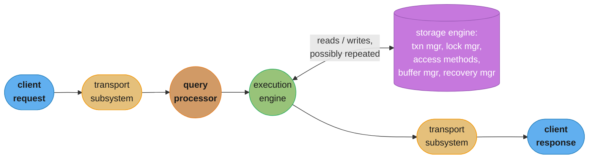
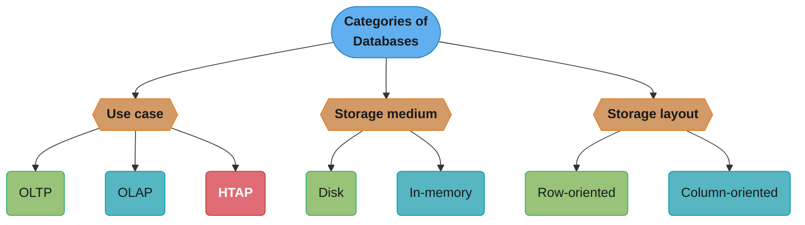
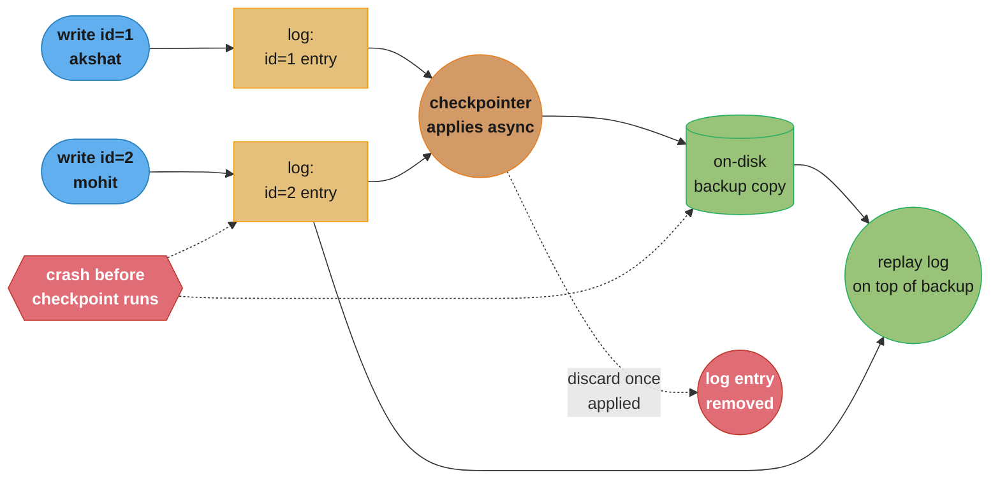

# Chapter 1: Introduction and Overview

> Part I — Storage Engines · Database Internals (Petrov, 1st ed., O'Reilly 2019) · opens the
> book, leads to Ch 2 (B-Tree Basics)

## Chapter Map

Every later chapter in this book zooms into one box drawn in this first chapter. Petrov opens by
naming the four subsystems inside any database server — transport, query processor, execution
engine, storage engine — and then spends the rest of the chapter narrowing to just the last one,
since Part I is entirely about it. Before the narrowing, he lays down the vocabulary that makes
every later comparison precise: OLTP versus OLAP versus HTAP is a question about *workload*;
disk versus in-memory is a question about *durability mechanism*; row versus column orientation
is a question about *physical layout*; and data files versus index files is a question about
*how a record's location is found*. None of these are independent choices a real system makes in
isolation — a column-oriented layout implies an OLAP-shaped workload, an in-memory database still
needs a disk-backed log — but Chapter 1 deliberately treats them as four separate axes so later
chapters can discuss each one without re-deriving the others.

**TL;DR:**
- A database server decomposes into a **transport subsystem**, **query processor**, **execution
  engine**, and **storage engine** — Part I studies only the last one, in depth.
- **OLTP** (many small transactional queries), **OLAP** (few large analytical queries), and
  **HTAP** (a compromise that is not the best at either) classify databases by *workload*, and
  that classification predicts almost every other design choice in the rest of the book.
- **In-memory databases hold their primary copy in RAM but are not exempt from durability** —
  they still write a sequential log to disk and periodically checkpoint a backup copy, because
  RAM is volatile and a crash cannot be allowed to lose committed data.
- **Row-oriented storage helps `SELECT *`; column-oriented storage helps `SELECT one_column`** —
  the difference is which direction is contiguous on disk, and it is the single biggest predictor
  of whether a database is built for OLTP or OLAP.
- A record can be found by its **primary index** either **directly** (a raw file offset — fast,
  but every pointer must be fixed up when the record moves) or **indirectly** (through the
  primary key — slower, but the indirection absorbs every future move).

## The Big Question

> Two engineers, staring at the same word "database," mean entirely different machines: one is
> thinking of a system that answers `UPDATE accounts SET balance = balance - 100 WHERE id = 42`
> in two milliseconds; the other is thinking of a system that scans four years of transaction
> history to compute a monthly revenue trend. What structural decisions make a system good at one
> of these and bad at the other — and can you build one system that is good at both?

Analogy: think of a large public library. An OLTP database is the front desk — a single patron
walks up, states an exact call number, and the librarian fetches exactly that one book in
seconds; a thousand patrons can be at a thousand desks at once, each served independently. An
OLAP database is the librarian doing inventory — pulling every book off a run of shelves in one
pass to count how many were published each decade; touching one shelf at a time in order is far
faster than jumping around fetching one exact title after another. You could build a library
where the front desk *also* does inventory scans well, but the shelving scheme that makes single
lookups instant (books scattered by call number across many small sections) is close to the worst
possible layout for a sweeping inventory scan, and vice versa — which is exactly why HTAP is
described in this chapter as a compromise, not a free lunch.

---

## 1.1 DBMS Architecture

A database, in client/server terms, is nothing more than another server: database *nodes* are
the servers, and the applications that use the database are the clients. Inside a single node,
Petrov decomposes the software into four subsystems, and traces one query through all four to
show how they interact.

**The transport subsystem** sends and receives data between the client and the database, and
also carries communication between the other nodes of the database cluster — the same subsystem
that speaks the client wire protocol also speaks whatever inter-node protocol the cluster uses
for replication or coordination (Part II's entire subject). **The query processor** parses,
validates, and optimizes queries before anything runs — the layer that turns SQL text (or
whatever the database's query language is) into something the execution engine can act on.
**The execution engine** actually executes the query, either locally or remotely: *remote*
execution means the query, or a piece of it, runs on a different node than the one that received
it, which is unavoidable in any sharded or replicated cluster. **The storage engine** helps the
execution engine read and write data from storage, and owns the storage layout and the storage
medium — this is the subsystem Part I is about, and it further decomposes into five pieces that
recur across the rest of the book:

- **Transaction manager** — schedules transactions and ensures queries do not introduce
  inconsistencies.
- **Lock manager** — performs concurrency control, preventing violations of data integrity when
  multiple transactions touch the same data (Chapter 5's subject).
- **Access methods (storage structures)** — organize data on disk and provide access to it; a
  B-tree (Chapters 2, 4, 6) or an LSM-tree (Chapter 7) are both access methods in this sense.
- **Buffer manager** — caches data pages in memory so the execution engine is not forced through
  a disk read on every access (Chapter 5's buffer-pool material).
- **Recovery manager** — restores the database to a consistent state after a failure, using
  whatever the access method's crash-safety mechanism is (write-ahead logging, in every case this
  book covers).

### Lifecycle of a query

Following one query end to end through these subsystems: **client request → transport subsystem
→ query processor → execution engine → storage engine → execution engine → transport subsystem →
client response.** This picture is a useful first approximation, but Petrov flags that it
oversimplifies the moment a query has more than one moving part. A join such as
`SELECT * FROM foo WHERE bar IN (SELECT bar FROM boop)` does not walk the pipeline once — the
execution engine builds a plan (read `boop.bar` into a list, sort that list to make the
membership check fast, read `foo` row by row, and test each row's `bar` against the sorted list)
that calls back into the storage engine multiple times, interleaving storage-engine reads with
execution-engine processing rather than making one clean pass through. A query with a sort or a
`GROUP BY` may also be forced to buffer its entire result set in memory before returning anything,
rather than streaming rows to the client as they are produced. The "one clean pipeline" picture
is the right mental model for Part I's scope — it is what a single access method needs to satisfy
— but a real query planner's actual behavior is considerably more tangled.



Caption: the "clean pipeline" is the right mental model for what Part I studies — a single
storage engine satisfying reads and writes — even though a real execution engine calls back into
it more than once per query, as the `IN (SELECT ...)` example shows.

## 1.2 Memory- Versus Disk-Based DBMS

Storage medium is a second, independent axis from workload. **In-memory databases** hold their
primary copy of the data in RAM and use disk only for recovery and logging; **disk-based
databases** hold their primary copy on disk and use memory for caching and temporary storage. The
underlying motivation is simple: accessing RAM is dramatically faster than accessing disk, so
holding the working set in memory removes the disk from the hot path entirely — but RAM is
volatile, so an in-memory database still needs *some* durable record of every write, or a power
loss erases committed data. (**Non-volatile memory**, NVM, is a newer storage class the book
flags as worth tracking — memory-speed access that survives a power cycle — but as of the book's
writing it had not displaced the disk-versus-RAM tradeoff described here.)

### Durability in in-memory databases

Because RAM does not survive a crash, an in-memory database has to manufacture durability by
maintaining backups on disk. Petrov's answer for how is **checkpointing**, built from two
cooperating pieces.

### Checkpointing

1. **A sequential log file.** Before any operation is reported successful, the database must
   ensure the operation is written to a sequential log file first — this is **write-ahead
   logging**, the mechanism Chapter 5 covers in full detail; Chapter 1 introduces only the name.
2. **A backup copy.** The **checkpointer**, a component of the recovery manager, maintains a
   backup copy of the database on disk in an almost-up-to-date state.

The two pieces cooperate asynchronously: log entries are applied to the backup copy in batches,
and once a batch has been applied, those entries are removed from the log file — at that point
the backup copy represents a database snapshot as of a specific point in time. This is
**checkpointing**, and it is what makes an in-memory database durable despite RAM's volatility.
Discarding applied log entries matters because an unbounded log file slows down recovery — every
entry in it has to be replayed after a crash, so a log that is never trimmed makes every future
recovery progressively slower.

A minimal illustration (the book is explicit that this is a simplified picture, not the actual
implementation): suppose the database currently holds `id=1, name=akshat` and
`id=2, name=mohit`, the log file has entries recording both writes, and the on-disk backup copy —
not yet caught up to the latest checkpoint — holds only `id=1, name=akshat`. If the system
crashes right now, before the checkpointer has applied the pending log entries to the backup, the
recovery manager still has everything it needs: replay the log entries on top of the backup copy,
and the database is back to its pre-crash state. Once the checkpointer *does* apply a log entry to
the backup copy, that entry becomes redundant — the backup already reflects it — so it can be
safely discarded:

```python
# simplified — not the actual algorithm, just the shape of it
def checkpoint(backup_copy, log_entries):
    for entry in log_entries:
        apply(backup_copy, entry)
        log_entries.remove(entry)     # now redundant: backup_copy already reflects it
    return backup_copy                # a consistent snapshot as of "now"
```

## 1.3 Column- Versus Row-Oriented DBMS

Physical layout is a third axis, orthogonal to both workload and storage medium. **Row-oriented**
databases store data row by row on disk; **column-oriented** databases store data column by
column. A two-row, three-column table illustrates the difference directly:

```
row-oriented on disk:
  id=1, name=akshat, age=20
  id=2, name=mohit,  age=21

column-oriented on disk:
  id:   1, 2
  name: akshat, mohit
  age:  20, 21
```

Disk is read and written in units of **blocks** — the minimal unit of data transferred to or from
disk — and this is what makes the layout choice consequential rather than cosmetic. A query like
`SELECT name FROM users` touches only the `name` column; in a column-oriented layout every `name`
value is stored contiguously, so the query reads far fewer blocks than it would if it had to skip
past `id` and `age` between every `name`. Conversely, a query like `SELECT * FROM users WHERE
id = 1` wants every column for one row; in a row-oriented layout all of that row's columns are
already adjacent, so one block read (or a small contiguous run of them) satisfies the whole query,
whereas a column store would have to touch a separate location per column. **Row-oriented storage
improves spatial locality for rows; column-oriented storage improves spatial locality for
columns** — the two orientations are not different in *what* they can store, only in which access
pattern is cheap.

### Another interesting difference

Reading many values from the same column in one pass — the column-oriented access pattern — has
benefits beyond fewer blocks read: it **improves cache utilization** (values of the same type,
packed together, make better use of the CPU cache line); it achieves a **better compression
ratio** (a column of identically-typed, often repetitive values compresses far better than a row
mixing types); and it **improves vectorization** (a CPU's SIMD instructions can operate on many
same-typed adjacent values at once, which a row-major layout does not offer). This is precisely
why column-oriented databases suit OLAP workloads (aggregations and analytics over relatively few
columns across huge row counts) and row-oriented databases suit OLTP workloads (transactional
queries that touch one or a few whole rows).

### Wide column stores

A third layout, distinct from both: **wide column stores** (the book names BigTable and HBase as
examples) represent data as a multidimensional map. Columns are grouped into **column families**,
and *within* a column family the data is stored row-wise — so a wide column store is best
understood as row-oriented storage applied at the granularity of a column family rather than the
whole row, giving some of column orientation's benefits (only the needed column families are
touched) without fully committing to per-column storage.



Caption: three independent axes — a real system picks one option per axis (Cassandra is
disk-based, wide-column, and OLTP-leaning; ClickHouse is disk-based, column-oriented, and
OLAP-leaning), and the axes combine rather than substituting for each other.

**OLTP** is optimized for transactional workloads — user-facing requests, individual reads and
writes. **OLAP** is optimized for analytical workloads — data warehousing, aggregation over large
scans. **HTAP** targets both at once, and the book is blunt about the cost: HTAP is a compromise
between OLTP and OLAP, meaning it has both capabilities but is not the best at either — the
physical-layout tension between row orientation (helps whole-row OLTP access) and column
orientation (helps single-column OLAP scans) does not disappear just because a vendor markets a
system as HTAP; it is absorbed somewhere, usually as extra engineering complexity (dual storage
formats, background format conversion) rather than eliminated.

## 1.4 Data Files and Index Files

Two kinds of files organize data on disk. **Data files** contain the actual data. **Index files**
contain metadata about the records in data files — the information needed to find a given record
efficiently, without scanning the whole data file. Both are internally partitioned into **pages**,
where one page corresponds to one or several disk blocks; Chapter 3 works out the exact page
structure, and Chapter 1 only establishes that pages are the unit both kinds of files are divided
into.

### Data Files

Data files come in three organizations, and each implies a different shape for the accompanying
index's **data entries** (the per-record information the index actually stores):

| Data file organization | How records are placed | What the index stores per record |
|---|---|---|
| **Heap file** | Unordered, generally in write order | File offset (a direct row locator) |
| **Hash file** | Bucketed: a hash of the key picks the bucket | The bucket ID |
| **Index-organized table (IOT)** | The data itself lives inside the index structure | The primary key (there is no separate offset — the index *is* the data) |

A heap file is the simplest and the default assumption for the rest of Part I unless stated
otherwise: new records are appended wherever there is room, generally in write order, and an
index is required to find anything by a key other than "the order it was inserted."

### Index Files

An **index** is a data structure built to find a target record efficiently, without scanning the
whole data file. An index built directly on a data file — including, per the book's phrasing, one
built over a composite primary key — is a **primary index**; every other index on the same data
is a **secondary index**. A second, orthogonal distinction: an index is **clustered** if the data
file's physical row order matches the index order, and **non-clustered** otherwise. (Petrov flags
this pairing of terms as one of the more confusingly explained parts of the chapter, and promises
Chapter 2's worked examples will make it concrete — this summary keeps that promise in mind rather
than over-claiming precision the book itself does not yet offer at this point.)

## 1.5 Buffering, Immutability, and Ordering

The chapter closes by naming three properties that any storage structure can be classified along,
setting up the vocabulary Chapters 2-7 use throughout to compare B-trees against LSM-trees and
their variants:

- **Buffering** — whether data is held in memory before being written to disk, versus written
  through immediately.
- **Immutability** — whether existing on-disk data is updated in place (**mutable**) or new data
  is only ever appended (**immutable**, append-only).
- **Ordering** — whether records are stored in key order on disk, or in some other order (such as
  insertion order).

These three variables are the axis system the rest of Part I is built on: a classic B-tree is
mutable, ordered, and lightly buffered (Chapters 2, 4); an LSM-tree is immutable (within each
run), ordered within each run, and heavily buffered through an in-memory memtable (Chapter 7); a
plain heap file is mutable, unordered, and unbuffered. Naming all three explicitly here is what
lets later chapters say "trades mutability for write throughput" and have that phrase mean
something precise.

---

## Visual Intuition

```
  ROW-ORIENTED disk layout                COLUMN-ORIENTED disk layout
  (2 rows x 3 columns)                    (same 2 rows x 3 columns)

  block 1: id=1 name=akshat age=20        block 1: id=1   id=2
  block 2: id=2 name=mohit  age=21        block 2: name=akshat  name=mohit
                                           block 3: age=20  age=21

  SELECT * WHERE id=1                     SELECT name FROM users
    -> reads block 1 only                   -> reads block 2 only
    (row-oriented wins: 1 block)             (column-oriented wins: 1 block)

  SELECT name FROM users                  SELECT * WHERE id=1
    -> reads block 1 AND block 2            -> reads block 1, block 2, AND block 3
    (must touch every row's block           (must touch every column's block
     to extract just "name")                 to reconstruct one whole row)
```

Caption: the same query pair, run against both layouts — each orientation wins decisively on the
access pattern its contiguity matches, and loses just as decisively on the other; there is no
layout that wins both, which is the physical reason HTAP is a compromise rather than a free
upgrade.



Caption: durability for an in-memory database is not "hope RAM survives" — it is a disk-backed
log plus an asynchronously-updated backup copy, and recovery after a crash is exactly "replay
whatever log entries never made it into the backup."

---

## Key Concepts Glossary

- **Transport subsystem** — sends/receives data between client and database, and carries
  inter-node cluster communication.
- **Query processor** — parses, validates, and optimizes a query before execution.
- **Execution engine** — runs the query, locally or on a remote node.
- **Storage engine** — reads and writes data on behalf of the execution engine; owns storage
  layout and medium.
- **Transaction manager** — schedules transactions and prevents them from causing inconsistency.
- **Lock manager** — performs concurrency control to protect data integrity.
- **Access methods (storage structures)** — the on-disk data structures (B-trees, LSM-trees) that
  organize and provide access to data.
- **Buffer manager** — caches data pages in memory.
- **Recovery manager** — restores database state after a failure.
- **OLTP (Online Transaction Processing)** — a workload class optimized for many small
  transactional operations.
- **OLAP (Online Analytical Processing)** — a workload class optimized for large analytical scans
  and aggregations.
- **HTAP (Hybrid Transactional/Analytical Processing)** — a compromise workload class supporting
  both, at the cost of being best-in-class at neither.
- **In-memory database** — holds its primary data in RAM; uses disk only for logging and
  recovery.
- **Disk-based database** — holds its primary data on disk; uses memory for caching and
  temporary storage.
- **Non-volatile memory (NVM)** — memory-speed storage that survives a power cycle.
- **Checkpointing** — the process of applying a durable log to a backup copy asynchronously, in
  batches, to make an in-memory database's state durable.
- **Write-ahead logging (WAL)** — writing an operation to a sequential log file before it is
  reported successful (introduced here, detailed in Chapter 5).
- **Checkpointer** — the recovery-manager component that maintains the backup copy.
- **Row-oriented storage** — physical layout storing each row's columns contiguously.
- **Column-oriented storage** — physical layout storing each column's values contiguously.
- **Block** — the minimal unit of data read from or written to disk.
- **Vectorization** — CPU SIMD processing of many same-typed adjacent values at once, aided by
  column-oriented layout.
- **Wide column store** — a multidimensional-map layout grouping columns into column families,
  row-oriented within each family (e.g., BigTable, HBase).
- **Column family** — a named group of columns stored together in a wide column store.
- **Data file** — the file holding a table's actual records.
- **Index file** — the file holding metadata (data entries) that let records be found
  efficiently.
- **Page** — the unit a data or index file is partitioned into; one or more disk blocks.
- **Heap file** — a data file with unordered, generally write-ordered, record placement.
- **Hash file** — a data file bucketed by a hash of the key.
- **Index-organized table (IOT)** — a data file whose records live directly inside the index
  structure.
- **Data entry** — the per-record information an index stores (offset, bucket ID, or primary key,
  depending on the data file organization).
- **Primary index** — an index built directly on a data file (including on a composite primary
  key).
- **Secondary index** — any index other than the primary index.
- **Clustered index** — an index whose order matches the data file's physical row order.
- **Non-clustered index** — an index whose order does not match the data file's physical row
  order.
- **Buffering (storage-structure property)** — whether writes are held in memory before hitting
  disk.
- **Immutability (storage-structure property)** — whether existing on-disk data is updated in
  place or only appended.
- **Ordering (storage-structure property)** — whether records are stored in key order on disk.

---

## Tradeoffs & Decision Tables

| | OLTP | OLAP | HTAP |
|---|---|---|---|
| Optimized for | Many small transactional queries | Few large analytical scans | Both |
| Typical layout | Row-oriented | Column-oriented | Mixed / dual, or a compromise layout |
| Best-in-class at | Point lookups, single-row writes | Aggregation over huge row counts | Neither — that is the explicit tradeoff |

| | In-memory database | Disk-based database |
|---|---|---|
| Primary copy lives in | RAM | Disk |
| RAM used for | Storing the actual data | Caching + temporary storage |
| Disk used for | Recovery log + checkpointed backup | Storing the actual data |
| Failure mode without durability engineering | Total data loss on crash | N/A — disk already durable |

| | Row-oriented | Column-oriented | Wide column store |
|---|---|---|---|
| Contiguous on disk | Row's columns | Column's rows | Column family's rows |
| Wins `SELECT *` | Yes | No | Partially (whole family) |
| Wins `SELECT one_col` | No | Yes | Partially (that family only) |
| Compression | Weaker (mixed types) | Strong (same type, repetitive) | Moderate |
| Example systems | Traditional RDBMS row stores | ClickHouse, columnar warehouses | BigTable, HBase |

| Access strategy | Speed | Update cost |
|---|---|---|
| Direct reference (file offset) | Faster — fewer disk seeks | Higher — every pointer must be fixed up when data moves |
| Indirect reference (primary key index) | Slower — an extra seek through the index | Lower — the indirection absorbs future moves |

---

## Common Pitfalls / War Stories

- **Assuming a query pipeline is always linear.** The four-subsystem pipeline (transport → query
  processor → execution engine → storage engine → back out) is the right first mental model, but
  treating it as literally one pass per query breaks down the moment a query has a subquery or a
  join — the execution engine calls back into the storage engine multiple times, and reasoning
  about performance as if it were one storage-engine round trip undercounts the real I/O cost.
- **Choosing HTAP expecting OLTP-grade point lookups and OLAP-grade scans simultaneously.**
  The book is explicit that HTAP is a compromise, not a solved problem — a team that picks an HTAP
  system expecting best-in-class performance on both axes is setting itself up for disappointment
  when either workload turns out to be merely adequate rather than excellent.
- **Forgetting that an in-memory database still needs a durable log.** RAM's speed is easy to get
  excited about; skipping or under-provisioning the write-ahead log because "it's an in-memory
  database, the data's already fast" reintroduces the exact crash-data-loss risk the checkpointing
  design exists to eliminate.
- **Letting the durable log grow unbounded.** If checkpointing never runs, or runs too
  infrequently relative to write volume, the log grows without limit — and every unbounded byte
  in it is a byte that must be replayed during the next recovery, extending downtime after a
  crash exactly when a fast recovery matters most.
- **Picking row-oriented storage for an analytics workload (or vice versa) without checking the
  access pattern.** A team building a reporting/aggregation product on a row-oriented OLTP
  database, because "that's what we already have," pays the full block-read cost of touching
  every column of every row scanned — the column-oriented alternative would have read a fraction
  of the blocks for the same query.
- **Conflating "clustered" with "primary."** A primary index and a clustered index answer
  different questions — one is about which data file the index covers, the other is about whether
  the index's order matches physical row order — and a schema design that assumes the primary
  index is automatically clustered can be surprised by the actual physical layout underneath a
  chosen storage engine.

---

## Real-World Systems Referenced

**Wide column stores:** BigTable (Google's internal system that pioneered the model), HBase (its
open-source descendant). **Storage-engine subsystem division and buffer-pool rationale** are
discussed generically rather than tied to one product in this chapter — the concrete B-tree/LSM
systems (PostgreSQL, MySQL/InnoDB, RocksDB, Cassandra, LMDB, and others) are introduced starting
in Chapters 2 and 6-7, once the book has the vocabulary this chapter sets up.

---

## Summary

A database server is four cooperating subsystems — transport, query processor, execution engine,
storage engine — and Part I of the book studies only the last one. Databases can be classified
along independent axes that recur through the rest of the book: **workload** (OLTP for
transactional, OLAP for analytical, HTAP as an explicit compromise between the two), **storage
medium** (in-memory, which still needs disk-backed durability via write-ahead logging and
checkpointing, versus disk-based, which uses memory only for caching), and **physical layout**
(row-oriented, which favors whole-row access, versus column-oriented, which favors single-column
scans and compresses and vectorizes better, versus wide-column stores, a row-within-family
compromise). Data on disk is organized into **data files** (heap, hash, or index-organized) and
**index files**, whose contents depend on the data file's organization; a **primary index** can
reference records **directly** (fast, costly to update on move) or **indirectly** through a
primary key (slower, cheap to update on move). The chapter closes by naming three properties
every storage structure can be classified along — **buffering**, **immutability**, and
**ordering** — which is the vocabulary Chapters 2 through 7 use to compare B-trees against
LSM-trees precisely.

---

## Interview Questions

**Q: Why does the book insist HTAP is "a compromise" rather than presenting it as a strict
upgrade over OLTP or OLAP alone?**
**Short:** Petrov argues HTAP is not the best at either OLTP or OLAP — it trades peak performance on each for coverage of both.
Because a physical storage layout that is optimal for OLTP's whole-row point lookups (row-oriented) is close to the worst possible layout for OLAP's single-column scans, and vice versa — a system claiming both has to either maintain two physical formats, accept a middling compromise layout, or pay conversion overhead moving data between formats. In an interview, naming this tension explicitly (rather than reciting "HTAP does both") signals you understand *why* the tradeoff exists at the storage-layout level, not just that a marketing label exists for it.

**Q: What durability mechanism does an in-memory database rely on, and why can't it just skip logging since RAM is already fast?**
**Short:** Petrov's book: checkpointing — a sequential write-ahead log plus an asynchronously-updated backup copy on disk.
RAM being fast to access has nothing to do with RAM being durable — it is volatile, so any committed write that exists only in RAM is lost the instant the process crashes or the machine loses power. The book's answer is checkpointing: every operation is written to a sequential log file before being reported successful, and a separate backup copy on disk is updated from that log asynchronously in batches, with applied log entries discarded once the backup reflects them. Skipping this because "it's already fast" reintroduces exactly the total-data-loss risk the mechanism exists to prevent.

**Q: In the checkpointing algorithm, why are log entries discarded only after being applied to the backup copy, and what breaks if you discard them earlier?**
**Short:** An entry is only redundant once the backup already reflects it — discarding earlier loses unrecoverable data.
The log's entire purpose is to let the recovery manager replay whatever changes the on-disk backup copy has not yet absorbed; a log entry only becomes redundant once the backup copy already contains its effect. Discarding it any earlier means that if the system crashes before the checkpointer would have applied it, there is no record left anywhere of that write — the recovery manager would restore the database to a state that silently omits it, a straightforward durability violation.

**Q: Why does column-oriented storage compress better and vectorize better than row-oriented storage, beyond just "fewer blocks read"?**
**Short:** Adjacent values share a type and are often repetitive, unlike a row's mixed-type columns.
A column store places many values of the *same type* (and frequently very similar or repeated values) contiguously, which both general-purpose and specialized column compression schemes exploit far more effectively than a row's mix of an integer, a string, and a date sitting side by side. The same contiguity lets a CPU's SIMD instructions process many values from the column in a single instruction (vectorization), and it improves cache utilization since a cache line holds many useful same-column values instead of one row's worth of unrelated types — three separate wins that all follow from the identical physical property.

**Q: What's the practical difference between referencing a record directly (by file offset) versus indirectly (through the primary key index), and when does each lose?**
**Short:** Direct offsets are faster to read but every one must be fixed up whenever the record moves.
Direct references cost fewer disk seeks on read, since the pointer already names the exact location — but a storage engine that moves records (compaction, defragmentation, a page split) must find and rewrite every pointer to that record, which can mean touching many secondary indexes on every move. Indirect references through the primary key absorb any number of moves for free — only the primary index needs updating — at the cost of an extra lookup (through the primary index) on every read via a secondary index. The choice is a direct trade of read latency against update/maintenance cost, and it's exactly why many production systems default to indirect references despite the extra hop.

**Q: How does a heap file's data-entry format in its index differ from a hash file's, and why?**
**Short:** A heap file's index stores file offsets; a hash file's index stores bucket IDs, matching each layout's lookup mechanism.
A heap file stores records unordered, generally in write order, so the only way to find a given record efficiently is to store its exact file offset (a row locator) in the index. A hash file instead buckets records by a hash of the key, so its index only needs to store which bucket a key maps to — the bucket itself, not a specific offset, is what a lookup resolves to. An index-organized table needs neither: the primary key IS the lookup path, since the data lives inside the index structure itself rather than in a separate data file.

**Q: What does it mean for an index to be "clustered," and why is that a different question from whether it's the "primary" index?**
**Short:** Clustered means index order matches physical row order; primary means the index is built directly on the data file.
"Primary" answers which data file an index covers (the base table itself, versus a secondary index over some other set of columns); "clustered" answers whether the index's key order matches the physical order records are actually stored in on disk. A primary index is not automatically clustered — the underlying storage engine determines whether it maintains physical row order to match the index, and treating the two labels as synonyms is a common source of confusion the book itself acknowledges is easy to trip over at this stage.

**Q: What is the difference between an in-memory database's disk usage and a disk-based database's memory usage — aren't they just mirror images of each other?**
**Short:** No — an in-memory DB uses disk only for logging/recovery; a disk-based DB uses memory only for caching, not as the source of truth.
An in-memory database's disk usage exists purely to make an otherwise-volatile RAM-resident dataset durable — the log and backup copy are not the primary copy, they are insurance against a crash. A disk-based database's memory usage is the opposite kind of thing: it's an optimization (caching, temporary storage for a sort or a join) layered on top of a primary copy that is already durable on disk. Confusing the two directions matters operationally — an in-memory database's disk subsystem is on the critical path for durability guarantees, while a disk-based database's memory subsystem, if lost, only costs performance, not correctness.

**Q: Why does the book decompose the storage engine into five components (transaction manager, lock manager, access methods, buffer manager, recovery manager) rather than treating it as one black box?**
**Short:** Each component maps to a distinct failure mode and gets its own chapter later in the book.
Each of the five owns a genuinely separate concern with its own correctness requirements: scheduling transactions without introducing inconsistency (transaction manager), preventing concurrent access from violating data integrity (lock manager), organizing and accessing data on disk (access methods — the B-tree/LSM-tree material that dominates the rest of Part I), caching pages in memory (buffer manager), and restoring state after a failure (recovery manager). Naming them separately up front is what lets Chapter 5 later discuss buffer management, recovery, and concurrency control as distinct sections without re-deriving why each one exists.

**Q: In the query-lifecycle example with a subquery (`WHERE bar IN (SELECT bar FROM boop)`), why does the execution engine call back into the storage engine more than once?**
**Short:** Building the plan requires reading one table's data before it can filter using it against another.
Because the subquery's result (every `bar` value in `boop`) has to be materialized and sorted *before* the outer query can test `foo.bar` against it row by row — the execution engine reads from the storage engine once for `boop`, processes that intermediate result, then reads from the storage engine again for `foo`, interleaving computation between the two storage-engine round trips rather than making one pass through a single linear pipeline. This is the concrete case the book uses to caution that the four-subsystem "clean pipeline" picture is a simplification once queries get more complex than a single-table lookup.

**Q: Why is "accessing RAM is faster than accessing disk" not, by itself, a complete justification for choosing an in-memory database?**
**Short:** Speed is only half the story — durability must still be engineered in via logging and checkpointing.
Raw access latency is genuinely faster for RAM, but that speed advantage says nothing about what happens on a crash — a database that stores its only copy of data in RAM with no durability mechanism loses everything the instant the process dies. Choosing in-memory storage is really choosing "pay the engineering cost of write-ahead logging and checkpointing in exchange for RAM-speed reads and writes," not "skip durability because RAM is fast" — the two are separate decisions bundled into one product category.

**Q: What's the relationship between a data file's organization (heap, hash, IOT) and how expensive record relocation is?**
**Short:** A heap file's records can move freely since the index just stores an offset that gets updated; an IOT has no separate offset to update.
A heap file's index only stores a file offset per record, so if the storage engine ever needs to physically move a record (compaction, page reorganization), it only has to update that one offset in the index — the data file itself has no ordering constraint to preserve. An index-organized table has no separate offset at all; the "location" of a record IS its position within the index structure, so any operation that changes that position (a page split, a rebalance) inherently is the relocation, with no separate offset-fixup step required or possible. This distinction becomes directly relevant once Chapter 2 introduces how B-tree node splits move records around.

**Q: The chapter names three storage-structure properties — buffering, immutability, ordering. Why do these three, specifically, matter enough to be called out before any actual data structure is introduced?**
**Short:** They are the axis system used to compare every storage structure in the rest of the book.
Buffering, immutability, and ordering are independent design knobs that any on-disk storage structure sets, and setting them differently is what actually distinguishes a B-tree from an LSM-tree at a mechanical level — a classic B-tree is mutable and lightly buffered, an LSM-tree is immutable within each run and heavily buffered through a memtable. Naming these three explicitly here, before either structure is introduced, means Chapters 2 and 7 can describe each new structure in terms of the same three knobs rather than each chapter inventing its own vocabulary for what changed.

**Q: Why does the book classify NVM (non-volatile memory) as a distinct, third category rather than folding it into "disk" or "memory"?**
**Short:** NVM offers memory-speed access with disk-like persistence, collapsing an assumption both older categories depend on.
The disk-versus-RAM tradeoff this chapter builds on assumes fast access implies volatility and durable storage implies slow access — NVM breaks that assumption by offering memory-speed access that survives a power cycle, which doesn't cleanly fit either existing bucket. The book flags it as an emerging technology worth tracking rather than a fully worked-out third category, since as of the book's writing it had not yet displaced the disk/RAM tradeoff underlying the rest of Part I's engineering decisions.

**Q: If wide column stores are "row-oriented within a column family," why aren't they just called row-oriented databases?**
**Short:** Because the family boundary lets a query skip whole families it doesn't need, which pure row orientation can't do.
A pure row-oriented layout stores every column of every row together, so any query — no matter how few columns it needs — reads the entire row's worth of data. A wide column store groups related columns into families and stores rows only within a family, so a query touching one family can skip every other family entirely, something a fully row-oriented layout offers no mechanism for. That partial skip-ability is exactly the "compromise" position between full row orientation and full column orientation that makes wide column stores their own category rather than a synonym for either extreme.

**Q: Why does the book trace the full request lifecycle (client → transport → query processor → execution engine → storage engine → back) instead of starting directly with the storage engine, given Part I only covers that one subsystem?**
**Short:** Naming the surrounding subsystems shows exactly what the storage engine is and isn't responsible for.
Without first establishing that parsing/validation/optimization belongs to the query processor and query execution belongs to the execution engine, it would be easy to misattribute those responsibilities to the storage engine simply because it's the only subsystem examined in depth. Drawing the full pipeline up front — even briefly — draws a clean boundary around what the rest of the book covers (how bytes are organized, found, and kept durable on one machine) versus what it deliberately leaves out (query planning, optimization, distributed query execution across nodes).

---

## Cross-links in this repo

- [database/storage_engines_internals/ — buffer pools, page caches, and storage-engine internals in production databases](../../../database/storage_engines_internals/storage_engines_internals.md)
- [database/wide_column_databases/ — BigTable/HBase-style column-family storage in depth](../../../database/wide_column_databases/wide_column_databases.md)
- [database/analytical_databases_and_olap/ — the OLAP side of the OLTP/OLAP/HTAP split](../../../database/analytical_databases_and_olap/analytical_databases_and_olap.md)
- [database/in_memory_databases/ — durability engineering for RAM-primary systems](../../../database/in_memory_databases/in_memory_databases.md)
- [database/indexing_deep_dive/ — primary vs secondary, clustered vs non-clustered indexes worked in depth](../../../database/indexing_deep_dive/indexing_deep_dive.md)
- [book/ddia_2e/04_storage_and_retrieval/ — the same B-tree/LSM/column-store material from a different author's frame](../../ddia_2e/04_storage_and_retrieval/04_storage_and_retrieval.md)
- Next chapter: [Ch 2 B-Tree Basics](../02_btree_basics/02_btree_basics.md)

## Further Reading

- Petrov, *Database Internals*, O'Reilly, 2019 — Chapter 1.
- Crotty, Galakatos, Dursun, Kraska, "Are You Sure You Want to Use MMAP in Your Database
  Management System?", CIDR 2022 — cited in reading-group discussion of this chapter as the
  rationale for databases implementing their own buffer pools instead of relying on the OS page
  cache.
- Book website / errata: <https://www.databass.dev/>
- Community reading-group notes for this chapter (used to verify this folder's section list):
  <https://github.com/Akshat-Jain/database-internals-notes>
