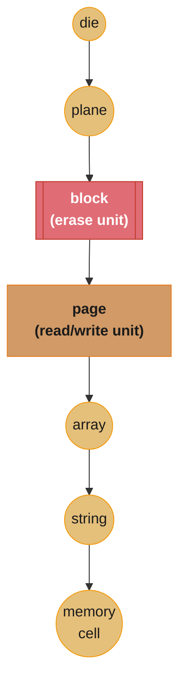
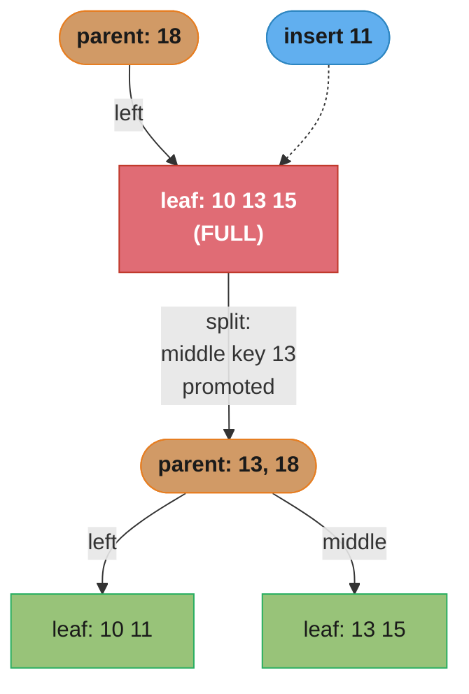

# Chapter 2: B-Tree Basics

> Part I — Storage Engines · Database Internals (Petrov, 1st ed., O'Reilly 2019) · builds on
> Ch 1's data-file/index-file vocabulary, leads to Ch 3 (File Formats)

## Chapter Map

Chapter 1 established that an index needs a data structure to find records efficiently; Chapter 2
answers *which* structure, and why the obvious in-memory answer — a balanced binary search tree —
fails once the tree has to live on disk. The chapter's argument has three beats. First, it
reviews why a BST needs balancing at all, and how rotation keeps that balance. Second, it
inventories the physical realities of HDDs and SSDs that any on-disk structure has to respect —
seek time, sector/page/block granularity, erase-before-write on flash — and shows precisely how
those realities defeat a binary tree: low fanout means excessive height, and height is what
determines how many expensive disk seeks a single lookup costs. Third, it introduces the B-tree
as the structural fix: raise the fanout per node from 2 to dozens or hundreds, and the tree's
height collapses from something proportional to `log2(n)` to something proportional to
`logM(n)` for a much larger `M` — turning a lookup that might need twenty disk seeks into one
that needs three or four.

**TL;DR:**
- A binary search tree needs **height O(log n)** to keep lookups fast, which requires
  **balancing** (rotation) — but a BST's fixed fanout of 2 makes even a balanced tree too tall
  once it holds enough keys to matter on disk.
- Two disk realities defeat a naive on-disk BST: **locality** (a new node isn't necessarily
  written near its parent, forcing extra seeks) and **low fanout** (2 children per node means
  height grows fast, and every level of height is another potential seek).
- **HDDs** are seek-time dominated (the mechanical read/write head must physically move); **SSDs**
  have no seek time but a structural asymmetry — **read/write happens at the page level, erase
  happens at the block level** — that shapes every flash-aware design later in the book.
- A **B-tree** is a BST generalization with much higher **fanout** (many keys and child pointers
  per node), which is what collapses tree height and turns a lookup into a handful of disk
  reads instead of dozens.
- **Node splitting** (on overflow) and **node merging** (on underflow) are the two operations
  that keep a B-tree balanced automatically as data is inserted and deleted — no separate
  rebalancing pass is required.

## The Big Question

> A binary search tree gives you `O(log2 n)` lookups in memory, and that's already about as good
> as comparison-based search gets. So why does the very same structure, moved onto a spinning
> disk or an SSD, become one of the worst possible ways to store an index?

Analogy: imagine looking up a word in a dictionary that is split across many separate booklets,
each stored on a different, distant shelf — a binary tree's version of a dictionary would have
only *two* words per booklet, so finding one word might mean walking to twenty different shelves
in sequence, each round trip costing real time regardless of how quick reading the two words
themselves is. A B-tree is the alternative dictionary design: pack a few hundred words into each
booklet, sorted, so you can flip through a whole booklet's contents in effectively no time once
you're holding it, and the number of shelf-to-shelf trips collapses from twenty down to three or
four. The chapter's whole argument is that on disk, the trip to the shelf (the seek) costs far
more than reading what's on it (the comparison) — so the right structure is the one that
minimizes trips, not the one that minimizes comparisons.

---

## 2.1 Binary Search Trees

A **binary search tree** is a sorted, in-memory data structure built for efficient key-value
lookups. Its defining invariant: for any node, every key in its left subtree is less than the
node's own key, and every key in its right subtree is greater than or equal to it. That invariant
alone doesn't bound lookup cost — a BST built by inserting already-sorted keys degenerates into a
linked list, with height equal to the number of nodes and lookup cost `O(n)`. A **balanced** tree
is one whose height is `O(log n)` — formally, the heights of any node's left and right subtrees
differ by at most one — and balance is restored after an insert or delete via **rotation**, a
local restructuring that preserves the BST invariant while reducing height:

```
before rotation (unbalanced: a 3-node chain leaning left)     after rotation (balanced)

        3                                                              2
       /                                                              / \
      2   <- pivot                                                   1   3
     /
    1
```

Rotation is cheap (a constant number of pointer swaps) and keeps the BST invariant intact by
construction — the tree ends up storing the same keys in the same left-less-than-right order,
just reshaped so that height stays logarithmic in the node count.

## 2.2 Trees for Disk-Based Storage

A perfectly balanced BST is not, on its own, a good on-disk index structure, for two related
reasons the chapter names directly:

1. **Locality.** A newly inserted node is not necessarily written physically near its parent on
   disk — nothing about the BST's logical structure guarantees spatial proximity of related
   nodes, so traversing a root-to-leaf path can mean jumping to a different, distant physical
   location on every single step, and every jump is a disk seek.
2. **Low fanout.** **Fanout** (the branching factor — how many children a node can have) is fixed
   at 2 for a binary tree. Low fanout means the tree needs more *levels* to hold the same number
   of keys, and more levels means more disk seeks to reach a leaf, since (absent extra tricks) a
   traversal touches one node per level.

Both problems point at the same fix: a node that holds more than one key, with more than two
children, cuts the tree's height directly — but before designing that node, the chapter first
lays out exactly what a "disk seek" costs and why it dominates everything else.

## 2.3 Storage Types

**Hard disk drives (HDDs)** are mechanical: a spinning platter, and a read/write head that must
physically move to the correct location before any data transfer can happen. That physical
movement — the **seek** — is what makes HDDs slow; the actual read or write, once the head is
correctly positioned, is comparatively fast. The smallest unit of data an HDD can read or write is
a **sector**, typically ranging from 512 bytes to 4 KB. This single fact — seek time dominates,
transfer time is comparatively cheap — is the entire justification for minimizing tree height:
every level of a tree traversal is a potential seek, and a seek is the expensive part.

**Solid state drives (SSDs)** have no moving parts and no seek time in the mechanical sense, but
they carry a structural quirk that shapes flash-aware design throughout the rest of this book. An
SSD's internal hierarchy nests: **die → plane → block → page → array → string → memory cell**.
The consequential asymmetry: **data is read and written at the page level, but erased at the
block level** — a block being a much larger unit than a page. The physical reason is that erasing
a NAND flash cell requires driving a comparatively large voltage through it, and it is difficult
to target that voltage at finer granularity than a block without disturbing neighboring cells; a
page-level erase simply isn't achievable with the underlying physics, so blocks (many pages each)
are the smallest unit that can be safely erased. This mismatch — writable at page granularity,
erasable only at block granularity — is exactly why SSDs need a **garbage collection** process
underneath (relocating live pages out of a block before that block can be erased and reused), and
it is a large part of why append-only, immutable storage structures such as the LSM-tree
(Chapter 7) map naturally onto flash: they avoid random in-place overwrites, which are precisely
the pattern that forces expensive read-modify-erase-rewrite cycles on an SSD.



Caption: the SSD hierarchy nests seven levels deep, but only two matter for storage-engine
design — pages (what you can write) are strictly smaller than the blocks that contain them (what
you must erase), which is why overwriting flash in place is expensive and append-only writes are
cheap.

## 2.4 On-Disk Data Structures: B-Trees

A **B-tree** is a binary search tree generalized to much higher fanout: instead of one key and
two child pointers, a B-tree node holds many keys and many child pointers. A **binary tree** node
is the degenerate case — one key, two child pointers; a **2-3 tree** node holds two keys and
three child pointers; a general B-tree node holds up to some maximum number of keys `M - 1` and
`M` child pointers (a common way the fanout `M` is defined). Within a node, keys are kept sorted,
so locating a specific key inside a node is itself a binary search — the fanout increase is at
the level of *how many keys fit in one node*, not a change to how keys are found once you're
already looking at a node's contents. A node's **occupancy** is how full it is — the number of
keys it currently holds compared to the maximum it could hold.

Three properties fall out of raising fanout:

- **Balancing amortizes.** A higher fanout means many more inserts can land in an existing node
  before that node overflows and needs to split — so the (still occasionally necessary)
  rebalancing work is spread thinly across far more operations than a binary tree's constant
  rotation-per-insert.
- **Fewer seeks.** Storing many keys and child pointers together in one block, or a small run of
  consecutive blocks, means one disk read pulls in an entire node's worth of navigation
  information at once, rather than one key's worth.
- **Balancing happens at the extremes.** Splits and merges — the two operations that keep a
  B-tree balanced — only trigger when a node becomes completely full (overflow, on insert) or
  nearly empty (underflow, on delete); a node sitting comfortably in between needs no rebalancing
  work at all.

## 2.5 Separator Keys

A B-tree node's internal structure alternates child pointers and keys — **separator keys**
(also called **index entries** or **divider cells**) — in the pattern `p1 k1 p2 k2 p3` for a node
with two keys and three children:

```
   p1     k1     p2     k2     p3
   |             |             |
   v             v             v
 keys < k1    k1 <= keys    keys > k2
              <= k2
```

`p1` points to the subtree holding every key less than `k1`; `p2` points to the subtree holding
every key between `k1` and `k2` inclusive on the low end; `p3` points to the subtree holding every
key greater than `k2`. This generalizes directly to a node with `n` keys and `n + 1` pointers —
each separator key marks the boundary between two adjacent child subtrees' key ranges, which is
exactly what lets a lookup binary-search a node's keys to decide which single child pointer to
follow next.

## 2.6 Sibling Pointers

**Sibling pointers** (also called **next/previous pointers**) link a node to the next and
previous node at the *same level* of the tree. B-trees maintain these on **leaf** nodes
specifically, and the payoff is range queries: once a lookup has descended to the correct leaf, a
range scan can walk forward through consecutive leaves via their sibling pointers directly,
without climbing back up to the parent and descending again for every subsequent leaf — turning
what would otherwise be a repeated root-to-leaf traversal per leaf into one initial descent
followed by a cheap linked-list walk.

## 2.7 B-Tree Lookup Complexity

A B-tree lookup costs `O(log_M n)`, where `M` is the tree's fanout and `n` is the total number of
keys stored. Because `M` can be in the hundreds (bounded by how many separator keys and pointers
fit in one disk page — Chapter 3's subject), `log_M n` stays small even for enormous `n`: a fanout
of, say, 200 needs only about 3 levels to index over eight million keys (`200^3 = 8,000,000`),
compared to a binary tree's roughly 23 levels for the same key count (`2^23 ≈ 8.4M`) — the
direct, concrete payoff of trading a binary tree's fanout of 2 for a B-tree's fanout in the
hundreds.

## 2.8 B-Tree Node Splits

Inserting into a full node triggers a **split**: the node's keys are divided into two nodes, and
the middle key is promoted into the parent node (which may itself now overflow and split,
propagating upward — Chapter 4 works out this propagation mechanically in full).

Worked example, with a maximum node occupancy of 3 keys: suppose the parent node holds `18 _ _`
(one key, two empty slots) whose left pointer leads to a leaf holding `10 13 15` — already full.
Inserting `11` cannot fit into `10 11 13 15` in one node (four keys exceeds the maximum of three),
so the node splits:

```
before insert of 11:

  parent:  [ 18 | _ | _ ]
              |
              v
  leaf:    [ 10 | 13 | 15 ]     <- full (occupancy 3/3)

after inserting 11 forces a split:

  parent:  [ 13 | 18 | _ ]
             |     |
             v     v
  left:  [10|11|_]  right: [13|15|_]

  the middle key of the overflowing 4-key set (10, 11, 13, 15) -> 13 -> promoted to parent
  remaining keys split evenly: {10, 11} stay left, {13, 15} move right
```

The middle key (`13`) is promoted into the parent, inserted in sorted position among the parent's
existing keys, and the four keys that no longer fit in one node are distributed between the two
resulting nodes. The split is entirely local except for that one promoted key — which is exactly
what keeps the amortized cost of maintaining balance low even as the tree grows.

## 2.9 B-Tree Node Merging

Deletion removes a key (and its associated value) from a leaf node directly. If that removal
drops a node's occupancy below some minimum threshold — **underflow** — the node is merged with a
sibling to restore an acceptable occupancy level.

Worked example, again with a maximum occupancy of 3 keys per node: suppose the parent holds
`11 20 _`, the pointer between `11` and `20` leads to a node holding `15 16 _`, and the pointer
between `20` and the end leads to a node holding `25 30 _`. Deleting `16` leaves the first child
with only `15 _ _` — a single key, likely below the minimum acceptable occupancy — so it merges
with its right sibling:

```
before deleting 16:

  parent:  [ 11 | 20 | _ ]
             |      |
             v      v
        [15|16|_]  [25|30|_]

after deleting 16 (left child underflows to [15|_|_]) and merging with its right sibling:

  parent:  [ 11 | _ | _ ]
             |
             v
        [15|25|30]
```

Merging moves the surviving elements from the right sibling into the left sibling and updates the
parent node accordingly — removing the separator key (`20`) that used to divide the two now-merged
children, since there is only one child left where there used to be two.

---

## Visual Intuition

```
  BINARY TREE (fanout 2)                  B-TREE (fanout ~4, illustrative)
  height for 21 keys: ~5 levels           height for 21 keys: ~2-3 levels

           k                                    [ k1 | k2 | k3 ]
          / \                                  /    |    |    \
         k   k                              [..]  [..]  [..]  [..]
        / \ / \
       k  k k  k                          each leaf holds several keys,
      /\ /\ /\ /\                         so far fewer LEVELS are needed
     (each node: 1 key, 2 children)       to hold the same total key count

  every level = 1 potential disk seek     the SAME data, reached in
  -> 5 seeks in the worst case            far fewer seeks
```

Caption: raising fanout is a direct trade of "keys per node" for "levels in the tree," and
because a disk seek costs orders of magnitude more than comparing a few extra keys once a page is
already in memory, that trade is almost pure win on disk — this is the single mechanical reason
every disk-based index in this book is a high-fanout tree, never a binary one.



Caption: a split is local — only the promoted middle key touches the parent — which is why
rebalancing a B-tree stays cheap even under heavy, sustained insert load; contrast this with a
naive BST, where every single insert can trigger a rotation.

---

## Key Concepts Glossary

- **Binary search tree (BST)** — a sorted in-memory tree where a node's left subtree holds
  smaller keys and its right subtree holds larger-or-equal keys.
- **Balanced tree** — a tree whose height is `O(log n)`; formally, sibling subtree heights differ
  by at most one.
- **Rotation** — a local restructuring operation that rebalances a BST while preserving its
  invariant.
- **Fanout (branching factor)** — the number of children a tree node can have.
- **Locality** — whether related nodes are stored physically near each other on disk.
- **Seek (HDD)** — the mechanical repositioning of an HDD's read/write head before a transfer can
  occur; the dominant cost of an HDD access.
- **Sector** — the smallest unit an HDD reads/writes, typically 512 bytes to 4 KB.
- **SSD hierarchy** — die → plane → block → page → array → string → memory cell.
- **Page (SSD)** — the smallest unit an SSD can read or write.
- **Block (SSD)** — the smallest unit an SSD can erase; strictly larger than a page.
- **Garbage collection (SSD)** — relocating live pages out of a block so the block can be erased
  and reused.
- **B-tree** — a BST generalized to high fanout: many keys and child pointers per node.
- **Occupancy** — how full a node is relative to its maximum key capacity.
- **Separator key (index entry, divider cell)** — a key inside a B-tree node that divides two
  adjacent child pointers' key ranges.
- **Sibling pointer** — a link from a node to the next/previous node at the same tree level,
  maintained on leaves to accelerate range scans.
- **B-tree lookup complexity** — `O(log_M n)`, where `M` is fanout and `n` is total key count.
- **Node split** — dividing an overflowing node into two, promoting the middle key to the parent.
- **Underflow** — a node's occupancy dropping below the minimum acceptable threshold after a
  delete.
- **Node merge** — combining an underflowing node with a sibling and updating the parent
  accordingly.

---

## Tradeoffs & Decision Tables

| | Binary search tree | B-tree |
|---|---|---|
| Fanout | 2 | Tens to hundreds |
| Height for large n | `O(log2 n)` — large | `O(log_M n)` — small |
| Disk seeks per lookup | High (one per level) | Low (one per level, but far fewer levels) |
| Rebalancing cost per insert | Constant, but frequent (rotation) | Amortized — split only on overflow |
| Suitable for on-disk storage | No | Yes |

| | HDD | SSD |
|---|---|---|
| Dominant cost | Mechanical seek time | No seek time; read/write vs. erase asymmetry |
| Smallest read/write unit | Sector (512 B - 4 KB) | Page |
| Smallest erase unit | N/A (overwrite in place) | Block (larger than a page) |
| Favors which write pattern | Sequential (minimizes seeks) | Append-only / sequential (minimizes erase-cycle garbage collection) |

| Operation | Trigger | Effect |
|---|---|---|
| Split | Node overflow (insert into a full node) | Node divides in two; middle key promoted to parent |
| Merge | Node underflow (delete drops occupancy too low) | Node combines with sibling; parent's separator key removed |

---

## Common Pitfalls / War Stories

- **Assuming a balanced binary tree is "good enough" for an on-disk index.** Balance alone
  guarantees logarithmic height in terms of *node count* — it says nothing about the base of that
  logarithm, and a base-2 logarithm over millions of keys still means dozens of levels, each one
  a potential disk seek. A design that stops at "it's balanced" without addressing fanout ships an
  index with an order-of-magnitude worse seek profile than a B-tree covering the same data.
- **Ignoring locality when placing new nodes.** Even a correctly balanced tree can perform badly
  on disk if logically adjacent nodes end up physically scattered — the fix isn't a smarter
  balancing algorithm, it's a structure (like the B-tree's grouped-in-one-page node) that makes
  locality a structural property rather than something to hope the allocator provides.
  by accident.
- **Treating SSDs as "fast, so overwrite in place is fine."** The absence of seek time does not
  mean the absence of write cost: an SSD's page-write-but-block-erase asymmetry means random
  in-place overwrites still trigger expensive garbage collection cycles internally, even though
  no mechanical head ever moves. Structures that assume SSDs behave like infinitely-fast RAM miss
  this entirely.
- **Splitting or merging too aggressively.** A B-tree that rebalances at the very first sign of
  slight over- or under-occupancy (rather than waiting for genuine overflow or underflow) pays
  split/merge cost far more often than necessary — occupancy is deliberately allowed to range
  between the minimum and maximum before a rebalance triggers.
- **Forgetting sibling pointers matter for range scans.** An implementation that omits leaf
  sibling pointers loses the cheap linked-list-style range scan and is forced back into repeated
  root-to-leaf traversals for every subsequent key in a range — correct, but far slower than
  necessary for exactly the query pattern (range scans) B-trees are prized for.

---

## Real-World Systems Referenced

The chapter frames B-trees generically rather than tying the mechanics to one product by name —
concrete production B-tree implementations (PostgreSQL, MySQL/InnoDB, SQLite, LMDB) appear
starting in Chapters 3-4 and 6, once the byte-level page format is established. **Introduction to
Algorithms** (Cormen, Leiserson, Rivest, Stein) is referenced in reading-group discussion as a
classic BST/balancing treatment worth pairing with this chapter.

---

## Summary

A balanced binary search tree guarantees `O(log2 n)` lookups in memory, but two disk realities
defeat it once it's stored on disk: poor locality between logically adjacent nodes, and a fixed
fanout of 2 that forces excessive tree height. HDDs are dominated by mechanical seek time; SSDs
have no seek time but read/write at the page level while only erasing at the coarser block level,
an asymmetry that rewards sequential, append-friendly access patterns over random in-place
overwrites. The **B-tree** fixes the height problem directly by raising fanout from 2 to the
tens-or-hundreds, collapsing `O(log2 n)` height into `O(log_M n)` height for a much larger `M` —
turning a lookup that might cost dozens of seeks into one that costs a handful. Internally, a
B-tree node alternates **separator keys** and child pointers to route a lookup to the correct
subtree, and leaf nodes carry **sibling pointers** to make range scans cheap. Balance is
maintained automatically and only at the extremes: a **split** on node overflow (insert), a
**merge** on node underflow (delete) — both local operations whose cost amortizes across many
operations rather than firing on every single insert or delete the way BST rotation does.

---

## Interview Questions

**Q: Why does raising a tree's fanout from 2 to, say, 200 matter so much more on disk than in memory?**
**Short:** Because on disk, each tree level costs a full seek — fanout directly determines how many levels (and seeks) a lookup needs.
In memory, comparisons are cheap regardless of fanout, so a binary tree's extra levels cost almost nothing. On disk, each level of a tree traversal is a potential disk seek, and seek time dominates total access cost — so cutting the number of levels from ~23 (binary, for ~8M keys) down to ~3 (fanout 200, for the same key count) is a direct, roughly order-of-magnitude cut in the number of expensive seeks a lookup performs, which is why B-trees exist specifically as a disk-oriented structure rather than a general algorithmic improvement.

**Q: Why can't a simple balanced BST just be written to disk as-is and expected to perform well?**
**Short:** Locality and fanout both fail — related nodes can land far apart, and fanout-2 forces too many levels.
Balancing guarantees logarithmic height in terms of node count, but says nothing about where nodes physically land on disk — a newly inserted node isn't necessarily written near its logical parent, so a root-to-leaf traversal can jump between distant physical locations on every step. Combined with the base of that logarithm being 2 (a large number of levels even when balanced), a plain on-disk BST forces many more seeks than necessary; the B-tree fixes both problems at once by packing many keys into one physically co-located node.

**Q: What's the actual physical reason SSDs can't erase at the page level, only at the block level?**
**Short:** Erasing a NAND cell needs a large voltage that can't be precisely targeted below block granularity.
Erasing a flash memory cell requires driving a comparatively large voltage through it, and that voltage is difficult to confine to a single page's worth of cells without disturbing neighboring cells outside the intended page — so manufacturers settled on the block (many pages) as the smallest unit that can be safely and reliably erased. This asymmetry — writable at page granularity, erasable only at block granularity — is why SSDs need a background garbage-collection process, and it's a direct physical justification for append-only storage designs later in the book.

**Q: A B-tree node with 3 keys and a maximum occupancy of 3 receives an insert that would make it 4 keys. Walk through exactly what happens.**
**Short:** The node splits: keys divide into two nodes, and the middle key is promoted to the parent.
The node currently holding, say, `10 13 15` cannot fit a 4th key like `11` (exceeding its max occupancy of 3), so it splits into two nodes. The four keys `10 11 13 15`, now sorted, have their middle key (`13`) promoted into the parent node in sorted position among the parent's existing keys; the remaining keys split evenly, with `10 11` staying in the original node's position and `13 15` occupying a new sibling node. If the parent itself is now full, this same split-and-promote process repeats one level up.

**Q: Why does a node merge remove a separator key from the parent, and what would go wrong if it didn't?**
**Short:** After merging two children into one, there's only one child pointer where there used to be two, so the divider between them is meaningless.
Merging two sibling nodes collapses two children into one, so the separator key in the parent that used to divide those two children's key ranges no longer corresponds to any actual boundary — there's only one child pointer left where there used to be two. Leaving the separator key in place would leave the parent with a dangling reference implying a split that no longer exists, breaking the invariant that every separator key corresponds to an actual boundary between two live child subtrees.

**Q: What do separator keys actually route, and how does a lookup use them to pick the next child pointer?**
**Short:** They mark the boundary between adjacent child subtrees' key ranges; a lookup binary-searches them to pick a pointer.
In a node shaped `p1 k1 p2 k2 p3`, `p1` covers everything less than `k1`, `p2` covers everything from `k1` up to and including `k2`, and `p3` covers everything greater than `k2` — the separator keys are boundary markers, not stored values themselves in the sense a leaf's actual data entries are. A lookup at that node binary-searches the sorted separator keys to determine which single range the target key falls into, then follows the corresponding child pointer — the same binary-search-within-a-node step that makes each level of traversal cheap once the node's page is already in memory.

**Q: Why do B-trees maintain sibling pointers specifically on leaf nodes, rather than at every level?**
**Short:** Range queries only need to walk through actual data (leaves) in order — internal nodes don't hold the data being scanned.
A range query's job is to return every leaf-level data entry within some key range, in order — once the initial descent reaches the correct starting leaf, sibling pointers let the scan walk forward leaf-to-leaf directly, without climbing back to a parent and redescending for each subsequent leaf. Internal (non-leaf) nodes don't hold the actual data entries being scanned, only routing information, so linking them the same way would add bookkeeping without saving any work a range scan actually needs to do.

**Q: What does "occupancy" measure, and why do splits and merges only trigger at the extremes of it rather than at every insert or delete?**
**Short:** Occupancy is how full a node is; triggering rebalance only at the extremes amortizes the cost.
Occupancy is a node's current key count relative to its maximum capacity, and a B-tree deliberately tolerates a wide range of occupancy — anywhere from some minimum threshold up to completely full — without triggering any rebalancing work. Restricting splits to full-node overflow and merges to under-threshold underflow means most inserts and deletes touch only a single node with no cascading restructuring, which is exactly what keeps a B-tree's amortized per-operation cost low even under sustained write load — a sharp contrast with a plain BST, where rotation can be needed on essentially every insert.

**Q: Why does the chapter bother introducing HDD and SSD internals before introducing the B-tree itself?**
**Short:** The B-tree's design (high fanout, node-per-page) is a direct engineering response to those physical constraints.
Without first establishing that seeks dominate HDD cost and that SSDs punish random overwrites relative to sequential/append patterns, the B-tree's core design choice — pack many keys into one physically co-located node to minimize the number of separate disk accesses a lookup needs — would look like an arbitrary implementation detail rather than a direct engineering response to measured physical costs. The ordering (storage physics, then the structure built to respect it) is deliberate and mirrors how the rest of Part I justifies every subsequent design decision.

**Q: What is the relationship between a B-tree node and a disk page, and why does that relationship matter?**
**Short:** A B-tree node is generally sized to fit in exactly one disk page, so reading a node costs exactly one I/O.
Sizing a B-tree node to match the disk's page size means that reading one node during a traversal corresponds to exactly one disk I/O operation, rather than a node spilling across page boundaries and requiring multiple reads to load a single level of the tree. This is why B-tree fanout is not an arbitrary tuning knob picked for algorithmic elegance — it's bounded above by how many separator keys and child pointers actually fit inside one page, a byte-level constraint Chapter 3 works out precisely.

**Q: Is a B-tree's `O(log_M n)` lookup complexity asymptotically better than a BST's `O(log2 n)`, or just better in practice for realistic n?**
**Short:** Asymptotically both are `O(log n)` — the practical difference is entirely in the constant factor from the base M.
Both complexities are technically `O(log n)` in big-O terms, since a logarithm's base is only a constant multiplicative factor away from any other base — so the theoretical asymptotic class is the same. What actually matters is the *practical* constant: for realistic key counts, `log_200(n)` is roughly 7-8x smaller than `log_2(n)`, and because each unit of "height" corresponds to a real, expensive disk seek rather than a cheap in-memory comparison, that constant-factor difference translates directly into an order-of-magnitude difference in real I/O cost — which is precisely why the distinction matters enormously in practice despite being asymptotically "the same."

**Q: What's the difference between a 2-3 tree and a general B-tree, and why does the chapter mention the 2-3 tree at all?**
**Short:** A 2-3 tree is the minimal non-binary case (2 keys, 3 pointers) — the B-tree generalizes that pattern to arbitrary fanout.
A binary tree node holds 1 key and 2 child pointers; a 2-3 tree node holds 2 keys and 3 child pointers — the smallest possible step up in fanout from the binary case, useful as a bridge example before generalizing further. A B-tree extends the same `n` keys/`n+1` pointers pattern to whatever maximum fanout a disk page can accommodate (often in the hundreds), so the 2-3 tree isn't a separate structure so much as the smallest instance of the same family the B-tree generalizes.

**Q: Why does an HDD's sector size (512 B - 4 KB) matter for database page sizing, given that databases usually think in terms of "pages," not "sectors"?**
**Short:** A database page must be a multiple of the sector (or SSD page) size, or reads/writes cross unit boundaries wastefully.
Because the disk's own smallest read/write unit is the sector (HDD) or page (SSD), a database's logical page size is deliberately chosen as a multiple of that underlying hardware unit — writing or reading a database page that straddles two hardware sectors/pages awkwardly would force the drive to touch an extra unit's worth of data for no benefit. This is part of why database page sizes cluster around round numbers like 4 KB, 8 KB, or 16 KB rather than arbitrary values — they're chosen to align cleanly with the hardware granularity underneath, a theme Chapter 3 develops in full when it fixes an actual page size.

**Q: If SSDs have no seek time, why does the book still care about minimizing the number of separate I/O operations a B-tree lookup performs?**
**Short:** Even without mechanical seek delay, each I/O still carries fixed per-operation overhead and interacts with the erase-block asymmetry.
"No seek time" removes the mechanical repositioning cost, but every I/O operation still has fixed overhead (command issue, controller latency, the read/write-vs-erase-block asymmetry discussed above), so minimizing the number of separate page accesses remains valuable even on flash — just for a different underlying reason than on an HDD. A high-fanout B-tree reduces the number of I/O operations for both storage types, which is exactly why the fanout argument from earlier in the chapter holds regardless of whether the underlying medium is an HDD or an SSD.

---

## Cross-links in this repo

- [database/indexing_deep_dive/ — B-tree indexing, fanout, and lookup complexity worked with production numbers](../../../database/indexing_deep_dive/indexing_deep_dive.md)
- [database/storage_engines_internals/ — page sizing and disk I/O patterns in real storage engines](../../../database/storage_engines_internals/storage_engines_internals.md)
- [cs_fundamentals/ — general balanced-tree and rotation background](../../../cs_fundamentals/README.md)
- [book/ddia_2e/04_storage_and_retrieval/ — B-tree vs LSM-tree tradeoffs from a different author's frame](../../ddia_2e/04_storage_and_retrieval/04_storage_and_retrieval.md)
- Sibling chapters: [Ch 1 Introduction and Overview](../01_introduction_and_overview/01_introduction_and_overview.md) · [Ch 3 File Formats](../03_file_formats/03_file_formats.md) · [Ch 4 Implementing B-Trees](../04_implementing_btrees/04_implementing_btrees.md)

## Further Reading

- Petrov, *Database Internals*, O'Reilly, 2019 — Chapter 2, including the node-split diagram on
  page 40 referenced directly in this summary's worked example.
- Cormen, Leiserson, Rivest, Stein, *Introduction to Algorithms* — a classic treatment of BSTs,
  balancing, and (unusually for an algorithms text) real disk mechanics.
- Comer, "The Ubiquitous B-Tree," ACM Computing Surveys, 1979 — the original comprehensive B-tree
  survey.
- Book website / errata: <https://www.databass.dev/>
- Community reading-group notes for this chapter:
  <https://github.com/Akshat-Jain/database-internals-notes>
