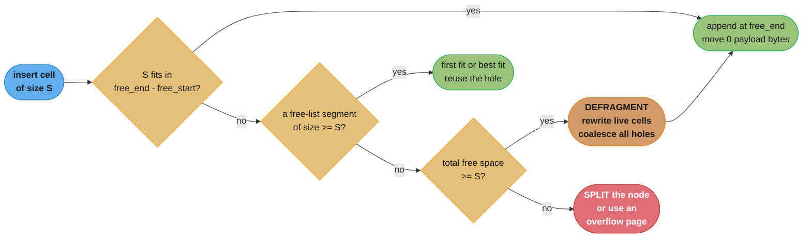
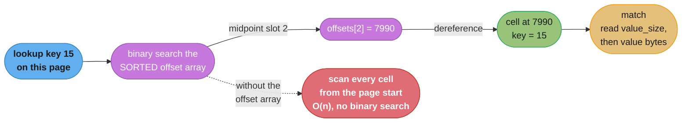

# Chapter 3: File Formats

> Part I — Storage Engines · Database Internals (Petrov, 1st ed., O'Reilly 2019) · builds on
> Ch 2's B-tree node/fanout vocabulary, leads to Ch 4 (Implementing B-Trees)

## Chapter Map

Chapter 2 ended with a promise it could not keep on its own: a B-tree node is sized to fit one
disk page, and fanout is bounded by "how many separator keys and child pointers actually fit
inside one page." That sentence is meaningless until somebody decides what a page *is*, byte by
byte. Chapter 3 is that decision. It steps away from tree algorithms entirely and asks a much
lower-level question — how do you lay out bytes on disk when there is no language runtime to do
it for you? In memory you allocate a struct, follow a pointer, and let the garbage collector
clean up; on disk there are no pointers, no allocator, no types, and no runtime. There is a flat
array of bytes and whatever discipline you impose on it.

The chapter builds that discipline in two halves. The first half is **encoding**: how to
represent primitive numeric types (byte order, IEEE 754 floats), how to represent things whose
size is not known in advance (length-prefixed strings), and how to squeeze small values into
individual bits (booleans, enums, flags). The second half is **layout**: the general shape of a
database file (fixed-size header, pages, optional trailer), then the specific and dominant page
organization — the **slotted page**, whose header-plus-offset-array-plus-cells structure is what
makes variable-size records, cheap logical reordering, and in-page space reclamation all possible
at once. The chapter closes on two operational concerns that any real format needs and no
textbook page layout mentions: **versioning** (the format will change, and old files must still
be identifiable) and **checksumming** (the bytes will get corrupted, and you must find out before
you trust them).

**TL;DR:**
- On disk there is **no runtime doing layout for you** — no pointers, no allocator, no type
  information. Everything a language gives you for free in memory must be designed by hand as a
  byte layout, which is why storage engines ship hand-written binary formats rather than
  general-purpose serialization.
- **Fixed-size primitives** (integers, IEEE 754 floats/doubles) can be laid out contiguously and
  addressed by arithmetic; **variable-size data** cannot, so it is stored **length-prefixed**
  (`[size][bytes]`, the Pascal-string form) rather than terminated by a sentinel.
- A database file is a **fixed-size header, a sequence of fixed-size pages, and optionally a
  trailer** — commonly a 4 KB, 8 KB, or 16 KB page, chosen as a multiple of the hardware's own
  sector/page granularity.
- The **slotted page** is the answer to variable-size records: a header, an **offset (slot) array
  growing left-to-right**, and **cells growing right-to-left**, with free space in the middle.
  Logical order lives in the 2-byte offsets, so **reordering records never moves record bytes**.
- Deleting a cell does not erase it — its space joins an **availability list**, and a later insert
  reuses it via **first fit** or **best fit**; when free space exists but is too fragmented,
  the page is **defragmented**.
- Every format needs **versioning** (magic numbers, header version fields, or filename prefixes)
  and **checksums or CRCs** computed per page, because a format outlives its writer and disks
  corrupt data silently.

## The Big Question

> A `Map<String, Record>` in memory takes about four lines of code and no thought about layout.
> The same logical structure on disk takes an entire chapter of byte-level design. What exactly
> does memory give you for free that disk takes away?

Analogy: writing an in-memory data structure is like arranging furniture in a house where you can
say "put the lamp next to the sofa" and someone else works out the floor plan — the runtime knows
where every object lives, gives you a handle to it, moves it if it needs to, and reclaims the
space when you stop referring to it. Writing an on-disk structure is like shipping that same
house's contents as numbered boxes in a container: nothing can point at anything, every box has
to say how big it is before its contents start, boxes cannot be resized once packed, "next to"
has to be encoded as an explicit offset in a manifest, and if a box gets crushed in transit
nothing tells you unless you wrote the weight on the outside and check it on arrival. The
manifest is the offset array, the weight is the checksum, and the container itself is the page.

---

## 3.1 Motivation

The chapter opens by naming the gap directly: **on-disk structures are designed under a
completely different set of constraints than in-memory ones**, and the difference is not "disk is
slower." It is that the conveniences a programming language provides simply do not exist.

| In memory the runtime gives you | On disk you must build it |
|---|---|
| Pointers — a reference that dereferences in one instruction | **Offsets** — an integer you decode and add to a base address by hand |
| An allocator (`malloc`/`new`) that finds free space | A **free-space manager** you write: free lists, fit strategies, defragmentation |
| Garbage collection / `free` that reclaims space | Manual reclamation — a deleted record's bytes stay until you reuse or compact them |
| Types — the runtime knows an `int` is here and a `String` is there | **Nothing.** A page is a flat byte array; the layout is the only thing that says what a byte means |
| Variable-size objects that can grow in place | Fixed-size pages; anything that grows must be relocated, or overflowed to another page |

Two more constraints shape everything that follows. First, **disk access happens in blocks**, not
bytes: a read pulls in a whole sector or page whether you wanted one byte from it or all of it,
so the unit of design is the page, not the record. Second, **random access on disk is expensive
relative to sequential access** — the argument Chapter 2 built out of HDD seek time and SSD
erase-block asymmetry — so a format is judged partly on whether the bytes you need next are the
bytes physically adjacent to the bytes you just read.

The practical conclusion the chapter draws: storage engines use **hand-rolled binary formats**
rather than general-purpose serialization. A general format optimizes for schema evolution and
cross-language portability; a storage engine optimizes for reading one field out of the middle of
a page without decoding anything around it, and for writing a page back in exactly the number of
bytes it occupied before.

---

## 3.2 Binary Encoding

Before any page can be laid out, the individual values inside it need a byte representation. The
chapter works through three families, in increasing order of awkwardness: fixed-size primitives,
variable-size data, and values smaller than a byte.

### Primitive Types

**Fixed-size numeric types are the easy case**, and the reason is worth stating: because their
width is known at compile time, a field's position within a record is computable by arithmetic.
If a record is `uint_32 id, uint_64 timestamp, uint_16 flags`, then `timestamp` always starts at
byte 4 and `flags` always starts at byte 12 — no scanning, no length decoding, no indirection.
Every good on-disk layout puts its fixed-size fields first for exactly this reason.

The one genuine decision for multi-byte integers is **byte order**, and getting it wrong produces
a file that reads as garbage on another machine:

- **Big-endian** — the most significant byte first, at the lowest address. Also called **network
  byte order**, because that is what the internet protocols standardized on.
- **Little-endian** — the least significant byte first. What x86 and ARM (in their usual
  configuration) use natively.

```
  The 32-bit value 0x0A0B0C0D written to four consecutive bytes

  address:        +0     +1     +2     +3
                 +------+------+------+------+
  big-endian     | 0A   | 0B   | 0C   | 0D   |   most significant byte at the LOW address
                 +------+------+------+------+
                 +------+------+------+------+
  little-endian  | 0D   | 0C   | 0B   | 0A   |   least significant byte at the LOW address
                 +------+------+------+------+

  Read a little-endian file as big-endian and 0x0A0B0C0D (168,496,141)
  becomes 0x0D0C0B0A (218,893,066). No error is raised. The value is
  simply wrong, which is why the byte order is part of the FORMAT SPEC,
  not a property of the machine that happens to write the file.
```

Caption: byte order is the first thing a binary format has to fix and the easiest thing to leave
implicit — an implicit choice works perfectly until the file is read on a machine of the other
persuasion, at which point every integer in it is silently wrong rather than detectably broken.

**Floating-point numbers** use the IEEE 754 layout, which splits a fixed-width field into three
parts. A single-precision `float` occupies 32 bits: **1 sign bit, 8 exponent bits, 23 mantissa
(fraction) bits**. A double-precision `double` occupies 64 bits: **1 sign bit, 11 exponent bits,
52 mantissa bits**. The value is reconstructed as sign × mantissa × 2^exponent, with the exponent
stored biased (offset by 127 for a `float`, 1023 for a `double`) so that negative exponents need
no separate sign, and with an implicit leading 1 in front of the stored mantissa bits for normal
numbers.

```
  IEEE 754 single precision (32 bits) — worked on 0.15625

  bit:  31   30                23   22                                        0
       +---+---------------------+-------------------------------------------+
       | S |      EXPONENT       |             MANTISSA (FRACTION)           |
       | 1 |        8 bits       |                  23 bits                  |
       +---+---------------------+-------------------------------------------+
         0    0 1 1 1 1 1 0 0      0 1 0 0 0 0 0 0 0 0 0 0 0 0 0 0 0 0 0 0 0 0 0

       S = 0                  -> positive
       exponent = 0111 1100   -> 124 stored, 124 - 127 = -3 actual
       mantissa = 010000...   -> implicit 1 + 0.25 = 1.25 significand

       value = +1.25 x 2^-3 = 0.15625

  Why this matters to a FILE FORMAT and not just to arithmetic: the layout is
  fixed-width and self-contained, so a float in a record can be addressed by
  offset like any other 4-byte primitive. Nothing about it needs decoding to
  know where the NEXT field starts.
```

Caption: the sign/exponent/mantissa split is what lets a value with an enormous dynamic range
still occupy a fixed 4 or 8 bytes — and fixed width is precisely the property that makes a field
addressable by arithmetic inside a record.

The chapter also notes that **fixed-size primitives compose into fixed-size records trivially**:
lay the fields out one after another and the whole record is addressable by a single base offset
plus a compile-time-known field offset. Every complication in the rest of the chapter comes from
values that are *not* fixed size.

### Strings and Variable-Size Data

A string has no width known in advance, so it cannot be addressed by arithmetic alone. The
chapter's answer is the one nearly every binary format converges on: **prefix the data with its
size**.

```
String
{
    size  uint_16
    data  byte[size]
}
```

This is the **UCSD String / Pascal String** form — as opposed to the C convention of a
null-terminated string, where the end is marked by a sentinel byte rather than declared up front.
The difference is not stylistic:

| | Length-prefixed (`[size][bytes]`) | Null-terminated (`bytes` + `\0`) |
|---|---|---|
| Finding the length | Read one fixed-size field: O(1) | Scan until the sentinel: O(n) |
| Finding the NEXT field | `current + 2 + size` — arithmetic | Only after scanning the whole string |
| Can the data contain any byte? | Yes, including `0x00` | No — `0x00` terminates it early |
| Cost | 2 bytes of overhead per string (for a `uint_16` size) | 1 byte, but paid in scanning |

For a storage engine the decisive column is the second one. A page holds many fields back to
back; if finding field *n+1* requires scanning field *n*, then reading the last field on a page
costs a full page scan. Length-prefixing turns every "where does the next thing start" question
into an addition.

The same shape generalizes beyond strings — **any variable-size value is encoded as its size
followed by its bytes**, and a variable-size *sequence* is encoded as an element count followed by
that many encoded elements:

```
Array
{
    count     uint_16
    elements  Element[count]
}
```

The size field's own width is a real design choice with a real ceiling: a `uint_16` length caps a
value at 65,535 bytes, a `uint_32` at ~4 GB. Pick too small and large values are unrepresentable;
pick too large and every short string pays the overhead. This is exactly the tension that
Chapter 4's **overflow pages** exist to resolve when a value outgrows the page it lives in.

### Bit-Packed Data: Booleans, Enums, and Flags

Some values need far less than a byte, and a page is a scarce resource — every byte spent on
metadata is a byte not spent on keys.

**Booleans.** A boolean carries exactly one bit of information but the smallest addressable unit
on disk is a byte, so storing one boolean per byte wastes 7/8 of the space. The fix is to **pack
eight booleans into a single byte** and address individual ones with bitwise operations: set with
`byte |= (1 << i)`, clear with `byte &= ~(1 << i)`, test with `(byte & (1 << i)) != 0`.

**Enums.** An enumerated type is a set of named values encoded as small integers — the canonical
storage-engine example being the node type of a B-tree page, where `LEAF = 0` and
`INTERNAL = 1` (or `NODE_TYPE_ROOT`, `NODE_TYPE_INTERNAL`, `NODE_TYPE_LEAF`). Encoding these as a
`uint_8` rather than a string costs one byte, not the seven-plus a name would take, and turns a
type check into an integer comparison. Enums also show up inside cells to distinguish a key cell
from a key-value cell.

**Flags.** Flags are packed booleans that describe page-level state — whether a page has deleted
(reclaimable) cells, whether its cells are fixed size, whether it has been modified since the
last flush. They are stored as a single integer field and tested with **masks**:

```
  A 1-byte flags field, and what each bit means

  bit:      7     6     5     4     3     2     1     0
          +-----+-----+-----+-----+-----+-----+-----+-----+
  value:  |  0  |  0  |  0  |  0  |  0  |  1  |  0  |  1  |   = 0x05
          +-----+-----+-----+-----+-----+-----+-----+-----+
                                     |           |     |
                                     |           |     +-- IS_LEAF          (0x01) set
                                     |           +-------- HAS_OVERFLOW     (0x02) clear
                                     +-------------------- HAS_DELETED_CELLS(0x04) set

  test:   flags & IS_LEAF            -> 0x01 -> true
  set:    flags |= HAS_OVERFLOW      -> 0x07
  clear:  flags &= ~HAS_DELETED_CELLS-> 0x03

  Eight independent yes/no facts about the page, in ONE byte of a header
  that is read on every single page access.
```

Caption: the header is read on every page access, so its size is multiplied by the entire read
workload — which is why storage engines are willing to spend bit-twiddling code to save six bytes
here and would not bother anywhere else.

---

## 3.3 General Principles

With values encodable, the chapter zooms out to the shape of the file as a whole. The general
recipe is short and holds across almost every storage engine:

1. A **fixed-size header at the start of the file**, holding whatever is needed to interpret
   everything after it — a magic number, a format version, the page size, a page count, a pointer
   to the root page or to metadata.
2. The **body, split into fixed-size pages**, which are the unit of I/O, of caching, and of
   allocation.
3. Optionally a **fixed-size trailer at the end**, for information that is only known once
   writing is finished (an index of what the file contains, a summary, a final checksum).

The header-and-trailer pattern repeats one level down: **a page itself has a fixed-size header**,
and sometimes a trailer, wrapping its own variable-size contents. The self-similarity is
deliberate — at both levels, a fixed-size prologue tells you how to interpret the variable-size
remainder, which is the only way to read a byte array whose meaning is not otherwise recoverable.

Two principles the chapter is emphatic about:

- **Prefer fixed-size, page-aligned structures.** Alignment means a page never straddles the
  hardware's own read/write unit, so writing one logical page is one physical operation rather
  than a read-modify-write of two.
- **Write and read in whole pages.** Even if only a few bytes changed, the page is the unit that
  goes to disk, which is why in-page free-space management (§3.8) is worth the complexity: it
  keeps a modification inside one page rather than spilling into a second.

Because these formats are dense and positional, the chapter describes them with a small **grammar
/ structure notation** rather than prose — a field name, a type, and for variable-size fields a
length expression referring to an earlier field:

```
Page
{
    magic          uint_32          // constant, validates this is a page
    version        uint_16
    flags          uint_16
    cell_count     uint_16
    free_start     uint_16          // offset just past the last slot
    free_end       uint_16          // offset of the lowest-addressed cell
    frag_bytes     uint_16          // bytes lost to fragmentation
    rightmost_ptr  uint_32
    checksum       uint_32
    offsets        uint_16[cell_count]
    // ... free space ...
    // ... cells, growing back from the end of the page ...
}
```

That notation is the whole point of the chapter: it is precise enough to implement from and short
enough to read, and every field's position is derivable from the fields before it.

---

## 3.4 Page Structure

A B-tree node lives in a page, so the page layout has to hold a node's contents: separator keys
and child pointers for an internal node, keys and data records for a leaf.

**The naive layout first.** If every key and every value were fixed size, you could do something
very simple — store them as two parallel arrays, keys in one and pointers/values in the other,
each indexed positionally:

```
  FIXED-SIZE LAYOUT (works only when everything is the same width)

  +--------+------+------+------+------+------+------+------+------+
  | HEADER |  k0  |  k1  |  k2  |  k3  |  p0  |  p1  |  p2  |  p3  |
  +--------+------+------+------+------+------+------+------+------+
             8 B    8 B    8 B    8 B    4 B    4 B    4 B    4 B

  key i is at:      HEADER_SIZE + i*8            pure arithmetic
  pointer i is at:  HEADER_SIZE + 4*8 + i*4      pure arithmetic

  BROKEN THE MOMENT EITHER OF THESE IS TRUE:
    (a) keys are variable size    -> key i's offset is no longer computable
    (b) you insert k' between k1 and k2, or delete k1
        -> every subsequent key AND its pointer must physically MOVE
           to keep the positional index meaningful
```

Caption: the fixed-size two-array layout is genuinely optimal when it applies — pure arithmetic
addressing, zero per-record overhead — and it fails on exactly the two things a real database
does constantly: variable-length keys, and inserting or deleting in the middle.

Problem (b) is worth quantifying, because it is what motivates everything that follows. On an
8 KB page holding 400 keys, inserting a key at position 5 under this layout means shifting
roughly 395 keys and 395 pointers — several kilobytes of `memmove` per insert, on a page that
will be inserted into hundreds of times before it splits. And problem (a) is not exotic: a text
primary key, a composite key, a JSON value, a variable-length string column all defeat it
immediately.

So the requirements for a real page layout are:

1. Store **variable-size records** with minimal overhead.
2. Reclaim the **space occupied by removed records**.
3. Reference a **record within the page without regard to its exact physical location**, so that
   the record can be moved (by defragmentation, or by a rewrite) without invalidating references
   to it.

---

## 3.5 Slotted Pages

The **slotted page** (also called a **slot directory** or **slot page**) satisfies all three
requirements at once, and it is the organization used by essentially every page-based storage
engine. Its structure has three parts:

- a **header** at the top of the page, holding metadata about the page;
- an **offset (slot) array** immediately after the header, holding one small integer per cell —
  the cell's offset within the page — and **growing toward higher offsets**;
- the **cells** themselves, the variable-size records, written **from the end of the page toward
  lower offsets**.

Free space is whatever sits between the two, and the page is full when they meet.

```
  8 KB SLOTTED PAGE — page-relative byte offsets

  0        24        32                                          7936        8192
  |        |         |                                           |           |
  +--------+---------+-------------------------------------------+-----------+
  | HEADER | OFFSETS |                FREE SPACE                 |   CELLS   |
  |  24 B  |  2 B ea |                 7904 bytes                | variable  |
  +--------+---------+-------------------------------------------+-----------+
            ----> grows toward HIGHER offsets   grows toward LOWER offsets <----
            (free_start = 32)                              (free_end = 7936)

  free space = free_end - free_start = 7936 - 32 = 7904 bytes
  page is FULL when free_start meets free_end

  HEADER (24 B, fixed)                OFFSET ARRAY (4 slots x 2 B)
  +--------------------------+        +-------+-------+-------+-------+
  | magic        "PAGE"  4 B |        | 8140  | 8100  | 7990  | 7936  |
  | flags                2 B |        +-------+-------+-------+-------+
  | cell_count = 4       2 B |          slot0   slot1   slot2   slot3
  | free_start = 32      2 B |          key=10  key=13  key=15  key=21
  | free_end   = 7936    2 B |
  | frag_bytes = 0       2 B |        SORTED BY KEY. The cells they point
  | rightmost_ptr        4 B |        at are in ARRIVAL order, which is a
  | checksum             4 B |        completely different order.
  | reserved             4 B |
  +--------------------------+
```

Caption: the two regions grow toward each other from opposite ends so that neither needs its size
declared in advance — a page that turns out to hold four fat cells and one that holds four
hundred thin ones use exactly the same layout with no wasted reservation on either side.

**Why grow toward each other rather than reserving each region a fixed share?** Because the split
between "space for the directory" and "space for the data" depends entirely on the data. A page
of 20-byte cells needs 400 slots; a page of 2,000-byte cells needs 4. Any fixed reservation is
wrong for one of those two workloads, and the two-ended layout needs no reservation at all: one
subtraction (`free_end - free_start`) answers "does this cell fit?" for every case.

**Why a fixed-size offset array plus variable cells beats a packed array of variable records.**
This is the central insight of the whole chapter:

| | Packed variable records, no directory | Slotted page (offset array + cells) |
|---|---|---|
| Find record *i* | Scan from the start, decoding each record's length | `offsets[i]` — one 2-byte read, then one dereference |
| Binary search within the page | Impossible — you cannot jump to the midpoint | Binary search over the offset array; O(log n) |
| Insert in logical position 5 | `memmove` every following record's bytes | Insert a 2-byte offset into the array; **the cell bytes never move** |
| Delete record 3 | `memmove` everything after it, or leave an undetectable hole | Remove one offset; the cell's space goes to the free list |
| Overhead per record | 0 bytes | 2 bytes |

Two bytes per record buys random access, binary search, and mutation without data movement. On a
page with 400 records that is 800 bytes of an 8,192-byte page — about 10% — and in exchange an
insert costs a 2-byte-granularity shift of at most 800 bytes instead of a byte-granularity shift
of up to 7,000. The trade is not close.

The third requirement — **referencing a record without regard to its physical location** — falls
out for free. A reference to a record on a page is its **slot index**, not its byte offset. That
means defragmentation can physically rewrite every cell on the page into new positions, update
the offsets, and every outside reference remains valid. Chapter 4's page defragmentation depends
entirely on this indirection.

---

## 3.6 Cell Layout

A **cell** is one record inside a page, and B-trees need two kinds of them, because an internal
node and a leaf node store different things.

**Key cells** live in internal (non-leaf) nodes. They hold a separator key and the page ID of the
child subtree it separates:

```
KeyCell
{
    cell_type   uint_8      // enum: KEY_CELL
    key_size    uint_16
    page_id     uint_32     // child page this separator routes to
    key         byte[key_size]
}
```

**Key-value cells** live in leaf nodes. They hold a key and the data record itself:

```
KeyValueCell
{
    cell_type   uint_8      // enum: KEY_VALUE_CELL
    key_size    uint_16
    value_size  uint_32
    key         byte[key_size]
    value       byte[value_size]
}
```

```
  KEY CELL (internal node) — separator key 15 routing to child page 42

  offset within cell:  0      1          3              7           7+key_size
                       +------+----------+--------------+-----------------+
                       | type | key_size |   page_id    |      key        |
                       | 0x00 |    2     |      42      |    "15"         |
                       +------+----------+--------------+-----------------+
                         1 B      2 B          4 B          key_size B
                       |<------ fixed-size prologue: 7 B ------>|

  KEY-VALUE CELL (leaf node) — key 15, a 120-byte row

  offset within cell:  0      1          3            7          11
                       +------+----------+------------+----------+----------+
                       | type | key_size | value_size |   key    |  value   |
                       | 0x01 |    2     |    120     |   "15"   | 120 bytes|
                       +------+----------+------------+----------+----------+
                         1 B      2 B         4 B      key_size    value_size
                       |<------ fixed-size prologue: 11 B ----->|

  ALL FIXED-SIZE FIELDS COME FIRST. That is not tidiness -- it is what makes
  key_size and value_size readable at KNOWN offsets, which is the only way to
  compute where `key` ends and `value` begins without scanning.
```

Caption: the fixed-size prologue is the cell's own miniature header, and the rule it embodies —
everything whose position you need in order to find something else goes at a constant offset — is
the same rule the page header and the file header follow one and two levels up.

**The cell-type field can often be hoisted out of the cell entirely.** Every cell on a given page
is the same kind, because a node is either internal or a leaf, never both. So the type can live
once in the **page header flags** (§3.2's `IS_LEAF` bit) instead of once per cell — saving one
byte per cell, which on a page of 400 cells is 400 bytes, roughly 5% of an 8 KB page recovered by
deleting a field.

A second space optimization the chapter raises: **separator keys in internal nodes do not have to
be full keys**. An internal node's key exists only to say "everything below this boundary goes
left, everything at or above it goes right" — it never has to reproduce a stored key exactly. So
a separator can be **truncated** to the shortest prefix that still discriminates between the two
subtrees: separating `"database_internals"` from `"database_systems"` needs only `"database_s"`,
not either full key. Shorter separators mean more of them per page, which means higher fanout,
which means a shorter tree — Chapter 2's fanout argument reappearing as a byte-layout decision.

---

## 3.7 Combining Cells into Slotted Pages

Now the two halves meet. The rule that governs a slotted page is short and consequential:

> **Cells are appended in arrival order at the cell-data end of the page and never move.
> The offset array is kept sorted by key.**

Physical order and logical order are decoupled. Insert order determines where the bytes land;
key order determines the order of the offsets pointing at them.

```
  INSERTING KEY 12 INTO A PAGE THAT ALREADY HOLDS 10, 13, 15, 21

  BEFORE                                         cell bytes, arrival order:
  header | 8140 | 8100 | 7990 | 7936 | ..free.. | [k21][k15][k13][k10]
           k=10   k=13   k=15   k=21                7936 7990 8100 8140
           slot0  slot1  slot2  slot3
           free_start = 32+8 = 40      free_end = 7936

  STEP 1 -- write the new cell at the free-space boundary, growing LEFTWARD.
           cell for key 12 is 44 bytes -> lands at 7936-44 = 7892
           free_end := 7892

  STEP 2 -- insert its offset into the SORTED position in the offset array.
           key 12 belongs between 10 and 13, i.e. slot index 1.
           shift slots 1..3 right by 2 bytes  (6 bytes moved)
           free_start := 42

  AFTER
  header | 8140 | 7892 | 8100 | 7990 | 7936 | ..free.. | [k12][k21][k15][k13][k10]
           k=10   k=12   k=13   k=15   k=21              7892 7936 7990 8100 8140
           slot0  slot1  slot2  slot3  slot4
                  ^^^^ new                        ^^^^^ new cell, physically FIRST
                                                        in address order but SECOND
                                                        in key order

  BYTES MOVED: 6  (three 2-byte offsets)
  BYTES THAT WOULD MOVE IN A PACKED LAYOUT: ~200 (three whole cells)
```

Caption: the entire benefit of the slot directory is visible in the last two lines — a logical
insertion in the middle costs a shift of pointers, not of payload, and the payload is one to two
orders of magnitude larger than the pointers.

Three consequences follow directly:

- **Binary search works.** Because the offset array is sorted by key and each entry is fixed
  width, a lookup can binary-search it: pick the midpoint slot, dereference its offset, read the
  key at that address, compare, halve the range. This is the "binary search within a node" step
  Chapter 2 assumed and Chapter 4 works out in detail — it is only possible because of the
  directory.
- **Reordering is free.** Any operation that changes the logical order of records on a page —
  including bulk operations — changes only the offset array.
- **The page's own physical layout carries no meaning.** Cell addresses are arbitrary. Nothing
  outside the offset array knows or cares where a cell sits, which is what makes defragmentation
  safe.

---

## 3.8 Managing Variable-Size Data

The remaining requirement is reclamation: what happens to the bytes when a record is deleted or
grows past its current size.

**Deletion does not erase the cell.** Removing a record means removing its entry from the offset
array (and shifting the following offsets down), not overwriting the cell bytes. The freed
region — its offset and its size — is recorded in an **availability list** (a **free list**), a
list of reusable segments within the page, typically stored in the page itself as a linked list
threaded through the freed regions or as a small structure in the header area. The page header's
`frag_bytes` counter tracks how much space is sitting in these holes.

```
  A PAGE AFTER DELETING TWO CELLS

  offsets:  | 8140 | 7990 |                    (k=10, k=15 remain)
  cells:    ...[ 44 B free ][k21][ 110 B free ][k15][   free   ][k10]
                 ^7892                  ^7990-110       ^8100     ^8140
                 freed by                freed by
                 deleting 12             deleting 13

  availability list: {offset 7892, size 44} -> {offset 8100, size 110}
  frag_bytes = 154

  TOTAL free space in the page = 154 (fragmented) + contiguous middle block
  ...but a single 120-byte cell CANNOT use the 44-byte hole, and can only use
  the 110-byte hole if it is 110 bytes or smaller. Free space and USABLE free
  space are different numbers, and the gap between them is fragmentation.
```

Caption: the last three lines are the whole problem — a page can report ample free space and
still fail an insert, because free space is a sum while an insert needs a contiguous run.

**Fit strategies.** When a new cell arrives, the engine consults the availability list for a
segment that can hold it. The chapter names two policies:

| Strategy | How it picks | Effect |
|---|---|---|
| **First fit** | Take the first segment large enough | Fast — stops at the first match. But a 120-byte cell placed in a 500-byte segment leaves a 380-byte remainder, and repeating this shreds the page into many small unusable holes |
| **Best fit** | Scan all segments and take the one whose remainder is smallest | Slower — must examine the whole list. But it leaves the least waste per placement, so fewer unusable fragments accumulate |

The chapter's framing is that neither is universally right: first fit trades placement quality
for speed, best fit trades speed for placement quality, and the correct choice depends on how
churn-heavy the workload is. Best fit's advantage compounds over a long-lived page; first fit's
advantage is per-operation and constant.

**When nothing fits.** If no single segment is large enough but the page's *total* free space
would be sufficient, the page is **defragmented**: the live cells are rewritten contiguously so
that all the holes coalesce into one block. Because references are slot indices rather than byte
offsets, this rewrite is invisible outside the page. Chapter 4 develops this as part of vacuum
and maintenance.

If even total free space is insufficient, the page genuinely cannot hold the record: the node
splits (Chapter 2's split, mechanized in Chapter 4), or — for a single record larger than a page
can ever hold — the value goes to an **overflow page** (Chapter 4).



Caption: the ladder is ordered by cost — append is free, reusing a hole is nearly free,
defragmentation rewrites a whole page, and a split rewrites several and touches the parent — so
an engine tries them strictly in this order and the fit strategy's real job is to keep the
workload on the cheap rungs.

---

## 3.9 Versioning

A storage engine outlives any single version of its own file format. New features add header
fields, change cell layouts, or alter compression — and a running system will encounter files
written by an older build, or (during a downgrade) by a newer one. **A format that cannot
identify itself cannot be evolved safely**, because the reader has no way to know which layout
the bytes in front of it follow, and a misread layout is not an error, it is wrong data.

The chapter lays out the approaches in use:

| Approach | Where the version lives | Example the chapter points at |
|---|---|---|
| **Version in the filename** | Encoded as a prefix or suffix of the file name, so the version is known before a single byte is read | Cassandra's SSTable naming, where a component of the filename identifies the format generation |
| **Version in a separate file** | A small dedicated file next to the data | PostgreSQL's `PG_VERSION` file in the data directory |
| **Version field in the file header** | A fixed-offset integer in the file's own header | The common in-file approach; requires the header layout itself to be stable forever |
| **Magic number** | A constant multi-byte value at a fixed offset, sometimes doubling as a version discriminator | Validates "this is one of our files" before anything is parsed |

The practical implications are worth stating plainly. Putting the version in the **filename** or
in a **separate file** means it can be read without opening and parsing the data file at all —
useful when the decision of *which parser to use* has to be made before parsing begins. Putting
it in the **header** keeps everything self-describing and survives a file being renamed or moved,
but it hard-freezes the prefix of the header: the version field's offset, width, and byte order
can never change, because every future reader must be able to read it before it knows what
version it is reading. Most real engines use more than one of these mechanisms at once.

---

## 3.10 Checksumming

Files get corrupted. The causes the chapter names are mundane and unavoidable: hardware faults,
firmware bugs, software defects in the engine itself, a torn write when power is lost mid-flush.
The corruption is **silent** — a disk returns the bytes it has, not an error — so unless the
format carries redundancy, the engine will parse garbage as though it were data and act on it.

The defence is a **checksum** or a **cyclic redundancy check (CRC)** stored alongside the data,
computed when the data is written and recomputed and compared when it is read.

**Checksums and CRCs are not the same thing**, and the chapter is careful about the distinction:

| | Checksum (e.g. a simple sum or XOR of words) | Cyclic redundancy check (CRC) |
|---|---|---|
| Cost | Very cheap | More expensive, though hardware-accelerated on modern CPUs |
| Detects single-bit errors | Yes | Yes |
| Detects **burst** errors (a run of adjacent corrupted bits) | Poorly — a simple sum can miss them, and can miss transpositions entirely | Yes — this is what CRCs are designed for |
| Typical use | Quick sanity checks | Page-level integrity in storage engines |

The critical practical decision is **granularity: compute the checksum per page, not per file**.
Whole-file checksums are useless in a database: verifying one would require reading the entire
file on every access, and after an update it would have to be recomputed over the entire file. A
per-page checksum makes the cost proportional to what you actually touched — verify one page, pay
for one page — and it localizes the damage report, telling you *which* page is bad rather than
that *something somewhere* is.

The checksum is written into the page's own header (or trailer), and the verification step is:

1. Read the page.
2. Recompute the checksum over the page's bytes, excluding the checksum field itself.
3. Compare against the stored value.
4. On mismatch, **report the corruption; do not attempt to repair it.** A checksum detects errors;
   it does not correct them. Recovery requires redundancy from somewhere else — a replica, a
   backup, or the write-ahead log (Chapter 5).

A note on scope that trips people up: **checksums protect against corruption, not against
tampering.** They are error-detecting codes, not cryptographic ones; anyone able to modify a page
can recompute a valid checksum for it. Integrity against an adversary is a different mechanism
with a different cost profile.

---

## Beyond the book — variable-length integers, and today's default page sizes

> The chapter establishes length-prefixed encoding for variable-size *data* and states that
> database page sizes cluster around round values like 4 KB, 8 KB, and 16 KB. It does **not**
> develop variable-length integer encoding (varints) as a technique, and it does not tabulate the
> defaults of specific products. Both are added here because the brief for this summary asked for
> byte-level concreteness; neither is Petrov's material.

**Varints.** A `uint_32` length prefix costs four bytes whether the value it describes is 3 bytes
or 3 megabytes. A **variable-length integer** spends one byte per 7 bits of magnitude, using the
top bit of each byte as a continuation flag — so small numbers, which dominate real data, cost
one byte:

```
  LEB128-style varint: 7 payload bits per byte, high bit = "more bytes follow"

  value 1        -> 0000 0001                            1 byte
  value 127      -> 0111 1111                            1 byte
  value 128      -> 1000 0000  0000 0001                 2 bytes  (0x80 0x01)
  value 300      -> 1010 1100  0000 0010                 2 bytes  (0xAC 0x02)
                    ^continuation bit set on all but the LAST byte

  decode 0xAC 0x02:  take low 7 bits of each byte, little-endian order
                     0x2C = 010 1100        low  7 bits
                     0x02 = 000 0010        next 7 bits
                     (0x02 << 7) | 0x2C = 256 + 44 = 300

  TRADE vs a fixed uint_32 length prefix:
    3 bytes saved on every value under 128
    1 byte LOST on every value over 268,435,455
    and the field is NO LONGER FIXED WIDTH, so you cannot skip past it
    by arithmetic -- you must decode it to know where the next field starts.
```

That last line is why varints are not a free win in a page layout and why the chapter's
fixed-width prologue rule still stands: varints save space in a serialized *stream* (protocol
buffers, an LSM-tree's SSTable blocks, a write-ahead log record) where you read forward anyway,
and cost you random access in a *page* where you wanted to jump straight to a field.

**Page-size defaults in widely deployed engines** *(beyond the book — these are current product
defaults, not figures the chapter states)*:

| Engine | Default page/block size | Notes |
|---|---|---|
| PostgreSQL | 8 KB | Compile-time `BLCKSZ`; changing it requires rebuilding the cluster |
| MySQL / InnoDB | 16 KB | `innodb_page_size`, settable to 4/8/16/32/64 KB at initialization |
| SQLite | 4 KB | `PRAGMA page_size`, must be a power of two from 512 B to 64 KB |

All three are multiples of the common 4 KB hardware page — the alignment rule from §3.3 in
practice.

---

## Visual Intuition

```
  THE SAME PATTERN AT THREE SCALES -- fixed-size prologue, variable remainder

  FILE
  +--------------------+---------------------------------------+-----------+
  | FILE HEADER        |          PAGES (fixed size each)      |  TRAILER  |
  | magic, version,    |  page 0 | page 1 | page 2 | ... page n | (optional)|
  | page size, count   |                                       |           |
  +--------------------+---------------------------------------+-----------+
           |                          |
           |  fixed offsets           |  addressable as page_id * page_size
           v                          v
  PAGE
  +--------------+-----------+ - - - - - - - - +---------------------------+
  | PAGE HEADER  | OFFSETS   |   free space    |          CELLS            |
  | fixed 24 B   | 2 B each  |                 |        variable           |
  +--------------+-----------+ - - - - - - - - +---------------------------+
                                                            |
                                                            v
  CELL
  +------+----------+------------+--------------------------------------+
  | type | key_size | value_size |          key bytes | value bytes     |
  |  1 B |   2 B    |    4 B     |               variable               |
  +------+----------+------------+--------------------------------------+
   |<--- fixed-size prologue --->|<--------- variable remainder ------->|

  ONE RULE, THREE TIMES: whatever you need in order to LOCATE something else
  sits at a constant offset. Everything whose size depends on the data comes
  after it. This is the entire chapter compressed into a shape.
```

Caption: file, page, and cell are the same design repeated at three scales — which is why
learning the slotted page teaches you how to read almost any storage format, including ones this
book never mentions.



Caption: the offset array is the only reason a page lookup is logarithmic rather than linear —
without it the cells are an unindexed run of variable-length records, and the only way to find the
tenth one is to decode the nine before it.

---

## Key Concepts Glossary

- **Binary encoding** — representing values as a defined sequence of bytes, hand-designed rather
  than produced by a general-purpose serializer.
- **Byte order (endianness)** — whether a multi-byte integer's most significant byte comes first
  (**big-endian**, also **network byte order**) or last (**little-endian**).
- **IEEE 754** — the floating-point standard; a 32-bit `float` is 1 sign + 8 exponent + 23
  mantissa bits, a 64-bit `double` is 1 + 11 + 52.
- **Mantissa (fraction, significand)** — the precision-carrying bits of an IEEE 754 value.
- **Exponent (biased)** — the scale bits of an IEEE 754 value, stored offset by 127 (`float`) or
  1023 (`double`) so no separate sign is needed.
- **Length-prefixed encoding** — storing a variable-size value as its size followed by its bytes,
  so the next field's position is arithmetic rather than a scan.
- **Pascal string (UCSD string)** — the length-prefixed string form, as opposed to the
  null-terminated C form.
- **Bit-packing** — storing several sub-byte values (typically booleans) inside one byte and
  addressing them with bitwise operations.
- **Enum** — a set of named values encoded as small integers; used for node types and cell types.
- **Flags** — packed boolean page state (has deleted cells, is a leaf, cells are fixed size),
  tested with bit **masks**.
- **File header** — the fixed-size prologue of a database file, carrying whatever is needed to
  interpret the rest (magic number, version, page size, page count).
- **Trailer** — an optional fixed-size epilogue holding information only known once writing
  finishes.
- **Page** — the fixed-size block that is the unit of I/O, caching, and allocation; commonly 4 KB,
  8 KB, or 16 KB, aligned to the hardware's own granularity.
- **Slotted page (slot directory, slot page)** — a page organized as header + offset array growing
  one way + cells growing the other, with free space in the middle.
- **Offset (slot) array** — the fixed-width, key-sorted array of cell offsets that gives a page
  random access and binary search.
- **Cell** — one record inside a page.
- **Key cell** — an internal-node cell holding a separator key and a child page ID.
- **Key-value cell** — a leaf-node cell holding a key and its data record.
- **Separator key truncation** — shortening an internal node's separator to the smallest prefix
  that still discriminates between its two subtrees, raising fanout.
- **Availability list (free list)** — the in-page record of freed segments (offset and size)
  available for reuse.
- **First fit** — take the first free segment large enough; fast, but leaves awkward remainders.
- **Best fit** — take the free segment leaving the smallest remainder; slower, but fragments less.
- **Fragmentation** — the state where a page's total free space exceeds an incoming record's size
  but no single contiguous run does.
- **Defragmentation** — rewriting a page's live cells contiguously so all holes coalesce; safe
  because references are slot indices, not byte offsets.
- **Versioning** — identifying which format generation a file follows, via filename, a separate
  file, a header field, or a magic number.
- **Magic number** — a constant multi-byte value at a fixed offset that validates a file or page
  is what it claims to be.
- **Checksum** — a cheap error-detecting value computed over data and compared on read; weak
  against burst errors.
- **Cyclic redundancy check (CRC)** — a stronger error-detecting code that catches burst errors a
  simple checksum can miss.

---

## Tradeoffs & Decision Tables

| Encoding decision | Option A | Option B | Choose A when |
|---|---|---|---|
| Multi-byte integer order | Big-endian (network order) | Little-endian (native x86/ARM) | Cross-platform interchange matters more than avoiding a byte swap |
| Variable-size data | Length-prefixed | Null-terminated | Always, for a storage format — O(1) skip beats 1 byte saved |
| Booleans | Packed into bit flags | One byte each | The field is in a header read on every page access |
| Cell type | In the page header (once) | In each cell | Always — every cell on a page has the same type |
| Separator keys | Truncated to a discriminating prefix | Stored in full | Always for internal nodes — shorter separators raise fanout |

| Page layout | Fixed-size two-array | Slotted page |
|---|---|---|
| Variable-size records | Not supported | Supported |
| Per-record overhead | 0 bytes | ~2 bytes (one offset) |
| Random access to record *i* | Arithmetic | One offset read + dereference |
| Insert in the middle | `memmove` kilobytes of payload | Shift a few bytes of offsets |
| Space reclamation on delete | Compact the array | Availability list + defragmentation |
| Can records be physically relocated? | No — position is the index | Yes — the slot index is the identity |

| Free-space policy | First fit | Best fit |
|---|---|---|
| Search cost | Stops at first match | Scans the whole availability list |
| Remainder quality | Can leave large unusable stubs | Minimizes the leftover per placement |
| Long-lived, churn-heavy page | Fragments faster | Holds up better |
| Best for | Write-throughput-sensitive paths | Space-utilization-sensitive paths |

| Integrity check | Checksum | CRC |
|---|---|---|
| CPU cost | Lowest | Higher (often hardware-accelerated) |
| Single-bit errors | Detected | Detected |
| Burst errors | Often missed | Detected |
| Granularity to use | Per page in both cases — never per file |  |
| Can it repair? | No — detection only; repair needs a replica, a backup, or the WAL |  |

---

## Common Pitfalls / War Stories

- **Leaving byte order implicit.** The format works perfectly on the developer's machine and on
  every machine of the same architecture, and produces silently wrong integers the first time a
  file crosses to the other kind. There is no error, no exception, and no crash — a length prefix
  of 300 reads as 738,197,504 and the parser walks off the end of the page into whatever is next.
  Byte order belongs in the format specification, not in the CPU that happened to write the file.
- **Null-terminating strings in a page format.** It looks like it saves a byte. What it actually
  does is make "where does the next field start" an O(n) scan, forbid any value containing a
  `0x00` byte (which immediately excludes binary data, UTF-16, and compressed payloads), and turn
  a corrupted terminator into a read that runs past the record. Length-prefix everything.
- **Laying variable-size fields before fixed-size ones inside a cell.** If `key` precedes
  `value_size`, then finding `value_size` requires already knowing `key_size` *and* having read
  past the key — a chain of dependencies where there should be a constant offset. Fixed-size
  fields first is not a style preference; it is what makes the layout addressable.
- **Reserving a fixed share of the page for the directory.** "Slots get the first 1 KB, cells get
  the rest" is a reasonable-looking simplification that wastes 900 bytes on a page of large cells
  and refuses inserts on a page of small ones while free space remains. Growing the two regions
  toward each other costs one subtraction and is correct for every record-size distribution.
- **Reporting free space as the sum of the free list.** A page with 154 bytes free across two
  holes cannot take a 120-byte record if the largest hole is 110 bytes. Monitoring that reports
  the sum will show a page as having room right up until the insert fails, and the failure will
  look like a bug rather than fragmentation. Track the **largest contiguous run**, not the total.
- **Whole-file checksums.** They are correct and completely impractical: verifying one means
  reading the entire file, and updating one byte means recomputing over the entire file. Every
  real engine checksums per page, because the cost then scales with what was actually touched and
  the error message names the damaged page.
- **Treating a checksum mismatch as something to repair in place.** A checksum tells you the
  bytes are wrong; it tells you nothing about what they should have been. Attempting to "fix" a
  page by guessing converts detectable corruption into undetectable corruption. Fail loudly and
  recover from redundancy — replica, backup, or the write-ahead log.
- **Shipping a format with no version and no magic number.** It works until the second release.
  Then a new build reads an old file with a new layout, every field is offset by the width of the
  header field that was added, and the result parses successfully into nonsense. A magic number
  turns that into an immediate, obvious refusal.

---

## Real-World Systems Referenced

The chapter is deliberately more format-general than product-specific, but it grounds the
versioning and layout discussions in named systems:

- **PostgreSQL** — keeps its format version in a dedicated `PG_VERSION` file within the data
  directory, an example of version-outside-the-data-file.
- **Apache Cassandra** — encodes the SSTable format generation in the filename itself, so the
  correct reader can be selected before the file is opened.
- **SQLite** — a canonical slotted-page implementation, with a page header carrying the cell
  count, the start of the cell content area, and the count of fragmented free bytes; its cell and
  overflow handling is picked up in Chapter 4.
- **MySQL / InnoDB** — page-organized storage whose page header is dissected in Chapter 4.

Chapter 4 is where these become concrete: it walks the actual page headers of real
implementations field by field.

---

## Summary

On-disk structures are built without any of the machinery memory provides — no pointers, no
allocator, no garbage collector, no type information — so every one of those services has to be
designed by hand as a byte layout. Fixed-size primitives (integers under an explicitly chosen
byte order, IEEE 754 floats split into sign, biased exponent, and mantissa) can be laid out
contiguously and addressed by arithmetic; variable-size data cannot, and is therefore
**length-prefixed** rather than sentinel-terminated, so that the position of the next field is
always a computation and never a scan. Values smaller than a byte — booleans, enums, flags — are
**bit-packed** and read with masks, because header bytes are multiplied by every page access.

At the file level the recipe is a fixed-size header, a sequence of fixed-size pages, and
optionally a trailer; the same shape recurs inside each page and again inside each cell, and the
rule it expresses is constant: **whatever you need in order to locate something else lives at a
constant offset**. The page organization that makes variable-size records workable is the
**slotted page** — a header, an offset array growing from the low end, and cells growing from the
high end, meeting in the middle. Because logical order lives in the sorted offset array and
physical order is just arrival order, inserting a record in the middle moves a few bytes of
offsets rather than kilobytes of payload, a page lookup can binary-search, and a record can be
physically relocated without invalidating any reference to it. Cells come in two shapes — **key
cells** (separator key plus child page ID, for internal nodes) and **key-value cells** (key plus
data record, for leaves) — each with its fixed-size fields first, and with per-cell metadata
hoisted into the page header wherever every cell on the page would repeat it.

Space that a delete frees is not erased but recorded in an **availability list** and reused by
**first fit** or **best fit**; when free space exists but is too fragmented to serve an insert,
the page is **defragmented**, and when it genuinely does not fit, the node splits or the value
overflows to another page. Finally, two concerns that no idealized layout mentions and every real
format needs: **versioning**, so that a file written by one build can be identified and correctly
parsed by another (via filename, a side file, a header field, or a magic number), and
**checksumming per page**, so that inevitable silent corruption is detected on read rather than
acted upon — detection only, never repair, because repair requires redundancy that lives
elsewhere.

---

## Interview Questions

**Q: Why do storage engines write hand-rolled binary formats instead of using a general-purpose serialization library?**
**Short:** Petrov's argument is that engines need to read one field from the middle of a page without decoding anything around it, which general formats do not offer.
A general-purpose serializer optimizes for schema evolution and cross-language portability, and typically requires decoding a record from its start to reach any field within it. A storage engine's dominant access pattern is the opposite: pull one page off disk, jump straight to the offset array, binary-search it, dereference one offset, and read a few bytes — touching almost none of the page. That requires fixed-offset addressability and byte-exact control over layout, including things like hoisting the cell type into the page header to save a byte per cell, which a general format will not do for you. Use the general format at the API boundary and the hand-rolled one below the buffer pool.

**Q: What actually breaks if you store variable-size records packed one after another with no offset array?**
**Short:** You lose random access and binary search — finding record i means decoding every record before it, and inserting in the middle means moving payload bytes.
Without a directory, the only way to locate the tenth record on a page is to read the first record's length prefix, skip that far, read the second's, and so on — O(n) per lookup, and no binary search is possible because you cannot jump to a midpoint whose address you cannot compute. Mutation is worse: inserting a record in logical position 5 on a 400-record page requires physically moving every subsequent record, several kilobytes of memmove on a page that will be written hundreds of times before it splits. Two bytes per record of offset array buys back O(log n) search and reduces that insert to shifting a few hundred bytes of offsets.

**Q: In a slotted page, why do the offset array and the cell data grow toward each other from opposite ends?**
**Short:** Because neither region's size can be known in advance, and growing toward each other means neither needs a reservation that would be wrong for some workload.
A page of 20-byte cells needs around 400 slots and very little per-cell space each; a page of 2,000-byte cells needs 4 slots and nearly the whole page for data. Any fixed split between "directory space" and "data space" wastes room on one distribution and refuses inserts on the other while free space remains. Growing from opposite ends makes the boundary dynamic: free space is exactly free_end minus free_start, one subtraction answers "does this cell fit," and the page is full precisely when the two pointers meet. It is the same trick a stack-and-heap-in-one-address-space layout uses, for the same reason.

**Q: Cells in a slotted page are stored in arrival order but the page is logically key-ordered. How is that reconciled?**
**Short:** The offset array is kept sorted by key while the cells never move — logical order lives entirely in the 2-byte offsets.
When a new cell arrives it is appended at the free-space boundary wherever that happens to be, so physical addresses reflect insertion history and nothing else. Its offset, however, is inserted into the correct sorted position within the offset array, shifting only the following 2-byte entries. Reading the page in key order means walking the offset array in index order and dereferencing; a binary search over the same array gives logarithmic lookup. The payoff is that a mid-page logical insertion moves roughly 6 bytes of offsets where a packed layout would move roughly 200 bytes of cells.

**Q: Why does a length-prefixed string beat a null-terminated one in an on-disk page format?**
**Short:** The length prefix makes "where does the next field start" an addition instead of a scan, and lets the value contain any byte including 0x00.
With `[size][bytes]`, the next field begins at current + prefix_width + size — pure arithmetic, so reading the last field on a page costs the same as reading the first. With a terminator, finding the end of a string is an O(n) scan, so locating the tenth field means scanning the nine before it, and the data can never contain the terminator byte, which rules out binary values, UTF-16, and compressed payloads outright. The prefix costs two bytes for a uint_16 width; the terminator costs one byte plus every scan you will ever do. In a format, always length-prefix.

**Q: What does a page-level checksum actually protect you from, and what does it not?**
**Short:** It detects silent corruption on read; it cannot repair it, and it is no defence against deliberate tampering.
Disks, firmware, and torn writes corrupt bytes without reporting an error, so without redundancy the engine happily parses garbage as data. Recomputing a stored checksum on read catches that. What it cannot do is tell you what the bytes should have been — a checksum is an error-detecting code, not an error-correcting one — so the correct response to a mismatch is to fail loudly and recover from a replica, a backup, or the write-ahead log, never to guess. It is also not cryptographic: anyone who can modify a page can recompute a valid checksum for it, so integrity against an adversary needs a different mechanism entirely.

**Q: Why compute a checksum per page rather than per file?**
**Short:** A whole-file checksum would require reading and rewriting the entire file to verify or update it, and would not say which page is damaged.
Verifying a file-level checksum means reading every byte of a possibly multi-gigabyte file on every access, and updating a single record means recomputing over the whole file — both costs are proportional to file size rather than to the work actually done. Per-page checksums make verification proportional to what you touched: read one page, check one checksum. They also localize the diagnosis, naming the damaged page so recovery can target it, rather than reporting that something somewhere in the file is wrong. The general principle is that integrity checks should share the granularity of the I/O unit.

**Q: A page reports 154 bytes of free space but a 120-byte insert fails. What is going on?**
**Short:** The free space is fragmented — 154 bytes spread across a 44-byte hole and a 110-byte hole, and no single contiguous run fits 120.
Deleting a cell removes its offset from the array and records its region in the availability list, but does not move any surviving cells, so freed regions accumulate as scattered holes between live cells. A record needs one contiguous run, so the number that matters for an insert is the largest free segment, not the sum of all of them. The fix inside the page is defragmentation: rewrite the live cells contiguously so all holes coalesce into one block, which is safe because references are slot indices rather than byte offsets. The monitoring lesson is to track the largest contiguous run, or the fix will always look like a bug.

**Q: When would you choose best fit over first fit for reusing free segments in a page?**
**Short:** Best fit when the page is long-lived and churn-heavy so fragmentation compounds; first fit when per-insert latency matters more than utilization.
First fit stops at the first segment large enough, so it is fast, but placing a 120-byte cell into a 500-byte segment leaves a 380-byte remainder, and repeating that shreds a page into many small unusable holes. Best fit scans the whole availability list to find the segment that leaves the least waste, paying a search cost per insert to avoid accumulating stubs. The asymmetry is that first fit's advantage is constant and per-operation while best fit's advantage compounds over the life of the page, so heavily updated pages usually favour best fit and write-throughput-critical paths favour first fit.

**Q: Why can a page's cells be physically relocated during defragmentation without breaking anything that points at them?**
**Short:** Because a record's identity on a page is its slot index, not its byte offset — the offset array is a layer of indirection.
Everything outside the page refers to a record by slot number; only the offset array knows the byte address, and it is inside the page being rewritten. So defragmentation can pack the live cells contiguously, write new offsets into the same slot positions, and every external reference stays valid without being updated. This is the third of the three requirements the chapter sets for a page layout — reference a record without regard to its exact location — and it is the one that makes in-place maintenance possible at all. Design any format that needs background compaction with this indirection from the start.

**Q: What is the difference between a key cell and a key-value cell, and why does the distinction exist?**
**Short:** Key cells hold a separator plus a child page ID for internal nodes; key-value cells hold a key plus the actual data record for leaves.
An internal node's job is routing, so its cells need only enough key to decide which child to descend into, plus that child's page ID — cell_type, key_size, page_id, key bytes. A leaf's job is storage, so its cells need the key and the record itself, which means an extra value_size field and the value bytes. Keeping them as separate layouts avoids paying for a page_id field in every leaf cell or a value_size field in every internal one. It also means every cell on a given page has the same shape, which is what allows the cell type to be hoisted into the page header flags and dropped from the cells entirely.

**Q: Why can separator keys in internal nodes be truncated, and what does truncation buy?**
**Short:** A separator only marks a boundary between two subtrees, so the shortest discriminating prefix suffices — and shorter separators mean higher fanout.
An internal node's key is never returned to a user and never has to reproduce a stored key exactly; it only has to answer "does this search key go left or right." Separating "database_internals" from "database_systems" therefore needs only "database_s". Because more separators then fit in one page, fanout rises, and by Chapter 2's argument a higher fanout lowers tree height and therefore the number of disk seeks per lookup. It is a byte-layout decision with a direct effect on I/O cost, which is a good summary of why this chapter sits between the two B-tree chapters.

**Q: Where should a file format record its version, and what does each choice cost?**
**Short:** In the filename, a side file, a header field, or a magic number — the header is self-describing but permanently freezes its own prefix.
Encoding the version in the filename (Cassandra's SSTables) or in a separate file (PostgreSQL's PG_VERSION) means the right parser can be selected before a single data byte is read, which matters when the parse itself depends on the version. A version field in the file header keeps the file self-describing and survives renames and moves, but the offset, width, and byte order of that field can never change again, because every future reader must read it before it knows what it is reading. A magic number is complementary rather than alternative: it validates that the file is one of yours at all, and can double as a generation discriminator. Most engines use several of these at once.

**Q: What goes wrong if you put a variable-size field before a fixed-size one inside a cell?**
**Short:** You destroy constant-offset addressability — reaching the fixed-size field then requires decoding and skipping everything variable ahead of it.
The reason cells put cell_type, key_size, and value_size first is that those fields are what tell you where everything else is, so they must themselves be at known offsets. Put the key bytes before value_size and reading value_size requires first reading key_size, then skipping key_size bytes — a dependency chain where there should be a constant. It compounds: any later field's position depends on every variable field before it, so a corrupted length prefix does not just break one field, it desynchronizes the entire remainder of the cell. Fixed-size fields first is the rule that makes the layout parseable at all.

**Q: Why is byte order part of the format specification rather than something you can leave to the platform?**
**Short:** Reading a little-endian file as big-endian raises no error — every integer is silently wrong, including length prefixes, which then corrupt the parse.
Endianness mismatch is not a crash, it is a reinterpretation: 0x0A0B0C0D read the other way is 0x0D0C0B0A, a completely valid number that happens to be wrong. When the misread integer is a length prefix or an offset, the parser then jumps to a nonsense address and reads whatever is there as data, so the damage is not confined to the one field. Because the failure mode is silent and non-local, the byte order has to be fixed in the specification and applied on both write and read, regardless of what the host CPU prefers natively. Network byte order (big-endian) is the conventional choice when files cross architectures.

**Q: Booleans need one bit but disks address bytes. What does the chapter do about it, and is the saving worth the code?**
**Short:** Pack eight booleans into one byte and test them with masks — worth it specifically in page headers, which are read on every single page access.
Storing one boolean per byte wastes seven eighths of the space, so flags such as "is a leaf", "has deleted cells", and "cells are fixed size" live as individual bits of a single flags field, set with OR, cleared with AND-NOT, and tested with AND against a mask. The saving in absolute terms is tiny — six or seven bytes — but header bytes are multiplied by the whole read workload and by every page in the file, and the header competes directly with the keys that determine fanout. That is why bit-twiddling is worth writing here and would be premature almost anywhere else in the engine.

**Q: The chapter says a database page should be a multiple of the hardware's own unit. What breaks if it is not?**
**Short:** A misaligned page straddles two hardware sectors or flash pages, so writing one logical page becomes a read-modify-write of two physical ones.
The disk's smallest read/write unit is a sector on an HDD (512 B to 4 KB) or a page on an SSD; a database page that does not align with those boundaries overlaps two of them, so a single-page write forces the device to read both underlying units, merge, and write both back. On flash this also doubles the write amplification feeding the erase-block garbage collector Chapter 2 described. Aligning the logical page to a multiple of the physical unit makes one logical write exactly one physical operation, which is why real defaults cluster on 4 KB, 8 KB, and 16 KB rather than on arbitrary sizes.

---

## Cross-links in this repo

- [database/storage_engines_internals/ — page layout, buffer pools, and free-space management in production engines](../../../database/storage_engines_internals/storage_engines_internals.md)
- [database/postgresql_internals/ — PostgreSQL's 8 KB page, item pointers, and the slotted-page layout in practice](../../../database/postgresql_internals/postgresql_internals.md)
- [database/mysql_innodb_internals/ — InnoDB's 16 KB page, FIL header, and record format](../../../database/mysql_innodb_internals/mysql_innodb_internals.md)
- [database/indexing_deep_dive/ — how page-level fanout decisions show up as index performance](../../../database/indexing_deep_dive/indexing_deep_dive.md)
- [book/ddia_2e/04_storage_and_retrieval/ — the same storage layer from Kleppmann's angle, with SSTables and LSM-trees](../../ddia_2e/04_storage_and_retrieval/04_storage_and_retrieval.md)
- Sibling chapters: [Ch 2 B-Tree Basics](../02_btree_basics/02_btree_basics.md) · [Ch 4 Implementing B-Trees](../04_implementing_btrees/04_implementing_btrees.md) · [Ch 7 Log-Structured Storage](../07_log_structured_storage/07_log_structured_storage.md)

## Further Reading

- Petrov, *Database Internals*, O'Reilly, 2019 — Chapter 3, whose slotted-page and cell-layout
  figures this summary's ASCII diagrams follow.
- IEEE 754-2019, *Standard for Floating-Point Arithmetic* — the authoritative source for the
  sign/exponent/mantissa layout summarized here.
- SQLite, *Database File Format* — <https://www.sqlite.org/fileformat.html> — a complete,
  publicly specified slotted-page format, readable end to end in an afternoon.
- PostgreSQL documentation, *Database Page Layout* — the `PageHeaderData`, item pointer array,
  and special space that Chapter 4 dissects.
- Book website / errata: <https://www.databass.dev/>
