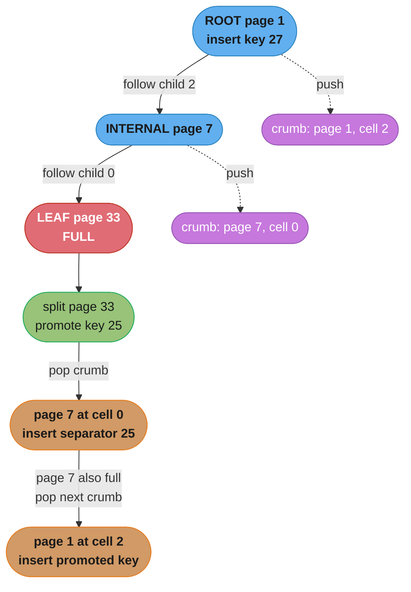
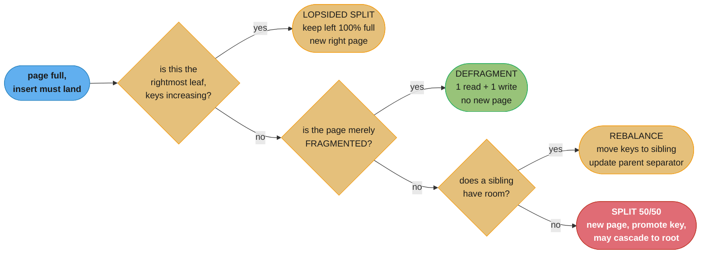

# Chapter 4: Implementing B-Trees

> Part I — Storage Engines · Database Internals (Petrov, 1st ed., O'Reilly 2019) · builds on
> Ch 2 (B-Tree Basics) and Ch 3 (File Formats), leads to Ch 5 (Transaction Processing and Recovery)

## Chapter Map

Chapter 2 gave the B-tree as an algorithm: high fanout, separator keys, splits on overflow, merges
on underflow. Chapter 3 gave the page as a byte layout: a header, a sorted offset array, cells
growing back from the end. Chapter 4 is where those two meet reality, and reality turns out to
have a long list of complaints. The algorithm says "insert the promoted key into the parent" — but
a page on disk has no parent pointer, so how did you get there and how do you get back? The
algorithm says "a node with n keys has n+1 pointers" — but a slotted page stores one key per cell,
so where does the extra pointer live? The algorithm says "split the node in half" — but if keys
only ever increase, half of every page you create is dead space forever. And nothing in the
algorithm accounts for the fact that a node whose keys grow may no longer fit the page it lives
in, that deleted cells leave holes, or that pages get compressed.

This is the chapter that turns a textbook B-tree into a storage engine, and its structure follows
the lifecycle of a real page: what the **page header** must carry (magic numbers, sibling links,
the rightmost pointer, high keys, overflow pages), how **search inside a page** actually works
given Chapter 3's indirection, how **splits and merges propagate upward** without parent pointers
(breadcrumbs), how **rebalancing** avoids splits altogether, how **right-only appends** and **bulk
loading** exploit known-ordered input, how **compression** interacts with fixed-size pages, and
finally how the accumulated damage of updates and deletes is repaired by **vacuum and page
defragmentation**.

**TL;DR:**
- The **page header** carries what navigation and maintenance need: a **magic number** for
  validation, **sibling links** for range scans, the **rightmost pointer** for the n+1-th child,
  a **high key** bounding the node's range, cell count, and free-space boundaries.
- **Sibling links make range scans cheap and splits expensive** — a split must update a page that
  is not on the search path, which means locking more pages and creating a window where the tree
  is inconsistent.
- **High keys** give the rightmost pointer a bounded range (making every pointer uniform) and are
  the basis of the **Blink-tree** trick that lets a reader detect and follow a concurrent split.
- **Values larger than a page** go to chained **overflow pages**, with the primary page keeping a
  prefix and a pointer, so a minimum number of cells still fits per page.
- **Binary search runs over the sorted offset array, not the cells** — every comparison is an
  indirection, and a miss returns the **insertion point**, which is exactly what an insert needs.
- Splits and merges propagate up without parent pointers by keeping **breadcrumbs**: a stack of
  (page id, cell index) recorded during the descent and popped on the way back.
- **Rebalancing** (moving elements to a sibling with room) postpones splits and raises occupancy
  toward the B*-tree's 2/3 guarantee, at the cost of extra writes and a parent separator update.
- **Right-only appends** get a cached rightmost leaf and a **lopsided split**; presorted data
  skips the tree machinery entirely via **bulk loading**, building full pages bottom-up.
- Updates and deletes fragment pages; **page defragmentation** rewrites the live cells
  contiguously, which is safe only because Chapter 3 made a cell's identity its slot index.

## The Big Question

> A B-tree's algorithm is four pages of pseudocode. A B-tree implementation is tens of thousands
> of lines. Where does all that code go?

Analogy: the algorithm is a recipe that says "fold the mixture into the pan and bake." The
implementation is a commercial kitchen that also has to answer: what if the pan is already full,
what if the ingredient is bigger than the pan, how does the person at the oven know which counter
the mixture came from, what happens if two cooks reach for the same pan at once, what do you do
with the pans that are half-empty at the end of service, and how do you know a pan is actually
yours and not one that got mixed in from the restaurant next door. None of those questions are in
the recipe, none of them are optional, and every one of them is a section of this chapter. The
recipe is the part that was already solved in 1972; everything since has been kitchen management.

---

## 4.1 Page Header

The page header is the fixed-size prologue Chapter 3 established, and this chapter fills it in.
It holds **the information navigation, maintenance, and optimization need before anything on the
page can be interpreted**: how the page is laid out, how many cells it holds, where free space
begins and ends, and what kind of node it is.

A representative header, assembled from the fields the chapter discusses:

```
  B-TREE PAGE HEADER -- 24 bytes at offset 0 of every page

  off  size  field              purpose
  ---  ----  -----------------  -------------------------------------------------
   0    4    magic              constant; validates this really is one of our pages
   4    2    flags              IS_LEAF, HAS_OVERFLOW, HAS_DELETED_CELLS ...
   6    2    cell_count         how many slots the offset array holds
   8    2    free_start         first free byte after the offset array
  10    2    free_end           lowest-addressed cell; free space = free_end-free_start
  12    2    frag_bytes         bytes stranded in the availability list
  14    4    rightmost_ptr      the (n+1)-th child, which has no separator key
  18    4    right_sibling      next page at this level, or NULL
  --   --    (left_sibling, high_key, checksum, LSN in real headers)

  EVERY FIELD HERE IS READ BEFORE ANY CELL IS. That is why Chapter 3's
  bit-packed flags matter -- this struct is multiplied by the whole read
  workload and it competes for the same bytes as the keys that set fanout.
```

Caption: the header is small, fixed, and read on literally every page access — which is why each
of the following sub-sections is a debate about whether one more field earns its four bytes.

Real implementations differ in what they include. **SQLite**'s B-tree page header carries the cell
count, the offset of the start of the cell content area, the number of fragmented free bytes, and
the rightmost pointer. **PostgreSQL**'s page header carries the LSN of the last change, a
checksum, flag bits, and the `pd_lower`/`pd_upper` boundaries that are exactly Chapter 3's
`free_start`/`free_end`. **MySQL/InnoDB** carries page type, page number, LSN, checksum, and
level-in-tree among other implementation-specific values. The set differs; the *shape* — fixed
size, read first, describes everything after it — does not.

### Magic Numbers

A **magic number** is a constant multi-byte value written at a known offset — the start of a file
or of a page — whose only job is to be checked. On load, the reader compares the bytes it finds
against the constant it expects; a mismatch means the page is corrupted, or the file was opened at
the wrong offset, or it is not the kind of file the reader thinks it is.

```
  page 3 of an 8 KB file, read at byte offset 3 * 8192 = 24576

  expected:  50 41 47 45   ("PAGE")
  found:     50 41 47 45   -> proceed

  BROKEN CASE -- an off-by-one in page-to-offset arithmetic, reading at 24575

  found:     00 50 41 47   -> magic mismatch, refuse immediately

  WITHOUT the magic number, the shifted read gives:
    cell_count  = a plausible-looking small integer
    free_start  = a plausible-looking small integer
    offsets     = plausible-looking addresses INTO THE PAGE
  ...and the engine parses garbage as a valid node, returning wrong rows
  rather than an error. The magic number converts a silent wrong answer
  into a loud refusal, for four bytes.
```

Caption: the value of a magic number is not that it catches corruption a checksum would miss — it
is that it fails *immediately, before any parsing*, turning a class of misinterpretation bugs into
an assertion rather than a wrong query result.

### Sibling Links

**Sibling links** are forward and backward pointers to the left and right pages at the same level,
stored in the header. Chapter 2 introduced them for range scans: once a descent has reached the
starting leaf, the scan walks forward leaf to leaf through the links rather than climbing back to
the parent and re-descending for each subsequent leaf.

The chapter's contribution here is the cost side. **Sibling links complicate splits and merges**,
and the reason is structural: a split creates a new page that must be spliced into a doubly linked
list, which means writing to a page that is *not on the search path*.

```
  BEFORE THE SPLIT -- three leaves, doubly linked

     +--------+       +--------+       +--------+
     |  L1    |<----->|  L2    |<----->|  L3    |
     | 10..19 |       | 20..29 |       | 30..39 |
     +--------+       +--------+       +--------+
                       ^ full, must split

  AFTER SPLITTING L2 INTO L2 AND L2'

     +--------+       +--------+       +--------+       +--------+
     |  L1    |<----->|  L2    |<----->|  L2'   |<----->|  L3    |
     | 10..24 |       | 20..24 |       | 25..29 |       | 30..39 |
     +--------+       +--------+       +--------+       +--------+
          ^                                 ^                ^
          |                                 |                |
     untouched                          NEW page        L3.left MUST be
                                                        repointed at L2'

  PAGES THAT MUST BE WRITTEN:  L2, L2' (new), L3, and the PARENT.
  PAGES ON THE SEARCH PATH:    root ... parent, L2.
  L3 IS NOT ON THE SEARCH PATH. To update it safely you must acquire it
  and latch it, which is (a) an extra I/O, (b) a lock ordering hazard --
  a concurrent scan holding L3 and walking LEFT wants L2 at the same
  moment you hold L2 and want L3. Classic deadlock shape.
```

Caption: the entire cost of sibling links is in that last block — a structure that makes reads
cheap by linking pages horizontally forces writes to touch pages the search path never visited,
and that is where both the extra I/O and the concurrency hazards come from.

The chapter's framing is that this is a genuine tradeoff rather than an obvious win, and
implementations land on different sides of it. Some maintain full doubly linked siblings and pay
the split complexity. Some maintain only forward links, halving the update cost and giving up
backward range scans (or reconstructing them through the parent). Some omit sibling links
entirely and reach a neighbouring leaf by going back up to the parent and down again — more I/O
per scan step, but splits touch only the search path. The **Blink-tree** takes a third position:
keep a forward link, and use it together with high keys so that a reader who lands on a page that
has since split can *detect that* and follow the link, which turns the sibling pointer from a
liability during splits into the mechanism that makes concurrent splits safe.

### Rightmost Pointers

A B-tree node with `n` separator keys has `n + 1` child pointers. In Chapter 3's cell layout, a
key cell holds one key and one page ID — so `n` cells carry `n` keys and `n` pointers, and the
last pointer has no key to attach to. Where does it go?

```
  A NODE WITH 3 SEPARATOR KEYS AND 4 CHILDREN

     p0   [ 11 ]   p1   [ 15 ]   p2   [ 21 ]   p3
     |             |             |             |
     v             v             v             v
   <11          11..15        15..21         >=21
                                              ^^^
                                        NO SEPARATOR KEY
                                        FOLLOWS THIS ONE

  KEY CELLS AVAILABLE:  (11 -> p0), (15 -> p1), (21 -> p2)
  ...three cells, three pointers. p3 is homeless.

  OPTION A -- store p3 in the PAGE HEADER as `rightmost_ptr`.
              simple, costs 4 bytes of header.
              but the pointer is now ASYMMETRIC: three children are
              described by cells, one by a header field, and every piece
              of code that walks children needs a special case for it.

  OPTION B -- give the node a HIGH KEY, so p3's range becomes [21, high_key)
              and the last pointer looks exactly like the others.
```

Caption: this is a pure representation problem created by pairing each pointer with a key inside
one cell — and it is worth noticing that the two fixes have very different downstream
consequences, because Option B turns out to solve concurrency problems the header field cannot
touch.

The chapter presents the header field as what many implementations do (SQLite's page header holds
the rightmost pointer directly), while noting its cost: a special case in every child-traversal
path, and one more thing to get right during splits and merges when the rightmost child changes.

### Node High Keys

A **high key** is the **upper bound of the key range a subtree can hold** — the highest key that
can appear anywhere below this node. Storing it in the page header changes the node's geometry:

```
  SAME NODE, NOW WITH A HIGH KEY OF 25

  header: high_key = 25,  rightmost_ptr = p3

     p0   [ 11 ]   p1   [ 15 ]   p2   [ 21 ]   p3        (high key 25)
     |             |             |             |
     v             v             v             v
  [-inf,11)     [11,15)       [15,21)       [21,25)
                                              ^^^^^^
                                    NOW BOUNDED. every pointer,
                                    including the last, describes a
                                    half-open interval [low, high).

  WITHOUT A HIGH KEY the last range is [21, +inf) and you cannot tell,
  from the node alone, whether key 30 belongs in this subtree or in one
  reachable only via the parent -- you have to remember the parent's
  separator to know. WITH a high key the node is SELF-DESCRIBING.
```

Caption: the high key makes a node carry its own range bound instead of inheriting it implicitly
from the parent, and self-describing is exactly the property that lets a reader validate that it
is on the right page.

The second payoff is the one that matters for concurrency, and it is the **Blink-tree**
construction. Suppose a reader descends to a leaf, and between the moment the parent was read and
the moment the leaf was read, another thread split that leaf and moved the upper half of the keys
into a new right sibling. The reader is now on a page that no longer contains the key it wants,
and without a high key it cannot tell — the key is simply absent, and "absent" is
indistinguishable from "does not exist."

```
  READER'S VIEW OF A CONCURRENT SPLIT

  t0  reader reads parent, learns "key 27 is under page L2"
  t1  writer splits L2: keys >= 25 move to a NEW page L2'
                        L2.high_key := 25
                        L2.right_sibling := L2'
                        (the parent has NOT been updated yet)
  t2  reader reads L2, searches for 27 -> NOT FOUND

      WITHOUT high keys:  reader concludes 27 does not exist.  WRONG.
      WITH high keys:     27 >= L2.high_key (25), so the reader knows the
                          page's range no longer covers 27, follows
                          L2.right_sibling to L2', and finds it.  CORRECT.

  This is the "half-split" state: the split of the leaf is done, the
  parent update is not, and the tree is STILL CORRECT to read because
  the high key plus the sibling link give a reader a way to recover.
```

Caption: the high key converts a window of inconsistency into a *detectable and recoverable* one,
which is why the Blink-tree can let readers proceed without blocking against a concurrent split —
the single most important reason high keys are worth their bytes.

### Overflow Pages

Pages are fixed size; keys and values are not. A 2 MB value cannot fit in a 16 KB page, and
allocating variable-size pages to accommodate it would destroy the page-aligned addressing
(page id × page size) that everything else depends on.

The solution is **overflow pages**: the primary page stores as much of the payload as it is
allowed to, plus a pointer to an overflow page holding the remainder; if the remainder is still
too large, overflow pages **chain**.

```
  A 40 KB VALUE IN AN 8 KB-PAGE TREE

  LEAF PAGE (8 KB)
  +--------+---------+-------------------------------+----------------------+
  | header | offsets | ...                           | cell for key 15      |
  +--------+---------+-------------------------------+----------------------+
                                                     | key    "15"          |
                                                     | prefix  first 1 KB   |
                                                     | overflow_page = 512  |
                                                     +----------------------+
                                                                |
                     +------------------------------------------+
                     v
  OVERFLOW 512 -> OVERFLOW 513 -> OVERFLOW 514 -> ... -> OVERFLOW 518
   ~8 KB each         ~8 KB           ~8 KB                 remainder
   next=513           next=514        next=515              next=NULL

  READING key 15's value = 1 sequential leaf read + 6 chained page reads.
  READING key 15's KEY (for a range scan or a comparison) = 0 extra reads,
  because the key and the prefix stayed on the primary page. That split is
  deliberate: navigation must never pay for payload it does not need.
```

Caption: the design keeps the *searchable* part of a record — the key, and often a prefix of the
value — on the primary page so that traversal and range scans never chase the chain, and pays the
chain cost only when the full value is actually requested.

The remaining question is **when** to overflow, and the answer is expressed as a threshold rather
than "when it does not fit." If a page were allowed to hold a single enormous cell, the tree's
fanout at that page would collapse to one and the structure would degenerate. So implementations
require that **a minimum number of cells still fit on a page** — SQLite, for example, is designed
around at least four cells per page — and any cell that would violate that threshold is truncated
to a prefix with the rest sent to overflow. The threshold is what keeps fanout, and therefore tree
height, under control even in the presence of large values.

---

## 4.2 Binary Search

Chapter 2 said a lookup binary-searches within a node. Chapter 3 explained why that is possible:
the offset array is fixed-width and sorted by key. This section joins them.

Searching a page means binary-searching the **offset array**, where every comparison requires a
dereference:

```
def search_page(page, target):
    lo, hi = 0, page.cell_count - 1
    while lo <= hi:
        mid = (lo + hi) // 2
        offset = page.offsets[mid]        # 2-byte read at a computed address
        key    = read_key(page, offset)   # INDIRECTION: jump to the cell
        if key == target:
            return mid                    # found: slot index
        elif key < target:
            lo = mid + 1
        else:
            hi = mid - 1
    return -(lo + 1)                       # NOT found: encodes the insertion point
```

Two details carry all the weight.

**The return value on a miss is not "absent" — it is the insertion point.** A search that fails
still tells you exactly where the key *would* go, and that is precisely what an insert needs. The
convention the chapter describes is to encode it in the sign: return the found index if the key
exists, and `-(insertion_point + 1)` if it does not. The `+1` is necessary because insertion point
0 would otherwise encode as `-0`, which is indistinguishable from a hit at index 0. So one search
serves lookup, insert, and range-scan-start, with no second traversal.

**A search on an internal node does not look for equality** — it looks for the child to descend
into. It finds the insertion point among the separator keys and follows the corresponding pointer,
which is why the same routine drives the whole root-to-leaf descent.

### Binary Search with Indirection Pointers

The subtlety worth isolating: **the array being searched and the data being compared live in
different places**.

```
  BINARY SEARCH OVER OFFSETS, COMPARING KEYS -- looking for 15

  OFFSET ARRAY (sorted BY KEY, contiguous, fixed 2 B stride)
  index:      0        1        2        3        4
            +------+ +------+ +------+ +------+ +------+
            | 8140 | | 7892 | | 8100 | | 7990 | | 7936 |
            +------+ +------+ +------+ +------+ +------+
               |        |        |        |        |
               |        |        |        |        |
  CELLS (arrival order, scattered across the page)
        7892:[k=12]  7936:[k=21]  7990:[k=15]  8100:[k=13]  8140:[k=10]
               ^        ^            ^            ^           ^
               |        |            |            |           |
               +--------|------------|------------|-----------+ index 0 -> k=10
                        |            |            +------------ index 2 -> k=13
                        |            +------------------------- index 3 -> k=15
                        +-------------------------------------- index 4 -> k=21

  STEP 1  lo=0 hi=4  mid=2  offsets[2]=8100  key=13  13 < 15  -> lo=3
  STEP 2  lo=3 hi=4  mid=3  offsets[3]=7990  key=15  MATCH    -> return 3

  2 comparisons for 5 cells. log2(400) = ~9 comparisons for a full 8 KB page.

  THE COST: each comparison is a POINTER CHASE within the page -- read the
  2-byte offset, then read the key at that address. Both reads hit the same
  already-resident page, so it is cache traffic, not I/O -- but the cells are
  in arrival order, so the accesses are effectively random within the page and
  will not prefetch the way a packed sorted key array would.
```

Caption: the indirection is what buys mutation-without-movement from Chapter 3, and its price is
paid here as scattered access within a resident page — a cache cost, never a disk cost, which is
exactly the trade a storage engine wants to make.

That last point is what makes the whole design work: the indirection converts a **disk-level**
cost (moving kilobytes of cells on every insert) into a **cache-level** cost (a few extra
random reads inside a page that is already in memory). Given the orders of magnitude Chapter 2
established between the two, it is not a close call. Implementations that want the cache locality
back sometimes store a small prefix of each key inside the offset array itself, so most
comparisons resolve without dereferencing at all.

---

## 4.3 Propagating Splits and Merges

A split promotes a key into the parent, which may itself overflow and split, propagating toward
the root. A merge removes a separator from the parent, which may underflow and merge in turn. Both
require **getting back to the parent from a child** — and a page on disk holds no parent pointer.

The chapter lays out two approaches.

**Approach 1: parent pointers in each node.** Store the parent's page ID in every page's header.
Going up is then a single read.

```
  PARENT POINTERS -- what they cost

  a node SPLITS into two, and every child of the new right node must have
  its parent pointer rewritten:

     before:  P
             /|\
            A B C D E F        (six children, all pointing at P)

     after:   P1        P2
             /|\        /|\
            A B C      D E F

     pages that must be WRITTEN: P1, P2, the grandparent, AND D, E, F --
     three pages whose CONTENTS did not change at all, rewritten purely
     to fix a back-pointer. On a fanout-200 node, that is up to 100 pages
     written per split.
```

Caption: parent pointers make going up trivial and make splitting expensive in exact proportion to
fanout — which is the wrong direction, because high fanout is the entire reason the structure
exists.

**Approach 2: breadcrumbs.** Do not store the parent at all. Record the path *while descending*,
which you were traversing anyway, and use it on the way back up.

### Breadcrumbs

A **breadcrumb** is a `(page_id, cell_index)` pair pushed onto a stack at each level of the
descent: the page visited, and which child pointer was followed out of it. When a split needs to
promote a key, it pops the stack to find the parent and the exact position to insert at — no read
required to find the parent, because it was already read on the way down and is almost certainly
still in the page cache.



Caption: the breadcrumb stack is free information — the descent already visited every one of those
pages — so it replaces a per-page parent pointer field and, more importantly, replaces the
fanout-proportional rewrite cost that pointer would impose on every split.

Concretely, for a tree of height 4 the stack holds at most 4 entries, roughly 24 bytes, and it is
discarded when the operation completes. Compare that to 4 bytes of header in every page in the
tree, plus the rewrites.

**The concurrency caveat.** A breadcrumb is a snapshot, and by the time the split walks back up,
another thread may have split that very parent — so the recorded `cell_index` may now point at the
wrong slot, or the parent may no longer be the parent of this key range at all. The chapter's
answer is to **re-validate on the way up** rather than trust the crumb blindly: check that the
parent still covers the key range being promoted, and if it does not, use the high key and sibling
link (§4.1) to walk right until you find the page that does. This is the same recovery mechanism
the Blink-tree gives readers, reused for writers.

---

## 4.4 Rebalancing

Splitting on overflow is not the only option. An implementation can, when a node is full,
**move some of its elements to a sibling that has room** instead of creating a new page —
**load balancing**, or **rebalancing**, between siblings.

```
  OVERFLOW WITH A NON-FULL SIBLING -- two responses

  parent:  [ ... | 20 | ... ]
                  /      \
            L (5/5 FULL)   R (2/5)
            [10 12 14 16 18]  [20 22 _ _ _]
            insert 19 -> L overflows

  RESPONSE A -- SPLIT
     L -> [10 12 _ _ _]   Lnew -> [14 16 18 19 _]   promote 14
     result: 3 pages at this level, occupancies 2/5, 4/5, 2/5
             average occupancy 53%. One NEW page allocated.
             writes: L, Lnew, parent = 3 pages

  RESPONSE B -- REBALANCE INTO THE SIBLING
     move 18, 19 from L into R, update the parent separator 20 -> 18
     L -> [10 12 14 16 _]  R -> [18 19 20 22 _]
     result: 2 pages, occupancies 4/5, 4/5
             average occupancy 80%. NO new page.
             writes: L, R, parent = 3 pages

  SAME NUMBER OF WRITES. Very different space outcome -- and the split
  is DEFERRED, not avoided, so B also postpones the next tree-height
  increase.
```

Caption: rebalancing and splitting cost the same three page writes here, but rebalancing leaves
the level 80% full instead of 53% and allocates nothing — the payoff is space and a deferred
split, not fewer writes.

The chapter frames the benefit precisely: **higher occupancy means fewer pages for the same data,
which means a shorter tree and fewer pages to read for a scan**. A standard B-tree only guarantees
that nodes are at least half full; the **B\*-tree**, which rebalances between siblings before
splitting, raises that guarantee to roughly **two-thirds full**. When a split does eventually
become unavoidable, a B*-tree splits two full sibling nodes into three, distributing their combined
contents rather than halving one.

The costs are real and worth stating:

- **Extra I/O.** Rebalancing writes the sibling, a page the operation would not otherwise have
  touched, and must read it first to know whether it has room.
- **A parent update on every rebalance.** Moving keys across the boundary changes the separator,
  so the parent is written even though nothing split.
- **More locking under concurrency.** Two leaves and a parent are modified together, and the
  sibling is off the search path — the same hazard sibling links introduced in §4.1.
- **Write amplification.** The same keys may be moved between siblings several times before they
  finally settle, so a write-heavy workload pays repeatedly for the space it saves.

The chapter's practical conclusion is that rebalancing is a **space-utilization optimization**,
correct for read-mostly and space-sensitive workloads, and an unattractive trade for
write-throughput-dominated ones.

---

## 4.5 Right-Only Appends

Enormously common workloads insert **monotonically increasing keys**: auto-increment primary keys,
timestamps, sequence numbers, UUIDv7 and other time-ordered identifiers. Every one of those
inserts lands in the **rightmost leaf** of the tree, and a general-purpose B-tree handles that case
badly in two distinct ways.

**Problem 1: the descent is wasted work.** Every insert walks root-to-leaf, comparing keys, only
to arrive at the same page it arrived at last time. The fix is to **cache (or pin) the rightmost
leaf** and check it first — if the new key is greater than every key in the tree and the cached
page has room, the insert skips the traversal entirely. PostgreSQL implements exactly this as a
**fastpath** for right-most-leaf insertions.

**Problem 2: the 50/50 split wastes half of every page, permanently.**

```
  SPLITTING THE RIGHTMOST LEAF WHEN KEYS ONLY EVER INCREASE

  page holds keys 1000..1399 (400 keys, FULL). insert 1400.

  BALANCED 50/50 SPLIT (the general-purpose rule)
     left  <- 1000..1199   (200 keys, 50% full)
     right <- 1200..1399 + 1400   (201 keys, 50% full)

     the LEFT page will NEVER receive another key, because every future
     key is larger than 1399. It is frozen at 50% forever.
     over a million sequential inserts, HALF THE INDEX IS EMPTY SPACE.

  LOPSIDED SPLIT (the right-only-append optimization)
     left  <- 1000..1399   (400 keys, 100% full -- stays full forever)
     right <- 1400         (1 key, and it is the new insertion point)

     space utilization approaches 100% instead of 50%.
     the index is HALF THE SIZE, so a full scan is half the I/O and
     twice as much of it fits in the page cache.
```

Caption: the general-purpose 50/50 rule is optimal under random insertion and pathological under
sequential insertion, and the entire fix is to detect the sequential case and split unevenly —
which doubles effective index density for the single most common primary-key pattern in practice.

SQLite implements this under the name **quick balance**, precisely to avoid the useless
half-empty page that a balanced split of a rightmost node produces.

### Bulk Loading

If the data is *already sorted* — loading a table from an export, rebuilding an index, copying a
tree — then the tree machinery is entirely unnecessary. **Bulk loading** builds the tree
**bottom-up** in one pass:

```
  BULK LOADING A PRESORTED KEY STREAM

  STEP 1  fill leaf pages to the target fill factor, in order, no splits
          leaf0 [1000..1399]  leaf1 [1400..1799]  leaf2 [1800..2199] ...

  STEP 2  build the parent level from the FIRST KEY of each leaf
          internal0 [ 1000->leaf0 | 1400->leaf1 | 1800->leaf2 | ... ]

  STEP 3  repeat upward until one page remains -- that page is the root.

  vs INSERTING THE SAME KEYS ONE AT A TIME:
     splits performed         bulk: 0            inserts: ~1 per full page
     pages written more
       than once              bulk: 0            inserts: every page, repeatedly
     final occupancy          bulk: ~100%        inserts: ~50-70%
     tree written             bulk: sequentially inserts: with random-ish writes
                                    to disk             back into earlier pages
```

Caption: the win is not a constant factor on one operation — bulk loading removes splits, removes
repeated writes of the same page, and produces a denser tree, so the loaded index is both faster
to build and permanently cheaper to scan.

Two conditions bound the technique. The input **must** be sorted; if it is not, sort it first (an
external sort of the input is usually still far cheaper than the splits and rewrites the
alternative incurs). And the target **fill factor** is a deliberate choice: filling pages to 100%
gives the densest possible tree but guarantees that the very first insert into any page splits it,
so an index expecting future writes is typically loaded to something like 70–90% instead, leaving
room for growth.

---

## 4.6 Compression

Pages contain highly compressible data — repeated key prefixes, sparse values, padding — and
compression trades CPU for I/O and for cache residency. The chapter's treatment is a granularity
question, because compression fundamentally conflicts with the fixed-size page that everything
else depends on.

| Granularity | How it works | Why it hurts |
|---|---|---|
| **Whole file** | Compress the entire data file | Reading one page requires decompressing everything before it. Random access is destroyed. Unusable for a B-tree |
| **Per page** | Compress each page independently | A compressed page has a **variable** size, so `offset = page_id * page_size` no longer holds — you need an indirection table mapping page IDs to (offset, compressed length), which is itself a structure to maintain and persist |
| **Per cell / per row** | Compress individual records | Addressing is untouched, and only the records you actually read get decompressed. But the compression ratio is much worse, because a single small record offers the algorithm almost no redundancy to exploit |

The core tension the chapter names is **compression ratio versus performance**, and the page-level
option is where most engines land because it is the only one that both preserves random access to
a *page* and gives the compressor enough data to work with. The price is the indirection table and
the fact that a page whose compressed size grows after an update may no longer fit where it was.

```
  WHY PAGE-LEVEL COMPRESSION BREAKS ARITHMETIC ADDRESSING

  UNCOMPRESSED -- page id maps to a byte offset by multiplication
     page 0 @ 0      page 1 @ 8192   page 2 @ 16384   page 3 @ 24576
     offset(id) = id * 8192            O(1), no state

  COMPRESSED -- each page is a different size
     page 0 @ 0      page 1 @ 2100    page 2 @ 5800   page 3 @ 6900
     sizes: 2100     3700             1100            2600

     offset(id) = LOOK IT UP. requires a persistent map:
        id -> (file_offset, compressed_length)
     ...which must be read on every access, cached, updated on every
     write, and recovered after a crash. Compression did not just cost
     CPU -- it added a whole index of its own.

  AND: updating page 1 so it compresses to 4000 bytes means it no longer
  fits in its 3700-byte slot, so it must be relocated and the map updated.
  This is Chapter 3's fragmentation problem, one level up.
```

Caption: compression is never only a CPU-versus-bytes trade in a page-based engine — it converts a
computable address into a looked-up one, which drags in an indirection structure with its own
persistence, caching, and fragmentation problems.

Algorithm choice sits on the same ratio-versus-CPU curve, and the chapter does not prescribe one.
*(beyond the book)* In current practice the fast end of the curve is occupied by LZ4 and Snappy —
low ratio, gigabytes per second per core — and the higher-ratio end by Zstandard and zlib, with
Zstandard's tunable levels making it the common default in newer engines.

---

## 4.7 Vacuum and Maintenance

The final section deals with the damage that accumulates from normal operation. B-trees are
mutable structures, and mutation leaves the physical layout progressively worse than the logical
content justifies.

### Fragmentation Caused by Updates and Deletes

Three distinct mechanisms degrade a page:

**Deletes do not remove cells.** As Chapter 3 established, deleting a record removes its entry from
the offset array and adds its region to the availability list. The cell's bytes remain, now
stranded as a hole. Nothing shrinks.

**Updates that grow a record relocate it.** If a value grows past the space its cell occupies, the
cell cannot expand in place — the cells around it are already there. So the new version is written
into free space elsewhere in the page and the old region joins the availability list, leaving a
hole exactly the size of the old cell.

**Whole pages become empty.** Deletes may empty a page entirely. It is unlinked from the tree and
added to a **free page list** for reuse — but the file does not shrink, because the page may sit
in the middle of it.

```
  ONE PAGE'S DECAY OVER A DAY OF NORMAL TRAFFIC

  t0  freshly loaded, 400 cells, contiguous
      [hdr][400 offsets][----------- free 200 B ----------][400 cells packed]
      largest contiguous free run: 200 B     frag_bytes: 0

  t1  120 deletes
      [hdr][280 offsets][---- free 440 B ----][cells with 120 HOLES]
      largest contiguous free run: 440 B     frag_bytes: 2400  (avg 20 B each)

  t2  90 updates that grew records by ~8 B each
      [hdr][280 offsets][- free 20 B -][cells, now 210 HOLES, badly mixed]
      largest contiguous free run: 20 B      frag_bytes: 4100

  t3  insert a 300-byte record
      total free space  = 20 + 4100 = 4120 B   PLENTY
      largest usable run = 300? NO -- biggest hole is 96 B
      -> the insert CANNOT be served, despite 4 KB free.
      -> DEFRAGMENT, or SPLIT a page that is only half full of live data.

  Splitting here would be the WRONG fix: it allocates a page and permanently
  halves occupancy to solve a problem that is purely layout.
```

Caption: the failure mode is that a page reports abundant free space and still refuses an insert —
and the naive response (split it) makes the tree permanently worse in exchange for solving a
problem that a rewrite of a single page would have solved for free.

### Page Defragmentation

**Defragmentation** (the page-level part of what databases call **vacuum**) repairs this by
**rewriting the page's live cells contiguously**:

```
  PAGE DEFRAGMENTATION -- before and after

  BEFORE (frag_bytes = 4100, largest hole = 96 B)
  +--------+-----------+------+-----------------------------------------------+
  | header | 280 offs  | free |  c c HOLE c HOLE HOLE c c HOLE c HOLE c c ...  |
  |        | 8140 7892 | 20 B |  scattered live cells among 210 dead regions   |
  |        | 8100 ...  |      |                                               |
  +--------+-----------+------+-----------------------------------------------+

  PROCEDURE
    1. allocate a scratch page
    2. walk the offset array IN SLOT ORDER (which is KEY order)
    3. copy each live cell to the scratch page, appending from the end
    4. record each cell's NEW offset in the new offset array,
       at the SAME SLOT INDEX
    5. frag_bytes := 0 ; free_end := new boundary ; availability list := empty
    6. write the scratch page over the original

  AFTER (frag_bytes = 0, largest hole = 4120 B contiguous)
  +--------+-----------+---------------------------------+---------------------+
  | header | 280 offs  |     free 4120 B contiguous      | 280 live cells      |
  |        | (SAME     |                                 | packed, in KEY order|
  |        |  indices, |                                 |                     |
  |        |  new offs)|                                 |                     |
  +--------+-----------+---------------------------------+---------------------+

  WHY NOTHING OUTSIDE THE PAGE BREAKS: every external reference is a SLOT
  INDEX, and slot indices are preserved exactly. Byte offsets all changed;
  nobody outside the page ever knew them. This is Chapter 3's third
  requirement -- reference a record without regard to its location -- being
  cashed in.

  BONUS: the cells now sit in KEY order physically, so the scattered
  within-page access of a binary search (section 4.2) becomes sequential.
```

Caption: defragmentation is one page read, one page write, and a complete reset of that page's
space accounting — cheap enough to do opportunistically on a write, which is why it is preferable
to letting fragmentation force a split.

The chapter notes that defragmentation and page reclamation run either **in the background** (a
maintenance process scanning for damaged pages) or **opportunistically** (defragment a page at the
moment an insert into it would otherwise fail). Whole pages emptied by deletes go onto the free
page list, and because they may sit anywhere in the file, shrinking the file itself requires
relocating live pages into the low-numbered free ones and truncating — a heavier operation, which
is why PostgreSQL separates the routine `VACUUM` from the rewriting `VACUUM FULL`.

---

## Visual Intuition

```
  THE FOUR HEADER FIELDS AND THE PROBLEM EACH ONE SOLVES

                      +---------------------------+
                      |       PAGE HEADER         |
                      +---------------------------+
                              |    |    |    |
        +---------------------+    |    |    +----------------------+
        |                          |    |                           |
        v                          v    v                           v
    magic                 rightmost_ptr  high_key            sibling links
        |                          |    |                           |
  "am I even                "where does  "does this          "how do I reach
   a page?"                  the n+1-th   page still          the next leaf
        |                    pointer      cover my            without going
        |                    live?"       key?"               back up?"
        |                          |    |                           |
        v                          v    v                           v
  catches misaligned      the n keys/    validates a         O(1) range-scan
  reads BEFORE any        n+1 pointers   descent AND         steps
  parsing happens         asymmetry      enables the                |
                                 |       Blink-tree                 |
                                 |       concurrent-split           |
                                 +-----> recovery <-----------------+
                                         (high key + sibling link
                                          TOGETHER, neither alone)

  The bottom row is the point: high keys and sibling links are usually
  presented as independent optimizations, but their real payoff is the
  one thing they only do TOGETHER -- letting a reader survive a split
  that happened underneath it.
```

Caption: each header field exists to solve one specific implementation problem the algorithm never
raised, and the two that look most optional — high keys and sibling links — combine into the
mechanism that makes concurrent B-tree access practical.



Caption: a full page has four possible responses ordered by cost, and most of this chapter is
about arranging to take one of the cheap ones — the plain 50/50 split is the fallback, not the
default.

---

## Key Concepts Glossary

- **Page header** — the fixed-size prologue of every page, carrying layout, navigation, and
  maintenance metadata read before any cell is interpreted.
- **Magic number** — a constant multi-byte value at a known offset, validated on load to catch
  corruption and misaligned reads before parsing.
- **Sibling links** — forward and/or backward pointers to the adjacent pages at the same level;
  cheap range scans, expensive splits.
- **Rightmost pointer** — the (n+1)-th child pointer of a node with n separator keys, which has no
  key to pair with and is therefore stored in the header.
- **High key** — the upper bound of the key range a subtree may contain, stored in the node so the
  node is self-describing.
- **Blink-tree** — a B-tree variant using high keys plus forward sibling links so a reader can
  detect a concurrent split and follow the link instead of blocking.
- **Half-split state** — the window in which a page has split but the parent has not yet been
  updated; readable correctly thanks to high keys and sibling links.
- **Overflow page** — a page holding the remainder of a payload too large for its primary page;
  chained when one is not enough.
- **Overflow threshold** — the rule limiting how much of a page one cell may occupy (SQLite is
  designed around at least four cells per page), which protects fanout.
- **Insertion point** — what a failed binary search returns, encoded as `-(index + 1)`, so one
  search serves lookup, insert, and scan-start.
- **Indirection pointers (in search)** — the property that binary search runs over the offset array
  while comparisons dereference into scattered cells.
- **Breadcrumbs** — a stack of `(page_id, cell_index)` pairs recorded during the descent and popped
  during split/merge propagation, replacing parent pointers.
- **Parent pointer** — the alternative to breadcrumbs; a page ID in every header, whose cost is a
  fanout-proportional rewrite on every split.
- **Rebalancing (load balancing)** — moving elements from a full node into a sibling with room
  rather than splitting.
- **B\*-tree** — a variant that rebalances before splitting, raising the occupancy guarantee from
  about one-half to about two-thirds and splitting two full nodes into three.
- **Right-only append** — the insertion pattern produced by monotonically increasing keys, in which
  every insert lands in the rightmost leaf.
- **Fastpath / quick balance** — the optimizations for right-only appends: cache the rightmost leaf
  (PostgreSQL's fastpath) and split it unevenly rather than 50/50 (SQLite's quick balance).
- **Bulk loading** — building a tree bottom-up from presorted input, with no splits and pages
  filled to a chosen fill factor.
- **Fill factor** — the target fullness for bulk-loaded pages, traded off between density and
  headroom for future inserts.
- **Compression granularity** — whole-file (destroys random access), per-page (needs an
  indirection table because compressed pages vary in size), or per-cell (poor ratio).
- **Fragmentation** — a page whose total free space exceeds an incoming record's size while no
  contiguous run does; caused by deletes and by updates that relocate a growing cell.
- **Availability list / free page list** — the in-page record of reusable segments, and the
  tree-level record of reusable empty pages.
- **Page defragmentation (vacuum)** — rewriting a page's live cells contiguously to coalesce all
  holes; safe because slot indices, not byte offsets, are a record's identity.

---

## Tradeoffs & Decision Tables

| Decision | Option A | Option B | Take A when |
|---|---|---|---|
| Reaching the parent | Parent pointers in the header | Breadcrumb stack | Almost never — parent pointers cost a fanout-proportional rewrite per split |
| The (n+1)-th pointer | `rightmost_ptr` in the header | High key bounding the last range | Simplicity matters more than concurrency; B is required for a Blink-tree |
| Sibling links | Doubly linked | Forward only, or none | Backward range scans are needed and split cost is acceptable |
| Node full | Split 50/50 | Rebalance into a sibling | The workload is write-heavy; B when it is read-heavy or space-constrained |
| Splitting the rightmost leaf | 50/50 | Lopsided (left stays full) | Keys are random; B whenever keys are monotonically increasing |
| Loading presorted data | Insert one at a time | Bulk load bottom-up | Never, if the data really is sorted — B wins on every axis |
| Compression | Per page | Per cell | Ratio matters and the indirection table is affordable; B when addressing must stay arithmetic |
| A fragmented full page | Split it | Defragment it | Never by preference — splitting to fix fragmentation permanently halves occupancy |

| Occupancy guarantees | Minimum fullness | Split behaviour |
|---|---|---|
| B-tree | ~1/2 | One full node becomes two half-full nodes |
| B\*-tree | ~2/3 | Two full siblings become three two-thirds-full nodes |
| Bulk-loaded tree | The chosen fill factor (often 70–90%, up to 100%) | No splits during construction |
| Right-only appends, 50/50 split | ~1/2, permanently | Every left page frozen half empty |
| Right-only appends, lopsided split | ~1 | Left page frozen full |

| Sibling links: what you gain and pay | |
|---|---|
| Gain | O(1) step to the next leaf during a range scan, instead of a climb-and-redescend |
| Pay (I/O) | A split must write a page not on the search path |
| Pay (concurrency) | Lock-ordering hazard between a scan walking left and a split reaching right |
| Pay (correctness) | More links to keep consistent during merges and page reuse |
| Mitigation | Forward-only links, or the Blink-tree's high-key recovery |

---

## Common Pitfalls / War Stories

- **Sequential primary keys plus a general-purpose 50/50 split.** The single most common cause of
  an index that is twice the size it should be. Every left page created by a rightmost split is
  frozen at 50% occupancy forever because no future key can ever land in it. On a table with a
  million-row auto-increment key, half the index pages are permanently empty, the index does not
  fit in cache when it should, and a full index scan reads twice the pages. The fix is a lopsided
  split, and it is invisible unless someone measures page occupancy.
- **Inserting presorted data row by row instead of bulk loading.** Every full page splits, pages
  are written repeatedly as the tree grows under them, the writes scatter back into earlier
  regions of the file, and the finished index sits at 50–70% occupancy. A bulk load performs zero
  splits, writes each page exactly once, and lands near 100%. The reflex to reach for is: if the
  input is sorted, do not use the insert path.
- **Bulk loading to a 100% fill factor on an index that will keep growing.** The mirror-image
  mistake. A perfectly dense tree means the very first insert into any page splits it, so a load
  that looked optimal converts directly into a burst of splits and a fragmented tree. Leave
  headroom proportional to the expected write rate.
- **Splitting a page to resolve fragmentation.** A page that reports 4 KB free but cannot take a
  300-byte record does not need another page; it needs its live cells rewritten contiguously. A
  split allocates a page, halves occupancy at that level, promotes a key, and possibly cascades —
  all to solve a layout problem that one read and one write would have fixed. This is a real bug
  shape because the symptom, "insert into a full page," is genuinely ambiguous between the two.
- **Trusting a breadcrumb without re-validating under concurrency.** The recorded `cell_index` was
  correct when the descent passed through, and a concurrent split can invalidate it before the
  propagation walks back up. Inserting the promoted separator at the stale index corrupts the
  parent's ordering — a defect that produces wrong query results, not a crash, and that surfaces
  only under load. Re-check that the parent still covers the promoted key range, and walk right via
  the sibling link if it does not.
- **Adding sibling links without thinking about lock ordering.** A range scan holds a leaf and
  wants its right neighbour; a split holds a leaf and wants its right neighbour to fix a back
  link. Two operations acquiring pages in opposite directions is the textbook deadlock shape, and
  it will show up as sporadic timeouts under concurrency, not in any single-threaded test.
- **Deploying page compression without accounting for the indirection table.** Page-level
  compression makes page addresses non-computable, so a persistent page-ID-to-offset map appears —
  which has to be cached, updated on every write, made crash-safe, and eventually defragmented
  itself when relocated pages leave gaps. Teams frequently budget the CPU cost of compression and
  not the structural cost, then discover a new class of recovery bug.
- **Assuming a delete frees disk space.** Deletes create holes inside pages and empty pages inside
  the file; neither shrinks the file. Space is returned to the free page list for reuse, and
  actually returning it to the filesystem requires relocating live pages and truncating. The
  operational lesson is that "we deleted 40% of the rows and the file did not shrink" is expected
  behaviour, not a bug.

---

## Real-World Systems Referenced

- **SQLite** — page header holding cell count, cell-content-area start, fragmented free byte count,
  and the rightmost pointer; overflow pages with a minimum-cells-per-page threshold; and **quick
  balance**, its right-only-append split optimization.
- **PostgreSQL** — page header with LSN, checksum, flags, and the `pd_lower`/`pd_upper` free-space
  boundaries; the **fastpath** for rightmost-leaf insertions; and `VACUUM` as the
  defragmentation/reclamation process, with `VACUUM FULL` for the file-rewriting case.
- **MySQL / InnoDB** — page header carrying page type, page number, LSN, checksum, and the node's
  level within the tree, among implementation-specific fields.
- **Blink-tree** (Lehman and Yao) — the high-key-plus-sibling-link construction that makes
  concurrent readers safe across a split, and the basis for how most production B-trees handle
  concurrency.
- **B\*-tree** — the rebalance-before-splitting variant with its ~2/3 occupancy guarantee.

---

## Summary

Implementing a B-tree is mostly a matter of answering questions the algorithm never asks. The
**page header** is where those answers accumulate: a **magic number** that turns a misaligned or
corrupted read into an immediate refusal rather than a plausible wrong answer; **sibling links**
that make range scans a linked-list walk while forcing splits to touch pages off the search path;
a **rightmost pointer** for the (n+1)-th child that no separator key can describe; a **high key**
that bounds the node's own range and, combined with the sibling link, lets a reader detect that
the page split underneath it and follow the link to the right page — the Blink-tree construction
that makes concurrent access practical; and **overflow pages** for payloads larger than a page,
governed by a threshold that keeps a minimum number of cells per page so fanout never collapses.

Searching a page is a **binary search over the sorted offset array with a dereference per
comparison** — Chapter 3's indirection converting a disk-level cost into a cache-level one — and a
failed search returns the **insertion point** rather than mere absence, so a single search serves
lookup, insert, and range-scan start. Splits and merges propagate upward without parent pointers
by recording **breadcrumbs** during the descent, which is free information and avoids the
fanout-proportional rewrite a parent pointer would impose on every split; under concurrency the
crumb must be re-validated on the way up, using the same high-key-and-sibling-link recovery.

The last three sections are optimizations, and all three are about not doing the general-purpose
thing. **Rebalancing** moves keys into a sibling with room instead of splitting, raising occupancy
from a B-tree's one-half guarantee toward a B\*-tree's two-thirds, at the cost of extra writes and
a parent update. **Right-only appends** — the overwhelmingly common auto-increment and timestamp
pattern — get a cached rightmost leaf (PostgreSQL's fastpath) and a **lopsided split** (SQLite's
quick balance) instead of a 50/50 split that would freeze half of every page empty forever; when
the input is already sorted, **bulk loading** builds the tree bottom-up with no splits at all and a
chosen fill factor. **Compression** is a granularity problem before it is a CPU problem: whole-file
destroys random access, per-cell compresses poorly, and per-page — the usual answer — makes a page
address something you look up rather than compute. Finally, **updates and deletes fragment pages**
until one reports ample free space and still cannot take a record, and **page defragmentation**
repairs that by rewriting the live cells contiguously — an operation that is only safe because
Chapter 3 made a record's identity its slot index rather than its byte offset.

---

## Interview Questions

**Q: Why do most B-tree implementations avoid parent pointers, and what do they use instead?**
**Short:** Because a split would have to rewrite every child's back-pointer — cost proportional to fanout. Petrov's answer is a breadcrumb stack recorded during the descent.
A parent pointer in each page makes going up trivial, but when a node splits, every child that moves to the new node needs its parent pointer rewritten — on a fanout-200 node that is up to 100 page writes whose contents did not otherwise change, and the cost grows with exactly the fanout that makes the structure worthwhile. Breadcrumbs invert it: during the root-to-leaf descent you were already reading every page on the path, so push a (page_id, cell_index) pair at each level onto a stack, and pop it when a split needs to promote a key. The stack is a few dozen bytes, discarded after the operation, and the parent pages are almost certainly still in the page cache.

**Q: You cache a breadcrumb on the way down and use it on the way back up. What can go wrong under concurrency?**
**Short:** The crumb is a snapshot — another thread may have split that parent, so the recorded cell index can point at the wrong slot or the wrong page entirely.
Between the descent and the propagation, a concurrent writer can split the parent, which changes both which keys that page covers and what each cell index means. Inserting the promoted separator at the stale index silently corrupts the parent's key ordering, and the symptom is wrong query results rather than a crash, appearing only under load. The remedy is to re-validate on the way up rather than trusting the crumb: check that the parent still covers the key range being promoted, and if it does not, use the high key and the sibling link to walk right until you reach the page that does — the same recovery the Blink-tree gives readers, reused for writers.

**Q: What is a node high key, and why is it worth the header bytes?**
**Short:** It is the upper bound of the key range the subtree can hold — it makes the node self-describing and, with sibling links, lets a reader survive a concurrent split.
Without a high key, the rightmost pointer's range is open-ended and a node cannot say from its own contents whether a given key belongs beneath it; that knowledge lives in the parent's separator. With one, every pointer including the last describes a bounded half-open interval. The consequential payoff is concurrency: if a reader descends to a leaf that has since split, the key it wants may have moved to a new right sibling and simply be absent, which is indistinguishable from "does not exist." Comparing against the high key reveals that the page's range no longer covers the key, so the reader follows the sibling link and finds it — this is the Blink-tree, and it is why readers need not block against splits.

**Q: Why does a B-tree with sequential primary keys end up roughly twice the size it should be?**
**Short:** A 50/50 split of the rightmost leaf freezes the left page at half full forever, since every future key is larger than everything in it.
When keys increase monotonically — auto-increment IDs, timestamps — every insert lands in the rightmost leaf. Splitting that leaf down the middle produces a left page that can never receive another key, because all future keys exceed its maximum, so it is stranded at 50% occupancy permanently. Over a million inserts, half the index is empty space: it does not fit in the page cache when it should, and a full scan reads twice the pages. The fix is a lopsided split that keeps the left page 100% full and starts the new right page nearly empty, which SQLite calls quick balance; PostgreSQL separately caches the rightmost leaf as a fastpath so the descent itself is skipped.

**Q: A page reports 4 KB of free space but a 300-byte insert fails. What happened, and what is the wrong fix?**
**Short:** The page is fragmented — free space is a sum, an insert needs a contiguous run. The wrong fix is splitting it, which permanently halves occupancy.
Deletes remove offsets but leave cell bytes as holes, and updates that grow a record relocate it and leave a hole the size of the old cell, so a busy page accumulates hundreds of small stranded regions. The total can be kilobytes while the largest single run is under 100 bytes. Splitting resolves the symptom by allocating a page, promoting a key, and possibly cascading — solving a pure layout problem by permanently degrading the tree. The right fix is defragmentation: rewrite the live cells contiguously in slot order, coalescing every hole into one block, at a cost of one read and one write. Monitoring should track the largest contiguous run, not total free space, or this looks like a bug rather than fragmentation.

**Q: Page defragmentation physically moves every cell. Why does that not invalidate references to those records?**
**Short:** A record's identity on a page is its slot index, not its byte offset — the offset array is the indirection layer, and it is rewritten in place.
Everything outside the page refers to a record by slot number; only the offset array holds the byte address, and it lives inside the page being rewritten. Defragmentation copies the live cells into a scratch page in slot order, records their new offsets at the same slot indices, and writes the scratch page over the original. Byte offsets all change; nobody outside ever knew them. This is exactly the third requirement Chapter 3 sets for a page layout — reference a record without regard to its physical location — and any format expecting background compaction needs that indirection designed in from the beginning. A side benefit is that the cells end up physically in key order, so subsequent within-page searches access memory sequentially.

**Q: Sibling links make range scans cheap. What do they cost?**
**Short:** A split must write a page that is not on the search path, which adds I/O and creates a lock-ordering hazard against scans walking the other way.
Splicing a new page into a doubly linked list requires repointing the old right neighbour's back link — a page the descent never visited, so it must be fetched and latched purely for bookkeeping. That is an extra I/O per split, and worse, it creates opposing acquisition orders: a range scan holds a leaf and wants its right neighbour, while a split holds a leaf and wants that same neighbour, which is the classic deadlock shape and shows up as sporadic timeouts only under concurrency. Implementations respond variously — forward-only links, no links at all with neighbours reached via the parent, or the Blink-tree's high-key recovery that turns the forward link into the mechanism that makes concurrent splits safe.

**Q: What does a failed binary search inside a page return, and why is that design significant?**
**Short:** The insertion point, encoded as -(index + 1) — so one search serves lookup, insert, and range-scan start without a second traversal.
A search that finds nothing has nonetheless computed exactly where the key would belong, and throwing that away would force an insert to descend the tree twice. The negative encoding distinguishes the two outcomes in one return value, and the +1 is required because insertion point 0 would otherwise be -0, indistinguishable from a hit at index 0. The same routine also drives descent through internal nodes, where equality is not what is being sought at all — the search finds the insertion point among separator keys and follows the corresponding child pointer. Reusing one primitive for lookup, descent, insert, and scan-start is what keeps the search path small.

**Q: When is a node with n separator keys missing a place to put a pointer, and how is that resolved?**
**Short:** Always — n keys pair with n pointers inside cells, but a node has n+1 children, so the last one goes in the header as the rightmost pointer or gets a high key.
Chapter 3's key cell holds one key and one child page ID, so n cells account for n pointers while the node needs n+1 to cover n+1 key ranges. The straightforward fix is a `rightmost_ptr` field in the page header, which is what SQLite does; it costs four bytes and a special case in every piece of code that iterates children, plus care during splits and merges when the rightmost child changes. The more elegant fix is a high key: bound the last range at the node's own upper limit and the final pointer becomes structurally identical to all the others, with the concurrency benefits as a bonus. The two are not mutually exclusive — implementations often carry both.

**Q: How do overflow pages work, and what decides when a value overflows?**
**Short:** The primary page keeps the key plus a prefix and a pointer, and the remainder goes to a chain of overflow pages; a threshold ensures a minimum number of cells still fit per page.
Pages are fixed size, so a payload larger than a page cannot be stored inline, and allowing variable-size pages would destroy the page_id times page_size addressing everything else depends on. The primary page keeps the key and often a prefix of the value — so that navigation and range scans, which only need the key, never chase the chain — and links to overflow pages that chain until the payload is exhausted. The trigger is not simply "does not fit": if one enormous cell were allowed to fill a page, fanout at that node would collapse to one, so implementations require a minimum number of cells per page (SQLite is designed around four) and overflow anything that would violate it.

**Q: Why is per-page compression the usual choice, and what hidden cost does it bring?**
**Short:** It is the only granularity that keeps random access to a page while giving the compressor enough data — but it makes a page address something you look up instead of compute.
Whole-file compression forces decompressing everything before the page you want, which is fatal for a B-tree. Per-cell compression preserves addressing but compresses badly, because a single small record offers almost no redundancy. Per-page sits between: good ratio, and only the page you need is decompressed. The cost is that compressed pages have variable sizes, so offset equals page_id times page_size no longer holds and you need a persistent page-ID-to-offset map — one that must be cached, updated on every write, made crash-safe, and defragmented when relocated pages leave gaps. Teams routinely budget the CPU and not this structural cost.

**Q: What does rebalancing between siblings buy over a plain split, and what does it cost?**
**Short:** Higher occupancy — a B*-tree's ~2/3 guarantee versus a B-tree's ~1/2 — at the price of extra writes, a parent update, and more locking.
When a node overflows and a sibling has room, moving some keys across the boundary and updating the parent separator avoids allocating a page at all; the level ends up around 80% full where a split would leave it near 53%. Higher occupancy means fewer pages for the same data, a shorter tree, and fewer pages read per scan, and the split is deferred rather than merely avoided. The costs are that you must read the sibling to know it has room and then write it, that the parent is written on every rebalance even though nothing split, and that the same keys may shuffle between siblings repeatedly under write-heavy load. It is a space optimization: right for read-mostly workloads, wrong for write-throughput-dominated ones.

**Q: Someone is loading ten million presorted rows by inserting them one at a time. What is wrong with that?**
**Short:** Bulk loading builds the same tree bottom-up with zero splits, each page written exactly once, and near-100% occupancy — the insert path loses on every axis.
Row-by-row insertion splits every page as it fills, rewrites pages repeatedly as the tree grows beneath them, scatters writes back into earlier regions of the file, and leaves the finished index at 50–70% occupancy. Bulk loading fills leaf pages in order to a chosen fill factor, then builds each parent level from the first key of each child page, repeating until one page remains as the root — no splits ever occur and every page is written once. The two conditions are that the input really is sorted (if not, an external sort first is still cheaper than the alternative) and that the fill factor leaves headroom if the index will keep growing, since loading to 100% guarantees the first insert into any page splits it.

**Q: What is a magic number actually protecting against, given that the page already has a checksum?**
**Short:** Misinterpretation rather than corruption — it fails before any parsing, catching a page read at the wrong offset or from the wrong kind of file.
A checksum tells you the bytes are not the bytes that were written; a magic number tells you these bytes are not one of our pages at all, and it does so at a fixed offset before any field is interpreted. The failure it catches is an off-by-one in page-to-offset arithmetic or a file opened by the wrong reader: a shifted read yields a plausible-looking cell count, plausible-looking free-space boundaries, and offsets that point into the page, so the engine parses garbage as a valid node and returns wrong rows rather than an error. Four bytes converts a silent wrong answer into an immediate refusal, which is a better trade than almost anything else in the header.

**Q: Binary search inside a page compares keys but iterates over offsets. What does that indirection cost?**
**Short:** Scattered access within an already-resident page — a cache cost, never a disk cost, which is exactly the trade the slotted page is making.
Each comparison reads a 2-byte offset from a contiguous array and then dereferences it to reach a cell that sits wherever it happened to land on arrival, so the key reads are effectively random within the page and will not prefetch the way a packed sorted key array would. Both reads hit a page already in memory, so nothing extra goes to disk. That is the whole point: the indirection converts a disk-level cost — moving kilobytes of cell payload on every mid-page insert — into a handful of extra cache references, and given the orders of magnitude between disk and cache, it is not a close call. Implementations that want the locality back store a short key prefix inside the offset array so most comparisons resolve without dereferencing.

**Q: A team deletes 40% of a large table and the data file does not shrink. Is that a bug?**
**Short:** No — deletes leave holes inside pages and empty pages inside the file, both reclaimed for reuse; returning space to the filesystem needs a rewriting vacuum.
Deleting a record removes its offset-array entry and adds its region to the page's availability list; the bytes stay. Pages emptied entirely are unlinked from the tree and added to a free page list, available for the next allocation. In both cases the space is genuinely reclaimed *within the database*, but the file cannot shrink because the free pages may sit anywhere in it, and a file can only be truncated from the end. Actually returning the space requires relocating live pages into the low-numbered free ones and then truncating — a much heavier operation, which is why PostgreSQL separates routine `VACUUM` from `VACUUM FULL`.

**Q: Which page header fields exist purely because of concurrency, rather than for single-threaded correctness?**
**Short:** High keys and sibling links — a single-threaded B-tree needs neither for correctness, but together they let a reader detect and recover from a concurrent split.
A single-threaded tree can use the parent's separator as the implicit upper bound, and can reach the next leaf by climbing and re-descending; the high key and the sibling pointer are both optimizations at that point, one for self-description and one for range-scan speed. Under concurrency they become the correctness mechanism: after a split, there is a window in which the child has divided but the parent has not been updated, and a reader on the old page finds the key simply absent. Comparing against the high key reveals the range no longer covers the key, and the sibling link says where it went. Neither field alone provides this — it is specifically their combination, which is what the Blink-tree is.

---

## Cross-links in this repo

- [database/storage_engines_internals/ — page headers, free-space management, and vacuum in production engines](../../../database/storage_engines_internals/storage_engines_internals.md)
- [database/postgresql_internals/ — the fastpath rightmost-leaf insert, page layout, and VACUUM versus VACUUM FULL](../../../database/postgresql_internals/postgresql_internals.md)
- [database/mysql_innodb_internals/ — InnoDB page headers, fill factor, and index fragmentation](../../../database/mysql_innodb_internals/mysql_innodb_internals.md)
- [database/indexing_deep_dive/ — how occupancy, fill factor, and sequential keys show up as index performance](../../../database/indexing_deep_dive/indexing_deep_dive.md)
- [book/ddia_2e/04_storage_and_retrieval/ — the same B-tree maintenance concerns from Kleppmann's angle, against LSM-trees](../../ddia_2e/04_storage_and_retrieval/04_storage_and_retrieval.md)
- Sibling chapters: [Ch 2 B-Tree Basics](../02_btree_basics/02_btree_basics.md) · [Ch 3 File Formats](../03_file_formats/03_file_formats.md) · [Ch 5 Transaction Processing and Recovery](../05_transaction_processing_and_recovery/05_transaction_processing_and_recovery.md) · [Ch 6 B-Tree Variants](../06_btree_variants/06_btree_variants.md)

## Further Reading

- Petrov, *Database Internals*, O'Reilly, 2019 — Chapter 4, whose page-header, breadcrumb, and
  defragmentation figures this summary's diagrams follow.
- Lehman and Yao, "Efficient Locking for Concurrent Operations on B-Trees," ACM TODS, 1981 — the
  Blink-tree paper behind the high-key-plus-sibling-link construction.
- Comer, "The Ubiquitous B-Tree," ACM Computing Surveys, 1979 — the survey that popularized the
  B\*-tree and its two-thirds occupancy guarantee.
- SQLite, *Database File Format* — <https://www.sqlite.org/fileformat.html> — the page header,
  overflow-page threshold, and quick-balance behaviour described here, specified precisely.
- PostgreSQL documentation, *Routine Vacuuming* and *Database Page Layout* — the production form of
  §4.7's fragmentation and reclamation discussion.
- Book website / errata: <https://www.databass.dev/>
