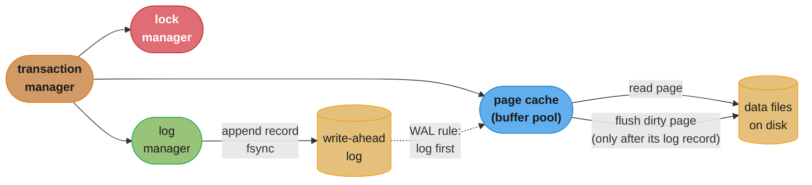
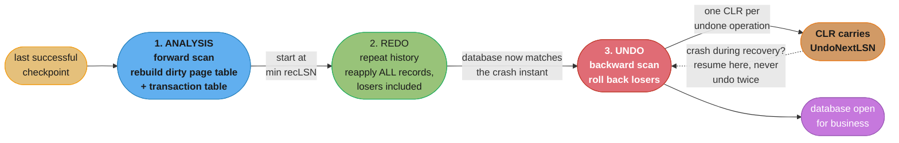

# Chapter 5: Transaction Processing and Recovery

> Part I — Storage Engines · Database Internals (Petrov, 1st ed., O'Reilly 2019) · builds on
> Ch 4's B-tree implementation mechanics (page layout, splits, merges, rebalancing), leads to
> Ch 6 (B-Tree Variants), where several designs exist purely to escape this chapter's latching
> and write-amplification costs

## Chapter Map

Chapters 2 through 4 built a single-threaded, crash-ignorant B-tree: a structure that finds keys
efficiently and rebalances itself, provided nothing else touches it and the power never fails.
Chapter 5 is where both of those assumptions are removed at once, and it is the longest and most
demanding chapter in Part I because removing them requires three separate subsystems that must
agree with each other. The **page cache** (buffer manager) decides which pages live in memory and
when a modified page is allowed to reach disk. The **recovery** subsystem — the write-ahead log
and the ARIES algorithm — makes sure that whatever the page cache did or did not flush, the
database can be reconstructed to a consistent state after a crash. **Concurrency control** makes
concurrent transactions behave as though they ran one at a time. The chapter's structural
insight is that these three are not independent knobs: the page cache's freedom to evict a dirty
page (the *steal* policy) is exactly what forces the recovery subsystem to implement undo, and
the recovery subsystem's need for a stable page image is exactly what forces the concurrency
subsystem to distinguish **locks** from **latches**.

Petrov opens by naming the four components that cooperate here — the **transaction manager**
(coordinates, schedules and tracks transactions and their steps), the **lock manager** (guards
access to shared resources and prevents concurrent access from violating physical data
integrity), the **page cache** (the intermediary between persistent storage and the rest of the
engine), and the **log manager** (holds the history of operations applied to cached pages but not
yet persisted). Every section of the chapter is an elaboration of one of these four.

**TL;DR:**
- The **page cache** is an intermediary that both saves I/O and creates a correctness problem: a
  dirty page in memory is a version of the truth that disk does not have. Pinning, dirty-flag
  tracking, and a page-replacement policy (**FIFO/CLOCK**, **LRU**, **LFU**) are all consequences
  of that.
- The **write-ahead log** is the fix: force the log record to durable storage *before* the page it
  describes. Everything about recovery follows from that one ordering rule plus a monotonically
  increasing **LSN**.
- The **steal / no-steal × force / no-force** matrix decides which of undo and redo you must
  implement. **Steal forces undo; no-force forces redo.** Real engines pick **steal + no-force**
  because it is fastest at runtime, and therefore need both.
- **ARIES** implements steal/no-force in three phases: **analysis** (rebuild the dirty page table
  and transaction table), **redo** (repeat history — reapply *everything*, including operations of
  transactions about to be rolled back), **undo** (roll back losers, writing a **CLR** per undone
  operation so undo survives a crash *during* recovery).
- **Isolation levels are a menu of which anomalies you tolerate**, not a quality ranking: read
  uncommitted, read committed, repeatable read, serializable — plus **snapshot isolation**, which
  prevents lost update but permits **write skew**.
- **Locks and latches are different things with confusingly similar names.** Locks are logical,
  guard user data (keys and ranges), are held for a transaction's duration, and their deadlocks
  are *detected*. Latches are physical, guard the in-memory representation of pages and
  structures, are held for the duration of one operation, and their deadlocks are *avoided by
  ordering*. This is the chapter's single most-quizzed distinction.
- **Blink-trees** cut latch contention structurally: high keys plus sibling links on every level
  make a **half-split** a legal, searchable tree state, so a split need not hold the whole
  root-to-leaf path latched while the parent is updated.

## The Big Question

> A B-tree on disk has two enemies that the previous three chapters carefully ignored. The first
> is the power cord: a crash can strike between any two of the dozens of page writes that a
> single logical insert may require, leaving a tree that is not merely stale but *structurally
> broken* — a parent pointing at a child that was never written. The second is the other threads:
> a page split moves keys between pages, and a reader traversing the tree at that exact moment can
> follow a pointer to a page whose contents have already moved elsewhere. How do you get atomicity
> and durability out of a medium that only guarantees single-page writes, and isolation out of a
> structure that many threads are actively reshaping?

Analogy: think of the page cache as a whiteboard in a shared office and the disk as the filing
cabinet down the hall. Working on the whiteboard is enormously faster than walking to the cabinet
for every change, so everyone does it — but the whiteboard is volatile, and the office can lose
power at any moment. The write-ahead log is the ruled notebook by the door in which you must
write down *what you are about to change on the whiteboard, before you change it*. Recovery is
what the first person through the door the next morning does: read the notebook from the last
page-marker onward, redo every entry so the whiteboard is exactly as it was at the moment of the
outage, then walk backwards undoing every entry belonging to work that never got signed off —
striking each one out in the notebook as you go, so that if you are interrupted mid-cleanup, the
next person does not undo it twice. Concurrency control is the etiquette that governs the same
whiteboard with six people at it: **locks** are the rule that nobody else may change the customer
record you are working on until you finish, and **latches** are the much smaller rule that two
people may not physically hold the same eraser at the same instant. They protect different
things, and confusing the two is how you end up with either a corrupt whiteboard or an office
where only one person can work at a time.

---

## 5.1 Buffer Management

Most databases are built with a two-level memory hierarchy: cheap, durable, slow **disk** and
expensive, volatile, fast **memory**. Pages are the unit of transfer between them, and the
**page cache** — also called the **buffer pool**, and referred to as the *buffer manager* when
the emphasis is on policy — is the in-memory structure that holds cached page contents. Its job
is stated by Petrov in three parts: it caches pages read from disk, it allows changes to on-disk
pages to be *buffered* in memory rather than applied one at a time, and it takes care of the
whole cycle by writing modified pages back and evicting pages when memory runs out.

The performance argument is straightforward — a memory access is on the order of 100 nanoseconds
and a page read from an SSD is on the order of 100 microseconds, roughly a thousandfold gap, and
from a spinning disk with a seek it is closer to 10 milliseconds, a hundred-thousandfold gap. The
*correctness* argument is where the interesting content lives: once a page can be modified in
memory without immediately going to disk, memory and disk disagree, and every subsequent section
of this chapter exists to manage that disagreement.



*Caption: the four subsystems Petrov names at the head of the chapter, and the one dashed
constraint that ties them together — a dirty page may not reach the data files before the log
record describing its change has reached the log. Every recovery guarantee in section 5.2 is
downstream of that arrow.*

### Caching Semantics

The cached copy is the **authoritative** copy. When a higher layer asks for a page, the page
cache checks whether it is already resident; if so it hands back the in-memory version, and if
not it reads the page from disk into a free frame and hands that back. Modifications are applied
to the cached version and the page is marked **dirty** — meaning its in-memory contents have
diverged from what is on disk, and the difference has to be reconciled (flushed) before that
frame can be reused for anything else.

This produces the vocabulary the rest of the section depends on:

| Term | Meaning |
|---|---|
| **Frame** | A slot in the page cache that can hold one page's contents |
| **Dirty page** | A cached page modified in memory and not yet flushed to disk |
| **Clean page** | A cached page identical to its on-disk image — evictable for free |
| **Pinned page** | A page currently in use (or deliberately held) that may not be evicted |
| **Reference count** | How many callers currently hold the page pinned |
| **Flush** | Writing a dirty page's contents back to its on-disk location, clearing the dirty flag |

Flushing is done in the background rather than synchronously on every modification, which is the
whole point — many logical writes to the same page collapse into one physical page write. A
counter page updated ten thousand times between two checkpoints is written to disk once, not ten
thousand times. That collapse is why a database can sustain write throughput far above what its
disk's random-write IOPS number would suggest.

### Cache Eviction

Keeping a page cached takes memory, so pages have to be evicted to make room. Petrov names two
things that constrain *which* page may be chosen:

1. Dirty pages **must be flushed first**. Evicting a dirty page without flushing it silently
   discards a committed or in-progress modification. And the flush is not free to schedule
   arbitrarily either: the write-ahead log record describing the change must reach durable storage
   *before* the page does (section 5.2), so eviction of a dirty page can force a log flush too.
2. Pinned pages **may not be evicted at all**. A page being actively read or written by an
   in-flight operation cannot have its frame reused underneath the caller.

Because a dirty-page eviction can cascade into a log flush and then a page flush — turning what
the caller thought was a cache miss into two synchronous I/Os — engines keep a supply of clean,
evictable frames available in the background rather than discovering the need under load. The
degenerate case, where every eviction requires a flush because the entire pool is dirty, is a
classic production stall: throughput collapses from memory speed to disk speed with no change in
the workload.

> **Decoding the hit rate (this summary's arithmetic, not the chapter's).** The chapter argues
> qualitatively that caching saves I/O. Putting numbers on it: a workload doing 100,000 page
> accesses per second at a 99% hit rate issues 1,000 disk reads per second. Drop the hit rate to
> 95% — a change that sounds minor — and it issues 5,000, a **fivefold** increase in disk load
> for a 4-point change in a percentage. Hit rate enters the I/O equation as `1 - h`, so the
> interesting region is entirely in the last few percent, which is why buffer-pool sizing is
> discussed in terms of misses rather than hits.

### Locking Pages in Cache

**Pinning** is the mechanism for saying "this page must stay resident." Its obvious use is
short-lived — a page being operated on right now — but Petrov's more interesting use is
*deliberate, permanent* pinning of the upper levels of a B-tree.

The argument is arithmetic. In a B-tree, every single root-to-leaf traversal touches the root,
then exactly one node at level 2, then one at level 3, and so on. So the root is accessed by
100% of lookups, a level-2 node by roughly one in *fanout* lookups, a level-3 node by one in
*fanout²*. The top of the tree is both minuscule in size and maximally hot; the bottom is
enormous and cold. Pinning the top levels is therefore nearly free in memory and eliminates most
of the traversal's I/O.

> **Decoding the pinning payoff (this summary's arithmetic).** Take Petrov's style of example: a
> tree with fanout 500 and three levels. Level 1 is 1 page; level 2 is 500 pages; level 3 is
> 250,000 pages. Pinning levels 1 and 2 costs 501 pages — at an 8 KB page size, about **4 MB** —
> which is 0.2% of the tree's 250,501 pages. In exchange, **two of the three page accesses per
> lookup become guaranteed cache hits**, so the worst-case disk reads per lookup fall from 3 to 1.
> This is the sharpest illustration in the chapter of why a page-replacement policy that treats
> all pages as equally evictable is leaving free performance on the table: the access distribution
> across a B-tree's levels is not remotely uniform, and a policy that discovers this empirically
> (LRU, LFU) is doing work that the structure already told you the answer to.

### Page Replacement

When there is no free frame and a page must be read in, an **eviction policy** picks the victim.
The policy is judged on three axes at once: how well it approximates future access patterns, how
much bookkeeping metadata it costs per frame, and — often decisive in practice — how much
*synchronization* it requires on the hot path, since every cache hit must update the policy's
state and a policy that needs a global lock to do so becomes the bottleneck it was meant to
avoid.

#### FIFO and CLOCK

**FIFO** evicts pages in the order they were added, using a queue of page IDs and a head pointer.
It is the cheapest possible policy and also nearly the worst: it takes no account of re-access,
so a page loaded first and touched on every subsequent operation — a B-tree root, for instance —
is evicted precisely because it has been useful for longest. FIFO is presented as a baseline, not
a recommendation.

**CLOCK** is the practical repair. Frames are arranged in a circular buffer with a moving hand,
and each frame carries **one reference bit**. On access the bit is set to 1. When a victim is
needed, the hand advances: if the frame under the hand has its bit set to 1, the bit is cleared
to 0 and the hand moves on (the page gets a second chance); if the bit is already 0, that frame
is the victim. A page must therefore go a full sweep of the clock without being touched before it
can be evicted.

What makes CLOCK attractive is not its hit rate — it is a coarse approximation of LRU — but its
cost profile. Recording an access is a *single bit set*, with no list manipulation and no
repositioning of the page within a data structure, which means no lock is needed on the hot read
path. Compare with LRU, where every cache hit must move an entry to the head of a shared list.

> **Decoding the metadata cost (this summary's arithmetic).** One reference bit per frame is
> almost nothing: at an 8 KB page size, a 1 GB buffer pool holds 131,072 frames, so the reference
> bits total 131,072 bits ≈ **16 KB**, about 0.0015% of the pool. Even generous variants that
> keep a small counter instead of one bit stay in the same negligible band. The reason CLOCK wins
> is not memory, it is the absence of a shared mutable list on the read path.

```
CLOCK: one reference bit per frame, hand sweeps for a victim

              hand
               |
               v
        +----+----+----+----+----+----+----+----+
frame   | P0 | P1 | P2 | P3 | P4 | P5 | P6 | P7 |
ref bit |  1 |  0 |  1 |  1 |  0 |  1 |  0 |  1 |
        +----+----+----+----+----+----+----+----+
           ^
           circular: after P7 the hand wraps to P0

sweep step 1: P0 has ref=1  -> clear it to 0, advance          (second chance)
sweep step 2: P1 has ref=0  -> EVICT P1, load new page, ref=1

after the sweep:
        +----+----+----+----+----+----+----+----+
frame   | P0 | NEW| P2 | P3 | P4 | P5 | P6 | P7 |
ref bit |  0 |  1 |  1 |  1 |  0 |  1 |  0 |  1 |
        +----+----+----+----+----+----+----+----+

A page touched at any time during a full revolution of the hand survives.
Recording a hit costs one bit-set - no list, no lock, no repositioning.
```

*Caption: CLOCK buys most of LRU's recency behaviour for the cost of one bit per frame and, more
importantly, for zero synchronization on the read path — the reason it appears in real buffer
managers where a strict LRU list would serialize every cache hit.*

#### LRU

**LRU** evicts the **least recently used** page, on the theory that recent use predicts imminent
reuse. It is implemented with a queue ordered by access time: on a hit, the page is unlinked and
re-appended at the head. That unlink-and-re-append is precisely the problem — it is a mutation of
a shared structure on *every* cache hit, and under concurrency it needs synchronization, making
the cache's own bookkeeping a contention point.

LRU is also defeated by a workload the chapter cares about: a large sequential scan touches an
enormous number of pages exactly once, and strict LRU dutifully promotes every one of them,
evicting the genuinely hot working set in favour of pages that will never be read again.

Petrov names the refinements that address this:

- **2Q** — maintain two queues. A page on first access enters a probationary queue; only on a
  *second* access is it promoted to the main queue. A one-touch scan therefore churns only the
  probationary queue and never displaces the hot set.
- **LRU-K** — track the time of the **K-th most recent** reference rather than the most recent
  one, and evict based on that. With K = 2 this distinguishes "touched once, ever" from
  "repeatedly touched," which is exactly the distinction plain LRU cannot make.

#### LFU

**LFU** evicts the **least frequently used** page, tracking a usage count per page rather than a
recency position. This inverts LRU's failure mode — it is resistant to a one-off scan, since a
page touched once has a count of one — but it introduces its own: **cache pollution by history**.
A page that was extremely hot an hour ago carries a large count and resists eviction long after
its workload has moved on.

The refinements Petrov points at:

- **TinyLFU** — do not store a frequency counter per cached page. Instead keep a compact
  probabilistic frequency **sketch** (a count-min-sketch-style structure) over recent history and
  use it as an **admission policy**: when a new page arrives, compare its estimated frequency
  against the eviction candidate's, and if the newcomer is estimated *less* frequent, do not admit
  it at all. That single inversion — deciding what gets *in* rather than only what gets *out* —
  is what makes a scan harmless.
- **Ageing / windowing** — periodically halve all counters, or restrict the sketch to a recent
  window, so historic popularity decays rather than accumulating forever. **W-TinyLFU** combines a
  small recency-oriented admission window with the TinyLFU sketch, taking the scan resistance of
  frequency and the burst responsiveness of recency.

| Policy | Metadata per frame | Cost of recording a hit | Scan-resistant? | Failure mode |
|---|---|---|---|---|
| FIFO | position in queue | none (insertion order only) | no | evicts hot pages purely for being old |
| CLOCK | 1 reference bit | one bit set — no lock | partially | coarse approximation of recency |
| LRU | queue node | unlink + re-append on shared list | **no** | a sequential scan evicts the working set |
| 2Q / LRU-K | 2 queues / K timestamps | list moves, but scan-filtered | yes | more bookkeeping, tuning of K |
| LFU | frequency counter | counter increment | yes | stale historic popularity never decays |
| TinyLFU / W-TinyLFU | shared sketch + small window | sketch update | yes | approximate counts, needs ageing |

---

## 5.2 Recovery

The page cache has now created the exact problem recovery has to solve: at any instant, some
modifications live only in volatile memory, and some pages on disk may contain modifications from
transactions that never committed. The **write-ahead log (WAL)**, also called a **commit log**, is
the append-only, disk-resident structure that makes both survivable. It has one governing rule and
several consequences.

The rule: **a log record describing a modification must reach durable storage before the modified
page does.** Hence "write-ahead."

Petrov states the WAL's purposes directly. It allows the page cache to buffer in-memory page
changes while guaranteeing durability semantics in the larger context of the database; it acts as
the source of truth when the database state has to be restored; and it enables both **redo** — for
operations whose results were not persisted to disk — and **undo** — for operations belonging to
transactions that aborted or failed before committing.

### Log Semantics

The log is a strictly **append-only**, sequentially written structure. That is not merely
convenient, it is a performance argument: sequential writes to the log at, say, 500 MB/s cost
nothing like the random page writes they replace, and a commit needs only the log to be durable,
not the data pages.

Records carry a **log sequence number (LSN)**: a unique, **monotonically increasing** identifier,
typically produced from a global counter, that both identifies a record and orders it against
every other record. LSNs appear in several places, and the interplay is the whole mechanism:

| Where the LSN lives | What it means |
|---|---|
| **LSN** on a log record | This record's position in the global order |
| **pageLSN**, stored inside each page | The LSN of the last log record whose change was applied to this page |
| **flushedLSN** | The highest LSN known to be durable in the log |
| **recLSN** (recovery LSN), per dirty page | The LSN of the record that first made this page dirty since it was last flushed |
| **lastLSN**, per transaction | The most recent log record written by this transaction |

The WAL rule is enforced with a comparison: a page may be written to disk only if
`pageLSN <= flushedLSN`. And the redo phase's idempotence comes from the same field — when
recovery considers reapplying a record with LSN *n* to a page, it skips it if the page's stored
`pageLSN >= n`, because that change is demonstrably already reflected in the page image. That one
comparison is what lets redo be run, interrupted, and run again without corrupting anything.

**Checkpointing** bounds how far back recovery must read. The naive form is a **sync
checkpoint**: halt all activity, flush every dirty page, record the checkpoint, resume. It is
correct and unusable — the stall is proportional to the amount of dirty data. The practical form
is a **fuzzy checkpoint**, which writes a `begin_checkpoint` record, continues normal operation
while flushing proceeds, then writes an `end_checkpoint` record containing the **dirty page
table** and **transaction table** as of the begin point. A separate, small, fixed location holds
`last_checkpoint` — a pointer to the most recent successfully completed checkpoint — and recovery
starts from there rather than from the beginning of the log. Petrov notes the pointer must be
updated only after the checkpoint completes, since a pointer to a half-written checkpoint is worse
than no pointer.

### Operation Versus Data Log

What should a log record actually contain? There are two extremes, and the chapter's point is
that real systems use both, in different phases.

**Physical logging** records the *result*: byte-level before-images and after-images of the
affected page regions ("bytes 128–160 of page 42 changed from X to Y"). Its virtue is that
reapplying it needs no interpretation and no surrounding state — it is a blind overwrite, which
is exactly what makes redo safely repeatable.

**Logical logging** records the *operation*: "insert key 42 with value V into relation R." Its
virtue is compactness — a single logical record can stand in for a change that physically touched
several pages, including a split — and its cost is that replaying it requires the database to be
in a well-defined state, since the operation must be re-executed rather than re-applied.

| | Physical (data) log | Logical (operation) log |
|---|---|---|
| Records | before/after byte images | the operation and its arguments |
| Size | larger — proportional to bytes changed | smaller — one record per logical op |
| Replay requires | nothing but the page | a consistent, well-defined database state |
| Repeatable/idempotent? | yes, with the `pageLSN` check | not inherently — re-execution has side effects |
| Survives structural change? | tied to a specific page layout | yes — expressed in terms of keys |

The combination the chapter identifies — and which ARIES uses — is **physical redo and logical
undo**, sometimes called **physiological logging**: redo is physical because it must be blindly
repeatable during recovery, while undo is logical because by the time a rollback happens the
structure may have changed (the page the row was on may have split), and a byte-level
before-image of a page that no longer has that shape is useless.

### Steal and Force Policies

These two policy choices are, in Petrov's framing, what determines whether you need undo, redo,
both, or neither. They are policies about *the page cache*, but their entire consequence lands on
*recovery*.

- **Steal** — the page cache is allowed to evict (and thus flush) a page modified by a transaction
  that has **not yet committed**. **No-steal** forbids it: an uncommitted transaction's dirty
  pages are pinned in memory until it commits.
- **Force** — all pages modified by a transaction are flushed to disk **before the transaction is
  allowed to commit**. **No-force** does not require it: commit only requires the log to be
  durable.

The implications follow mechanically. If you **steal**, uncommitted data can be sitting on disk
when you crash, so you must be able to **undo** it. If you **no-force**, committed data may exist
only in the log when you crash, so you must be able to **redo** it.

```
                        FORCE                          NO-FORCE
                (flush all pages at commit)     (commit needs only the log)
            +--------------------------------+--------------------------------+
            |  no undo needed                |  no undo needed                |
  NO-STEAL  |  no redo needed                |  REDO needed                   |
 (hold      |                                |                                |
  dirty     |  simplest recovery, worst       |  fast commits, but a large     |
  pages     |  runtime: slow commits AND      |  transaction can exhaust the   |
  until     |  unbounded memory for long      |  buffer pool with pages it is  |
  commit)   |  transactions                   |  not allowed to evict          |
            +--------------------------------+--------------------------------+
            |  UNDO needed                   |  UNDO needed                   |
    STEAL   |  no redo needed                |  REDO needed                   |
 (may flush |                                |                                |
  uncommit- |  bounded memory, but commit     |  <-- WHAT REAL ENGINES DO      |
  ted dirty |  still pays random page writes  |  bounded memory, fast commits, |
  pages)    |                                 |  price: implement BOTH         |
            +--------------------------------+--------------------------------+

The two "needed" lines are not design preferences - they are forced.
Steal => uncommitted data can be on disk    => you must be able to UNDO it.
No-force => committed data may be log-only  => you must be able to REDO it.
```

*Caption: the 2×2 that explains why nearly every serious storage engine implements the hardest
recovery algorithm. Steal/no-force is chosen for runtime behaviour — bounded memory and cheap
commits — and undo plus redo is the bill that arrives with it.*

The no-steal cell deserves the war story. **A no-steal engine cannot evict an uncommitted
transaction's dirty pages, so a single transaction that modifies more pages than fit in the buffer
pool simply cannot make progress** — you have converted a recovery simplification into a hard
limit on transaction size. Likewise, force means a commit's cost is proportional to the number of
distinct pages the transaction dirtied, each a random write, rather than one sequential log flush.
Steal/no-force is the combination whose *runtime* cost is lowest and whose *recovery* cost is
highest, and that is the correct trade because runtime happens continuously and recovery happens
after a crash.

### ARIES

**ARIES** — Algorithm for Recovery and Isolation Exploiting Semantics — is the steal/no-force
recovery algorithm, using physical redo and logical undo. Petrov describes it in three phases,
run in order, from the last successful checkpoint.

**Phase 1 — Analysis.** Read the log forward from the last checkpoint. Reconstruct two tables: the
**dirty page table** (which pages were dirty in the page cache at the time of the crash, each with
its `recLSN`) and the **transaction table** (which transactions were in flight, each with its
`lastLSN`). Any transaction that has a `commit` record is a **winner**; any transaction still
in-flight at the crash is a **loser** and must be rolled back. Analysis also computes where redo
must begin: the **minimum `recLSN` across the dirty page table**, since no page could have been
dirtied earlier than that without having been flushed.

**Phase 2 — Redo, and it "repeats history."** Starting from that minimum `recLSN`, reapply the
logged changes — **including changes made by loser transactions that are about to be rolled
back**. This looks wasteful and is deliberate: repeating history restores the database to the
*exact* state it was in at the moment of the crash, which means the undo phase can then work
against a known, well-defined state rather than a partially-recovered one. Redo is skipped for a
record whose LSN is `<=` the target page's stored `pageLSN`, which is what makes the phase
idempotent and safely restartable.

**Phase 3 — Undo the losers.** Walk backwards through each loser transaction's records, following
its `lastLSN` chain, reversing each operation. For every operation undone, ARIES writes a
**compensation log record (CLR)** into the log. A CLR is a redo-only record: it describes the
compensating action, and it carries an **`UndoNextLSN`** pointing at the *next* record of that
transaction still needing undo.

The CLR is the piece that most summaries skip and the one interviewers ask about. **It makes undo
itself crash-safe.** If the system crashes halfway through rolling back a transaction, the next
recovery run reads the CLRs, sees which operations have already been compensated, and resumes
undo from the `UndoNextLSN` of the last CLR rather than starting the rollback over. Without CLRs,
a crash during recovery could undo the same operation twice — and undoing a decrement twice is a
data-corruption bug, not a performance problem. CLRs are never themselves undone; they are only
ever redone.



*Caption: the three ARIES phases and the loop that makes the third one restartable. Redo
deliberately reapplies work it is about to throw away, because a known state is worth more than
the I/O saved by being clever.*

---

## 5.3 Concurrency Control

Recovery handles the crash. Concurrency control handles the other threads. Petrov organizes the
field into three families up front — **optimistic concurrency control (OCC)**, **multiversion
concurrency control (MVCC)**, and **pessimistic (lock-based) concurrency control** — and notes
that they are not mutually exclusive: MVCC is a way of storing data that is routinely combined
with either an optimistic or a pessimistic conflict-resolution scheme.

### Serializability

A **schedule** is an ordering of the operations of a set of transactions, preserving each
individual transaction's internal operation order. A schedule is **complete** if it contains every
operation of every transaction it covers, along with each transaction's terminating commit or
abort.

A **serial** schedule runs transactions one after another with no interleaving at all — trivially
correct, and useless for throughput. A schedule is **serializable** if it is *equivalent* to
*some* serial schedule of the same transactions. That word "some" is doing real work: serializable
does not mean "equivalent to the order they arrived in," only that *a* serial order exists that
produces the same result.

Petrov distinguishes two flavours of equivalence:

- **Conflict serializability.** Two operations **conflict** if they belong to different
  transactions, access the same object, and at least one of them is a **write**. Two schedules are
  conflict-equivalent if they order every conflicting pair identically. Testing it is mechanical:
  build a **precedence graph** with a node per transaction and an edge `T1 -> T2` whenever an
  operation of `T1` conflicts with and precedes one of `T2`; the schedule is conflict-serializable
  **iff the graph is acyclic**.
- **View serializability.** A weaker, broader condition: the schedule reads the same values and
  leaves the same final writes as some serial schedule, even if conflicting operations are ordered
  differently. Every conflict-serializable schedule is view-serializable but not the reverse.
  Deciding view serializability is computationally hard, which is why practical systems enforce
  conflict serializability.

Serializability is not the only property that matters, because aborts also have to be handled.
The chapter's ladder of increasingly strong recoverability conditions:

| Property | Guarantee | What it prevents |
|---|---|---|
| **Recoverable** | A transaction commits only after every transaction it read from has committed | Committing on the basis of data that later vanishes |
| **Avoids cascading aborts (ACA)** | Transactions read only *committed* values | One abort forcing a chain of dependent aborts |
| **Strict** | No transaction reads *or overwrites* an uncommitted value | The above, plus making before-image undo always valid |

### Transaction Isolation

Full serializability costs throughput: the conflicts that a serializable schedule must resolve are
resolved by making somebody wait or abort. So implementations offer **isolation levels** —
explicitly weaker guarantees that permit certain anomalies in exchange for concurrency.

The chapter's framing here is the one to carry into an interview: **isolation levels are defined
by the anomalies they permit**, not by a mechanism, and the same level name can be implemented
very differently by different engines. A level is a contract about observable behaviour, and
reasoning about which anomalies your application can survive is the actual engineering task.

### Read and Write Anomalies

The SQL standard describes anomalies caused by reads and by writes. Petrov walks both.

**Read anomalies:**

- **Dirty read** — a transaction reads a value written by another transaction that has not
  committed. If that transaction aborts, the reader acted on data that never existed.
- **Non-repeatable read** (also **fuzzy read**) — a transaction reads the same *row* twice and
  gets different values, because another transaction modified and committed it in between.
- **Phantom read** — a transaction runs the same *range query* twice and the second run returns
  rows that were not there before (or is missing rows that were), because another transaction
  inserted or deleted rows matching the predicate. The distinction from a non-repeatable read is
  precise and frequently examined: a non-repeatable read is about a row that *exists in both
  reads and changed*, a phantom is about the *set of rows matching a predicate* changing. You can
  lock every row you read and still get phantoms, because you cannot lock a row that does not yet
  exist — which is why preventing phantoms requires **predicate** or **range** locks rather than
  row locks.

**Write anomalies:**

- **Lost update** — two transactions read the same value, each computes a new value from it, and
  both write. The second write silently overwrites the first, and one update is simply gone.
- **Dirty write** — a transaction overwrites a value written by another, still-uncommitted
  transaction. Now a rollback of either has no correct outcome: restoring the before-image
  destroys the other transaction's write.
- **Write skew** — two transactions read an overlapping set of rows, each modifies a *different*
  row, and each write is individually legal, but the combination violates an invariant that
  spanned both rows. No individual write conflicts with any other, which is exactly why
  snapshot-based mechanisms miss it entirely.

*(beyond the book)* Readers coming from Kleppmann will also look for **read skew**, in which a
transaction reads two related rows and sees them at inconsistent points in time (an account
transfer observed after the debit and before the credit). Petrov's anomaly discussion covers the
standard's list and write skew; read skew is included in the table below for completeness because
it is what snapshot isolation is chiefly designed to eliminate, and interviewers frequently pair
the two terms.

#### The broken example: write skew survives read committed

This is the chapter's on-call doctors scenario, rendered as SQL. The invariant is **at least one
doctor must remain on call**, and there are currently exactly two, Alice and Bob. Both decide to
take the shift off, at the same moment, under **read committed** (or snapshot isolation — it makes
no difference here):

```sql
-- transaction A (Alice)                    -- transaction B (Bob)
BEGIN;                                      BEGIN;
SELECT count(*) FROM doctors                SELECT count(*) FROM doctors
 WHERE on_call = true                        WHERE on_call = true
   AND shift_id = 1234;                        AND shift_id = 1234;
-- returns 2, so the check passes           -- returns 2, so the check passes
                                            -- (A has not committed, so this is
                                            --  NOT a dirty read - it is correct
                                            --  committed data as of B's read)

UPDATE doctors SET on_call = false          UPDATE doctors SET on_call = false
 WHERE name = 'Alice'                        WHERE name = 'Bob'
   AND shift_id = 1234;                        AND shift_id = 1234;
COMMIT;                                     COMMIT;

-- Result: zero doctors on call. The invariant is violated, and no rule of read
-- committed or snapshot isolation was broken. The two UPDATEs touched DIFFERENT
-- ROWS, so they never conflicted; each transaction's premise (count = 2) was
-- silently invalidated by the other AFTER it was read.
```

Note what is *not* wrong here. There is no dirty read — each transaction read committed data.
There is no lost update — the two updates hit different rows and neither overwrote the other.
Every individual operation is correct, and the database is still corrupt. This is why write skew
is dangerous: it is invisible to any mechanism that reasons about conflicts between *writes to the
same object*.

**Three fixes, in increasing order of cost:**

```sql
-- Fix 1: materialize the conflict by locking the rows the DECISION depends on,
-- so the two transactions now genuinely conflict on the same objects.
BEGIN;
SELECT count(*) FROM doctors
 WHERE on_call = true AND shift_id = 1234
   FOR UPDATE;                  -- takes exclusive locks on the rows read
UPDATE doctors SET on_call = false WHERE name = 'Alice' AND shift_id = 1234;
COMMIT;
-- Now B blocks on A's locks, re-reads count = 1 after A commits, and its check fails.

-- Fix 2: make the invariant a constraint the database itself enforces, so no
-- isolation level is required to hold it (a materialized shift-coverage row that
-- both transactions must update, turning a phantom conflict into a write-write one).

-- Fix 3: raise the isolation level to SERIALIZABLE. Under serializable snapshot
-- isolation the engine tracks read/write dependencies and ABORTS one transaction
-- at commit time - correct, and the price is that the application MUST have retry
-- logic, because a legal transaction can now fail through no fault of its own.
```

The practical guidance the chapter's framing implies: pick the fix by how many places the
invariant is enforced. If one code path decides it, `FOR UPDATE` is the cheapest correct answer.
If many do, a constraint or serializable isolation is worth the cost, because a `FOR UPDATE` that
one code path forgets is a bug that reproduces only under concurrency.

### Isolation Levels

| Level | Dirty read | Non-repeatable read | Phantom read | Lost update | Write skew |
|---|---|---|---|---|---|
| **Read uncommitted** | possible | possible | possible | possible | possible |
| **Read committed** | prevented | possible | possible | possible | possible |
| **Repeatable read** | prevented | prevented | possible | prevented (typically) | possible |
| **Snapshot isolation** | prevented | prevented | prevented (for the snapshot) | prevented (first committer wins) | **possible** |
| **Serializable** | prevented | prevented | prevented | prevented | prevented |

- **Read uncommitted** allows all of it, including dirty reads. Rarely useful.
- **Read committed** guarantees you never see uncommitted data. Each statement sees a fresh view
  of committed data, which is exactly why two statements in the same transaction can disagree.
- **Repeatable read** guarantees a row you read will not change under you, but says nothing about
  rows appearing — phantoms remain possible in the standard's definition.
- **Snapshot isolation** gives every transaction a consistent view of the database **as of the
  moment it started**. Concurrent writes to the same object are resolved by **first committer
  wins**: of two transactions writing the same value, only one commits and the other aborts. This
  eliminates lost update and read skew. **It does not eliminate write skew**, because write skew
  involves no two transactions writing the same object.
- **Serializable** permits nothing. **Serializable snapshot isolation (SSI)** is the practical
  implementation the chapter points to: build on snapshot isolation, additionally track the
  read/write dependencies between concurrent transactions, and abort a transaction whose
  dependencies would form a cycle. It gets serializability without the blocking of two-phase
  locking, at the cost of aborts under contention — which the application must be written to
  retry.

A warning the chapter is explicit about, and which catches people constantly: **the level names
are standard, the implementations are not.** An engine's "repeatable read" may in fact be snapshot
isolation; some engines' "serializable" is SSI and some is two-phase locking, with completely
different failure behaviour (abort-and-retry versus block-and-possibly-deadlock). Read your
engine's documentation rather than the standard's table.

### Optimistic Concurrency Control

**OCC** bets that conflicts are rare. Transactions execute without acquiring locks, buffering
their writes in a **private workspace**, and the conflict check happens only at the end. Petrov
describes three phases:

1. The **read phase** executes the transaction. Reads come from the database, writes go to the
   private workspace, invisible to everyone else. Nothing is locked.
2. The **validation phase** checks whether this transaction's read and write sets conflict with those
   of concurrent transactions. Validation runs in a **critical section**, because two transactions
   validating simultaneously could each conclude they are safe. If validation fails, the
   transaction **aborts** and (usually) restarts.
3. The **write phase** publishes the private workspace's writes and commits.

Validation comes in two directions: **backward-oriented** validation checks against transactions
that have already *committed* since this one started, and **forward-oriented** validation checks
against transactions still *in flight*, which offers a choice of which one to abort.

The economics are simple and worth stating plainly: **OCC does no work to prevent conflicts and
all of its work after the fact.** Under low contention this is near-optimal — no lock acquisition,
no blocking, maximum parallelism. Under high contention it degrades badly, and the degradation is
worse than "slow": the wasted work is *the entire transaction*, repeatedly, and a hot row can
produce a livelock where transactions abort each other indefinitely without any making progress.

### Multiversion Concurrency Control

**MVCC** keeps **multiple versions** of a record, each tagged with a timestamp or transaction
identifier, rather than a single mutable value. A read selects the version appropriate to the
reading transaction's timestamp.

The consequence that makes it ubiquitous: **readers never block writers and writers never block
readers**, because they are looking at different versions of the same logical record. A long
analytical scan and a stream of point updates can proceed simultaneously with neither waiting on
the other. This is also the natural implementation of **snapshot isolation** — "the database as of
timestamp T" is exactly what a version-tagged store can answer directly.

MVCC is a *storage* technique, not a complete concurrency-control scheme; it must be paired with a
policy for resolving write-write conflicts, which may be optimistic (first committer wins) or
pessimistic (writers take locks on the current version). Its cost is the other side of its
benefit: old versions accumulate and must be reclaimed by a **garbage collection** process once no
active transaction can still need them. A single long-running read transaction pins every version
created since it began — which is how a forgotten idle-in-transaction session turns into unbounded
storage growth and a collapse in scan performance, a failure mode that appears in the Common
Pitfalls section below.

### Pessimistic Concurrency Control

**Pessimistic** schemes prevent conflicts rather than detecting them, by blocking or restarting a
transaction the moment a conflict *could* occur. Petrov splits them into lock-based and
non-lock-based.

The non-lock-based form is **timestamp ordering**. Every transaction gets a timestamp; every
record keeps `max_read_timestamp` and `max_write_timestamp`. A transaction attempting an operation
that would violate the timestamp order — writing a record already read by a *newer* transaction,
say — is aborted rather than allowed to proceed. No locks are held, but transactions are still
prevented from creating a non-serializable order.

The lock-based form is the classic one, covered next. One variant deserves a name here:
**conservative two-phase locking**, in which a transaction acquires *all* the locks it will need
before it begins. It is deadlock-free by construction — there is no incremental acquisition, so
there is no cycle to form — and it is rarely usable, because a transaction seldom knows its full
lock set in advance and holding every lock for the whole transaction destroys concurrency.

### Lock-Based Concurrency Control

The standard protocol is **two-phase locking (2PL)**, which splits a transaction's lifetime into
two phases with respect to locks:

- **Growing (expanding) phase** — the transaction acquires locks. It may not release any.
- **Shrinking phase** — the transaction releases locks. It may not acquire any.

The moment of the first release is the **lock point**, and the fact that no lock is acquired after
it is what guarantees conflict serializability. **Strict 2PL** goes further: all *exclusive* locks
are held until commit or abort, which additionally guarantees strict schedules and makes
before-image undo always valid. Most engines that lock, do strict 2PL.

Petrov flags the naming collision explicitly, and it is worth flagging again: **two-phase locking
(2PL) has nothing to do with two-phase commit (2PC)**. 2PL is a single-node concurrency protocol
whose two phases are acquire-then-release; 2PC is a distributed atomic-commitment protocol whose
two phases are prepare-then-commit (Chapter 13).

#### Deadlocks

Two transactions each holding a lock the other needs will wait forever. Two families of response:

**Deadlock detection.** Maintain a **wait-for graph** — a node per transaction, an edge
`T1 -> T2` when `T1` waits on a lock held by `T2` — and periodically search for a cycle. A cycle
*is* a deadlock; break it by choosing a **victim** and aborting it. Victim selection is a policy
choice (youngest, least work done, fewest locks held). The cheaper, cruder alternative is a
**timeout**: assume any transaction waiting longer than *N* is deadlocked and abort it. It needs
no graph and no bookkeeping, and it is imprecise in both directions — a merely slow transaction is
aborted, and a real deadlock waits out the full timeout before anything happens.

**Deadlock prevention** using timestamps, which never lets a cycle form. Both schemes work by
allowing waits in only one direction of transaction age:

| Scheme | If the requester is **older** than the lock holder | If the requester is **younger** |
|---|---|---|
| **Wait-die** | the older transaction **waits** | the younger **dies** (aborts and restarts) |
| **Wound-wait** | the older **wounds** the holder (aborts it) and takes the lock | the younger **waits** |

Because waits only ever point in one direction along the timestamp order, no cycle is possible.
The behavioural difference is which transaction pays: wait-die is **non-preemptive** — it never
aborts a running holder, so it restarts more transactions overall but never interrupts work in
progress; wound-wait is **preemptive** — it aborts the holder, which favours older transactions
and prevents the starvation of a long transaction that keeps getting restarted. Note that in both
schemes a restarted transaction **keeps its original timestamp**, so it grows older relative to
everything else and eventually wins — which is what stops a transaction from being aborted
forever.

#### Locks

**Locks are logical.** They guard **user data** — a key, a row, a range of keys, a table — and
their unit is a logical entity that exists in the data model, not a physical one that exists in
the storage layout. They are held for the **duration of the transaction**, they are administered
by a dedicated **lock manager**, they participate in deadlock detection, and they can be held on
things that do not physically exist yet: a **range lock** covering keys 100 through 200 prevents
another transaction from *inserting* key 150, which is precisely how phantoms are prevented and
precisely what a physical page-level mechanism cannot express.

#### Latches

**Latches are physical.** They guard the **in-memory data structures** the engine uses to
represent data — the contents of a page, the page cache's own tables, a free-list — from being
observed or modified while momentarily inconsistent. During a B-tree split, keys are physically
moving between pages, and any concurrent reader traversing those pages must be excluded until the
operation completes. That exclusion is a latch.

**The distinction is the chapter's single most-examined point.** The names sound like synonyms and
the concepts share almost nothing:

| | **Lock** | **Latch** |
|---|---|---|
| Guards | **logical** content — keys, rows, ranges, tables | **physical** structures — page contents, in-memory structures, the page cache's own tables |
| Held for | the **duration of the transaction** | the **duration of one operation** (microseconds) |
| Managed by | a dedicated **lock manager** / transaction subsystem | the data structure itself, via a concurrency primitive |
| Deadlocks | **detected and resolved** — wait-for graph, timeouts, wound-wait | **avoided by design** — ordered acquisition, crabbing. Not detected |
| Visible to recovery? | yes — locking is part of the transaction protocol | **no** — latches are not logged and play no part in recovery |
| Cost | heavyweight: hash table entry, queue, bookkeeping | lightweight: often a handful of CPU instructions |
| Can cover a nonexistent object? | **yes** — a range lock covers keys not yet inserted | no — it guards a concrete physical structure |
| Held across an I/O? | yes, routinely | **never** — that is the classic mistake |
| Rolled back on abort? | yes, released at abort | not applicable — released when the operation ends |

Two corollaries that follow from the table and are worth memorizing separately. First, **latch
deadlocks are not detected, so they are permanent** — there is no wait-for graph watching them,
which is why latching protocols must be deadlock-*free by construction*, via a strict acquisition
order (top-down, left-to-right) that makes a cycle impossible. Second, **holding a latch across an
I/O is a design error**, because a latch is meant to be held for the microseconds of a memory
operation and an I/O is three to five orders of magnitude longer; the page cache is structured
around pinning a page (a lock-like, long-lived claim) rather than latching it (a short-lived,
physical one) exactly so I/O never happens under a latch.

**Latch crabbing** (also called **latch coupling**) is the protocol that keeps latch hold times
short during a tree traversal. Descending from the root: latch the parent, latch the child, and
then **release the parent as soon as the child is known to be "safe"** — meaning the operation
cannot propagate back up to modify the parent. For an insert, a node is safe if it is **not
full** (it will not split). For a delete, safe means it is **above minimum occupancy** (it will
not merge). If the child is unsafe, the parent's latch must be retained, and possibly its
parent's, until a safe ancestor is found.

```
LATCH CRABBING on a descent (read: shared latches, release parent immediately)

  step 1        step 2                 step 3               step 4
  [root]*       [root]*                [root]               [root]
     |             |                      |                    |
  [ n1 ]        [ n1 ]*   <- latch     [ n1 ]*  <- root       [ n1 ]
     |             |         child      |          released      |
  [leaf]        [leaf]                [leaf]*  <- latch       [leaf]*
                                                  child,
  * = latched                                     release n1

At most TWO latches are held at once, and each is held only long enough to
read the pointer to the next level - never across an I/O.

WRITE descent (insert), where a node may split:

  [root  8 keys / 8 max ]  <- FULL: UNSAFE, may split. keep its latch.
      |
  [ n1   3 keys / 8 max ]  <- not full: SAFE. every latch held ABOVE n1 can
      |                       now be released - a split at or below n1 cannot
  [leaf  8 keys / 8 max ]     propagate past it.
                           <- FULL: unsafe, but nothing is above it to release

  The rule: on the way down, the moment you reach a SAFE node, drop every
  latch you are still holding above it.
```

*Caption: crabbing bounds the number of simultaneously held latches to two on a read descent, and
on a write descent releases the whole held prefix the instant a safe node is found. Without it, a
writer would hold the root latched for the entire operation — serializing every other transaction
in the database behind one insert.*

The chapter also names two related hazards. **Latch upgrading** — taking a shared latch on the way
down and attempting to upgrade it to exclusive on the way back up — can deadlock when two readers
both hold shared latches on the same node and both request the upgrade: neither can proceed until
the other releases, and neither will. **Pointer chasing** is the risk that, having released a
latch to keep hold times short, the node the pointer refers to has been split, merged, or freed by
the time you follow it — a stale pointer that was valid when read. Both hazards are resolved
structurally by the Blink-tree of section 5.4, which is why that section closes the chapter.

#### Readers-Writer Lock

The compatibility rule that makes latches (and locks) useful at all: a **shared** claim may
coexist with other shared claims, and an **exclusive** claim may coexist with nothing.

| Held \ Requested | **Shared (read)** | **Exclusive (write)** |
|---|---|---|
| **Shared (read)** | compatible | blocks |
| **Exclusive (write)** | blocks | blocks |

Any number of readers may hold a shared latch on a page simultaneously — reading does not disturb
anyone. A writer requires exclusivity. This is what makes a read-heavy workload scale: a hot
B-tree root latched in shared mode by two hundred concurrent readers costs nothing, whereas a
single mutual-exclusion latch there would serialize the whole database.

The classic hazard is **writer starvation**: if new readers are admitted while a writer waits, a
steady stream of readers can keep the shared count above zero indefinitely and the writer never
runs. The fix is to make the queue fair — once a writer is waiting, block *new* readers behind it
even though they are compatible with the current holders, so the shared count can drain to zero.

#### Busy-Wait and Queueing Techniques

Having decided a thread must wait, there is one more choice: how.

**Busy-wait (spinning).** The waiter loops, repeatedly testing the latch, burning CPU until it
becomes free. This is right when the expected wait is *shorter than a context switch* — parking a
thread and waking it costs on the order of a few microseconds, so spinning for a latch held for a
few hundred nanoseconds is strictly cheaper than sleeping. It is exactly wrong for a long wait,
where it burns a core doing nothing and, worse, may prevent the holder from being scheduled.

**Queueing / parking.** The waiter is placed on a queue and descheduled, to be woken when the
latch is released. It costs a context switch in each direction but consumes no CPU while waiting,
and — the underrated benefit — the queue gives you **fairness** and **FIFO ordering** for free,
where pure spinning can starve an unlucky thread indefinitely.

| | Busy-wait / spin | Queue / park |
|---|---|---|
| Right when | expected wait < context-switch cost (~1–5 µs) | expected wait is longer, or unbounded |
| CPU while waiting | fully consumed | none |
| Wake-up latency | immediate | context switch |
| Fairness | none — a thread can be starved | FIFO by construction |
| Typical use | **latches** (short, physical) | **locks** (long, transaction-scoped) |

The mapping in the last row is the practical summary and it aligns exactly with the locks/latches
table: **latches are typically spin-based because they are held for nanoseconds to microseconds,
and locks are queue-based because they are held for the length of a transaction.** Hybrid
approaches spin for a bounded number of iterations and then park, getting the cheap case cheap
without burning a core on the expensive one.

---

## 5.4 Blink-Trees

The chapter closes with a structural answer to the latching problem rather than a protocol one.
**Blink-trees** extend B*-trees with two additions:

1. A **high key** on every node — the upper bound of the key range that node is responsible for.
2. Sibling (**right-link**) pointers on **every level** of the tree, not just the leaves.

Together these make a new tree state legal: the **half-split**. A node can be split, its new
right sibling written and linked in, and the **parent left un-updated** — and the tree is still
correct and fully searchable in that state. A search that arrives at a node and finds its target
key **greater than that node's high key** knows the key has moved right, and simply follows the
sibling pointer to the new node. It does not need to go back to the parent, and it does not need
the parent to have been updated yet.

```
BEFORE the split: one node owns keys up to its high key 40

  parent:   [ ... | 40 | ... ]
                     |
                     v
            +--------------------------+
            | keys 10 20 30 40         |  high key = 40   -> next sibling
            +--------------------------+

HALF-SPLIT state: node has split, sibling is linked, PARENT IS NOT YET UPDATED

  parent:   [ ... | 40 | ... ]        <- still says this subtree ends at 40
                     |                   (stale, and that is FINE)
                     v
            +---------------+        +---------------+
            | keys 10 20    | -----> | keys 30 40    |  high key = 40
            | high key = 20 |  right +---------------+
            +---------------+  link

  A search for key 30 lands on the left node, sees 30 > high key 20,
  and follows the right link. Correct answer, no parent involvement,
  no latch held on the root-to-leaf path.

AFTER the parent catches up (done lazily, by whoever gets there next):

  parent:   [ ... | 20 | 40 | ... ]
                     |    |
                     v    v
            [10 20] ---> [30 40]
```

*Caption: the high key turns a stale parent pointer from a correctness bug into a routing hint —
the search self-corrects by moving right. This is what allows a split to be published in two
independent steps instead of one atomic latched operation.*

Why this matters is stated in terms of contention. In a plain B-tree, a split is a
**multi-page structural modification that must appear atomic**, so the writer must hold exclusive
latches on the affected path — potentially up to the root — for the duration, and every other
transaction descending the tree stops behind it. In a Blink-tree the intermediate state is a
*legal, searchable tree*, so:

- **Fewer latches are held, for shorter periods.** The writer does not need to latch the whole
  root-to-leaf path against the possibility of a split propagating upward.
- **The parent update becomes lazy.** It can happen after the fact, by any thread that notices the
  half-split, rather than being on the critical path of the insert.
- **Readers never block on a split in progress.** They either find the key where they expect it or
  step right.
- **The pointer-chasing hazard dissolves.** A reader that followed a pointer to a node whose
  contents have since moved right does not need to detect and restart — it just keeps moving
  right, which is the ordinary search path, not an error path.

This is the chapter's final and best illustration of a theme running through all of Part I:
**a structural property can be worth more than a clever protocol.** Everything the locking sections
achieved with careful ordering, crabbing rules, and upgrade hazards, the Blink-tree partly obviates
by redefining what counts as a valid tree. The same idea returns immediately in Chapter 6, where
the Bw-tree's split is likewise a two-step operation made safe by a logical side link.

---

## Beyond the book — where this chapter's ideas landed after 2019

> The chapter presents buffer management, ARIES, isolation levels, and Blink-trees as
> general storage-engine techniques and deliberately does not tie them to specific product
> versions or benchmark numbers. Nothing below is Petrov's claim; it is context a reader
> comparing the chapter against a modern engine will want, collected here rather than
> woven into the summary so the two voices stay separable.

- **ARIES is 1992 and still the default.** Mohan et al.'s paper predates the book by nearly three
  decades, and the three-phase structure with CLRs remains the shape of recovery in essentially
  every relational engine that logs physically. Where engines diverge is at the edges — parallel
  redo across pages, log-structured engines that need no undo at all (Chapter 7).
- **Serializable snapshot isolation** gets a paragraph here, but it is the mechanism behind
  PostgreSQL's `SERIALIZABLE` level and has become the standard way to get serializability
  without two-phase locking's blocking. The application-visible consequence — a legal transaction
  can be aborted at commit and must be retried — is the part that most often surprises teams
  raising their isolation level.
- **The isolation-level naming mess is worse than the standard suggests**, which the chapter warns
  about generically. The concrete cases readers hit: MySQL/InnoDB's `REPEATABLE READ` behaves as a
  snapshot-based level and prevents many phantoms the standard permits, while PostgreSQL's
  `REPEATABLE READ` is snapshot isolation outright. Two engines, the same keyword, different
  guarantees.
- **The buffer pool itself is now sometimes optional.** Engines built on memory-mapped files (LMDB
  in Chapter 6) delegate caching to the OS page cache entirely, and in-memory engines skip the
  hierarchy. The tradeoffs the chapter describes do not vanish — they move into the kernel, where
  the database has less control over eviction, which is itself an argument the chapter's framing
  helps you make.

---

## Visual Intuition

### The write-ahead ordering constraint, drawn as a timeline

```
The ONE rule: the log record reaches durable storage before the page does.

time ------------------------------------------------------------------>

 t0   modify page 42 in the page cache        [ memory only ]
      write log record LSN=907 to log buffer  [ memory only ]
                                              |
 t1   fsync the log up to LSN 907  ---------> [ DURABLE ]   <-- commit may
                                                                return here
 t2   (optionally, much later)
      flush page 42 to the data file -------> [ DURABLE ]

  CRASH between t1 and t2:  log has LSN 907, page does not.
                            -> REDO reapplies it. Nothing is lost.

  CRASH between t0 and t1:  neither is durable.
                            -> the transaction never committed. Nothing to do.

  If the order were REVERSED (page at t1, log at t2), a crash in between
  leaves a modified page on disk with NO log record describing it:
  unrecoverable. Neither redo nor undo has anything to work from.
```

*Caption: durability at commit costs exactly one sequential log fsync, not a page write — the
whole reason a database can commit faster than its random-write IOPS would allow. The reversed
ordering in the last block is not slower, it is unrecoverable.*

### Anomalies, ordered by what they require to prevent

```
  DIRTY READ            read of uncommitted data
  |                     prevented by: read only committed values
  v
  LOST UPDATE           two writes to the SAME object, one silently vanishes
  |                     prevented by: first-committer-wins, or write locks
  v
  NON-REPEATABLE READ   the same ROW changes under you
  |                     prevented by: a snapshot, or read locks held to commit
  v
  PHANTOM READ          the SET OF ROWS matching a predicate changes
  |                     prevented by: predicate/range locks, or a snapshot
  |                     NOT prevented by: row locks - you cannot lock a row
  |                                       that does not exist yet
  v
  WRITE SKEW            two writes to DIFFERENT objects break a shared invariant
                        prevented by: serializable only
                        NOT prevented by: snapshot isolation - the two writes
                                          never conflict with each other at all

The ladder is not arbitrary: each rung needs a strictly stronger mechanism than
the one above it, and the last two are the ones that defeat row-level reasoning.
```

*Caption: the two anomalies at the bottom are the interview material, because both defeat the
intuition that "locking what I touched is enough" — phantoms concern rows that do not exist yet,
and write skew concerns writes that never touch the same row.*

---

## Key Concepts Glossary

- **Transaction** — an indivisible logical unit of work that may contain multiple operations,
  moving the database from one consistent state to another.
- **ACID** — atomicity, consistency, isolation, durability: the four properties a transaction is
  expected to provide.
- **Transaction manager** — the component that coordinates, schedules, and tracks transactions and
  their constituent steps.
- **Lock manager** — the component guarding access to shared resources, preventing concurrent
  access from violating physical data integrity.
- **Page cache (buffer pool)** — the in-memory intermediary between persistent storage and the
  rest of the engine, caching pages and buffering their modifications.
- **Log manager** — the component holding the history of operations applied to cached pages but
  not yet persisted.
- **Frame** — a page-sized slot in the page cache.
- **Dirty page** — a cached page modified in memory whose contents differ from the on-disk image.
- **Pinning** — marking a page as non-evictable while in use, or deliberately for hot pages.
- **Eviction** — removing a page from the cache to free its frame, requiring a flush first if the
  page is dirty.
- **FIFO** — evict pages in insertion order, ignoring re-access.
- **CLOCK** — a circular-buffer eviction policy using one reference bit per frame and a sweeping
  hand, giving each recently-touched page a second chance.
- **LRU** — evict the least recently used page; requires repositioning an entry on every hit.
- **2Q** — an LRU refinement using a probationary queue so that once-touched pages cannot displace
  the working set.
- **LRU-K** — an LRU refinement tracking the K-th most recent reference rather than the most
  recent one.
- **LFU** — evict the least frequently used page, tracked by a usage count.
- **TinyLFU / W-TinyLFU** — an LFU refinement using a compact frequency sketch as an *admission*
  policy, plus a recency window, so scans cannot pollute the cache.
- **Write-ahead log (WAL, commit log)** — the append-only durable log written before the pages it
  describes, the source of truth for recovery.
- **LSN (log sequence number)** — a unique, monotonically increasing identifier that orders log
  records.
- **pageLSN** — the LSN of the last log record whose change was applied to a given page; the field
  that makes redo idempotent.
- **recLSN (recovery LSN)** — the LSN that first made a page dirty since its last flush; the
  minimum across the dirty page table is where redo begins.
- **flushedLSN** — the highest LSN known durable in the log.
- **Checkpoint** — a recorded point that bounds how far back recovery must read the log.
- **Sync checkpoint** — a checkpoint that halts activity and flushes every dirty page; correct but
  stalling.
- **Fuzzy checkpoint** — a checkpoint bracketed by `begin_checkpoint` and `end_checkpoint` records
  that allows normal operation to continue, recording the dirty page and transaction tables.
- **Physical (data) logging** — logging byte-level before/after images of modified page regions.
- **Logical (operation) logging** — logging the operation and its arguments rather than its byte
  effects.
- **Physiological logging** — the combination ARIES uses: physical redo, logical undo.
- **Steal** — the page cache may flush pages modified by an uncommitted transaction; **requires
  undo**.
- **No-steal** — uncommitted dirty pages are pinned until commit; no undo needed, but transaction
  size is bounded by the buffer pool.
- **Force** — all of a transaction's modified pages are flushed before it commits; no redo needed,
  but commits pay random page writes.
- **No-force** — commit requires only the log to be durable; **requires redo**.
- **ARIES** — the steal/no-force recovery algorithm using physical redo and logical undo, in three
  phases: analysis, redo, undo.
- **Dirty page table** — the recovery structure recording which pages were dirty at the crash and
  each one's `recLSN`.
- **Transaction table** — the recovery structure recording in-flight transactions and each one's
  `lastLSN`.
- **Winner / loser** — a transaction that had committed at crash time / one that had not and must
  be rolled back.
- **Repeating history** — ARIES's redo phase reapplying *all* logged operations, including those of
  losers, so undo operates against a known state.
- **Compensation log record (CLR)** — a redo-only record written for each undone operation,
  carrying `UndoNextLSN` so that a crash during recovery never undoes the same operation twice.
- **Schedule** — an ordering of the operations of a set of transactions that preserves each
  transaction's own operation order.
- **Serial schedule** — a schedule with no interleaving between transactions.
- **Serializable schedule** — one equivalent to *some* serial schedule.
- **Conflicting operations** — two operations from different transactions on the same object where
  at least one is a write.
- **Conflict serializability** — equivalence to a serial schedule in the ordering of all
  conflicting pairs; testable via an acyclic **precedence graph**.
- **View serializability** — a weaker, broader equivalence based on values read and final writes;
  computationally hard to decide.
- **Recoverable schedule** — one where a transaction commits only after every transaction it read
  from has committed.
- **Cascading abort** — one transaction's abort forcing the abort of others that read its
  uncommitted data.
- **Strict schedule** — one where no transaction reads or overwrites an uncommitted value.
- **Dirty read** — reading a value written by an uncommitted transaction.
- **Non-repeatable (fuzzy) read** — re-reading the same row and getting a different value.
- **Phantom read** — re-running a range query and getting a different set of rows.
- **Lost update** — two transactions updating the same value, one write silently overwriting the
  other.
- **Dirty write** — overwriting a value written by an uncommitted transaction.
- **Write skew** — two transactions writing *different* objects, each write legal, the combination
  violating a shared invariant.
- **Read skew** *(beyond the book)* — reading related rows at inconsistent points in time.
- **Isolation level** — a defined set of anomalies a transaction is permitted to observe: read
  uncommitted, read committed, repeatable read, serializable.
- **Snapshot isolation** — every transaction sees the database as of its start time, with
  write-write conflicts resolved by **first committer wins**; prevents lost update, permits write
  skew.
- **Serializable snapshot isolation (SSI)** — snapshot isolation plus dependency tracking that
  aborts transactions whose dependencies would form a cycle.
- **Optimistic concurrency control (OCC)** — execute without locks into a private workspace, then
  validate in a critical section and either write or abort.
- **Backward-oriented validation** — validating against already-committed concurrent transactions.
- **Forward-oriented validation** — validating against still-in-flight concurrent transactions.
- **Multiversion concurrency control (MVCC)** — keeping multiple timestamped versions of a record
  so readers never block writers and writers never block readers.
- **Pessimistic concurrency control** — preventing conflicts up front by blocking or restarting,
  rather than detecting them afterwards.
- **Timestamp ordering** — a non-lock-based pessimistic scheme aborting operations that would
  violate the timestamp order, using per-record max read/write timestamps.
- **Two-phase locking (2PL)** — a growing phase acquiring locks and a shrinking phase releasing
  them, with no acquisition after the first release.
- **Strict 2PL** — 2PL holding all exclusive locks until commit or abort.
- **Conservative 2PL** — acquiring all locks before the transaction begins; deadlock-free but
  rarely practical.
- **Lock point** — the moment a transaction releases its first lock, dividing the two phases.
- **Deadlock** — a cycle of transactions each waiting on a lock held by another.
- **Wait-for graph** — the detection structure whose cycles are deadlocks.
- **Wait-die** — a non-preemptive prevention scheme: an older requester waits, a younger one aborts.
- **Wound-wait** — a preemptive prevention scheme: an older requester aborts the holder, a younger
  one waits.
- **Lock** — a **logical** guard on user data, held for the transaction's duration, deadlock-
  detected, managed by the lock manager, able to cover keys that do not yet exist.
- **Latch** — a **physical** guard on an in-memory structure, held for one operation's duration,
  deadlock-*avoided* by ordering, invisible to recovery, and never held across an I/O.
- **Latch crabbing (coupling)** — releasing an ancestor's latch as soon as the child is known safe
  during a descent, bounding held latches to two on a read path.
- **Safe node** — one that cannot propagate a structural change upward: not full on an insert
  descent, above minimum occupancy on a delete descent.
- **Latch upgrading** — converting a shared latch to exclusive; deadlocks when two holders both try.
- **Pointer chasing** — following a pointer read before a latch was released, to a node that may
  since have moved or been freed.
- **Readers-writer lock** — a lock admitting many shared holders or one exclusive holder.
- **Writer starvation** — a waiting writer indefinitely deferred by a continuous stream of new
  readers.
- **Busy-wait (spinning)** — looping on a latch test rather than descheduling; correct when the
  expected wait is shorter than a context switch.
- **Queueing (parking)** — descheduling a waiter onto a queue; costs a context switch but consumes
  no CPU and gives FIFO fairness.
- **Blink-tree** — a B*-tree extension adding a **high key** and **sibling pointers on every
  level**, making the **half-split** a legal searchable state.
- **High key** — the upper bound of the key range a node covers; a search whose key exceeds it
  follows the sibling pointer.
- **Half-split** — a legal intermediate state in which a node has split and linked its sibling but
  the parent has not yet been updated.

---

## Tradeoffs & Decision Tables

### The policy matrix, restated as a decision

| If you choose | You must implement | Runtime cost | Recovery cost | Verdict |
|---|---|---|---|---|
| No-steal + force | neither undo nor redo | worst — slow commits, bounded transaction size | trivial | teaching example only |
| No-steal + no-force | redo only | transaction size limited by buffer pool | moderate | rarely used |
| Steal + force | undo only | commits pay random page writes | moderate | rarely used |
| **Steal + no-force** | **undo and redo** | **best** — bounded memory, one sequential log fsync per commit | highest (ARIES) | **what real engines do** |

### Concurrency-control family selection

| | OCC | MVCC | Pessimistic (2PL) |
|---|---|---|---|
| Conflicts are handled | after the fact, at validation | by versioning — readers avoid them entirely | before the fact, by blocking |
| Best when | contention is **low** | reads are long and writes are point updates | contention is **high** and transactions are short |
| Failure mode | abort storms, livelock, wasted whole transactions | version bloat if an old reader lingers; GC pressure | deadlocks, convoys, blocked throughput |
| Readers block writers? | no | **no** | yes (unless combined with MVCC) |
| Application must retry? | **yes** | depends on the write policy | usually no — it waits instead |
| Cost concentrated in | restarted work | storage and garbage collection | waiting |

### Deadlock strategy

| | Detection (wait-for graph) | Timeout | Prevention (wait-die / wound-wait) |
|---|---|---|---|
| Bookkeeping | a graph, updated on every wait | none | a timestamp per transaction |
| Precision | exact | imprecise both ways | exact — no cycle can form |
| False aborts | none | yes, slow transactions are killed | yes, by design |
| Latency to resolve | detection interval | the full timeout | immediate |
| Deadlocks a latch? | no — latches are not tracked here | no | no |

### Eviction policy

| Workload | Best policy | Why |
|---|---|---|
| Point lookups with a stable hot set | LRU or CLOCK | recency predicts reuse well |
| Mixed OLTP plus periodic large scans | 2Q, LRU-K, or W-TinyLFU | scan resistance is the deciding property |
| High-concurrency read-heavy | CLOCK | no shared list mutation on the read path |
| Any B-tree | pin the top levels regardless | the structure already tells you what is hot |

---

## Common Pitfalls / War Stories

- **Confusing a lock with a latch when reading a stack trace.** A thread blocked on a *latch* is
  waiting microseconds on a physical structure and will not appear in any deadlock report; a
  transaction blocked on a *lock* may wait indefinitely and will. Teams debugging a stall by
  looking exclusively at the lock manager's tables miss latch contention entirely, because latches
  are not tracked there by design — they are not part of the transaction protocol and have no
  bookkeeping to inspect.
- **Holding a latch across an I/O.** A latch is designed for nanosecond-to-microsecond hold times.
  Reading a page from disk under a latch takes 100 µs to 10 ms — a hundred to a hundred thousand
  times longer — and every other thread that needs that structure stops. This is why the page
  cache pins pages (a long-lived, lock-like claim) rather than latching them for the duration of
  the I/O.
- **Assuming snapshot isolation is "basically serializable."** It prevents dirty reads,
  non-repeatable reads, read skew and lost updates, which covers every anomaly most developers can
  name — and it permits write skew, which is the one that silently violates cross-row invariants.
  Every "we checked the condition first and it was still violated" bug in a system running at
  snapshot isolation is this.
- **Testing isolation-dependent logic single-threaded.** Write skew, lost update and phantoms are
  all invisible to any test that runs one transaction at a time. The invariant holds perfectly in
  every unit test and breaks the first day of production traffic, which is why the code path that
  forgot its `FOR UPDATE` gets shipped.
- **A long-running read transaction in an MVCC engine.** An idle session that opened a transaction
  and never committed pins every version created since it began. Old versions cannot be garbage
  collected, storage grows without bound, and every scan pays for wading through versions nobody
  can see. The transaction is doing *nothing*, which is what makes it hard to find — it consumes
  no CPU and holds no locks anybody is waiting on.
- **A no-steal design meeting a large transaction.** No-steal means uncommitted dirty pages cannot
  be evicted, so a transaction modifying more pages than fit in the buffer pool cannot make
  progress at all. What was chosen as a recovery simplification becomes a hard, surprising ceiling
  on transaction size.
- **Trusting the isolation level's name across engines.** "Repeatable read" means one thing in the
  standard and something materially different in several implementations. Assuming portability of
  the guarantee — rather than of the keyword — is how a migration reintroduces anomalies the old
  engine happened to prevent.
- **Raising the isolation level without adding retry logic.** Serializable (especially SSI) does
  not make transactions wait more — it makes them **abort**. Code that has never handled a
  serialization failure will surface it as a user-visible error under exactly the load that made
  raising the level necessary.
- **LRU plus a nightly full-table scan.** The scan touches millions of pages once each, LRU
  promotes every one of them, and the genuinely hot working set is evicted. Cache hit rate
  collapses for the following hour and nothing in the application changed. This specific
  interaction is why scan-resistant policies exist.
- **Assuming redo is optional because "we fsync everything."** Force-at-commit means every commit
  pays for random page writes proportional to the pages touched, rather than one sequential log
  write. The performance loss is not marginal, and it buys only the removal of the redo phase.

---

## Real-World Systems Referenced

The chapter is written at the level of algorithms rather than products, and names comparatively
few systems by name — the concrete implementations are the subject of Chapter 6. What it does
reference:

- **ARIES** (Mohan, Haderle, Lindsay, Pirahesh, Schwarz, IBM Almaden) — the recovery algorithm
  that names this section, originating in System R's lineage and reproduced in essentially every
  subsequent physical-logging engine.
- **System R** — the ancestor of the isolation-level vocabulary and of two-phase locking as a
  practical protocol.
- **Blink-trees** (Lehman and Yao) — the high-key-plus-sibling-pointer design of section 5.4.
- **The SQL standard** — the source of the four named isolation levels and of the anomaly
  definitions the chapter both uses and criticizes as underspecified.
- **Snapshot isolation and SSI** — cited as the practical middle ground and the practical route to
  serializability respectively.
- **TinyLFU / W-TinyLFU** — cited as the modern refinement of frequency-based eviction with an
  admission policy.

---

## Summary

A transaction is an indivisible unit of work, and delivering that indivisibility on real hardware
requires four cooperating subsystems: a transaction manager, a lock manager, a page cache, and a
log manager. The **page cache** buys enormous performance by holding pages in memory and letting
many logical writes collapse into one physical one, and in doing so creates the central problem —
memory and disk disagree. Its policies (pinning, dirty tracking, and an eviction policy chosen
from **FIFO**, **CLOCK**, **LRU** and its scan-resistant refinements, or **LFU** and its
admission-policy refinements) are all consequences of that disagreement, and the deepest of them
is that the correct eviction decision for a B-tree is not learned empirically at all: pin the top
levels, because the structure already says they are hot.

**Recovery** resolves the disagreement after a crash, and it rests on a single ordering rule —
the log record before the page — plus a monotonically increasing **LSN** that both orders records
and, stored in each page as the **pageLSN**, makes reapplying them idempotent. The **steal** and
**force** policies determine what recovery must be capable of: steal forces **undo**, no-force
forces **redo**, and because real engines choose steal/no-force for its runtime behaviour, they
must implement both. **ARIES** is that implementation: **analysis** rebuilds the dirty page and
transaction tables from the last checkpoint, **redo** repeats history by reapplying everything
including work about to be rolled back, and **undo** rolls back the losers while writing a
**compensation log record** for each undone operation so that a crash *during* recovery cannot
undo anything twice.

**Concurrency control** resolves the disagreement between simultaneous transactions.
**Serializability** — equivalence to some serial schedule, testable in its conflict form by the
acyclicity of a precedence graph — is the correctness target, and **isolation levels** are the
menu of principled retreats from it, each defined by the anomalies it permits: dirty reads,
non-repeatable reads, phantoms, lost updates, dirty writes, and the one that defeats snapshot
isolation, **write skew**. The three implementation families are **optimistic** (execute freely,
validate at the end, abort on conflict — right when contention is low), **multiversion** (keep
timestamped versions so readers and writers never block each other — the natural substrate for
snapshot isolation, at the cost of garbage collection), and **pessimistic** (block up front, via
timestamp ordering or **two-phase locking**, with deadlocks either detected on a wait-for graph or
prevented outright by **wait-die** or **wound-wait**).

Underneath all of it sits the distinction the chapter is most often examined on: **locks guard
logical data for the length of a transaction and have their deadlocks detected; latches guard
physical in-memory structures for the length of an operation and must have their deadlocks
*avoided* by ordering**. **Latch crabbing** keeps latch hold times short during a descent by
releasing an ancestor the moment a safe child is found, and **readers-writer** semantics let
unlimited readers share what one writer must own alone. Finally, **Blink-trees** show that a
structural change can beat a protocol: adding a **high key** and **sibling pointers at every
level** makes the **half-split** a legal, fully searchable state, so a split need not hold the
root-to-leaf path latched and the parent can be updated lazily — an idea Chapter 6 picks up
immediately in the Bw-tree.

---

## Interview Questions

**Q: What is the difference between a lock and a latch, and why does the distinction matter in practice?**
**Short:** Locks are logical guards on user data held for a transaction; latches are physical guards on in-memory structures held for one operation.
Locks guard logical content — keys, rows, ranges, tables — are held for the entire duration of a transaction, are administered by a dedicated lock manager, and their deadlocks are detected and resolved via a wait-for graph or timeouts. Latches guard the physical in-memory representation of data — a page's contents, the page cache's own tables — are held only for the duration of a single operation (microseconds), are implemented by the data structure itself, and their deadlocks are not detected at all, so latching protocols must be deadlock-free by construction through a strict acquisition order. The practical consequences are sharp: a lock can cover a key that does not yet exist (which is how phantoms are prevented), a latch cannot; a lock is part of the transaction protocol and visible to recovery, a latch is invisible to both; and a thread stuck on a latch will never appear in any deadlock report, which is why teams debugging a stall by reading only the lock manager's tables miss latch contention entirely.

**Q: Why do steal and no-force between them force a database to implement both undo and redo?**
**Short:** Steal lets uncommitted data reach disk, so undo is required; no-force lets committed data exist only in the log, so redo is required.
A steal policy permits the page cache to flush a page modified by a transaction that has not committed, so after a crash the data files can contain uncommitted changes that must be reversed — that is undo. A no-force policy permits a transaction to commit once only its log records are durable, without flushing its modified pages, so after a crash the data files can be missing committed changes that must be reapplied — that is redo. Real engines choose steal because it bounds memory usage and lets a transaction be larger than the buffer pool, and no-force because it makes a commit cost one sequential log fsync rather than a scatter of random page writes; both choices are about runtime behaviour, and implementing ARIES is the bill that arrives with them.

**Q: Why does ARIES redo operations belonging to transactions it is about to undo?**
**Short:** Repeating history restores the database to the exact state at the crash, so undo then operates against a known, well-defined state.
The redo phase deliberately reapplies every logged operation from the minimum recLSN forward, including those of loser transactions that the undo phase will immediately roll back, which looks like wasted I/O and is not. The alternative — selectively skipping losers during redo — means the undo phase must reason about a database that is partially recovered in a way that depends on which pages happened to be flushed before the crash, and the logical undo records were written against the state that actually existed, not against some reconstructed subset of it. Repeating history makes undo's job deterministic: reverse each operation against exactly the state it was applied to, which is why the phase is named that way in the original paper.

**Q: What is a compensation log record and what specific failure does it prevent?**
**Short:** A CLR is a redo-only record written per undone operation, carrying UndoNextLSN so a crash during recovery never undoes the same operation twice.
During the undo phase ARIES writes a compensation log record for each operation it reverses, and that record carries an UndoNextLSN pointing at the next record of the same transaction still needing undo. If the system crashes partway through a rollback, the following recovery run reads the CLRs, sees exactly which operations have already been compensated, and resumes from the UndoNextLSN of the last one rather than restarting the rollback from the beginning. Without CLRs a crash during recovery could undo the same operation twice — and undoing a decrement twice is silent data corruption, not a slow recovery — which is why CLRs are themselves never undone, only ever redone.

**Q: Snapshot isolation prevents dirty reads, non-repeatable reads and lost updates. Why does it still permit write skew?**
**Short:** Write skew involves two transactions writing different objects, so there is never a write-write conflict for first-committer-wins to detect.
Snapshot isolation gives each transaction a consistent view as of its start and resolves concurrent writes to the same object by first committer wins, which catches lost update precisely because both transactions target the same object. Write skew is structurally different: two transactions read an overlapping set of rows, then each modifies a *different* row, so no two writes ever touch the same object and no conflict-detection rule based on write sets can see one. The classic case is two doctors each checking that at least one other doctor remains on call, both seeing the count as two, and each taking themselves off a different row — every operation legal, the invariant destroyed. Preventing it requires either materializing the conflict (locking the rows the decision depends on with SELECT FOR UPDATE), turning the invariant into a constraint the database enforces, or moving to serializable, which detects the read-write dependency cycle and aborts one transaction.

**Q: What is the difference between a non-repeatable read and a phantom read?**
**Short:** A non-repeatable read is a row that exists in both reads and changed; a phantom is a change in the set of rows matching a predicate.
A non-repeatable (fuzzy) read means the same row, re-read within one transaction, has a different value because another transaction modified and committed it. A phantom read means a range query, re-run within one transaction, returns a different set of rows because another transaction inserted or deleted rows matching the predicate. The distinction is load-bearing rather than pedantic: you can prevent non-repeatable reads by locking every row you actually read, but that does nothing about phantoms, because you cannot lock a row that does not yet exist. Preventing phantoms therefore requires predicate or range locks — locking the key *range* rather than the rows in it — or a snapshot-based mechanism, which is exactly why the standard's repeatable-read level prevents the first and permits the second.

**Q: Why is CLOCK often preferred to LRU in a buffer manager even though LRU has a better hit rate?**
**Short:** Recording a hit under CLOCK is a single bit set with no shared-list mutation, so cache hits need no synchronization on the read path.
LRU must move an entry to the head of a shared queue on every single cache hit, which under concurrency requires synchronization and turns the cache's own bookkeeping into a contention point on the hottest path in the engine. CLOCK arranges frames in a circular buffer with one reference bit each: an access sets the bit, and eviction advances a hand that clears a set bit and moves on or evicts a frame whose bit is already clear, so a page touched at any point during a full revolution survives. The metadata cost is negligible — one bit per frame is about 16 KB for a 1 GB pool at 8 KB pages — but the real win is that recording an access mutates nothing shared, which is why CLOCK's slightly worse hit rate is usually the better trade under concurrency.

**Q: What does latch crabbing do, and how do you decide when it is safe to release the parent's latch?**
**Short:** Crabbing latches the child before releasing the parent, and the parent can be dropped as soon as the child is known not to propagate a change upward.
Descending the tree, crabbing (or coupling) takes a latch on the child while still holding the parent's, then releases the parent immediately, so at most two latches are held at once on a read path. On a write descent the release condition is safety: a node is safe if a modification to it cannot propagate back up, meaning not full on an insert (it will not split) and above minimum occupancy on a delete (it will not merge). The moment a safe node is reached, every latch still held above it can be dropped at once. Without crabbing a writer would have to hold the root latched for the whole operation against the possibility of a split reaching it, serializing every other transaction in the database behind one insert.

**Q: How does a Blink-tree reduce contention compared to a plain B-tree?**
**Short:** High keys and sibling links on every level make a half-split a legal searchable state, so a split need not hold the root-to-leaf path latched.
Blink-trees extend B*-trees with a high key on each node — the upper bound of the range it covers — and sibling pointers at every level, not just the leaves. That makes a half-split legal: a node can split and link in its new right sibling while the parent still holds the stale separator, and the tree remains correct, because a search whose key exceeds a node's high key simply follows the sibling pointer to find it. A split therefore becomes two independently publishable steps rather than one atomic operation requiring exclusive latches up the path, the parent update becomes lazy work any thread can complete, and the pointer-chasing hazard dissolves because a reader that followed a now-stale pointer just keeps moving right along the ordinary search path instead of detecting an error and restarting.

**Q: What are the three phases of optimistic concurrency control, and when does OCC become the wrong choice?**
**Short:** Read into a private workspace, validate against concurrent transactions in a critical section, then write — and it degrades badly under contention.
In the read phase the transaction executes without acquiring locks, buffering writes in a private workspace nobody else can see. In the validation phase, which must run in a critical section so two transactions cannot both conclude they are safe, it checks its read and write sets against concurrent transactions — backward-oriented validation against those already committed, forward-oriented against those still in flight. In the write phase it publishes the workspace and commits, or it aborts and restarts. OCC does no work to prevent conflicts and all of its work afterwards, which is near-optimal when conflicts are rare and pathological when they are not: the wasted unit is the entire transaction, repeatedly, and a hot row can produce livelock where transactions abort each other indefinitely with none making progress.

**Q: What exactly does MVCC guarantee, and what is its characteristic failure mode?**
**Short:** MVCC keeps timestamped versions so readers never block writers and writers never block readers; its failure mode is version bloat from a long-lived reader.
By keeping multiple versions of each record, each tagged with a timestamp or transaction identifier, MVCC lets a reader select the version appropriate to its own start time while a writer creates a newer one — so a long analytical scan and a stream of point updates proceed without either waiting. It is the natural implementation of snapshot isolation, since "the database as of time T" is a query a version-tagged store answers directly. It is a storage technique rather than a complete scheme, so it must still be paired with a write-conflict policy, optimistic or pessimistic. The failure mode is garbage collection: old versions can be reclaimed only once no active transaction could need them, so a single forgotten idle-in-transaction session pins every version created since it opened, growing storage without bound and slowing every scan — while consuming no CPU and blocking on nothing, which is what makes it hard to find.

**Q: How do wait-die and wound-wait prevent deadlocks without a wait-for graph, and how do they differ?**
**Short:** Both permit waiting in only one direction of transaction age so no cycle can form; wait-die never aborts a running holder, wound-wait does.
Each transaction carries a timestamp, and the schemes allow a wait only when it points consistently along the age ordering, which makes a cycle structurally impossible and removes the need for detection entirely. Under wait-die, an older requester waits for a younger holder and a younger requester dies — aborting and restarting — so it is non-preemptive: it never interrupts work already in progress, at the cost of restarting more transactions overall. Under wound-wait, an older requester wounds the holder by aborting it and takes the lock, while a younger requester waits, so it is preemptive and favours older transactions. In both schemes a restarted transaction keeps its original timestamp, growing relatively older each time and eventually winning, which is what prevents a transaction from being starved indefinitely.

**Q: Why does ARIES combine physical redo with logical undo rather than using one form for both?**
**Short:** Redo must be blindly repeatable, which physical byte images give you; undo happens after structural change, which only a logical description survives.
Physical logging records before and after byte images of the affected page regions, so reapplying a record needs no interpretation and no surrounding state — combined with the pageLSN check that skips a record already reflected in a page, this is what makes the redo phase idempotent and safely restartable after a crash mid-recovery. Logical logging records the operation and its arguments instead, which is compact and, crucially, expressed in terms of keys rather than byte offsets. That matters at undo time because the page may have split or merged since the operation ran, so a byte-level before-image of a page that no longer has that shape is useless, whereas "remove key 42 from relation R" remains executable. The combination is called physiological logging, and it is the standard shape for a physical-logging engine.

**Q: A schedule is serializable. Does that mean the transactions ran in the order they arrived?**
**Short:** No — serializable means equivalent to some serial schedule, not necessarily the arrival order.
Serializability requires only that the interleaved schedule produce the same result as *some* serial execution of the same transactions, and the existence of that equivalent order is the entire guarantee. The practical test is conflict serializability: two operations conflict when they come from different transactions, touch the same object, and at least one is a write; build a precedence graph with an edge from T1 to T2 whenever a conflicting operation of T1 precedes one of T2, and the schedule is conflict-serializable if and only if that graph is acyclic. View serializability is a weaker, broader condition based on values read and final writes, but deciding it is computationally hard, so practical systems enforce the conflict form. The consequence to carry into design: a serializable system may commit a later-arriving transaction first, and applications must not assume submission order implies execution order.

**Q: When should a waiting thread spin rather than be parked on a queue?**
**Short:** Spin when the expected wait is shorter than a context switch — roughly a few microseconds — which is the normal case for a latch.
Parking a thread and waking it costs on the order of one to five microseconds in context switches, so a latch held for a few hundred nanoseconds is strictly cheaper to spin on than to sleep on: the waiter burns a little CPU and proceeds immediately, with no scheduler involvement. Queueing is right when the wait is longer or unbounded — a transaction-scoped lock, for instance — because the waiter consumes no CPU while parked and the queue additionally provides FIFO fairness, where pure spinning can starve an unlucky thread indefinitely. That is exactly the split the locks-versus-latches distinction predicts: latches are typically spin-based because they are held for nanoseconds to microseconds, locks are queue-based because they are held for a transaction. Hybrid schemes spin for a bounded number of iterations and then park, keeping the cheap case cheap without burning a core on the expensive one.

**Q: Why is a fuzzy checkpoint preferred over a sync checkpoint, and what has to be recorded to make it work?**
**Short:** A sync checkpoint stalls the database while it flushes every dirty page; a fuzzy checkpoint records the tables recovery needs and lets work continue.
A sync checkpoint halts all activity, flushes every dirty page, records the checkpoint and resumes, which is correct and unusable because the stall is proportional to the amount of dirty data in the buffer pool. A fuzzy checkpoint writes a begin_checkpoint record, allows normal operation to continue while flushing proceeds in the background, and then writes an end_checkpoint record containing the dirty page table and the transaction table as of the begin point — which is exactly what the analysis phase needs to reconstruct where redo must start and which transactions are losers. A small, fixed location holds a last_checkpoint pointer that must be updated only after the checkpoint completes, since a pointer to a half-written checkpoint is worse than no pointer at all.

**Q: Why does pinning the top levels of a B-tree in the page cache beat any general-purpose eviction policy for those pages?**
**Short:** Access frequency across B-tree levels is structurally non-uniform — the root is hit by every lookup — so the structure already tells you what is hot.
Every root-to-leaf traversal touches the root, one node at level two, one at level three, and so on, so the root is accessed by 100% of lookups while a given level-three node is accessed by roughly one in fanout-squared. The top of the tree is simultaneously the smallest and the hottest part of it. With fanout 500 and three levels, pinning levels one and two costs 501 pages — about 4 MB at an 8 KB page size, 0.2% of the tree's pages — and converts two of the three page accesses per lookup into guaranteed hits. A general policy like LRU or LFU eventually learns this by observation, but it spends metadata and cache-miss opportunities learning something the structure guaranteed in advance, and a single large scan can make it forget.

**Q: Your engine documents its default isolation level as REPEATABLE READ. What can you actually conclude from that?**
**Short:** Very little without reading that engine's own documentation — the level names are standardized but the implementations behind them are not.
The SQL standard defines repeatable read as preventing dirty and non-repeatable reads while permitting phantoms, but implementations diverge substantially from that definition and from each other, so the keyword names a contract that differs by engine. Some engines implement it as snapshot isolation, which prevents phantoms the standard permits but permits write skew; others implement serializable as serializable snapshot isolation, which aborts transactions at commit, while others implement it with two-phase locking, which blocks them instead — completely different failure behaviour under the same name. The practical guidance is to establish which anomalies your specific engine permits at the level you run, and to treat a migration between engines as a change in isolation semantics even when the keyword is identical.

**Q: What is the difference between a recoverable schedule, one that avoids cascading aborts, and a strict schedule?**
**Short:** Recoverable delays commits until what you read committed; ACA additionally forbids reading uncommitted data; strict also forbids overwriting it.
A schedule is recoverable if a transaction commits only after every transaction it read from has committed, which prevents the worst case of committing on the basis of data that later disappears — but it still allows reading uncommitted data, so one abort can force a chain of dependent aborts. A schedule avoids cascading aborts if transactions read only committed values, removing that chain. A strict schedule goes further and forbids reading *or overwriting* an uncommitted value, which additionally guarantees that restoring a before-image is always a valid way to undo, since no other transaction has written over it in the meantime. Strict 2PL — holding all exclusive locks until commit or abort — is the standard way engines achieve the strongest of the three.

**Q: What goes wrong if the write-ahead ordering is reversed, and the page reaches disk before its log record?**
**Short:** A crash between the two leaves a modified page on disk with no log record describing it, which neither redo nor undo can repair.
The write-ahead rule requires the log record describing a change to be durable before the page carrying that change, and the ordering is enforced by comparing the page's pageLSN against the highest durable log position. Reverse it, and a crash in the window leaves the data file holding a modification for which the log has no record: redo has nothing to reapply and, more damagingly, undo has no before-image to restore, so the page's state is simply unexplainable and the database cannot be brought to any consistent point. The reversed order is not a slower design or a weaker guarantee — it is unrecoverable, which is why the rule is stated as an absolute rather than a policy, and why an eviction of a dirty page can force a log flush before the page write proceeds.

---

## Cross-links in this repo

- [database/concurrency_control_and_locking/ — locks, latches, 2PL, MVCC and deadlock handling worked with production engine behaviour](../../../database/concurrency_control_and_locking/concurrency_control_and_locking.md)
- [database/storage_engines_internals/ — buffer pools, WAL and checkpointing as implemented in real engines](../../../database/storage_engines_internals/storage_engines_internals.md)
- [database/postgresql_internals/ — MVCC, vacuum, and serializable snapshot isolation in PostgreSQL](../../../database/postgresql_internals/postgresql_internals.md)
- [database/mysql_innodb_internals/ — InnoDB's buffer pool, redo/undo logs, gap locks and isolation levels](../../../database/mysql_innodb_internals/mysql_innodb_internals.md)
- [database/database_caching_patterns/ — cache eviction and admission policies from the application side](../../../database/database_caching_patterns/database_caching_patterns.md)
- [database/backup_recovery_and_disaster_recovery/ — WAL archiving, point-in-time recovery and RPO/RTO](../../../database/backup_recovery_and_disaster_recovery/backup_recovery_and_disaster_recovery.md)
- [database/distributed_transactions/ — where 2PC (not to be confused with this chapter's 2PL) lives](../../../database/distributed_transactions/distributed_transactions.md)
- [java/concurrency/ — readers-writer locks, spinning versus parking, and CAS at the language level](../../../java/concurrency/concurrency.md)
- [book/ddia_2e/08_transactions/ — the same anomalies and isolation levels from Kleppmann's frame](../../ddia_2e/08_transactions/08_transactions.md)
- [book/designing_data_intensive_applications/07_transactions/ — the 1st-edition treatment of write skew and SSI](../../designing_data_intensive_applications/07_transactions/07_transactions.md)
- Sibling chapters: [Ch 4 Implementing B-Trees](../04_implementing_btrees/04_implementing_btrees.md) · [Ch 6 B-Tree Variants](../06_btree_variants/06_btree_variants.md) · [Ch 7 Log-Structured Storage](../07_log_structured_storage/07_log_structured_storage.md)

## Further Reading

- Petrov, *Database Internals*, O'Reilly, 2019 — Chapter 5, the longest chapter of Part I.
- Mohan, Haderle, Lindsay, Pirahesh, Schwarz, "ARIES: A Transaction Recovery Method Supporting
  Fine-Granularity Locking and Partial Rollbacks Using Write-Ahead Logging," ACM TODS, 1992 — the
  source of the three-phase algorithm and of compensation log records.
- Lehman and Yao, "Efficient Locking for Concurrent Operations on B-Trees," ACM TODS, 1981 — the
  Blink-tree paper behind section 5.4.
- Berenson, Bernstein, Gray, Melton, O'Neil, O'Neil, "A Critique of ANSI SQL Isolation Levels,"
  SIGMOD, 1995 — why the standard's anomaly-based definitions are underspecified, and where
  snapshot isolation was named.
- Gray and Reuter, *Transaction Processing: Concepts and Techniques* — the reference text for
  everything in this chapter at far greater length.
- O'Neil, O'Neil, Weikum, "The LRU-K Page Replacement Algorithm for Database Disk Buffering,"
  SIGMOD, 1993.
- Einziger, Friedman, Manes, "TinyLFU: A Highly Efficient Cache Admission Policy," 2015.
- Book website / errata: <https://www.databass.dev/>
- Community reading-group notes for this chapter:
  <https://github.com/Akshat-Jain/database-internals-notes>
