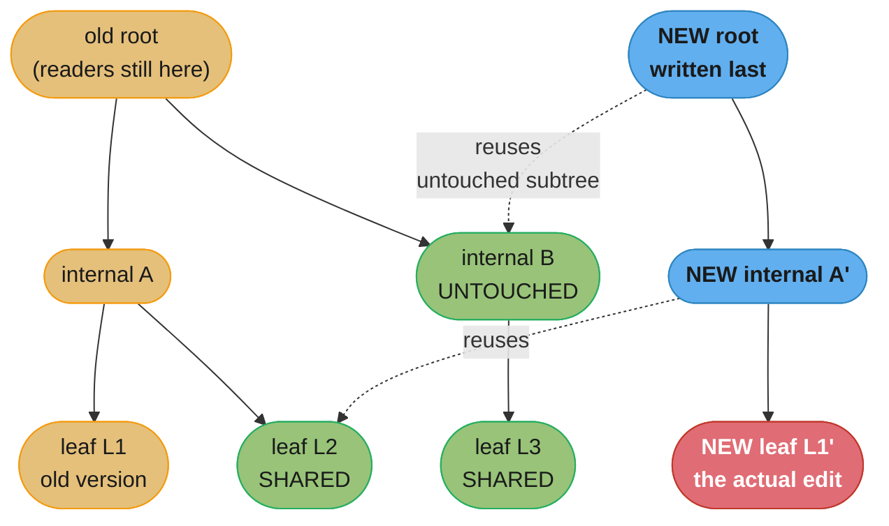
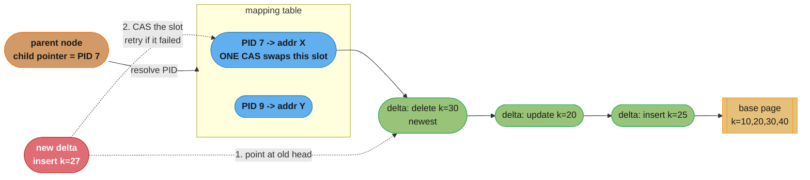

# Chapter 6: B-Tree Variants

> Part I — Storage Engines · Database Internals (Petrov, 1st ed., O'Reilly 2019) · builds on
> Ch 4's B-tree implementation and Ch 5's latching and write-ahead machinery, leads to Ch 7
> (Log-Structured Storage), where the same pressures produce a different structure entirely

## Chapter Map

The previous four chapters built one B-tree and then spent a whole chapter (Ch 5) paying for it:
page-level latching to make concurrent access safe, a write-ahead log to make crashes survivable,
and a full-page write for every modification however small. Chapter 6 is the catalogue of designs
that attack those costs one at a time. Its organising claim — and the thing to hold onto, because
the chapter is otherwise a parade of unfamiliar acronyms — is that **each variant fixes exactly
one specific weakness of the classic B-tree, and pays for it somewhere else.**

Petrov names three weaknesses up front and every section below maps to one or more of them:
**write amplification** (a one-byte update rewrites an entire page, and possibly the whole path),
**space amplification** (fragmentation, partially-filled pages, retained old versions), and
**concurrency** (page-level latching serializes access to hot pages, and structural modifications
must appear atomic). The variants are, in the chapter's order: **copy-on-write** trees, which give
readers a completely synchronization-free view at the cost of rewriting a root-to-leaf path per
write; **lazy B-trees**, which buffer updates in memory so many logical writes collapse into one
page write; **FD-trees**, which turn random writes into sequential ones by keeping immutable
logarithmic runs and use fractional cascading to keep lookups cheap across them; **Bw-trees**,
which make the tree entirely **latch-free** using a mapping table plus compare-and-swap-appended
delta chains; and **cache-oblivious B-trees**, which get near-optimal behaviour at *every* level
of the memory hierarchy without knowing any block size at all.

**TL;DR:**
- **Copy-on-write** never modifies a page in place: it copies the page, the parent, the
  grandparent, up to a new root, and switches a root pointer atomically. **Readers need no
  synchronization whatsoever** — they are looking at an immutable tree. The bill is write
  amplification proportional to tree height and space for the old versions. **LMDB** is the
  worked example.
- **Abstracting node updates** is the quiet enabling section: what "update a node" *means*
  depends on whether the engine reads the cached page bytes directly, materializes the page into
  native structures, or wraps it lazily — and every variant after it redefines the operation.
- **Lazy B-trees** attach an in-memory **update buffer** to a page and merge it with the on-disk
  image at read time, reconciling and writing only on eviction or checkpoint. **WiredTiger** uses
  a skiplist per page; the **Lazy-Adaptive Tree** attaches buffers to whole *subtrees* and
  propagates in batches.
- **FD-trees** keep a small mutable **head tree** plus immutable **logarithmic runs** of
  exponentially increasing size, merged on overflow — so writes become large sequential ones. The
  lookup cost of searching every run is repaired by **fractional cascading**, which pulls fence
  pointers up a level so a search in run *i* localizes the search in run *i+1*.
- **Bw-trees** make the tree **latch-free**: every tree pointer is a logical page id resolved
  through a **mapping table**, updates are small **delta records prepended by compare-and-swap**
  to a chain over a base page, splits and merges are two-step SMOs any thread may complete, and
  long chains are **consolidated** with **epoch-based** garbage collection.
- **Cache-oblivious B-trees** achieve asymptotically B-tree-optimal I/O **without knowing the
  block size B**, via the **van Emde Boas layout** — a recursive split of the tree by *height* —
  so the same structure is efficient at the cache line, the page, and the disk block
  simultaneously.

## The Big Question

> A classic B-tree makes one design decision very early and then lives with it forever: a node is
> a page, and modifying a node means rewriting that page. That decision buys simplicity and costs
> three things at once. Updating an eight-byte counter rewrites eight kilobytes. Splitting a node
> means holding exclusive latches on a path that other readers want. And a reader and a writer on
> the same page must take turns, because the page has exactly one version of itself. What would
> the tree look like if you refused to accept each of those costs in turn?

Analogy: the classic B-tree is a printed reference book kept up to date by whiting out a line and
retyping it — cheap to read, disruptive to edit, and impossible to do while somebody else is
reading that page. Copy-on-write is reprinting the affected page, plus every page in the table of
contents chain that refers to it, and putting the new edition on the shelf when it is complete:
readers of the old edition are never disturbed at all, and the price is a great deal of paper.
Lazy B-trees are the sticky notes stuck to a page, read together with it and typed in properly
only when the book is next reprinted. FD-trees are giving up on editing entirely and instead
keeping a stack of supplements, newest and smallest on top, merged into larger supplements as
they accumulate — with an index in each supplement telling you where to look in the next one down.
The Bw-tree is the same stack of notes but where the *table of contents entry itself* is a slot
you can atomically re-point, so nobody ever has to be locked out of a page while it is edited. And
the cache-oblivious tree is a book laid out so that whether your desk holds one page, ten pages,
or a whole chapter at a time, the pages you need next are already the ones in front of you —
without the printer ever having been told how big your desk is.

---

## 6.1 Copy-on-Write

A **copy-on-write** B-tree never modifies a page in place. To apply an update, the engine copies
the target page, applies the modification to the copy, and writes the copy to a **new location**.
That immediately creates a second problem: the parent's child pointer still refers to the *old*
location, so the parent must be updated too — and since the parent is also copy-on-write, it must
itself be copied to a new location, which invalidates *its* parent's pointer. The cascade runs all
the way to the root, so **a single-key update rewrites the entire root-to-leaf path**.

The new root is written last. Only when the whole new path is durably on disk is the pointer to
the current root switched — a single, atomic pointer update — which is what makes the whole
multi-page modification appear atomic. This structure is also known as **shadow paging**.

Three consequences follow, and they are the reason the technique keeps reappearing:

- **Readers require no synchronization at all.** A reader that started from the old root is
  traversing a tree that is entirely immutable — nothing on its path can be modified, because
  modification means writing elsewhere. No latches, no readers-writer locks, no crabbing, none of
  the machinery of Chapter 5's latching sections. This is the single largest benefit.
- **Crash safety comes free of the write-ahead log.** Because the root pointer is switched only
  after the new path is durable, a crash at any point leaves the old root intact and pointing at a
  complete, consistent tree. There is no partial state to recover from and no redo/undo to run.
- **Write amplification is proportional to tree height.** Every update rewrites height-many pages.

> **Decoding the write amplification (this summary's arithmetic, not the chapter's).** Take a
> four-level tree with 4 KB pages. Updating a single 8-byte value rewrites 4 pages = 16 KB, an
> amplification factor of **2,000×**. Raise the page size to 8 KB and it is 32 KB, or 4,000×. This
> is why copy-on-write is chosen for read-dominated and read-heavy-with-modest-write workloads,
> and why the variants in the rest of the chapter exist: every one of them is, in part, an attempt
> to get copy-on-write's concurrency properties without paying its write bill.

Space is the other cost. The old version of every rewritten page remains on disk until it is
certain no reader still needs it, so the engine must track reachability and reclaim pages —
either through a free list or through periodic compaction.



*Caption: one leaf edit forces a new copy of every node on its path to the root — three new pages
here — while every subtree the path did not touch is shared by pointer, not copied. Readers on the
old root never see any of it, which is why copy-on-write needs no reader latches at all.*

### Implementing Copy-on-Write: LMDB

**LMDB** — the Lightning Memory-Mapped Database, the key-value store underneath **OpenLDAP** — is
the chapter's worked copy-on-write implementation, and it is instructive mostly for how much
machinery it *does not* have.

- **It is a copy-on-write B+tree.** All values live in leaves, and no page is ever modified in
  place.
- **There is no write-ahead log.** Copy-on-write plus a last-written root pointer already provides
  atomicity and durability, so the entire recovery apparatus of Chapter 5 is absent.
- **There is no page cache of its own.** LMDB memory-maps the database file and lets the operating
  system's page cache do the caching, which removes a whole subsystem — and hands eviction policy
  to the kernel, which knows nothing about B-tree level access frequencies.
- **Single writer, multiple concurrent readers.** Writes are serialized by a single writer lock;
  reads take no locks at all. **Writers never block readers, and readers never block writers** —
  the copy-on-write property, stated operationally.
- **It maintains exactly two root versions.** Rather than accumulating an unbounded chain of
  historical trees, LMDB keeps two meta pages, each holding a root pointer, and a write builds its
  new tree over the *older* of the two, flipping which one is current on commit. That bounds
  version retention to one prior tree and lets the pages of the superseded copy be reclaimed
  immediately.
- **Reclamation is via a free list plus a reader table.** Pages from a superseded version go on a
  free list and are reused by subsequent writes. A reader table records which version each open
  reader is using, so a page may be reused only once no reader still needs it.

The failure mode falls straight out of the last two points and is worth naming, because it is the
production incident LMDB users hit: **a long-lived read transaction pins its version, so the free
list cannot reclaim the pages that version references, and every write must allocate fresh space
at the end of the file.** The database file grows steadily for as long as that reader stays open,
with no error and no warning — the same shape as the MVCC version-bloat pitfall from Chapter 5,
which is not a coincidence, since copy-on-write is a form of multiversioning.

---

## 6.2 Abstracting Node Updates

This short section is easy to skim past and is the hinge of the chapter: every variant that
follows changes what "applying an update to a node" *means*, so it is worth being precise about
what the operation is in the first place. Petrov lays out three ways an engine can represent a
page in memory once the page cache has loaded it.

1. Operate on **the cached page bytes directly**. The in-memory representation *is* the on-disk
   byte layout; reads and writes go through offsets into the buffer. There is no deserialization
   cost on load and no serialization cost on flush — the page is already in its final form — but
   every single access pays the cost of parsing the layout (finding the cell pointer, decoding the
   header), and any update has to fit the on-disk encoding exactly.
2. Materialize the page into **native language structures**. On load, parse the page into
   objects, arrays, or maps; operate on those; serialize back to the page format on flush.
   Accesses are then as cheap as ordinary in-memory data-structure accesses, and the update logic
   is written against a natural API rather than byte offsets. The costs are the
   (de)serialization work on every load and flush, plus a materially larger memory footprint than
   the page itself — and, in a managed runtime, a large number of objects to garbage-collect.
3. Use **wrapper objects that deserialize lazily**. A wrapper holds the raw page and materializes
   only the parts actually touched, on demand. This is the pragmatic middle ground, especially in
   a managed language where fully materializing every cached page would generate unacceptable GC
   pressure — a concern Petrov raises directly, along with the option of keeping page buffers
   off-heap so the collector never sees them at all.

| Representation | Load cost | Access cost | Memory | Best for |
|---|---|---|---|---|
| Raw cached page | none | parse the layout on every access | one page | scan-heavy, simple layouts, unmanaged runtimes |
| Fully materialized | full deserialization | native, cheap | several times the page | update-heavy pages accessed many times while resident |
| Lazy wrappers | none up front | parse once per touched element | between the two | managed runtimes; mixed access patterns |

The reason this belongs immediately before the variants: a **lazy B-tree's update buffer** is a
third representation the page does not have on disk at all; a **Bw-tree's delta chain** replaces
the notion of "the node's contents" with "a base page plus a list of modifications to be applied
during the read"; and copy-on-write makes an update a *new page* rather than a mutation of the
current one. Fix in your head that a node's in-memory form need not resemble its on-disk form, and
every variant below becomes a variation on one theme.

---

## 6.3 Lazy B-Trees

The weakness lazy B-trees attack is **write amplification from small updates**. In a classic
B-tree, a modification of a few bytes eventually causes the whole page to be written. If updates
to a page arrive frequently, the same page is rewritten again and again with only a little new
information in each version.

The fix is to **buffer the updates and apply them later, in a batch**. An update is recorded
somewhere cheap — an in-memory structure, or an append to a log — rather than being applied to the
page image, and the page's true logical contents become *the on-disk page merged with its buffered
updates*. Reads must do that merge on the fly; writes become nearly free. The page image is
rewritten only when the buffer is flushed, at which point many logical updates collapse into one
physical page write.

### WiredTiger

**WiredTiger** — the storage engine of MongoDB — is the chapter's row-store example of the
technique.

The mechanism: a page is loaded from disk as a **clean** image. The **first update** to that page
allocates an **update buffer** and attaches it to the in-memory page; that and all subsequent
updates are written into the buffer, not into the page image. Every **read** of the page consults
both — the on-disk image supplies the base contents and the update buffer supplies the
modifications, merged during the read. The clean image itself is never mutated while resident.

Two details Petrov highlights:

- **The update buffer is implemented as a skiplist**, not a sorted array or a tree. A skiplist
  keeps entries sorted with `O(log n)` search — which the merge-on-read needs — and, decisively,
  supports concurrent insertion without the structural rearrangement (and therefore latching) that
  a balanced tree requires. The choice is about concurrency, not about search cost.
- **Reconciliation** is the flush step. When a page is evicted or a checkpoint runs, the on-disk
  image and the update buffer are merged into a new page image and written out. The result may not
  fit in one page, so reconciliation can **split the page into several**, and pages are written to
  **new locations** in copy-on-write style rather than overwritten in place.

The payoff is direct: a page updated a thousand times between two checkpoints is written to disk
once, not a thousand times, and every one of those thousand updates avoided a page-sized write.
The cost is that reads pay a merge, memory holds both the page image and its buffer, and a page
with a very large buffer becomes progressively more expensive to read until reconciliation runs.

```
WiredTiger: the logical page is the on-disk image PLUS its update buffer

  on-disk page image (clean, never mutated in memory)
  +------------------------------------------------+
  | k=10 v=A | k=20 v=B | k=30 v=C | k=40 v=D       |
  +------------------------------------------------+
                     +
  in-memory update buffer (a skiplist, appended to by writers)
  +------------------------------------------------+
  | k=20 v=B'  | k=25 v=NEW | k=40 DELETED          |
  +------------------------------------------------+
                     =
  what a READ sees (merged on the fly, never materialized on disk)
  +------------------------------------------------+
  | k=10 v=A | k=20 v=B' | k=25 v=NEW | k=30 v=C    |
  +------------------------------------------------+

  RECONCILIATION (on eviction or checkpoint) writes that merged result
  as one or more NEW pages, and only then is a page-sized write paid.

  1000 updates between checkpoints -> 1 page write, not 1000.
```

*Caption: buffering turns the write cost from "per update" to "per reconciliation," and shifts the
work onto reads, which now merge two sources. That trade is only worth making when a page receives
many updates between flushes — which is exactly the workload that hurt the classic B-tree most.*

### Lazy-Adaptive Tree

The **Lazy-Adaptive Tree (LA-tree)** applies the same buffering idea one level up: instead of a
buffer per page, it groups nodes into **subtrees** and attaches an update buffer to each subtree.

An update is appended to the buffer of the subtree it belongs to. When a buffer fills, its
contents are **emptied down into the buffers of the subtrees below it** — a cascading propagation
in which a whole batch of updates moves one level in a single operation, rather than each update
individually descending the tree. Because updates destined for many different nodes travel
together, the I/O cost is amortized across the whole batch rather than paid per update. **Splits
and merges propagate in batches too**, so a burst of structural changes is applied to the higher
levels once rather than repeatedly.

The "adaptive" part is that buffer sizes are adjusted according to workload — a subtree receiving
heavy update traffic gets a larger buffer, so more updates accumulate before a propagation is
triggered.

| | WiredTiger-style | Lazy-Adaptive Tree |
|---|---|---|
| Buffer attached to | a single page | a whole subtree |
| Update path | append to that page's buffer | append to the subtree's buffer, cascade down when full |
| Batch granularity | one page's worth | one subtree's worth, across many pages |
| Structural changes | reconciliation may split a page | splits and merges propagate upward in batches |
| Read cost | merge page image with its buffer | check the buffers on the path, then the node |

Both designs share a property worth stating plainly, because it explains the whole rest of the
chapter and all of Chapter 7: **once you accept that a node's true contents are "the stored image
plus a set of pending modifications," you have taken the first step towards a log-structured
design.** FD-trees and Bw-trees take that step further, and LSM-trees (Chapter 7) take it all the
way.

---

## 6.4 FD-Trees

The **FD-tree** (Flash Disk tree) targets flash specifically. The relevant property of an SSD,
established back in Chapter 2, is that it reads and writes at page granularity but *erases* at the
much coarser block granularity, so **small random writes are disproportionately expensive** —
each one can force a read-modify-erase-rewrite cycle internally — while large sequential writes
are cheap.

The FD-tree's strategy is therefore to **minimize the surface area on which random writes occur**.
It does so with two structures:

1. A small mutable **head tree** — an ordinary B-tree, kept small enough to be cheap — which
   absorbs incoming writes.
2. A series of immutable, sorted **runs** of exponentially increasing size, stored contiguously.
   When the head tree fills, its contents are merged into the first run; when a run fills, it is
   merged into the next, and so on.

Because the runs are immutable and written whole, **every write to them is a large sequential
write** — exactly the pattern flash is good at. The random writes are confined to the small head
tree.

The obvious objection is lookup cost. If a key can be in the head tree or in any of *k* runs, a
naive lookup performs a binary search in each — `O(k log n)` — and *k* grows as the dataset does.
Fractional cascading is the repair.

### Fractional Cascading

**Fractional cascading** is a general technique for searching the same key across several sorted
arrays in the cost of roughly *one* search plus a constant per array. Its mechanism is to build
**bridges** between adjacent levels: pull every *N*-th element from level `L+1` up into level `L`,
and store with each such element a pointer back to its position in `L+1`.

The consequence is that a search does not start over at each level. A binary search in level `L`
ends between two elements; at least one of those neighbouring positions is a bridge, and its
pointer identifies a narrow window in `L+1` — bounded by the bridge spacing — so the search in
`L+1` is a scan of a handful of entries rather than a binary search over the whole run. Repeating
this down the levels turns `O(k log n)` into `O(log n + k)`: one real search at the top and a
constant amount of work per level thereafter.

```
FRACTIONAL CASCADING: bridges make the search in level L+1 nearly free

  level L    (smaller, searched first)
   +-----+-----+-----+-----+-----+
   |  8  | 15* | 23  | 42* | 57  |        * = a BRIDGE element, pulled up
   +-----+-----+-----+-----+-----+            from L+1, carrying a pointer
             |                 |              back to its position there
             |                 |
             v                 v
  level L+1  (larger, immutable run)
   +----+----+----+----+----+----+----+----+----+----+
   |  9 | 12 | 15 | 18 | 21 | 30 | 36 | 42 | 49 | 55 |
   +----+----+----+----+----+----+----+----+----+----+
             ^                        ^
             bridge for 15            bridge for 42

  Searching for key 21:

  1. binary search in level L  -> lands between 15* and 23
  2. follow the bridge at 15*  -> position of 15 in level L+1
  3. scan FORWARD a bounded number of entries: 15, 18, 21  -> FOUND

  Step 3 is O(bridge spacing), not O(log n). Without bridges, step 3 would
  be a fresh binary search over all of level L+1 - and again over L+2, L+3...

  cost:  WITHOUT cascading  O(k * log n)      k = number of runs
         WITH cascading     O(log n + k)      one real search, then constants
```

*Caption: the bridge is a pointer that converts "search this level from scratch" into "resume from
here." Every level after the first costs a bounded scan, which is what makes a multi-run structure
searchable at nearly single-tree cost — and what lets the FD-tree keep many immutable runs without
the lookups degrading.*

### Logarithmic Runs

The **runs** are immutable sorted arrays whose sizes grow **exponentially** — level `i` holds
roughly `k^i` entries for some growth factor `k`. When a level exceeds its size limit, it is
**merged with the next level down**, producing a new, larger immutable run, and the old ones are
discarded.

Exponential growth is what makes the number of levels **logarithmic** in the dataset size — the
reason the structure is tractable at all. With a growth factor of 10 and a first run of 1,000
entries, a billion entries fit in six levels; with a growth factor of 2 it would take twenty. That
is a direct trade: a larger growth factor means fewer levels (cheaper lookups, since the constant
in `O(log n + k)` is `k`) but larger, less frequent, more expensive merges.

Every merge writes a fresh contiguous run sequentially, so the whole structure's write pattern is
large sequential writes plus small random ones confined to the head tree — precisely the flash
profile it set out to achieve. The lineage here is unmistakable and Petrov makes it explicit: this
is the same immutable-sorted-run-plus-merge idea that Chapter 7 develops fully as the **LSM-tree**,
arriving here from the direction of B-trees rather than from log-structured storage.

---

## 6.5 Bw-Trees

The **Bw-tree** (Buzzword tree, from Microsoft Research, part of the Deuteronomy/LLAMA line of
work) attacks all three weaknesses at once, and its distinguishing achievement is the third:
**it is latch-free.** No thread ever blocks another. That is a stronger property than
"fine-grained latching," and it eliminates a whole category of Chapter 5's problems — latch
convoys, latch upgrade deadlocks, the pointer-chasing hazard, and the cache-line invalidation
storms that a contended latch causes on a multicore machine.

The chapter names the specific problems it addresses: write amplification (updating a page
rewrites it), space amplification, and the concurrency cost of page latching.

### Update Chains

A Bw-tree logical page is not a page image. It is a **base node** with a **chain of delta
records** in front of it. An update — an insert, an update, a delete — creates a small delta
record describing just that modification and **prepends** it to the chain. The base node is never
modified.

A read walks the chain from the newest delta to the oldest, then reaches the base node, applying
the modifications in order to reconstruct the page's logical contents. Because a delta describes
one change rather than a page, **a small update costs a small write**, and deltas are appended to
storage sequentially rather than overwriting a page in place. Write amplification collapses.

The costs are equally direct: a read must traverse the chain, and every link is a pointer
dereference likely to miss cache, so a long chain makes reads progressively slower — which is what
consolidation, below, exists to fix.

### Taming Concurrency with Compare-and-Swap

The mechanism that makes the chain safe without latches is a level of indirection: a **mapping
table**.

Every node in the tree is identified by a **logical page identifier (PID)** rather than by a
physical address, and **every pointer in the tree — every parent-to-child link — stores a PID**.
The mapping table maps each PID to the physical address of that logical page's current chain head.
Nothing in the tree itself ever holds a physical address.

The consequence is decisive. Installing a new delta means writing the delta record (which points
at the old chain head) and then **atomically swapping one slot of the mapping table** from the old
head's address to the new delta's address, with a single **compare-and-swap** instruction. If the
CAS succeeds, the update is visible to everyone instantly. If it fails — because another thread
installed its own delta first — the thread simply retries against the new head. No lock is ever
taken, no thread ever waits, and because the tree stores PIDs rather than addresses, **relocating
a page's contents requires no change to any pointer in the tree at all**: only the mapping table
entry moves.

This is also what makes the design *lock-free* in the technical sense rather than merely
"latch-free by convention": a thread that is descheduled mid-operation cannot block any other
thread, because it holds nothing. Progress is guaranteed system-wide, at the cost of retried work
under contention — the same optimistic bargain as Chapter 5's OCC, applied to the physical
structure instead of to transactions.



*Caption: the mapping table is the whole trick. Because every tree pointer is a PID and only the
table holds physical addresses, publishing an arbitrarily complex update — a delta, a
consolidation, a relocated page — is always the same single atomic instruction on one slot, and
nothing else in the tree has to change.*

### Structural Modification Operations

Splits and merges — **structural modification operations (SMOs)** — are the hard part, because
they span more than one node and a single CAS can only publish one change atomically. The Bw-tree's
answer is to decompose each SMO into **a sequence of individually atomic half-steps that leave the
tree in a legal, searchable state in between**, and to require that **any thread encountering an
incomplete SMO must complete it before proceeding** — so a stalled or descheduled thread never
leaves the structure stuck.

A **split** is two steps:

1. Install a **split delta** on the overflowing node P. It records the separator key and a
   **logical side link** — a PID — pointing at the new sibling Q. One CAS. From this moment,
   a search for a key beyond the separator that arrives at P follows the side link to Q and finds
   it. The parent has not been touched.
2. Post an **index-entry delta** to the parent, adding the separator key and Q's PID as a proper
   child. One CAS. Now searches reach Q directly.

Between the two steps the tree is in a **half-split** state — and this is precisely the
Blink-tree idea from Chapter 5, rebuilt out of deltas: a stale parent is not a correctness bug,
because the side link routes the search correctly. That is what makes the intermediate state
legal, and legality is what makes the two-step decomposition safe.

A **merge** is three steps, for the same reason in reverse:

1. A **remove-node delta** on the node being removed, marking it as no longer valid on its own.
2. A **node-merge delta** on its left sibling, taking ownership of the removed node's contents.
3. An **index-term-delete delta** on the parent, removing the separator and the child pointer.

| SMO | Steps | Intermediate state is legal because… |
|---|---|---|
| **Split** | split delta on P (with side link to Q) → index-entry delta on parent | a search past the separator follows the side link, exactly as in a Blink-tree |
| **Merge** | remove-node delta on Q → node-merge delta on left sibling → index-term-delete on parent | the removed node is marked and its contents are reachable through the sibling |

The "help-along" rule is the piece that distinguishes this from a merely optimistic scheme: a
thread that finds a half-completed SMO on its path does not wait and does not abort — it finishes
the SMO itself, then continues its own operation. Nothing depends on the original thread ever
being scheduled again.

### Consolidation and Garbage Collection

Delta chains grow, and a long chain is expensive to read: each link is a pointer dereference, most
of them cache misses, and the read must traverse all of them before it can answer. So when a
chain exceeds a length threshold, the Bw-tree **consolidates** it: it builds a fresh base page
containing the merged result of the base plus every delta, and installs it with a single CAS on
the mapping table slot, replacing the whole chain with one node.

This immediately raises a memory-reclamation problem that has no equivalent in a latch-based
design. After the CAS, the old chain is unreachable to *new* readers — but a reader that resolved
the PID a moment before the swap is still walking it. Freeing that memory would be a use-after-free
in another thread. There is no latch to tell you when the last reader is done, because avoiding
latches was the entire point.

The answer is **epoch-based reclamation**. A thread joins the current **epoch** when it begins an
operation and leaves it when it finishes. Memory made unreachable during epoch *E* is put on a
pending-free list tagged with *E*, and it may be reclaimed only once **every thread that joined
epoch *E* or earlier has exited** — at which point no thread can possibly still hold a reference
to it. It is a coarse but cheap form of safe memory reclamation, requiring no per-object reference
counts and no synchronization on the read path.

The failure mode mirrors the LMDB and MVCC ones exactly: **a thread that stays inside an epoch
indefinitely blocks reclamation of everything freed since**, so a stalled or very long operation
turns into unbounded memory growth. Three different structures in two chapters, one recurring
lesson — anything that keeps old versions alive for readers needs a way to know when the last
reader has gone, and any reader that never leaves defeats it.

---

## 6.6 Cache-Oblivious B-Trees

Every structure so far has been tuned to a block size. A B-tree node is sized to a page; the
fanout is chosen so a node fits one I/O. That tuning assumes there is *one* meaningful block size,
and on real hardware there are several: a 64-byte cache line, a 4 KB or 8 KB page, a disk block,
an SSD erase block. A tree tuned for the page is not tuned for the cache line.

A **cache-oblivious** structure achieves the asymptotically optimal number of block transfers
**for every block size simultaneously, without knowing any of them** — no parameter, no tuning, no
configuration. A cache-oblivious B-tree gets the same asymptotic I/O bounds as a B-tree tuned to a
known block size `B`, while containing no `B`.

It is built from two ideas: the **van Emde Boas layout** for the tree's nodes, and a
**packed-memory array** for the data, which keeps elements in sorted order with deliberate gaps so
that an insertion has to move only a small, amortized number of elements rather than shifting the
whole array.

### van Emde Boas Layout

The layout question is: given a tree, in what *order* should its nodes be placed in contiguous
memory so that a root-to-leaf path touches as few blocks as possible — without knowing how big a
block is?

The van Emde Boas answer is recursive, and it splits the tree by **height**, not by subtree. A
tree of height `h` is cut horizontally at the middle: a **top subtree** of height `h/2`, and
roughly `sqrt(n)` **bottom subtrees** of height `h/2` hanging beneath it. Each of these pieces is
laid out **contiguously**, and each is itself laid out by applying the same rule recursively.

Why that produces block-size independence: whatever the block size `B` turns out to be, there is
*some* level of the recursion at which the subtrees have a size between roughly `B/2` and `B` — so
they fit in one block. A root-to-leaf path passes through `O(h / log B)` of those subtrees, and
each costs one block transfer, giving `O(log_B n)` — the B-tree bound — with `B` appearing only in
the analysis and never in the structure.

```
van EMDE BOAS LAYOUT: split the tree by HEIGHT, recursively

  Logical tree, height h = 4:                Split at height h/2 = 2:

            (1)                                 TOP subtree, height 2
           /   \                                +---------------+
        (2)     (3)                             |      (1)      |
        / \     / \                             |     /   \     |
      (4) (5) (6) (7)                           |   (2)   (3)   |
      /\  /\  /\  /\                            +---------------+
     ........  ......                                |   |   |  |
     8 9 ...     ... 15                        four BOTTOM subtrees, height 2
                                               +------+ +------+ +------+ +------+
                                               | (4)  | | (5)  | | (6)  | | (7)  |
                                               | / \  | | / \  | | / \  | | / \  |
                                               |(8)(9)| |10 11 | |12 13 | |14 15 |
                                               +------+ +------+ +------+ +------+

  LAID OUT ON DISK / IN MEMORY, each piece CONTIGUOUS, top piece first:

  [ 1 2 3 ][ 4 8 9 ][ 5 10 11 ][ 6 12 13 ][ 7 14 15 ]
   ^ top     ^ bottom subtree 1 ... each one contiguous, and each one
             laid out by applying THE SAME RULE recursively

  Contrast with the naive breadth-first (level-order) layout:

  [ 1 2 3 4 5 6 7 8 9 10 11 12 13 14 15 ]
    ^ the path 1 -> 2 -> 4 -> 8 touches positions 0, 1, 3, 7:
      increasingly far apart, so deeper levels cost a fresh block each

  With the vEB layout the path 1 -> 2 -> 4 -> 8 touches [1 2 3] then [4 8 9]:
  TWO contiguous pieces, not four scattered positions.

  The point: at SOME level of the recursion the pieces are between B/2 and B
  in size and each fits one block - and that is true for EVERY B at once,
  which is why the structure never has to be told what B is.
```

*Caption: the recursion is on the tree's height rather than on its subtrees, and that is the whole
trick — a height split produces pieces at every scale simultaneously, so whichever scale happens
to match the hardware's block size, some level of the recursion has already grouped the path's
nodes to fit it.*

Petrov presents this as an elegant and asymptotically strong idea rather than as a standard
production choice: the constant factors and the implementation complexity — particularly
maintaining the packed-memory array's gaps under sustained insertion — have kept cache-oblivious
B-trees largely in the research literature, while their ideas inform how production structures are
laid out.

---

## Beyond the book — where these variants stood after 2019

> The chapter surveys these designs as of its 2019 publication and deliberately does not track
> product adoption, version history, or benchmark outcomes. Nothing below is Petrov's claim; it
> is orientation for a reader comparing the chapter against a modern system, kept separate so the
> two voices do not blur.

- **WiredTiger** is described here as a storage engine; readers should know it has been MongoDB's
  default engine since well before this book, which is why the chapter can treat it as a
  representative production implementation rather than a research prototype.
- **The Bw-tree's latch-free claim has been contested empirically.** Independent
  reimplementations found the constant factors — chain traversal cache misses, epoch-based
  reclamation overhead, and CAS retry rates under contention — materially higher than the original
  papers reported. This does not undermine the chapter's *structural* argument, which is what it
  is teaching, but a reader should not carry away "latch-free is strictly faster."
- **LMDB's design is unchanged and its tradeoffs are unchanged**, including the long-reader
  file-growth behaviour. It remains the cleanest small example of copy-on-write anyone can read
  end to end.
- **The FD-tree's direction won.** The chapter positions it as one variant among several; the
  broader industry answer to flash's random-write penalty converged on LSM-trees (Chapter 7),
  which share the immutable-run-plus-merge core. Reading 6.4 as "a B-tree reaching towards
  LSM" rather than as a widely deployed structure is the more useful frame.

---

## Visual Intuition

### Which weakness does each variant actually fix?

```
  CLASSIC B-TREE weaknesses:   [W] write amplification
                               [S] space amplification
                               [C] concurrency / latching

  variant                 fixes            pays with
  ----------------------  ---------------  ------------------------------------
  Copy-on-write / LMDB    [C] completely   [W] rewrites the whole root-to-leaf
                              (readers          path per update; [S] old
                               need NO           versions until reclaimed
                               synchronization)

  Lazy B-tree             [W] batches      reads must merge image + buffer;
  (WiredTiger, LA-tree)       many updates  memory holds both; a big buffer
                              into one      makes reads progressively slower
                              page write

  FD-tree                 [W] random ->    lookups must consult every run
                              sequential    (repaired by fractional cascading);
                                            merges rewrite whole runs

  Bw-tree                 [C] LATCH-FREE   long delta chains slow reads
                          [W] delta-sized  (repaired by consolidation);
                              writes        epoch-based reclamation needed;
                                            CAS retries under contention

  Cache-oblivious         [W][C] optimal   large constant factors; complex
  B-tree                      at EVERY      packed-memory-array maintenance;
                              block size    largely a research structure
                              with NO tuning

  Read the table as one sentence each: nobody got something for nothing.
```

*Caption: the chapter has no single winner, and looking for one is the wrong reading. Match the
variant to which of the three costs your workload actually pays — that is the decision the chapter
is equipping you to make.*

### The one idea shared by four of the five variants

```
  In a CLASSIC B-tree, a node's contents are exactly what is on the page:

       node contents  ==  page bytes

  In lazy B-trees, FD-trees, Bw-trees (and LSM-trees in Ch 7):

       node contents  ==  stored image  +  a set of pending modifications
                          ^^^^^^^^^^^^     ^^^^^^^^^^^^^^^^^^^^^^^^^^^^^
                          cheap to write   cheap to write
                          once, in bulk    individually

                              WiredTiger:  page image + skiplist update buffer
                              LA-tree:     subtree   + cascading buffers
                              FD-tree:     runs      + head tree
                              Bw-tree:     base page + delta chain

  The cost is ALWAYS the same and always lands on reads: something has to
  merge the two at read time, and the merge gets more expensive the more
  pending modifications there are. Every one of these designs therefore
  needs a periodic "apply the pending set for real" step:

       WiredTiger -> reconciliation
       LA-tree    -> buffer emptying
       FD-tree    -> run merge
       Bw-tree    -> consolidation
       LSM-tree   -> compaction  (Chapter 7)
```

*Caption: four different names in four different sections for the same operation. Recognizing that
compaction, consolidation, reconciliation and merging are one idea is most of what this chapter
has to teach, and it is what makes Chapter 7 feel inevitable rather than new.*

---

## Key Concepts Glossary

- **Write amplification** — the ratio of bytes physically written to bytes logically updated; a
  one-byte change rewriting an 8 KB page is 8,000×.
- **Space amplification** — storage consumed beyond the logical data size, from fragmentation,
  partially filled pages, and retained old versions.
- **Copy-on-write (shadow paging)** — never modifying a page in place: copy it, modify the copy,
  write it to a new location, and propagate the new pointer up to a new root.
- **Root pointer switch** — the single atomic update that publishes an entire copy-on-write
  modification, performed only after the new path is durable.
- **LMDB** — the Lightning Memory-Mapped Database (used by OpenLDAP): a copy-on-write B+tree with
  no write-ahead log, no page cache of its own (memory-mapped files), one writer and many
  concurrent readers, and exactly two retained root versions.
- **Meta page (LMDB)** — one of the two pages holding a root pointer, alternated on each commit.
- **Reader table (LMDB)** — the structure recording which version each open reader uses, gating
  page reclamation.
- **Free list** — the set of pages from superseded versions available for reuse by later writes.
- **Node representation** — how a cached page appears in memory: raw page bytes, fully
  materialized native structures, or lazily-deserializing wrapper objects.
- **Lazy B-tree** — a B-tree that buffers updates rather than applying them to the page image, so
  many logical writes collapse into one physical page write.
- **Update buffer** — the in-memory structure holding a page's pending modifications, merged with
  the on-disk image at read time.
- **WiredTiger** — MongoDB's storage engine, whose per-page update buffers are skiplists and whose
  flush step is reconciliation.
- **Skiplist** — the probabilistic sorted structure WiredTiger uses for update buffers, chosen for
  concurrent insertion without structural rearrangement.
- **Reconciliation** — merging a page's on-disk image with its update buffer into a new page image
  at eviction or checkpoint, possibly splitting it into several pages.
- **Lazy-Adaptive Tree (LA-tree)** — a lazy B-tree attaching update buffers to whole subtrees,
  cascading batches downward when a buffer fills and propagating splits and merges in batches.
- **FD-tree (Flash Disk tree)** — a flash-oriented design confining random writes to a small
  mutable head tree and keeping the rest of the data in immutable sorted runs.
- **Head tree** — the FD-tree's small mutable B-tree that absorbs incoming writes.
- **Logarithmic runs** — immutable sorted arrays of exponentially increasing size, merged into the
  next level on overflow, keeping the level count logarithmic in dataset size.
- **Fractional cascading** — bridging adjacent sorted levels by pulling every N-th element upward
  with a pointer back, turning `O(k log n)` multi-run search into `O(log n + k)`.
- **Bridge** — a pulled-up element carrying a pointer into the level below, letting a search
  resume rather than restart.
- **Bw-tree** — a latch-free B-tree variant using a mapping table of logical page identifiers plus
  compare-and-swap-installed delta chains.
- **Base node** — the consolidated page image at the tail of a Bw-tree delta chain.
- **Delta record** — a small record describing one modification, prepended to a Bw-tree page's
  chain and applied during the read.
- **Update chain** — the linked sequence of delta records in front of a base node, read
  newest-to-oldest.
- **Mapping table** — the Bw-tree's indirection layer mapping a logical page identifier to the
  physical address of its current chain head.
- **Logical page identifier (PID)** — what every Bw-tree pointer stores instead of a physical
  address, so relocating a page changes only one mapping-table entry.
- **Compare-and-swap (CAS)** — the single atomic instruction that installs a new chain head; on
  failure the operation retries against the new head, and no thread ever blocks.
- **Latch-free (lock-free)** — the property that no thread's progress depends on another thread
  being scheduled, achieved here by CAS on the mapping table.
- **Structural modification operation (SMO)** — a split or merge, decomposed into individually
  atomic half-steps that leave the tree legally searchable in between.
- **Split delta** — the first half of a Bw-tree split, recording the separator key and a logical
  side link to the new sibling.
- **Logical side link** — the sibling pointer that makes a half-split searchable, exactly as in a
  Blink-tree.
- **Index-entry delta** — the second half of a split, adding the separator and the new sibling's
  PID to the parent.
- **Remove-node / node-merge / index-term-delete deltas** — the three half-steps of a Bw-tree
  merge.
- **Help-along rule** — the requirement that a thread encountering an incomplete SMO must complete
  it before proceeding, so no stalled thread can leave the structure stuck.
- **Consolidation** — rebuilding a fresh base page from a long delta chain and installing it with
  one CAS, restoring read performance.
- **Epoch-based reclamation** — freeing memory only once every thread that joined the relevant
  epoch has exited, since there is no latch to signal when the last reader is done.
- **Cache-oblivious structure** — one achieving asymptotically optimal block transfers for every
  block size simultaneously, containing no block-size parameter.
- **van Emde Boas layout** — a recursive layout splitting the tree by *height* into a contiguous
  top subtree and contiguous bottom subtrees, each laid out by the same rule.
- **Packed-memory array** — a sorted array kept with deliberate gaps so an insertion moves only a
  small amortized number of elements.

---

## Tradeoffs & Decision Tables

### Variant selection

| Variant | Fixes | Costs | Choose when |
|---|---|---|---|
| **Copy-on-write** | reader concurrency (zero synchronization), crash safety without a WAL | write amplification × tree height, space for old versions | reads dominate overwhelmingly, writes are modest, and simplicity matters |
| **Lazy B-tree** | write amplification from repeated small updates | reads merge two sources; memory for buffers | a page receives many updates between flushes |
| **FD-tree** | random writes on flash | lookups touch every run; merges rewrite whole runs | write-heavy on SSD, where random writes are the binding cost |
| **Bw-tree** | latching entirely, plus write amplification | chain traversal cache misses, epoch reclamation, CAS retries | many cores contending on hot pages |
| **Cache-oblivious** | tuning for one block size | large constants, complex maintenance | the memory hierarchy has several relevant scales and tuning is impossible |

### Copy-on-write versus in-place update

| | In-place B-tree | Copy-on-write B-tree |
|---|---|---|
| Reader synchronization | latches / readers-writer locks required | **none** |
| Crash recovery | requires a write-ahead log and ARIES | root pointer switch is sufficient |
| Write cost of a 1-byte update | one page | one page **per tree level** |
| Old versions | none retained | retained until no reader needs them |
| Failure mode | latch contention on hot pages | file growth while a long reader holds a version |

### What each design does with a long-lived reader

| Structure | What the reader pins | Symptom if it never finishes |
|---|---|---|
| MVCC (Ch 5) | every version created since it started | unbounded version accumulation, slow scans |
| LMDB copy-on-write | the pages of its root version | the database file grows on every write |
| Bw-tree | its epoch | pending-free memory is never reclaimed |

*The recurrence is the lesson: any structure that keeps old data alive for readers needs a
reliable signal that the last reader has gone, and a reader that never leaves defeats every one of
them.*

### Merge/flush operation by name

| Structure | Name for "apply the pending modifications for real" | Triggered by |
|---|---|---|
| WiredTiger | reconciliation | eviction or checkpoint |
| Lazy-Adaptive Tree | buffer emptying / cascading | a subtree's buffer filling |
| FD-tree | run merge | a level exceeding its size limit |
| Bw-tree | consolidation | chain length exceeding a threshold |
| LSM-tree (Ch 7) | compaction | level size or file count policy |

---

## Common Pitfalls / War Stories

- **A long-lived read transaction in LMDB grows the database file without bound.** The reader's
  version pins its pages, the free list cannot reclaim them, and every write allocates fresh space
  at the end of the file. There is no error and no warning — just steadily increasing disk usage
  that stops the moment the reader closes. Auditing tools that open a read transaction and hold it
  are the usual culprit.
- **Assuming copy-on-write is cheap because "it avoids locking."** It avoids *reader* locking, and
  it pays for that with write amplification proportional to tree height: on a four-level tree with
  4 KB pages, an 8-byte update writes 16 KB. On a write-heavy workload this is not a marginal
  overhead, it is the dominant cost, and no amount of tuning removes it because it is structural.
- **Letting a Bw-tree delta chain grow unbounded.** Every read must traverse the chain
  newest-to-oldest, and each link is a pointer dereference that is likely a cache miss, so read
  latency degrades roughly linearly in chain length. Consolidation exists to prevent it; a
  threshold set too high converts an elegant latch-free structure into a slow linked list.
- **A thread that stays inside an epoch indefinitely.** Epoch-based reclamation frees memory only
  once every thread from that epoch has exited, so one long-running or stalled operation blocks
  reclamation of everything freed since it began. Memory grows, and the offending thread is not
  obviously doing anything wrong — it is the same shape as the MVCC and LMDB failures above.
- **Reading a page with a very large update buffer.** A lazy B-tree's read cost includes merging
  the buffer, so a page that has accumulated thousands of buffered updates without reconciliation
  is progressively slower to read. The buffering that made writes cheap is quietly charging reads
  for it, and the charge is invisible until reconciliation catches up.
- **Skipping fractional cascading in a multi-run design.** Searching *k* immutable runs
  independently is `O(k log n)`, and `k` grows with the dataset — so a structure that looks fine
  in testing degrades steadily in production as levels accumulate. The bridges are not an
  optimization detail, they are what makes the design viable at scale.
- **Choosing a growth factor for logarithmic runs without considering both ends.** A large factor
  means fewer levels and cheaper lookups, but larger and more disruptive merges; a small factor
  means cheap incremental merges and many levels to search. Tuning one end while measuring only
  the other produces a structure that is excellent at exactly one of read and write throughput.
- **Fully materializing every cached page in a managed runtime.** Deserializing pages into native
  objects makes access cheap and generates enormous garbage-collection pressure, since the buffer
  pool's worth of pages becomes a buffer pool's worth of live objects. Lazy wrappers or off-heap
  page buffers exist precisely to avoid handing the collector the entire cache.
- **Treating latch-free as automatically faster.** Lock-freedom is a *progress* guarantee, not a
  performance guarantee: under contention, CAS retries do real work repeatedly, and the pointer
  chasing that delta chains require costs cache misses a contiguous page does not. The Bw-tree's
  argument is about eliminating blocking and convoys, and it should be evaluated on that.

---

## Real-World Systems Referenced

- **LMDB** (Lightning Memory-Mapped Database) — the chapter's worked copy-on-write implementation:
  memory-mapped, no WAL, no own page cache, single writer with many readers, two retained root
  versions.
- **OpenLDAP** — named as LMDB's user, which is why LMDB's design centres on read-dominated
  workloads.
- **WiredTiger** — the storage engine used as the lazy-B-tree example, with skiplist update
  buffers and reconciliation.
- **MongoDB** — named as WiredTiger's context.
- **The Bw-tree** — from Microsoft Research, developed alongside the **LLAMA** storage layer and
  the **Deuteronomy** architecture, and associated with the Hekaton line of in-memory work.
- **FD-trees** and **cache-oblivious B-trees** — presented from their research literature rather
  than tied to a named product, which is itself informative about their adoption.

---

## Summary

Each variant in this chapter repairs one specific weakness of the classic B-tree — write
amplification, space amplification, or the concurrency cost of page latching — and pays for the
repair somewhere else.

**Copy-on-write** trees never modify a page in place: the modified page, its parent, and every
ancestor up to a new root are written to new locations, and the root pointer is switched atomically
once the new path is durable. Readers therefore need **no synchronization whatsoever** and crash
safety comes without a write-ahead log, at the cost of write amplification proportional to tree
height and retained old versions. **LMDB** is the worked example — a memory-mapped copy-on-write
B+tree with no WAL and no page cache of its own, one writer and many readers, exactly two retained
root versions, and a characteristic failure in which a long-lived reader prevents page reclamation
and the file grows.

**Abstracting node updates** — reading cached page bytes directly, fully materializing pages into
native structures, or wrapping them for lazy deserialization — is the hinge that makes the rest of
the chapter coherent: a node's in-memory form need not resemble its on-disk form, and every variant
that follows exploits that.

**Lazy B-trees** buffer updates rather than applying them to the page image, so many logical writes
collapse into one physical write. **WiredTiger** attaches a skiplist **update buffer** to each page,
merges it with the on-disk image on every read, and **reconciles** the two into new pages at
eviction or checkpoint. The **Lazy-Adaptive Tree** attaches buffers to whole subtrees instead,
cascading batches downward and propagating splits and merges in batches too.

**FD-trees** target flash by confining random writes to a small mutable **head tree** and keeping
everything else in immutable **logarithmic runs** whose sizes grow exponentially and which merge
downward on overflow — making the bulk of all writes large and sequential. **Fractional cascading**
repairs the lookup cost of searching many runs by pulling bridge elements up a level with pointers
back down, turning `O(k log n)` into `O(log n + k)`.

**Bw-trees** eliminate latching entirely. Every tree pointer is a **logical page identifier**
resolved through a **mapping table**, so any change to a page — a new **delta record** prepended to
its **update chain**, or a **consolidation** replacing the chain with a fresh base page — is
published by a single **compare-and-swap** on one table slot, and a failed CAS simply retries.
Splits and merges are decomposed into individually atomic **SMO** half-steps whose intermediate
states are legally searchable thanks to a **logical side link** (the Blink-tree idea from Chapter 5,
rebuilt from deltas), and any thread encountering an incomplete SMO must finish it. Because no
latch signals when the last reader of a superseded chain has left, memory is reclaimed by
**epochs**.

**Cache-oblivious B-trees** obtain the B-tree's asymptotic I/O bound for *every* block size at once
and contain no block-size parameter at all, using the **van Emde Boas layout** — a recursive split
of the tree by *height* into a contiguous top subtree and contiguous bottom subtrees, each laid out
by the same rule — together with a **packed-memory array** whose gaps keep insertion cheap. The
chapter presents them as asymptotically elegant and constant-factor expensive.

The through-line, and the best preparation for Chapter 7: four of these five designs redefine a
node's contents as **a stored image plus a set of pending modifications**, shifting cost from
writes onto reads, and every one of them therefore needs a periodic step that applies the pending
set for real — reconciliation, buffer emptying, run merging, consolidation. Chapter 7 calls it
compaction.

---

## Interview Questions

**Q: Why does a copy-on-write B-tree need no reader synchronization at all?**
**Short:** Nothing on a reader's path can ever be modified — an update writes new pages elsewhere and publishes them by switching a root pointer.
In a copy-on-write tree, applying an update copies the target page, modifies the copy, writes it to a new location, and propagates the new pointer up through copies of every ancestor to a new root, which is written last and published by one atomic root-pointer switch. A reader that started from the old root is therefore traversing a completely immutable tree: no page it can reach will be mutated, because mutation means writing somewhere else entirely. That removes latches, readers-writer locks, crabbing, and the pointer-chasing hazard in one stroke, and it also removes the need for a write-ahead log, since a crash before the pointer switch leaves the old root pointing at a complete consistent tree. The bill arrives as write amplification proportional to tree height and as space for old versions that must be tracked and reclaimed.

**Q: What is the mapping table in a Bw-tree and why is it the key to being latch-free?**
**Short:** It maps logical page ids to physical addresses, so any page change is published by one compare-and-swap on a single table slot.
Every node in a Bw-tree is identified by a logical page identifier, and every pointer in the tree — every parent-to-child link — stores that identifier rather than a physical address; only the mapping table holds addresses. Installing an update therefore means writing a delta record that points at the current chain head, then atomically swapping one mapping-table slot from the old head's address to the new record's, with a single compare-and-swap. If the CAS fails because another thread got there first, the thread retries against the new head; no lock is taken and no thread ever waits. Because the tree stores identifiers rather than addresses, relocating a page's contents — installing a delta, consolidating a chain, moving a page — requires no change to any pointer anywhere in the tree, which is precisely what makes an arbitrarily complex structural change publishable in one atomic instruction.

**Q: How does a Bw-tree perform a split when a single compare-and-swap can only publish one change atomically?**
**Short:** It splits the operation into two atomic half-steps whose intermediate half-split state is legally searchable via a logical side link.
The first step installs a split delta on the overflowing node, recording the separator key and a logical side link — a page identifier — pointing at the new sibling; that is one CAS, and the parent is untouched. The second step posts an index-entry delta to the parent, adding the separator and the sibling's identifier as a proper child; that is a second CAS. Between them the tree is in a half-split state, and it is correct because a search for a key beyond the separator that arrives at the original node follows the side link and finds it — exactly the Blink-tree idea from Chapter 5, rebuilt out of delta records. A merge decomposes the same way into three steps: a remove-node delta, a node-merge delta on the left sibling, and an index-term-delete on the parent. The rule that makes the decomposition safe under arbitrary scheduling is that any thread encountering an incomplete SMO must complete it before continuing, so a descheduled thread never leaves the structure stuck.

**Q: Why does a Bw-tree need epoch-based garbage collection when a latch-based tree does not?**
**Short:** With no latches there is no signal that the last reader of a superseded delta chain has finished, so memory cannot be freed on the spot.
After a consolidation CASes a fresh base page into the mapping table, the old delta chain is unreachable to new readers — but any thread that resolved the identifier a moment earlier is still walking it, so freeing that memory immediately is a use-after-free in another thread. A latch-based design would know when the last reader left because it would have to release something; the Bw-tree deliberately has nothing to release. Epoch-based reclamation solves it coarsely and cheaply: a thread joins the current epoch on entering an operation and leaves on finishing, memory made unreachable during an epoch goes on a pending-free list tagged with it, and it is reclaimed only once every thread that joined that epoch or earlier has exited. The failure mode is that one thread that never leaves its epoch blocks reclamation of everything freed since — the same shape as an MVCC long reader or an LMDB long read transaction.

**Q: What does fractional cascading actually do, and what would the cost be without it?**
**Short:** Bridges pulled up from the level below let a search resume rather than restart, turning O(k log n) across k runs into O(log n + k).
A structure with many immutable sorted runs faces an obvious lookup problem: a key can be in any run, so a naive search performs an independent binary search per run, costing `O(k log n)` where k grows as the dataset does. Fractional cascading builds bridges between adjacent levels by pulling every N-th element from level L+1 up into level L, storing with each a pointer back to its position below. A binary search in level L then ends adjacent to a bridge, whose pointer identifies a narrow window in L+1 bounded by the bridge spacing — so the search in L+1 is a short forward scan rather than a fresh binary search, and repeating that down the levels gives `O(log n + k)`: one real search at the top and a constant per level thereafter. The practical consequence is that without it, a multi-run design looks fine in testing and degrades steadily in production as levels accumulate.

**Q: Why does copy-on-write's write amplification scale with tree height rather than being one page?**
**Short:** Writing the modified page to a new location invalidates the parent's pointer, and the parent is also copy-on-write, so the cascade runs to the root.
The modified page cannot be overwritten in place, so it is written elsewhere, which means the parent's child pointer now refers to a stale location and must be updated — but the parent is subject to the same rule, so it too must be copied to a new location, which invalidates its parent's pointer, and so on to the root. A single-key update therefore rewrites height-many pages. Concretely, a four-level tree with 4 KB pages rewrites 16 KB to change an 8-byte value, an amplification factor around 2,000×. This is structural rather than an implementation inefficiency, which is why copy-on-write is chosen for read-dominated workloads and why most of the rest of the chapter is an attempt to get its concurrency properties without its write cost.

**Q: What is reconciliation in WiredTiger and what problem does the update buffer create that makes it necessary?**
**Short:** Reconciliation merges a page's on-disk image with its update buffer into new pages at eviction or checkpoint, bounding read cost.
WiredTiger loads a page as a clean image and never mutates it in memory; the first update allocates an update buffer, implemented as a skiplist, and every subsequent update goes there instead of into the page. That makes writes cheap and shifts the cost onto reads, which must merge the image with the buffer on every access. The buffer grows, so read cost grows with it — which is the problem reconciliation solves: on eviction or at a checkpoint, the image and buffer are merged into a new page image and written out, possibly split across several pages and written to new locations copy-on-write style. The skiplist choice is about concurrency rather than search cost: it keeps entries sorted with logarithmic search while supporting concurrent insertion without the structural rearrangement, and therefore the latching, that a balanced tree would need.

**Q: What does "cache-oblivious" mean, and how can a structure be optimal for a block size it does not know?**
**Short:** It attains the optimal block-transfer bound for every block size at once, because the van Emde Boas layout produces contiguous pieces at every scale.
A cache-oblivious structure contains no block-size parameter and still achieves asymptotically the same number of block transfers as a structure tuned to a known B — which matters because real hardware has several relevant block sizes at once: a 64-byte cache line, a 4 or 8 KB page, a disk block, an erase block. A B-tree tuned for the page is not tuned for the cache line. The van Emde Boas layout gets there by recursively splitting the tree by height: a tree of height h becomes a contiguous top subtree of height h/2 and roughly sqrt(n) contiguous bottom subtrees of the same height, each laid out by the same rule recursively. Whatever B turns out to be, some level of that recursion produces pieces between roughly B/2 and B in size that fit one block, so a root-to-leaf path crosses `O(log_B n)` of them — the B-tree bound, with B appearing only in the analysis.

**Q: Why does the van Emde Boas layout split the tree by height rather than by subtree?**
**Short:** A height split produces contiguous groupings at every scale simultaneously, which is what makes the layout work for all block sizes at once.
Splitting by subtree in the obvious way — laying out each child's whole subtree contiguously — optimizes for one particular grouping and leaves the top of the tree scattered relative to it. Cutting horizontally at half the height instead yields a top piece and many bottom pieces that are all roughly the same size, and applying the rule recursively yields nested groupings whose sizes form a geometric sequence — pieces at every scale from the whole tree down to a single node. Because the sizes span every scale, whichever one happens to match the hardware's block size is already present in the layout, and the nodes along any root-to-leaf path that fall within such a piece are already contiguous. Contrast a naive level-order layout, where the path 1, 2, 4, 8 lands at positions 0, 1, 3, 7 — increasingly far apart, so each deeper level costs a fresh block.

**Q: All of lazy B-trees, FD-trees and Bw-trees redefine what a node's contents are. What is the shared idea, and what does it always cost?**
**Short:** A node becomes a stored image plus pending modifications, which makes writes cheap and always charges reads for merging the two.
In a classic B-tree a node's contents are exactly the page bytes. WiredTiger makes them a page image plus a skiplist update buffer; the LA-tree makes them a subtree plus cascading buffers; the FD-tree makes them immutable runs plus a small head tree; the Bw-tree makes them a base page plus a delta chain; and the LSM-tree in Chapter 7 takes the idea to its conclusion. The benefit is uniform — a small update costs a small write instead of a page write — and so is the cost: something must merge the stored image with the pending set at read time, and the merge grows more expensive the more pending modifications exist. Every one of these designs therefore requires a periodic operation that applies the pending set for real, called reconciliation, buffer emptying, run merging, consolidation, and compaction respectively — five names for the same thing.

**Q: What specifically makes LMDB unusual as a storage engine, and what is its characteristic production failure?**
**Short:** It has no write-ahead log and no page cache of its own, and a long-lived read transaction makes the database file grow without bound.
LMDB is a copy-on-write B+tree that memory-maps its file and delegates caching entirely to the operating system, so it carries neither a WAL nor a buffer manager — copy-on-write plus a last-written root pointer already provides atomicity and durability. It permits a single writer and any number of concurrent readers, with writers never blocking readers and readers never blocking writers, and it retains exactly two root versions in two alternating meta pages, so a write builds over the older one and flips which is current on commit. Superseded pages go on a free list, gated by a reader table recording which version each open reader uses. The failure follows directly: a reader that never closes pins its version, the free list cannot reclaim the pages that version references, and every write must allocate fresh space at the end of the file — steady growth with no error and no warning.

**Q: What problem is an FD-tree solving that a plain B-tree does not, and how does its structure follow from that?**
**Short:** Small random writes are disproportionately expensive on flash, so the FD-tree confines them to a small head tree and keeps everything else in immutable runs.
An SSD reads and writes at page granularity but erases at the much coarser block granularity, so a small random write can force an internal read-modify-erase-rewrite cycle while a large sequential write is cheap. A plain B-tree's update pattern is exactly the bad case: scattered page-sized overwrites. The FD-tree therefore minimizes the surface area on which random writes occur, keeping a small mutable head tree to absorb incoming writes and storing the bulk of the data in immutable sorted runs of exponentially increasing size that are merged downward on overflow. Because runs are immutable and written whole, every write to them is large and sequential. The lookup cost of consulting many runs is then repaired by fractional cascading, and the resulting shape — a small mutable top plus immutable exponentially-sized sorted runs merged on overflow — is the LSM-tree of Chapter 7 arrived at from the B-tree direction.

**Q: Does latch-free mean faster? What does the Bw-tree's lock-freedom actually guarantee?**
**Short:** It guarantees progress, not speed — no thread's progress depends on another being scheduled, but CAS retries and chain traversal cost real work.
Lock-freedom is a progress property: because a thread never holds anything, one that is descheduled mid-operation cannot block any other, so the system as a whole always makes progress and there are no latch convoys, no latch-upgrade deadlocks, and no waiting on a thread the scheduler has forgotten. It says nothing about throughput. Under contention, failed compare-and-swaps mean the same work is done repeatedly, and reading a delta chain is a sequence of pointer dereferences that are likely cache misses where a contiguous page would have been one transfer. Consolidation and epoch-based reclamation both add their own overhead. The right framing is that the Bw-tree eliminates blocking and its associated pathologies, and should be evaluated on that rather than assumed to dominate a well-tuned latching design.

**Q: Why does an engine care how a cached page is represented in memory, and what are the three options?**
**Short:** The representation trades deserialization cost against access cost and memory, and every variant in this chapter redefines what updating a node means.
The first option is to operate on the cached page bytes directly, so the in-memory form is the on-disk form: no load or flush conversion cost, but every access must parse the layout and every update must fit the encoding exactly. The second is to fully materialize the page into native structures on load and serialize back on flush, which makes accesses as cheap as ordinary in-memory operations at the cost of conversion work on both ends, a much larger footprint, and — in a managed runtime — a buffer pool's worth of objects for the garbage collector. The third is lazily-deserializing wrapper objects that materialize only what is touched, the pragmatic middle ground, often paired with off-heap page buffers so the collector never sees them. This matters immediately because a lazy B-tree's update buffer, a Bw-tree's delta chain, and a copy-on-write update are all representations the page does not have on disk.

**Q: What is the tradeoff in choosing the growth factor for an FD-tree's logarithmic runs?**
**Short:** A larger factor means fewer levels and cheaper lookups but larger, more disruptive merges; a smaller one means cheap merges and more levels to search.
Runs grow exponentially — level i holds roughly k^i entries for growth factor k — and exponential growth is what keeps the number of levels logarithmic in dataset size, which is what makes the structure tractable at all. With a factor of 10 and a first run of 1,000 entries, a billion entries fit in six levels; with a factor of 2 it takes about twenty. Since lookup cost after fractional cascading is `O(log n + k)` where k is the level count, fewer levels directly means cheaper lookups. But merging a level into the next rewrites the whole target run, so a larger factor means those merges are larger, longer, and more disruptive when they happen, even though they happen less often. Tuning one end while measuring only the other produces a structure excellent at exactly one of read and write throughput, which is the same read/write-amplification tension that governs LSM-tree compaction policy in Chapter 7.

**Q: How does the Lazy-Adaptive Tree differ from per-page buffering, and what does the extra level of grouping buy?**
**Short:** It attaches buffers to whole subtrees rather than single pages, so a batch of updates destined for many nodes moves one level in a single operation.
Per-page buffering, as in WiredTiger, collapses many updates to *one* page into one page write. The LA-tree groups nodes into subtrees and attaches an update buffer to each, so an update is appended to its subtree's buffer and, when that buffer fills, its whole contents are emptied down into the buffers of the subtrees below in a cascading propagation. Because updates destined for many different nodes travel together, the I/O of moving them down a level is amortized across the whole batch rather than paid per update, and splits and merges likewise propagate upward in batches so a burst of structural change is applied to higher levels once. The adaptive part is that buffer sizes are adjusted to workload, so a subtree under heavy update traffic accumulates more before triggering a propagation. The cost is that a read must consult the buffers along the path in addition to the node itself.

**Q: When would you deliberately choose copy-on-write over a lazy B-tree, given that lazy buffering has far lower write amplification?**
**Short:** When reader concurrency and crash simplicity matter more than write cost — copy-on-write needs no reader synchronization and no write-ahead log at all.
Lazy buffering wins decisively on write amplification, collapsing many updates into one page write, but it does nothing about reader/writer coordination: the buffer is a mutable in-memory structure that concurrent readers and writers must still coordinate on, and the engine still needs a write-ahead log because a partially reconciled page is a recoverable-state problem. Copy-on-write eliminates both categories: readers traverse an immutable tree with zero synchronization, and crash safety is the root-pointer switch, so an entire recovery subsystem does not need to exist. For a read-dominated workload with modest write volume — LMDB's OpenLDAP case — that simplification is worth more than the write amplification costs, and the resulting engine is dramatically smaller and easier to reason about. Reverse the read/write ratio and the calculation reverses with it.

**Q: Where does the Blink-tree from Chapter 5 reappear in this chapter, and why is that not a coincidence?**
**Short:** The Bw-tree's split delta carries a logical side link so a half-split is searchable — the same high-key-and-sibling-pointer idea, rebuilt from deltas.
Chapter 5's Blink-tree makes a half-split a legal tree state by giving each node a high key and sibling pointers on every level, so a search whose key exceeds a node's range simply steps right and a stale parent is a routing hint rather than a bug. The Bw-tree needs exactly the same property for a different reason: a compare-and-swap can publish only one change atomically, so a split must be decomposed into two independently published steps, and the intermediate state must be legally searchable for that decomposition to be safe. Its split delta therefore carries a logical side link to the new sibling, and a search past the separator follows it. The recurrence is structural rather than accidental — whenever a multi-node change cannot be made atomic, the way out is to redefine the intermediate state as legal, and a sibling link is what does that for a tree.

**Q: A page in a lazy B-tree has accumulated a very large update buffer. What is happening to your read latency, and what fixes it?**
**Short:** Reads degrade because every access merges the on-disk image with the whole buffer, and reconciliation is the step that resets it.
The logical contents of a lazily-updated page are the stored image merged with the pending modifications, so a read cannot answer from the image alone — it must consult the buffer too, and the cost of that merge grows with the number of buffered entries. The buffering that made writes nearly free is quietly charging reads for it, and the charge is invisible in write metrics. Reconciliation at eviction or checkpoint merges the two into a fresh page image, resetting read cost and paying one page write for however many updates accumulated. The tuning question is therefore how long to defer reconciliation: defer it too little and the write-amplification benefit disappears, defer it too long and read latency degrades — the same read-versus-write-amplification dial that appears as consolidation threshold in the Bw-tree and as compaction policy in Chapter 7.

**Q: The chapter presents five variants. How should you actually choose between them?**
**Short:** By which of write amplification, space amplification, or latch contention your workload actually pays — there is no overall winner and looking for one misreads the chapter.
Each design repairs one specific weakness and pays for it elsewhere, so the decision starts with measuring which cost dominates. If reader concurrency is the constraint and writes are modest, copy-on-write eliminates reader synchronization and the write-ahead log outright. If the same pages receive many small updates between flushes, a lazy B-tree collapses them into one page write. If random writes on flash are the binding cost, an FD-tree confines them to a small head tree and makes everything else sequential. If many cores contend on hot pages, the Bw-tree removes blocking entirely. Cache-oblivious layouts matter when several levels of the memory hierarchy are simultaneously relevant and tuning to one is impossible, though their constant factors keep them largely in the literature. The one thing none of them does is reduce all three costs at once.

---

## Cross-links in this repo

- [database/storage_engines_internals/ — page representation, buffering and flush paths in production engines](../../../database/storage_engines_internals/storage_engines_internals.md)
- [database/indexing_deep_dive/ — B-tree indexing mechanics these variants are departing from](../../../database/indexing_deep_dive/indexing_deep_dive.md)
- [database/concurrency_control_and_locking/ — latching, lock-freedom and CAS in the concurrency-control context](../../../database/concurrency_control_and_locking/concurrency_control_and_locking.md)
- [database/document_databases/ — MongoDB and the WiredTiger storage engine in production use](../../../database/document_databases/document_databases.md)
- [database/embedded_and_edge_databases/ — LMDB and its embedded key-value peers](../../../database/embedded_and_edge_databases/embedded_and_edge_databases.md)
- [database/key_value_stores/ — LSM-based stores that the FD-tree section is reaching towards](../../../database/key_value_stores/key_value_stores.md)
- [java/concurrency/ — compare-and-swap, lock-free structures and safe memory reclamation](../../../java/concurrency/concurrency.md)
- [book/ddia_2e/04_storage_and_retrieval/ — B-tree versus LSM-tree tradeoffs from Kleppmann's frame](../../ddia_2e/04_storage_and_retrieval/04_storage_and_retrieval.md)
- Sibling chapters: [Ch 5 Transaction Processing and Recovery](../05_transaction_processing_and_recovery/05_transaction_processing_and_recovery.md) · [Ch 7 Log-Structured Storage](../07_log_structured_storage/07_log_structured_storage.md)

## Further Reading

- Petrov, *Database Internals*, O'Reilly, 2019 — Chapter 6, the closing chapter of Part I's
  B-tree sequence.
- Levandoski, Lomet, Sengupta, "The Bw-Tree: A B-tree for New Hardware Platforms," ICDE, 2013 —
  the source of the mapping table, delta chains, and two-step SMOs.
- Levandoski, Lomet, Sengupta, "LLAMA: A Cache/Storage Subsystem for Modern Hardware," VLDB, 2013
  — the storage layer beneath the Bw-tree.
- Li, He, Luo, Yi, "Tree Indexing on Flash Disks" / the FD-tree line of work — logarithmic runs and
  fractional cascading applied to flash.
- Chazelle and Guibas, "Fractional Cascading," Algorithmica, 1986 — the original technique.
- Bender, Demaine, Farach-Colton, "Cache-Oblivious B-Trees," SIAM Journal on Computing — the van
  Emde Boas layout and packed-memory array construction.
- Agrawal et al., "Lazy-Adaptive Tree: An Optimized Index Structure for Flash Devices," VLDB, 2009.
- LMDB technical documentation and the OpenLDAP project's design notes.
- Book website / errata: <https://www.databass.dev/>
- Community reading-group notes for this chapter:
  <https://github.com/Akshat-Jain/database-internals-notes>
