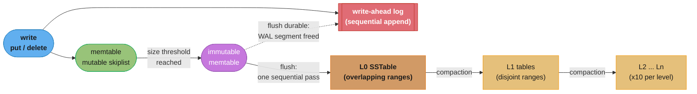
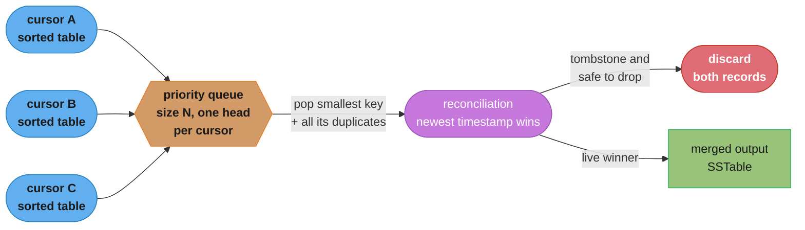
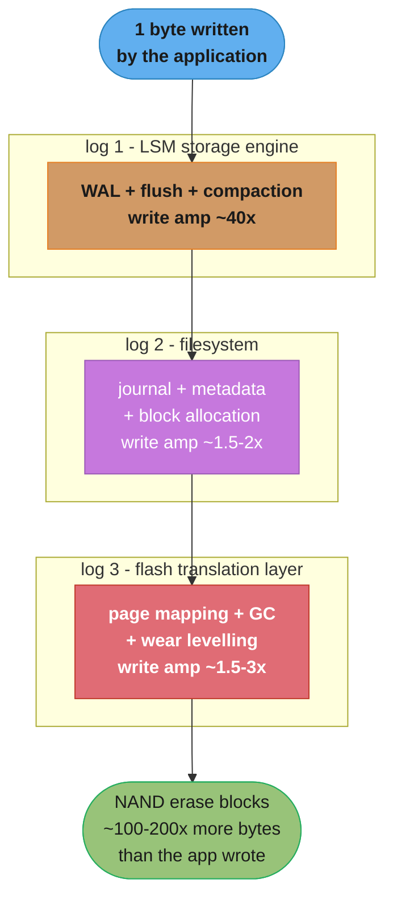
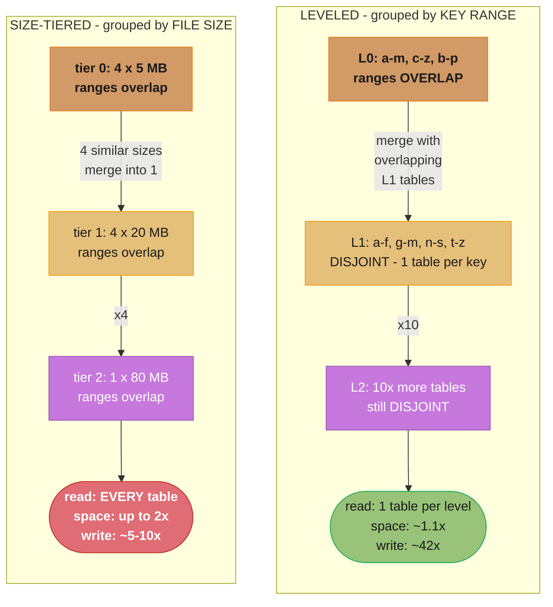

# Chapter 7: Log-Structured Storage

> Part I — Storage Engines · Database Internals (Petrov, 1st ed., O'Reilly 2019) · builds on Ch 6 (B-Tree Variants), closes Part I and leads to Ch 8 (Part II)

## Chapter Map

Chapters 2 through 6 built one machine: a **mutable, in-place, read-optimized** index. A B-tree
finds a key in three or four page reads, and it pays for that with an update path that has to
locate a page, pin it, modify it in place, and eventually write the whole page back — plus a
write-ahead log entry, plus a split or merge when occupancy hits an extreme, plus the fragmentation
that in-place mutation leaves behind. Chapter 7 asks the opposite question: what does a storage
engine look like if you never overwrite anything? The answer is the **LSM tree** — buffer writes in
a sorted in-memory structure, flush that buffer to an immutable file when it fills, and let a
background **compaction** process merge those files back together. Every write becomes sequential.
Every file, once written, is never touched again. And the entire cost of that decision shows up
somewhere else: reads must now consult many files instead of one tree, and the disk holds several
versions of the same key until compaction gets around to reconciling them.

That is the chapter's spine, and it has a name — the **RUM conjecture**: read overhead, update
overhead, and memory (space) overhead form a triangle where you may optimize two at the expense of
the third. A B-tree picks read and space. An LSM tree with leveled compaction picks write and space
and buys the read back with Bloom filters. An LSM tree with size-tiered compaction picks write and
read-in-the-common-case and pays in space. Bitcask picks read and write and pays with RAM and the
loss of range scans. Nothing in this chapter escapes the triangle; everything in it is a different
corner of it.

The back half of the chapter turns the argument on the environment the engine runs in. An
append-only log is only cheap if the thing beneath it is not *also* a log — and it usually is. A
journaling filesystem is a log. An SSD's flash translation layer is a log. Stack three logs and the
write amplification does not cancel, it **multiplies**. Petrov's term for the fix is **mindful
stacking**: layers that know about each other (LLAMA under the Bw-tree) or layers removed entirely
(open-channel SSDs). Then Part I ends.

**TL;DR:**
- An **LSM tree** trades in-place mutation for immutability: writes land in an in-memory
  **memtable**, are flushed as immutable **sorted string tables (SSTables)**, and are merged by
  background **compaction**. Deletes are **tombstones**, not removals; updates are new records that
  shadow old ones.
- A read must now merge across many tables. **Merge-iteration** (a priority queue over N sorted
  cursors) plus **reconciliation** (highest timestamp wins) is the mechanism, and **Bloom filters**
  are what keep the read amplification survivable.
- The **RUM conjecture** frames every choice: optimize any two of read, write, and space overhead
  and the third gets worse. **Leveled compaction** buys low space and read amplification with high
  write amplification (roughly the size ratio `T` per level, times the number of levels).
  **Size-tiered** inverts it. **Time-window** compaction is the special case where whole files can
  be dropped on TTL expiry.
- **Tombstone retention is the correctness trap.** A tombstone dropped before it has been compacted
  against every older table that could hold the value it shadows **resurrects deleted data**. On a
  delete-heavy size-tiered workload the opposite failure appears: tombstones and the values they
  shadow live in different size tiers and never meet, so reads keep slowing down forever.
- **Unordered log-structured storage** drops the sort: **Bitcask** keeps every key in an in-memory
  `keydir` and serves any read in one seek but cannot range-scan; **WiscKey** separates keys from
  values so compaction rewrites only keys, at the cost of a value-log garbage collector and scan
  locality.
- **Log stacking multiplies write amplification.** An append-only engine on a journaling filesystem
  on an FTL is three logs deep. The remedies are awareness (**LLAMA**) or removal
  (**open-channel SSDs**).

---

## The Big Question

> Every write to a B-tree eventually rewrites a whole page in place, and to make that page write
> survivable you first write the same change to a log — so the "one small update" costs at minimum
> a log record plus a full page write, at a random location, possibly triggering a split that
> rewrites two more pages and a parent. What if you simply never went back and modified a page?
> What would you have to give up, and would the trade be worth it?

Analogy: a B-tree is a **ledger kept in a bound book with an eraser**. Every entry sits at its
correct alphabetical place, so finding one is instant — but making a correction means locating that
exact line, erasing it, and writing over it, and when a page fills you physically re-copy half of it
onto a fresh sheet and re-stitch the binding. An LSM tree is a **stack of dated notepads**. You
never erase anything: you write today's corrections on today's pad in whatever order they arrive
(sorted only within the pad), and when the pad is full you start a new one and put the old one on
the stack. Looking something up now means checking today's pad first, then yesterday's, then the
week's, until you find it — slower, and you must remember that the *newest* mention wins. Every so
often, at night, someone merges several old pads into one clean pad, discarding every superseded
entry. Writing is now as fast as writing can be. Reading costs more, the stack takes more shelf
space than the facts strictly require, and the merging is real work that never ends. That
three-way trade is the whole chapter.

The one asymmetry that makes the trade worth taking: **writing sequentially is one or two orders of
magnitude cheaper than writing randomly on both HDDs and SSDs** (Chapter 2's seek argument, and
flash's erase-before-write asymmetry). The notepad is not merely a different bookkeeping style; it
converts every write into the access pattern the hardware is fastest at.

---

## 7.1 LSM Trees

The **log-structured merge-tree (LSM tree)** is an immutable, disk-resident write-optimized
structure. Its defining commitment is that **files are written once and never modified**. Where a
B-tree locates the page a key belongs to and mutates it, an LSM tree buffers the write in memory
and, on a schedule, dumps that buffer to disk as a brand-new sorted file. Reconciling what those
files collectively say about a key is deferred — to read time, and to a background merge process.

The two designs sit at opposite ends of the same axis:

| | B-tree (Ch 2–6) | LSM tree (Ch 7) |
|---|---|---|
| Mutability | Mutable — pages updated in place | Immutable — files written once |
| Write path | Locate page, modify, write back (random) | Append to memory, flush whole file (sequential) |
| Read path | One root-to-leaf descent, ~3–4 page reads | Search memtable + every disk table that might match |
| Optimized for | Reads | Writes |
| Same-key duplicates on disk | Impossible (one page owns the key) | Normal — reconciled at read/compaction time |
| Deletes | Remove the cell, maybe merge nodes | Insert a **tombstone** |
| Background work | Vacuum / page defragmentation | **Compaction**, continuously |
| Fragmentation | Real (partially-full pages, free lists) | None within a file — files are dense and sequential |

Note the last row carefully, because it is the compensation for everything else: a B-tree page is
typically only about 70% full in steady state, and its free space is scattered. An SSTable is
written in one pass with full knowledge of its contents, so it is packed exactly, and its index is
built for the data it actually holds rather than for the data that might arrive later.

### LSM Tree Structure

An LSM tree has an **in-memory, mutable** component and one or more **disk-resident, immutable**
components. The original two-component formulation names them `C0` (memory) and `C1` (disk).
Practical engines are **multicomponent**: `C0` plus many disk-resident tables spread across levels
or tiers.

- **Memtable** — the mutable in-memory buffer that absorbs every write. It is a sorted structure
  (a balanced tree or, more commonly, a **skiplist** — see 7.3) so that a flush can walk it in key
  order and emit a sorted file in one pass. It serves reads too: the newest value for a key is
  usually still here.
- **Write-ahead log** — the memtable is volatile, so every write is first appended to a WAL. On
  crash recovery the memtable is rebuilt by replaying the WAL. Once a memtable has been durably
  flushed, its WAL segment can be discarded, which is what keeps the log from growing without
  bound.
- **Flush** — when the memtable reaches a size threshold, it is made **immutable**, a fresh mutable
  memtable takes over incoming writes, and the immutable one is written out as a sorted table.
- **Disk-resident tables** — immutable, sorted, and never edited. A key may appear in several of
  them simultaneously, each occurrence carrying a timestamp or sequence number.

At any instant three kinds of state exist and all three must be readable: the **current mutable
memtable**, the **memtable currently being flushed** (still the only in-memory home of its
records until the flush completes), and the **on-disk tables**. Section 7.5 is about coordinating
exactly that.



Caption: every arrow on the write path is a sequential append or a single-pass file write — there
is no random page update anywhere in it, which is precisely the property a B-tree cannot offer.
The dashed arrow is the one that bounds the log's size: the WAL segment only becomes disposable
once the memtable it protects is safely on disk.

### Updates and Deletes

Neither an update nor a delete touches existing data.

- An **update** is simply a new record with the same key and a newer timestamp, written to the
  memtable like any other. The old record stays wherever it is until a compaction happens to merge
  the two tables holding both versions.
- A **delete** inserts a **tombstone** — a marker recording that the key was deleted at a given
  timestamp. Petrov also calls this a **dormant certificate**: it certifies the deletion and lies
  dormant on disk until a compaction is able to act on it.

A delete therefore *increases* the amount of data on disk. This is the single most
counter-intuitive property of the model, and it is where most production LSM incidents originate
(see the war story in 7.1's compaction sub-sections).

Some engines also support a **range tombstone** — one marker that shadows an entire key range —
rather than forcing one tombstone per key. Deleting a million-key range with a million individual
tombstones writes a million records; a single range tombstone writes one, and every read over that
range consults one marker instead of a million.

```
key "user:42" as it actually exists on disk, right now, across four tables:

  memtable      user:42  ->  {name: "Ada", ts: 1005}      <- newest, wins
  SSTable #7    user:42  ->  <TOMBSTONE, ts: 900>
  SSTable #4    user:42  ->  {name: "Ada L.", ts: 610}
  SSTable #1    user:42  ->  {name: "A.L.",   ts: 120}

  a read returns {name: "Ada"}. Nothing else is deleted yet.
  disk holds 4 versions of one live record: that is space amplification, made concrete.
```

### LSM Tree Lookups

A lookup has to consider that the answer may live in any component, and that several components may
have an answer.

- **Point query.** Search the memtable, then the disk-resident tables, **newest first**. Because
  the newest occurrence of a key always wins, a point query may stop at the first hit — including
  when that hit is a tombstone, in which case the answer is "not found" and the search is over.
  This ordering is not an optimization detail, it is required for correctness: stopping at an
  *older* hit would return data that has since been overwritten or deleted.
- **Range scan.** No early exit exists. The scan must open a cursor on every component whose key
  range overlaps the query, advance them together, and merge — because any of them may contribute a
  key that no other one holds. This is why range scans are where LSM read amplification hurts most,
  and why Bloom filters (which answer only point-membership questions) cannot help.

The number of components a lookup may have to touch is exactly the **read amplification** of the
engine, and it is the number every design in the rest of the chapter is trying to reduce.

### Merge-Iteration

Merging N sorted inputs into one sorted output is done with a **priority queue** (a min-heap) that
holds one entry per input — the head element of each cursor. The queue size is `N`, the number of
iterators, not the number of records.

The algorithm:

1. Open a cursor on each of the N sorted tables. Push each cursor's first key into the priority
   queue.
2. Pop the smallest key from the queue. That key is the next key of the merged output.
3. If several cursors are sitting on that same key, **pop all of them** — they are duplicates of the
   same key from different tables and must be handed to reconciliation together.
4. Advance each popped cursor by one record and push its new head back into the queue.
5. Repeat until the queue is empty.

Cost: `O(M log N)` for `M` total records across `N` tables, with `O(N)` memory for the queue.
Crucially it is a **streaming** algorithm — it never materializes more than one record per table at
a time, which is what lets a compaction merge tables far larger than RAM.

```
merging three tables. queue holds one head per cursor; smallest key wins.

  Table A:  [ a:1  c:1  d:1 ]      step 1: queue = { a(A), b(B), a(C) }
  Table B:  [ b:2  c:3      ]              pop the two 'a' entries together
  Table C:  [ a:5  e:2      ]              -> reconcile a:1 (A) vs a:5 (C)

  step 2: queue = { c(A), b(B), e(C) }  -> emit b (only B has it)
  step 3: queue = { c(A), c(B), e(C) }  -> pop BOTH c's -> reconcile c:1 vs c:3
  step 4: queue = { d(A),        e(C) }  -> emit d, then e

  output: a(newest), b, c(newest), d, e     queue never exceeds 3 entries
```



Caption: merge-iteration is the same machinery whether it is serving a range scan or driving a
compaction — the only difference is where the output goes (to the client, or to a new file).

### Reconciliation

Merge-iteration hands reconciliation a group of records that share a key and came from different
tables. **Reconciliation decides which one is real.** The rule is: the record with the highest
timestamp or sequence number wins, and the rest are superseded.

For this to work, every record must carry an ordering marker written at insert time. Without one
there is no way to tell which of two same-key records is newer, because file identity alone does
not establish it — a table produced by a compaction can contain records that are older than records
in a table created after it.

Three cases the reconciler must handle:

| Records for one key | Result |
|---|---|
| Two data records, ts 610 and ts 1005 | Emit ts 1005; drop ts 610 |
| Data record ts 610 and a tombstone ts 900 | The tombstone is newer — the key is deleted |
| Tombstone ts 900 and a data record ts 1005 | The write is newer — the key is live again |

The second row is the one that matters for compaction: a tombstone that has been merged with the
data it shadows has done its job, and **both** records can be discarded from the output — provided
no older table anywhere else still holds a value for that key. That proviso is the subject of the
next two sub-sections and it is where the correctness bugs live.

### Maintenance in LSM Trees

The disk-resident tables accumulate. Left alone, every flush adds one more file a read may have to
consult, and every superseded record and every tombstone stays on disk forever. **Compaction** is
the background process that reads several tables with merge-iteration, reconciles the duplicates,
writes a single new table, and then deletes the inputs.

Mechanically it is straightforward and it exploits immutability directly:

1. Pick a set of input tables according to the strategy (7.1's next four sub-sections).
2. Open cursors on all of them and merge-iterate, reconciling duplicates as they arrive.
3. Stream the surviving records into a new table (and its index, and its Bloom filter).
4. Atomically make the new table visible and the old ones invisible.
5. Delete the old files — but only once no reader still holds a cursor on them.

Step 4 and 5 are the only tricky part, and immutability is what makes them tractable: a reader
already iterating an input table can safely keep reading it, because nothing is modifying that file
underneath it. The file's deletion just waits for the last reader to finish. Compare this with a
B-tree, where an in-place page modification must be coordinated with every concurrent reader of
that page.

Compaction is not optional and it is not free. It reads and rewrites data that the user never asked
to be touched, and that rewriting **is** the write amplification of an LSM tree.

### Tombstones and Compaction

Here is the rule that governs correctness, and the single easiest thing to get wrong in an LSM
engine:

> **A tombstone may only be dropped once it has been compacted against every table that could
> still contain an older value for that key.**

Break it and you get **data resurrection**. Concretely:

```
BROKEN: tombstone dropped too early

  SSTable #9  (recent)  user:42 -> <TOMBSTONE ts 900>
  SSTable #4  (older)   user:42 -> {name: "Ada L.", ts: 610}   <- NOT in this compaction

  compaction merges #9 with #8 only. #9's tombstone has nothing to shadow
  in #8, so a naive implementation concludes "nothing to delete here" and
  omits the tombstone from the output to save space.

  result:  the tombstone is gone. SSTable #4 still holds ts 610.
           the next read finds {name: "Ada L."} and returns it.
           A DELETED USER IS BACK. No error was raised anywhere.

FIXED: retain until provably shadowing nothing

  the tombstone is written to the compaction output UNLESS the compaction's
  input set provably covers every table whose key range includes user:42 and
  whose records could be older. In practice that means:

    - keep the tombstone if any table NOT in this compaction overlaps the key
      range and may hold an older record;
    - only in a compaction that includes the OLDEST table covering the range
      (in leveled compaction, when the record reaches the bottom-most level)
      may the tombstone be discarded along with the data it shadows.
```

The distributed-database version of the same rule adds a *time* dimension: a replica that was down
when the delete happened must be given a chance to learn about it before the tombstone disappears,
or anti-entropy (Chapter 12) will helpfully replicate the surviving old value back onto the node
that had correctly deleted it. Cassandra's `gc_grace_seconds`, default 10 days, is exactly this
grace window *(beyond the book — the chapter states the retention requirement, not this setting)*.

The mirror-image failure is not incorrectness but unbounded slowdown: tombstones that are retained
correctly but **never get compacted against the data they shadow**. Read the size-tiered
sub-section below for how that happens by construction.

### Leveled Compaction

Leveled compaction organizes disk-resident tables into **levels** with a fixed size ratio `T`
between them, and enforces a strong structural invariant:

- **Level 0** holds tables flushed directly from memtables. Their key ranges **overlap** freely,
  because each is simply a snapshot of whatever keys happened to be in one memtable.
- **Level 1 and below** hold tables with **disjoint key ranges**. Within one level, any given key
  lives in at most one table.
- Each level holds roughly `T` times as much data as the level above it. `T = 10` is the common
  choice *(beyond the book — RocksDB's `max_bytes_for_level_multiplier` defaults to 10)*.
- Tables are of a fixed target size; it is the **number** of tables per level that grows, not their
  size.

Compaction fires when a level exceeds its size budget: pick a table from level `n`, find every table
in level `n+1` whose key range overlaps it, merge them all, and write the results back into level
`n+1`.

The disjointness invariant is what makes reads cheap. Below L0, a point query touches **at most one
table per level** — so with 5 levels the worst case is L0's handful of tables plus 5 more, and Bloom
filters eliminate most of even those. Space amplification is also small: because at most one table
per level holds a key, a key can exist in at most `L` copies, and in practice the bottom-most level
holds the overwhelming majority of the data, so the redundant fraction is on the order of 10%.

The bill arrives as write amplification. Every byte that descends from level `n` to level `n+1` is
rewritten together with the overlapping bytes already in level `n+1` — and because level `n+1` is
`T` times bigger, an overlapping merge rewrites roughly `T` bytes for every byte pushed down. Over
`L` levels, that is roughly `T x L` in total.

```
leveled write amplification, worked (T = 10, 5 levels)  *(beyond the book: the
arithmetic is the summarizer's; the chapter states the relationship, not the numbers)*

  per level:      ~10 bytes rewritten per byte promoted   (level n+1 is 10x bigger)
  levels:         L0 -> L1 -> L2 -> L3 -> L4              (4 promotions)
  compaction:     ~10 x 4        = ~40x
  plus flush:     memtable -> L0 = ~1x
  plus WAL:       every write logged once = ~1x
                                  --------
  total write amplification       ~42x

  meaning: a 1 GB/day ingest workload writes ~42 GB/day to the device.
  on flash, that is the number that determines drive lifetime.
```

Leveled compaction is therefore the strategy for **read-heavy and space-constrained** workloads,
and the wrong one for a write-saturated ingest pipeline.

### Size-Tiered Compaction

Size-tiered compaction groups tables by **size**, not by key range. Tables of similar size form a
tier; once enough of them accumulate in a tier (commonly 4), they are merged into one larger table,
which lands in the next tier up. Small tables merge into medium ones, medium into large, large into
enormous.

There is **no disjointness guarantee anywhere**. Two tables in the same tier may both contain
`user:42`, and so may every table in every other tier.

The consequences, in both directions:

- **Write amplification is much lower.** A record is rewritten once per tier promotion, and the
  number of tiers grows logarithmically with the dataset — roughly `log_T(N)` rewrites rather than
  leveled's `T x L`. For a write-saturated workload this is the difference between keeping up and
  falling behind.
- **Read amplification is much higher.** A point query may have to consult *every* table, because
  any of them may hold the key. Bloom filters take most of that cost away for keys that are absent,
  but a key present in a dozen tables still forces a dozen lookups.
- **Space amplification is much worse, and it spikes.** Duplicates of a key can exist in every tier.
  Worse, merging the largest tier requires enough free space to hold the merged output *while the
  inputs still exist* — so a database whose largest tier is half the dataset needs roughly **2x**
  the dataset size in free space to complete that compaction at all. Running out mid-compaction is a
  real operational failure mode.

And the delete-heavy pathology, which is the classic production incident:

```
BROKEN: delete-heavy workload on size-tiered compaction

  setup: a queue-like table. rows are written, consumed, deleted.
         steady state: ~50 GB of live data in one huge tier-3 SSTable,
         written months ago.

  today's deletes flush as small tier-0 SSTables, a few MB each,
  containing almost nothing but tombstones.

  size-tiered merges tables of SIMILAR SIZE. so:

    tier 0:  [t] [t] [t] [t]   -> merged into one tier-1 table of tombstones
    tier 1:  [tt] [tt] [tt] [tt] -> merged into one tier-2 table of tombstones
    tier 2:  ...
    tier 3:  [ 50 GB of the actual old rows ]   <- never selected: nothing
                                                   else is anywhere near its size

  the tombstones NEVER MEET the data they shadow. they cannot be dropped
  (correctly - see 7.1 Tombstones and Compaction), so they accumulate.

  symptom curve: a read of one partition scans and discards 100 tombstones,
  then 1,000, then 50,000. p99 read latency climbs week over week with no
  change in traffic, data volume, or query shape. eventually a single
  partition read has to materialize and discard hundreds of thousands of
  markers and the query times out.

FIXED - pick whichever matches the workload:

  1. switch this table to LEVELED compaction. leveled promotes a tombstone
     down level by level, and at each level it is merged against the tables
     that overlap its KEY RANGE - so it is structurally guaranteed to
     eventually meet the old row and annihilate it. write amplification
     rises; the unbounded read regression stops.

  2. if the data is time-series or TTL'd, use TIME WINDOW compaction. the
     old rows and their expiry live in the same time bucket, so the entire
     SSTable is dropped wholesale and no tombstone is needed at all. This is
     strictly better than either of the above for that shape of data.

  3. as a stopgap, allow single-table tombstone compaction: rewrite an
     individual SSTable whose tombstone ratio exceeds a threshold, purging
     tombstones whose shadowed data is provably not present elsewhere.
     Bounds the damage; does not fix the structural mismatch.

  the root cause is a strategy/workload mismatch, not a tuning value. deletes
  are writes in an LSM tree, and size-tiered compaction has no mechanism that
  brings a write together with the older write it supersedes.
```

### Time Window Compaction

Time window compaction is the specialization for **time-series and TTL'd data**, where records
arrive in roughly timestamp order and expire in roughly timestamp order.

Data is bucketed into **time windows**. Tables written within the same window are compacted with
each other — often size-tiered *within* the window — and once a window is closed, its tables are
never compacted again. When every record in a window has expired, **the entire file is deleted**.

That last property is the whole point. Expiring a window costs one `unlink`, not a compaction, not a
tombstone, not a merge. Compare this against a general-purpose strategy on the same workload, where
each expiring row produces a tombstone, and every tombstone has to be merged against the row it
shadows before either can go away.

The precondition is that writes are roughly ordered by time. Out-of-order or backdated writes land
in a window that has already been closed, forcing that window to be recompacted or leaving records
in the wrong bucket — which is why time window compaction is a workload-specific choice and not a
default. It supersedes the earlier **date-tiered** strategy, which attempted the same idea with a
compaction-window scheme that was harder to reason about.

---

## 7.2 Read, Write, and Space Amplification

Three costs, each measured as a ratio against the ideal:

| Amplification | Definition | Dominated by |
|---|---|---|
| **Read** | Disk reads (or tables consulted) per logical read | Number of components a lookup must touch |
| **Write** | Bytes written to the device per byte of user data | Compaction rewrites, flush, WAL |
| **Space** | Bytes stored on disk per byte of live user data | Superseded versions, tombstones, compaction headroom |

Every one of them is real money. Read amplification is p99 latency. Write amplification is SSD
endurance and background CPU. Space amplification is the storage bill and the free-space headroom
you must keep to let compaction run at all.

Some worked figures to keep the units concrete:

- **Write amplification.** A workload ingesting 1 GB/day at leveled `T = 10`, 5 levels, writes about
  42 GB/day to the device. The same ingest under size-tiered writes roughly 5–10 GB/day. A B-tree,
  by comparison, writes each 8 KB page in full for a 100-byte row update, plus a WAL record —
  which is a very different *shape* of amplification: per-operation and immediate rather than
  deferred and batched, and random rather than sequential.
- **Space amplification.** Leveled: about 1.1x, because the bottom level holds ~90% of the data and a
  key exists in at most one table per level. Size-tiered: up to 2x steady-state, and transiently
  higher during a top-tier compaction. B-tree: roughly 1.3–2x, from page occupancy sitting near 70%
  plus free-list fragmentation.
- **Read amplification.** Leveled: L0 tables plus one per level, so on the order of 6–10 candidate
  tables — but a Bloom filter at 10 bits/key rejects about 99% of the tables that do not hold the
  key, so the *actual* disk reads drop to roughly one table plus the odd false positive. Size-tiered:
  every table is a candidate, so 10–30 in a large database, again heavily filtered by Bloom filters
  for absent keys but not for present ones.

### RUM Conjecture

The **RUM conjecture** — Read, Update, Memory — states the general form: for any access method you
may optimize at most **two** of read overhead, update overhead, and memory (space) overhead, and the
third will suffer. There is no design that wins all three; there are only different corners.

Placing the chapter's designs on the triangle:

| Design | Optimizes | Pays in |
|---|---|---|
| B-tree | Read, space | Write (in-place page rewrites, random I/O) |
| LSM + leveled compaction | Read (with Bloom filters), space | Write (~T x L) |
| LSM + size-tiered compaction | Write | Read and space |
| LSM + time window compaction | Write, space (for TTL data) | Read; and only valid for time-ordered data |
| Bitcask | Read (one seek), write (pure append) | Memory — every key must fit in RAM; no range scans |
| WiscKey | Write (values never re-merged) | Scan locality, plus a second GC process to run |

The practical instruction the conjecture gives is: **decide which of the three you are willing to
lose before choosing a structure**, because every subsequent tuning knob only moves you along the
same triangle. Tuning cannot escape it — only a different access method can, and only by trading a
different pair.

```
the RUM triangle, made concrete. read the columns as "what this costs".

                     READ AMP           WRITE AMP        SPACE AMP
                  (tables touched)    (bytes / byte)  (disk / live bytes)
  -----------------------------------------------------------------------
  B-tree            1 root->leaf          ~2-4x           1.3-2.0x
  (Ch 2-6)          path, ~3-4          (full page        (~70% page
                    page reads           + WAL)            occupancy)

  LSM leveled       ~6-10 candidates      ~42x            ~1.1x
  (T=10, L=5)       -> ~1 after         (10 per level     (bottom level
                    bloom filters        x 4 levels)       holds ~90%)

  LSM size-tiered   every table:          ~5-10x          up to 2x, and
  (4 per tier)      10-30 candidates    (log_T(N)          spikes during
                                         promotions)       top-tier merge

  Bitcask           exactly 1             ~1-2x           ~2x before merge
  (hash keydir)     (keydir -> seek)    (pure append)     + ALL keys in RAM

  WiscKey           1 LSM hit             ~2-5x           value log needs
  (kv separated)    + 1 vLog read       (keys only)        its own GC
  -----------------------------------------------------------------------
  every row is good at exactly two columns. that is the conjecture.
```

Caption: the grid is the RUM conjecture rendered as a table you can point at — scan any row and the
weak column is immediately visible, and no row is strong in all three.

---

## 7.3 Implementation Details

The model above is simple. Making it fast requires five specific pieces of engineering, and this is
where the chapter descends from structure to bytes.

### Sorted String Tables

An **SSTable (sorted string table)** is the on-disk format of an LSM tree's immutable components. It
has two parts:

- **Data file** — the records, **sorted by key**, written in a single sequential pass.
- **Index file** — a mapping from key to offset in the data file, allowing a lookup to jump straight
  to the right region rather than scanning.

Because the file is written once, in one pass, with the complete contents known in advance, several
properties fall out for free that a B-tree has to work for:

- **No fragmentation.** Records are packed densely; there are no half-empty pages and no free lists.
- **The index is exactly sized.** It is built for the data present, not for data that might arrive.
- **Sequential write, sequential read.** The whole file can be streamed by a compaction or a scan
  with no seeking.
- **Trivially cacheable.** An immutable file's cached blocks never need invalidation — a point
  developed further under *Disk Access* below.
- **Cheap range scans.** Records are already in key order within the file, so a scan is a forward
  read.

The index is usually **sparse**: one entry per *block* rather than per record. A lookup binary-
searches the sparse index to find the block that must contain the key, reads that one block, and
scans within it. That keeps the index small enough to hold in memory even for a large data file.

```
SSTable on-disk layout (sparse index, block-granular)

  data file  -- records sorted by key, blocks written once, never modified
  +---------------+---------------+---------------+---------------+
  |   block 0     |   block 1     |   block 2     |   block 3     |
  |  apple..kiwi  | lemon..mango  | melon..pear   | plum..zebra   |
  +---------------+---------------+---------------+---------------+
  ^               ^               ^               ^
  | offset 0      | offset 4096   | offset 8192   | offset 12288

  index file -- ONE entry per block, not per record. small enough for RAM.
  +------------------------------------------------------------------+
  | "apple" -> 0 | "lemon" -> 4096 | "melon" -> 8192 | "plum" -> 12288|
  +------------------------------------------------------------------+

  lookup("mango"):
    1. binary-search the index: "lemon" <= "mango" < "melon"  -> block 1
    2. ONE disk read of block 1 (4 KB)
    3. scan within the decompressed block -> found

  cost: 1 disk read, because the index is in memory and points at a block,
  not at a record. an index with one entry per record would be ~100x larger
  and would not fit.
```

Some implementations also attach secondary indexes to the SSTable itself, so that an index over a
non-key column is written and dropped along with the table it describes — no separate index
structure to keep consistent, because the table it indexes is immutable.

### Bloom Filters

A **Bloom filter** (Burton Bloom, 1970) is a probabilistic set-membership structure. It answers
"might this set contain key `k`?" with either **"definitely not"** or **"possibly yes"**. False
positives are possible; **false negatives are not**. That asymmetry is precisely what an LSM lookup
needs: a definite "no" lets it skip a table without touching the disk at all, and a "possibly yes"
merely costs the read it would have done anyway.

Mechanism: a bit array of `m` bits and `k` independent hash functions. To insert a key, hash it `k`
ways and set all `k` bits. To test a key, hash it `k` ways and check all `k` bits — if any is 0 the
key is definitely absent; if all are 1 it is probably present, or `k` other keys collectively
happened to set those same bits.

The sizing tradeoff, in bits per key:

| Bits per key | Optimal `k` | Approx. false-positive rate | Memory for 100M keys |
|---|---|---|---|
| 5 | 3 | ~9% | ~60 MB |
| **10** | **7** | **~1%** | **~120 MB** |
| 15 | 10 | ~0.15% | ~180 MB |
| 20 | 14 | ~0.03% | ~240 MB |

**10 bits per key giving roughly a 1% false-positive rate** is the standard operating point: a
lookup against a table that does not hold the key does a wasted disk read only 1% of the time, for
about 1.2 bytes of RAM per key. Push to 20 bits and you cut the waste to 0.03% but double the memory
— and memory is the third axis of the RUM conjecture, so this is the same trade again, one level
down.

What Bloom filters do **not** help with: **range scans** (membership is a point question, so there
is nothing to ask about a range) and **keys that are actually present** (the filter says yes and the
read happens). They convert the read amplification of *absent* keys — which, in a
many-table LSM, is most of the candidate tables for any given lookup — from disk reads into memory
lookups.

### Skiplist

The memtable needs a sorted, mutable, concurrently-accessible structure. A **skiplist** is the usual
choice over a balanced tree.

Structure: a stack of linked lists. The bottom list holds every element in sorted order. Each higher
list holds a random subset of the list below it — an element appears at level `i+1` with
probability `p`, commonly 1/2 or 1/4. Search starts at the top-left, walks forward while the next
key is smaller than the target, and drops down a level when it is not, converging in
`O(log n)` expected steps.

```
skiplist search for 21. start top-left, walk right while you can, else drop down.

  L3:  head ------------------------------------> 25 --------> NIL
  L2:  head ----------> 9 ---------------------> 25 --------> NIL
  L1:  head ----> 6 --> 9 ------> 17 ---------> 25 --> 31 --> NIL
  L0:  head -> 3 -> 6 -> 9 -> 12 -> 17 -> 21 -> 25 -> 31 --> NIL

  path: L3 head -> 25 is too big, drop.  L2 head -> 9 ok, advance to 9.
        9 -> 25 too big, drop.  L1 9 -> 17 ok, advance.  17 -> 25 too big, drop.
        L0 17 -> 21 FOUND.   4 hops instead of 6 through the bottom list.

  no rotations. no rebalancing. the shape is maintained by the coin flip
  at insert time, which is exactly why concurrent updates are easier here
  than in a balanced tree.
```

Why a skiplist rather than a B-tree or red-black tree in memory:

- **No rebalancing.** Structure is maintained probabilistically at insert time, so no operation ever
  has to restructure a region of the data. A balanced tree's rotation, by contrast, touches nodes
  far from the inserted key.
- **Concurrency is far simpler.** An insert links a new node into `h` lists with node-local pointer
  updates, which lends itself to fine-grained locking or lock-free compare-and-swap. A tree
  rebalance is a multi-node structural change that is much harder to make concurrent — exactly the
  problem the Bw-tree of Chapter 6 had to solve with delta chains.
- **Predictable memory behaviour.** Node count is `n / (1 - p)` in expectation, so the overhead of
  the upper levels is a small, known constant.

### Disk Access

Immutability changes how an LSM engine talks to the operating system, and it simplifies things a
B-tree cannot simplify.

- **The page cache can be used directly.** A B-tree generally needs its own buffer pool with pinning,
  eviction policy, and dirty-page tracking, because pages are mutated in place and the engine must
  control exactly when a modified page reaches disk (Chapter 5's recovery rules depend on it). An
  SSTable is never modified, so a cached block can never be stale — the OS page cache is sufficient
  and requires no invalidation protocol at all.
- **Memory-mapped files are practical.** Because the file never changes size or content after being
  written, `mmap` is straightforward: no remapping on growth, no torn reads from a concurrent
  writer.
- **Indexes and Bloom filters are pinned in memory.** These are small relative to the data and are
  consulted on every lookup, so they are held in RAM while the data blocks themselves are left to
  the page cache. Only the parts of the index that are needed have to be loaded, which matters when
  a database has thousands of SSTables.
- **Compaction is a streaming read and a streaming write.** It touches large amounts of data but in
  a pattern the device handles at full bandwidth. The operational hazard is that this streaming
  traffic **evicts the page cache** that the read path depends on — which is why compaction I/O is
  usually rate-limited rather than run at full speed.

### Compression

Compressing an entire SSTable as one unit would make random access impossible: you would have to
decompress from the start of the file to reach any record. So compression is applied **per block**.

The consequence is an extra indirection: block offsets in the *logical* (uncompressed) address space
no longer correspond to *physical* offsets in the file. The file therefore carries an additional
structure mapping compressed-block boundaries to their physical offsets, and a lookup goes:

```
lookup("mango") in a compressed SSTable

  1. sparse index      -> logical block 1
  2. block offset map  -> physical offset 2 480, compressed length 1 630
  3. read 1 630 bytes  -> decompress -> 4 096 bytes
  4. scan the decompressed block -> record found

  block size is the tuning knob:
    4 KB   -> less CPU per lookup, worse compression ratio, bigger offset map
    64 KB  -> better ratio, but a 100-byte read decompresses 64 KB
  the right choice depends on whether the workload is point lookups or scans.
```

The tradeoff is CPU against I/O, and the block size sets where you land. Smaller blocks waste less
work on a point lookup and compress worse; larger blocks compress better and make every point lookup
decompress far more than it needs. Scan-heavy workloads want large blocks; point-lookup-heavy
workloads want small ones.

---

## 7.4 Unordered LSM Storage

Everything so far has kept data **sorted** — that is what makes range scans and merge-iteration
possible. But sorting is also what makes compaction expensive: records are rewritten repeatedly for
no reason other than to keep them in order relative to their neighbours. Two designs give up some or
all of the sorting to buy write amplification back.

### Bitcask

**Bitcask** is the log-structured storage engine of Riak. It is unordered: it does not build
SSTables and it does not sort anything on disk.

**The write path.** Records are appended to the current data file in **arrival order**, with no
sorting at all. When the file reaches a size limit it is closed (becoming immutable) and a new
active file is opened. That is the entire write path — one sequential append, and nothing is ever
rewritten to maintain order.

**The read path.** An in-memory hash table called the **keydir** maps **every key in the database**
to the file id, offset, size, and timestamp of its most recent record. A read is a hash lookup
followed by exactly **one disk seek** to a known offset — no index descent, no table-by-table
search, no merge, and no Bloom filter needed because the keydir is exact rather than probabilistic.

```
Bitcask read: one hash lookup, one seek. that is the whole path.

  keydir (RAM, every key in the database)
  +---------------------------------------------------+
  | "user:42" -> file 7, offset 1 205, len 96, ts 1005 |
  | "user:43" -> file 3, offset 8 800, len 72, ts  610 |
  +---------------------------------------------------+
                     |
                     v  ONE seek, exact offset
  data file 7 (append-order, UNSORTED)
  ... | user:19 | user:42 (ts 1005) | order:88 | ...
                ^ offset 1 205

  contrast with a leveled LSM read of the same key:
    check memtable, then L0 tables, then one table per level,
    bloom-filtered, each hit costing an index lookup + a block read.
```

**Compaction (merge).** Old data files are merged: for each key, the newest record is kept and every
older record is dropped, producing a compacted data file plus a **hint file** — a compact summary of
which keys live at which offsets. Hint files exist purely for startup: rebuilding the keydir by
scanning every data file would take proportional to the whole dataset, whereas reading the hint
files reconstructs it quickly.

**What you buy and what you pay:**

| Property | Bitcask |
|---|---|
| Point read | **One seek**, guaranteed, regardless of dataset size |
| Write | Pure sequential append, no re-sorting, low write amplification |
| **Range scan** | **Not supported** — data is unordered, so there is no cheap way to walk a key range |
| **Memory** | **Every key must fit in RAM.** 100M keys at ~50 bytes of keydir entry is ~5 GB before the keys themselves |
| Space | Old versions persist until a merge; roughly 2x before compaction |
| Startup | Fast with hint files; slow without |

This is a direct RUM-conjecture placement: Bitcask optimizes **read and write** and pays in
**memory**. It is the right engine when the key space is bounded and known, point lookups dominate,
and nobody will ever ask for a range.

### WiscKey

**WiscKey** keeps the sorting but attacks the *reason* compaction is expensive: it rewrites values,
and values are usually far bigger than keys.

**The separation.** Keys stay in the LSM tree. **Values move to a separate append-only value log
(vLog)**, and the LSM tree stores, in place of each value, a pointer `(vLog file, offset, length)`.

**Why that helps so much.** Compaction now merges and rewrites **only keys and pointers**. Consider
a 16-byte key with a 1 KB value: under a conventional LSM tree, every compaction rewrites 1,040
bytes for that record. Under WiscKey, it rewrites about 32 bytes — the key plus the pointer. The
value is written **once**, when it is first inserted, and never again. For large values that is a
roughly 30x reduction in the bytes compaction has to move, and for a leveled engine at ~42x write
amplification it brings the effective figure down toward the low single digits.

```
value size vs the win, illustrative *(beyond the book: the chapter argues the
mechanism; these ratios are the summarizer's arithmetic)*

  value size   conventional LSM         WiscKey            reduction
               rewritten per merge      rewritten
  ----------------------------------------------------------------------
     64 B      16 + 64  =  80 B         16 + 16 = 32 B       ~2.5x
    256 B      16 + 256 = 272 B         16 + 16 = 32 B       ~8.5x
      1 KB     16 + 1024 = 1040 B       16 + 16 = 32 B       ~33x
     16 KB     16 + 16384 = 16400 B     16 + 16 = 32 B      ~512x

  the separation is only worth its costs when values are large relative to
  keys. for tiny values the pointer is as big as the value it replaces.
```

**The two costs, both real:**

- **Scan locality is lost.** In a conventional LSM tree a range scan reads consecutive records from
   one sorted file — sequential I/O. In WiscKey the *keys* are sequential but each value requires a
   separate random read into the vLog, wherever that value happened to be appended. A 1,000-key scan
   becomes 1,000 random reads. The mitigation is to exploit SSD internal parallelism by issuing
   those reads concurrently and prefetching ahead of the scan cursor, which recovers much of the
   throughput on flash — and essentially none of it on a spinning disk. This is why key-value
   separation is a **flash-era** design.
- **The value log needs its own garbage collection.** The vLog accumulates values whose keys have
   since been updated or deleted, and nothing in the LSM tree's compaction cleans them up. The GC
   walks the vLog from its tail: for each value, look up its key in the LSM tree and check whether
   the stored pointer still points at *this* offset. If yes the value is live and is re-appended at
   the head; if no it is garbage and is skipped. The tail pointer then advances, freeing space.
   Note what this means — WiscKey has traded one background rewrite process for **two**, and the
   second one performs an LSM lookup per value it examines.

WiscKey is therefore the right design when values are large, the workload is point-lookup and
write heavy, and the device is flash. It is the wrong design for small values, or for a scan-
dominated workload on a device without cheap random reads.

---

## 7.5 Concurrency in LSM Trees

The concurrency problem in an LSM tree is not the one a B-tree has. A B-tree must protect **pages
being mutated in place** against concurrent readers, which is why Chapters 5 and 6 spend so long on
latch coupling and latch-free delta chains. An LSM tree mutates nothing on disk, so the entire
disk-resident side is read-only by construction. What remains is the **transitions**: the moments
when the *set* of components changes.

Two pieces of shared state need synchronized access:

- **The memtable pointer** — which memtable is currently mutable and receiving writes.
- **The set of disk-resident tables** — which files are currently part of the tree.

Both change during a flush, and both change during a compaction. The flush is the harder of the two
because it involves the in-memory side.

The ordering constraints during a flush, all of which must hold:

- The **new mutable memtable** must be in place and accepting writes **before** the old one stops
  accepting them, or writes are rejected or lost during the switch.
- The **old memtable must remain readable** for the entire duration of the flush. Until its contents
  are durably on disk and visible in the table set, it is the only place those records exist in a
  readable form, so discarding it early loses reads.
- The **flushed table must become visible** to readers **before** the old memtable is discarded, and
  the switch between the two must be atomic from a reader's point of view — a reader must never
  observe a window where the records are in neither.
- The **WAL segment may only be discarded after** the flush has completed durably. Discard it
  earlier and a crash mid-flush loses every record it protected.

Compaction has the same shape but is simpler: build the new table fully, then atomically swap it in
for its inputs, then delete the inputs — but only after the last reader holding a cursor on them has
finished. Immutability makes that last part easy: an in-flight reader can safely continue reading a
file that has been logically removed, because no writer is touching it. Reference counting the open
files is enough.

The practical technique the chapter emphasises is to keep the **lock scope tiny**: the expensive
work (writing the file) happens entirely outside any lock, and only the pointer swap that makes it
visible is protected. Writers never wait on a flush's I/O.

One capacity note that is a scheduling matter rather than a locking one: a flush should be triggered
**pre-emptively**, before the memtable is completely full, so that the flush of memtable `n` overlaps
with writes into memtable `n+1`. If flushes only start when the memtable is already full, writes
stall until the flush completes — and the stall is proportional to the memtable size, which is
exactly when it is largest.

---

## 7.6 Log Stacking

Here the chapter turns the whole argument on its head. Log-structured storage is efficient because
sequential appends are cheap. But an application's log almost never sits on bare hardware. It sits
on a filesystem, which may keep a journal or be log-structured itself; and that sits on an SSD,
whose flash translation layer is *also* a log-structured system with its own garbage collection.

**Logs do not cancel. They compose, and the composition multiplies.** A byte appended by the storage
engine is rewritten by the filesystem's journal and again by the FTL's garbage collector, and each
layer's write amplification multiplies with the others' rather than being absorbed.



Caption: three independent logs, each individually well-designed, each unaware of the others — the
amplification factors multiply rather than add, and the device sees two orders of magnitude more
writes than the application issued.

Two structural problems, distinct from the raw multiplication:

- **Misaligned segments.** If the upper log's segment size is not a multiple of the lower log's
  erase or allocation unit, then deleting one upper segment leaves partial lower units live, forcing
  the lower layer's GC to copy live data it would otherwise have been able to erase wholesale.
- **Mixed lifetimes.** If data with very different lifetimes ends up in the same lower-level erase
  block — a short-lived WAL segment next to a long-lived bottom-level SSTable — then erasing that
  block requires relocating the long-lived data. Repeatedly. Data that never changes gets rewritten
  over and over because of what it happens to sit next to.

### Flash Translation Layer

The **flash translation layer (FTL)** is the firmware inside an SSD that presents a normal
block-device interface over NAND flash that cannot deliver one directly. From Chapter 2: flash reads
and writes at **page** granularity but erases only at **block** granularity, and a page cannot be
overwritten without erasing the block containing it.

The FTL therefore does exactly what an LSM tree does, one layer down:

- It maps **logical block addresses to physical pages**, and on an overwrite it **writes the new
  version to a fresh page** and updates the mapping — never in place.
- It runs **garbage collection**: to reclaim an erase block, it relocates that block's still-live
  pages elsewhere, then erases the block.
- It performs **wear levelling**, spreading writes across blocks so no block wears out early. NAND
  cells tolerate a finite number of program/erase cycles.

Two things follow, and they point in opposite directions:

**The good.** Because the FTL is already log-structured, an append-only storage engine is
*sympathetic* to it: sequential writes fill erase blocks completely, so when the data is deleted the
whole block is dead and can be erased with **zero** live-page relocation. Random in-place
overwrites, by contrast, scatter dead pages across many blocks and force the GC to relocate live
pages constantly. This is a large part of why log-structured storage suits flash so well, and it
also means the FTL's own GC benefits from writes arriving in an order that groups similar lifetimes
together.

**The bad.** The upper log's GC and the FTL's GC do not know about each other. When compaction
deletes an SSTable, the FTL learns only that some blocks became unreferenced — it has no idea those
blocks were logically a unit, and if they were interleaved with live data from another file it
relocates the live pages anyway. Two garbage collectors, neither aware of the other's decisions,
each doing work the other made necessary.

### Filesystem Logging

The filesystem adds a **third** log. Journaling filesystems write metadata (and in some
configurations data) to a journal before applying it, so that a crash leaves a recoverable state —
which means every write is written twice at that layer alone. Log-structured filesystems go further
and make the entire filesystem append-only, with their own segment cleaner.

Beyond the doubling, the filesystem layer contributes:

- **Its own buffering and block allocation policy**, which the storage engine does not control and
  which may scatter a logically-contiguous file across the device.
- **Fragmentation over time**, as files are created and deleted, so that "sequential" writes to a
  file are no longer physically sequential.
- **Metadata operations** — every file creation and deletion is itself journaled, and an LSM engine
  creates and deletes files constantly.

The mitigation the chapter points to is to reduce what the filesystem has to manage: **fewer, larger
files** (so metadata churn is small relative to data), preallocation so allocation decisions are made
once, and where the deployment allows it, bypassing the filesystem entirely with raw block-device
access — which removes an entire log from the stack.

---

## 7.7 LLAMA and Mindful Stacking

If stacking independent logs is the disease, the cure is layers that are **aware of each other**.
Petrov's name for the discipline is **mindful stacking**, and the worked example is **LLAMA**
(Latch-Free, Log-Structured, Access-Method Aware) — the storage subsystem beneath the **Bw-tree** of
Chapter 6.

Recall the Bw-tree: pages are updated by prepending small **delta records** to a chain rather than
by modifying the page, and a mapping table indirects logical page ids to physical locations. LLAMA
sits underneath that and does the actual log-structured writing — and the "access-method aware" part
of its name is the whole point: **it knows what a delta record is.**

Because it knows:

- **It can consolidate a delta chain and its base page into one physical write**, rather than writing
  each delta separately as an opaque byte range and leaving the reader to gather them.
- **It can elide writes entirely.** If a delta has already been superseded by a later one, or if a
  page's deltas have been consolidated, the intermediate versions never need to reach the device.
  A layer that saw only opaque bytes would have had to write all of them.
- **It can garbage-collect intelligently**, because it can tell live pages from superseded delta
  versions rather than inferring liveness from a reference count it does not understand.

The generalizable lesson, which is the reason the section exists at all:

> A layer that optimizes in isolation may make the layer below it worse. Independent optimization
> at every level does **not** compose into a globally-optimal system — it compounds into a worse
> one. Either the layers must share information, or a layer must be removed.

Practical forms of mindful stacking, ordered by how much they demand:

| Approach | What it does | Cost |
|---|---|---|
| Align segment sizes to the erase-block size | Deleting a segment frees whole erase blocks; no relocation | Free — a configuration decision |
| Group data by expected lifetime | Short-lived and long-lived data land in different erase blocks | Requires knowing lifetimes |
| Access-method-aware log layer (LLAMA) | The log understands the structure above it and can elide and consolidate writes | Layers must be co-designed |
| Bypass the filesystem (raw block device) | Removes one log from the stack entirely | Loses filesystem tooling and portability |
| Open-channel SSD | Removes the FTL from the stack | The application must implement GC and wear levelling itself |

### Open-Channel SSDs

The most aggressive form of mindful stacking is to **delete a layer**. An **open-channel SSD**
exposes the raw flash geometry — channels, dies, planes, erase blocks — to the host and omits the
FTL, or reduces it to a thin pass-through. Software on the host takes over the responsibilities the
FTL used to hide: page allocation, garbage collection, and wear levelling.

What that buys:

- **One fewer log.** The storage engine's log-structured layout *is* the device's layout. There is
  no second garbage collector duplicating and multiplying the first one's work.
- **Lower write amplification**, directly, because the engine controls placement and can put data of
  similar lifetime in the same erase block — so when a compaction deletes an SSTable, the erase
  blocks it occupied are entirely dead and no live pages need relocating.
- **Predictable latency.** The single worst property of a commodity SSD from a database's
  perspective is that its FTL runs garbage collection **whenever it decides to**, producing latency
  spikes the database can neither predict nor schedule around. With the host in control, GC becomes
  something the database schedules — during a quiet period, or rate-limited alongside compaction.
- **Better parallelism.** The engine can address channels and dies directly and issue I/O to
  exploit the device's internal parallelism deliberately rather than hoping the FTL does.

What it costs: the application now **is** the FTL. It must implement garbage collection, wear
levelling, and bad-block management correctly, and a bug in any of them destroys data or destroys
the drive. That is a large amount of hardware-specific, correctness-critical code to own, which is
why open-channel remains a specialized deployment rather than a default.

---

## Beyond the book — where the concrete numbers in this summary come from

> The chapter states the *relationships* — that leveled compaction's write amplification grows with
> the size ratio and the number of levels, that a Bloom filter trades bits per key against false
> positives, that size-tiered compaction can require free space comparable to the dataset. It does
> **not** publish the specific figures used throughout this summary. Petrov's text is deliberately
> engine-agnostic on these points; the numbers below were chosen to make the relationships concrete
> and are the summarizer's, not the author's.

| Number used above | Where it actually comes from |
|---|---|
| Size ratio `T = 10` | RocksDB's `max_bytes_for_level_multiplier` default; a conventional choice, not a book figure |
| Leveled write amplification ~42x | Derived here as `T x L` plus flush plus WAL, with `T = 10`, `L = 5` |
| 4 tables per size tier | Cassandra's `min_threshold` default for size-tiered compaction |
| 10 bits/key giving ~1% false positives | The standard Bloom filter operating point from the filter's own math, `k = 7` |
| Block sizes of 4 KB / 64 KB | Common SSTable block-size settings; the chapter discusses block granularity without fixing a size |
| `gc_grace_seconds` = 10 days | Cassandra's default tombstone grace window; the chapter states the retention *requirement* |
| Memtable flush thresholds in the tens of MB | Typical engine defaults; the chapter says "a threshold", not a value |
| WiscKey's per-value-size reduction table | Arithmetic from the key/pointer/value sizes stated, not measurements from the WiscKey paper |

Everything else in this page — the structures, the algorithms, the failure modes, the RUM
conjecture, the log-stacking argument, LLAMA and open-channel SSDs — is the chapter's own material.

---

## Visual Intuition

**Leveled versus size-tiered compaction, as shapes.** The two strategies differ in *what they group
by*: leveled groups by key range and keeps ranges disjoint below L0; size-tiered groups by file
size and guarantees nothing about ranges. Every difference in read, write, and space amplification
follows from that one choice.



Caption: the disjointness invariant below L0 is the entire reason leveled compaction can promise a
bounded read and space cost — and re-establishing it on every promotion is the entire reason it
costs `T` bytes rewritten per byte promoted.

**Where the three amplifications actually come from.** Each one has a distinct physical origin, and
mixing them up is the most common source of bad tuning decisions.

```
  WRITE AMPLIFICATION            READ AMPLIFICATION          SPACE AMPLIFICATION
  origin: compaction rewrites    origin: many components     origin: superseded copies

  user writes 1 KB               a lookup must ask:          on disk right now:
    -> WAL          1 KB           memtable        1           user:42 v1  (dead)
    -> memtable     0 KB           L0 tables       4           user:42 v2  (dead)
    -> flush to L0  1 KB           L1 table        1           user:42 TOMBSTONE
    -> L0->L1      10 KB           L2 table        1           user:42 v3  (LIVE)
    -> L1->L2      10 KB           L3 table        1           ------------------
    -> L2->L3      10 KB           L4 table        1           4 records, 1 alive
    -> L3->L4      10 KB           --------------              -> 4x for this key
                 -------           10 candidates
                   42 KB           ~1 after bloom              fix: compact sooner
  fix: fewer levels,              fix: bloom filters,               (costs WRITE amp)
       bigger T                        fewer tables
       (costs READ/SPACE amp)          (costs WRITE amp)

  every "fix" column names the OTHER axis it charges. that is the conjecture.
```

Caption: the three columns are not independent knobs — each fix is a transfer to one of the other
two, which is why an LSM engine is tuned by deciding what to sacrifice rather than by reducing
everything at once.

**Why the delete-heavy size-tiered failure is structural.** The tombstone and the row it shadows are
in different size tiers, and size-tiered compaction only ever merges within a tier.

```
  tombstones written today       the rows they shadow, written 6 months ago
        |                                        |
        v                                        v
  tier 0: [t][t][t][t]  --merge-->  tier 1: [tt]  |
  tier 1: [tt][tt][tt][tt] --merge--> tier 2: [tttt]
  tier 2: [tttt] ...                           |
                                               |
  tier 3: [============ 50 GB of old rows ============]
                     ^
                     never selected: no other table is remotely its size,
                     so it is never an input to a compaction, so the
                     tombstones never meet it, so nothing is ever purged.

  the tombstone count per partition grows monotonically. p99 read latency
  grows with it. no metric on the write path shows anything wrong.
```

Caption: the failure is not a tuning value set too low — it is that size-tiered compaction has no
mechanism at all that brings a record together with the older record it supersedes, which is exactly
what leveled compaction's key-range grouping guarantees.

---

## Key Concepts Glossary

- **LSM tree (log-structured merge-tree)** — an immutable, disk-resident, write-optimized structure
  that buffers writes in memory and flushes them as sorted files merged by background compaction.
- **Memtable** — the mutable, sorted, in-memory component that absorbs incoming writes.
- **Immutable memtable** — a memtable that has stopped accepting writes and is being flushed; still
  readable until the flush completes.
- **Flush** — writing a full memtable out as one immutable, sorted disk-resident table.
- **Two-component LSM tree** — the original formulation: one in-memory component (`C0`) and one
  disk-resident component (`C1`).
- **Multicomponent LSM tree** — an LSM tree with many disk-resident tables rather than one.
- **Tombstone (dormant certificate)** — a marker recording that a key was deleted at a given
  timestamp; deletion inserts data rather than removing it.
- **Range tombstone** — a single marker that shadows an entire key range, instead of one tombstone
  per key.
- **Merge-iteration** — merging N sorted iterators using a priority queue that holds one head
  element per iterator.
- **Reconciliation** — deciding which of several same-key records from different tables is current;
  the highest timestamp or sequence number wins.
- **Compaction** — the background process that merges tables, reconciles duplicates, writes a new
  table, and deletes the inputs.
- **Data resurrection** — deleted data reappearing because a tombstone was dropped before being
  compacted against every older table that could hold the shadowed value.
- **Leveled compaction** — tables organized into levels with a size ratio `T`; disjoint key ranges
  below level 0; low read and space amplification, high write amplification.
- **Size-tiered compaction** — tables grouped by size; enough similar-sized tables merge into a
  larger one; low write amplification, high read and space amplification.
- **Time window compaction** — tables bucketed by write-time window, compacted only within a window,
  and dropped wholesale when the window expires; for time-series and TTL data.
- **Write amplification** — bytes written to the device per byte of user data.
- **Read amplification** — disk reads (or components consulted) per logical read.
- **Space amplification** — bytes stored on disk per byte of live user data.
- **RUM conjecture** — read, update, and memory overheads form a triangle: optimize at most two, and
  the third gets worse.
- **SSTable (sorted string table)** — an immutable on-disk file of key-sorted records, with a data
  file and an index file.
- **Sparse index** — an index with one entry per block rather than per record, small enough to hold
  in memory.
- **Bloom filter** — a probabilistic set-membership structure with no false negatives, used to skip
  tables that definitely do not hold a key.
- **Skiplist** — a probabilistic sorted structure of stacked linked lists, promoted level by level
  with probability `p`; the usual memtable implementation.
- **Block compression** — compressing an SSTable per block rather than whole-file, so random access
  remains possible; requires a logical-to-physical block offset map.
- **Bitcask** — Riak's unordered log-structured engine: append-order data files plus an in-memory
  `keydir` mapping every key to a file offset. One-seek reads, no range scans.
- **Keydir** — Bitcask's in-memory hash table mapping every key to file id, offset, size, and
  timestamp.
- **Hint file** — a compact summary written during a Bitcask merge, used to rebuild the keydir
  quickly at startup.
- **WiscKey** — a key-value separated design: keys in the LSM tree, values in a separate append-only
  value log, so compaction rewrites only keys.
- **vLog (value log)** — WiscKey's append-only file of values, requiring its own garbage collection.
- **Log stacking** — layering log-structured systems on one another, so their write amplification
  multiplies rather than cancels.
- **Flash translation layer (FTL)** — SSD firmware that maps logical addresses to physical flash
  pages, performs garbage collection, and does wear levelling; itself log-structured.
- **Wear levelling** — spreading writes across flash blocks so no block exhausts its finite
  program/erase cycles early.
- **Mindful stacking** — designing layers to be aware of each other rather than optimizing each in
  isolation.
- **LLAMA** — a latch-free, log-structured, access-method-aware storage subsystem underneath the
  Bw-tree; it understands delta records and can consolidate or elide writes because of it.
- **Open-channel SSD** — a drive that exposes raw flash geometry and omits the FTL, moving garbage
  collection and wear levelling into host software.

---

## Tradeoffs & Decision Tables

**B-tree versus LSM tree, by workload:**

| Workload | Prefer | Why |
|---|---|---|
| Write-heavy ingest, few reads | LSM (size-tiered) | Sequential writes; lowest write amplification |
| Read-heavy, point lookups | B-tree, or LSM leveled + Bloom filters | Bounded number of components per lookup |
| Range-scan heavy | B-tree | One descent plus a sibling-pointer walk; no merge across components |
| Space-constrained | B-tree or LSM leveled | Both keep space amplification near 1.1–1.5x |
| Time-series with TTL | LSM + time window compaction | Whole files dropped on expiry; no tombstones at all |
| Bounded key space, point reads only | Bitcask | One seek per read; range scans not needed |
| Large values, flash device | WiscKey-style separation | Compaction stops rewriting values |

**Compaction strategy selection:**

| | Leveled | Size-tiered | Time window |
|---|---|---|---|
| Grouped by | Key range | File size | Write-time window |
| Ranges disjoint? | Yes, below L0 | No | No (within a window) |
| Write amplification | High (`~T x L`) | Low (`~log_T N`) | Low |
| Read amplification | Low (1 per level) | High (every table) | Low (window-scoped) |
| Space amplification | ~1.1x | Up to 2x, spikes | ~1x |
| Free-space headroom needed | Small | Comparable to the largest tier | Small |
| Delete-heavy workloads | Handles them | **Pathological** — tombstones never meet their data | Best case — files dropped |
| Requires | Nothing | Nothing | Roughly time-ordered writes |

**Amplification remedies and what each one charges:**

| Problem | Remedy | Charged to |
|---|---|---|
| Read amplification too high | Add / enlarge Bloom filters | Memory |
| Read amplification too high | Compact more aggressively | Write amplification |
| Write amplification too high | Switch leveled → size-tiered | Read and space amplification |
| Write amplification too high | Increase the size ratio `T` | Read amplification per level |
| Write amplification too high (large values) | Key-value separation (WiscKey) | Scan locality + a second GC |
| Space amplification too high | Compact more aggressively | Write amplification |
| Space amplification too high | Shorten tombstone retention | **Correctness** — data resurrection |
| Flush stalls writes | Trigger flushes pre-emptively | More, smaller L0 tables |

**Unordered designs compared:**

| | Bitcask | WiscKey |
|---|---|---|
| On-disk ordering | None — arrival order | Keys sorted in the LSM tree; values unordered in the vLog |
| Point read | 1 hash lookup + 1 seek | LSM lookup + 1 vLog read |
| Range scan | Not supported | Supported, but values require random reads |
| Memory requirement | **Every key in RAM** | Normal LSM memory profile |
| Extra background process | Merge (produces hint files) | Compaction **and** vLog garbage collection |
| Best for | Bounded key space, point lookups | Large values, flash, write-heavy |

---

## Common Pitfalls / War Stories

- **Assuming a delete frees space.** In an LSM tree a delete is a **write**: it adds a tombstone.
  A "cleanup job" that deletes 200 million expired rows to reclaim disk will *increase* disk usage
  immediately, trigger a compaction storm, and only release space once every tombstone has been
  compacted against the data it shadows — which may be days later, or never on size-tiered
  compaction. Teams have filled a disk by trying to empty it.
- **Running a delete-heavy workload on size-tiered compaction.** The structural failure worked
  through in 7.1: tombstones live in small, recent tables and the rows they shadow live in one
  enormous old table, and size-tiered compaction only ever merges tables of similar size, so they
  never meet. Read latency degrades monotonically with no change in traffic. The write path shows
  nothing. The fix is a strategy change (leveled, or time-window for TTL data), not a tuning value.
- **Shortening tombstone retention to reclaim space.** This is the one pitfall in the chapter that
  is a **correctness** bug rather than a performance one. Drop a tombstone before it has been
  compacted against every older table that could hold the shadowed value and the deleted data comes
  back — silently, with no error anywhere. In a replicated system the grace period also has to
  outlast the longest possible node outage, or anti-entropy replicates the surviving old value back
  onto the node that correctly deleted it.
- **Sizing Bloom filters for the average and paying at the tail.** Bloom filters only help keys that
  are **absent**. A workload that mostly reads keys which exist gets no benefit from a bigger filter
  and every byte of its memory cost — and range scans get nothing at all, at any size. Measure the
  absent-key fraction before spending memory here.
- **Letting compaction run at full speed.** Compaction is a large streaming read plus a large
  streaming write, and at full bandwidth it evicts the page cache the read path depends on and
  saturates the device queue. p99 read latency spikes during compaction on an otherwise-idle
  cluster. Rate-limit it.
- **Only flushing when the memtable is completely full.** Writes then stall for the duration of a
  flush, and the stall is longest exactly when the memtable is biggest. Flushing pre-emptively lets
  the flush of memtable `n` overlap with writes into memtable `n+1`.
- **Not reserving compaction headroom on size-tiered compaction.** Merging the largest tier needs
  free space for the merged output while the inputs still exist — roughly the size of that tier. A
  database at 80% disk utilization can be structurally unable to complete its largest compaction,
  and the tier grows further while it fails to.
- **Deploying an append-only engine on a stack of other logs and expecting the sequential-write
  win.** A log-structured engine on a journaling filesystem on a commodity SSD is three logs deep;
  the amplification factors multiply. The device sees far more traffic than the engine issued, and
  the FTL's unschedulable garbage collection injects latency spikes the database cannot predict.
- **Treating open-channel SSDs as a free win.** Removing the FTL means the application *becomes* the
  FTL: garbage collection, wear levelling, and bad-block management all become the storage engine's
  correctness-critical, hardware-specific responsibility. A bug there costs data or costs the drive.
- **Choosing WiscKey-style key-value separation for small values.** The pointer that replaces the
  value is roughly the size of a small value, so the write-amplification saving evaporates while the
  costs — lost scan locality and a second garbage collector — remain in full.

---

## Real-World Systems Referenced

- **LevelDB / RocksDB** — the canonical leveled-compaction LSM engines; RocksDB is the reference
  implementation for most of this chapter's mechanics.
- **Apache Cassandra** — size-tiered, leveled, and time-window compaction strategies; the source of
  most operational experience with the tombstone pathologies described here.
- **Apache HBase** — LSM-based, with a skiplist memtable.
- **Riak / Bitcask** — the unordered, keydir-in-RAM log-structured engine of 7.4.
- **WiscKey** — Lu, Pillai, Arpaci-Dusseau and Arpaci-Dusseau, FAST 2016: key-value separation on
  flash.
- **LLAMA and the Bw-tree** — Levandoski, Lomet and Sengupta (Microsoft Research); the
  access-method-aware log-structured subsystem of 7.7, building directly on Chapter 6.
- **LightNVM and open-channel SSD work** — host-managed flash, including LSM engines built directly
  on open-channel devices.
- **The original LSM-tree paper** — O'Neil, Cheng, Gawlick and O'Neil, 1996, which introduced the
  `C0` / `C1` two-component formulation.
- **The RUM conjecture** — Athanassoulis et al., EDBT 2016.

---

## Summary

Chapter 7 presents the alternative to everything Part I built up to it. Where a B-tree is **mutable,
in-place, and read-optimized**, an LSM tree is **immutable, append-only, and write-optimized**:
writes accumulate in a sorted in-memory **memtable**, are flushed as immutable sorted files, and are
reconciled later by background **compaction**. Updates and deletes never modify anything — an update
is a newer record, and a delete is a **tombstone**. Reads therefore have to consult several
components at once, which is done with **merge-iteration** (a priority queue over N sorted cursors)
and **reconciliation** (highest timestamp wins).

Every property of the design is a position on one triangle. The **RUM conjecture** names it: read,
update, and space overheads cannot all be minimized, only traded. **Leveled compaction** enforces
disjoint key ranges below L0 and buys low read and space amplification with high write
amplification. **Size-tiered compaction** groups by file size instead and inverts the trade — with a
structural pathology on delete-heavy workloads, where tombstones and the rows they shadow sit in
different size tiers and never meet. **Time window compaction** is the special case where the whole
problem dissolves, because expiring data means deleting whole files. And the tombstone retention
rule is the one place where getting the trade wrong is not slow but *incorrect*: drop a tombstone
early and deleted data comes back.

The implementation details are what make the model fast. **SSTables** are dense and
fragmentation-free because they are written once with full knowledge of their contents. **Bloom
filters** at around 10 bits per key remove roughly 99% of the wasted reads on absent keys, converting
read amplification into memory. **Skiplists** give the memtable a sorted structure whose concurrency
story is far simpler than a balanced tree's. **Immutability** lets the engine lean on the OS page
cache instead of a buffer pool, because a cached block of a file that never changes can never be
stale. **Block-level compression** keeps random access possible at the cost of an extra offset map.

Two designs drop the sort. **Bitcask** keeps every key in an in-memory `keydir` and serves any read
in a single seek — at the cost of holding the entire key space in RAM and giving up range scans
entirely. **WiscKey** keeps the keys sorted in the LSM tree but moves values to a separate
append-only log, so compaction rewrites only keys; for large values that is an order-of-magnitude
cut in write amplification, paid for with lost scan locality and a second garbage collector for the
value log.

Concurrency in an LSM tree is unlike a B-tree's, because nothing on disk is ever mutated. What needs
protecting is the **transitions** — the memtable switch during a flush and the table-set swap during
a compaction — and the discipline is to do the I/O outside any lock and hold it only for the pointer
swap.

The chapter closes by turning the argument on the environment. An append-only engine is only cheap
if what is underneath it is not also a log — and it usually is. A journaling filesystem is a log; an
SSD's **flash translation layer** is a log with its own garbage collector and wear levelling. Stack
them and the write amplification **multiplies**, with misaligned segments and mixed data lifetimes
making it worse still. The remedy Petrov calls **mindful stacking**: layers that know about each
other, as **LLAMA** knows what a Bw-tree delta record is and can therefore consolidate or elide
writes an opaque layer would have had to perform; or layers removed outright, as an **open-channel
SSD** removes the FTL and hands garbage collection and wear levelling to the host — buying lower
amplification and predictable latency at the price of owning correctness-critical hardware
management.

The book places a short **"Part I Conclusion"** immediately after this chapter, closing the
storage-engine half before Part II turns to distributed systems in Chapter 8.

---

## Interview Questions

**Q: Why does deleting a large amount of data from an LSM tree make disk usage go up before it goes down?**
**Short:** Because a delete is a write — it inserts a tombstone rather than removing anything, so space is only reclaimed by a later compaction.
An LSM tree never modifies data in place, so a delete cannot remove a record; it inserts a tombstone (Petrov also calls it a dormant certificate) marking the key deleted at a given timestamp. Both the tombstone and the original record now occupy disk, and the space is only reclaimed when a compaction merges the table holding the tombstone with the table holding the shadowed data and drops both. Practically, this means a bulk-delete job must be planned as an ingest job — it adds write load, adds compaction load, and reclaims nothing immediately, which is how teams manage to fill a disk while trying to empty it.

**Q: What exactly goes wrong if a tombstone is dropped from a compaction too early?**
**Short:** Deleted data resurrects — an older table still holds the value, and with the tombstone gone the next read returns it as if it were live.
A tombstone may only be discarded once it has been compacted against every table that could still contain an older value for that key. If a compaction merges only a subset of tables, sees no matching data in that subset, and concludes the tombstone has nothing to shadow, it may omit it from the output — but an older table elsewhere still holds the deleted value, and the next read finds it and returns it. No error is raised anywhere. The safe rule is to retain the tombstone unless the compaction's input set provably covers every older table overlapping that key range, which in leveled compaction means waiting until the record reaches the bottom-most level.

**Q: Why does a delete-heavy workload degrade forever under size-tiered compaction but not under leveled compaction?**
**Short:** Size-tiered merges tables of similar SIZE, so small tombstone tables never merge with the huge old table holding the rows they shadow.
Size-tiered compaction groups tables by file size: recent deletes flush as small tables full of tombstones, and those merge with other small tables, then with other medium ones, while the rows they shadow sit in one enormous table in the top tier that is never selected because nothing is remotely its size. The tombstones can never be dropped (correctly), so they accumulate, and every read of an affected partition materializes and discards more of them — p99 read latency climbs week over week with no change in traffic and nothing visible on the write path. Leveled compaction groups by key range instead, so a tombstone is merged against the tables overlapping its range at each level and is structurally guaranteed to eventually meet the data it shadows.

**Q: State the RUM conjecture and place a B-tree and a leveled LSM tree on it.**
**Short:** Read, update, and memory overheads form a triangle where you optimize two and the third worsens — B-trees pick read and space, leveled LSM picks read and space by paying in write.
The RUM conjecture holds that for any access method you may optimize at most two of read overhead, update overhead, and memory (space) overhead, and the third necessarily suffers. A B-tree optimizes reads (one root-to-leaf descent) and space (roughly 1.3-2x from page occupancy), paying in write overhead through random in-place page rewrites. A leveled LSM tree optimizes space (~1.1x, since a key exists in at most one table per level) and, with Bloom filters, reads, and pays in write amplification of roughly the size ratio T times the number of levels. The useful consequence is that tuning only moves you along the triangle: to escape a corner you have to change the access method, not the configuration.

**Q: How is write amplification calculated for leveled compaction, and what makes it that large?**
**Short:** Roughly the size ratio T rewritten per level, times the number of levels, plus flush and WAL — around 42x for T=10 and five levels.
Every byte promoted from level n to level n+1 must be merged with the overlapping bytes already in level n+1 to preserve the disjoint-key-range invariant, and level n+1 is T times larger, so roughly T bytes are rewritten per byte promoted. Across L levels that compounds to about T times L, plus one pass for the memtable flush and one for the write-ahead log — with the common T of 10 and five levels that is around 42x, meaning a 1 GB/day ingest writes about 42 GB/day to the device. That figure is what determines SSD endurance and background CPU consumption, and it is the direct price of the low read and space amplification leveled compaction delivers.

**Q: What does merge-iteration actually do, and what is the size of its priority queue?**
**Short:** It merges N sorted iterators by keeping one head element per iterator in a priority queue of size N — not of size M, the record count.
Merge-iteration opens a cursor on each of the N sorted tables and pushes each cursor's head key into a min-heap. It then repeatedly pops the smallest key, popping every cursor sitting on that same key together so reconciliation can see all duplicates at once, advances those cursors, and pushes their new heads back. The cost is O(M log N) for M total records with only O(N) memory, and crucially it is a streaming algorithm that never holds more than one record per table — which is what lets a compaction merge tables far larger than available RAM. The same machinery drives both range scans and compactions; only the destination of the output differs.

**Q: Why is a Bloom filter useful for LSM lookups when it can return false positives?**
**Short:** Because it never returns false negatives — a "definitely not present" lets a lookup skip a table without any disk read at all.
A Bloom filter answers set membership with either "definitely not" or "possibly yes", and only the first answer needs to be trusted for the optimization to be sound: it lets a lookup skip an entire SSTable without touching the disk. A false positive merely costs the disk read the engine would have performed anyway, so the filter can only help. At the standard operating point of about 10 bits per key with seven hash functions the false-positive rate is roughly 1%, so 99% of the wasted reads on absent keys become in-memory bit checks for about 1.2 bytes of RAM per key — which is why sizing this filter is itself a RUM trade, converting read amplification into memory.

**Q: When do Bloom filters not help an LSM tree at all?**
**Short:** On range scans, and on keys that are actually present — the filter answers only point-membership, and a present key always forces the read.
A Bloom filter answers "might this table contain key k", which is a point question, so a range scan has nothing to ask it: every table whose key range overlaps the query must be opened and merged regardless. And for a key that genuinely exists, the filter correctly says "possibly yes" and the disk read happens anyway. So a workload dominated by reads of keys that exist, or by scans, gets essentially no benefit from a larger filter while paying its full memory cost. Measure the fraction of lookups that miss before spending memory on more bits per key.

**Q: Why is a skiplist usually chosen over a balanced tree for the memtable?**
**Short:** It maintains its shape probabilistically at insert time, so there is no rebalancing — which makes concurrent updates far simpler.
A skiplist is a stack of linked lists where an element is promoted to the next level with probability p (commonly 1/2 or 1/4), giving O(log n) expected search without any rotation or restructuring. That matters for a memtable because inserts are node-local pointer updates across a few levels, which lends itself directly to fine-grained locking or lock-free compare-and-swap, whereas a balanced tree's rebalance is a multi-node structural change that must be coordinated with every concurrent reader. Memory overhead is also predictable at n/(1-p) nodes in expectation, so the upper levels cost a known small constant.

**Q: Why can an LSM tree rely on the OS page cache when a B-tree generally needs its own buffer pool?**
**Short:** SSTables are immutable, so a cached block can never become stale and no invalidation protocol is needed.
A B-tree mutates pages in place, so the engine must control pinning, eviction, and exactly when a dirty page reaches disk, because Chapter 5's recovery rules depend on that ordering — hence a dedicated buffer pool. An LSM tree's disk-resident files are written once and never modified, so any cached block is permanently valid and the OS page cache is sufficient with no invalidation protocol at all; memory-mapping is similarly straightforward since the file never changes size or content. The operational catch is that compaction's large streaming reads and writes will evict that page cache, which is why compaction I/O is normally rate-limited rather than run at full device bandwidth.

**Q: What is log stacking, and why does it multiply write amplification instead of cancelling it?**
**Short:** Petrov's point is that an append-only engine usually sits on a journaling filesystem on an FTL — three independent logs whose amplification factors multiply.
A log-structured storage engine is efficient because sequential appends are cheap, but it rarely sits on bare hardware: beneath it is a filesystem that journals metadata (and sometimes data), and beneath that an SSD's flash translation layer, which is itself a log-structured system with garbage collection and wear levelling. Each layer rewrites bytes independently, so their write amplification factors compose multiplicatively — the device can see two orders of magnitude more bytes than the application wrote. Two structural problems make it worse: segment sizes misaligned with erase blocks force the lower layer's GC to relocate live data, and mixing short-lived and long-lived data in one erase block means the long-lived data is relocated repeatedly.

**Q: What does "mindful stacking" mean, and what makes LLAMA the example of it?**
**Short:** Layers should be aware of each other rather than each optimizing in isolation — LLAMA is log-structured and knows what a Bw-tree delta record is.
Mindful stacking is Petrov's name for the discipline that independent optimization at every layer does not compose into a globally optimal system but compounds into a worse one, so layers must either share information or be removed. LLAMA (Latch-Free, Log-Structured, Access-Method Aware) is the storage subsystem beneath the Bw-tree of Chapter 6, and the "access-method aware" part is the whole point: because it understands delta records, it can consolidate a delta chain with its base page into a single physical write, elide writes for deltas that have already been superseded, and garbage-collect by distinguishing live pages from stale delta versions. A layer seeing only opaque byte ranges would have had to write every one of them.

**Q: What does an open-channel SSD remove, and what does the application take on in exchange?**
**Short:** It removes the flash translation layer, so the host gains predictable latency and lower write amplification but must implement GC and wear levelling itself.
An open-channel SSD exposes raw flash geometry — channels, dies, planes, erase blocks — and omits the FTL, which deletes an entire log from the stack. The host engine then controls placement, so data of similar lifetime can share an erase block and a deleted SSTable leaves whole dead blocks needing no live-page relocation; and because garbage collection becomes something the database schedules rather than something the drive does unannounced, the unpredictable latency spikes of commodity SSD GC disappear. The price is that the application now is the FTL: garbage collection, wear levelling, and bad-block management become its correctness-critical, hardware-specific responsibility, and a bug in any of them destroys data or destroys the drive.

**Q: How does Bitcask serve a read in one seek, and what does that cost?**
**Short:** An in-memory keydir maps every key to a file id and offset, so a read is a hash lookup plus one seek — but the whole key space must fit in RAM.
Bitcask appends records to data files in arrival order with no sorting at all, and maintains a keydir in memory mapping every key in the database to the file id, offset, size, and timestamp of its newest record. A read is therefore a hash lookup followed by exactly one seek to a known offset — no index descent, no table-by-table search, no Bloom filter needed since the keydir is exact. The costs are that every key must fit in memory (100M keys at roughly 50 bytes of entry is about 5 GB before the keys themselves) and that range scans are simply unsupported, because nothing on disk is ordered. Merges produce hint files so the keydir can be rebuilt quickly at startup rather than by scanning every data file.

**Q: How does WiscKey cut compaction write amplification, and what two costs does it create?**
**Short:** Keys stay in the LSM tree and values move to a separate append-only value log, so compaction rewrites only keys — at the price of scan locality and a second GC.
WiscKey stores each value in an append-only value log and keeps only a pointer to it in the LSM tree, so compaction merges and rewrites keys and pointers rather than values. For a 16-byte key with a 1 KB value that reduces the bytes moved per merge from roughly 1,040 to about 32, and the value is written exactly once, at insert. The first cost is scan locality: keys are still sequential but every value requires a random read into the vLog, so a 1,000-key scan becomes 1,000 random reads, mitigated on flash by issuing them in parallel and prefetching but not on a spinning disk. The second is that the vLog needs its own garbage collector, which walks the log tail, checks each value's key in the LSM tree to see whether the pointer still refers to that offset, re-appends the live ones, and advances the tail — a second background rewrite process performing an LSM lookup per value.

**Q: What actually needs to be synchronized in an LSM tree, given that nothing on disk is mutated?**
**Short:** The transitions — the memtable pointer during a flush and the disk-resident table set during a flush or compaction — not the data itself.
Because disk-resident tables are immutable, the entire on-disk side is read-only and needs no protection against concurrent modification; what changes is which components exist. During a flush the new mutable memtable must be accepting writes before the old one stops, the old memtable must stay readable for the whole flush since it is the only readable home of those records, the flushed table must become visible before the old memtable is discarded, and the WAL segment may only be dropped after the flush is durable. Compaction has the same shape, made easy by immutability: a reader already iterating an input file can safely keep reading it, so deletion just waits on a reference count. The technique is to keep the lock scope tiny — the file writing happens outside any lock, and only the pointer swap that makes it visible is protected.

**Q: When is time window compaction the right choice, and what does it require of the workload?**
**Short:** For time-series and TTL data with roughly time-ordered writes — an expired window is deleted as whole files, so no tombstones are needed at all.
Time window compaction buckets tables by write-time window, compacts only within a window, and stops compacting a window once it closes; when every record in a window has expired the entire file is unlinked. That turns expiry from a compaction problem into a single file deletion — no tombstone is written, nothing has to be merged against anything, and space is reclaimed immediately, which is strictly better than any general-purpose strategy on TTL data. The precondition is that writes arrive in roughly timestamp order: backdated or out-of-order writes land in windows that have already closed, forcing recompaction or leaving records in the wrong bucket, which is why it is a workload-specific choice rather than a default. It supersedes the earlier date-tiered strategy that attempted the same idea.

**Q: Why is an SSTable's index sparse rather than holding an entry per record?**
**Short:** One entry per block instead of per record keeps the index small enough to stay in memory, and a lookup only needs to find the right block.
An SSTable's data file is sorted, so a lookup does not need a per-record index — it needs to find the one block that must contain the key and then scan within it after a single disk read. A sparse index with one key-to-offset entry per block is therefore around a hundred times smaller than a dense one and fits comfortably in memory alongside the Bloom filter, which is what allows a database with thousands of SSTables to keep all of their indexes resident. The lookup path is: binary-search the in-memory sparse index for the bracketing block, read that one block, scan it — one disk read, because the index points at a block rather than a record.

**Q: Why is compression applied per block rather than to a whole SSTable, and what does that add?**
**Short:** Whole-file compression would destroy random access, so blocks are compressed individually — which requires an extra logical-to-physical offset map.
Compressing an entire SSTable as one stream would force a lookup to decompress from the beginning of the file to reach any record, so compression is applied per block. The consequence is that logical (uncompressed) block boundaries no longer correspond to physical file offsets, so the file must carry an additional structure mapping compressed blocks to their physical offset and length, and a lookup goes sparse index to logical block, offset map to physical position, read, decompress, scan. Block size is the tuning knob and it is a straight CPU-versus-I/O trade: 4 KB blocks waste less decompression work on a point lookup and compress worse, while 64 KB blocks compress better but decompress 64 KB to answer a 100-byte read — so scan-heavy workloads want large blocks and point-lookup workloads want small ones.

**Q: Why does immutability eliminate fragmentation, and what does a B-tree pay instead?**
**Short:** An SSTable is written in one pass with its full contents known, so it is packed densely — a B-tree page is left partly empty for future inserts.
Because an SSTable is written once, in a single sequential pass, with the complete set of records known in advance, its records are packed exactly and its index is sized precisely for the data present rather than for data that might arrive later — there are no half-empty pages and no free lists to manage. A B-tree page, by contrast, must leave room for future inserts and accumulates holes from deletions, so steady-state occupancy sits around 70% and the free space is scattered across the file, requiring vacuum or defragmentation to reclaim. The LSM engine pays for this elsewhere, of course: the same immutability that makes each file dense is what forces the same key to exist in several files at once until compaction reconciles them.

---

## Cross-links in this repo

- [database/storage_engines_internals/ — LSM versus B-tree engines, compaction strategies, and amplification measured on production systems](../../../database/storage_engines_internals/storage_engines_internals.md)
- [database/key_value_stores/ — LSM-backed key-value engines, memtable and SSTable tuning in practice](../../../database/key_value_stores/key_value_stores.md)
- [database/indexing_deep_dive/ — the B-tree side of the comparison, with fanout and lookup cost worked out](../../../database/indexing_deep_dive/indexing_deep_dive.md)
- [book/ddia_2e/04_storage_and_retrieval/ — Kleppmann's treatment of SSTables, LSM trees, and compaction, from a different author's frame](../../ddia_2e/04_storage_and_retrieval/04_storage_and_retrieval.md)
- [book/designing_data_intensive_applications/03_storage_and_retrieval/ — the 1st-edition version of the same argument](../../designing_data_intensive_applications/03_storage_and_retrieval/03_storage_and_retrieval.md)
- Sibling chapters: [Ch 2 B-Tree Basics](../02_btree_basics/02_btree_basics.md) · [Ch 5 Transaction Processing and Recovery](../05_transaction_processing_and_recovery/05_transaction_processing_and_recovery.md) · [Ch 6 B-Tree Variants](../06_btree_variants/06_btree_variants.md) · [Ch 8 Distributed Systems Introduction](../08_distributed_systems_introduction/08_distributed_systems_introduction.md)

## Further Reading

- Petrov, *Database Internals*, O'Reilly, 2019 — Chapter 7, and the short "Part I Conclusion" that
  follows it and closes the storage-engine half of the book.
- O'Neil, Cheng, Gawlick, O'Neil, "The Log-Structured Merge-Tree (LSM-Tree)", *Acta Informatica*,
  1996 — the original two-component formulation.
- Athanassoulis, Kester, Maas, Stoica, Idreos, Ailamaki, Callaghan, "Designing Access Methods: The
  RUM Conjecture", EDBT 2016 — the read/update/memory triangle that structures this chapter.
- Lu, Pillai, Arpaci-Dusseau, Arpaci-Dusseau, "WiscKey: Separating Keys from Values in SSD-Conscious
  Storage", FAST 2016.
- Sheehy and Smith, "Bitcask: A Log-Structured Hash Table for Fast Key/Value Data", Basho, 2010.
- Levandoski, Lomet, Sengupta, "LLAMA: A Cache/Storage Subsystem for Modern Hardware", VLDB 2013 —
  the access-method-aware log-structured layer beneath the Bw-tree.
- Bloom, "Space/Time Trade-offs in Hash Coding with Allowable Errors", CACM, 1970.
- Pugh, "Skip Lists: A Probabilistic Alternative to Balanced Trees", CACM, 1990.
- Book website / errata: <https://www.databass.dev/>
