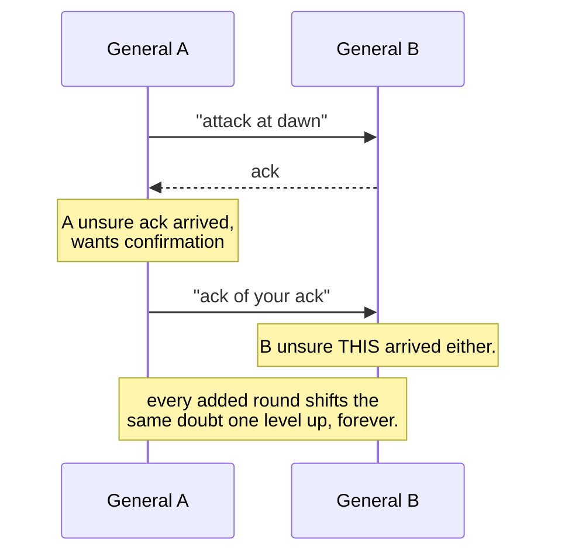
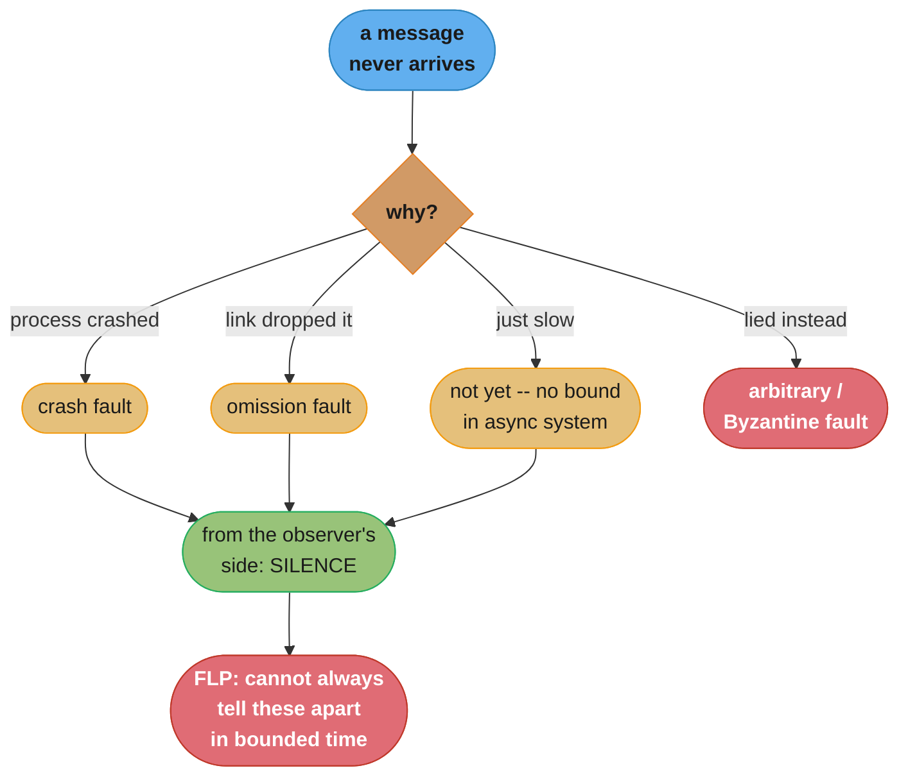

# Chapter 8: Introduction and Overview

> Part II — Distributed Systems · Database Internals (Petrov, 1st ed., O'Reilly 2019) · opens
> Part II (builds on Ch 7's single-node storage engine), leads to Ch 9 (Failure Detection)

## Chapter Map

Part I built a storage engine assuming one machine, one disk, one clock, and one process
reading its own writes. Part II removes every one of those assumptions at once. Chapter 8 is
the chapter that explains *why* the rest of Part II has to exist: it is not an optimism-free
tour of the four remaining chapters, it is an argument that naive assumptions about "the
network" and "the other node" are not merely inconvenient, they are formally impossible to
patch away, and every algorithm in Chapters 9–14 is a specific, disciplined response to one
of the impossibilities established here.

**TL;DR:**
- A distributed system trades a single machine's simplicity for availability and scale, but
  every node now has only a **partial, stale view** of shared state — there is no such thing
  as "the current global state," only what each node currently believes.
- Eight **fallacies of distributed computing** describe assumptions programmers make about
  networks that are false in production and stay false regardless of how good the network
  gets — reliability, latency, bandwidth, and security are never zero-cost.
- The **Two Generals' Problem** proves no protocol over an unreliable channel can let two
  parties reach guaranteed common knowledge of agreement — this is not an engineering gap, it
  is a mathematical dead end, and every "ack the ack" scheme just moves the same problem one
  level up.
- The **FLP impossibility** result proves that in a fully asynchronous system, no consensus
  algorithm can guarantee both safety and termination if even a single process can crash — this
  is *the* foundational result Chapters 10 and 14 spend the rest of Part II routing around.
- Failures are classified by how badly a faulty node can misbehave — **crash**, **omission**,
  and **arbitrary (Byzantine)** faults — and each algorithm in this book states up front which
  fault model it assumes, because a protocol correct under crash faults can be trivially broken
  by a Byzantine one.

## The Big Question

> "In distributed systems, coordination between nodes is required to reach consensus... but
> coordination is fundamentally limited by physics: the network is slow, unreliable, and
> nodes can fail independently and invisibly to one another."

Analogy: imagine trying to run a company entirely by letters sent through a postal service that
sometimes loses mail, sometimes delivers it late and out of order, and never tells you which
happened. You cannot know whether your business partner received your last letter, is simply
slow to reply, has quit, or has died — the *symptom* you observe (silence) is identical in every
case. Chapter 8 is the chapter that says: stop hoping for a faster or more reliable postal
service. Assume it will always behave this badly, prove precisely what is and is not achievable
under that assumption, and then build algorithms — the subject of every remaining chapter in
this book — that are honest about the guarantees they can and cannot give.

---

## 8.1 Shared State in a Distributed System

A **distributed system** is a group of independent processes that appear to their clients as
one coherent system, coordinating over a network to accomplish something none of them could
alone — more storage, more compute, or continued operation when some subset of them fails. The
appeal is real: capacity and fault tolerance beyond a single machine's limits. The cost is that
every property Part I could take for granted — one process, one memory space, one clock, writes
visible to reads the instant they complete — disappears.

The central technical difficulty the chapter names up front is **shared state**. A single-node
program has exactly one copy of its state, and every read sees the effect of every prior write
immediately, because there is only one memory and one clock ordering every event. A distributed
system has *no* single copy — each node holds its own local state, and that state is
synchronized with the others only by exchanging messages across a network that is slow relative
to a local memory access and that can lose, delay, duplicate, or reorder those messages without
warning. A node's view of "the current state of the system" is therefore always a stale
snapshot as of the last message it received, never the true instantaneous global state — and
because there is no shared clock, "instantaneous" itself is not even a well-defined concept
across nodes (Chapter 9 in DDIA's numbering covers clocks directly; this book folds the
consequence into every later chapter instead).

Everything that follows in Part II is a way of coping with this one fact: two nodes cannot
directly observe each other's state, they can only exchange messages and infer.

```
  single node                          distributed system

  [ process ]                          [ node A ]  <--msg-->  [ node B ]
       |                                    |                     |
   one memory,                         local state A         local state B
   one clock,                          (own view only)       (own view only)
   reads see all                            |                     |
   prior writes                        A infers B's state    B infers A's state
                                        only from messages    only from messages
                                        already received,     already received,
                                        which may be stale,    which may be stale,
                                        lost, or reordered      lost, or reordered
```
Caption: a single process has one authoritative state; a distributed system has N local states,
each of which is only ever a delayed, possibly-wrong inference about the others.

---

## 8.2 Fallacies of Distributed Computing

The **fallacies of distributed computing** (originally attributed to Peter Deutsch and others
at Sun Microsystems, and adopted by the book as the frame for this section) are assumptions
programmers habitually make about a network that are false, and stay false no matter how much
the underlying hardware improves — they are properties of *any* network built from independent,
geographically separated components, not defects of a particular implementation. The book groups
its discussion around these themes:

- **The network is reliable.** Packets are dropped, links fail, switches misroute; a message you
  sent is not guaranteed to arrive, and you generally cannot even prove after the fact whether it
  did.
- **Latency is zero.** Every network hop costs real time — a same-datacenter round trip is
  typically under a millisecond, a cross-region one commonly 50–150 ms, and an application that
  assumes remote calls are as cheap as local ones will make far too many of them and buckle under
  load nobody predicted.
- **Bandwidth is infinite.** Links have a hard capacity ceiling; enough concurrent traffic
  saturates it, and once saturated, latency and loss both get worse together.
- **The network is secure.** Any message can be intercepted, altered, or forged unless the
  protocol explicitly defends against it — trusting the network's honesty is itself a design
  decision, and usually the wrong one.
- **Topology doesn't change.** Nodes join, leave, and get rerouted around outages continuously;
  a system that hardcodes today's network shape breaks the first time it changes.
- **There is one administrator.** A real distributed system usually crosses ownership and
  administrative boundaries, so a single operator cannot even see, let alone directly fix, every
  node.
- **Transport cost is zero.** Serialization, connection setup, and message framing all cost real
  CPU and real time, and that cost does not vanish just because the call *looks* like a normal
  function call.
- **The network is homogeneous.** Different links, protocols, and hardware generations coexist in
  the same system, each with its own latency and failure characteristics.

The unifying lesson the book draws from the list: code that implicitly assumes any of these is
not merely slower than it should be, it is *wrong* — it will work in development, on a fast,
quiet, single-switch network, and then fail in production the first time a real network problem
(a partition, a saturated link, a router hiccup) exposes the assumption. The remaining sections
of this chapter turn "the network misbehaves" from a vague warning into precise, provable
statements about what is and is not achievable.

---

## 8.3 Distributed Systems Abstractions

Since raw packets are too unreliable to program against directly, distributed algorithms are
built on top of a small set of standard abstractions that give the messaging layer more
structure — at a cost, and never a complete cost, as the rest of this section shows.

### Links

A **link** models the channel between two processes and is classified by what it guarantees:

- **Fair-loss link.** If a message is sent infinitely often, it is eventually delivered
  infinitely often — individual messages can still be lost, but not *every* retry of the same
  message can be lost forever. This is the weakest, closest-to-reality abstraction, and the
  standard building block algorithms are actually specified over.
- **Stubborn link.** Built on top of a fair-loss link by simply retransmitting every unacknowledged
  message forever, until it is finally delivered.
- **Reliable (perfect) link.** Guarantees every message sent is eventually delivered exactly
  once, and no message is delivered that was never sent — built by adding **message
  acknowledgments** and **de-duplication** (via message IDs) on top of a stubborn link.

Two problems recur in every one of these constructions:

**Message acknowledgments and retransmits.** A fair-loss link gives no receipt, so a sender
cannot tell "message lost" apart from "message delivered, acknowledgment lost" apart from
"receiver is just slow to reply" — all three look identical from the sender's side: silence.
The standard fix is to acknowledge every message and retransmit on timeout.

**The problem with retransmits: exactly-once delivery.** Retransmitting on a missing
acknowledgment risks the receiver getting the *same* message twice — once originally, once as a
retry that turns out to have been unnecessary because only the ack was lost, not the message.
A receiver that isn't careful ends up processing one logical operation twice. The general fix
is **deduplication**: tag every message with a unique ID, and have the receiver track which
IDs it has already processed, discarding a duplicate instead of reapplying it. This is exactly
why idempotency is treated as a first-class design property throughout distributed systems, not
an optional nicety — "exactly-once delivery" in the wire-protocol sense does not exist over an
unreliable network; what is achievable is **at-least-once delivery plus idempotent processing**,
which behaves like exactly-once from the application's point of view.

```
  sender                              receiver

  send(msg, id=7)  ------------X       (lost in flight)
  [timeout, no ack]

  send(msg, id=7)  ------------------->  process(id=7)   [new]
                    <----ack(id=7)------
  [ack lost in flight]        X <-------

  send(msg, id=7)  ------------------->  already seen id=7, DISCARD
                    <----ack(id=7)------
  [ack received, sender stops retrying]
```
Caption: the sender cannot distinguish "message lost" from "ack lost" — both look like silence
— so it must retransmit either way; the receiver's job is catching the resulting duplicate via
the message ID, which is what turns "at-least-once" into an effectively-once outcome.

---

## 8.4 Two Generals' Problem

The **Two Generals' Problem** is the canonical proof that two parties communicating only over an
**unreliable** channel cannot reach guaranteed common knowledge of an agreement, no matter how
sophisticated the protocol. Two army divisions, led by two generals, camp on opposite hills
overlooking a city they can only defeat by attacking *simultaneously* — attacking alone means
defeat. Their only communication is a messenger who must cross enemy territory and may be
captured (the message lost) at any time.

General A sends "attack at dawn." He cannot act on his own plan until he knows General B
received it — otherwise B might not attack, and A attacking alone loses. So B must send an
acknowledgment back. But by the identical argument, B cannot be sure *his* acknowledgment
arrived either, so he cannot be confident A will actually attack — meaning B, too, is not
willing to commit. Suppose A now sends an "ack of your ack" to reassure B — the same problem
recurs one level higher: A cannot be sure that message got through either. Every additional
round of confirmation only pushes the identical uncertainty out by one more message; it never
resolves it, because the last message in any finite chain is *always* unacknowledged by
construction.

**The proof, not just the folk story:** for any protocol using a finite number of messages over
a channel where any message can be lost, there exists a possible execution — the very last
message being the one that happens to be lost — in which the two parties end up in different
states, one believing agreement was reached and the other not. Because message loss is possible
at every step, no finite protocol can rule out that final-message-lost scenario. The problem is
therefore **unsolvable in the general case** — not merely hard, not an engineering gap waiting on
a cleverer protocol, but a genuine mathematical dead end, exactly like the impossibility of
trisecting an arbitrary angle with compass and straightedge.

**Why real systems still work.** Practical systems escape the impossibility by *changing the
assumptions*, not by outsmarting the proof: adding **acceptable risk** (accept a very small,
bounded probability of disagreement instead of demanding certainty — most retry-based protocols
do exactly this), or moving to a **partially synchronous** model with **timeouts** so that
"no reply within T seconds" becomes actionable evidence of failure rather than pure silence
(§8.6), or accepting that a small amount of ambiguity is fine because the *consequences* of the
rare disagreement are cheap to undo (idempotent, retryable operations). Chapters 9–14 build on
top of exactly this second strategy: partial synchrony plus timeouts is what makes failure
*detection* — as opposed to failure *proof* — possible at all.


Caption: no finite number of rounds closes the gap — the final message in any protocol is, by
construction, the one execution where loss breaks the agreement.

---

## 8.5 FLP Impossibility

The **FLP impossibility** result — Fischer, Lynch, and Paterson, "Impossibility of Distributed
Consensus with One Faulty Process," 1985 — is the formal generalization of the Two Generals'
intuition to the **consensus** problem: getting a set of processes to agree on a single value.
The theorem: in a fully **asynchronous** system (no bound whatsoever on message delay or
relative process speed), **no consensus algorithm can guarantee both safety and termination if
even a single process can crash** — not "is hard to build," but **provably does not exist**.

The proof's mechanism, in outline: because the system is fully asynchronous, a slow message is
indistinguishable from a crashed process that will never send it. An adversarial scheduler can
therefore always delay exactly the message that would let the remaining correct processes reach
a decision, repeating this forever — so no protocol can be forced to terminate within a bounded
number of steps while also guaranteeing it will never produce an inconsistent decision. Every
algorithm must sacrifice at least one of:

- **Safety** — no two correct processes ever decide differently, and a decided value was
  actually proposed by someone (never fabricated).
- **Liveness (termination)** — every correct process eventually decides *something*.
- **Fault tolerance** — the protocol survives at least one process crashing.

**Why this doesn't mean consensus is useless in practice.** FLP is a **worst-case, fully
asynchronous** result — an adversary that can delay *any* message *arbitrarily* long, forever.
Real networks are not adversarial in that sense: message delay is usually bounded most of the
time, even if that bound cannot be proven in advance. Practical consensus algorithms (Paxos,
Raft — Chapter 14) sidestep the impossibility by weakening liveness rather than safety: they
guarantee safety **unconditionally**, even under full asynchrony, but only guarantee
termination once the system becomes sufficiently synchronous again (message delays stabilize
below some bound) — a system can, in principle, fail to make progress forever during a bad
enough network period, but it can never become inconsistent while doing so. That asymmetry —
never sacrifice safety, accept a possible liveness stall — is the single most important design
choice threaded through every consensus algorithm in Chapter 14.

---

## 8.6 System Synchrony

**System synchrony** describes what a distributed algorithm is allowed to assume about time —
specifically, about bounds on message delivery delay and relative process execution speed —
and it directly determines which impossibility results apply.

- **Synchronous system.** Known upper bounds exist on both message delivery time and process
  execution speed. Under this model, a non-responding process can be safely declared failed once
  the bound is exceeded — failure detection is *exact*. Real networks rarely offer a system this
  strong a guarantee; it is mostly a useful theoretical baseline.
- **Asynchronous system.** No bounds at all — a message may take arbitrarily long, and a process
  may run arbitrarily slowly. This is the model FLP proves consensus impossible under (with even
  one crash fault tolerated), and it is also the hardest model to reason in, precisely because
  nothing about timing can ever be assumed.
- **Partially synchronous system.** The realistic middle ground the book adopts as its working
  assumption for the rest of Part II: the system is asynchronous in general, but it eventually
  behaves synchronously for long enough stretches that a protocol relying on bounded delays
  during those stretches can make progress. Practically, this looks like a network whose delays
  are usually bounded, occasionally spike unpredictably, and eventually settle back down.

Partial synchrony is why real consensus systems work at all: they are designed to remain *safe*
regardless of synchrony (satisfying FLP's warning), but to only make *progress* during the
system's synchronous intervals — exactly the strategy §8.5 described. Every failure detector in
Chapter 9 and every leader-election and consensus algorithm from Chapter 10 onward is implicitly
built on the partially-synchronous assumption, even where the book doesn't restate it explicitly
at every step.

---

## 8.7 Failure Models

A **failure model** specifies exactly how a faulty process is allowed to misbehave — and every
algorithm in this book is only correct under the specific failure model it was designed for,
which is why stating the assumed model up front matters as much as the algorithm itself.

- **Crash faults (fail-stop).** A process simply stops executing and never resumes — it does not
  send corrupted or misleading messages before or after stopping, it just goes silent. This is
  the weakest, most forgiving fault to tolerate, and it is the default assumption for most of
  this book's algorithms (leader election in Chapter 10, most of the replication and consensus
  material in Chapters 11 and 14).
- **Omission faults.** A process fails to send or receive some messages — it may drop some
  outgoing or incoming messages while continuing to operate correctly on the rest, rather than
  stopping outright. A **crash fault** is the special case of an omission fault where the process
  omits *everything* from some point onward, so tolerating crash faults is strictly easier than
  tolerating general omission faults.
- **Arbitrary (Byzantine) faults.** A process can behave in *any* way at all — send conflicting
  information to different peers, lie about its own state, or actively collude with other faulty
  processes to sabotage the protocol. This subsumes crash and omission faults as special cases
  and is by far the hardest to tolerate, because a Byzantine node's messages are indistinguishable
  from a correct node's *except* for the fact that they may be actively deceptive. §14.5 covers
  the algorithm family (PBFT) built specifically for this model, and it requires strictly more
  replicas — **3f + 1** for f tolerated faults — than crash-fault-tolerant consensus needs for
  the same f (**2f + 1**), precisely because a Byzantine node's vote cannot be trusted at face
  value the way a merely-crashed node's silence can.

```
  fault severity, weakest to strongest (each subsumes the ones before it)

  crash / fail-stop  ⊂  omission  ⊂  arbitrary (Byzantine)

  crash:      stops, then permanently silent, never lies
  omission:   selectively drops SOME messages, otherwise behaves correctly
  Byzantine:  can send anything to anyone -- wrong data, contradictory
              claims to different peers, coordinated with other faulty nodes

  replicas needed to tolerate f faults, generalized:

    crash-tolerant consensus  (Ch 10, 14 Paxos/Raft):     n >= 2f + 1
    Byzantine-tolerant consensus (Ch 14 PBFT):             n >= 3f + 1

    f = 1  ->  crash needs 3 replicas   |  Byzantine needs 4 replicas
    f = 2  ->  crash needs 5 replicas   |  Byzantine needs 7 replicas
```
Caption: the replica count roughly doubles for the same fault tolerance once a faulty node is
allowed to lie instead of merely stopping — the extra replicas exist purely to outvote a
dishonest minority, not to survive more simultaneous failures.

---

## 8.8 Handling Failures

Given that failures cannot be prevented and, per FLP, cannot even always be reliably detected in
bounded time, the chapter closes by framing the discipline the rest of Part II follows: design
*for* failure rather than treat it as an edge case. Concretely, that means every algorithm from
here on states explicitly:

1. **Which failure model it assumes** — crash, omission, or Byzantine — since a protocol proven
   correct under one model offers no guarantee at all under a stronger one.
2. **Which synchrony assumption it relies on** — a bound it needs (even a loose, adaptive one)
   for *liveness*, while ideally keeping *safety* unconditional, per §8.5's asymmetry.
3. **What it sacrifices when the assumption is violated** — does it stall (safe but not live),
   or can it, under a strong enough adversary, actually violate safety?

That framing is the thread every remaining chapter in Part II pulls on: Chapter 9 builds
*failure detectors* that trade certainty for a tunable, adaptive suspicion threshold; Chapter 10
builds *leader election* that assumes a failure detector exists and asks who gets to lead once
one node is suspected; Chapter 11 asks what a client can safely assume about *replicated data* in
the presence of these failures; Chapter 12 covers keeping replicas convergent when messages are
lost or delayed indefinitely; Chapter 13 covers making multi-node operations appear atomic
despite all of the above; and Chapter 14 closes the book on the sharpest version of the problem
this chapter opened with — genuine consensus, safe under FLP, live under partial synchrony.

---

## Beyond the book — retry storms and jittered backoff

> The chapter establishes that retransmission over an unreliable link is unavoidable and that
> deduplication is what makes it safe; it does not walk through *how* production systems pace
> their retries. This section adds that operational detail — it is not in Petrov's text.

A stubborn link (§8.3) retransmits an unacknowledged message, but retransmitting immediately and
retransmitting at a fixed interval both create the same failure mode at scale: if a downstream
service degrades under load, every client's next retry lands at roughly the same moment,
deepening the very overload that caused the first timeout — a **retry storm**. The standard
mitigation is **exponential backoff with jitter**: each retry waits roughly double the previous
interval, with a random component added so that many clients' retries don't stay synchronized
with each other. AWS's own architecture guidance credits "full jitter" backoff (choosing the
wait uniformly between zero and the exponential cap, rather than a fixed exponential curve) with
meaningfully reducing total request volume during a recovery compared to fixed or non-jittered
exponential backoff. This is a direct, practical descendant of §8.3's stubborn-link idea: the
*correctness* argument (keep retrying until acknowledged) is exactly what the book proves
necessary, and the *pacing* argument (don't retry in lockstep) is the part production systems
had to add on top once loss stopped being rare and started being systemic under load.

---

## Visual Intuition


Caption: the reason failure detection is hard is structural, not an implementation weakness —
crash, omission, and "just slow" are observationally identical (silence), and Byzantine faults
are worse still because even a *response* can be actively misleading.

```
  synchrony spectrum -- what each model lets you assume about time

  synchronous  <-------- partially synchronous --------> asynchronous
  (known bound              (bound exists but            (no bound at all,
   on delay,                 unknown / eventual)          FLP applies fully)
   exact failure
   detection)

  practical consensus (Paxos/Raft, Ch 14) lives HERE:
       safety   held  UNCONDITIONALLY, across the whole spectrum
       liveness held  ONLY once the system is behaving synchronously
                                   ^
                                   |
                        this is the design choice that
                        routes around FLP without violating it
```
Caption: no algorithm defeats FLP — every practical one instead narrows what it promises,
keeping safety unconditional and making liveness conditional on the network settling down.

---

## Key Concepts Glossary

- **Distributed system** — independent processes coordinating over a network to appear as one
  coherent system.
- **Shared state (problem)** — no node has a single, current, authoritative view of global state;
  every view is a locally inferred, possibly stale snapshot.
- **Fallacies of distributed computing** — false assumptions about networks (reliable, zero
  latency, infinite bandwidth, secure, static topology, single administrator, zero transport
  cost, homogeneous) that remain false regardless of hardware improvements.
- **Fair-loss link** — a channel where a message retried infinitely often is eventually delivered
  infinitely often, though any single attempt can be lost.
- **Stubborn link** — a fair-loss link with unconditional retransmission until delivered.
- **Reliable (perfect) link** — guarantees exactly-once eventual delivery, built from a stubborn
  link plus acknowledgments and deduplication.
- **Message acknowledgment** — a receipt confirming a message arrived, used to detect loss via
  its absence.
- **Deduplication** — discarding a message already processed, identified by a unique message ID.
- **At-least-once delivery** — a message may be delivered more than once but is never silently
  dropped; combined with idempotency it behaves like exactly-once.
- **Two Generals' Problem** — the proof that two parties over an unreliable channel cannot reach
  provably guaranteed common agreement.
- **Common knowledge** — a state both parties know, know the other knows, know the other knows
  they know, ad infinitum — unreachable over a channel where any message can be lost.
- **Consensus** — the problem of getting a set of processes to agree on a single value.
- **FLP impossibility** — no consensus algorithm can guarantee both safety and termination in a
  fully asynchronous system tolerating even one crash fault.
- **Safety** — no two correct processes decide differently, and any decided value was actually
  proposed.
- **Liveness (termination)** — every correct process eventually decides something.
- **Synchronous system** — known bounds exist on message delay and process speed.
- **Asynchronous system** — no bounds exist on message delay or process speed at all.
- **Partially synchronous system** — asynchronous in general, but eventually behaves
  synchronously for long enough stretches to make progress.
- **Crash fault (fail-stop)** — a process stops permanently and sends no further (and no
  misleading) messages.
- **Omission fault** — a process selectively fails to send or receive some messages while
  otherwise behaving correctly.
- **Arbitrary (Byzantine) fault** — a process may behave in any way, including sending
  contradictory or deceptive information.
- **3f + 1** — the minimum replica count to tolerate f Byzantine faults (vs. 2f + 1 for crash
  faults).

---

## Tradeoffs & Decision Tables

| Synchrony model | Bound on delay/speed | Failure detection | Consensus possible (1+ crash fault)? |
|---|---|---|---|
| Synchronous | Known, fixed | Exact | Yes |
| Asynchronous | None | Impossible to guarantee correctly, in bounded time | No (FLP) |
| Partially synchronous | Eventually holds, unknown when | Approximate, tunable (Ch 9) | Yes, safety always; liveness once synchronous |

| Fault model | What a faulty node can do | Minimum replicas for f faults | Example algorithm family |
|---|---|---|---|
| Crash | Stop permanently, stay silent | 2f + 1 | Paxos, Raft (Ch 14) |
| Omission | Selectively drop messages | 2f + 1 (treated as generalized crash) | Same crash-tolerant protocols, weaker guarantee |
| Byzantine (arbitrary) | Send anything, including lies, to anyone | 3f + 1 | PBFT (Ch 14 §14.5) |

| Link type | Guarantee | Built from | Cost |
|---|---|---|---|
| Fair-loss | Infinite retries -> infinite eventual deliveries | Raw unreliable network | None added |
| Stubborn | Unconditional retransmission | Fair-loss + timer-driven resend | Bandwidth, possible duplicates |
| Reliable (perfect) | Exactly-once eventual delivery | Stubborn + acks + dedup | Acks, per-message ID tracking |

---

## Common Pitfalls / War Stories

- **Treating a timeout as proof of failure.** A non-response after T seconds means "unknown" —
  crashed, slow, or partitioned are all consistent with it — not "confirmed dead." Code that
  reacts to a timeout as certain death (e.g., immediately reassigning that node's work to
  another node with no further check) risks two nodes doing the same job concurrently the moment
  the "dead" node was actually just slow.
- **Assuming a low-latency dev network generalizes to production.** Code written and tested on a
  single-switch LAN with sub-millisecond RTTs silently assumes zero latency and infinite
  bandwidth (two of the eight fallacies); the same code under cross-region RTTs of 50–150 ms, or
  under a saturated link, can time out constantly or serialize what should be concurrent work.
- **"Ack the ack" as a fix for the Two Generals' Problem.** Adding more confirmation rounds feels
  like it should eventually close the gap; it provably cannot — every additional round just moves
  the exact same uncertainty to the newest, still-unacknowledged message.
- **Retrying without deduplication.** A retransmit sent because an ack was lost (not because the
  original message was lost) can cause the receiver to process the same logical operation twice
  — a classic source of duplicate charges, duplicate rows, or double-counted metrics in systems
  that treat "message delivered" and "message not yet delivered" as the only two possibilities.
- **Designing a protocol under the crash-fault model, then deploying it where nodes can lie.** A
  consensus protocol proven correct assuming crash faults offers zero guarantee once a
  participant can send different values to different peers — this is a common source of security
  vulnerabilities when a "trusted internal" protocol is later exposed to untrusted or
  compromised participants without re-deriving its safety proof under the Byzantine model.

---

## Real-World Systems Referenced

The chapter is largely theoretical and grounds its arguments in classical distributed-systems
results rather than naming specific production systems: the **fallacies of distributed
computing** (Peter Deutsch and colleagues, Sun Microsystems), the **Two Generals' Problem**
(a classical thought experiment, formalized by Akkoyunlu, Ekanadham, and Huber, 1975), and the
**FLP impossibility** result (Fischer, Lynch, and Paterson, 1985). These results underpin every
named production system discussed later in Part II — Cassandra, Riak, ZooKeeper, Spanner, Raft-
based systems such as etcd and CockroachDB — none of which are introduced yet in this chapter,
but all of which are, in the book's framing, engineering responses to exactly the impossibilities
proven here.

---

## Summary

A distributed system has no single, authoritative, instantaneously current view of its own
state — every node's picture of the others is inferred from messages that can be lost, delayed,
duplicated, or reordered, never observed directly. The **fallacies of distributed computing**
catalog the false assumptions this reality punishes. The **Two Generals' Problem** proves no
protocol over an unreliable channel achieves guaranteed common agreement, no matter how many
confirmation rounds are added. The **FLP impossibility** result generalizes this to consensus
itself: no algorithm can guarantee both safety and termination in a fully asynchronous system
tolerating even one crash fault. Real systems escape these impossibilities not by defeating them
but by weakening the promise — accepting a **partially synchronous** model where safety holds
unconditionally and liveness holds only once the network behaves well enough — and by stating
precisely which **failure model** (crash, omission, or Byzantine) they defend against, since a
guarantee proven under one model does not transfer to a stronger one. Every algorithm in the
rest of Part II is a specific, disciplined answer to the questions this chapter poses: how much
can you assume about time, and how badly can a faulty node behave?

---

## Interview Questions

**Q: Is the Two Generals' Problem an engineering limitation that a clever enough protocol could eventually solve?**
**Short:** No — it is a mathematical impossibility, not an unsolved engineering problem.
For any protocol using a finite number of messages over a channel where any message can be lost, there is always a possible execution — the one where the very last message happens to be lost — in which the two parties end up believing different things about whether agreement was reached. Because that scenario can never be ruled out for a finite protocol, no amount of cleverness closes the gap; real systems instead change the problem, accepting a small bounded risk of disagreement or moving to a partially synchronous model with timeouts rather than demanding provable certainty.

**Q: What does the FLP impossibility result actually prove, and what does it not prove?**
**Short:** No consensus algorithm can guarantee safety and termination together under full asynchrony with even one crash fault.
It proves that in a fully asynchronous system — no bound at all on message delay — no algorithm can guarantee both that all correct processes eventually decide (liveness) and that no two of them decide differently (safety), if even a single process can crash. It does not prove that consensus is useless in practice: real algorithms like Paxos and Raft sidestep it by keeping safety unconditional while making liveness depend on the network eventually behaving synchronously for long enough, which is exactly the scenario FLP's adversarial, permanently-async model rules out by assumption.

**Q: Why can't a process reliably tell a crashed peer apart from a merely slow one?**
**Short:** Both produce identical silence, and an asynchronous system has no delay bound to compare against.
A crashed process stops sending messages permanently; a slow process (overloaded, garbage-collecting, network-congested) simply hasn't sent its next message *yet* — from the observing process's side, both look exactly like "no message has arrived." Without an upper bound on how long a correct process is allowed to take, there is no timeout value that is both short enough to be useful and guaranteed never to misclassify a slow-but-alive process as dead; Chapter 9's failure detectors manage this as a tunable trade-off, not a solved problem.

**Q: What is the difference between a fair-loss link, a stubborn link, and a reliable link?**
**Short:** Each layers a stronger guarantee on the one below it, at the cost of retransmission and deduplication.
A fair-loss link only guarantees that a message retried infinitely often is eventually delivered infinitely often — any single attempt can still be lost. A stubborn link adds unconditional retransmission on top, so the message keeps being resent until it succeeds. A reliable (perfect) link adds acknowledgments and deduplication by message ID on top of that, guaranteeing exactly-once eventual delivery — which is why "exactly-once" over a raw network is actually built, not natively available.

**Q: Why is "exactly-once delivery" over an unreliable network not really achievable in the strict wire-protocol sense?**
**Short:** A sender can never distinguish a lost message from a lost acknowledgment, so it must retransmit either way.
If an acknowledgment doesn't arrive, the sender cannot tell whether the original message was lost or whether the message arrived fine and only the ack was lost — both look identical (silence), so the only safe choice is to retransmit, which risks delivering a message the receiver already processed. What's actually achievable is at-least-once delivery combined with receiver-side deduplication by message ID, which behaves like exactly-once from the application's perspective without requiring the wire protocol itself to guarantee it.

**Q: What is the difference between crash, omission, and Byzantine (arbitrary) faults?**
**Short:** Each subsumes the one before it: crash stops silently, omission drops selectively, Byzantine can lie.
A crash fault means a process stops entirely and permanently, never misleading anyone — it simply goes silent. An omission fault means a process selectively fails to send or receive some messages while continuing to behave correctly otherwise, of which crash is the special case where it omits everything from some point on. A Byzantine (arbitrary) fault means a process can behave in any way at all, including sending contradictory or deceptive information to different peers — it subsumes both weaker models and is far harder to tolerate because a faulty node's output can look identical to a correct node's until it actively contradicts itself.

**Q: Why does Byzantine fault tolerance need 3f + 1 replicas instead of the 2f + 1 that crash-fault-tolerant consensus needs?**
**Short:** A Byzantine node's own vote cannot be trusted, so honest nodes need enough votes to outvote liars.
With crash faults, a silent node simply doesn't vote, so 2f + 1 replicas guarantee a majority of f + 1 correct nodes can always outvote up to f crashed (silent) ones. With Byzantine faults, a faulty node can actively vote and even claim different things to different peers, so the protocol needs enough correct nodes to form a majority even after subtracting both the f faulty nodes AND accounting for the fact that faulty votes can be indistinguishable from correct ones until cross-checked — the standard derivation requires n >= 3f + 1 so that even discounting f possibly-Byzantine votes, the remaining correct majority still outnumbers any faulty minority.

**Q: What is the "shared state" problem this chapter opens with, and why can't it just be solved by replicating state faster?**
**Short:** No node ever has the true instantaneous global state, only a stale, locally inferred snapshot.
Because nodes only learn about each other through messages that take nonzero, unpredictable time to arrive, every node's view of "the current state of the system" is always as-of the last message it happened to receive, never a live view of what's actually true elsewhere right now. Making replication faster narrows the staleness window but cannot eliminate it, since there is no shared clock or shared memory across nodes to make "instantaneous" a meaningful concept in the first place — this is a structural property of physically separated computers, not a performance problem.

**Q: Name three of the "fallacies of distributed computing" and explain why they stay false even as hardware improves.**
**Short:** The network is reliable, latency is zero, and bandwidth is infinite — all false regardless of hardware generation.
"The network is reliable" is false because any link, switch, or cable can fail, and no amount of redundancy reduces the probability of loss to exactly zero. "Latency is zero" is false because a message takes real, physically bounded time to cross a real distance — faster networks lower the constant, they don't remove it, and cross-region round trips remain tens to hundreds of milliseconds no matter how fast local networking gets. "Bandwidth is infinite" is false because every link has a hard capacity ceiling, and enough concurrent traffic will always be able to saturate it, degrading both loss and latency together once it does.

**Q: What is the practical design implication of the FLP result for real consensus algorithms like Paxos and Raft?**
**Short:** They guarantee safety unconditionally but only guarantee liveness once the network is synchronous enough.
Since FLP proves no algorithm can guarantee both safety and termination under full, permanent asynchrony, practical algorithms deliberately choose which guarantee to keep unconditional: they preserve safety (no two nodes ever decide differently) no matter how badly the network behaves, and make liveness (eventually deciding something) conditional on the system settling into a partially synchronous stretch. In the worst case such a system can stall indefinitely without ever becoming inconsistent — which is the accepted, provably necessary trade-off, not a design flaw.

**Q: In a synchronous system, why is failure detection "exact" in a way it can never be in an asynchronous one?**
**Short:** A known bound on message delay turns "no response within that bound" into proof of failure.
If the system guarantees a maximum message delivery time and a maximum process execution speed, then any non-response after that known bound has elapsed cannot be explained by "still in flight" or "still processing" — it can only mean the process has actually failed, making the timeout a provably correct failure signal. An asynchronous system has no such bound, so an identical non-response is equally consistent with "crashed" and "just extremely slow," which is exactly why Chapter 9's failure detectors can only ever be probabilistic, not exact, absent a synchrony guarantee this chapter shows doesn't hold in practice.

**Q: What does "partially synchronous" mean, and why is it the realistic model rather than a compromise invented for convenience?**
**Short:** The system behaves asynchronously in general but eventually settles into synchronous stretches long enough to make progress.
It captures how real networks actually behave: delays are usually bounded in practice even though no fixed bound can be proven in advance, and periods of bad behavior (partition, congestion, GC pause) do eventually end. This isn't a weaker assumption chosen for mathematical convenience — it's closer to the true behavior of production networks than either extreme (a synchronous system with a hard guaranteed bound, or a permanently adversarial asynchronous one), which is why every practical consensus algorithm targets it rather than either pure model.

**Q: Why is a message acknowledgment not, by itself, enough to build a reliable link?**
**Short:** An ack can be lost too, so the sender still can't distinguish message loss from ack loss.
Acknowledgments tell the sender when they arrive, but they travel over the same unreliable channel as the original message, so the ack itself can be dropped — leaving the sender in the same "silence means what?" situation the message loss created in the first place. A reliable link needs retransmission on top of acknowledgment (to recover from either kind of loss) plus deduplication on the receiving side (to discard the resulting duplicate when the retransmit turns out to have been unnecessary).

**Q: How does an omission fault differ from a crash fault in terms of what a protocol must tolerate?**
**Short:** Omission faults are ongoing and selective; crash faults are total and permanent from one point on.
A crashed process is a simple, one-time event: it works correctly until some moment, then stops entirely and forever. An omission-faulty process can continue running and behaving correctly most of the time while unpredictably dropping some subset of its incoming or outgoing messages indefinitely, which a protocol must tolerate as an ongoing condition rather than a single detectable event — in practice most crash-fault-tolerant protocols also happen to tolerate omission faults, since dropping "everything from now on" is just the extreme case of dropping "some things."

**Q: What is a "reliable (perfect) link," and is it something the underlying network actually provides?**
**Short:** No — it is a software construction built on top of an unreliable network, not a native network guarantee.
A reliable link guarantees every sent message is eventually delivered exactly once, with no message delivered that was never sent, but no physical network offers this natively — it is built in software by layering retransmission (to recover from loss) and deduplication by message ID (to collapse the resulting duplicates) on top of the raw, fair-loss channel the hardware actually provides. TCP's guarantees are a close analogue at the transport layer, but even TCP resets on failure and cannot guarantee delivery across a connection that drops entirely, so application-level protocols still need their own idempotency and retry logic above it.

**Q: Why does the chapter insist every algorithm state its assumed failure model and synchrony assumption explicitly, rather than treating "handle failures" as a generic requirement?**
**Short:** A guarantee proven under a weaker fault model does not automatically hold under a stronger one.
A protocol proven correct assuming crash faults can be trivially broken if deployed where a participant can actually lie (a Byzantine fault it was never designed to tolerate), and a protocol assuming synchronous bounds can misbehave the moment it runs on a genuinely asynchronous or adversarial network. Stating the assumed model up front is what makes the correctness proof meaningful at all — it tells an engineer exactly which real-world conditions the guarantee is conditioned on, and which conditions would silently invalidate it.

**Q: Why does the book bother with the classification of links (fair-loss, stubborn, reliable) instead of just assuming TCP everywhere?**
**Short:** TCP solves reliability within one connection, not the higher-level exactly-once problem applications still face.
TCP already implements something close to a stubborn-then-reliable link at the transport layer within a single connection — retransmitting lost segments and delivering bytes in order — but a TCP connection itself can reset or fail, an application can crash after receiving bytes but before processing them, and the reliable-delivery guarantee only covers "arrived at the socket," not "was successfully applied by the receiving application." Understanding the link hierarchy from first principles is what lets you reason correctly about the gap TCP doesn't close, which is exactly where application-level idempotency and deduplication (§8.3) still have to live.

**Q: Two nodes both send each other a message and each waits for the other's acknowledgment before proceeding. What classical result does this resemble, and why can it deadlock the same way?**
**Short:** It is the Two Generals' Problem again — waiting for confirmed mutual awareness never terminates.
Each node wants proof the other received its message before committing to act, which is exactly the common-knowledge requirement the Two Generals' Problem proves is unreachable over an unreliable channel — no matter how many rounds of "I got yours" are exchanged, the last round is always itself unconfirmed. The practical fix is the same one real systems use generally: stop waiting for provable mutual confirmation and instead act under a timeout-bounded, acceptable-risk assumption, or restructure the protocol so agreement doesn't require symmetric confirmation at all (for example, one side is designated to decide unilaterally, as leader-based protocols in Chapter 10 do).

---

## Cross-links in this repo

- [database/consistency_models_and_consensus/ — consensus, quorum, and consistency-model deep dive](../../../database/consistency_models_and_consensus/consistency_models_and_consensus.md)
- [hld/consensus_algorithms/ — Paxos/Raft mechanics that Chapter 14 builds toward](../../../hld/consensus_algorithms/consensus_algorithms.md)
- [hld/cap_theorem/ — the availability/consistency trade-off failure and partition assumptions feed into](../../../hld/cap_theorem/cap_theorem.md)
- [book/ddia_2e/09_trouble_with_distributed_systems/09_trouble_with_distributed_systems.md — DDIA's own treatment of unreliable networks and clocks, a close companion to this chapter](../../ddia_2e/09_trouble_with_distributed_systems/09_trouble_with_distributed_systems.md)
- [book/ddia_2e/10_consistency_and_consensus/10_consistency_and_consensus.md — DDIA's FLP/consensus discussion, a useful second framing of §8.5](../../ddia_2e/10_consistency_and_consensus/10_consistency_and_consensus.md)
- Sibling chapters: [Ch 9 Failure Detection](../09_failure_detection/09_failure_detection.md) · [Ch 10 Leader Election](../10_leader_election/10_leader_election.md) · [Ch 14 Consensus](../14_consensus/14_consensus.md)

## Further Reading

- Fischer, Lynch, and Paterson, "Impossibility of Distributed Consensus with One Faulty
  Process," Journal of the ACM, 1985 — the FLP result.
- Akkoyunlu, Ekanadham, and Huber, "Some Constraints and Trade-offs in the Design of Network
  Communications," SOSP 1975 — an early formalization behind the Two Generals' Problem.
- Gray, "Notes on Data Base Operating Systems," IBM Research Report, 1978 — early treatment of
  distributed commit and the same coordination difficulties.
- Deutsch, "The Eight Fallacies of Distributed Computing," Sun Microsystems, 1994.
- Lamport, "Time, Clocks, and the Ordering of Events in a Distributed System," CACM, 1978 —
  foundational context for the ordering problems the rest of Part II tackles.
