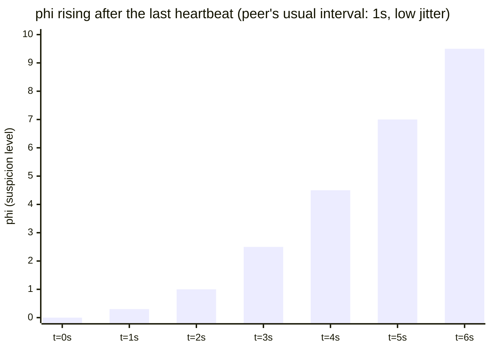
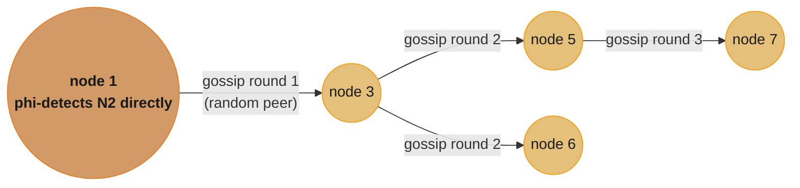
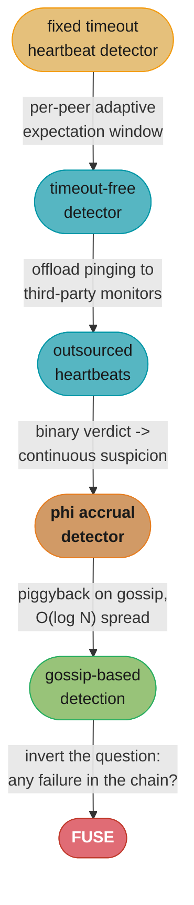

# Chapter 9: Failure Detection

> Part II — Distributed Systems · Database Internals (Petrov, 1st ed., O'Reilly 2019) · builds
> on Ch 8 (failure models, FLP), leads to Ch 10 (Leader Election)

## Chapter Map

Chapter 8 proved that failure cannot be detected with certainty in an asynchronous system, and
that even in a partially synchronous one, "no response" is inherently ambiguous. Chapter 9 takes
that impossibility as a given and asks the practical question every real system still has to
answer: **given that certainty is unavailable, what is the best achievable trade-off between
detecting a real failure quickly and not crying wolf on a merely slow node?** It walks a
progression of failure detectors, each fixing a specific weakness of the one before it, ending
at the **phi accrual failure detector** — the design most production systems (Cassandra,
Akka) actually ship.

**TL;DR:**
- A naive fixed-timeout heartbeat detector forces a single bad trade-off on the whole cluster: a
  short timeout produces false positives during a GC pause or load spike; a long timeout delays
  real failure detection for everyone, even when the network is healthy.
- A **timeout-free failure detector** removes the fixed threshold by having every node track,
  per peer, an *adaptive* expected arrival window based on recent inter-arrival history rather
  than a single global constant.
- **Outsourced heartbeats** offload the actual pinging to third-party monitoring nodes, reducing
  the direct N-to-N heartbeat traffic and letting a heavily loaded node's own liveness be
  attested by peers other than the ones waiting on it.
- The **phi accrual failure detector** replaces a binary "up/down" verdict with a continuously
  valued **suspicion level (φ)**, letting the *application* decide its own risk tolerance instead
  of the detector baking in one fixed timeout for everybody.
- **Gossip-based failure detection** piggybacks liveness information on top of an
  already-running gossip protocol, spreading suspicion (and refutation) across the cluster in
  O(log N) rounds instead of requiring every node to directly monitor every other node.
- **FUSE** flips the usual failure-detection question around: instead of "is this one node
  dead," it asks "has *any* node in this dependency chain died," propagating a single failure
  to every dependent process so a partially-failed distributed computation fails cleanly instead
  of hanging forever waiting on a dead link in the chain.

## The Big Question

> If you cannot know with certainty whether a peer has failed, how do you build a detector that
> is fast when the network is healthy, doesn't cry wolf under transient load, and lets every
> different application decide its own tolerance for being wrong?

Analogy: imagine judging whether a friend who always calls back within a day has gone silent
because something is wrong, or just because they're busy. A fixed rule — "no call in 24 hours
means something's wrong" — is either too trigger-happy (they took one long weekend off-grid) or
too slow (they really did have an accident and you waited a full day to act). A better approach
watches *how variable* their usual response time actually is, and instead of a yes/no verdict,
produces a rising level of worry the longer the silence continues past what's normal for
*them specifically* — which is exactly what the phi accrual detector does mathematically, per
peer, using each peer's own observed heartbeat history rather than one constant that has to fit
every peer and every network condition at once.

---

## 9.1 Heartbeats and Pings

The most basic failure-detection primitive sends periodic **heartbeats** — small messages a node
proactively sends to announce "I'm alive" — or **pings**, where a monitor actively probes a node
and waits for a response, rather than waiting passively. Either way, the detector declares a peer
**suspected** (or failed) once it has not heard from it within some **timeout** window.

The fundamental tension this section names is the one every later detector in the chapter exists
to soften:

- A **short timeout** detects real failures quickly, which matters because every dependent
  process is typically blocked or degraded while waiting to find out whether a peer is actually
  gone — but it also means a node that is merely slow (a stop-the-world GC pause, a CPU-starved
  moment, a transient network delay) gets misclassified as failed, triggering unnecessary and
  disruptive recovery action (Chapter 10's leader election, for instance) against a node that was
  never actually down.
- A **long timeout** avoids most false positives, but delays legitimate failure detection for
  everyone, even during network conditions where a much shorter timeout would have been perfectly
  safe.

A single fixed timeout, applied uniformly to every peer under every condition, cannot be
correct for all of them simultaneously — some peers are consistently fast and predictable,
others are bursty; some periods are quiet, others are under load. This observation — that the
"right" timeout is not a constant, it depends on recent, per-peer conditions — motivates every
refinement in the rest of the chapter.

```
  naive fixed-timeout heartbeat detector

  node A  --heartbeat-->  node B     (every interval T)
  node A  --heartbeat-->  node B
  node A  --heartbeat-->  node B
  node A  --heartbeat--X  node B     (lost, or A paused by GC for 2T)

  B's naive detector: "no heartbeat for timeout window -> A is DOWN"

  timeout too short  ->  false positive during A's GC pause; A was never down
  timeout too long   ->  a REAL crash of A goes undetected for that whole window
```
Caption: the naive detector forces one global timeout to be simultaneously short enough to be
useful and long enough to never misfire — a bar no single constant clears under varying load.

---

## 9.2 Timeout-Free Failure Detector

A **timeout-free failure detector** removes the single hardcoded threshold by tracking, per
peer, an *adaptive* expectation of when the next heartbeat should arrive, built from that peer's
own recent inter-arrival history rather than a global constant. Concretely: instead of asking
"has more than T seconds passed since the last heartbeat," the detector maintains a **sliding
window** of recent inter-arrival times for each monitored peer and derives a dynamic expected
arrival window from that window's own statistics (for example, the mean plus some margin, or
the maximum observed interval plus a safety factor).

This directly fixes the naive detector's single worst property: a peer that is *usually* very
regular (say, heartbeats every 100 ms with almost no jitter) gets a tight, fast-reacting
expectation window, while a peer whose heartbeats are naturally bursty gets a looser one — the
detector adapts itself to each peer's actual behavior instead of forcing every peer through the
same fixed constant. It is still ultimately a threshold-based binary detector at the moment of
decision (a peer is either currently within its expected window or not), but the threshold
itself is now a moving target derived from live data rather than a number chosen once at
configuration time.

---

## 9.3 Outsourced Heartbeats

**Outsourced heartbeats** address a different weakness: direct heartbeating means every
interested node monitors every peer it depends on directly, which means N nodes each running
their own point-to-point heartbeat to the same busy node multiplies that node's monitoring
overhead by N, and — more subtly — means a *heavily loaded* node's own liveness is being judged
by peers who are themselves competing with that load for network and CPU resources, exactly the
condition under which false positives are most likely.

The fix is to introduce dedicated third-party monitoring nodes that take over the actual pinging
on behalf of a set of interested parties, and to let those monitors' verdicts be shared rather
than recomputed independently by every interested party. This reduces the total heartbeat
traffic (from O(N) direct point-to-point checks down to however many monitors are actually
needed), and — because the monitor node is not itself contending for the exact same resources as
the node it's watching in the same way a busy dependent would be — its verdict tends to be more
representative of the monitored node's actual health than a self-interested dependent's own
observation would be.

---

## 9.4 Phi Accrual Failure Detector

The **phi accrual failure detector** (Hayashibara et al., 2004) is the chapter's centerpiece and
the design actually shipped by Cassandra and Akka. Its central idea is to stop producing a
binary up/down verdict at all, and instead output a continuously valued **suspicion level, φ
(phi)**, that rises the longer a heartbeat is overdue relative to the peer's own recent history
— leaving the decision of *when* φ is high enough to act on to the application, rather than
baking a single fixed threshold into the detector itself.

**The mechanism.** The detector keeps a sliding window of recent inter-arrival times for each
monitored peer (same raw data as §9.2's timeout-free detector) and fits a distribution to it —
commonly treated as approximately normal, though the accrual approach generalizes to whatever
distribution best matches the observed data. Given that distribution and the time elapsed since
the last heartbeat, φ is computed (in the paper's original formulation) as roughly the negative
log of the probability that a heartbeat would still arrive at this point, scaled so that:

```
  phi = -log10( P(heartbeat still hasn't arrived, given elapsed time t) )

  phi = 1   ~ 10% chance the "failure" verdict is wrong  (heartbeat could still be normal)
  phi = 2   ~ 1% chance
  phi = 3   ~ 0.1% chance
  phi = 8   ~ 1 in 100,000,000 chance   (Cassandra's historical default convict threshold)
```

The value grows without bound the longer the silence persists relative to that peer's normal
inter-arrival pattern — a peer with a very regular 1-second heartbeat that goes silent for 5
seconds produces a much higher φ, much faster, than a peer whose heartbeats are naturally erratic
and occasionally arrive late by several seconds anyway. This is the mechanism's real payoff:
**the same absolute silence duration produces a different φ depending on that specific peer's
historical variance**, which is exactly the per-peer adaptivity a fixed global timeout cannot
express.

**Why this is strictly more useful than a binary verdict.** An application reading a rising φ
value can choose its own action threshold based on its own cost-benefit trade-off — a component
where a false failure verdict is cheap to act on and quick to reverse (e.g., temporarily
deprioritizing a peer for read routing) can react at a low φ for fast responsiveness; a component
where acting on a false positive is expensive and disruptive (e.g., triggering a full leader
election, Chapter 10) can wait for a much higher φ before committing, trading some detection
latency for a much lower false-positive rate. A single fixed-timeout detector cannot offer this
choice at all — every consumer is stuck with whatever one threshold the detector's author picked.


Caption: phi climbs slowly at first, then steeply, as elapsed silence moves further outside the
peer's normal inter-arrival distribution — different consumers can pick different phi thresholds
(fast/cheap-to-reverse action at phi~2, disruptive action at phi~8) off the exact same curve.

---

## 9.5 Gossip and Failure Detection

Direct heartbeating, even with the phi accrual improvements above, still costs O(N) monitoring
relationships if every node must directly watch every other node it cares about. **Gossip-based
failure detection** instead piggybacks liveness state on top of an already-running gossip
protocol (the dissemination mechanics themselves are covered fully in Chapter 12): each node
periodically gossips a small **membership table** — its current belief about which peers are
alive, along with a version/heartbeat counter per peer — to a small number of randomly chosen
peers, who merge that information into their own table and pass it along in turn.

This spreads a single node's up-to-date liveness information across the whole cluster in
O(log N) gossip rounds rather than requiring N-to-N direct pings, and it means that a node
doesn't need to be directly reachable by every peer for its aliveness (or suspected failure) to
become cluster-wide knowledge — an indirect path through gossip is enough. Systems built on this
approach (Cassandra's gossip layer is the book's running example) fold the phi accrual detector
directly into the gossip protocol: each node's local phi accrual detector monitors the peers it
gossips with directly, and the resulting suspicion state is itself part of what gets gossiped,
so suspicion (and later, refutation, if the "dead" peer turns out to still be alive and heard
from again) spreads the same way membership information does.


Caption: node 1's own direct phi-accrual observation of a suspected peer reaches the rest of the
cluster in O(log N) gossip rounds, without every node needing a direct monitoring link to that
peer.

---

## 9.6 Reversing Failure Detection Problem Statement (FUSE)

Every detector so far answers "is this specific node alive." **FUSE** (Failure Detection and
Propagation via Gossip — the mechanism the book uses to illustrate reversing the question)
inverts the framing: instead of asking about one node in isolation, it asks **"has any node
in this multi-node computation's dependency chain failed"**, and if so, propagates that single
failure to *every* participant, so a distributed computation with a dead link fails cleanly and
promptly for all of its participants rather than having some of them hang indefinitely waiting
on a peer that will never respond.

The motivating scenario: a distributed job with several cooperating processes, where each
process's usefulness depends on every other process staying alive — if any one of them dies, the
whole computation is doomed regardless of which specific process failed, so there is no value in
each surviving process independently waiting out its own local timeout against the dead one.
FUSE's mechanism deliberately mirrors gossip's own propagation model: participants form a group
tied to the computation, and the *detection* of any single participant's failure is disseminated
group-wide via the same kind of gossip fanout §9.5 uses, with one crucial design property —
**the propagation itself is engineered to be highly reliable, even though the individual failure
detection that triggers it is not**. Once one correct process learns the group has failed, that
knowledge is disseminated to every other member with very high probability, converting a single
local failure detection into a group-wide, nearly-guaranteed failure notification.

This reframing matters practically because it turns N independent, imperfect local failure
detectors (each of which risks its own false positive or false negative in isolation, as every
earlier section in this chapter established) into a single group-wide signal: *any* correct
detection anywhere in the group is enough to abort cleanly everywhere, rather than requiring
every single participant to independently and correctly detect the same failure on its own.

---

## Visual Intuition


Caption: each stage in the chapter fixes one specific weakness of the stage before it — a
fixed global constant, then per-node monitoring load, then a binary verdict, then N-to-N
scaling, then finally the question itself.

```
  same absolute silence, different phi -- why per-peer history matters

  peer X: heartbeat every 1.0s, jitter +/- 0.05s (very regular)
    silent for 4.0s  ->  ~4x the normal interval, way outside history  ->  phi HIGH, fast

  peer Y: heartbeat every 1.0s, jitter +/- 0.8s (bursty, GC-prone)
    silent for 4.0s  ->  still within the tail of Y's own observed distribution -> phi LOWER

  a FIXED timeout of, say, 3s would flag BOTH X and Y as down at the same moment --
  phi accrual flags X much earlier (it's a real anomaly for X) and Y later or not at all
  (4s of silence is unremarkable for Y specifically)
```
Caption: the whole value of phi accrual is per-peer calibration — the same wall-clock silence
duration means something different for a regular peer than for a naturally bursty one.

---

## Key Concepts Glossary

- **Heartbeat** — a periodic message a node proactively sends to announce it is alive.
- **Ping** — an active probe sent by a monitor, awaiting a response, rather than waiting
  passively for a heartbeat.
- **Timeout** — the window of silence after which a naive detector declares a peer suspected or
  failed.
- **False positive (failure detection)** — declaring a peer failed when it was actually alive but
  slow.
- **False negative (failure detection)** — failing to detect a peer that has actually failed.
- **Timeout-free failure detector** — a detector using a per-peer adaptive expected-arrival
  window derived from recent inter-arrival history, instead of one fixed global timeout.
- **Sliding window (failure detection)** — the recent history of inter-arrival times a detector
  uses to compute its per-peer expectation.
- **Outsourced heartbeats** — offloading the actual pinging to dedicated third-party monitoring
  nodes shared by multiple interested parties.
- **Phi accrual failure detector** — a detector producing a continuous suspicion level (φ) instead
  of a binary verdict, letting each application choose its own action threshold.
- **Phi (φ)** — the suspicion level output by the phi accrual detector, roughly the negative log
  of the probability a heartbeat is still merely late rather than the peer being failed.
- **Gossip-based failure detection** — piggybacking liveness/suspicion state on an existing
  gossip protocol, spreading it in O(log N) rounds instead of N-to-N direct monitoring.
- **Membership table** — the per-node table of believed-alive peers and their heartbeat/version
  counters, exchanged during gossip.
- **Refutation (gossip)** — a peer previously suspected of failure being marked alive again once
  it is heard from, and that correction being gossiped the same way the original suspicion was.
- **FUSE** — a mechanism that reverses the failure-detection question: instead of "is this node
  alive," it asks "has any node in this dependency group failed," propagating one failure to the
  whole group reliably.

---

## Tradeoffs & Decision Tables

| Detector | Verdict type | Adapts per peer? | Monitoring cost | Weakness it fixes |
|---|---|---|---|---|
| Naive fixed timeout | Binary | No | O(N) direct | — (baseline) |
| Timeout-free | Binary, adaptive threshold | Yes | O(N) direct | fixed-constant mismatch across peers |
| Outsourced heartbeats | Binary | Depends on underlying detector | Shared across monitors, less per-node | N duplicated monitoring links on one hot node |
| Phi accrual | Continuous (φ) | Yes | O(N) direct (usually) | binary verdict hides risk-tolerance choice |
| Gossip-based | Continuous or binary, cluster-propagated | Yes (via underlying detector) | O(log N) spread | O(N) direct monitoring at cluster scale |
| FUSE | Group-wide binary ("has anyone in the chain died") | N/A — group question | O(log N) propagation | every participant re-detecting the same failure independently |

| Phi threshold chosen | Detection speed | False-positive risk | Good fit for |
|---|---|---|---|
| Low (phi ~ 1-2) | Fast | Higher | Cheap, quickly-reversible reactions (deprioritize a read replica) |
| Medium (phi ~ 5) | Moderate | Moderate | General-purpose cluster membership |
| High (phi ~ 8+, Cassandra's historical default) | Slow | Very low | Disruptive actions (triggering leader election, Ch 10) |

---

## Common Pitfalls / War Stories

- **A GC pause misread as a crash.** A stop-the-world garbage collection pause of a few hundred
  milliseconds to a few seconds on a JVM-based node can make it miss several heartbeat intervals
  in a row; a naive fixed-timeout detector tuned for fast detection declares it dead and triggers
  a disruptive failover (Chapter 10) against a node that comes back online moments later, now
  fighting its own former replicas for the role it never actually lost.
- **One global timeout tuned for the "typical" peer breaks the atypical ones.** A cluster with a
  mix of same-rack and cross-region replicas has fundamentally different normal latency
  distributions; a single fixed timeout picked to suit the fast, local peers produces constant
  false positives against the slower, but perfectly healthy, distant ones — and a timeout picked
  to tolerate the distant peers is needlessly slow to react to a real failure of a local one.
- **Direct N-to-N heartbeating amplifying load on the busiest node.** A hot node being monitored
  directly by every one of its N dependents multiplies its own incoming traffic by N at exactly
  the moment it's most loaded, which can itself push response times past the threshold and
  trigger the very false-positive storm the monitoring was meant to avoid — outsourced
  heartbeats (§9.3) exist specifically to break this feedback loop.
- **Treating phi as a binary threshold anyway.** Adopting the phi accrual detector but then
  hardcoding one single "phi > 8 means down" rule for every consumer throws away the entire
  point of a continuous suspicion value — different consumers with different cost profiles for a
  wrong call should be allowed to pick different thresholds off the same underlying curve.
- **A dependency chain where one dead node leaves every other participant hanging.** Without a
  FUSE-style group failure mechanism, a multi-stage distributed computation where stage 3 of 5
  dies can leave stages 1, 2, 4, and 5 each independently waiting out their own local timeout
  against a peer that will never respond — multiplying the effective detection delay instead of
  sharing one group-wide signal.

---

## Real-World Systems Referenced

**Phi accrual failure detector:** Cassandra (its gossip-integrated failure detector, historically
defaulting its convict threshold to φ = 8), Akka (its cluster membership failure detector uses
the same design). **Gossip-based membership/failure detection:** Cassandra's gossip protocol.
**Origin of the phi accrual design:** Hayashibara, Défago, Yared, and Katayama, the paper that
introduced it (2004), building on earlier adaptive failure-detector research from Chen, Toueg,
and Aguilera.

---

## Summary

No failure detector can be both instantly responsive and immune to false positives, because
"no response yet" is inherently ambiguous under the impossibility results Chapter 8 establishes
— every design in this chapter is a different point on that same trade-off curve, not an escape
from it. A naive fixed timeout forces one uniform trade-off on every peer under every condition.
A **timeout-free detector** makes the threshold adaptive per peer, using recent inter-arrival
history instead of a constant. **Outsourced heartbeats** reduce direct monitoring load by
sharing dedicated monitor nodes across interested parties. The **phi accrual failure detector**
goes further still, replacing the binary verdict with a continuous suspicion level that lets
each application choose its own risk tolerance rather than inheriting one baked-in threshold —
this is the design Cassandra and Akka actually ship. **Gossip-based failure detection** spreads
whatever underlying detector's verdicts across the whole cluster in O(log N) rounds instead of
requiring direct N-to-N monitoring. And **FUSE** reframes the entire question for multi-node
dependency chains: rather than every participant independently detecting the same failure, one
correct detection anywhere in the group is disseminated reliably to abort the whole computation
cleanly. Chapter 10 assumes a failure detector like these already exists and builds leader
election on top of the suspicion signal it produces.

---

## Interview Questions

**Q: Why can't a single fixed timeout ever be the "correct" failure-detection threshold for a whole cluster?**
**Short:** Different peers and conditions have different normal latency, so one constant is always wrong for some of them.
A timeout short enough to detect a real failure quickly on a fast, local peer will misfire constantly against a slower but perfectly healthy cross-region peer, and a timeout long enough to tolerate that slower peer needlessly delays detecting a genuine crash on the fast one. Because "normal" latency and jitter vary by peer and by moment, any single fixed constant is necessarily miscalibrated for at least some of the cluster at any given time, which is exactly the gap the timeout-free and phi accrual detectors are built to close.

**Q: What specifically does the phi accrual failure detector output, and why is that more useful than a binary up/down verdict?**
**Short:** A continuous suspicion level (phi) instead of a binary verdict, letting each consumer pick its own threshold.
It outputs a continuously rising value, phi, that reflects how improbable it is that a heartbeat is merely late rather than the peer being genuinely down, computed from that specific peer's own recent inter-arrival history. Because it's continuous rather than binary, different consumers of the same detector can react at different points on the curve based on their own cost of being wrong — a cheap, reversible action can trigger at low phi for fast responsiveness, while a disruptive action like leader election can wait for a much higher phi and a correspondingly lower false-positive rate.

**Q: Why does the same absolute duration of silence produce a different phi value for two different peers?**
**Short:** Phi is computed from each peer's own historical inter-arrival distribution, not a shared constant.
The detector fits a distribution to each monitored peer's own recent heartbeat inter-arrival times, so a peer whose heartbeats are normally very regular will see phi rise quickly once it's silent even slightly longer than usual, while a peer whose heartbeats are naturally bursty and occasionally late anyway will see phi rise more slowly for the identical elapsed silence — because that same duration is a much bigger anomaly relative to the first peer's history than the second's.

**Q: What problem does "outsourced heartbeats" solve that the timeout-free detector alone does not?**
**Short:** It reduces direct N-to-N monitoring load, especially on a heavily depended-upon node.
Even with an adaptive per-peer threshold, direct heartbeating still means every interested node independently pings every peer it depends on, so a node with many dependents receives and must respond to N times the monitoring traffic — exactly when it's under the most load, which is also when false positives are most likely. Outsourcing the actual pinging to shared, dedicated monitor nodes reduces that duplicated load and produces a verdict from a party that isn't itself contending for the same resources as an interested dependent would be.

**Q: How does gossip-based failure detection scale better than direct heartbeating in a large cluster?**
**Short:** It piggybacks liveness data on gossip, spreading it in O(log N) rounds instead of O(N) direct links.
Rather than every node directly monitoring every peer it cares about, each node runs its own local (often phi accrual) detector only against the small number of peers it gossips with directly, and the resulting suspicion or aliveness state is included in the same membership information already being gossiped — so it propagates cluster-wide in roughly log N rounds instead of requiring N² or even N direct monitoring relationships.

**Q: What is "refutation" in a gossip-based failure detector, and why is it necessary?**
**Short:** A previously suspected peer being marked alive again once heard from, gossiped the same way suspicion spread.
Because gossip-propagated suspicion can outrun the truth — a peer that was briefly slow enough to be suspected may recover and start heartbeating again before every node in the cluster has heard the original suspicion — the protocol needs an explicit mechanism to correct the record: once a "suspected" peer is heard from directly again, that refutation is gossiped through the cluster the same way the original suspicion was, so stale suspicion doesn't linger indefinitely in parts of the cluster the correction hasn't yet reached.

**Q: How does FUSE's question differ from every other failure detector discussed in this chapter?**
**Short:** It asks whether ANY node in a dependency group has failed, not whether one specific node is alive.
Every other detector in the chapter answers "is peer X currently alive," evaluated independently by whoever is asking. FUSE instead treats a group of cooperating processes in a single distributed computation as a unit and asks "has any member of this group failed," because for many multi-stage computations any single participant's death dooms the whole computation regardless of which one it was — so there's no benefit to N different participants independently re-detecting and reacting to the same underlying failure.

**Q: Why does FUSE deliberately make failure propagation more reliable than the underlying failure detection itself?**
**Short:** One correct local detection needs to reach the whole group reliably, even though detecting it is inherently uncertain.
The individual act of detecting that a peer has failed is still subject to the same fundamental uncertainty every detector in this chapter has — it can be a false positive or arrive late. But once *any* correct process anywhere in the group does detect a real failure, FUSE is engineered so that fact spreads to every other member with very high reliability (using the same kind of gossip fanout as ordinary membership dissemination), which converts one imperfect local signal into a dependable group-wide abort, rather than requiring every participant to independently get its own detection right.

**Q: Why is a "false positive" in failure detection often more costly than a "false negative," and how does phi accrual let you act on that asymmetry?**
**Short:** A false positive can trigger disruptive recovery (like a failover) against a node that was never actually down.
Wrongly declaring a healthy-but-slow node dead can trigger costly, disruptive recovery actions — reassigning its work, promoting a new leader (Chapter 10), redirecting traffic — against a node that will simply come back and now conflict with whatever took over its role, whereas a slightly delayed detection of a real failure is often just a brief extension of already-degraded service. Because phi accrual exposes a continuous suspicion value instead of a binary verdict, a component whose false-positive cost is high can simply wait for a much higher phi before acting, directly encoding that asymmetry instead of being stuck with one detector-wide constant.

**Q: What raw signal do both the timeout-free detector and the phi accrual detector actually track, and how do they differ in what they compute from it?**
**Short:** Both track per-peer heartbeat inter-arrival history; timeout-free thresholds it, phi accrual turns it into a probability.
Both maintain a sliding window of recent inter-arrival times per monitored peer as their raw input. The timeout-free detector uses that window to derive an adaptive but still ultimately binary expected-arrival threshold — has the peer exceeded its own personal window or not. The phi accrual detector goes a step further and fits a distribution to that same history, then expresses elapsed silence as a continuously valued improbability (phi) rather than collapsing it into a single yes/no cutoff.

**Q: Why can't heartbeat-based failure detection ever be made perfectly accurate, no matter how sophisticated the detector?**
**Short:** Chapter 8's impossibility results mean silence is always ambiguous between "crashed" and "just slow."
Every detector in this chapter is a statistical or heuristic improvement on the same underlying, fundamentally unresolvable ambiguity established in Chapter 8: in an asynchronous or even partially synchronous system, a non-responding process is indistinguishable from a merely delayed one without an absolute bound on message delay, which real networks don't reliably provide. Phi accrual and gossip-based detection reduce the *practical* rate of costly mistakes and let applications tune their own risk tolerance, but none of them, nor any possible detector, can eliminate the underlying uncertainty.

**Q: In what sense is the naive fixed-timeout heartbeat detector a special case of the phi accrual detector?**
**Short:** It is equivalent to picking one single fixed phi threshold and ignoring per-peer history entirely.
A fixed-timeout detector effectively fires at whatever elapsed-silence duration crosses its one constant, applied identically to every peer regardless of that peer's own normal variability — which is what you get from a phi accrual detector if you strip out the per-peer historical distribution and instead compare elapsed time against one hardcoded value for everyone. Phi accrual generalizes the naive detector by replacing that one shared constant with a per-peer-calibrated, continuously valued signal, of which the naive detector's binary output is a degenerate special case.

**Q: Why does outsourcing heartbeats to third-party monitors improve accuracy, not just reduce network load?**
**Short:** A monitor isn't competing for the same resources as an interested, possibly-also-loaded dependent.
An interested dependent monitoring a peer directly is itself potentially under load (network congestion, its own GC pauses) at exactly the moments its verdict about the monitored peer matters most, which can bias its own observations. A dedicated monitor node, less likely to be under correlated load with either the monitored node or its dependents, tends to produce a more representative, less self-interested observation — on top of the separate benefit of not multiplying a hot node's monitoring traffic by every one of its dependents.

**Q: How would you decide, as an engineer, what phi threshold to use for a given consumer of a failure detector?**
**Short:** Weigh the cost of a false positive against the cost of delayed detection for that specific consumer's action.
If the action taken on suspicion is cheap and easily reversed (temporarily deprioritizing a peer for read traffic, logging a warning), a low phi threshold favoring fast detection is reasonable since a wrong call costs little. If the action is expensive or disruptive (triggering a leader election, evicting a node from the cluster, failing over a primary), a much higher phi threshold is appropriate even though it means tolerating a longer window of genuine failure before acting, because the cost of acting wrongly outweighs the cost of a modestly slower correct reaction.

**Q: What does gossip-based failure detection assume is already in place, and how does that shape its design?**
**Short:** It assumes a gossip dissemination protocol already exists and rides on top of it.
Rather than inventing its own propagation mechanism, gossip-based failure detection piggybacks liveness and suspicion state on the periodic peer-exchange messages an existing gossip protocol (Chapter 12 covers the mechanics fully) is already sending for membership and other cluster metadata — so the marginal cost of spreading failure-detection state is small, and its propagation speed and reliability characteristics (O(log N) rounds, eventual full coverage) are inherited directly from whatever gossip protocol the system already runs.

**Q: A cluster of 100 nodes wants every node to eventually learn about any single node's failure. Compare direct heartbeating and gossip-based detection on the number of messages required.**
**Short:** Direct heartbeating needs roughly O(N) monitoring links per node; gossip needs O(log N) rounds cluster-wide.
Direct pairwise heartbeating, if every node monitors every other node, requires on the order of N-squared ongoing monitoring relationships across the cluster (or O(N) per node if each node only monitors the peers it depends on); gossip-based propagation instead only requires each node to periodically exchange state with a small, fixed number of random peers, and information about any single node's status reaches the whole 100-node cluster in roughly log(100) ≈ 7 rounds regardless of how many nodes are being monitored — the scaling advantage grows sharply as cluster size increases.

---

## Cross-links in this repo

- [database/replication_and_high_availability/ — failover mechanics that consume a failure detector's verdict](../../../database/replication_and_high_availability/replication_and_high_availability.md)
- [hld/consensus_algorithms/ — leader election and consensus protocols that assume a failure detector exists](../../../hld/consensus_algorithms/consensus_algorithms.md)
- [book/ddia_2e/09_trouble_with_distributed_systems/09_trouble_with_distributed_systems.md — DDIA's own treatment of timeouts and unreliable networks](../../ddia_2e/09_trouble_with_distributed_systems/09_trouble_with_distributed_systems.md)
- Sibling chapters: [Ch 8 Introduction and Overview](../08_distributed_systems_introduction/08_distributed_systems_introduction.md) · [Ch 10 Leader Election](../10_leader_election/10_leader_election.md) · [Ch 12 Anti-Entropy and Dissemination](../12_anti_entropy_and_dissemination/12_anti_entropy_and_dissemination.md)

## Further Reading

- Hayashibara, Défago, Yared, and Katayama, "The φ Accrual Failure Detector," SRDS 2004 — the
  paper this chapter's centerpiece design comes from.
- Chandra and Toueg, "Unreliable Failure Detectors for Reliable Distributed Systems," JACM 1996 —
  the foundational failure-detector abstraction (weak/strong/eventually-weak completeness and
  accuracy) the rest of this literature builds on.
- Chen, Toueg, and Aguilera, "On the Quality of Service of Failure Detectors," IEEE Transactions
  on Computers, 2002 — the adaptive/timeout-free detector line of work.
- Van Renesse, Minsky, and Hayden, "A Gossip-Style Failure Detection Service," Middleware 1998.
- Van Renesse, Birman, and Vogels, "Astrolabe: A Robust and Scalable Technology for Distributed
  System Monitoring, Management, and Data Mining," ACM TOCS 2003.
- Ben-Or, "Another Advantage of Free Choice," PODC 1983 — background on the randomized-consensus
  tradition the FUSE-style group failure question draws on.
