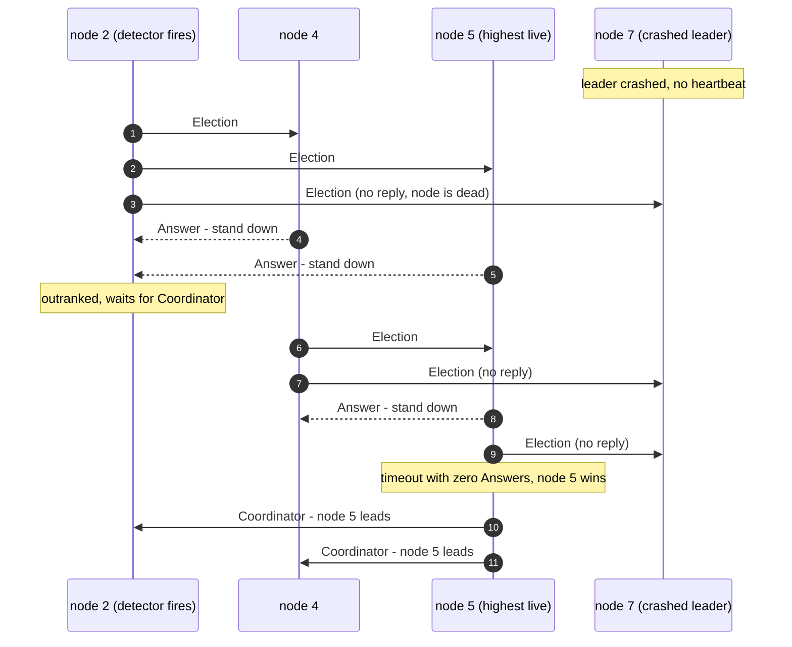
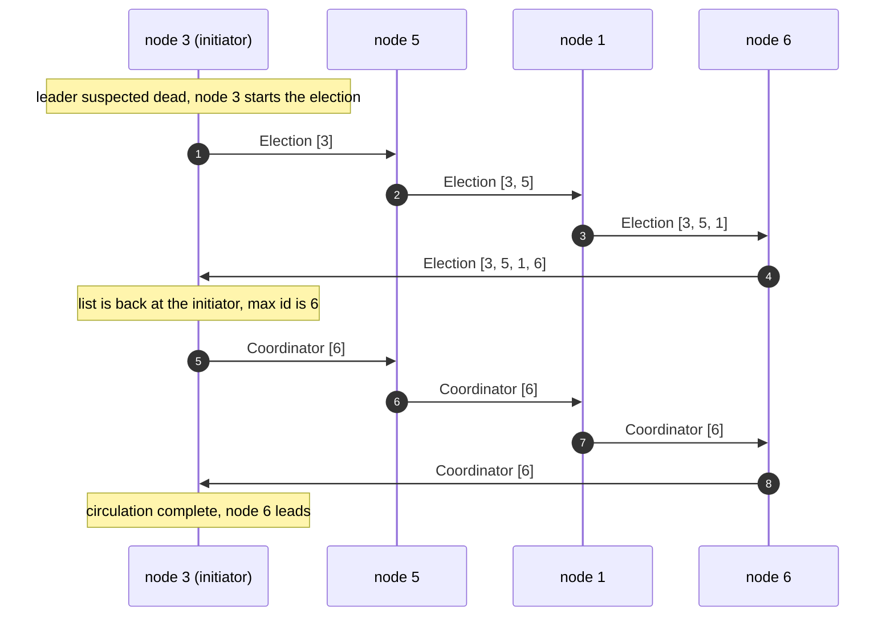
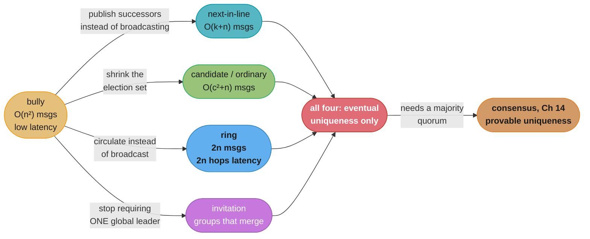

# Chapter 10: Leader Election

> Part II — Distributed Systems · Database Internals (Petrov, 1st ed., O'Reilly 2019) · builds
> on Ch 9 (Failure Detection), leads to Ch 11 (Replication and Consistency)

## Chapter Map

Chapter 9 ended with a failure detector that produces a suspicion signal — a φ value, a gossiped
membership verdict, a group-wide FUSE abort. Chapter 10 asks what a cluster *does* with that
signal when the node that went quiet was the one coordinating everything. The answer is a
**leader election**: a deterministic procedure by which the surviving processes settle on exactly
one of them as the new coordinator. The chapter walks five algorithms, each a different point on
the same trade-off surface — message count against election latency against topology assumptions
against partition behaviour.

The chapter's most consequential sentence is also its quietest one. An election is supposed to
have two properties: **liveness** (eventually a leader is elected) and **safety** (at most one
leader is active at a time, so split brain is impossible). The chapter states both and then
concedes that **many practical leader-election algorithms violate the safety half**. Every
algorithm below guarantees only *eventual uniqueness*. That is not a footnote — it is the reason
Chapter 14 exists, and the reason a leader whose decisions must be safe cannot rest on an
election alone.

**TL;DR:**
- A **leader** (coordinator) exists to make a distributed algorithm cheap: one process orders
  operations, hands out work, and breaks ties, so peers do not have to negotiate every decision
  pairwise. The price is a single point of failure and a re-election every time it dies.
- The **bully algorithm** elects the highest reachable process id. It is fast in wall-clock terms
  but costs **O(n²) messages** in the worst case, and it is pathologically unstable when the
  highest-id node flaps up and down — it wins every election it is alive for and vacates it
  moments later.
- **Next-in-line failover** and the **candidate/ordinary optimization** are both message-count
  cures: publish an ordered list of successors so a detector contacts one node instead of
  broadcasting, or split the cluster into a small set of election-eligible *candidates* and a
  large set of *ordinary* nodes that never lead. Both shrink the election set; both buy that with
  a narrower availability envelope.
- The **invitation algorithm** does not try to produce one global leader at all. Processes form
  **groups**, each with its own coordinator, and groups **merge** when they can reach each other.
  It therefore *tolerates* a partition by design: each side runs with its own coordinator and the
  groups reconcile when the partition heals.
- The **ring algorithm** arranges processes in a logical ring, circulates an id list once to
  collect candidates and once more to announce the winner — **2n messages**, far cheaper than the
  bully — but it pays in latency (2n *sequential* hops) and it assumes the ring stays intact.
- **Leader election is not consensus.** Every algorithm here delivers "eventually exactly one
  leader per reachable component", which across a partition means two leaders, both correct by
  their own local view, both accepting writes. A leader whose decisions must be *safe* needs
  consensus (Ch 14) underneath it, or a lease plus a fencing token so stale-leader writes are
  rejected at the resource.

## The Big Question

> Given a failure detector that is never certain, how do a set of peers settle deterministically
> on exactly one coordinator — and what, precisely, has that election promised you once it
> finishes?

Analogy: a roped climbing team whose lead has stopped moving on the pitch above. Someone has to
take over, and the team needs a rule that resolves without argument — "the most experienced
climber still on the rope leads" is deterministic, everyone can evaluate it from what they can
see, and it converges. But notice what the rule does *not* cover: if fog splits the team into two
groups that cannot see or hear each other, each group applies the rule honestly and each ends up
with a lead climber. Neither group is wrong. The rule was only ever a tie-break among people who
can communicate, and it silently became two rules the moment the fog rolled in. Every algorithm
in this chapter is that rule; consensus (Ch 14) is the separate machinery that stops both leads
from anchoring the same bolt.

---

## 10.1 Bully Algorithm

The **bully algorithm** (Garcia-Molina, 1982) is the chapter's starting point and the most widely
taught election protocol. Its rule is a single line: **every process has a unique, totally ordered
id, and the process with the highest id among the reachable ones becomes leader.** The name comes
from the behaviour that follows: a higher-id process, on learning an election is in progress,
simply bullies the lower-id initiator out of the way and takes over the election itself.

**The three message types.** The protocol needs exactly three:

| Message | Sent by | Sent to | Meaning |
|---|---|---|---|
| `Election` | any process that suspects the leader is gone | every process with a **higher** id | "I am starting an election. Is anyone above me still alive?" |
| `Answer` (alive) | a higher-id process receiving an `Election` | the sender | "I am alive and outrank you. Stand down, I will take it from here." |
| `Coordinator` (victory) | the winner | every process with a **lower** id | "I am the new leader." |

**The mechanism, step by step.** Process P notices (via its Chapter 9 failure detector) that the
current leader is unreachable:

1. P sends `Election` to every process with an id greater than its own.
2. If **any** of them replies `Answer` within a timeout, P has been outranked. P stops, and simply
   waits for a `Coordinator` message. (If none arrives within a second, longer timeout, P assumes
   the higher process died mid-election and restarts from step 1.)
3. If **no** `Answer` arrives within the timeout, P concludes it is the highest live process. P
   declares itself leader and broadcasts `Coordinator` to every lower id.
4. Every process receiving an `Election` from below runs steps 1–3 itself. The cascade terminates
   at the highest live id, which receives no `Answer` and wins.


*The cascade is the algorithm: node 2's election is taken over by node 4, node 4's by node 5, and
node 5 wins only because its own `Election` messages to the dead node 7 time out with no reply.
Every arrow above is a real message, which is exactly why the message count is quadratic.*

**Message cost — where the O(n²) comes from.** The worst case is the *lowest*-id live process
detecting the failure first. It sends `n-1` `Election` messages. Each of those recipients answers
it and then starts its own election, sending `Election` to everyone above itself. Summing the
cascade gives Σ(i) over the live processes, which is **O(n²)** — concretely up to n(n-1) messages.
The best case is the *highest*-id live process detecting first: it receives no answers, declares
itself, and sends `n-1` `Coordinator` messages, so **O(n)**.

| Cluster size n | Worst-case bully messages | Best-case bully messages |
|---|---|---|
| 8 | 56 | 7 |
| 32 | 992 | 31 |
| 128 | 16,256 | 127 |
| 1,000 | 999,000 | 999 |

A 1,000-node cluster whose lowest-id node happens to notice first generates roughly a million
messages for one election. That is the **message storm**, and it typically lands during exactly
the network condition that caused the failure detector to fire in the first place.

**Failure mode 1 — the flapping bully.** The nastier problem is stability, not volume. Suppose
node 7, the highest id, is the unhealthy one: it crashes, restarts, runs for 20 seconds, and
crashes again. The bully rule guarantees that node 7 wins *every single election it happens to be
alive for*, because the rule looks only at id, never at fitness. So the cluster runs a full
election, hands leadership to the least-reliable node in it, loses that leader 20 seconds later,
runs another full election, and repeats — at 992 messages a round for n=32 and a full leadership
handover each time. The cluster spends more time electing than leading. Petrov's framing is that
the bully algorithm's fixed priority is exactly what makes it simple and exactly what makes it
brittle: **it optimizes for deterministic convergence, not for picking a good leader.**

**Failure mode 2 — split brain.** If the failure detector is wrong (a GC pause misread as a crash,
per §9's war stories) or if the network partitions, the algorithm quietly produces two leaders.
Nodes 1–5 on one side of a partition cannot reach node 7, elect node 5, and start accepting
writes. Node 7 on the other side has heard nothing that contradicts its own leadership and keeps
accepting writes. Both sides ran the algorithm correctly. See "What an election has and has not promised" below for what this costs and what
the remedy actually is.

---

## 10.2 Next-In-Line Failover

**Next-in-line failover** is the first of two message-count fixes and the more direct one. Rather
than discovering the succession order by broadcasting an election, the **current leader publishes
it in advance**: along with its ordinary coordination traffic, the leader disseminates an ordered
list of alternates — its designated successors, ranked.

**The mechanism.** When a process detects the leader is gone, it does not broadcast. It walks the
published list:

1. Contact alternate #1 directly with a single message. If it responds, it becomes leader.
2. If alternate #1 does not respond within a timeout, contact alternate #2. And so on.
3. The first responding alternate takes the role and announces itself.

**Message cost.** One targeted probe per dead alternate before the first live one, plus the
announcement — **O(k + n)** where k is the number of dead alternates traversed, versus the bully's
O(n²). In the common case where alternate #1 is alive, an election costs **one round trip plus one
broadcast** instead of a quadratic cascade. For the n=32 cluster above, that is roughly 32 messages
instead of 992.

It also fixes the flapping-bully problem *if the leader chooses its list sensibly*, because the
succession order is now editorial rather than mechanical: the leader can rank alternates by
observed health, hardware class, or rack diversity, and simply omit the node that keeps crashing.
The bully rule has no such freedom — id is id.

**The new failure mode: list staleness.** The list is only as fresh as the last time the leader
published it, and the leader is by definition unable to update it after it dies. So the list can
be stale in two directions, and both hurt:

- **Stale-dead:** alternates #1 and #2 died before the leader did, and nobody could revise the
  list. The detector burns a full timeout per dead alternate before reaching a live one, turning
  a fast failover into a serial chain of timeouts. With a 5 s timeout and three dead alternates
  ahead of the live one, failover takes 15 s that the bully algorithm would have spent in parallel.
- **Stale-live:** an alternate was removed from the cluster (decommissioned, reimaged, reassigned)
  after the list was published, but the list still names it and it still answers. It becomes
  leader with a stale view of membership and configuration.

```
  broken: one published list, no freshness bound

    leader L publishes  [A, B, C]   at t=0
    A dies              t=10
    B dies              t=25
    L  dies             t=40
    detector at t=41 walks the list serially:
      probe A -> timeout (5s)   probe B -> timeout (5s)   probe C -> alive
      failover completed at t=56  --  15s of it spent on nodes already known dead

  fixed: alternates re-publish liveness, list is filtered at use time

    every alternate heartbeats into the same membership state the detector
    already maintains (Ch 9), and the list is intersected with "currently
    believed alive" BEFORE the first probe is sent
      probe C -> alive
      failover completed at t=41.05
```
*The list is a hint, not a fact. Intersecting it with the failure detector's live membership view
at the moment of use costs nothing and removes the serial-timeout chain entirely.*

---

## 10.3 Candidate/Ordinary Optimization

The second message-count fix attacks the *size of the election set* rather than the shape of the
protocol. Under the **candidate/ordinary optimization**, processes are split into two classes:

- **Candidate** processes are eligible to become leader. There are few of them — a handful in a
  cluster of hundreds.
- **Ordinary** processes are never leaders. They participate by *detecting* that the leader is
  gone and by *consuming* the result, but they never stand for election themselves.

**The mechanism.** An ordinary process that suspects the leader has failed does not start a
cluster-wide cascade. It notifies the candidate set — or, in the cheaper variant, contacts the
highest-ranked candidate directly and falls through to the next if that one does not respond,
exactly as in §10.2. The candidates then run the election among themselves, using whatever
protocol they like (typically the bully rule, now over a tiny set), and the winner announces
itself to everyone.

**Message cost.** The election cascade is now **O(c²)** in the candidate count c, not O(n²) in the
cluster size n, plus O(n) for the final announcement. Since c is chosen to be small and fixed
while n grows, this is the difference between an election that scales with the cluster and one
that does not:

| Cluster n | Candidates c | Bully over all n (worst) | Candidate/ordinary (worst) |
|---|---|---|---|
| 100 | 5 | 9,900 | 20 + 100 announce = 120 |
| 500 | 5 | 249,500 | 20 + 500 announce = 520 |
| 1,000 | 7 | 999,000 | 42 + 1,000 announce = 1,042 |

The election itself becomes essentially free; what remains is the unavoidable cost of telling
everyone the answer. That is a good shape for a protocol: the expensive part is now proportional
to the information that genuinely has to reach n nodes.

**The cost: a narrower availability envelope.** This is the trade-off the optimization does not
advertise. Under the plain bully rule, an election succeeds as long as *any* process survives —
the survivor elects itself. Under candidate/ordinary, an election succeeds only if **at least one
candidate is reachable**. A partition or correlated failure that takes out all c candidates leaves
a cluster in which the overwhelming majority of nodes are healthy, mutually reachable, and
*structurally unable to elect a leader at all*. With c = 5 out of 500, you have concentrated the
cluster's entire ability to recover into 1% of its nodes.

The mitigation is placement, not protocol: candidates must be spread across failure domains
(racks, availability zones, power feeds) so that no single correlated failure can claim all of
them. Choosing five candidates that happen to share a rack converts a rack failure from "lose 1%
of capacity" into "lose the ability to elect a leader".

---

## 10.4 Invitation Algorithm

The **invitation algorithm** (also from Garcia-Molina, 1982) is the chapter's most interesting
design because it changes the question. Bully, next-in-line, and candidate/ordinary all assume the
goal is *one leader for the whole system* and treat anything else as a failure. The invitation
algorithm assumes instead that the system may legitimately be several disconnected pieces, and
that each piece should keep making progress with its own coordinator.

**The mechanism — groups, invitations, merges.**

1. Every process starts as the coordinator of a **group** containing only itself.
2. Periodically, a group coordinator sends **invitations** to processes it can reach — in
   particular, to the coordinators of other groups.
3. When a coordinator accepts an invitation, the two groups **merge**. One of the two coordinators
   becomes the coordinator of the merged group (the tie broken deterministically, e.g. by group
   id), and every member of the absorbed group is told who its new coordinator is.
4. Over time, mutually reachable processes coalesce into progressively larger groups, converging
   on one group per **reachable component** of the network.

Note what step 4 says and does not say. It converges on one coordinator *per connected component*,
not one coordinator globally. Two components that cannot exchange messages will have two
coordinators, indefinitely, and that is the design working correctly.

```
  invitation algorithm across a partition -- multiple groups are the expected state

  t0  every process is its own group
      {1}L1  {2}L2  {3}L3   ||   {4}L4  {5}L5        (|| = partition)

  t1  invitations exchanged within each reachable component
      {1,2}L2        {3}L3   ||   {4,5}L5

  t2  further merging within each component
      {1,2,3}L3              ||   {4,5}L5

      TWO coordinators, stable, both correct. Each serves its own component.

  t3  partition heals. L3's group and L5's group can now exchange invitations.
      {1,2,3,4,5}L5          (deterministic tie-break picks one, members re-pointed)
```
*Bully treats the middle state as a bug to be prevented. The invitation algorithm treats it as the
system's honest description of itself, and provides the merge machinery to leave it cleanly.*

**Message cost.** A merge of a group of size *a* into a group of size *b* costs on the order of
**O(a + b)** messages: the invitation and acceptance between coordinators, plus one notification
to every member of the absorbed group telling it its new coordinator. Building one group of n
processes from n singletons through repeated pairwise merges therefore costs O(n log n) in the
balanced case and O(n²) if merges are maximally unbalanced (a size-1 group absorbed at a time).
The steady-state cost once groups have converged is just the periodic invitation traffic.

**Failure mode — merge livelock, and why group ids matter.** Two coordinators that invite each
other simultaneously must break the tie the *same way* on both sides. If each simply accepts the
other's invitation, both step down, both groups are now leaderless, and the next round has them
both step up again — a livelock where the coordinator role oscillates and never settles. The fix
is a deterministic, totally ordered **group identifier** (typically incorporating a monotonically
increasing generation or era number, so a group id is never reused after a merge): the group with
the ordering-winning id absorbs the other, unconditionally, and both sides compute the same
answer from the same two ids without further negotiation. The generation number is what stops a
stale invitation carrying an old group id from re-splitting a group that has already merged.

**Why this is the right shape for some systems and the wrong shape for others.** A system whose
work is partitionable — independent jobs, disjoint key ranges, per-tenant workloads — genuinely
benefits from both halves of a partition continuing to serve. A system whose leader arbitrates a
*single* shared resource does not: two coordinators writing to one log is precisely the split-brain
outcome, and the invitation algorithm has made it a first-class supported state rather than an
accident. The algorithm has not solved split brain; it has decided that split brain is acceptable
and given it clean semantics. Whether that is a feature depends entirely on what the leader does.

---

## 10.5 Ring Algorithm

The **ring algorithm** (Chang and Roberts, 1979) trades the bully's parallel broadcast for a
sequential circulation and gets a dramatically better message count in return.

**The topology assumption.** Processes are arranged in a **logical ring**: each process knows only
its **successor**, and messages travel one direction around it. The ring is logical, not physical
— it says nothing about network topology — but it must be *known and consistent*, which is itself
a distributed state-maintenance problem the algorithm assumes is already solved.

**The mechanism.**

1. A process that suspects the leader is gone constructs an `Election` message containing its own
   id and sends it to its successor.
2. Each process receiving the message **appends its own id** to the list and forwards it onward.
   (A common variant forwards only the running maximum instead of the full list — same result,
   constant-size message.)
3. When the message arrives back at the **initiator**, the initiator has seen every live process's
   id. It picks the highest and sends a `Coordinator` message with that id around the ring.
4. Each process reads the winner from the `Coordinator` message and forwards it, until it returns
   to the initiator and circulation stops.


*Two full laps of the ring: the first collects who is alive, the second announces the winner. The
whole election is 2n messages — but they are 2n messages in strict sequence, which is where the
latency goes.*

**Message cost and the latency trade.** The ring uses **2n messages** (one lap to collect, one to
announce) against the bully's O(n²). But those 2n messages are strictly sequential: the election
cannot finish faster than 2n network hops. The bully's messages are sent in parallel, so its
latency is bounded by a couple of detection timeouts regardless of n. The two algorithms therefore
cross over:

| n | Ring messages | Ring latency at 1 ms/hop | Bully messages (worst) | Bully latency at T=500 ms timeout |
|---|---|---|---|---|
| 8 | 16 | **16 ms** | 56 | ~1,000 ms |
| 32 | 64 | **64 ms** | 992 | ~1,000 ms |
| 256 | 512 | 512 ms | 65,280 | ~1,000 ms |
| 1,000 | 2,000 | **2,000 ms** | 999,000 | ~1,000 ms |
| 5,000 | 10,000 | 10,000 ms | ~25,000,000 | ~1,000 ms |

Read that table twice, because the intuition most people carry is wrong in both directions. For a
small cluster the ring is not merely cheaper, it is also **faster**, because the bully's latency is
dominated by a fixed timeout it must wait out regardless. For a large cluster the ring's serial
lap becomes the bottleneck while the bully's latency stays flat and its message count explodes.
Neither algorithm is universally better; the crossover in the numbers above sits somewhere around
n ≈ 500 for a 1 ms hop and a 500 ms detection timeout, and moves with both parameters.

**Failure mode — a broken ring.** The algorithm's entire correctness rests on the message
completing a lap, so a process that dies while the `Election` message is in flight simply
**swallows it**. No timeout fires at the initiator by default, no leader is elected, and the
cluster waits forever. The standard mitigation is for each process to know not just its successor
but its **successor's successor** (and sometimes further), so that a forwarding failure can be
routed around: node A, unable to reach its successor B, forwards to B's successor C and repairs
the ring behind it. This is a real cost — ring maintenance is a continuous background obligation,
and its failure is not detected by the election protocol but by the membership layer beneath it.

**Multiple simultaneous initiators.** If three processes detect the failure at once, three
`Election` messages circulate concurrently. This is not a correctness problem for the standard
formulation: each message collects the same set of live ids and therefore computes the same
maximum, so all three initiators announce the same winner. It is a *waste* problem — 3 × 2n
messages instead of 2n. Implementations typically suppress it by having a process drop an incoming
`Election` whose initiator id is lower than one it has already forwarded, so the highest-id
initiator's message survives and the others die out.

---

## What an election has and has not promised

*(Deliberately unnumbered: this is not one of the chapter's six book sections, so it does not get a
`## 10.x` heading. The argument below is nonetheless the book's own — the liveness/safety framing
the chapter uses to evaluate every algorithm, and its concession that many practical algorithms
violate safety — gathered here rather than left scattered across §10.1–§10.5. The specific
lease-and-fencing-token construction in `## Beyond the book` below is not the book's.)*

The chapter frames every algorithm above against two properties:

| Property | Statement | Do the chapter's algorithms guarantee it? |
|---|---|---|
| **Liveness** | The election eventually terminates with a leader elected. | Yes, under the assumptions each algorithm makes (reachability, intact ring, live candidate). |
| **Safety** | At most one process is leader at any instant — no split brain. | **No.** The chapter states plainly that many practical leader-election algorithms violate this. |

This is the point the chapter makes that readers most often carry away backwards. What these
algorithms deliver is *eventual uniqueness among mutually reachable processes*. Across a
partition, or across a failure-detector false positive, they deliver one leader **per component**,
each of which believes it is the leader and has no local evidence to the contrary.

```
  split brain -- what "eventual uniqueness" actually costs

  before the partition
    [n1] [n2] [n3] [n4] [n5]        leader = n5, everyone agrees

  during the partition ( || is the network split )
    [n1] [n2] [n3]   ||   [n4] [n5]

    left  side: n5 unreachable -> election runs -> n3 elected (highest live id here)
                n3 accepts writes, orders operations, hands out work
    right side: n5 was never told anything. It is alive, it still leads,
                it still accepts writes

    TWO leaders. Both ran the algorithm correctly. Both are internally consistent.
    The election never promised "at most one leader globally at all times" --
    it promised "eventually one leader among processes that can talk to each other",
    and it delivered exactly that, twice.

  after the partition heals
    the algorithms above converge back to one leader -- but nothing in them
    reconciles or rejects the writes the losing leader accepted meanwhile.
```
*The election is not the thing that was violated. The expectation was.*

The practical consequence for anyone building on top of an election: **the correctness of a
leader's decisions is not established by the election that produced it.** If the leader's job is
advisory — routing hints, work distribution, cache warming, a metrics scrape schedule — two
leaders for a few seconds cost duplicated work and nothing worse, and any algorithm in this
chapter is fine. If the leader's job is authoritative — appending to a single log, assigning
monotonic ids, granting exclusive access to a resource — then two leaders for a few seconds is
data corruption, and the election must be backed by **consensus (Ch 14)**, which is precisely the
machinery that turns "eventually one" into "provably at most one".

A useful way to hold the distinction: leader election answers *who*, consensus answers *who, and
can you prove nobody else thinks so too*. The second question is strictly harder, requires a
majority quorum, and cannot be answered by any protocol in this chapter — which is why the chapter
hands off to Chapter 14 rather than claiming to have finished the job.

---

## Beyond the book — leases and fencing tokens

> The chapter states the safety property, concedes that its algorithms violate it, and points at
> consensus (Ch 14) as the remedy. It does not describe the **lease + fencing token** construction
> below, which is the mechanism most production systems actually use to make a possibly-stale
> leader harmless at the point of use. It is included here because it is the concrete answer to
> "so what do I do about split brain", and because interviewers ask for it by name. Petrov
> discusses leader leases in the consensus chapter, not this one; the fencing-token framing is
> from the wider literature (notably Kleppmann's treatment in DDIA Ch 8) rather than from Petrov.

Consensus makes the *election* safe. A lease with a fencing token makes the *actions* safe even
when the election was not — a cheaper, more local guarantee that composes with any of the
algorithms above.

- A **lease** is leadership with an expiry. A leader holds it for a bounded period and must renew
  before it lapses. A leader that stops renewing (crashed, partitioned, GC-paused) loses
  leadership by the passage of time, without needing to be told.
- A **fencing token** is a monotonically increasing number issued with each lease grant. Every
  write the leader performs carries its token. The *resource* — the storage layer, the log, the
  lock service — tracks the highest token it has seen and **rejects any write carrying a lower
  one**.

```
  a lease with a fencing token turns "eventually one leader" into "safe to act"

  t=0    n5 acquires the lease, token = 5
         n5 --write(token=5)--> storage      ACCEPTED   (high-water mark := 5)

  t=10   n5 enters a 30s stop-the-world GC pause. It still believes it leads.
  t=25   lease expires. The cluster runs an election. n3 wins.
  t=26   n3 acquires the lease, token = 6
         n3 --write(token=6)--> storage      ACCEPTED   (high-water mark := 6)

  t=40   n5 wakes up. It has no idea any time passed. It still believes it leads.
         n5 --write(token=5)--> storage      REJECTED   (5 < 6)

  The stale leader is not prevented from EXISTING. It is prevented from
  DOING DAMAGE, at the only place that can actually enforce it: the resource.
```

The design insight worth carrying: split brain cannot be prevented by the electing side alone,
because the stale leader's problem is that it has no way to know it is stale. The check has to
live where the writes land. Note also the assumption the lease smuggles in — bounded clock drift
between the leader and whoever expires the lease — which is why leases are usually paired with a
generous safety margin and why consensus-based leadership (Ch 14) remains the stronger guarantee.

---

## Visual Intuition


*Four of the five algorithms are optimizations of the bully's cost structure and inherit its safety
gap; the invitation algorithm alone changes the goal. All five terminate at the same place — the
safety property that only consensus supplies.*

```
  message count vs election latency -- the two axes every algorithm trades on

  messages
   ^
   |  bully  *
   |  (parallel broadcast, latency flat in n,
   |   message count quadratic in n)
   |
   |        candidate/ordinary  *
   |        (bully over a tiny set, then one announce lap)
   |
   |                 next-in-line  *
   |                 (one targeted probe, then one announce lap)
   |
   |                          ring  *
   |                          (2n messages, but 2n SEQUENTIAL hops)
   +--------------------------------------------------------> latency

  Small n : the ring wins on BOTH axes -- 16 messages and 16 ms at n=8,
            against the bully's 56 messages and a full detection timeout.
  Large n : the ring's serial lap dominates -- 2,000 sequential hops at
            n=1000 -- while the bully's latency has not moved at all.
```
*The usual summary "the ring is cheaper, the bully is faster" is only half true, and the half that
is true depends on n. Below roughly n = 500 at 1 ms hops, the ring is cheaper AND faster.*

```
  where each algorithm fails, at a glance

  bully              highest-id node flaps  ->  it wins every election,
                                                vacates seconds later, repeat
  next-in-line       stale successor list   ->  serial timeout chain through
                                                nodes already known dead
  candidate/ordinary all candidates lost    ->  99% of the cluster is healthy,
                                                mutually reachable, and CANNOT elect
  invitation         two coordinators       ->  livelock unless group ids give a
                     invite each other          deterministic, generation-stamped
                     simultaneously             tie-break
  ring               a node dies mid-lap    ->  the Election message is swallowed,
                                                nobody times out, no leader ever
  ALL FIVE           network partition      ->  one leader per component, each
                                                internally correct, both writing
```
*Four of these six rows are per-algorithm bugs with per-algorithm fixes. The last row is not a bug
in any of them — it is the safety property they never claimed.*

---

## Key Concepts Glossary

- **Leader (coordinator)** — the single process that orchestrates a distributed algorithm: ordering
  operations, distributing work, and breaking ties on behalf of its peers.
- **Leader election** — a deterministic procedure by which a set of processes settles on exactly one
  of them as leader, run whenever the incumbent is suspected failed.
- **Liveness (of an election)** — the property that an election eventually terminates with some
  leader elected.
- **Safety (of an election)** — the property that at most one leader is active at any instant. The
  chapter states that many practical election algorithms violate it.
- **Split brain** — the state in which two or more processes simultaneously believe they are the
  leader, typically after a partition or a failure-detector false positive.
- **Eventual uniqueness** — the weaker guarantee the chapter's algorithms actually provide: exactly
  one leader per set of mutually reachable processes, eventually.
- **Bully algorithm** — an election in which the highest-id reachable process wins, driven by
  `Election`, `Answer`, and `Coordinator` messages; O(n²) messages worst case.
- **`Election` message** — sent to all higher-id processes to start or escalate an election.
- **`Answer` (alive) message** — a higher-id process's reply telling a lower-id initiator to stand
  down.
- **`Coordinator` (victory) message** — the winner's announcement to all lower-id processes.
- **Next-in-line failover** — the leader publishes an ordered list of alternates in advance, so a
  detector contacts successors one at a time rather than broadcasting an election.
- **Candidate process** — a process eligible to become leader under the candidate/ordinary split.
- **Ordinary process** — a process that participates in detection and consumes the result, but is
  never itself a candidate for leadership.
- **Candidate/ordinary optimization** — shrinking the election set from n processes to a small
  fixed candidate set c, reducing the cascade from O(n²) to O(c²).
- **Invitation algorithm** — an election in which processes form groups, each with a coordinator,
  and groups merge on contact; converges to one coordinator per reachable component, not one
  globally.
- **Group (invitation algorithm)** — a set of processes sharing a coordinator, the unit that
  invitations merge.
- **Group coordinator** — the leader of one group; the role that survives or is relinquished when
  two groups merge.
- **Group merge** — the operation joining two groups into one, requiring a deterministic tie-break
  between the two coordinators.
- **Group identifier / generation number** — the totally ordered, monotonically increasing stamp on
  a group that makes merge tie-breaks deterministic and prevents stale invitations re-splitting an
  already-merged group.
- **Ring algorithm** — an election in which an id-collecting message circulates a logical ring once
  and a winner announcement circulates once more; 2n messages, 2n sequential hops.
- **Successor** — the single neighbour each process forwards to in the ring algorithm; knowing the
  successor's successor is the standard mitigation for a broken ring.
- **Message storm** — the burst of election traffic (up to n(n-1) messages under the bully rule)
  generated by a single failure detection, typically during already-degraded network conditions.
- **Lease** *(beyond the book — see the disclosed section above)* — leadership with an expiry that
  must be periodically renewed, so a crashed or partitioned leader loses the role by elapsed time.
- **Fencing token** *(beyond the book — see the disclosed section above)* — a monotonically
  increasing number issued with each leadership grant and attached to every write, letting the
  resource reject writes from a stale leader.

---

## Tradeoffs & Decision Tables

| Algorithm | Messages (worst) | Election latency | Topology assumed | Behaviour under partition | Leader chosen by |
|---|---|---|---|---|---|
| Bully | O(n²) — up to n(n-1) | ~2 detection timeouts, flat in n | all-to-all reachability | one leader per component | highest id (fixed) |
| Next-in-line failover | O(k + n), k = dead alternates | 1 round trip if alternate #1 lives; k×timeout otherwise | all-to-all; leader must have published a list | one leader per component | leader's published ranking |
| Candidate/ordinary | O(c² + n), c = candidates | ~2 timeouts over the candidate set | candidates reachable from everywhere | **no election at all** if every candidate is lost | highest-ranked live candidate |
| Invitation | O(a + b) per merge | proportional to merge depth | pairwise reachability only | **multiple groups by design**, merged on heal | deterministic group-id tie-break |
| Ring | 2n | 2n sequential hops | intact logical ring, successor known | one leader per component; a broken ring blocks entirely | highest id in the collected list |

| If the leader's job is… | Two leaders for 10 s means… | Then you need… |
|---|---|---|
| Advisory (routing hints, cache warming, scrape scheduling) | duplicated work, wasted CPU | any algorithm here, no consensus |
| Owning disjoint, partitionable work (per-tenant jobs, key ranges) | both halves keep serving their own slice | the invitation algorithm — it is the shape of the problem |
| Assigning monotonic ids or appending to one log | **corruption** | consensus (Ch 14), or a lease + fencing token at the resource |
| Granting exclusive access to a shared resource | **corruption** | fencing token enforced by the resource itself, always |

| Tuning knob | Turn it up | Turn it down |
|---|---|---|
| Failure-detector threshold (φ, Ch 9) | fewer spurious elections, longer real-failure outage | faster failover, more election churn and more split-brain windows |
| Candidate set size c | wider availability envelope, more election traffic | cheaper elections, more concentrated recovery risk |
| Lease duration | fewer renewals, longer stale-leader window after a pause | tighter safety window, more renewal traffic, more churn under load |

---

## Common Pitfalls / War Stories

- **The flapping bully.** A node with failing hardware — a dying NIC, a disk that stalls under
  load — sits at the top of the id ordering. It crashes, restarts, wins the election because the
  bully rule looks only at id, leads for 20 seconds, and crashes again. The cluster runs a full
  O(n²) election every 20 seconds and hands leadership to the least reliable member every time.
  The fix is not a better election algorithm; it is to make leadership *earned* rather than
  *ordinal* — the next-in-line list, which the leader can rank by observed health, or an explicit
  candidate set that excludes the flapping node.
- **A GC pause promoted to a second leader.** A JVM-based leader takes a 20 s stop-the-world
  collection. The failure detector's threshold was tuned for fast failover, so it fires; an
  election runs; a new leader is installed and starts appending to the shared log. The old leader's
  collection finishes and it resumes appending to the same log **from where it left off**, with no
  knowledge that anything happened. Nothing in Chapter 10 catches this. Only a fencing token at
  the log — or consensus-based leadership — does.
- **The successor list that pointed at three corpses.** A leader published `[A, B, C]` at
  deployment. A and B were decommissioned over the following weeks; nobody re-published. When the
  leader eventually failed, failover walked the list serially, burning a 5 s timeout on A and
  another on B before reaching C — a 15 s outage of which 10 s was spent probing nodes the
  membership layer already knew were gone. Intersect the published list with live membership
  before the first probe.
- **All five candidates in one rack.** A 400-node cluster used the candidate/ordinary optimization
  with five candidates, all provisioned together and therefore all landed in the same rack by the
  scheduler's bin-packing. The rack lost power. 395 healthy, mutually reachable nodes sat unable to
  elect a leader until an operator manually promoted one. Candidates are a failure domain — spread
  them deliberately, and assert the spread in configuration rather than hoping the scheduler does
  it.
- **The ring that swallowed the election.** A node died while forwarding an `Election` message. The
  message vanished; the initiator was not waiting on a timeout because the protocol as implemented
  had none; no `Coordinator` message ever arrived. The cluster sat leaderless and idle, with every
  node individually healthy and every health check green, until someone noticed the absence of
  leader activity in a dashboard. Ring implementations need both successor-of-successor routing
  **and** an initiator-side timeout that restarts the lap.
- **Merge livelock between two coordinators.** Two groups invited each other in the same round.
  Both coordinators politely accepted the other's invitation and stepped down; both groups were now
  leaderless; the next round had both step up and repeat. The oscillation ran until an operator
  restarted one process. Group ids must give a *total order* that both sides evaluate identically,
  and the winner must absorb unconditionally rather than negotiating.
- **Treating the election as the safety guarantee.** The most common and most expensive mistake in
  this chapter's territory: a system elects a leader, the leader starts issuing monotonically
  increasing ids, and nobody ever asks what happens when two leaders issue overlapping ranges. The
  election gave *eventual uniqueness*. It never gave *at most one*. If the answer to "what breaks
  if two of these run at once" is anything worse than wasted work, Chapter 10 is not enough.

---

## Real-World Systems Referenced

**Named by the chapter's own references.** Garcia-Molina, "Elections in a Distributed Computing
System" (1982) — the source of both the **bully algorithm** and the **invitation algorithm**, and
of the liveness/safety framing the chapter uses to evaluate all of them. Chang and Roberts, "An
Improved Algorithm for Decentralized Extrema-Finding in Circular Configurations of Processes"
(1979) — the **ring algorithm**. Le Lann, "Distributed Systems — Towards a Formal Approach" (1977)
— the earlier ring-based extrema-finding work Chang and Roberts improve on. The chapter also points
forward to its own Chapter 14 for the consensus machinery that supplies the safety property these
algorithms lack.

**Added by this repo for grounding** *(beyond the book — these are not the chapter's examples)*:
ZooKeeper's ephemeral-sequential-znode election recipe and etcd's lease-based leader election are
the two most commonly deployed production realizations, and both are consensus-backed rather than
bully-style precisely because of the safety gap "What an election has and has not promised" describes; Kafka's controller and HDFS's
active NameNode are two widely known single-leader roles whose failover has to answer the same
questions.

---

## Summary

A leader exists to make distributed coordination cheap: one process orders operations and hands
out work so that peers do not renegotiate every decision pairwise. The cost is that the leader is
a single point of failure, and every failure demands an election. The chapter's five algorithms
are five points on one trade-off surface. The **bully algorithm** picks the highest reachable id —
simple, deterministic, low-latency, and O(n²) in messages, with a pathological instability when
the top-ranked node is the unreliable one, since the rule considers id and never fitness.
**Next-in-line failover** has the leader publish a ranked successor list in advance, turning a
broadcast cascade into one targeted probe, at the price of a list that goes stale exactly when
nobody can refresh it. The **candidate/ordinary optimization** shrinks the election set from n to a
small fixed c, reducing the cascade to O(c²) but concentrating the cluster's entire ability to
recover into those c nodes — lose them all and a healthy cluster cannot elect at all. The
**invitation algorithm** stops insisting on one global leader: processes form groups that merge on
contact, converging on one coordinator per reachable component, which makes it the right shape for
partitionable work and the wrong shape for a single arbitrated resource. The **ring algorithm**
circulates an id list once and a winner once — 2n messages, far cheaper than the bully, but 2n
*sequential* hops, so it is both cheaper and faster than the bully for small clusters and
distinctly slower for large ones, and it depends on a ring that stays intact.

Above all: an election is supposed to satisfy **liveness** (eventually a leader) and **safety** (at
most one leader), and the chapter is explicit that many practical algorithms — including these —
violate safety. What they deliver is *eventual uniqueness among mutually reachable processes*,
which across a partition means one leader on each side, both internally correct, both accepting
writes. That gap is not repaired by a better election. It is repaired by consensus, which Chapter
14 supplies, or by making a stale leader's actions harmless at the resource they touch. Chapter 11
now takes the leader as given and asks the next question: once several replicas hold copies of the
same data, what does it actually mean for them to agree?

---

## Interview Questions

**Q: Why is leader election not the same thing as consensus, and what breaks if you assume it is?**
**Short:** Petrov's algorithms guarantee only eventual uniqueness, so across a partition each side elects its own leader.
The chapter states that an election should have liveness (eventually a leader) and safety (at most one leader at a time), and then concedes that many practical algorithms violate the safety half. What bully, ring, next-in-line, and candidate/ordinary all actually deliver is one leader per set of mutually reachable processes — so a network partition produces two leaders, each internally consistent and each with no local evidence it is wrong. If the leader's job is advisory the duplication is merely wasteful, but if it assigns monotonic ids or appends to a single shared log, two leaders is data corruption, and the only real remedies are consensus (Chapter 14) or a fencing token enforced at the resource so a stale leader's writes are rejected.

**Q: What is split brain, and why do most leader-election algorithms permit it rather than prevent it?**
**Short:** Two processes both believing they lead, permitted because an election can only order the processes it can actually reach.
Split brain is the state where two or more processes simultaneously act as leader, typically after a network partition or a failure-detector false positive such as a long GC pause. The algorithms permit it because none of them require a majority quorum: each simply applies a deterministic rule to the set of processes it can currently contact, and a partitioned process applies the same rule honestly to its own smaller view. Preventing split brain requires proving that no other process can also believe it leads, which is a strictly harder problem needing a majority quorum, so in practice you either use consensus-based leadership or accept the possibility and fence the resource so a stale leader cannot do damage.

**Q: Why is the bully algorithm O(n squared) in the worst case, and what is the best case?**
**Short:** The worst case is the lowest-id node detecting first, which triggers a cascade where every higher node restarts the election.
In the worst case the lowest-id live process notices the failure first and sends `Election` to all n-1 processes above it; each of those replies `Answer` and then starts its own election against everyone above itself, and summing that cascade gives up to n(n-1) messages — 992 for a 32-node cluster, roughly a million for 1,000 nodes. The best case is the highest-id live process detecting first: it sends its `Election` messages, receives no `Answer` because nobody outranks it, declares itself, and broadcasts n-1 `Coordinator` messages, so O(n). The practical consequence is that the message storm lands during the degraded network conditions that triggered detection in the first place, which is what next-in-line failover and the candidate/ordinary optimization exist to avoid.

**Q: Walk through the bully algorithm's three message types and what each one does.**
**Short:** `Election` escalates upward, `Answer` tells a lower-id initiator to stand down, `Coordinator` announces the winner downward.
A process suspecting the leader has failed sends `Election` to every process with a higher id. Any higher-id process that receives one replies `Answer` (also called alive), which tells the initiator it has been outranked and should stop and wait, and then that higher process starts its own `Election` upward. A process whose `Election` messages all time out with no `Answer` concludes it is the highest live id, declares itself leader, and sends `Coordinator` to every lower id. The cascade is what makes the algorithm both deterministic and quadratic, and the timeout in step two is what makes its latency roughly constant in n rather than growing with cluster size.

**Q: What is the bully algorithm's instability problem when the highest-id node keeps crashing and restarting?**
**Short:** The rule looks only at id, never at fitness, so a flapping top-ranked node wins every election it happens to be alive for.
Because the bully rule ranks purely by process id, a node with failing hardware that sits at the top of the ordering will win every single election that occurs while it is up — then crash again seconds later, triggering another full O(n squared) election, and repeat indefinitely. The cluster can end up spending more time electing than leading, and it hands leadership to its least reliable member every time. The fix is not a different election protocol but a different selection criterion: next-in-line failover lets the leader publish a ranked successor list it can order by observed health, and the candidate/ordinary split lets you exclude the flapping node from eligibility entirely.

**Q: How does next-in-line failover reduce message cost, and what new failure mode does it introduce?**
**Short:** The leader publishes a ranked successor list in advance, so a detector probes one node instead of broadcasting an election.
Instead of discovering the succession order by cascading `Election` messages, the leader disseminates an ordered list of alternates during normal operation, so a process detecting failure contacts alternate one directly and only falls through to alternate two if that times out — O(k + n) messages against the bully's O(n squared). The new failure mode is staleness, because the list can only be refreshed by a leader that is by definition now dead: it can name alternates that died earlier, forcing a serial chain of timeouts (three dead alternates at a 5 s timeout is 15 s of pure failover delay), or it can name a node that was decommissioned but still answers. The cheap mitigation is to intersect the published list with the failure detector's current live-membership view before sending the first probe.

**Q: What does the candidate/ordinary optimization buy, and what availability cost does it carry?**
**Short:** It shrinks the election cascade from O(n squared) to O(c squared), but the cluster cannot elect at all if every candidate is lost.
Processes are split into a small set of election-eligible candidates and a large set of ordinary processes that detect failures and consume results but never lead, so the expensive cascade runs only among the c candidates — 20 messages for five candidates in a 500-node cluster instead of 249,500. The hidden cost is that under the plain bully rule an election succeeds as long as any process survives, whereas here it succeeds only if at least one candidate is reachable, so a correlated failure taking out all c candidates leaves a cluster where the overwhelming majority of nodes are healthy and mutually reachable yet structurally unable to elect. Candidates are therefore a failure domain in their own right and must be deliberately spread across racks and availability zones rather than left to a scheduler's bin-packing.

**Q: How does the invitation algorithm's goal differ fundamentally from the bully and ring algorithms?**
**Short:** It converges on one coordinator per reachable component rather than one globally, treating multiple groups as a supported state.
Bully and ring both assume the correct outcome is a single global leader and treat anything else as a failure to be prevented; the invitation algorithm assumes the system may legitimately be several disconnected pieces and gives each piece its own coordinator. Every process starts as the coordinator of a singleton group, coordinators periodically send invitations to other groups' coordinators, and accepting an invitation merges the two groups under one of them — so mutually reachable processes coalesce while a partition simply leaves two stable groups that reconcile when it heals. This makes it the right shape for partitionable work such as per-tenant jobs or disjoint key ranges, and precisely the wrong shape for a leader arbitrating one shared resource, because it has not solved split brain so much as made it a first-class supported state with clean merge semantics.

**Q: Why does the invitation algorithm need group identifiers with generation numbers?**
**Short:** Without a deterministic total order on group ids, two coordinators inviting each other simultaneously livelock by both stepping down.
If two coordinators exchange invitations in the same round and each politely accepts the other's, both step down, both groups are momentarily leaderless, and the next round has both step up and repeat — an oscillation that never settles. A totally ordered group identifier lets both sides compute the same winner from the same two ids without further negotiation, and the winner absorbs the other unconditionally rather than negotiating. The generation or era number matters separately: it makes ids non-reusable across merges, so a delayed invitation carrying a stale group id cannot re-split a group that has already merged.

**Q: How does the ring algorithm work, and how many messages does an election cost?**
**Short:** An id list circulates the ring once to collect live processes and once more to announce the winner, costing 2n messages.
Processes are arranged in a logical ring where each knows only its successor. A process detecting failure sends an `Election` message containing its own id to its successor; each recipient appends its own id and forwards it, so when the message returns to the initiator it carries every live process's id. The initiator picks the maximum and circulates a `Coordinator` message announcing it, giving 2n messages total against the bully's O(n squared) — 64 messages for a 32-node cluster instead of 992. The catch is that those 2n messages are strictly sequential, so the election cannot complete faster than 2n network hops, which is where the ring's cost reappears as latency.

**Q: Ring versus bully: which one is faster, and when does that answer flip?**
**Short:** The ring is both cheaper and faster below roughly 500 nodes, then its 2n sequential hops overtake the bully's flat timeout-bound latency.
The bully's messages go out in parallel, so its latency is bounded by a couple of detection timeouts — around a second with a 500 ms timeout — regardless of cluster size, while its message count grows quadratically. The ring's message count is a modest 2n but those hops are serial, so at 1 ms per hop an 8-node ring finishes in 16 ms and a 1,000-node ring takes 2 seconds. The result is that for small clusters the ring wins on both axes, and for large clusters the bully's latency has not moved while the ring's has become the bottleneck, so the crossover depends on your actual hop latency and detection timeout rather than on a general rule.

**Q: What single failure breaks the ring algorithm, and how is it mitigated?**
**Short:** A process dying mid-lap swallows the `Election` message, so no leader is ever elected and nothing times out.
The ring's correctness depends entirely on the circulating message completing a lap, so a node that fails while forwarding simply absorbs the message: the initiator is not waiting on anything by default, no `Coordinator` message ever arrives, and the cluster sits leaderless with every individual health check green. The standard mitigation is for each process to know its successor's successor as well, so a forwarding failure can be routed around and the ring repaired behind it, which turns ring maintenance into a continuous background obligation of the membership layer. Any real implementation also needs an initiator-side timeout that restarts the lap, because successor-of-successor routing does not help if the message was lost rather than the node being visibly down.

**Q: Two processes start a ring election simultaneously. What happens, and is it a correctness problem?**
**Short:** Both messages collect the same live ids and elect the same winner, so it wastes messages rather than breaking correctness.
Each concurrent `Election` message circulates independently, and since each collects the same set of live process ids, each initiator computes the same maximum and announces the same winner — the outcome is consistent. The cost is purely wasteful: three simultaneous initiators produce 3 × 2n messages where 2n would have sufficed. Implementations usually suppress the duplicates by having a process drop an incoming `Election` whose initiator id is lower than one it has already forwarded, so the highest-id initiator's message survives and the rest die out en route.

**Q: What are the liveness and safety properties an election is meant to satisfy, and which one do these algorithms actually deliver?**
**Short:** Petrov states both, and concedes the algorithms deliver liveness but violate safety.
Liveness says the election eventually terminates with some leader elected, and safety says at most one leader is active at any instant so split brain is impossible. All five algorithms in the chapter satisfy liveness under their own assumptions — reachability for the bully, a live candidate for candidate/ordinary, an intact ring for the ring algorithm — but the chapter is explicit that many practical election algorithms, these included, violate safety. The distinction is worth stating precisely in an interview because it is the whole reason the book goes on to a consensus chapter: leader election answers who, while consensus answers who and proves nobody else believes otherwise.

**Q: How would you make a leader's decisions safe despite the possibility of two leaders existing?**
**Short:** Enforce a lease with a monotonically increasing fencing token at the resource, so a stale leader's writes are rejected where they land.
The stale leader's fundamental problem is that it has no local way to know it is stale — a process emerging from a 30-second GC pause believes no time passed — so the check cannot live on the electing side. A lease gives leadership an expiry that lapses by elapsed time without anyone needing to notify the holder, and each grant carries a fencing token that increments; every write carries its token, the resource tracks the highest token it has seen, and it rejects anything lower. This does not prevent two leaders from existing, it prevents the older one from doing damage, and it composes with any election algorithm — though it does assume bounded clock drift, which is why consensus-based leadership remains the stronger guarantee.

**Q: You raise your failure detector's threshold to reduce spurious elections. What have you actually traded away?**
**Short:** Detection latency and therefore real-failure outage duration, in exchange for fewer false elections and fewer split-brain windows.
Raising the threshold — a higher phi in Chapter 9's terms — means a slow-but-healthy node is far less likely to be declared dead, so you run fewer unnecessary elections, avoid the message storms they cause, and shrink the window in which a paused-then-resumed leader coexists with its replacement. The price is that a genuine crash now goes undetected for longer, and everything blocked on the leader stays blocked for that whole extra window. The right threshold therefore depends on what the election costs you: a bully-based election in a 1,000-node cluster is expensive and disruptive enough to justify a very high threshold, while a cheap candidate-set election guarded by fencing tokens can afford to be trigger-happy.

**Q: When would you deliberately choose not to have a leader at all?**
**Short:** When the work is partitionable or the coordination cost of electing exceeds what a leader saves.
A leader is an optimization: it exists so that peers do not have to negotiate every decision pairwise, and it is worth its cost only when there is genuinely a single decision to be centralized. If the work partitions cleanly — independent jobs, disjoint key ranges, per-tenant state — then leaderless replication or the invitation algorithm's per-component coordinators let both halves of a partition keep serving, which a single-leader design cannot. Equally, if the leader would become a throughput bottleneck or if the election machinery and its failure modes cost more than the coordination it saves, a quorum-based leaderless design (Chapter 11's tunable consistency) is the better answer.

---

## Cross-links in this repo

- [database/consistency_models_and_consensus/ — leader election, leases, and the consensus machinery that supplies the safety property](../../../database/consistency_models_and_consensus/consistency_models_and_consensus.md)
- [database/replication_and_high_availability/ — failover in practice, and what a promoted replica has to reconcile](../../../database/replication_and_high_availability/replication_and_high_availability.md)
- [hld/consensus_algorithms/ — Raft's and Paxos's leader election, which are consensus-backed rather than bully-style](../../../hld/consensus_algorithms/consensus_algorithms.md)
- [book/ddia_2e/10_consistency_and_consensus/ — Kleppmann's treatment of fencing tokens and the split-brain problem](../../ddia_2e/10_consistency_and_consensus/10_consistency_and_consensus.md)
- Sibling chapters: [Ch 9 Failure Detection](../09_failure_detection/09_failure_detection.md) · [Ch 11 Replication and Consistency](../11_replication_and_consistency/11_replication_and_consistency.md) · [Ch 14 Consensus](../14_consensus/14_consensus.md)

## Further Reading

- Garcia-Molina, "Elections in a Distributed Computing System," IEEE Transactions on Computers,
  1982 — the source of both the bully algorithm and the invitation algorithm, and of the
  liveness/safety framing this chapter uses.
- Chang and Roberts, "An Improved Algorithm for Decentralized Extrema-Finding in Circular
  Configurations of Processes," CACM 1979 — the ring algorithm.
- Le Lann, "Distributed Systems — Towards a Formal Approach," IFIP Congress 1977 — the earlier
  ring-based extrema-finding work Chang and Roberts improve on.
- Singh and Kurose, "Electing 'Good' Leaders," Journal of Parallel and Distributed Computing, 1994
  — on selecting a leader by fitness rather than by identifier, the concern behind this chapter's
  flapping-bully problem.
- Aguilera, Delporte-Gallet, Fauconnier, and Toueg, "Stable Leader Election," DISC 2001 — election
  protocols that avoid unnecessary leader changes, addressing the churn the bully rule invites.
