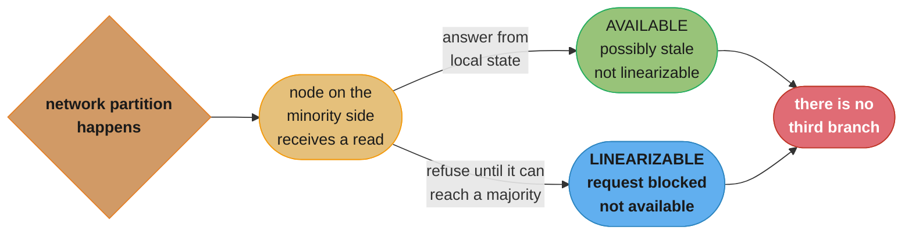
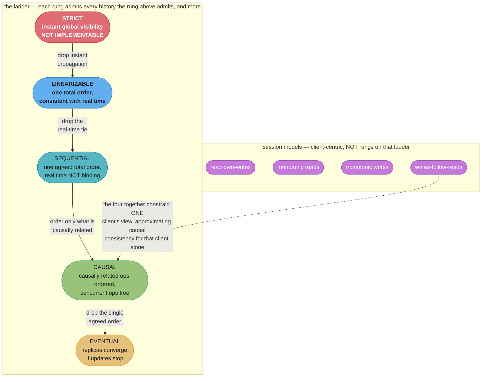
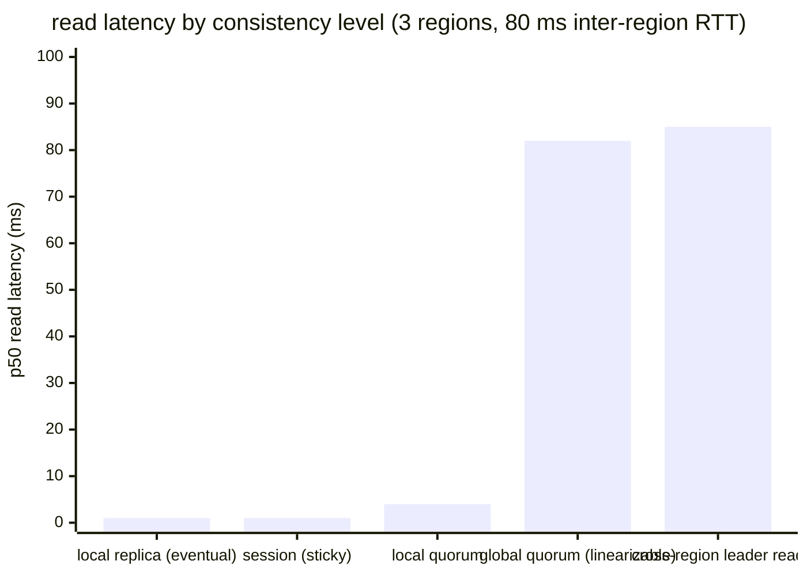
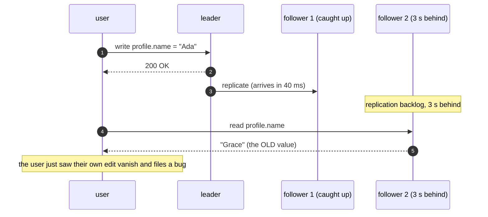

# Chapter 11: Replication and Consistency

> Part II — Distributed Systems · Database Internals (Petrov, 1st ed., O'Reilly 2019) · builds
> on Ch 10 (Leader Election), leads to Ch 12 (Anti-Entropy and Dissemination)

## Chapter Map

Chapters 8 through 10 built the machinery for keeping a cluster's *membership* coherent: a failure
model, a failure detector, an election. Chapter 11 asks the question that machinery exists to
serve. Once you have kept several nodes alive and agreed on who coordinates them, you still have
to decide **what it means for the copies of your data to agree** — and, more uncomfortably, how
much agreement you are willing to pay for.

This is the most interview-critical chapter in the book, and the reason is that it refuses to give
a single answer. It presents a *ladder* of consistency models from strict (unimplementable)
through linearizable (achievable, expensive) down to eventual (cheap, weakest), plus a set of
**session models** that sit off to the side as per-client guarantees rather than rungs on the same
ladder, plus two escape hatches — **tunable consistency**, which makes the choice per-request, and
**CRDTs**, which sidestep conflict resolution entirely by making conflicts impossible.

**TL;DR:**
- Replication is the *only* way to get availability, and it is also the *sole source* of the
  consistency problem — a single unreplicated copy has no consistency question to answer.
- **CAP** says that when the network partitions you must give up either linearizability or
  availability. The chapter's "use CAP carefully" argument is that the popular "pick two of three"
  framing is wrong in almost every detail: P is not optional, CAP's C is not ACID's C, CAP's A is
  a binary property with no latency bound and nothing to do with an uptime SLA, and CAP says
  nothing at all about the overwhelmingly common non-partitioned case.
- **Harvest and yield** (Fox and Brewer) replace CAP's binary availability with two independently
  degradable dials: harvest is *how complete* an answer is, yield is *how likely* you are to get
  one. Returning results from 98 of 100 index shards is harvest 0.98 at yield 1.0 — a trade the
  binary framing cannot even express.
- Consistency models are statements about **which orderings of operations a history may exhibit**.
  **Strict consistency** demands instantaneous global visibility and is not implementable.
  **Linearizability** is the strongest achievable model: a *recency* guarantee about single
  operations on single objects, consistent with real time. **Sequential consistency** keeps one
  agreed total order but drops the real-time tie. **Causal consistency** orders only
  causally-related operations, leaving concurrent ones free. **Eventual consistency** promises
  only convergence, with no bound on when and no constraint on what you read meanwhile.
- **Session models** — read-own-writes, monotonic reads, monotonic writes, writes-follow-reads —
  are client-centric guarantees that cost a sticky route or a version token rather than global
  coordination, and together they approximate causal consistency *for one client*.
- **Tunable consistency** exposes the quorum arithmetic directly: with N replicas, W write acks
  and R read replicas, **R + W > N** forces read and write quorums to intersect. That is a
  necessary condition for reading the latest write, not a sufficient one for linearizability.
- **Witness replicas** vote in quorums but hold no data in steady state, preserving the quorum
  size while cutting storage — 3 full plus 2 witnesses tolerates the same two failures as 5 full
  replicas at 40% less storage. **CRDTs** achieve **strong eventual consistency** by making merge
  commutative, associative, and idempotent, so replicas that have seen the same updates are in the
  same state regardless of delivery order, with no coordination at all.

## The Big Question

> Once the same piece of data lives on several machines, "what is its value" stops being a fact
> and becomes a *contract*. Which contract do you want, what does it forbid, and what does each
> one cost in latency and availability?

Analogy: three branches of a library each holding a copy of the same reference book, connected by
couriers who are usually fast and occasionally stuck in traffic. **Strict consistency** is the
fantasy where an edit written in branch A is legible in branches B and C the same instant the pen
lifts — no courier exists that fast, and none can. **Linearizability** is the rule that once a
reader in *any* branch has seen the new edition, no reader anywhere may afterwards be handed the
old one; enforcing it means every reader waits for a courier round trip before being trusted with
an answer. **Sequential consistency** says all three branches must shelve the editions in the same
order, but that order need not match the order the edits were actually written — two branches may
agree on a history that reality disagrees with, and nobody inside the system can tell. **Causal
consistency** only insists that an *erratum slip* is never shelved before the page it corrects;
two unrelated edits may be shelved in either order in either branch. **Eventual consistency** says
the couriers will get there someday and until then you may be handed anything. The **session
models** are a different kind of promise entirely: they say nothing about what other readers see,
only that *you personally* will never be handed a page older than one you have already read — a
promise that costs a library card and a note of which edition you last saw, rather than a courier
round trip.

---

## 11.1 Achieving Availability

The chapter opens where every distributed data system has to: **the only way to make data
available in the presence of failures is to store more than one copy of it.** A single node
holding the only copy of a record makes that record exactly as available as that node, and no
engineering effort inside the node changes that ceiling.

**The arithmetic that motivates it.** Suppose one node is available 99% of the time — 3.65 days of
downtime per year. Place the data on three nodes, and let a request succeed if *any one* of them
answers:

| Replicas | Probability all are down | Availability | Downtime per year |
|---|---|---|---|
| 1 | 0.01 | 99% | 3.65 days |
| 2 | 0.0001 | 99.99% | 52.6 minutes |
| 3 | 0.000001 | 99.9999% | 31.5 seconds |
| 5 | 10⁻¹⁰ | ten nines | ~3 ms |

Those numbers are also the chapter's first warning, because every one of them rests on an
assumption stated nowhere in the arithmetic: **independence**. Three replicas in the same rack
share a top-of-rack switch and a power feed; three replicas running the same build share a bug;
three replicas behind the same misconfigured firewall rule share an outage. Correlated failures do
not multiply, they coincide, and a correlated-failure probability of 0.5% dominates the 10⁻⁶ the
table promises. Replica *placement* across failure domains is therefore not an optimization on top
of replication — it is the thing that makes the arithmetic true at all.

**And here is the trade the rest of the chapter is about.** Replication is not free in a way that
matters more than its storage cost: the moment there is a second copy, there is the possibility
that the two copies disagree, and "what is the value of x" stops having a single answer. An
unreplicated store has no consistency model, because there is nothing to be consistent *with*.
Every consistency model from §11.5 onward is a different answer to a question that only exists
because §11.1's answer to availability was "make copies".

---

## 11.2 Infamous CAP

The **CAP theorem** (Brewer's conjecture, 2000; proved by Gilbert and Lynch, 2002) is the chapter's
framing device and, by the chapter's own account, the most abused result in the field. Its three
terms have precise meanings that bear very little resemblance to their English ones:

| Term | What CAP means by it | What people usually think it means |
|---|---|---|
| **Consistency** | **Linearizability** — there is a single, up-to-date copy of the data as far as any observer can tell | ACID's C (integrity constraints hold), or vaguely "the data is right" |
| **Availability** | **Every request to a non-failing node receives a response** — a binary property, with **no latency bound whatsoever** | An uptime SLA, "99.99% available", "the service is up" |
| **Partition tolerance** | The system continues to operate despite **arbitrary loss of messages** between nodes | A design choice you can decline |

The theorem: **in the presence of a network partition, a system cannot be both consistent
(linearizable) and available.** During a partition, a node on the minority side that receives a
read has exactly two options — answer from possibly-stale local state (available, not linearizable)
or refuse to answer until it can reach the majority (linearizable, not available). There is no
third option, because the node genuinely does not know whether a write happened on the other side.


*The node is not choosing badly. It has no information distinguishing "no write happened" from "a
write happened and I cannot see it", so any answer it gives is a guess and any refusal is an
outage.*

### Use CAP Carefully

The chapter spends more space warning about CAP's misuse than stating it, and the warnings are
where the interview value lives. Every one of these is a place the popular framing is simply wrong:

- **"Pick two of three" is not what the theorem says.** Partitions are a property of networks, not
  a design choice — packets get dropped, switches fail, cables get unplugged. You do not get to
  "choose CA". What you actually choose is **what your system does during a partition**, which is a
  choice between C and A only, and only *while the partition lasts*.
- **CAP's C is not ACID's C.** ACID's consistency means the database's integrity constraints are
  preserved by a transaction — a property of the application's schema. CAP's consistency is
  linearizability, a property of operation ordering across replicas. They are unrelated, and a
  system can trivially have one without the other.
- **CAP's A is not an availability SLA.** CAP availability requires that *every* request to *every*
  non-failing node gets a response, with no bound on how long that takes. A system that answers
  every request in ten minutes is CAP-available; a system with 99.999% uptime that ever rejects a
  request on a live node is not. This is why "we're an AP system, we're 99.99% available" is a
  category error stated twice.
- **CAP says nothing about the non-partitioned case**, which is the case a system is in
  essentially all the time. During normal operation you are not choosing between consistency and
  availability at all — you are choosing between **consistency and latency**, because a linearizable
  read still costs a coordination round trip whether or not anything is broken. The natural
  extension of the chapter's own argument here is Abadi's **PACELC** formulation: *if* Partitioned,
  choose between Availability and Consistency, *Else* choose between Latency and Consistency. The
  "else" branch is the one your users actually experience.
- **Real systems are not purely CP or AP.** The labels are applied to whole databases as if they
  were a fixed property, but tunable consistency (§11.8) makes the choice per-request: the same
  cluster can serve one query at a level that blocks during a partition and the next at a level
  that does not. A "CP database" is usually a database with a CP *default*.

### Harvest and Yield

Fox and Brewer's **harvest and yield** framing (1999) is the chapter's constructive alternative to
CAP's binary availability, and it is the idea most worth taking away from §11.2. Instead of one
bit — the system answered or it did not — it defines two independently degradable quantities:

- **Harvest** = the fraction of the data reflected in the response. `harvest = data_available /
  complete_data`. A search that queries 100 index shards and hears back from 98 has harvest 0.98.
- **Yield** = the probability that a request completes successfully. `yield = requests_completed /
  requests_received`. Note carefully that this is **not uptime**: a server that is up and
  responding but dropping 10% of requests has yield 0.9 and 100% uptime.

The insight is that **these can be traded against each other**, and which direction you trade
depends entirely on whether a partial answer is worth anything to the caller:

```
  the same two shards are down. Two different systems, opposite correct answers.

  100-shard search index, 2 shards unreachable
    trade harvest DOWN, keep yield at 1.0
      -> return results from the 98 reachable shards, flagged as partial
      -> harvest 0.98, yield 1.00
      -> the user sees a result page that is very nearly identical to the
         complete one, and does not notice

  100-shard billing ledger, 2 shards unreachable
    keep harvest at 1.0, let yield DROP
      -> any request touching the 2 unreachable shards is REFUSED
      -> harvest 1.00, yield 0.98
      -> 2% of customers get an error. All the rest get a correct balance.
         A "mostly correct" balance is worse than no balance.

  the binary CAP framing cannot express either row. It has one bit, and both
  systems are "available" in one of these configurations and "unavailable" in
  the other, which tells you nothing about what to build.
```
*Harvest and yield make degradation a design surface instead of a failure. The question stops being
"are we up" and becomes "which dimension do we degrade, and does a partial answer help this
caller".*

| Workload | Is a partial answer useful? | Degrade | Mechanism |
|---|---|---|---|
| Search / recommendations / feeds | Yes, nearly as good | harvest | return results from reachable shards, mark partial |
| Analytics dashboards | Yes, with a coverage indicator | harvest | report the sampled fraction alongside the number |
| Account balance, inventory count | No — wrong is worse than absent | yield | refuse requests touching unreachable data |
| Auth / permission checks | No — a partial deny-list is a security hole | yield | fail closed |
| Timeline with a "some posts may be missing" banner | Yes, if disclosed | harvest | serve what is reachable, disclose the gap |

The practical instruction: harvest degradation must be **visible**. A search that silently drops
two shards produces results a user cannot distinguish from complete ones, which converts a
degradation into an undetected data-loss-shaped bug. Flag the partial answer in the response.

---

## 11.3 Shared Memory

Before defining any consistency model, the chapter establishes what the models are models *of*.
From the outside, a distributed data store is supposed to look like a **single shared memory
unit**: you write a value to a location, you read it back, and the fact that a dozen machines and
a network are involved is meant to be invisible. The implementation, of course, is many nodes each
holding an independent copy. **A consistency model is precisely a statement of how much of that
single-unit illusion survives.**

**Registers.** The abstraction for one shared memory location is a **register**, supporting `read`
and `write`. The critical modelling move — the one that makes the whole chapter's reasoning
possible — is that **an operation is not instantaneous**. Each has an **invocation** time (when the
client issued it) and a **completion** time (when the client learned it was done), and it occupies
the interval between them. Two operations are **concurrent** if their intervals overlap.

```
  operations occupy intervals, and overlap is what makes ordering hard

  time ------------------------------------------------------------------>

  client A   |----- write(x=1) -----|
             ^                      ^
             invocation             completion

  client B                |----- read(x) -----|
                          ^                   ^
                          overlaps A's write -> CONCURRENT with it

  client C                                        |-- read(x) --|
                                                  ^
                                                  starts AFTER A completed
                                                  -> NOT concurrent with the write

  B's read overlaps the write. What may it return? That is the whole question,
  and each register type below answers it differently.

  C's read does not overlap. Every model from regular upward requires it to
  return 1. There is no ambiguity to exploit -- the write was DONE.
```
*The invocation/completion interval is not pedantry. It is the only reason a distributed store can
be correct at all: within an operation's own interval the system is free to choose, and every
consistency model is a rule about how much freedom it keeps.*

**The three register types** (Lamport's classification, which the chapter uses) differ exactly in
what a read *concurrent with a write* may return:

| Register | A read concurrent with a write may return… | A read not concurrent with any write returns… | Extra guarantee |
|---|---|---|---|
| **Safe** | **any value in the register's range** — including a value never written | the last written value | none |
| **Regular** | either the old value or the new one, nothing else | the last written value | none |
| **Atomic** (linearizable) | either the old or the new value | the last written value | **no going back**: once any read returns the new value, no later read may return the old one |

The "safe" register looks absurd until you remember what it models: a physical memory word being
written non-atomically, where a concurrent read can catch a half-updated bit pattern that is
neither the old value nor the new one. The step from safe to regular is "no torn reads"; the step
from regular to atomic is the one that costs real coordination, because it constrains not just
each read in isolation but the *relationship between successive reads by different clients*.

Registers are also classified by writer count: a **single-writer** register has one process that
may write it (much easier — the writer's own program order gives a total order on writes), while a
**multi-writer** register admits concurrent writes from several processes and therefore needs a
rule for ordering writes that overlap each other, not just reads against writes.

---

## 11.4 Ordering

The register model reduces consistency to a question about **order**, and the chapter now makes
that explicit: **a consistency model is a specification of which orderings of operations a legal
execution history may exhibit.** Everything from §11.5 on is a different constraint on the same
underlying object.

**Why ordering is hard here.** In a single-threaded program, "before" is unambiguous: the program
counter defines it. In a distributed system there is no shared clock, so:

- Operations whose intervals do **not** overlap have a genuine **real-time order** — one completed
  before the other was invoked, and any observer with a watch would agree.
- Operations whose intervals **do** overlap are **concurrent**, and there is no fact of the matter
  about which came first. The system is free to pick an order, or to let different observers see
  different orders, depending on the model.

**Total order versus partial order.** A **total order** puts every pair of operations in a defined
sequence — for any a and b, either a precedes b or b precedes a. A **partial order** leaves some
pairs unordered, and those pairs are exactly the concurrent ones. The canonical partial order is
Lamport's **happened-before** (written `→`), defined by three rules:

1. If a and b occur in the same process and a comes first, then `a → b`.
2. If a is the sending of a message and b is its receipt, then `a → b`.
3. Transitivity: if `a → b` and `b → c`, then `a → c`.

If neither `a → b` nor `b → a`, then a and b are **concurrent** (`a ‖ b`). Note that "concurrent"
here does not mean "at the same wall-clock instant" — it means *causally independent*, which is a
strictly information-theoretic notion. Two events an hour apart on opposite sides of the world with
no message between them are concurrent by this definition.

```
  the same three operations, ordered three different ways

  operations:  W1: write(x=1) by A      W2: write(x=2) by B      R: read(x) by C

  real time  A |--W1--|
             B            |--W2--|
             C                       |--R--|

  W1 and W2 do not overlap -> real-time order W1 before W2 -> R must see 2
     under LINEARIZABILITY (real time is binding)

  under SEQUENTIAL CONSISTENCY the legal orders include [W2, W1, R] -> R sees 1
     as long as EVERY observer agrees on that same order and each process's
     own operations stay in program order. Nobody inside the system can tell.

  under CAUSAL CONSISTENCY, if B never read x before writing, W1 and W2 are
     causally concurrent, so different readers may see [W1, W2] and [W2, W1]
     and both are legal AT THE SAME TIME.

  the operations did not change. Only the contract about what may be observed did.
```
*This is the chapter's central move: consistency is not a property of the data, it is a constraint
on the set of histories the system is permitted to produce.*

---

## 11.5 Consistency Models

A **consistency model** is a contract between the store and the application: given a history of
operations, it specifies which values a read is permitted to return. Stronger models admit fewer
histories, which makes them easier to program against and more expensive to implement; weaker
models admit more histories, which makes them cheap and pushes reconciliation onto the application.


*The ladder is a containment hierarchy: every linearizable history is sequentially consistent,
every sequentially consistent history is causally consistent, and so on downward. The session
models are drawn beside it deliberately — they are per-client promises that do not place a system
anywhere on the ladder, and the four of them together approximate causal consistency for a single
client at a fraction of the cost.*

### Strict Consistency

**Strict consistency** is the theoretical ceiling: **any write becomes visible to every reader
everywhere at the instant it occurs**, and a read always returns the value of the most recent write
as determined by real, global, instantaneous time.

It is **not implementable in a distributed system**, and the reason is physics rather than
engineering: it would require zero-latency propagation and a perfectly synchronized global clock
with zero error. Neither exists. The model matters anyway, for exactly one purpose — it is the
yardstick. Strict consistency is what a single-threaded program on a single machine gives you for
free, which is why programmers' intuitions default to it, and why every distributed anomaly feels
like a bug rather than a documented weakening of a contract nobody read.

### Linearizability

**Linearizability** is the strongest model that *is* achievable, and it is the C in CAP. Its
definition: **every operation appears to take effect atomically at some single instant between its
invocation and its completion, and the resulting total order is consistent with real time.**

Unpack the two halves, because interviews live in the gap between them:

- **Atomically at an instant** — the operation's interval collapses to a point. There is no
  half-applied state observable by anyone.
- **Consistent with real time** — if operation a *completed* before operation b was *invoked*, then
  a must appear before b in the order. This is the expensive half, and it is what distinguishes
  linearizability from sequential consistency.

The practical statement most worth memorizing: **linearizability is a recency guarantee about
single operations on single objects.** Once a write completes, every subsequent read — subsequent
in real time, issued by *any* client, against *any* replica — must return that value or a newer one.
Nothing ever goes backwards.

**Linearizability is not serializability, and the chapter's own "CAP's C is not ACID's C" warning
is the same distinction one level down.** Serializability is an *isolation* property of
**transactions over multiple objects**: it says the outcome is equivalent to *some* serial
execution of those transactions. It says nothing about *which* serial order, and in particular that
order need not match real time — a serializable database may execute a transaction that started
later as if it came first. Linearizability constrains real-time order but only for single
operations on single objects. They constrain different things, and a system can have either without
the other. (The named combination of both, and the full orthogonality matrix, are in
`## Beyond the book` below — the chapter draws the distinction but does not use the term.)

#### Cost of Linearizability

Linearizability is expensive in three separate currencies, and the chapter is explicit that this is
the reason weaker models exist at all rather than being a mere implementation detail.

**Latency.** A linearizable read cannot be served from local state, because local state may be
stale and the model forbids returning a value older than one already returned elsewhere. It must
either route through the leader or contact a quorum. In a geo-distributed deployment, that is at
minimum one cross-region round trip:


*Serving a read from a local replica costs about 1 ms. Making that same read linearizable across
three regions costs about 82 ms — roughly an 80-fold increase, paid on every read, forever, whether
or not anything is broken. That number is the entire commercial case for the weaker models below.*

**Availability.** This is CAP restated: during a partition, a linearizable system must refuse
requests on the minority side. Availability is not degraded, it is zero for those clients until the
partition heals.

**Throughput.** Coordination serializes. Every linearizable operation on an object passes through a
single ordering point (a leader, or a quorum agreement round), so that object's throughput is
bounded by one node's ability to sequence operations, regardless of how many replicas exist.

**The broken → fixed example everyone gets wrong.** The single most common misconception in this
territory is that quorum arithmetic delivers linearizability. It does not:

```
  broken: "R + W > N" alone does NOT give linearizability

  N=3 replicas: r1 r2 r3     W=2   R=2     (R+W = 4 > 3, quorums always intersect)

  writer: write(x=1)   reaches r1 ... then the writer CRASHES before reaching r2
                       r1: x=1     r2: x=0     r3: x=0
                       the write never completed. It is neither applied nor rolled back.

  reader A: reads {r1, r2} -> sees {1, 0} -> returns 1   (highest version wins)
  reader B: reads {r2, r3} -> sees {0, 0} -> returns 0   (B's read STARTS AFTER A's completed)

  A read 1. B read 0 afterwards, in real time. The value went BACKWARDS.
  Quorum intersection guaranteed that A's read set touched the write.
  It never guaranteed that B's would.

  fix: write the value back before returning it (read repair, the ABD technique)

  reader A: reads {r1, r2} -> sees {1, 0}
            -> WRITES x=1 back to a quorum BEFORE returning
                       r1: x=1     r2: x=1     r3: x=0
            -> returns 1
  reader B: reads {r2, r3} -> sees {1, 0} -> returns 1    ✓ nothing went backwards

  the repair is not an optimization. It is the step that converts a quorum
  register from REGULAR to ATOMIC, in exactly the §11.3 sense.
```
*Quorum intersection is a necessary condition for reading the latest completed write. Linearizability
additionally requires the "no going back" property, and that requires a read to make its own
observation durable before it returns.*

#### Linearization Point

The **linearization point** is the single instant, somewhere between an operation's invocation and
its completion, at which the operation is deemed to have taken effect atomically. Before it, no
observer can see the effect; after it, every observer must.

In a real implementation, the linearization point is almost always identifiable as a specific step
in the code — the instant a compare-and-swap instruction succeeds, the instant a leader appends an
entry to its log, the instant the Wth acknowledgement arrives at a quorum writer, the instant a
lock is acquired. Identifying it is how you *prove* an implementation linearizable: exhibit, for
each operation, the point inside its interval where it happened, and show that the resulting
sequence is a legal sequential history.

Its deeper importance is **composability**. Because each operation is equivalent to an instantaneous
event, reasoning about a linearizable object requires no knowledge of its implementation — it
behaves exactly like a variable in a single-threaded program. And linearizability composes: a system
built entirely of linearizable objects is itself linearizable, which is emphatically not true of
sequential consistency, where two individually sequentially-consistent objects can combine into a
system that is not.

### Sequential Consistency

**Sequential consistency** (Lamport, 1979) keeps the single agreed total order and drops the
real-time tie. Formally: **all operations appear in some total order, and each individual process's
operations appear in that order in the same sequence the process issued them (program order).**

The dropped clause is everything. Sequential consistency does not require the total order to match
the real-time order of non-overlapping operations. Two clients on opposite sides of the world may
issue writes an hour apart in wall-clock time, and a sequentially consistent system may legally
order the later one first — as long as **every** observer agrees on that same order and each
client's own operations stay in issue order.

```
  a history sequential consistency ALLOWS and linearizability FORBIDS

  real time -------------------------------------------------------->

  client A   |-- write(x=1) --|
                                        (one hour of wall-clock time)
  client B                                     |-- write(x=2) --|

  client C                                                   |-- read --| -> returns 1
  client D                                                    |-- read --| -> returns 1

  LINEARIZABLE?  NO. A's write completed an hour before B's write was invoked,
                 so the real-time order binds: the order must be [x=1, x=2] and
                 both reads must return 2.

  SEQUENTIAL?    YES. The single agreed order [x=2, x=1] is legal: every observer
                 sees the same order, and neither A nor B issued two operations,
                 so no program order is violated. C and D agree. Nothing inside
                 the system can detect the anomaly.

  the anomaly is only visible to an outside observer holding a real clock --
  which is exactly the observer distributed systems do not have.
```
*Sequential consistency is "everyone agrees on one story"; linearizability is "everyone agrees on
one story AND the story matches what actually happened".*

Dropping the real-time constraint is what makes sequential consistency substantially cheaper: it
permits write buffering, pipelining, and local caching, because a node no longer has to prove its
view is current with respect to wall-clock time — only that it is consistent with the one agreed
sequence. The price is that it does **not compose**: combining two sequentially consistent objects
can yield a system that is not sequentially consistent, so you cannot reason about them
independently the way linearizability lets you.

### Causal Consistency

**Causal consistency** drops the requirement of a single agreed order and keeps only what actually
matters to most applications: **operations that are causally related must be seen in the same order
by every process, while concurrent operations may be seen in different orders by different
processes.** Causality is the happened-before relation of §11.4.

The canonical example, and the one to give in an interview:

```
  causal consistency: the guarantee an application actually wants

  Alice posts:   "Where should we eat?"            (event P)
  Bob READS P, then replies: "The new place."      (event R)

  P -> R by the happened-before rule: Bob read P before writing R,
       so R causally depends on P.

  CAUSAL CONSISTENCY GUARANTEES: no observer ever sees R without P.
       A reply never appears above the post it replies to. Ever, anywhere.

  CAUSAL CONSISTENCY DOES NOT GUARANTEE anything about this:

  Alice posts:   "Where should we eat?"            (event P)
  Carol posts:   "Nice weather today."             (event Q)   -- never read P

  P || Q  (concurrent -- no information flowed between them)
       Reader 1 may legally see [P, Q]
       Reader 2 may legally see [Q, P]
       AT THE SAME TIME. Both are correct.

  and that is fine, because nobody can point at the two orderings and say
  one of them is WRONG -- there is no causal fact being violated.
```
*Causal consistency spends coordination only where information actually flowed. Two unrelated posts
never needed to be ordered, and every model above causal was paying to order them anyway.*

Causal consistency occupies an important boundary position: it is (per the wider literature the
chapter draws on) **the strongest consistency model that can be maintained by a system that remains
available under network partitions**. Everything above it on the ladder requires coordination that a
partition can sever; causal consistency requires only that a replica delay applying an update until
it has applied that update's causal dependencies, which it can do locally with no round trip.

#### Vector Clocks

To enforce causal consistency you need to *detect* causality, and you cannot do it with wall-clock
timestamps (clocks drift) or a scalar counter (it can only tell you one direction). A **vector
clock** is a vector of counters, one entry per process, that captures the happened-before relation
exactly.

**The three rules:**

1. Each process keeps a vector `V` of length n, initially all zeros.
2. On a local event, a process increments **its own** entry: `V[self] += 1`.
3. On sending a message, attach the current vector. On receiving one, take the **element-wise
   maximum** of the local and received vectors, then increment the receiver's own entry.

**Comparison:** `V(a) ≤ V(b)` iff every element of V(a) is ≤ the corresponding element of V(b).
Then:

- `a → b` (a happened-before b) iff `V(a) ≤ V(b)` **and** they differ in at least one entry.
- `a ‖ b` (concurrent) iff **neither** vector dominates the other.

That second case — neither dominates — is what a scalar counter cannot express, and it is the whole
reason vector clocks exist.

```
  three nodes, vectors ordered [A, B, C]

  A: --e1---------------------------e4------------->
      [1,0,0]                       [2,2,0]
        \                            ^
         \  msg carrying [1,0,0]    /  msg carrying [1,2,0]
          v                        /
  B: -----e2---------e3-----------+-----------------
          [1,1,0]    [1,2,0]       \
                                    \  msg carrying [1,2,0]
                                     v
  C: ----------------------------------e5----------->
                                       [1,2,1]

  how each vector was computed
    e1  A local event                          [0,0,0] -> bump A -> [1,0,0]
    e2  B receives [1,0,0]   max([0,0,0],[1,0,0]) = [1,0,0] -> bump B -> [1,1,0]
    e3  B local event                          [1,1,0] -> bump B -> [1,2,0]
    e4  A receives [1,2,0]   max([1,0,0],[1,2,0]) = [1,2,0] -> bump A -> [2,2,0]
    e5  C receives [1,2,0]   max([0,0,0],[1,2,0]) = [1,2,0] -> bump C -> [1,2,1]

  the comparisons that matter
    e1 [1,0,0]  vs  e3 [1,2,0]    1<=1, 0<=2, 0<=0, and differs somewhere
                                  -> e1 HAPPENED-BEFORE e3          (ordered)
    e2 [1,1,0]  vs  e5 [1,2,1]    1<=1, 1<=2, 0<=1, differs somewhere
                                  -> e2 HAPPENED-BEFORE e5          (ordered)
    e4 [2,2,0]  vs  e5 [1,2,1]    A: 2 > 1   but   C: 0 < 1
                                  NEITHER dominates
                                  -> e4 and e5 are CONCURRENT       (unordered)

  now compare with Lamport SCALAR clocks on the same history
    L(e1)=1  L(e2)=2  L(e3)=3  L(e4)=max(1,3)+1=4  L(e5)=max(0,3)+1=4

    L(e4) = L(e5) = 4. The scalar tells you they are not ordered by counter --
    but scalar clocks only ever guarantee ONE direction:
        a -> b  implies  L(a) < L(b)
        L(a) < L(b)  does NOT imply  a -> b
    So a scalar clock can never CONFIRM concurrency. It can only fail to rule
    it out. The vector answers the question exactly, in both directions.
```
*This is the payoff. If e4 and e5 were both writes to the same key, the store now knows they
conflict — they are genuinely concurrent, not one-after-the-other — and can either keep both as
siblings for the application to reconcile or apply an explicit resolution rule. A scalar clock or a
wall-clock timestamp would have silently picked a winner and thrown the other write away.*

The cost is size: a vector clock is O(n) in the number of processes, it travels on every message,
and it must be stored with every versioned value. Entries for processes that have left do not
naturally disappear, so long-lived deployments need explicit pruning.

#### Version Vectors

**Version vectors** look identical to vector clocks and answer a different question, and confusing
the two is one of the most common errors in this area.

| | Vector clock | Version vector |
|---|---|---|
| Tracks causality between | **events** in a distributed computation | **versions of a single data item** across replicas |
| One entry per | **process** | **replica** that may update the item |
| Incremented | on **every event** (local events, sends, receives) | only when that **replica updates the item** |
| Attached to | messages | the stored value / the object's version metadata |
| Question it answers | "did event a happen before event b?" | "is version X a descendant of version Y, or are they **siblings**?" |
| Size grows with | number of processes | number of **replicas** — bounded by the replication factor |

The difference that matters operationally is the last row. A version vector is indexed by
**replica**, of which there is a small fixed number (the replication factor — typically 3 or 5), so
its size is bounded no matter how many clients ever touch the object. This is the design that lets
a Dynamo-style store attach causality metadata to every value without unbounded growth.

**The classic bug this row prevents.** An implementation that indexes the vector by **client** or by
**session** instead of by replica has a vector that grows without bound as clients come and go — a
value written by ten thousand different clients over its lifetime carries ten thousand entries, and
the metadata dwarfs the data. *(beyond the book — the standard fix, dotted version vectors, which
attach a per-replica "dot" identifying the exact update event so siblings can be tracked precisely
without per-client entries, is later work and not in this chapter.)*

**How a version vector is used on a write.** The client reads a value along with its version vector,
modifies it, and writes it back *with the vector it read*. The replica compares:

- Incoming vector **dominates** the stored one → the write is a descendant, it supersedes. Apply it.
- Stored vector **dominates** the incoming one → the write is stale (based on an older version).
  Discard it, or return the newer value.
- **Neither dominates** → the two versions are **siblings**: genuinely concurrent updates. Keep both
  and hand them to the application to reconcile (a shopping cart merges by union, a counter by
  summing), or apply a deterministic rule such as last-write-wins — which is fast, simple, and
  **silently discards one of the two writes**, with the winner chosen by whichever node's clock ran
  ahead.

---

## 11.6 Session Models

**Session models** — also called client-centric consistency — constrain what a **single client's
session** observes, and say nothing whatsoever about what other clients see or about any global
order. That is why they sit beside the ladder in the §11.5 diagram rather than on it: a system
providing read-own-writes is not thereby "more consistent than eventual" in any global sense, it has
made a different *kind* of promise.

The reason they matter enormously in practice is cost. Every model on the ladder above causal
requires coordination between replicas. Every session model can be implemented with **sticky
routing** (send this client's requests to the same replica) or a **version token** (the client
carries the version it last observed, and a replica that has not caught up to it either waits or
redirects). Neither costs a coordination round trip.

**Read-own-writes** (read-your-writes). A client that has written a value will, on any subsequent
read, see that value or a newer one. It says nothing about whether *anyone else* sees it.


*The classic production symptom. Nothing is broken, no data was lost, and the write is perfectly
safe on the leader — but the load balancer routed the follow-up read to a lagging follower, and to
the user that is indistinguishable from the save button not working.*

The three standard fixes, in ascending order of cost: **read from the leader for a short window
after any write by that client** (simple, works, concentrates read load on the leader); **sticky
sessions** pinning the client to one replica (cheap, but breaks on failover and skews load); or
**carry the write's version token** and have the replica block briefly or redirect if it has not
caught up (most precise, needs the version to travel with the client).

**Monotonic reads.** A client's successive reads never go backwards in time — having seen a value,
it will never subsequently be shown an older one. The violation is the same shape as above with the
roles moved: the client's first read hits a caught-up replica and sees a new comment, the second
read is load-balanced to a lagging one and the comment disappears. The fix is the same family:
stickiness, or a per-session version floor the client carries and replicas must meet.

**Monotonic writes.** A client's writes are applied in the order the client issued them. Violated
when two writes from the same client take different paths and propagate independently — write 1
(set the description) and write 2 (set it again) land on different replicas and reconcile in the
wrong order, so the client's *earlier* text wins permanently. The fix is per-session ordering:
route a session's writes through the same replica, or sequence-number them so a replica can hold
write 2 until it has applied write 1.

**Writes-follow-reads** (session causality). A write that a client issues after reading some value
is ordered *after* the write that produced that value. This is the session-scoped version of the
forum guarantee from §11.5: it is what prevents a client's reply from being ordered before the post
it read and replied to. Without it, a replica that has received the reply but not yet the original
post can display an answer to a question that does not exist there yet.

| Session guarantee | The anomaly it prevents | Typical implementation |
|---|---|---|
| Read-own-writes | "I saved it and it did not save" | leader reads after write, or version token |
| Monotonic reads | data appearing and then disappearing on refresh | sticky replica, or per-session version floor |
| Monotonic writes | an earlier edit overwriting a later one | per-session write routing or sequence numbers |
| Writes-follow-reads | a reply visible before the post it answers | propagate the read's version with the write |

**The four together approximate causal consistency for one client** — they enforce exactly the
causal chains that pass through that client's own session — at the cost of a routing rule and a
token, rather than the cost of ordering every causally-related operation across every client in the
system. For a very large fraction of user-facing applications, that trade is the entire reason the
system is affordable, because almost every "consistency bug" a user can actually perceive is a
violation of one of these four.

---

## 11.7 Eventual Consistency

**Eventual consistency** is the weakest model on the ladder, and its definition is short enough to
quote and precise enough to be worth quoting exactly: **if no new updates are made to an item, all
replicas will eventually converge on the same value.**

What that sentence carefully does *not* say is the whole content of the model:

- **No bound on "eventually".** The definition is a liveness property with no deadline attached.
  Convergence in 10 ms and convergence in 10 hours both satisfy it.
- **No constraint on what a read returns before convergence.** A read may return the latest value,
  any previously written value, or — in the general case — a value that reflects a partial merge.
  Nothing is promised about intermediate states.
- **Nothing about which value wins.** Eventual consistency guarantees that replicas *agree*, not
  that they agree on anything in particular. Last-write-wins converges perfectly well while silently
  discarding writes.
- **The precondition matters.** "If no new updates are made" is a quiescence assumption. A
  continuously written key may never be in a converged state at any instant, and the model still
  holds.

**What it buys.** Every one of those omissions is purchased capability. Reads and writes are served
by *any* replica with no coordination, so latency is a single local round trip (about 1 ms rather
than the 82 ms of §11.5's linearizable read); the system stays available on both sides of a
partition; and throughput scales with replica count instead of being pinned to one ordering point.

**What it costs.** The application inherits the reconciliation problem. Either it must handle
reading a stale or conflicting value correctly, or it must supply a merge function (see §11.10),
or it accepts silent data loss under last-write-wins. There is no fourth option, and choosing not to
decide means choosing the third.

**How convergence actually happens** is Chapter 12's subject, and it is worth naming here because
eventual consistency is often taught as if convergence were automatic. It is not: it is driven by
explicit **anti-entropy** mechanisms — read repair (fix divergence when you notice it during a
read), hinted handoff (buffer writes for a down replica and deliver them on recovery), and
background Merkle-tree comparison (periodically diff replicas and reconcile). Remove those and
"eventually" becomes "never".

---

## 11.8 Tunable Consistency

**Tunable consistency** stops treating the model as a property of the database and makes it a
parameter of the request. Its arithmetic is the quorum:

- **N** — the replication factor: how many replicas hold each item.
- **W** — how many replicas must acknowledge a write before it is considered successful.
- **R** — how many replicas are consulted on a read.

**The rule: `R + W > N` guarantees that the read set and the write set intersect** in at least one
replica. Since that replica acknowledged the most recent completed write, the read set is guaranteed
to *contain* the latest value — the reader then picks the highest-versioned response.

The pigeonhole argument is worth being able to state: if R + W > N, then any R replicas and any W
replicas drawn from the same N must share at least one member, because R + W members cannot fit into
N distinct slots without overlap.

**Worked example, N = 3.** This is the configuration to have memorized:

| W | R | R + W | Intersects? | Write tolerates | Read tolerates | Character |
|---|---|---|---|---|---|---|
| 1 | 1 | 2 | **No** (2 ≤ 3) | 2 down | 2 down | Fastest, weakest. A read may miss the latest write entirely. |
| 2 | 2 | 4 | **Yes** | 1 down | 1 down | **The balanced default** — quorum both ways, survives one failure on both paths. |
| 3 | 1 | 4 | **Yes** | **0 down** | 2 down | Read-optimized. Reads are one-replica-fast, but **any** replica being down blocks all writes. |
| 1 | 3 | 4 | **Yes** | 2 down | **0 down** | Write-optimized. Writes are fast and highly available, but any replica down blocks all reads. |
| 3 | 3 | 6 | Yes | 0 down | 0 down | Pointlessly strict — no failure tolerance at all, no benefit over W=2/R=2. |

The shape to notice: with N = 3, both W=3/R=1 and W=1/R=3 satisfy the intersection rule while having
**zero failure tolerance on one side**. W=2/R=2 is the only configuration that satisfies the rule
*and* survives a single node failure on both the read and the write path, which is why quorum-quorum
is the default in essentially every Dynamo-style system.

**Per-request tunability** is what makes this a feature rather than a configuration setting. The
same cluster and the same data can serve one query at a level that requires a quorum and blocks
during a partition, and the next query at a level that reads one replica and never blocks — chosen
by the caller, per operation, based on what that operation is for. A user's own account balance
reads at quorum; the recommendation carousel on the same page reads at one replica; the analytics
scan over the whole table reads at one replica in the local datacenter. Three different consistency
requirements, one cluster, no reconfiguration.

**Two traps.**

- **R + W > N is not linearizability.** It is necessary, not sufficient — see the broken→fixed
  example in §11.5's cost section. Without read repair (writing the observed value back before
  returning it), successive reads can go backwards after an incomplete write, which the atomic
  register of §11.3 forbids.
- **A sloppy quorum destroys the intersection guarantee entirely.** When the "home" replicas for a
  key are unreachable, a sloppy quorum accepts W acknowledgements from *any* W reachable nodes,
  which hold the write as hints for later delivery (hinted handoff, Chapter 12). This preserves
  write *availability* and abandons the pigeonhole argument, because the nodes that acked the write
  need not be among the N the reader will consult. It is a deliberate and often correct trade — but
  a system running sloppy quorums has no R + W > N guarantee at all, however the numbers are
  configured, and documentation that quotes the arithmetic without mentioning this is describing a
  different system than the one running.

---

## 11.9 Witness Replicas

**Witness replicas** attack a cost asymmetry hiding inside the quorum arithmetic. To tolerate f
failures with a majority quorum you need 2f + 1 replicas — but look at what each of those replicas
is actually contributing. Some of them contribute a **vote**, which is what makes the quorum arithmetic
work. All of them contribute a **full copy of the data**, which is what makes it expensive. Those are
different jobs, and only the first one is needed from every member.

A **witness replica** participates in quorums — it votes, and it tracks version metadata — but it
**does not store the full data in the steady state**. It stores data only *temporarily*, when a full
replica is unavailable and the witness must stand in for it, and it discards that data once the full
replica has recovered and caught up.

```
  witness replicas -- same quorum size, same failure tolerance, less storage

  classic: N=5 full replicas, majority quorum = 3, tolerates 2 failures
    [full] [full] [full] [full] [full]          storage = 5 x dataset

  with witnesses: 3 full + 2 witness, majority quorum = 3, tolerates 2 failures
    [full] [full] [full] [wit ] [wit ]          storage = 3 x dataset   (-40%)
                          ^^^^^^^^^^^
                          vote in every quorum, hold version metadata,
                          store NO data while all full replicas are healthy

  a full replica goes down -- the witness stands in temporarily
    [full] [full] [DOWN] [wit*] [wit ]          wit* now HOLDS the writes it
                                                voted on, on behalf of the
                                                missing full replica

  the full replica recovers and catches up -- the witness sheds its data
    [full] [full] [full] [wit ] [wit ]          back to steady state, storage
                                                is 3 x dataset again
```
*The quorum needs five voters. The durability requirement needs three copies. Witness replicas stop
paying for the intersection of those two requirements when only the union is needed.*

**What it saves and what it does not.** Storage drops from 5N to 3N — 40% for the configuration
above, and the saving grows with the replication factor. Write availability and failure tolerance are
unchanged, because the quorum size is unchanged. What is *not* free:

- **Reads must be served by full replicas.** A witness has no data in steady state, so read
  availability is governed by the number of *full* replicas, not the total. Lose two full replicas out
  of three and you can still commit writes (three voters remain) while having exactly one copy of the
  data left — a durability position much worse than the vote count suggests.
- **Recovery traffic is real.** A witness that has been standing in must transfer its accumulated
  data to the recovering full replica before it can return to empty, and that transfer competes with
  live traffic exactly when the cluster is already degraded.
- **The metadata is not free either.** A witness must track versions well enough to vote correctly
  and to know what it is holding, which is small compared to the data but not zero.

The design is deployed in production: Spanner uses witness replicas that participate in Paxos voting
without storing the full data, which is what lets it place a voting member in a third region for
quorum purposes without paying to store the database there. *(beyond the book — the same idea ships
as Cassandra's transient replication, which the chapter does not name.)*

---

## 11.10 Strong Eventual Consistency and CRDTs

Eventual consistency's weakness, restated precisely, is that it guarantees replicas will agree
*eventually* without saying when, and without saying on what. **Strong eventual consistency (SEC)**
strengthens exactly that:

> **Any two replicas that have received the same set of updates are in the same state — regardless
> of the order in which they received them, and regardless of how many times they received each
> one.**

Read that carefully against the eventual-consistency definition in §11.7. SEC removes the quiescence
precondition ("if no new updates are made"), removes the dependence on delivery order, and — most
importantly — **removes the need for conflict resolution altogether**, because under SEC there are no
conflicts to resolve. Two replicas that have seen the same updates simply *are* equal.

**CRDTs** — conflict-free replicated data types — are the mechanism that achieves it, and the way
they achieve it is by constraining the merge operation algebraically. A CRDT's merge must be:

| Property | Statement | Why it is required |
|---|---|---|
| **Commutative** | `merge(a, b) = merge(b, a)` | updates may arrive in any order, and replicas must still agree |
| **Associative** | `merge(merge(a, b), c) = merge(a, merge(b, c))` | updates may be batched or grouped arbitrarily by the network |
| **Idempotent** | `merge(a, a) = a` | a message may be delivered more than once, and a redelivery must change nothing |

Together these make the set of states a **join-semilattice** and merge its least upper bound, which
is what makes convergence a mathematical consequence rather than a protocol to get right. Two
families exist: **state-based (CvRDT)**, where replicas ship their entire state and merge it, and
**operation-based (CmRDT)**, where replicas ship operations that must themselves commute and be
delivered exactly once (or be idempotent).

**Worked example 1 — the G-counter (grow-only counter).** The naive design fails immediately: a
plain integer counter cannot be merged, because from two replicas holding 5 and 7 there is no way to
tell whether that represents 7 total increments or 12. The CRDT fix is to make the state a vector of
per-replica counts:

```
  G-counter: state = one count PER REPLICA. Increment bumps only your own entry.
             merge  = ELEMENT-WISE MAX.        value = SUM of all entries.

  three replicas A, B, C. Vectors ordered [A, B, C].

  A increments 3 times      A: [3,0,0]     value 3
  B increments 2 times      B: [0,2,0]     value 2
  C increments 1 time       C: [0,0,1]     value 1

  merges arrive in arbitrary order -- convergence does not care

    A receives B's state:   max([3,0,0],[0,2,0]) = [3,2,0]     value 5
    C receives A's state:   max([0,0,1],[3,2,0]) = [3,2,1]     value 6
    B receives C's state:   max([0,2,0],[3,2,1]) = [3,2,1]     value 6
    A receives C's state:   max([3,2,0],[3,2,1]) = [3,2,1]     value 6

  ALL THREE now hold [3,2,1], value 6, which is the correct total. And the
  ORDER of those four merges was irrelevant -- any permutation lands here.

  idempotence, demonstrated: re-deliver B's OLD state to A one more time
    max([3,2,1],[0,2,0]) = [3,2,1]     unchanged.   ✓

  why MAX and not SUM -- the bug you would otherwise ship:
    if merge summed the vectors, re-delivering B's state would give
    [3,2,1] + [0,2,0] = [3,4,1] = value 8. Two increments became four.
    Sum is commutative and associative but NOT IDEMPOTENT, and at-least-once
    delivery turns that into silent data corruption.
```
*Element-wise max is doing exactly one job: making redelivery a no-op. That is the third algebraic
property, and it is the one people drop.*

A G-counter cannot decrement, because a decrement would require an entry to go *down* and max would
immediately undo it. The standard construction is a **PN-counter**: two G-counters, one for
increments (P) and one for decrements (N), with `value = sum(P) − sum(N)`. Each half only grows, so
max still works.

**Worked example 2 — the OR-set (observed-remove set).** A naive replicated set fails on the
concurrent add/remove case: replica A adds x while replica B removes x, and neither "add wins" nor
"remove wins" is right in general, because a *later* add must survive an *earlier* remove while an
earlier add must not survive a later one — and without causality metadata you cannot tell which
situation you are in. The OR-set fixes this by tagging:

```
  OR-set: every add tags the element with a UNIQUE id.
          remove(x) removes exactly the tags for x the remover HAS OBSERVED.
          merge = union of adds, union of removes.
          x is PRESENT iff it has at least one add-tag not in the remove set.

  A: add(x)                       adds {x:a1}          removes {}      x present
     ... replicated to B ...
  B: has adds {x:a1}, removes {}

  now, CONCURRENTLY:
    B: remove(x)   B has observed tag a1, so it removes exactly a1
                   B: adds {x:a1}         removes {a1}      x absent
    A: add(x) again (a second, independent add -- a new tag)
                   A: adds {x:a1, x:a2}   removes {}        x present

  merge (in either direction, same result):
       adds    = {x:a1, x:a2}
       removes = {a1}
       x has tag a2, which is NOT in removes  ->  x IS PRESENT     ✓

  and that is the intuitively correct answer: B removed the x it had SEEN.
  It never saw a2, so it had no business removing it. The tag encodes exactly
  "which add am I undoing", which is the information a naive set throws away.
```
*The tag is causality metadata in miniature. It is the same idea as a version vector — record what
you observed, so a concurrent operation can be distinguished from a subsequent one.*

**What CRDTs cost, and what they cannot do.**

- **Metadata growth.** A G-counter's state is O(replicas). An OR-set carries a tag per add and must
  retain removed tags as tombstones so a late-arriving duplicate add is not resurrected. Tombstone
  accumulation is the standard operational problem with OR-sets, and garbage-collecting them safely
  requires knowing every replica has seen the removal.
- **Not every type has a useful CRDT.** Registers, counters, sets, maps, and sequences (for
  collaborative text) have well-known constructions. Types with a **global invariant do not**, and
  the reason is definitional rather than a gap in the literature: enforcing "this balance must never
  go negative" or "this username is unique" requires knowing what every other replica is doing at the
  moment you decide, which is coordination — the exact thing a CRDT is defined by not needing. If
  your data has a global invariant, you need consensus (Chapter 14), not a CRDT.
- **Convergence is not correctness.** A CRDT guarantees all replicas reach the same state. Whether
  that state is the one the *user* wanted is a question about your merge semantics: an OR-set's
  add-wins behaviour on a concurrent add/remove is a choice, and for some applications the opposite
  choice is what users expect. Convergence is the mechanical guarantee; matching intent is still on
  you.

CRDTs are why collaborative editors work offline and reconcile without a server arbitrating, and why
Riak ships counters, sets, maps, and registers as first-class replicated data types rather than
leaving conflict resolution to the application.

---

## Beyond the book — strict serializability and PACELC

> The chapter distinguishes CAP's consistency (linearizability) from ACID's consistency and treats
> consistency models and transaction isolation as separate subjects, which they are. It does **not**
> use the term *strict serializability*, and it does not lay out the orthogonality matrix below.
> Both are included here because the linearizability-versus-serializability confusion is the single
> most common interview stumble in this territory, and because the matrix is the compact way to
> stop making it. The PACELC framing is Daniel Abadi's, not Petrov's — though the chapter's "use CAP
> carefully" argument leads straight to it.

**The orthogonality matrix.** These two properties constrain different things, so all four
combinations exist:

| | **Not serializable** | **Serializable** |
|---|---|---|
| **Not linearizable** | Snapshot isolation on an async-replicated cluster: transactions are isolated but not serially equivalent, and reads may be stale. | A serializable single-node database with async read replicas: transaction outcomes are serially equivalent, but a read replica can serve a stale snapshot. |
| **Linearizable** | A linearizable key-value register with no multi-key transactions at all — etcd, ZooKeeper, a single Raft-replicated register. | **Strict serializability** — transactions are serially equivalent *and* that serial order respects real time. Spanner's external consistency. |

The two one-line definitions to keep straight:

- **Linearizability** — a *recency* guarantee about **single operations on single objects**. Once a
  write completes, no subsequent read anywhere returns an older value. Says nothing about
  transactions.
- **Serializability** — an *isolation* guarantee about **transactions over multiple objects**. The
  outcome equals *some* serial execution. Says nothing about which serial order, and in particular
  nothing about real time.
- **Strict serializability** — both at once. The serial order must also respect real time. This is
  the strongest practical guarantee a transactional distributed database offers, and it is the
  expensive one.

**PACELC.** CAP describes only the partitioned case, which is rare. PACELC extends it: *if*
**P**artitioned, trade **A**vailability against **C**onsistency; **E**lse, trade **L**atency against
**C**onsistency. The "else" branch describes the state your system is in essentially always, and it
is where §11.5's 1 ms versus 82 ms read comparison lives. Classifying a system as PC/EL, PA/EL,
PC/EC and so on says considerably more about how it will behave on a normal Tuesday than the CP/AP
label does.

---

## Visual Intuition

```
  the ladder, as a containment hierarchy of PERMITTED HISTORIES

  +---------------------------------------------------------------+
  | EVENTUAL          -- replicas converge if updates stop         |
  |  +----------------------------------------------------------+ |
  |  | CAUSAL         -- causally related ops ordered everywhere | |
  |  |  +-----------------------------------------------------+ | |
  |  |  | SEQUENTIAL   -- ONE agreed total order,             | | |
  |  |  |                 real time not binding               | | |
  |  |  |  +------------------------------------------------+ | | |
  |  |  |  | LINEARIZABLE -- one total order that MATCHES    | | | |
  |  |  |  |                 real time                       | | | |
  |  |  |  |  +-------------------------------------------+ | | | |
  |  |  |  |  | STRICT -- instantaneous global visibility  | | | | |
  |  |  |  |  |           NOT IMPLEMENTABLE                | | | | |
  |  |  |  |  +-------------------------------------------+ | | | |
  |  |  |  +------------------------------------------------+ | | |
  |  |  +-----------------------------------------------------+ | |
  |  +----------------------------------------------------------+ |
  +---------------------------------------------------------------+

  each box PERMITS every history the box inside it permits, and more besides.
  Moving outward = more permitted histories = weaker contract = cheaper.

  SESSION MODELS ARE NOT ON THIS PICTURE.
  read-own-writes / monotonic reads / monotonic writes / writes-follow-reads
  constrain what ONE CLIENT observes across ITS OWN session, and say nothing
  about any global order. A store can offer all four while being, globally,
  eventually consistent -- which is exactly what most production systems do,
  because it is the combination users can actually perceive the absence of.
```
*The nesting is the reason "stronger" and "weaker" are meaningful words here. It is also why the
session models get drawn beside the picture instead of inside it — they are a different axis, not a
different rung.*

```
  what each model costs on the read path (3 regions, 80 ms inter-region RTT)

  eventual  / local replica       ~1 ms   ###
  session   / sticky + token      ~1 ms   ###
  causal    / local + dep check   ~1 ms   ###   (may WAIT for a dependency)
  local quorum (2 of 3, same DC)  ~4 ms   #####
  linearizable / global quorum   ~82 ms   ##############################
  linearizable / leader in
    another region                ~85 ms  ###############################

  the gap between row 1 and row 5 is roughly 80x, is paid on EVERY read,
  and is paid whether or not anything is broken. CAP describes the partitioned
  case. This chart describes the other 99.9% of the time, and it is the reason
  weaker models exist at all.
```
*Consistency is not primarily an availability decision. On any ordinary day it is a latency
decision, and the multiplier is large enough to change what products are possible.*

```
  quorum intersection, N=3 -- why R + W > N works, and where it stops working

  replicas    r1   r2   r3
  W=2 write   [XX] [XX]  --      the write acked on some 2 of the 3
  R=2 read     --  [XX] [XX]     the read consults some 2 of the 3

              R + W = 4 > 3, so by pigeonhole the two sets MUST share
              at least one replica. Here it is r2, which holds the write.
              -> the read set CONTAINS the latest completed write.  ✓

  R=1, W=1    [XX]  --   --      write acked by r1 only
               --   --  [XX]     read consults r3 only
              R + W = 2 <= 3. No overlap required, and here there is none.
              -> the read misses the write entirely.                 ✗

  SLOPPY QUORUM -- the guarantee is gone even when the numbers say it is not:
  r1, r2, r3 are all unreachable. The write takes W=2 acks from r7 and r9,
  which hold it as HINTS for later delivery.
              the reader still consults 2 of {r1, r2, r3}.
              r7 and r9 are not in that set. Pigeonhole never applied.
              -> R + W > N is satisfied ON PAPER and guarantees NOTHING.  ✗
```
*The arithmetic is a pigeonhole argument, and a pigeonhole argument is only valid while both sets are
drawn from the same N. Sloppy quorums trade exactly that premise for write availability.*

---

## Key Concepts Glossary

- **Replication** — storing copies of the same data on multiple nodes; the only way to make data
  available under failure, and the sole source of the consistency problem.
- **Replication factor (N)** — how many replicas hold each item.
- **CAP theorem** — under a network partition a system cannot be both linearizable and available;
  outside a partition it says nothing.
- **Consistency (in CAP)** — linearizability specifically, not ACID's integrity-constraint C.
- **Availability (in CAP)** — every request to a non-failing node receives a response, with no
  latency bound; not an uptime SLA.
- **Partition tolerance** — continuing to operate despite arbitrary message loss; a property of
  networks, not a design option.
- **Harvest** — the fraction of the complete data reflected in a response; 98 of 100 shards is 0.98.
- **Yield** — the probability a request completes successfully; distinct from uptime.
- **Shared memory (abstraction)** — the illusion that a distributed store is one memory unit; a
  consistency model states how much of that illusion holds.
- **Register** — the abstraction for a single shared memory location, supporting read and write.
- **Invocation / completion** — the start and end of an operation's interval; operations are not
  instantaneous.
- **Concurrent operations** — operations whose intervals overlap, or (in the causal sense) between
  which no information flowed.
- **Safe register** — a read concurrent with a write may return any value in the register's range.
- **Regular register** — a read concurrent with a write returns either the old or the new value.
- **Atomic register** — a regular register that additionally never goes backwards: once a read
  returns the new value, no later read returns the old one.
- **Single-writer / multi-writer register** — whether one process or several may write the location.
- **Total order** — every pair of operations is ordered relative to the other.
- **Partial order** — some pairs are left unordered; those pairs are the concurrent ones.
- **Happened-before (→)** — Lamport's causal partial order: same-process sequence, send-before-receive,
  and transitivity.
- **Consistency model** — a contract specifying which execution histories, and hence which read
  results, the store may produce.
- **Strict consistency** — writes instantly visible everywhere; not implementable in a distributed
  system.
- **Linearizability** — every operation takes effect atomically at an instant within its interval,
  in a total order consistent with real time; a recency guarantee on single operations on single
  objects.
- **Linearization point** — the instant inside an operation's interval at which it takes effect;
  identifying it is how an implementation is proven linearizable.
- **Sequential consistency** — one total order agreed by all observers, respecting each process's
  program order, but not required to respect real time.
- **Causal consistency** — causally related operations are seen in the same order everywhere, while
  concurrent operations may be seen in different orders by different observers.
- **Vector clock** — a per-process vector of counters capturing happened-before exactly, including
  the ability to detect that two events are concurrent.
- **Version vector** — a per-replica vector attached to a data item's versions, used to decide
  whether one version descends from another or the two are siblings.
- **Siblings (conflicting versions)** — two versions of an item whose version vectors do not dominate
  one another; genuinely concurrent updates requiring reconciliation.
- **Last-write-wins (LWW)** — resolving siblings by timestamp; simple, and silently discards one of
  the writes.
- **Session models (client-centric consistency)** — guarantees about what one client's session
  observes, independent of any global order.
- **Read-own-writes** — a client always sees its own prior writes or newer.
- **Monotonic reads** — a client's successive reads never return older data than it has already seen.
- **Monotonic writes** — a client's writes are applied in the order it issued them.
- **Writes-follow-reads** — a write issued after a read is ordered after the write that read
  observed.
- **Eventual consistency** — if updates stop, replicas eventually converge; no bound on when, and no
  constraint on intermediate reads.
- **Tunable consistency** — choosing R, W, and N per request rather than fixing a model for the whole
  database.
- **Quorum (R, W)** — the number of replicas consulted on a read and required to acknowledge a write.
- **R + W > N** — the intersection rule guaranteeing a read set contains the latest completed write;
  necessary for reading the latest value, not sufficient for linearizability.
- **Sloppy quorum** — accepting W acknowledgements from any reachable nodes rather than the item's N
  home replicas, preserving write availability and voiding the intersection guarantee.
- **Read repair** — writing an observed value back to lagging replicas during a read; the step that
  converts a quorum register from regular to atomic.
- **Witness replica** — a replica that votes in quorums and holds version metadata but stores no full
  data in steady state, cutting storage while preserving quorum size.
- **Strong eventual consistency (SEC)** — replicas that have received the same set of updates are in
  the same state, regardless of delivery order or duplication.
- **CRDT (conflict-free replicated data type)** — a type whose merge is commutative, associative, and
  idempotent, giving strong eventual consistency without coordination.
- **State-based CRDT (CvRDT)** — replicas exchange full state and merge it.
- **Operation-based CRDT (CmRDT)** — replicas exchange operations, which must commute and be
  delivered exactly once or be idempotent.
- **G-counter** — a grow-only counter held as a per-replica vector, merged by element-wise max, valued
  by sum.
- **PN-counter** — two G-counters (increments and decrements), valued as the difference.
- **OR-set (observed-remove set)** — a set where each add carries a unique tag and a remove deletes
  only the tags the remover observed, so a concurrent add survives.
- **Tombstone** — retained metadata for a removed element, needed so a late duplicate add does not
  resurrect it.
- **Strict serializability** *(beyond the book — see the disclosed section above)* — serializability
  whose serial order also respects real time; linearizability and serializability combined.
- **PACELC** *(beyond the book — see the disclosed section above)* — if Partitioned choose
  Availability or Consistency, Else choose Latency or Consistency.

---

## Tradeoffs & Decision Tables

| Model | What it guarantees | Coordination needed | Typical read latency (3 regions) | Available under partition? |
|---|---|---|---|---|
| Strict | instant global visibility | impossible | — | — |
| Linearizable | recency on single objects, real-time order | leader or quorum + repair, per operation | ~82 ms | **No** (minority side blocks) |
| Sequential | one agreed order, program order preserved | one agreed sequencer, no clock tie | varies | No |
| Causal | causally related ops ordered | dependency tracking, no round trip | ~1 ms (may wait on a dependency) | **Yes** |
| Session models | per-client guarantees only | sticky routing or a version token | ~1 ms | Yes |
| Eventual | convergence if updates stop | none | ~1 ms | Yes |
| Strong eventual (CRDT) | same updates ⇒ same state, any order | none | ~1 ms | Yes |

| Question | If the answer is yes | If the answer is no |
|---|---|---|
| Does a stale read cause incorrect behaviour a user or auditor would act on? | linearizable or strict serializable | a weaker model is fine |
| Would a partial answer still be useful? | degrade **harvest**, keep yield at 1.0 | degrade **yield**, keep harvest at 1.0 |
| Are the anomalies users notice all within one session? | session models — far cheaper than causal | you need a global model |
| Can concurrent updates be merged by a deterministic rule with no coordination? | a CRDT, for strong eventual consistency | consensus, or keep siblings and reconcile in the app |
| Does the data carry a global invariant (non-negative balance, uniqueness)? | consensus (Ch 14) — a CRDT cannot express it | a CRDT is available |
| Is storage cost dominated by the replication factor while the quorum size is what you need? | witness replicas | full replicas everywhere |

| Consistency level, N=3 | R | W | Blocks during a partition? | Use for |
|---|---|---|---|---|
| ONE | 1 | 1 | no | analytics scans, recommendation carousels, telemetry |
| QUORUM | 2 | 2 | yes, on the minority side | account state, anything a user compares against a prior read |
| ALL | 3 | 3 | yes, on any single node failure | almost nothing — no failure tolerance, no benefit over QUORUM |
| Write ALL, read ONE | 1 | 3 | writes block on any node loss | read-heavy config data written rarely |
| Write ONE, read ALL | 3 | 1 | reads block on any node loss | write-heavy ingest read rarely and carefully |

---

## Common Pitfalls / War Stories

- **"We're an AP system, so we're highly available."** Two category errors in one sentence. CAP's A
  has no latency bound and is not an SLA, and AP describes only what happens *during a partition*.
  A system can be AP by CAP's definition and have terrible availability by any operational measure,
  or CP and have excellent measured uptime because partitions are rare. Argue about PACELC's "else"
  branch instead — that is the behaviour your users experience every day.
- **The save button that didn't work.** A user updates their profile, the write goes to the leader
  and succeeds, the follow-up read is load-balanced to a follower three seconds behind, and the old
  value comes back. Support tickets say "the site loses my changes"; the data was never at risk. The
  fix is read-own-writes (§11.6), not more replication, and certainly not linearizability across the
  whole store.
- **Quorum arithmetic mistaken for linearizability.** A team configured N=3, R=2, W=2, wrote "we are
  strongly consistent" in the design document, and shipped. An incomplete write (writer crashed after
  one replica) produced successive reads returning 1 then 0, and the debugging took a week because
  the arithmetic was on the whiteboard and clearly correct. R + W > N without read repair gives a
  *regular* register, not an atomic one. See §11.5's broken→fixed block.
- **Sloppy quorums quoted with strict-quorum arithmetic.** The same design document said R + W > N
  while the system ran with hinted handoff enabled. Under a partition, writes were acked by nodes
  that were not in the reader's replica set at all, so the pigeonhole argument never applied and the
  documented guarantee was vacuous exactly when it mattered.
- **Last-write-wins losing writes to clock skew.** Two concurrent updates to the same key resolved by
  wall-clock timestamp. One node's clock was 400 ms ahead after an NTP hiccup, so its write won every
  conflict regardless of which was actually later — and the losing writes vanished with no error, no
  log line, and no metric. If you use LWW you have chosen to lose data on conflict; the only question
  is whether you know it.
- **Vector clocks indexed by client.** An implementation indexed the causality vector by client id
  rather than by replica. A popular object accumulated tens of thousands of entries as clients came
  and went, the metadata grew larger than the value, and reads slowed until the object was
  effectively unreadable. Version vectors are indexed by **replica**, of which there are three or
  five — that bound is the whole point.
- **A CRDT chosen for data with a global invariant.** An inventory counter was implemented as a
  PN-counter so it could be decremented offline without coordination. It converged perfectly and went
  negative, because "stock must never go below zero" is an invariant across replicas and no
  coordination-free merge can enforce it. Convergence is not correctness — if there is a global
  invariant, the answer is consensus.
- **OR-set tombstones that were never collected.** A shared set with heavy add/remove churn retained a
  tombstone per removal so that late duplicate adds would not resurrect elements. Nobody implemented
  garbage collection, the tombstones outgrew the live data by an order of magnitude, and merge times
  grew with them. Tombstone GC requires knowing every replica has seen the removal, which is itself a
  small coordination problem hiding inside a coordination-free design.
- **Witness replicas counted as durability.** A cluster ran 3 full + 2 witnesses and was described as
  "5-way replicated". Two full replicas failed. Writes kept committing — three voters remained — while
  exactly one copy of the data existed. The vote count and the copy count are different numbers, and
  only one of them is durability.
- **Silent harvest degradation.** A search tier returned results from whichever shards responded and
  did not mark the response partial. Two shards were quietly down for eleven days. Every dashboard was
  green, every request succeeded, and results were simply missing — a degradation indistinguishable
  from correct behaviour. Reduced harvest must be *visible* in the response, or it is a data-loss bug
  wearing a resilience costume.

---

## Real-World Systems Referenced

**Named by the chapter and its references.** The **CAP theorem** — Brewer's 2000 conjecture, proved
by Gilbert and Lynch (2002), and Brewer's own 2012 retrospective "CAP Twelve Years Later". **Harvest
and yield** — Fox and Brewer, "Harvest, Yield, and Scalable Tolerant Systems" (1999). **Registers and
their safe/regular/atomic classification, sequential consistency, and happened-before** — Lamport.
**Linearizability** — Herlihy and Wing (1990). **Vector clocks** — Fidge and Mattern (1988).
**Session guarantees** — Terry et al., from the Bayou project (1994). **CRDTs and strong eventual
consistency** — Shapiro, Preguiça, Baquero, and Zawirski (2011). **Witness replicas** — Spanner's use
of voting-but-not-storing replicas. **Tunable consistency and quorum replication** — the Dynamo
lineage (DeCandia et al., 2007) and the systems built on it.

**Added by this repo for grounding** *(beyond the book — these are not the chapter's examples)*:
Cassandra's per-request consistency levels (`ONE`, `LOCAL_QUORUM`, `QUORUM`, `ALL`) as the
best-known realization of §11.8; Cassandra's transient replication as the shipping form of §11.9's
witness replicas; Riak's CRDT data types and its dotted version vectors as the fix for the
client-indexed vector problem; etcd and ZooKeeper as linearizable-register systems with no multi-key
transactions; and Spanner's external consistency as the production example of strict serializability.

---

## Summary

Replication is the only route to availability, and it is also the entire origin of the consistency
problem: one copy has nothing to disagree with. **CAP** states that during a partition you must
choose between linearizability and availability, and the chapter's more useful contribution is its
list of the ways the popular framing gets it wrong — partitions are not optional, CAP's C is not
ACID's C, CAP's A is a binary property with no latency bound rather than an SLA, and the theorem is
silent about the non-partitioned case that is essentially all of your operating time, where the real
trade is consistency against **latency**. **Harvest and yield** replace the binary with two
independently degradable dials — how complete an answer is, and how likely you are to get one — and
which one you sacrifice depends entirely on whether a partial answer helps the caller.

The **shared memory** abstraction and the **register** — with its invocation and completion times, and
its safe/regular/atomic gradations — supply the vocabulary, and **ordering** supplies the frame: a
consistency model is a constraint on which execution histories are legal. **Strict consistency** is
the unimplementable ideal. **Linearizability** is the strongest achievable model, a recency guarantee
about single operations on single objects whose order matches real time, and it is expensive in
latency (roughly 80× a local read across three regions), in availability (it must block on a
partition's minority side), and in throughput (it serializes through one ordering point).
**Sequential consistency** keeps one agreed order and drops the real-time tie, which is cheaper and
undetectable from inside the system. **Causal consistency** orders only what is causally related,
detected exactly by **vector clocks** — which, unlike scalar clocks, can *confirm* that two events are
concurrent — while **version vectors** apply the same idea per replica to decide whether one version
of an item descends from another or the two are siblings. **Session models** sit off the ladder
entirely: read-own-writes, monotonic reads, monotonic writes, and writes-follow-reads constrain one
client's view for the price of a sticky route or a version token, and together they cover nearly every
anomaly a user can actually perceive.

**Eventual consistency** promises only that replicas converge if updates stop — no deadline, no
constraint on intermediate reads, and no statement about which value wins. **Tunable consistency**
makes the choice per request through R, W, and N, with `R + W > N` forcing quorum intersection: a
necessary condition for reading the latest completed write, and emphatically not sufficient for
linearizability without read repair, nor valid at all under a sloppy quorum. **Witness replicas**
separate the vote from the copy, preserving quorum size and failure tolerance at 40% less storage for
a 3-full-plus-2-witness configuration. And **CRDTs** achieve **strong eventual consistency** — same
updates, same state, any order — by making merge commutative, associative, and idempotent, which
eliminates conflict resolution rather than automating it, at the price of metadata growth and an
inability to express any global invariant. Chapter 12 supplies the machinery that makes "eventually"
actually happen: anti-entropy, read repair, hinted handoff, Merkle trees, and gossip.

---

## Interview Questions

**Q: What does the C in CAP actually mean, and why is calling it "consistency" misleading?**
**Short:** It means linearizability specifically, which is unrelated to ACID's consistency and to any informal sense of the data being correct.
CAP's consistency is linearizability: there appears to be a single up-to-date copy of the data, so once a write completes no subsequent read anywhere returns an older value. ACID's C is entirely different — it means a transaction preserves the database's declared integrity constraints, a property of the schema rather than of replica ordering — and a system can trivially satisfy either without the other. The chapter's broader warning is that all three CAP terms are technical and none matches its English reading, so an interview answer that says "CAP consistency means the data is correct" has already lost the thread.

**Q: Why is "pick two of three" a wrong way to state the CAP theorem?**
**Short:** Petrov's point is that partitions are a fact of networks, not a choice, so what you actually pick is what happens during one.
Packets are dropped, switches fail, and cables get unplugged whether or not your architecture diagram acknowledges it, so "choosing CA" is not available — you get partition tolerance imposed on you. What the theorem really constrains is behaviour *during* a partition, where a node on the minority side must either answer from possibly-stale local state (available, not linearizable) or refuse until it can reach a majority (linearizable, not available). Equally important is what the theorem does not cover: outside a partition, which is nearly all the time, the real trade is consistency against latency rather than against availability, which is the gap Abadi's PACELC formulation fills.

**Q: What are harvest and yield, and why are they more useful than CAP's binary availability?**
**Short:** Harvest is how complete an answer is, yield is how likely you are to get one, and Fox and Brewer's point is that you can trade them.
Harvest is the fraction of the data reflected in a response — a search hearing back from 98 of 100 index shards has harvest 0.98 — while yield is the fraction of requests that complete successfully, which is not the same as uptime since a server can be up and dropping 10% of requests. The value of splitting them is that with the same two shards down, a search engine should degrade harvest and keep yield at 1.0 because a near-complete result page is nearly as good, while a billing ledger should keep harvest at 1.0 and let yield drop because a partially-correct balance is worse than an error. The operational rule that follows is that reduced harvest must be visible in the response, since a silently partial answer is indistinguishable from a correct one and becomes an undetected data-loss bug.

**Q: What is the difference between linearizability and serializability?**
**Short:** Linearizability is a recency guarantee on single operations on single objects, serializability is an isolation guarantee on transactions over many objects.
Linearizability says every operation takes effect atomically at an instant within its own interval and that the resulting order matches real time, so once a write completes no later read anywhere returns an older value — it says nothing about transactions. Serializability says the outcome of a set of transactions equals *some* serial execution of them, and crucially says nothing about *which* serial order, so a serializable system may execute a later-starting transaction as if it came first. They constrain different things and are orthogonal, so all four combinations exist; a system with both — where the serial order also respects real time — is what the wider literature calls strict serializability, which is Spanner's external consistency.

**Q: Does configuring R + W > N give you linearizability?**
**Short:** No — quorum intersection is necessary for reading the latest completed write but not sufficient, because reads can still go backwards.
The pigeonhole argument guarantees that any read quorum overlaps any write quorum, so a read set contains at least one replica holding the last *completed* write. The failure case is an *incomplete* write: with N=3, W=2, R=2, a writer that reaches r1 and then crashes leaves r1 at the new value and r2, r3 at the old one, so a reader consulting {r1, r2} returns the new value while a later reader consulting {r2, r3} returns the old one — the value went backwards in real time, which an atomic register forbids. The fix is read repair, also called the ABD write-back technique: a read writes the value it observed back to a quorum before returning it, which is the step that upgrades a quorum register from regular to atomic.

**Q: What is a linearization point, and why does it matter?**
**Short:** The instant inside an operation's interval at which it takes effect atomically, and it is what makes linearizable objects composable.
Because linearizability requires each operation to appear instantaneous somewhere between its invocation and completion, every operation has a specific point where it happened — usually identifiable in the implementation as the instant a compare-and-swap succeeds, a leader appends to its log, or the Wth acknowledgement arrives. Exhibiting that point for every operation and showing the resulting sequence is a legal sequential history is how you prove an implementation linearizable. The deeper payoff is composition: a system built entirely from linearizable objects is itself linearizable, so you can reason about each object as if it were a variable in a single-threaded program, which is not true of sequential consistency.

**Q: Give a history that sequential consistency permits and linearizability forbids.**
**Short:** Two non-overlapping writes an hour apart may legally be ordered latest-first, as long as every observer agrees on that same order.
Client A writes x=1 and completes, an hour passes, client B writes x=2, and then two readers each return 1. Linearizability forbids this outright: A's write completed before B's write was invoked, so real time binds the order and both reads must return 2. Sequential consistency permits it, because it requires only that all observers agree on one total order and that each process's own operations appear in program order — the order [x=2, x=1] satisfies both, and neither client issued two operations so no program order is violated. The anomaly is detectable only by an outside observer holding a real clock, which is precisely the observer a distributed system does not have, and dropping that constraint is what makes sequential consistency cheaper by permitting caching and pipelining.

**Q: What does causal consistency guarantee, and what does it deliberately not guarantee?**
**Short:** Causally related operations are seen in the same order everywhere, while concurrent operations may be seen in different orders by different observers.
If Bob reads Alice's post and then replies, the reply causally depends on the post by the happened-before relation, and causal consistency guarantees no observer anywhere ever sees the reply without the post. If Carol posts something unrelated without reading Alice's post, the two posts are causally concurrent and different readers may legally see them in opposite orders at the same time — which is fine, because there is no causal fact being violated and nobody can point at either ordering and call it wrong. The reason this model matters is that it spends coordination only where information actually flowed, and it is the strongest model that a system can maintain while remaining available under a network partition.

**Q: How do vector clocks detect concurrency where Lamport scalar clocks cannot?**
**Short:** A vector answers happened-before in both directions, while a scalar only guarantees that a before b implies L(a) less than L(b).
Each process keeps a vector of counters, increments its own entry on every event, attaches the vector to messages, and on receipt takes the element-wise maximum before incrementing its own entry. Then a happened-before b exactly when a's vector is less than or equal to b's in every position and differs somewhere, and the two are *concurrent* exactly when neither vector dominates the other — a state a single number cannot represent. A scalar Lamport clock guarantees only one implication: causality implies increasing counters, but an increasing counter does not imply causality, so a scalar can never confirm concurrency, only fail to rule it out. That matters concretely because if two concurrent events were writes to the same key, the vector lets the store recognize the conflict and keep both as siblings, whereas a timestamp would silently pick a winner and discard the other write.

**Q: What is the difference between a vector clock and a version vector?**
**Short:** A vector clock tracks causality between events with one entry per process, a version vector tracks versions of a data item with one entry per replica.
A vector clock has an entry per process, is incremented on every event including sends and receives, travels on messages, and answers "did event a happen before event b". A version vector has an entry per *replica*, is incremented only when that replica updates the item, is stored alongside the value, and answers "is this version a descendant of that one, or are they siblings needing reconciliation". The operational difference is size: because a version vector is indexed by replica and the replication factor is a small fixed number like three or five, it stays bounded no matter how many clients touch the object — whereas an implementation that indexes by client instead grows without bound as clients come and go, which is a real and frequently shipped bug.

**Q: What are the four session models, and why do they sit outside the consistency hierarchy?**
**Short:** They constrain one client's own view rather than any global order, so they are a different axis rather than another rung.
Read-own-writes means a client always sees its own prior writes or newer; monotonic reads means its successive reads never go backwards; monotonic writes means its writes apply in the order it issued them; and writes-follow-reads means a write it issues after a read is ordered after the write that read observed. None of them says anything about what other clients see or about any global ordering, so a store can offer all four while being globally eventually consistent — which is what most production systems actually do. They belong beside the ladder rather than on it because they are dramatically cheaper: each needs only sticky routing or a client-carried version token rather than a coordination round trip, and together they approximate causal consistency for one client, which covers nearly every anomaly a user can actually perceive.

**Q: A user saves their profile and the next page load shows the old value. What happened and how do you fix it?**
**Short:** Read-own-writes was violated, almost always because the follow-up read was routed to a replica lagging behind the leader.
The write went to the leader and succeeded, replication to the followers takes some time, and the load balancer sent the subsequent read to a follower that had not yet applied it — nothing is broken and no data is at risk, but to the user it is indistinguishable from the save failing. The three standard fixes in ascending cost are to read from the leader for a short window after any write by that client, to pin the session to one replica with sticky routing, or to have the client carry the write's version token so a replica that has not caught up either waits briefly or redirects. Note what the fix is *not*: making the whole store linearizable would solve it at roughly eighty times the read latency, when a routing rule solves the same perceived problem for free.

**Q: What does eventual consistency actually promise, and what does it carefully avoid promising?**
**Short:** Petrov's definition is that if updates stop, replicas converge — with no deadline, no constraint on intermediate reads, and no statement about which value wins.
The definition is a liveness property with a quiescence precondition, so convergence in ten milliseconds and convergence in ten hours both satisfy it, and a continuously written key may never be converged at any instant while the model still holds. Nothing constrains what a read returns before convergence, and nothing says replicas will agree on the *right* value — last-write-wins converges perfectly while silently discarding writes. In exchange you get reads and writes from any replica with no coordination, roughly one millisecond instead of eighty, availability on both sides of a partition, and throughput that scales with replica count, at the cost of the application inheriting the reconciliation problem entirely.

**Q: Walk through the R/W/N options for N = 3 and say which you would pick.**
**Short:** W=2 with R=2 is the only setting that both satisfies R + W > N and survives one node failure on the read and write paths.
R=1/W=1 sums to 2, which is not greater than 3, so quorums need not intersect and a read can miss the latest write entirely — fastest and weakest. W=3/R=1 and W=1/R=3 both sum to 4 and satisfy the rule, but each has zero failure tolerance on one side: any single replica being down blocks all writes in the first case and all reads in the second. W=3/R=3 is strictly worse than W=2/R=2 with no compensating benefit. That leaves quorum-quorum as the balanced default, which is why it is the default in essentially every Dynamo-style system, and per-request tunability then lets you drop an analytics scan to R=1 on the same cluster without reconfiguring anything.

**Q: What is a sloppy quorum, and what does it do to the R + W > N guarantee?**
**Short:** It accepts acknowledgements from any reachable nodes rather than the item's home replicas, which voids the intersection guarantee entirely.
When the N home replicas for a key are unreachable, a sloppy quorum takes its W acknowledgements from whatever W nodes it can reach, which store the write as hints to be delivered later via hinted handoff. This preserves write availability during a partition, which is often exactly the right trade, but the pigeonhole argument behind R + W > N requires both sets to be drawn from the same N replicas — and here the acknowledging nodes are not in the reader's replica set at all. The consequence worth stating in an interview is that a system running sloppy quorums has no intersection guarantee however the numbers are configured, so documentation quoting the arithmetic without mentioning hinted handoff is describing a guarantee that evaporates precisely when it is needed.

**Q: What are witness replicas, and what exactly do they save?**
**Short:** They vote in quorums and hold version metadata but store no full data in steady state, cutting storage while preserving quorum size and failure tolerance.
The insight is that a replica contributes two separable things — a vote, which makes the quorum arithmetic work, and a full copy, which makes it expensive — and only the vote is needed from every member. A configuration of three full replicas plus two witnesses has the same majority quorum of three and tolerates the same two failures as five full replicas, at 40% less storage; a witness holds data only temporarily when a full replica is down, and sheds it once that replica catches up. The catch is that reads must be served by full replicas, so read availability and durability are governed by the *full* replica count rather than the vote count — losing two of three full replicas leaves writes committing on three voters with exactly one copy of the data in existence, which is a much worse durability position than "five-way replicated" suggests.

**Q: What is strong eventual consistency, and how is it stronger than eventual consistency?**
**Short:** It guarantees that replicas which received the same set of updates are in the same state regardless of order or duplication, removing conflict resolution entirely.
Eventual consistency says replicas converge if updates stop, with no deadline, and says nothing about which value they converge on. Strong eventual consistency drops the quiescence precondition and the dependence on delivery order: any two replicas that have seen the same updates simply *are* equal, however those updates were ordered or however many times each arrived. The practical consequence is that there is no conflict-resolution step at all — not an automated one, none — because concurrent updates merge into the same result by construction rather than one being chosen over the other, which is what makes it possible for an offline collaborative editor to reconcile with no server arbitrating.

**Q: What three algebraic properties must a CRDT's merge satisfy, and what does each one buy?**
**Short:** Commutativity, associativity, and idempotence — covering arbitrary arrival order, arbitrary batching, and duplicate delivery respectively.
Commutativity, merge(a,b) = merge(b,a), means updates arriving in any order produce the same state, which is what makes the network's ordering irrelevant. Associativity means updates can be grouped or batched arbitrarily without changing the outcome, which is what makes it safe for a replica to merge a pile of accumulated states in whatever grouping it received them. Idempotence, merge(a,a) = a, means a redelivered message changes nothing, which is what makes at-least-once delivery safe. Together these make the state space a join-semilattice with merge as its least upper bound, so convergence is a mathematical consequence rather than a protocol you have to get right — and idempotence is the property people most often drop, with silent double-counting as the result.

**Q: Why does a G-counter merge by element-wise max rather than by summing the vectors?**
**Short:** Summing is commutative and associative but not idempotent, so a redelivered state double-counts increments as silent corruption.
A G-counter's state is a vector of per-replica counts where each replica increments only its own entry, merge takes the element-wise maximum, and the counter's value is the sum of all entries. Element-wise max is doing exactly one job: making redelivery a no-op, since max of a state with itself is that state. If merge summed the vectors instead, re-delivering a replica's state — which at-least-once delivery makes routine — would add its counts a second time, so two increments would read as four with no error anywhere. The related detail worth knowing is that a G-counter cannot decrement, because a decrement would need an entry to go down and max would immediately undo it, which is why decrements are handled by a PN-counter holding two grow-only counters and reporting their difference.

**Q: Explain the OR-set and how it handles a concurrent add and remove.**
**Short:** Each add carries a unique tag and a remove deletes only the tags the remover observed, so an add it never saw survives the merge.
A naive replicated set cannot resolve a concurrent add and remove of the same element, because neither add-wins nor remove-wins is right in general — a later add should survive an earlier remove while an earlier add should not survive a later one, and without causality metadata the two cases are indistinguishable. The OR-set tags every add with a unique id, and a remove deletes exactly the tags for that element that the remover has actually seen; merge unions the adds and unions the removes, and the element is present if it has at least one add-tag not in the remove set. So if A adds x with tag a1, B observes it and removes a1, and A concurrently adds x again with tag a2, the merge leaves x present via a2 — which is the intuitively right answer, because B removed the x it had seen and never had any business removing one it had not.

**Q: Why can't a bank balance with a non-negative invariant be implemented as a CRDT?**
**Short:** Enforcing an invariant across replicas requires knowing what the others are doing, which is coordination — the exact thing a CRDT is defined by not needing.
A PN-counter converges beautifully and lets every replica decrement offline without talking to anyone, and that is precisely the problem: two replicas can each independently approve a withdrawal that is valid against their local view, and the merged result is negative. No coordination-free merge function can prevent it, because the decision of whether a decrement is legal depends on decrements happening concurrently elsewhere, and by construction the replica cannot see them. The rule to state is that convergence is not correctness: CRDTs guarantee all replicas reach the same state, not that the state is one the user or an auditor would accept, and any data carrying a global invariant needs consensus rather than a CRDT.

**Q: What is a register in the shared-memory abstraction, and what distinguishes safe, regular, and atomic registers?**
**Short:** A register is a single shared location whose operations occupy intervals, and the three types differ in what a read concurrent with a write may return.
A register models one shared memory location supporting read and write, and the load-bearing detail is that operations are not instantaneous — each has an invocation time and a completion time, and two operations are concurrent when their intervals overlap. A *safe* register lets a read that overlaps a write return any value in the register's range, including one never written, which models a physical word being written non-atomically and read mid-update. A *regular* register narrows that to either the old or the new value, and an *atomic* register adds the crucial "no going back" property: once any read has returned the new value, no later read may return the old one. That last step is the expensive one, because it constrains the relationship between successive reads by *different* clients rather than each read in isolation, and it is exactly the property that read repair supplies to a quorum system.

**Q: Why is a linearizable read so expensive in a geo-distributed deployment, with numbers?**
**Short:** It cannot be served from local state, so it costs at least one cross-region round trip — roughly 82 ms against 1 ms for a local read.
Linearizability forbids returning a value older than one already returned anywhere, so a replica cannot answer from its own possibly-stale state and must either route through the leader or contact a quorum. Across three regions with an 80 ms inter-region round trip, that turns a roughly 1 ms local read into a roughly 82 ms one — an eighty-fold increase paid on every read, forever, whether or not anything is broken. It also costs availability, since the minority side of a partition must refuse reads outright, and throughput, since every operation on an object passes through a single ordering point regardless of how many replicas exist. That latency multiplier is the entire commercial argument for session models and causal consistency, both of which serve from local state and cost a routing rule or a dependency check instead.

---

## Cross-links in this repo

- [database/consistency_models_and_consensus/ — linearizability, logical clocks, and the consensus machinery underneath](../../../database/consistency_models_and_consensus/consistency_models_and_consensus.md)
- [database/replication_and_high_availability/ — replication topologies, quorum configuration, and read repair in production](../../../database/replication_and_high_availability/replication_and_high_availability.md)
- [hld/cap_theorem/ — CAP, PACELC, and the CP/AP classification of real systems](../../../hld/cap_theorem/cap_theorem.md)
- [hld/consensus_algorithms/ — how a linearizable register is actually built on Raft or Paxos](../../../hld/consensus_algorithms/consensus_algorithms.md)
- [book/ddia_2e/06_replication/ — Kleppmann's treatment of leader-based, multi-leader, and leaderless replication](../../ddia_2e/06_replication/06_replication.md)
- [book/ddia_2e/10_consistency_and_consensus/ — Kleppmann on linearizability, ordering, and the cost of coordination](../../ddia_2e/10_consistency_and_consensus/10_consistency_and_consensus.md)
- Sibling chapters: [Ch 10 Leader Election](../10_leader_election/10_leader_election.md) · [Ch 12 Anti-Entropy and Dissemination](../12_anti_entropy_and_dissemination/12_anti_entropy_and_dissemination.md) · [Ch 14 Consensus](../14_consensus/14_consensus.md)

## Further Reading

- Gilbert and Lynch, "Brewer's Conjecture and the Feasibility of Consistent, Available,
  Partition-Tolerant Web Services," SIGACT News 2002 — the proof of CAP.
- Brewer, "CAP Twelve Years Later: How the 'Rules' Have Changed," IEEE Computer 2012 — Brewer's own
  correction of the "two of three" framing.
- Fox and Brewer, "Harvest, Yield, and Scalable Tolerant Systems," HotOS 1999 — the harvest/yield
  formulation.
- Herlihy and Wing, "Linearizability: A Correctness Condition for Concurrent Objects," ACM TOPLAS
  1990 — the definition of linearizability and of the linearization point.
- Lamport, "Time, Clocks, and the Ordering of Events in a Distributed System," CACM 1978 —
  happened-before and scalar logical clocks.
- Lamport, "How to Make a Multiprocessor Computer That Correctly Executes Multiprocess Programs,"
  IEEE Transactions on Computers 1979 — sequential consistency.
- Lamport, "On Interprocess Communication," Distributed Computing 1986 — safe, regular, and atomic
  registers.
- Attiya, Bar-Noy, and Dolev, "Sharing Memory Robustly in Message-Passing Systems," JACM 1995 — the
  ABD algorithm, and why a linearizable quorum read must write back.
- Fidge, "Timestamps in Message-Passing Systems That Preserve the Partial Ordering" (1988) and
  Mattern, "Virtual Time and Global States of Distributed Systems" (1988) — vector clocks.
- Terry, Demers, Petersen, Spreitzer, Theimer, and Welch, "Session Guarantees for Weakly Consistent
  Replicated Data," PDIS 1994 — the four session models.
- DeCandia et al., "Dynamo: Amazon's Highly Available Key-Value Store," SOSP 2007 — tunable quorums,
  sloppy quorums, hinted handoff, and version vectors in production.
- Shapiro, Preguiça, Baquero, and Zawirski, "Conflict-Free Replicated Data Types," SSS 2011 — strong
  eventual consistency, the CvRDT/CmRDT split, and the G-counter and OR-set constructions.
- Abadi, "Consistency Tradeoffs in Modern Distributed Database System Design," IEEE Computer 2012 —
  the PACELC formulation.
- Corbett et al., "Spanner: Google's Globally-Distributed Database," OSDI 2012 — witness replicas and
  external consistency (strict serializability) in production.
