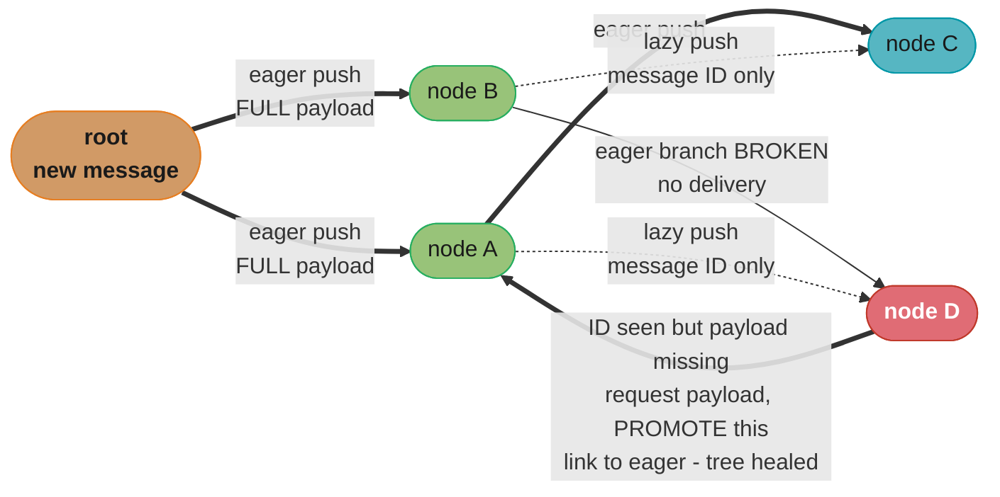
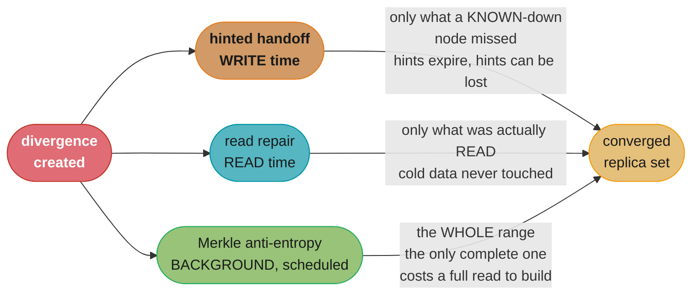
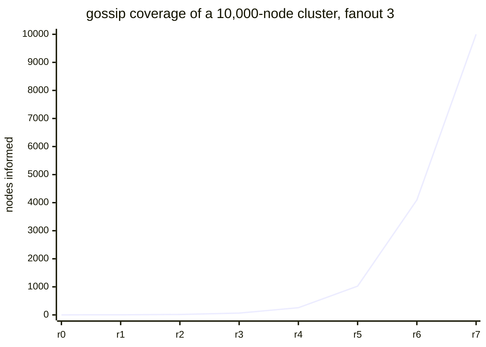

# Chapter 12: Anti-Entropy and Dissemination

> Part II — Distributed Systems · Database Internals (Petrov, 1st ed., O'Reilly 2019) · builds
> on Ch 11 (Replication and Consistency), leads to Ch 13 (Distributed Transactions)

## Chapter Map

Chapter 11 established that a replicated database with anything weaker than synchronous, unanimous
replication *will* diverge: a quorum write that reaches two of three replicas leaves the third
stale, a node that was down during a write never receives it, and a read quorum that happens to
touch the right replicas returns the right answer while telling nobody that the wrong replica is
still wrong. Chapter 12 takes that divergence as permanent unless something actively repairs it,
and asks the two questions that follow: **how does a replica set converge back to a single state,
and how does a piece of information reach every node in a cluster without any node having to know
every other node?**

The chapter's own organizing idea is a spectrum by **how eagerly and how completely** divergence is
repaired. Read repair is the eager, incomplete end — it fixes divergence in the foreground of a
read, but only for the keys somebody actually read. Hinted handoff sits in the middle — it repairs
at write time, but only for the writes a node was known to have missed. Merkle-tree anti-entropy is
the lazy, complete end — it runs in the background over whole key ranges and is the only mechanism
in the chapter that guarantees convergence for data nobody has touched in months. The second half
of the chapter turns from *repairing* state to *spreading* it: gossip dissemination, its overlay
structures, and the hybrid and partial-view refinements that keep gossip's message volume and
per-node memory from growing with the cluster.

**TL;DR:**
- **Read repair** reconciles replicas in the foreground of a read: the coordinator compares the
  responses it already collected and pushes the newest version back to whichever replica was stale.
  It is nearly free (the data was being read anyway) and it repairs *only what is read*.
- **Digest reads** make read repair affordable at full replication factor by asking one replica for
  the value and the rest for a cheap hash, so a read that agrees moves one copy of the data instead
  of RF copies.
- **Hinted handoff** catches the divergence created at write time: a write destined for an
  unreachable replica is stored as a *hint* by another node and replayed when the replica returns.
  Hints expire and hints can themselves be lost, so it is a best-effort optimization, never a
  guarantee.
- **Merkle trees** give background anti-entropy a cheap difference detector: two replicas compare
  a hash tree over the same key range and localize a divergent leaf in O(log n) hash comparisons
  instead of shipping the range. They tell you *that* two ranges differ, never *which side is
  newer*, and rebuilding a tree costs a full read of the range — so it runs on a schedule.
- **Bitmap version vectors** attack the same problem from the write-identifier side: each node
  tracks, per peer, a contiguous base counter plus a bitmap of the out-of-order gaps above it, so
  two nodes can name the exact set of missing writes without comparing any data at all.
- **Gossip dissemination** spreads an update to N nodes in O(log N) rounds with each node
  contacting only *fanout* random peers per round — robust and topology-free, at the cost of heavy
  message redundancy near the end of dissemination.
- **Hybrid gossip** (Plumtree-style) removes most of that redundancy by pushing payloads eagerly
  along a spanning tree and pushing only message *identifiers* lazily everywhere else, using the
  lazy channel purely as a repair path when the tree breaks.
- **Partial views** (HyParView-style) keep each node's membership state constant as the cluster
  grows: a small active view for actual communication and a larger passive view kept warm to heal
  the active one after a failure.

## The Big Question

> Replicas *will* fall out of sync — a node was down, a quorum write reached only some of them, a
> packet was dropped. Given that no read path ever touches most of the data, how does a replica set
> converge on a single state, and how does any new fact reach every node in a cluster nobody has a
> complete picture of?

Analogy: think of a library with three branches that are all supposed to hold identical catalogs.
Read repair is the librarian who, whenever a patron asks for a book, notices that Branch C's card
says a different edition and fixes that one card on the spot — excellent for popular books,
useless for the ninety percent of the collection nobody has asked about this decade. Hinted handoff
is the note left at the front desk saying "Branch C was closed on Tuesday, here are the four
updates it missed" — but the note is thrown away after a month, and if the front desk burns down
the note goes with it. Merkle-tree anti-entropy is the annual full inventory: expensive, scheduled,
but the only procedure that catches the mis-shelved book in the basement. And gossip is how the
branches learn a new fact at all — nobody phones all the branches, each branch phones two others,
and within a handful of rounds everybody knows. **None of the three repair mechanisms is
sufficient alone, which is exactly why real systems ship all three.**

---

## 12.1 Read Repair

**Read repair** reconciles replicas as a side effect of serving a read. When a coordinator issues a
read to the replicas holding a key, it does not merely pick a winner and return it: it compares the
responses, determines which is most recent (by timestamp, version, or the conflict-resolution rule
Chapter 11 established for that system), and **sends the newest version back to any replica that
returned a stale one**. The stale replica applies it as an ordinary write, and that key is now
consistent everywhere the read touched.

The economics are what make it attractive. The read had to contact those replicas anyway, and it
had to compare their responses anyway to serve a consistent answer — the only additional cost is
the repair write itself, and only in the case where divergence actually existed. In a healthy
cluster the overwhelming majority of reads find agreement and cost nothing extra.

**Blocking versus non-blocking.** The chapter distinguishes two placements of the repair relative
to the client's response:

| Form | The client's read returns… | Cost | What it guarantees |
|---|---|---|---|
| **Blocking read repair** | *after* the repair write has been acknowledged | added tail latency on any divergent read | a subsequent read touching *any* of the repaired replicas sees the new value — monotonic reads hold across the replica set |
| **Non-blocking read repair** | immediately, with the repair issued asynchronously | no added client latency | eventual convergence only; a second read that lands on the not-yet-repaired replica can still read the older value |

Blocking read repair is the one that buys a real session guarantee. Non-blocking read repair is
strictly a background convergence aid — it *is* faster, and it is the right default when the read
path is latency-critical, but do not describe it as providing monotonic reads, because it does not.

**Its structural limitation, which the rest of the chapter exists to cover.** Read repair is driven
entirely by the read workload. Consider a table where 5% of the keys serve 95% of the reads — an
utterly ordinary access distribution. Read repair keeps that 5% pristine and never once examines
the other 95%. A replica that was down for an hour and missed writes to cold keys stays wrong on
those keys **forever**, because no read will ever ask about them, and nothing in the read path
notices. That is not a tuning problem; it is what read repair *is*.

A second limitation follows from the read quorum. With RF = 3 and R = 2, the coordinator only ever
sees two of the three replicas on a normal read, so it can only ever repair one of the two possible
stale replicas — the third is invisible to that read. Systems that want read repair to cover the
full replica set have to read from *all* replicas, not just a quorum, which is exactly what makes
digest reads necessary.

---

## 12.2 Digest Reads

If read repair should contact every replica rather than just a quorum, the naive implementation
becomes expensive fast: RF = 3 means three full copies of every value crossing the network for
every read, of which two are discarded. **Digest reads** remove that waste. The coordinator asks
**one** replica for the full value and asks the remaining replicas for a **digest** — a hash of the
value (plus whatever version metadata the reconciliation rule needs) rather than the value itself.

The coordinator then compares digests:

- **All digests match the hash of the full value** — the replicas agree. Return the value. Nothing
  has moved across the network except one payload and a handful of hashes.
- **A digest differs** — divergence exists, but a hash cannot tell you *what* the other replica
  holds. The coordinator issues a follow-up **full read** to the disagreeing replicas, reconciles
  the actual values, returns the winner, and issues the repair writes.

The saving is proportional to value size against digest size, and for anything larger than a
trivial row it is dramatic:

```
  read of a 4 KB row at RF = 3, contacting ALL replicas

  without digests:   4 KB  +  4 KB  +  4 KB          = 12,288 bytes
  with digests:      4 KB  +  16 B  +  16 B          =  4,128 bytes    (~3.0x less)

  a 64 KB blob row:  196,608 bytes  ->  65,568 bytes  (~3.0x less, 131 KB saved per read)

  the ratio is exactly RF when the values are large relative to the digest,
  and it collapses toward 1 when the value is only a few bytes wider than its own hash.
```
Caption: the digest read's entire value is that a hash is O(1) in the size of the row, so the
saving grows with row size and the mechanism is nearly pointless for tiny values.

**The trap in the mismatch path.** A digest mismatch is not free — it costs a *second* round trip
to the disagreeing replicas, so the latency of a divergent read is roughly double that of an
agreeing one. In a cluster where divergence is rare this is an excellent trade (one cheap round for
the 99% case, two rounds for the 1%). In a cluster that is *chronically* divergent — a node
flapping, a badly tuned hinted-handoff window, a repair that never runs — digest reads make the
read path *slower* than plain full reads would have been, because nearly every read pays both
rounds. Chronic digest mismatch rates are a symptom worth alerting on, not just a performance
detail.

---

## 12.3 Hinted Handoff

Read repair fixes divergence when somebody reads. **Hinted handoff** attacks it one step earlier:
at write time, at the moment the divergence is *created*, when the system still knows exactly which
write went missing and which node missed it.

The mechanism: a coordinator handling a write discovers that one of the target replicas is
unreachable (per the failure detector of Chapter 9). Rather than dropping the write for that
replica and quietly leaving it stale, the coordinator — or a substitute node standing in for the
absent one — persists a **hint**: a record containing the write itself plus the identity of the
node it was meant for. When the failure detector reports that node alive again, the holder of the
hint replays the buffered writes to it, and the returning node catches up on precisely what it
missed, in order, without any comparison of state.

**Sloppy quorums.** Hinted handoff is what makes a *sloppy quorum* meaningful. In a strict quorum,
a write must be acknowledged by W of the RF nodes that actually own the key's range; if too many of
those owners are down, the write fails. A sloppy quorum instead accepts the write on W nodes that
are *reachable*, even if some of them are not the key's natural owners, and relies on hinted handoff
to deliver the data to the real owners later. This trades a genuine consistency property for
availability: the write is durable somewhere, but a read issued against the natural owners before
the hint is delivered will not see it, so a sloppy-quorum W + R > RF does **not** give you the
overlap guarantee the arithmetic appears to promise.

**Why hinted handoff can never be the completeness mechanism.** Three independent failure modes,
each of which permanently loses writes:

- **Hints expire.** A hint holder cannot buffer writes for a dead node indefinitely — the buffer
   would grow without bound for a node that is never coming back. So hint retention is bounded by a
   configured window *(beyond the book: Cassandra's `max_hint_window_in_ms` has historically
   defaulted to 3 hours)*. A node down longer than that window returns to the cluster with those
   writes gone from every hint buffer, and nothing in the write path will ever deliver them.
- **Hints are themselves single-replica state.** A hint lives on the node that stored it. If that
   node dies before replaying — and it is a normal cluster member with a normal failure rate — the
   hint dies with it. The mechanism that repairs a lost write is itself unreplicated.
- **Hint replay adds load exactly when the cluster is fragile.** A node returning after a long
   outage triggers a simultaneous flood of replay traffic from every peer holding hints for it, on
   top of the ordinary read and write traffic that is now being routed to it again. Under-provisioned
   clusters have knocked the recovering node straight back down this way, generating a fresh
   round of hints and a repeat of the same cycle.

The correct reading of hinted handoff is therefore: *an optimization that dramatically reduces how
much work full anti-entropy has to do, and dramatically shortens the window of inconsistency for
the common case of a brief outage.* It is not, and cannot be, the thing you rely on for
convergence.

---

## 12.4 Merkle Trees

Read repair covers what is read; hinted handoff covers what was known to be missed. Neither covers
the key that was silently corrupted, the write that was lost in a way nobody recorded, the cold
range that has drifted for six months, or the node that came back after the hint window closed.
**Background anti-entropy** covers those: two replicas periodically compare an entire key range and
reconcile every difference, regardless of whether anyone has read it or anyone noticed it going
missing. The naive way to do that is to ship the entire range from one replica to the other and
diff it — correct, complete, and completely unaffordable for a range holding tens of millions of
keys and tens of gigabytes.

A **Merkle tree** (hash tree) makes it affordable. Build a binary tree over the key range where
each **leaf** holds the hash of one key's value (or of a small contiguous bucket of keys), and each
**internal node** holds the hash of the concatenation of its children's hashes. The root is a
single hash summarizing the entire range. Two replicas now compare their trees top-down:

- **Roots equal** → the entire range is identical. **One hash exchanged, zero data transferred.**
  This is the case in a healthy cluster, and it is why the mechanism is affordable at all.
- **Roots differ** → descend. At each level, compare the two children; a child whose hashes match
  covers a subtree that is provably identical and is **pruned** — never visited, never transferred.
  Only the subtrees that differ are followed down, until the divergent leaves are located and only
  those leaves' key ranges are shipped and reconciled.

```
  two replicas of the same token range, 8 keys each -- one key differs

  replica A                                 replica B
        root H(ab)                                root H(ab')      <- DIFFER, descend
       /          \                              /          \
   H(a)            H(b)                      H(a)            H(b')
   /    \         /    \                     /    \         /    \
 H1      H2     H3      H4                 H1      H2     H3      H4'
 / \    / \     / \     / \                / \    / \     / \     / \
k0 k1  k2 k3  k4 k5   k6 k7              k0 k1  k2 k3  k4 k5   k6 k7*

  the walk:  root differs
             -> H(a) == H(a)    PRUNE  (k0..k3 provably identical, never touched)
             -> H(b) != H(b')   descend
                -> H3 == H3     PRUNE  (k4,k5 identical)
                -> H4 != H4'    descend -> ship only the (k6,k7) bucket

  hashes exchanged: 7          keys shipped: 2 of 8
  over 1,000,000 keys with ONE divergent key: ~20 hash comparisons (log2 of 1M),
  not 1,000,000 key comparisons and not one byte of the other 999,998 keys.
```
Caption: the pruning is the whole mechanism — a matching hash at any level certifies an entire
subtree as identical, so the cost of finding one difference is the tree's depth, not its width.

**Trap 1 — a Merkle tree detects difference, never direction.** The comparison ends with "these
leaves differ," and a hash carries no ordering information whatsoever. It cannot tell you which
replica holds the newer value, which one has a value the other lacks entirely, or whether the two
values are concurrent updates that need conflict resolution. The reconciliation that follows must
fall back on the *same* machinery Chapter 11 established — last-write-wins timestamps, version
vectors, or an application-level merge — applied to the actual values once they have been fetched.
The tree is a *locator*, not a resolver. An engineer who assumes "the tree found the difference, so
the repair is obvious" has skipped the entire hard part.

**Trap 2 — building the tree costs a full read of the range.** Every leaf hash requires reading the
underlying value. Computing a Merkle tree over a 50 GB range means reading 50 GB off disk and
hashing it, which competes directly with live query traffic for I/O and page cache. And the tree
becomes stale the instant the next write lands, so it cannot simply be cached and reused. This is
why anti-entropy repair is **scheduled** rather than continuous — nightly, weekly, or driven by a
repair coordinator — and why the interval interacts with the hinted-handoff window: whatever hints
lose, repair must catch before the data's other guarantees (like tombstone expiry) run out.

**Trap 3 — leaf granularity is a real tuning knob.** A tree with one leaf per key over 1,000,000
keys has depth 20 and pinpoints a single divergent key exactly — but it also holds 1,000,000 leaf
hashes, which is a substantial amount of memory and hashing work per range. Real implementations
build a **fixed-depth** tree, so each leaf covers a bucket of keys:

```
  1,000,000 keys in a range, ONE key actually differs

  tree depth 20  (2^20 leaves, 1 key per leaf)
      leaf hashes held: 1,048,576      keys transferred on repair: 1
      -> pinpoint accuracy, expensive tree

  tree depth 15  (32,768 leaves, ~30 keys per leaf)
      leaf hashes held: 32,768         keys transferred on repair: ~30
      -> 32x less tree, 30x over-transfer on a single-key difference

  tree depth 10  (1,024 leaves, ~977 keys per leaf)
      leaf hashes held: 1,024          keys transferred on repair: ~977
      -> tiny tree, but one bad key drags a thousand of its neighbours across the network
```
Caption: shallower trees are cheaper to build and hold but over-transfer on repair — the right
depth depends on how much divergence you actually expect, and a cluster that diverges rarely can
afford a coarse tree while a chronically divergent one cannot.

**Trap 4 — both trees must be built over identical range boundaries.** The comparison is only
meaningful if leaf *i* on replica A covers exactly the same key interval as leaf *i* on replica B.
If the two replicas partition the range differently — because one has a different token assignment,
or the range was split on one side after a topology change — every hash from the first mismatch
onward differs, the pruning never fires, and the "optimized" comparison degenerates into shipping
the whole range while also having paid for building two useless trees. This is a genuine
production failure mode after a topology change, and it is why repair is normally coordinated
per-token-range rather than per-node.

---

## 12.5 Bitmap Version Vectors

A Merkle tree compares **state**: it hashes the data as it currently exists and finds where the
data disagrees. **Bitmap version vectors** compare **knowledge of writes**: rather than asking
"do our values differ," they ask "which of your writes have I not seen yet," and answer it without
reading or hashing a single value.

The construction. Every node tags each write it originates with a monotonically increasing
per-node counter — the write's *dot*, in the form `(node_id, counter)`. Every node then maintains,
for each peer in the replica set, a record of which of that peer's dots it has received. The naive
representation of that record is a set of integers, which grows without bound. The bitmap version
vector compresses it by exploiting the fact that received dots are *almost* contiguous:

- a **base** counter — the highest value *n* such that every dot from 1 to *n* has been received
  (the contiguous prefix), stored as one integer;
- a **bitmap** covering the sparse region above the base, one bit per counter value, where a set bit
  means that dot has been received out of order.

```
  node B's record of node A's writes

  A has originated dots 1 .. 1006.
  B has received:  1..1000 (all of them), then 1001, 1003, 1004, 1006.
  B is MISSING:    1002 and 1005.

  naive set:   {1,2,3, ... ,1000,1001,1003,1004,1006}          1004 integers
  BVV:         base = 1001                                     1 integer
               bitmap (for 1002,1003,1004,1005,1006) = 01101   5 bits

  the whole of B's knowledge of A, in 8 bytes and change.

  base advances by ABSORPTION: when 1002 finally arrives, the bitmap's leading run
  of set bits merges into the base -> base = 1004, bitmap = 001 (for 1005,1006).
```
Caption: the base absorbs the contiguous prefix and the bitmap only ever has to cover the ragged
edge caused by out-of-order or lost delivery, so the representation stays tiny even after billions
of writes.

**The comparison.** Two nodes exchange these vectors and each immediately computes the exact set of
dots the other is missing — `1002` and `1005` above — and ships precisely those writes. No hashing,
no tree construction, no reading of the values that both sides already agree on, and crucially **no
ambiguity about direction**: a dot the peer lacks is unambiguously a write it must apply, which is
exactly the thing a Merkle comparison could not tell you.

**What it costs in exchange.** The mechanism only works if the system tracks per-write dots *at
write time* and never garbage-collects the mapping from a dot to its write before every replica has
it. That is real bookkeeping the Merkle approach does not require — a Merkle tree can be computed
retroactively over data that carries no per-write identity at all, which is why it remains the
general-purpose fallback. Bitmap version vectors also do not detect divergence that did not arise
from a *missing write*: silent disk corruption changes the value while leaving the dot record
untouched, so both nodes believe they have seen every write and the comparison reports agreement.
A Merkle tree catches exactly that case, because it hashes what is actually on disk.

| | Merkle tree | Bitmap version vector |
|---|---|---|
| Compares | data as it exists on disk | the set of writes each node has seen |
| Cost to prepare | full read + hash of the range | per-write dot bookkeeping, always on |
| Detects direction? | **No** — difference only | **Yes** — names the missing dots |
| Detects bit rot / silent corruption? | **Yes** | **No** — the dot record still matches |
| Extra transfer on a difference | the whole leaf bucket | exactly the missing writes |
| Works on data with no write metadata? | Yes | No |

Note the last two rows together: these are **complementary detectors of different failure classes**,
which is why a system may reasonably run both.

---

## 12.6 Gossip Dissemination

The first half of the chapter repairs state between replicas that already know about each other.
The second half asks a different question: **how does a fact reach every node in a cluster when no
node is willing to maintain a connection to, or even a list of, all the others?** Gossip
dissemination is the answer, and the book frames it explicitly in the language of epidemics — a
node with new information is *infective*, one without it is *susceptible*, and one that has stopped
spreading it is *removed*.

### Gossip Mechanics

Each node runs a periodic **gossip round**. In each round it selects **fanout** peers — typically
uniformly at random from its view of the cluster — and exchanges state with them. The core
parameters and their consequences:

**Fanout (b).** The number of peers contacted per round. It controls the base of the logarithm in
the dissemination time and the total message volume simultaneously:

```
  rounds to reach N nodes, roughly log_(b+1)(N)

  N = 10,000 nodes
    fanout 1  ->  ~log2(10,000)  = ~14 rounds
    fanout 3  ->  ~log4(10,000)  = ~7  rounds
    fanout 10 ->  ~log11(10,000) = ~4  rounds

  at a 1-second gossip interval, fanout 3 covers a 10,000-node cluster in ~7 seconds.

  but messages sent per round = N * b, so tripling fanout from 3 to 10 buys you
  3 fewer rounds and costs 3.3x the message volume in EVERY round.
```
Caption: dissemination time falls logarithmically in fanout while message cost rises linearly — the
returns on a larger fanout collapse quickly, which is why production fanouts are small single
digits.

The headline property is that **full dissemination takes O(log N) rounds**. The count of informed
nodes roughly multiplies by (1 + b) each round while informed nodes are scarce, so coverage is
exponential in rounds and therefore logarithmic in cluster size. A cluster ten times larger needs
only a handful more rounds.

**Push, pull, and push-pull.** The chapter distinguishes three interaction styles, and which is
better depends on *where in the dissemination curve you are*:

| Style | The initiator… | Efficient when | Weakness |
|---|---|---|---|
| **Push** | sends its update to the selected peers | **early** — few nodes are infected, so almost every push finds an uninformed peer and lands usefully | **late** — nearly every peer already has the update, so almost every push is wasted |
| **Pull** | asks the selected peers what they have | **late** — most peers are infected, so an uninformed node almost certainly learns something by asking | **early** — almost nobody has the update, so asking usually returns nothing |
| **Push-pull** | does both in one exchange, sending what it has and taking what it lacks | **throughout** — it is push in the early phase and pull in the late phase automatically | roughly double the payload per interaction |

Push-pull is the pragmatic default precisely because the phase changes during a single
dissemination and a protocol cannot easily know which phase it is in.

**The redundancy problem, which the rest of the section exists to fix.** Gossip's robustness comes
from redundancy — it does not care which peers you picked, or that some of them were down, because
enough other paths exist. But redundancy is also its cost, and the cost is concentrated at the
*end* of dissemination. In the final rounds, almost every node already has the update, so almost
every message sent is a duplicate that teaches nobody anything. Implementations blunt this with a
**removal rule**: a node stops gossiping a message after it has received that same message some
small number of times (it concludes the message is already well-known and transitions from
infective to removed) or after a fixed number of rounds. That caps the waste at the price of a
small probability that some unlucky node never receives the update at all — a probability gossip
protocols accept and quantify rather than eliminate.

### Overlay Networks

Purely random peer selection is what gives gossip its robustness, but it also guarantees redundant
delivery, because nothing coordinates who contacts whom. **Overlay networks** impose structure on
peer selection to cut that redundancy.

- A **fixed (or static) overlay** wires a durable topology — each node has a designated set of
  neighbours it always gossips with. It reduces waste and makes the message pattern predictable,
  but it must be maintained as nodes join and leave, and a badly chosen topology can partition.
- A **temporary overlay** is constructed for a single dissemination and discarded, letting the
  structure adapt to current conditions without the maintenance burden of a permanent one.
- The extreme structured case is a **spanning tree** over the cluster: every node has exactly one
  parent, and a message flows from the root down. This is *optimal* in message count — exactly
  N − 1 messages deliver an update to all N nodes, with zero duplicates.

And it is exactly the wrong structure for an unreliable network, which is the point:

```
  N = 8 nodes, one update to disseminate

  pure random gossip, fanout 3, ~4 rounds
      messages: ~8 * 3 * 4 = ~96          duplicates: MANY
      one node crashes mid-round: irrelevant, other paths deliver anyway

  spanning tree
      messages: exactly 7                 duplicates: ZERO
      one INTERNAL node crashes: its whole subtree receives NOTHING, silently,
      and the tree has no mechanism to notice or route around it
```
Caption: the tree is message-optimal and failure-fragile; random gossip is failure-robust and
message-wasteful. Hybrid gossip is the attempt to have both.

### Hybrid Gossip

**Hybrid gossip** combines the two by sending different *kinds* of message over the two structures.
The canonical design the chapter presents is **Plumtree** (Push-Lazy-Push Multicast Tree):

- **Eager push** — the full message *payload* is pushed along a spanning-tree overlay. In the
  steady state this is how essentially all data actually travels, at the tree's near-optimal
  message count.
- **Lazy push** — over the *remaining* links (the ones not in the tree), a node pushes only the
  message **identifier**, not the payload. These are tiny and cheap, and in the steady state they
  are pure overhead — every recipient already has the message.

The lazy channel earns its keep when the tree breaks. If a node receives a lazy-push *identifier*
for a message it has never received via the eager path, it knows the tree failed to deliver — a
branch is broken. It then requests the full payload over that lazy link and **promotes that link
into the eager (tree) set**, repairing the spanning tree in place, while demoting the branch that
failed to deliver. The tree heals itself using the information the lazy overlay was already
carrying.


Caption: payloads ride the tree, identifiers ride everything else — and the identifiers are exactly
the signal that tells a node its tree branch is broken, so the cheap channel is both the redundancy
detector and the repair path.

The result is message volume close to the spanning tree's optimum (payloads travel N − 1 times,
plus tiny identifiers elsewhere) with failure robustness close to random gossip's, since any lazy
link is a candidate repair path.

### Partial Views

Every mechanism so far has quietly assumed a node can pick a *uniformly random peer*, which
requires knowing the full membership list. That assumption breaks at scale: a full membership table
means every node stores O(N) state and every membership change must reach every node — the cost of
merely *knowing the cluster* grows with the cluster.

**Partial views** eliminate that. Each node maintains a **small, fixed-size subset** of the cluster
rather than the whole of it, and the union of everyone's partial views forms a connected random
graph over which gossip works essentially as well as it did with full knowledge. The canonical
design here is **HyParView**, which keeps **two** views with different sizes, maintenance costs,
and purposes:

| View | Size | Maintained how | Used for |
|---|---|---|---|
| **Active view** | small — on the order of fanout + 1 (single digits) | symmetric and reliably maintained (a TCP connection whose failure is an immediate failure signal) | actual gossip communication |
| **Passive view** | larger — on the order of tens | refreshed lazily by periodic shuffling with peers, no live connections held | a warm reserve of candidates to promote when an active peer fails |

When a node in the active view fails, the connection break is detected immediately (the active view
is maintained with connections precisely so failure is cheap to notice), and the node promotes a
candidate from its passive view to take the slot, re-establishing the required degree. The passive
view is kept fresh by periodic **shuffle** exchanges with peers, so its entries are unlikely to be
long-dead nodes.

```
  per-node membership state as the cluster grows

  full membership (Ch 9's gossip-based detection style):
      N =    100  ->    100 entries per node
      N =  1,000  ->  1,000 entries per node
      N = 10,000  -> 10,000 entries per node        state grows with N, forever

  partial views (HyParView style, active 5 / passive 30):
      N =    100  ->  35 entries per node
      N =  1,000  ->  35 entries per node
      N = 10,000  ->  35 entries per node           state is CONSTANT in N

  and dissemination still completes in O(log N) rounds, because the union of the
  partial views is a connected random graph with the same expansion properties.
```
Caption: the partial view is what makes gossip a genuinely scalable membership substrate rather
than one whose per-node cost grows with the very cluster size it is supposed to handle.

---

## Beyond the book — where this lands in modern practice

> The chapter presents read repair, hinted handoff, Merkle-tree anti-entropy, and gossip as
> mechanisms, and names Cassandra, Riak, Amazon Dynamo, Akka, Consul, and Apache Cassandra's
> gossip layer as systems using them. It does not discuss the *operational* consequence that the
> systems shipping these mechanisms have since had to confront, which is worth knowing when
> reading the chapter alongside a running cluster.

The chapter's implicit model is that scheduled Merkle-tree repair is a solved operational problem —
run it periodically and convergence follows. In practice, full-range repair became the single most
painful routine operation in Dynamo-style clusters, because it hits the two costs the chapter
names (a full read of the range to build the tree, plus over-transfer at coarse leaf granularity)
against production I/O budgets, and because a range that fails to repair inside the deletion-marker
retention window resurrects deleted data. This produced a whole class of *incremental* and
*subrange* repair strategies — repairing narrow token subranges so each tree is small enough to
build cheaply, and tracking which SSTables have already been repaired so the same data is not
re-hashed every cycle — none of which the chapter covers, but all of which are direct engineering
responses to Trap 2 and Trap 3 in §12.4 exactly as it states them.

---

## Visual Intuition


Caption: the three repair mechanisms cover three disjoint slices of the divergence problem — remove
any one and a specific class of lost write becomes permanent, which is why production systems ship
all three rather than choosing.


Caption: coverage multiplies by roughly (1 + fanout) per round while informed nodes are scarce, so
the whole cluster is reached in ~7 rounds — and note that the last round alone informs ~6,000 nodes
while every message sent to the other 4,000 is pure duplicate, which is the redundancy hybrid
gossip removes.

```
  the four repair/dissemination mechanisms on one axis: how eager, how complete

  EAGER, INCOMPLETE  <------------------------------------------>  LAZY, COMPLETE

  read repair            hinted handoff          Merkle anti-entropy
  |                      |                       |
  at read time           at write time           on a schedule
  repairs only the       repairs only writes     repairs EVERYTHING in the range
  keys someone read      a KNOWN-down node       whether read or not, whether
                         missed, within the      anyone noticed the loss or not
                         hint window
  cost: ~free            cost: hint storage      cost: FULL READ of the range
                         + replay burst          + hashing + repair transfer

  coverage of a key nobody has read in 6 months, on a node down for 2 days:
      read repair:     never
      hinted handoff:  never (hint window expired)
      anti-entropy:    YES -- this is the only one that catches it
```
Caption: the same key, three mechanisms, one that works — this single case is the argument for why
background anti-entropy is not optional however good the other two are.

---

## Key Concepts Glossary

- **Anti-entropy** — the family of background processes that detect and repair divergence between
  replicas independently of the read and write paths.
- **Read repair** — reconciling replicas during a read by pushing the newest version back to any
  replica that responded with a stale one.
- **Blocking read repair** — read repair whose repair write completes before the client's read
  returns, so the repaired value is visible to subsequent reads on those replicas.
- **Non-blocking read repair** — read repair issued asynchronously after the client's read returns;
  faster, but provides eventual convergence only, not monotonic reads.
- **Digest read** — a read in which the coordinator requests the full value from one replica and a
  hash (digest) from the others, fetching full values only if a digest disagrees.
- **Hint** — a stored record of a write plus the identity of the replica it was destined for, held
  by another node while that replica is unreachable.
- **Hinted handoff** — the mechanism of storing hints for an unreachable replica and replaying them
  once it returns.
- **Hint window** — the bounded retention period for hints, after which they are discarded and the
  writes they held become permanently missing from the write path's perspective.
- **Sloppy quorum** — accepting a write on W *reachable* nodes rather than W of the key's actual
  owning replicas, relying on hinted handoff to deliver it to the real owners later.
- **Merkle tree (hash tree)** — a tree whose leaves hash individual keys or key buckets and whose
  internal nodes hash their children, used to localize divergence between two copies of a range in
  O(log n) comparisons.
- **Pruning (Merkle comparison)** — skipping an entire subtree because its root hash matched,
  proving the subtree identical without examining it.
- **Leaf granularity / tree depth** — how many keys one Merkle leaf covers; shallower trees are
  cheaper to build but over-transfer on repair.
- **Dot** — a `(node_id, counter)` identifier assigned to an individual write by its originating
  node.
- **Bitmap version vector** — a compact per-peer record of which of that peer's dots have been
  received, stored as a contiguous base counter plus a bitmap of the out-of-order gaps above it.
- **Base (BVV)** — the highest counter value below which *every* dot has been received.
- **Gossip / epidemic protocol** — dissemination in which each node periodically exchanges state
  with a small number of peers, reaching the whole cluster in O(log N) rounds.
- **Fanout** — the number of peers a node contacts per gossip round.
- **Infective / susceptible / removed** — the epidemic-model states of a node: currently spreading
  a message, not yet holding it, and holding it but no longer spreading it.
- **Push gossip** — the initiator sends what it has; efficient early in dissemination.
- **Pull gossip** — the initiator asks what peers have; efficient late in dissemination.
- **Push-pull gossip** — both directions in one exchange, efficient across the whole curve.
- **Overlay network** — an imposed structure on which peers gossip with which, replacing purely
  random selection to reduce redundant messages.
- **Spanning tree overlay** — an overlay in which every node has one parent, delivering a message
  in exactly N − 1 messages with zero duplicates but no tolerance for an internal node's failure.
- **Hybrid gossip** — combining an eager, payload-carrying tree overlay with a lazy,
  identifier-only channel over the remaining links (Plumtree).
- **Eager push** — pushing the full message payload along the tree links.
- **Lazy push** — pushing only the message identifier along the non-tree links, used to detect and
  repair a broken tree branch.
- **Partial view** — a small, fixed-size subset of cluster membership held by each node, keeping
  per-node state constant as the cluster grows.
- **Active view** — the small set of peers a node actually communicates with, maintained with live
  connections so failures are detected immediately (HyParView).
- **Passive view** — the larger, lazily-refreshed reserve set from which a node promotes a
  replacement when an active-view peer fails (HyParView).
- **Shuffle** — the periodic exchange that refreshes a node's passive view with peers so its
  entries do not go stale.

---

## Tradeoffs & Decision Tables

| Mechanism | When it runs | What it repairs | Completeness | Marginal cost |
|---|---|---|---|---|
| Read repair | during a read | only keys that were read | **none** for cold data | near zero; the read happened anyway |
| Digest read | during a read | (enables full-RF read repair) | as read repair | one extra round trip on mismatch |
| Hinted handoff | at write time and on node return | only writes to a *known-down* node, inside the hint window | **none** past the window or if the hint holder dies | hint storage + a replay burst |
| Merkle anti-entropy | scheduled background | the entire key range | **complete** | full read of the range, hashing, over-transfer at coarse leaves |
| Bitmap version vectors | on demand between peers | exactly the writes a peer is missing | complete for *missing writes*; blind to corruption | per-write dot bookkeeping, always on |

| Gossip parameter | Increase it and… | Decrease it and… |
|---|---|---|
| Fanout | dissemination completes in fewer rounds (logarithmically), message volume rises linearly | fewer messages per round, more rounds, higher chance of a straggler node |
| Round interval | less network load, proportionally slower dissemination | faster propagation, proportionally more traffic at idle |
| Removal threshold (redundant receipts before a node stops gossiping) | higher delivery probability, more wasted duplicate messages | much less tail waste, a small but nonzero chance a node misses the message |
| Active view size (partial views) | more robust to simultaneous failures, more connections held per node | fewer connections, higher chance of a node being isolated by concurrent failures |

| Dissemination structure | Messages for N nodes | Duplicates | Survives an internal node failure? |
|---|---|---|---|
| Random gossip, fanout b | ~N·b per round × O(log N) rounds | many | **yes**, trivially — other paths exist |
| Spanning tree | exactly N − 1 | zero | **no** — the whole subtree is silently starved |
| Hybrid (Plumtree) | ~N − 1 payloads + cheap IDs elsewhere | few payload duplicates | **yes** — a lazy ID reveals the break and repairs the tree |

---

## Common Pitfalls / War Stories

- **Relying on read repair for convergence, then discovering a six-month-old divergence.** A
  cluster with a healthy read-repair rate and no scheduled anti-entropy looks perfectly consistent
  on every dashboard, because the dashboards are built from the read path and the read path only
  ever touches the hot 5% of keys. The divergence in the cold 95% is invisible until an analytics
  scan, a bulk export, or a restore-and-compare surfaces it — by which point the correct version may
  have been compacted away on the only replica that had it.
- **A node down slightly longer than the hint window, brought back with no repair.** The operator
  sees the node rejoin, sees hints replay, sees the replay queue drain, and concludes the node is
  caught up. It is caught up on everything inside the window and permanently missing everything
  before it. The reported symptom is usually not "missing data" but *resurrected deleted data*:
  the returning node never received the deletion markers, and once its stale live values are read
  and repaired outward, the deletes are effectively undone.
- **Hint replay knocking over the node it is repairing.** Every peer that buffered hints replays
  them the moment the failure detector says the node is back, all at once, on top of the read and
  write traffic that has just been re-routed to it. An under-provisioned node goes down again under
  the combined load, generating a fresh set of hints, and the cluster enters a replay-crash loop
  that looks like a hardware fault and is actually a thundering herd.
- **Merkle repair after a topology change, with mismatched range boundaries.** Ranges were split
  or moved, the two replicas build trees over subtly different intervals, no hash matches below the
  root, pruning never fires, and the "efficient" comparison transfers the entire range — after
  paying the full cost of building two trees whose only output was that everything differs. On a
  large range this saturates the network and the disks simultaneously.
- **A too-coarse Merkle tree turning a one-key difference into a gigabyte of transfer.** Depth
  chosen to keep the tree small, so each leaf covers thousands of keys. One divergent key drags its
  entire leaf bucket across the network. Multiply by every divergent key in a chronically-drifting
  cluster and the "cheap" comparison mechanism becomes the dominant source of repair traffic.
- **Assuming a Merkle comparison told you which replica is right.** It told you they differ. The
  reconciliation is a separate problem requiring the conflict-resolution rule from Chapter 11, and
  a repair implementation that guesses (say, always trusting the coordinator's replica) will happily
  overwrite newer data with older data across the whole divergent range.
- **Cranking gossip fanout up "to make convergence faster."** Dissemination time falls
  logarithmically in fanout, message volume rises linearly. Going from fanout 3 to fanout 10 on a
  10,000-node cluster saves roughly three rounds and costs over three times the traffic in every
  round forever, including the steady state where there is nothing to disseminate.
- **Running gossip against a full membership table at scale.** Per-node state grows with the
  cluster and every join/leave must reach everyone, so the cost of merely *tracking* membership
  grows superlinearly across the cluster — the exact problem partial views exist to eliminate.
- **Adopting a spanning-tree overlay for its message count and losing a subtree silently.** The
  tree is genuinely optimal at N − 1 messages, and an internal node's failure starves everything
  below it with no error anywhere: the tree has no mechanism to notice. Without hybrid gossip's
  lazy-push channel there is nothing to detect the break, and the subtree simply stops receiving
  updates.
- **Chronic digest mismatches making reads slower than they were before digests.** Digest reads
  are a win only when digests usually agree. A cluster with a broken repair schedule pays the
  digest round *and* the full-read round on nearly every read, so the optimization inverts into a
  latency regression that looks like a network problem.

---

## Real-World Systems Referenced

**Read repair, hinted handoff, and Merkle-tree anti-entropy together:** Amazon Dynamo (the paper
that popularized all three as a single coherent package), Apache Cassandra, Riak. **Merkle trees:**
Dynamo and Cassandra for replica synchronization; the structure itself originates with Ralph
Merkle's work on hash trees and is the same construction underlying content-addressed and
distributed-ledger systems. **Digest reads:** Cassandra's read path. **Bitmap version vectors:**
the node-wide dotted version vector line of work from the Riak/Basho research group (Gonçalves,
Almeida, Baquero, Fonte). **Gossip dissemination:** Cassandra's gossip layer for membership and
failure detection (Chapter 9), Amazon Dynamo, Akka Cluster, Consul (via SWIM-style gossip),
Riak. **Hybrid gossip / Plumtree:** Leitão, Pereira, and Rodrigues' epidemic broadcast trees.
**Partial views / HyParView:** the same group's hybrid partial-view membership protocol.
**Epidemic-model foundations:** the Xerox PARC Clearinghouse work of Demers et al., which is where
the push/pull/push-pull vocabulary and the anti-entropy terminology come from in the first place.

---

## Summary

Divergence between replicas is not an anomaly to be prevented but a permanent condition to be
continuously repaired, and this chapter's contribution is that the repair mechanisms form a
**spectrum by eagerness and completeness rather than a menu of alternatives**. **Read repair**
reconciles in the foreground of a read — nearly free, immediate, and structurally incapable of
touching data nobody reads. **Digest reads** make it affordable to contact every replica on a read
rather than just a quorum, by moving one payload and RF − 1 hashes instead of RF payloads.
**Hinted handoff** repairs at write time by buffering writes for an unreachable replica and
replaying them on its return — which shortens the inconsistency window enormously for brief
outages, but expires, can itself be lost with the node holding it, and therefore guarantees
nothing. **Merkle trees** make complete background anti-entropy affordable: comparing hash trees
over the same key range localizes divergence in O(log n) comparisons instead of transferring the
range, with the standing caveats that a hash comparison finds difference and never direction, that
building the tree costs a full read of the range so repair must be scheduled, and that coarse leaf
granularity over-transfers. **Bitmap version vectors** solve the complementary problem — naming the
exact writes a peer is missing, from a base counter plus a bitmap of gaps, with no data comparison
at all and no ambiguity about direction, at the cost of per-write dot bookkeeping and blindness to
silent corruption.

The dissemination half of the chapter answers the other question. **Gossip** spreads information to
N nodes in O(log N) rounds with each node contacting only *fanout* peers, is indifferent to which
peers happen to be down, and pays for that robustness in redundant messages concentrated at the
tail of dissemination. **Push** is efficient early, **pull** late, and **push-pull** across the
whole curve. **Overlay networks** cut redundancy by structuring peer selection, with the spanning
tree as the message-optimal and failure-fragile extreme. **Hybrid gossip** recovers most of the
tree's efficiency without its fragility by pushing payloads eagerly along the tree and message
identifiers lazily everywhere else — the lazy identifiers being precisely the signal that a tree
branch has broken and the path along which it is repaired. And **partial views** keep the whole
scheme scalable by holding a small active view and a larger passive reserve per node, so per-node
membership state stays constant no matter how large the cluster becomes. Chapter 13 moves from
converging replicas eventually to making multi-node operations appear atomic *now*.

---

## Interview Questions

**Q: Why are read repair, hinted handoff, and background anti-entropy complementary rather than alternatives?**
**Short:** Each covers a slice of divergence the others structurally cannot, so removing any one makes a class of lost write permanent.
Read repair is driven by the read workload and therefore never touches a key nobody reads, which in a typical access distribution is the overwhelming majority of the data. Hinted handoff only covers writes the system *knew* a specific node missed, and only within a bounded retention window, and the hint can be lost with the node holding it. Merkle-tree anti-entropy is the only one that examines an entire range regardless of access pattern or whether anyone noticed the loss — but it is expensive and scheduled, so it cannot be the fast path. The canonical failing case is a cold key on a node that was down longer than the hint window: read repair never looks at it, the hint is gone, and only background repair recovers it. Ship all three and treat any argument for dropping one as an argument for accepting a specific permanent data loss.

**Q: What does a Merkle tree comparison actually tell you, and what does it deliberately not tell you?**
**Short:** It localizes WHICH ranges differ in O(log n) hash comparisons, but a hash carries no ordering, so it never says which side is newer.
Comparing roots and descending only into subtrees whose hashes disagree pinpoints the divergent leaves without transferring or even reading the matching data — that is the entire efficiency argument. But the output is strictly "these leaves differ." A hash cannot express whether replica A's value supersedes B's, whether one replica has a value the other lacks entirely, or whether the two are concurrent writes. The reconciliation that follows must fetch the actual values and apply the system's conflict-resolution rule — last-write-wins timestamps, version vectors, or an application merge. Treat the tree as a locator and budget the resolution as a separate problem, because a repair implementation that guesses direction will overwrite newer data with older across the whole divergent range.

**Q: Why is Merkle-tree anti-entropy run on a schedule rather than continuously?**
**Short:** Every leaf hash requires reading the underlying value, so building a tree costs a full read of the range and it goes stale on the next write.
Constructing the tree over a 50 GB range means reading and hashing 50 GB, competing directly with live traffic for disk I/O and page cache. Worse, the tree is invalidated by the very next write to the range, so it cannot be built once and cached — the expense recurs every cycle. That forces repair into a scheduled maintenance operation whose interval must be chosen against a real constraint: it has to complete before the data's other guarantees expire, notably the deletion-marker retention window, or repair will resurrect deleted rows. If repair cost is dominating your I/O, narrow the token subranges so each individual tree is small, rather than lengthening the interval past the safe bound.

**Q: What is a digest read and what exactly does it save?**
**Short:** The coordinator asks one replica for the value and the rest for a hash, so an agreeing read moves one payload instead of RF payloads.
Full read repair wants to contact every replica, not just a read quorum, so it can repair all of them — but that means RF full copies crossing the network per read, of which RF − 1 are discarded. Requesting digests instead means a 4 KB row at RF = 3 moves about 4.1 KB rather than 12 KB, roughly a 3x reduction, and the ratio approaches RF as rows get larger. If a digest disagrees, the coordinator must issue a follow-up full read to the disagreeing replicas, so a divergent read costs two round trips. That makes digest reads an excellent trade when divergence is rare and an active latency regression when it is chronic — alert on a rising digest mismatch rate rather than treating it as a performance curiosity.

**Q: Why can hinted handoff never be relied on as the completeness mechanism for convergence?**
**Short:** Hints expire on a bounded window, the hint itself lives on a single unreplicated node, and replay can overload the node it is repairing.
Hints cannot be buffered forever for a node that may never return, so retention is capped by a configured window, and a node down longer than that rejoins with those writes gone from every buffer. Second, a hint is ordinary state on the node that stored it, unreplicated — if the hint holder crashes before replaying, the hint dies with it. Third, when the node returns, every peer holding hints replays simultaneously on top of newly re-routed live traffic, which has repeatedly knocked recovering nodes back down into a replay-crash loop. The reported symptom of the first failure is usually not missing data but resurrected deletes, because the returning node never received the deletion markers. Read hinted handoff as an optimization that shrinks the inconsistency window and the work anti-entropy must do, never as a guarantee.

**Q: What is the difference between blocking and non-blocking read repair, and which one actually gives you a session guarantee?**
**Short:** Blocking read repair returns only after the repair write is acknowledged, so it provides monotonic reads; the non-blocking form provides only eventual convergence.
In the blocking form, the client's read does not complete until the stale replica has applied the newer value, so any subsequent read landing on that replica sees at least what the first read saw — monotonic reads hold across the replica set. In the non-blocking form the read returns immediately and the repair is issued asynchronously, which keeps the read path fast but means a second read can still land on the not-yet-repaired replica and observe the older value, appearing to move backwards in time. Choose non-blocking when read latency dominates and you have real background anti-entropy behind it, but never describe it in a design review as providing monotonic reads, because it does not.

**Q: Why does read repair leave cold data permanently divergent?**
**Short:** Read repair is driven entirely by the read workload, so a key nobody reads is never compared and never repaired.
The mechanism only inspects replicas that a read actually contacted, for a key a client actually asked for. In a typical distribution where a small fraction of keys serves most of the reads, the remaining majority is never examined, so a replica that missed writes to cold keys stays wrong on them indefinitely. This is invisible on monitoring built from the read path, because the read path is precisely the part that is healthy. A second, narrower version of the same limitation applies even to hot keys: with RF = 3 and R = 2 the coordinator only ever sees two replicas, so it cannot repair the third — which is why systems that want full coverage read from all replicas using digests.

**Q: What do bitmap version vectors track that a Merkle tree does not, and what can they not detect?**
**Short:** They compare the set of writes each node has seen rather than the data itself, so they name the exact missing writes but are blind to silent corruption.
Each write gets a dot — a per-originator monotonic counter — and each node keeps, per peer, a base counter covering the contiguous prefix it has fully received plus a bitmap of the out-of-order dots above it. Exchanging those vectors immediately yields the precise set of missing dots with no hashing, no tree building, and no ambiguity about direction, which is the exact thing a Merkle comparison cannot give you. The cost is per-write dot bookkeeping that must be maintained at write time and cannot be reconstructed retroactively. And because the record describes *writes received* rather than *bytes on disk*, silent disk corruption changes a value while leaving the dot record intact — both sides believe they agree. That blind spot is precisely what a Merkle tree catches, which is why the two are complementary detectors of different failure classes.

**Q: How many rounds does gossip need to reach a whole cluster, and what does the fanout parameter buy you?**
**Short:** Roughly O(log N) rounds, with fanout setting the logarithm's base — dissemination time falls logarithmically while message volume rises linearly.
While informed nodes are still scarce, their count multiplies by about (1 + fanout) each round, so coverage is exponential in rounds and therefore logarithmic in cluster size. For 10,000 nodes: fanout 1 needs about 14 rounds, fanout 3 about 7, fanout 10 about 4 — so at a one-second interval a fanout of 3 covers the cluster in roughly seven seconds. But messages sent per round are N times fanout, so going from 3 to 10 saves three rounds and costs over three times the traffic in every round, including the idle steady state. The returns collapse fast, which is why production fanouts are small single digits and why "turn up the fanout" is almost never the right fix for slow convergence.

**Q: When is push gossip better than pull, and why is push-pull the usual default?**
**Short:** Push wins early when few nodes are infected and pull wins late when most are, so push-pull is efficient across the whole dissemination curve.
Early on, almost no peer has the update, so a push almost always lands on an uninformed node and teaches it something, while a pull almost always returns nothing. Late in dissemination the situation inverts: nearly every peer is already infected, so pushes are overwhelmingly duplicates while an uninformed node that asks will almost certainly learn something. Since a single dissemination passes through both phases and a node cannot easily tell which phase it is in, doing both in one exchange automatically behaves like push early and pull late. The price is roughly double the payload per interaction, which is usually a good trade against the round-count and straggler-risk savings.

**Q: Where does gossip waste its messages, and how do implementations bound that waste?**
**Short:** Almost all waste is at the tail, where nearly every peer already has the update, and it is capped by a removal rule that stops a node gossiping after enough redundant receipts.
Gossip's robustness comes from redundancy — it does not matter which peers you picked or that some were down — but the same redundancy means that in the final rounds virtually every message delivered teaches the recipient nothing. In a 10,000-node cluster at fanout 3, the last round alone may inform several thousand nodes while every other message is a pure duplicate. Implementations transition a node from infective to removed after it has received the same message some small number of times, or after a fixed number of rounds, which caps the tail waste in exchange for a small, quantifiable probability that an unlucky node never receives the update. That residual probability is accepted and measured rather than eliminated — and it is another reason a system needs anti-entropy underneath its dissemination layer.

**Q: What does hybrid gossip such as Plumtree change, and how does the lazy channel repair the tree?**
**Short:** Payloads are pushed eagerly along a spanning tree while only message IDs go lazily elsewhere, and an ID arriving for an unseen message reveals and repairs a broken branch.
A pure spanning tree delivers to N nodes in exactly N − 1 messages with zero duplicates, but an internal node's failure silently starves its whole subtree with nothing to detect it. Plumtree keeps the tree for the expensive part — the full payload rides the eager links — and sends only tiny message identifiers over the remaining, non-tree links. In the steady state those identifiers are pure overhead. When a node receives an identifier for a message it never got through the eager path, it knows the tree failed to deliver: it requests the payload over that lazy link and promotes the link into the eager set, healing the tree in place while demoting the broken branch. The result is message volume close to the tree's optimum with robustness close to random gossip's, because every lazy link is a standing candidate repair path.

**Q: What is a partial view and why does it matter as cluster size grows?**
**Short:** Each node holds only a small fixed-size subset of membership instead of the full list, so per-node state stays constant while gossip still completes in O(log N) rounds.
Random peer selection appears to require knowing everyone, and a full membership table means every node carries O(N) state and every join or leave must be propagated to everyone — the cost of merely knowing the cluster grows with the cluster. HyParView-style partial views break that: a node keeps a small active view of peers it actually communicates with, maintained over live connections so a failure is detected immediately, plus a larger passive view refreshed by periodic shuffles and used to promote a replacement when an active peer dies. With an active view of about five and a passive view of about thirty, a node holds roughly 35 entries whether the cluster is 100 nodes or 10,000, because the union of everyone's partial views is still a connected random graph with the expansion properties gossip needs.

**Q: A spanning-tree overlay sends exactly N − 1 messages with no duplicates. Why is that not simply the best option?**
**Short:** The tree has no redundancy, so one internal node's failure silently starves its entire subtree with no mechanism to detect the break.
Optimality in message count comes precisely from having exactly one path to each node, which means every internal node is a single point of failure for everything beneath it. There is no second path to deliver the message and nothing in the protocol that notices the omission — the subtree simply stops receiving updates, and the symptom surfaces later as inexplicably stale nodes. Random gossip is the opposite trade: enormously wasteful, and completely indifferent to any individual node being down because other paths exist. Hybrid gossip exists specifically to take the tree's message count and buy back the detection and repair capability with a cheap identifier-only side channel.

**Q: How does Merkle leaf granularity affect repair cost, and how would you pick it?**
**Short:** A leaf is the smallest unit shipped, so coarse leaves make a tiny tree that over-transfers and fine leaves make an expensive tree that pinpoints exactly.
Over a million keys, a tree with one key per leaf has depth 20 and ships exactly the one divergent key, but holds a million leaf hashes to build and store. A depth-15 tree holds 32,768 leaves at about thirty keys each — 32x less tree, but a single-key difference now drags roughly thirty keys across the network. Depth 10 is a thousand leaves of about a thousand keys each, so one bad key costs a thousand keys of transfer. The right depth follows from how much divergence you actually expect: a cluster that diverges rarely can afford a coarse tree because the over-transfer almost never happens, while a chronically divergent one pays the over-transfer on nearly every leaf and needs the finer tree despite its build cost.

**Q: Two replicas hold identical data but produce different Merkle roots. What has gone wrong?**
**Short:** Almost always mismatched range boundaries — the trees were built over different key intervals, so pruning never fires and the whole range is transferred.
The comparison is only meaningful if leaf *i* on both replicas covers exactly the same key interval. After a topology change, a range split, or a differing token assignment, the two trees partition the range differently, so no hash below the root can match, no subtree is ever pruned, and the optimized comparison degenerates into transferring the entire range — after paying the full cost of building two trees whose only finding was that everything differs. On a large range this saturates network and disks at once. This is why repair is coordinated per token range rather than per node, and why a repair run immediately after a topology change deserves particular scrutiny.

**Q: What is a sloppy quorum, and why does W + R > RF stop meaning what it usually means under one?**
**Short:** A sloppy quorum accepts a write on W reachable nodes rather than W of the key's actual owners, so the quorum overlap guarantee no longer holds.
Under a strict quorum, W and R are counted against the RF nodes that genuinely own the key's range, and W + R > RF guarantees any read quorum intersects any write quorum, so a read cannot miss an acknowledged write. A sloppy quorum keeps writes available when too many real owners are down by accepting the write on whichever W nodes are reachable, with hinted handoff responsible for delivering the data to the real owners later. But a read issued against the actual owners before those hints are delivered sees none of it — the arithmetic still holds numerically while the intersection it was supposed to guarantee does not. Treat sloppy quorums as an availability feature that suspends the quorum consistency argument, not as a free upgrade to it.

**Q: Why is background anti-entropy described as "lazy," and what is its real impact on a running cluster?**
**Short:** It runs on a schedule outside the read and write paths, so it adds no request latency, but it consumes substantial disk I/O and network while it runs.
Being off the request path is exactly why it can afford to be complete: nothing is waiting on it, so it can read and hash an entire key range. That same completeness is what makes it heavy — a full read of the range for tree construction, plus the transfer of every divergent leaf bucket, contending with live queries for disk and page cache. The practical consequences are that repair windows have to be scheduled against traffic troughs, that repair must complete inside the deletion-marker retention window or deleted data resurrects, and that repair traffic on a chronically divergent cluster can become the dominant network consumer. If the repair cycle cannot finish inside the safe window, the fix is narrower subranges and more frequent smaller runs, not a longer interval.

---

## Cross-links in this repo

- [database/replication_and_high_availability/ — replica-set mechanics, quorums, and failover that these repair paths operate on](../../../database/replication_and_high_availability/replication_and_high_availability.md)
- [database/consistency_models_and_consensus/ — the conflict-resolution rules a Merkle comparison must hand off to](../../../database/consistency_models_and_consensus/consistency_models_and_consensus.md)
- [database/sharding_and_partitioning/ — token ranges and the topology changes that break Merkle range alignment](../../../database/sharding_and_partitioning/sharding_and_partitioning.md)
- [hld/consistent_hashing/ — the ring and virtual-node placement that decides which replicas repair against which](../../../hld/consistent_hashing/consistent_hashing.md)
- [hld/consensus_algorithms/ — the strongly-consistent alternative to converging replicas after the fact](../../../hld/consensus_algorithms/consensus_algorithms.md)
- [book/ddia_2e/09_trouble_with_distributed_systems — DDIA on unreliable networks, the environment all of this assumes](../../ddia_2e/09_trouble_with_distributed_systems/09_trouble_with_distributed_systems.md)
- Sibling chapters: [Ch 9 Failure Detection](../09_failure_detection/09_failure_detection.md) · [Ch 11 Replication and Consistency](../11_replication_and_consistency/11_replication_and_consistency.md) · [Ch 13 Distributed Transactions](../13_distributed_transactions/13_distributed_transactions.md)

## Further Reading

- DeCandia et al., "Dynamo: Amazon's Highly Available Key-value Store," SOSP 2007 — the paper that
  packages read repair, hinted handoff, Merkle-tree anti-entropy, and gossip membership together.
- Merkle, "A Digital Signature Based on a Conventional Encryption Function," CRYPTO 1987 — the
  origin of the hash-tree construction.
- Demers et al., "Epidemic Algorithms for Replicated Database Maintenance," PODC 1987 — the Xerox
  PARC work that gives the chapter its anti-entropy and push/pull/push-pull vocabulary.
- Leitão, Pereira, and Rodrigues, "Epidemic Broadcast Trees," SRDS 2007 — Plumtree, the hybrid
  gossip design in §12.6.
- Leitão, Pereira, and Rodrigues, "HyParView: A Membership Protocol for Reliable Gossip-Based
  Broadcast," DSN 2007 — the active/passive partial-view design.
- Gonçalves, Almeida, Baquero, and Fonte, "Concise Server-Wide Causality Management for Eventually
  Consistent Data Stores," DAIS 2015 — the node-wide dotted/bitmap version vector work.
- Van Renesse, Dumitriu, Gough, and Thomas, "Efficient Reconciliation and Flow Control for
  Anti-Entropy Protocols," LADIS 2008.
