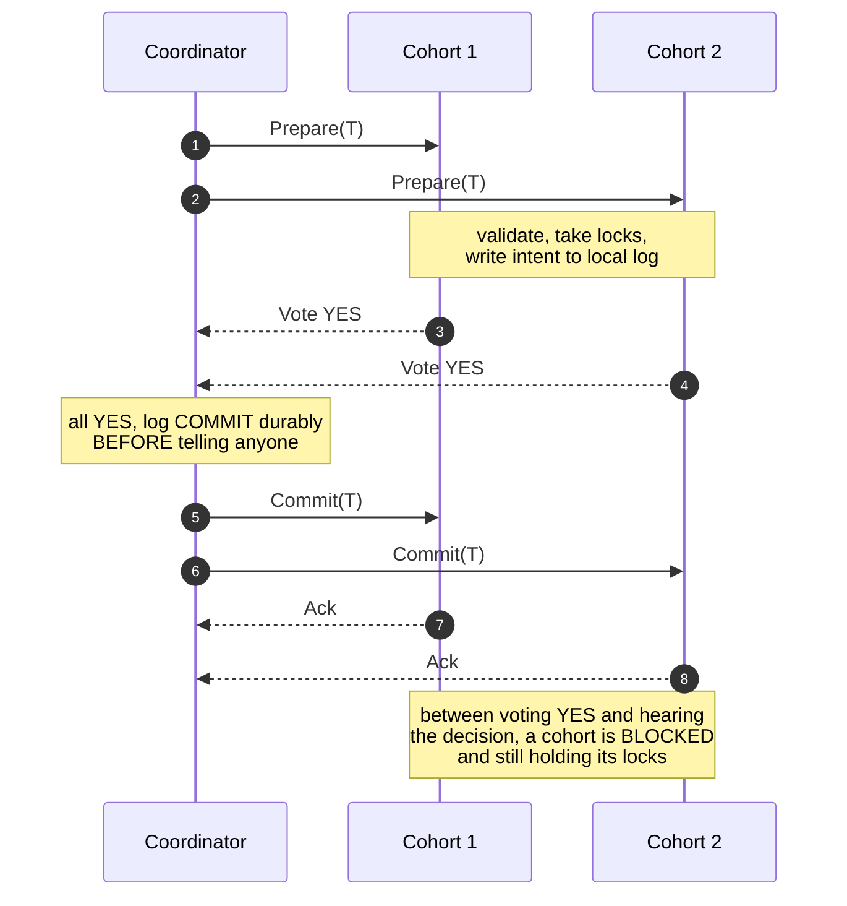
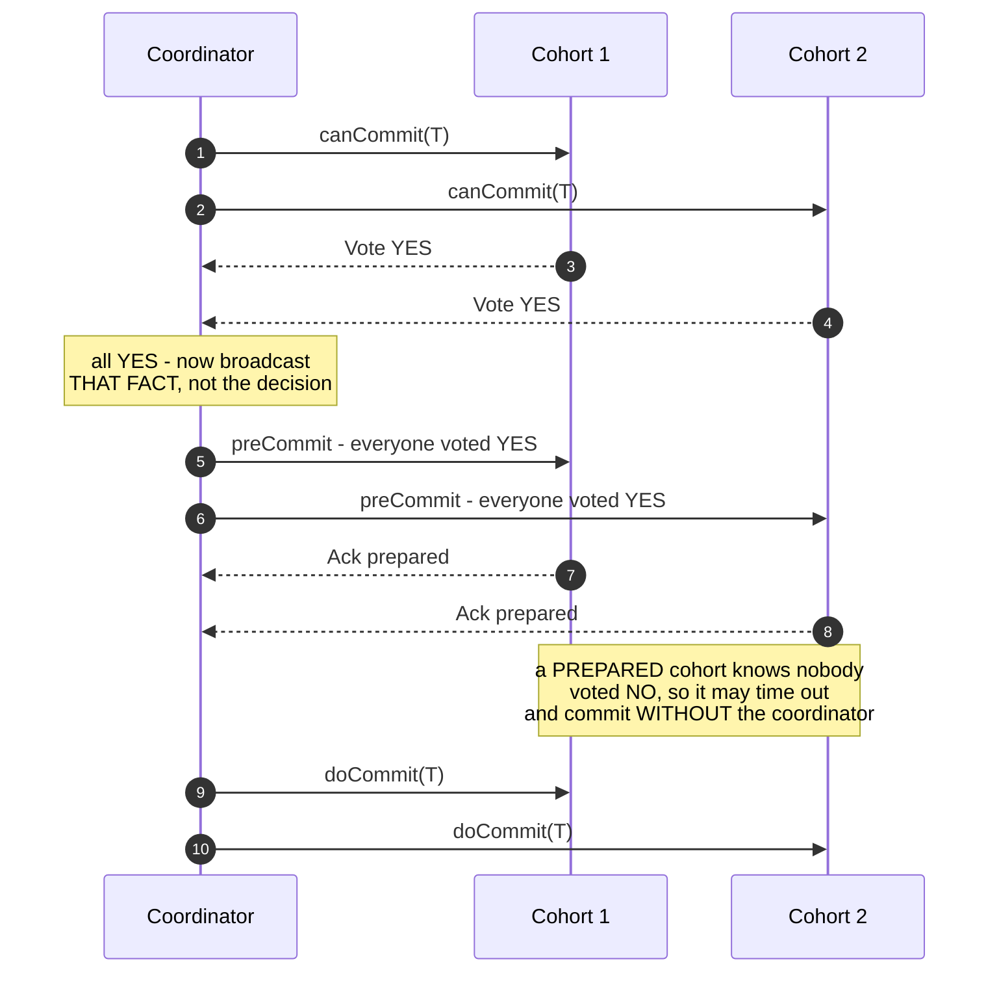
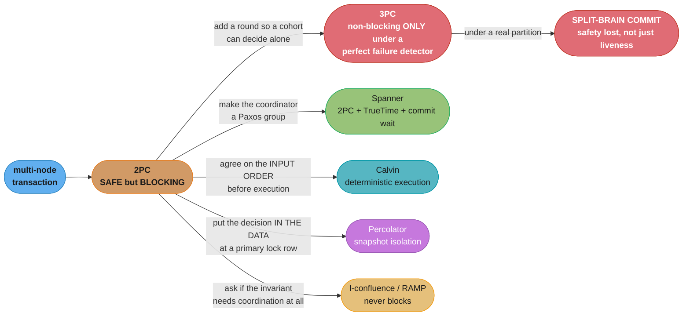
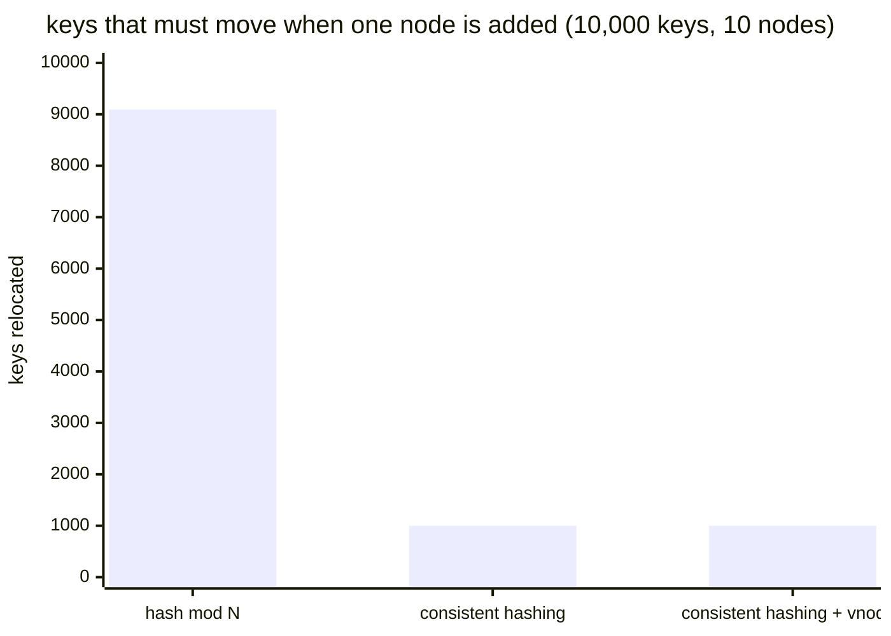

# Chapter 13: Distributed Transactions

> Part II — Distributed Systems · Database Internals (Petrov, 1st ed., O'Reilly 2019) · builds
> on Ch 11 (Replication and Consistency) and Ch 12 (Anti-Entropy and Dissemination), leads to
> Ch 14 (Consensus)

## Chapter Map

Chapter 5 established what a transaction means inside a single node: a write-ahead log, a recovery
procedure, and a concurrency-control scheme that together make a set of operations atomic and
durable on one machine. Chapters 11 and 12 established that once data is spread across machines,
replicas diverge and reconcile *eventually*. Chapter 13 asks the question that sits between those
two: **when a single logical operation has to touch several nodes, how do you make all of it
happen or none of it happen — right now, not eventually?**

This is the hardest chapter in Part II, and its spine is a single unresolved tension that every
protocol in it attacks from a different angle. **Two-phase commit is correct but blocking**: a
cohort that has voted *yes* has surrendered its right to decide unilaterally, so if the coordinator
disappears at exactly the wrong moment, that cohort holds its locks and waits, indefinitely, with
no legal way to resolve. **Three-phase commit removes the blocking** by inserting a round that makes
the outcome decidable from a cohort's local state — but it can only do so under a synchronous model
with a perfect failure detector, and Chapter 9 already proved that no such detector exists on a real
network. So 3PC does not eliminate the problem; it **trades a liveness failure for a safety
failure**, and under a network partition it can commit on one side while aborting on the other.

The rest of the chapter is a tour of systems that decline to accept that trade and restructure the
problem instead. **Calvin** makes execution deterministic and agrees on the transaction *input
order* before anything runs, so no post-hoc agreement on the outcome is needed. **Spanner** keeps
2PC but runs each participant as a Paxos group so a coordinator crash is a leader election rather
than an outage, and uses **TrueTime** — a clock that reports an explicit uncertainty interval —
plus a deliberate **commit wait** to obtain external consistency. **Percolator** builds snapshot
isolation on top of Bigtable with a client-driven 2PC whose commit point is a single row write.
**Coordination avoidance** asks whether the transaction needed coordination at all.

**TL;DR:**
- **Atomic commitment** differs from consensus: consensus lets any proposed value win, while atomic
  commitment must commit *only* if every participant voted yes, and any single *no* is decisive.
- **2PC** — prepare, then commit — is correct, but a cohort that voted yes and then lost the
  coordinator is **blocked**: it cannot abort (the decision may have been commit) and cannot commit
  (some other cohort may have voted no).
- **3PC** inserts a *prepare/pre-commit* round so a cohort that reached the prepared state knows
  every cohort voted yes, and can therefore time out and commit alone. This requires a synchronous
  network and a perfect failure detector; under a partition it produces a **split-brain commit**.
- **Calvin** puts a **sequencer** in front of the database that fixes a global transaction order,
  replicates that *order* by consensus, and relies on deterministic execution so every replica
  reaches the same outcome without agreeing on the outcome afterwards.
- **Spanner** runs 2PC where every participant is itself a Paxos group, and uses **TrueTime** —
  which returns a time *interval* whose width the book cites at around 6 ms on average — plus a
  **commit wait** of that interval to guarantee external consistency.
- **Consistent hashing** places keys and nodes on the same ring so a node join or leave moves only
  about **K/N** keys, versus nearly all of them under `hash(key) mod N`; **virtual nodes** fix the
  load-imbalance the plain ring suffers.
- **Percolator** layers snapshot isolation over Bigtable using **lock**, **write**, and **data**
  columns, with a designated **primary lock** row whose single write is the atomic commit point for
  the whole transaction.
- **Coordination avoidance** (invariant confluence, RAMP) asks whether coordination is required at
  all: operations whose invariants survive independent merging need none, and RAMP achieves
  read-atomic isolation with metadata plus an optional second read round, never blocking.

## The Big Question

> A single node can make a transaction atomic because one write-ahead log and one recovery
> procedure own the decision. Spread that transaction across five nodes and the decision has no
> owner. How do you get all five to agree on commit-or-abort, when any of them — and the thing
> coordinating them — can fail at any point, and no node can tell a crashed peer from a slow one?

Analogy: four people agree to buy a house together, each contributing a quarter. Nobody wants to
transfer their share until they know everyone else will, so they appoint an escrow agent. Each
person confirms to the agent that their money is ready and *ring-fenced* — that is the prepare
phase, and the crucial part is that once you confirm, you have given up the right to spend that
money on anything else. The agent then tells everyone "all four confirmed, go" or "one backed out,
release your funds." Now the agent's phone dies right after collecting the confirmations. You know
you said yes. You do not know what the other three said, and you do not know whether the agent
already told someone else to go. You cannot spend the money and you cannot release it. **That is
2PC's blocking problem in full**, and every remaining protocol in the chapter is an attempt to
either make that state decidable, remove the agent, or avoid needing one.

---

## 13.1 Making Operations Appear Atomic

The chapter opens by naming precisely what is required. A distributed transaction must satisfy
**atomicity across nodes**: either all of its effects become visible, or none of them do. There is
no partial outcome in which the debit landed on node A and the credit did not land on node B.

Two prerequisites make that achievable at all, and the chapter is explicit that the second is
usually the forgotten one:

- **Agreement on the outcome.** Every participant must end up with the same commit-or-abort
   decision. This is what an **atomic commitment** protocol provides.
- **Local recoverability.** Every participant must be able to *undo* its part if the decision is
   abort, and to *redo* it if the decision is commit and the participant crashed in between. This
   is Chapter 5's machinery — a durable write-ahead log — and without it the agreement is
   worthless: a node that agreed to commit but cannot reconstruct what it agreed to has broken
   atomicity just as thoroughly as one that disagreed.

**Atomic commitment is not consensus, and conflating them is a classic interview trap.** They look
similar — several nodes, one agreed value — but the decision rules differ in a way that matters:

| | Consensus (Ch 14) | Atomic commitment (this chapter) |
|---|---|---|
| The decided value | any value that was *proposed* may be chosen | commit **only** if *every* participant voted yes |
| Effect of one dissenting vote | none — a majority decides | **decisive** — a single no forces abort |
| Effect of one unreachable participant | none, if a majority is reachable | it must be resolved, because its vote is required |
| Can it make progress with a minority down? | yes, with a majority quorum | **no** — every participant's vote is needed |

That last row is the source of every difficulty in the chapter. Consensus tolerates a minority
failure by definition; atomic commitment cannot, because the missing vote might have been a *no*.

---

## 13.2 Two-Phase Commit

**Two-phase commit (2PC)** is the canonical atomic commitment protocol. One node acts as
**coordinator** (usually the one that initiated the transaction); the others are **cohorts** (or
participants). The protocol has exactly the two phases its name promises.

**Phase 1 — prepare / voting.** The coordinator sends a `Prepare` message carrying the transaction
to every cohort. Each cohort does everything short of committing: it validates the operation,
acquires the locks it needs, and **writes its intent durably to its own log** so it can honour
either outcome after a crash. It then votes `YES` or `NO`. A `YES` vote is a **binding promise**:
the cohort is guaranteeing it *can* commit if told to, which means it must hold its locks and
preserve its log record until it learns the decision. A `NO` vote (constraint violation, deadlock,
resource exhaustion) means the cohort may release everything immediately — it already knows the
outcome will be abort.

**Phase 2 — commit / abort.** The coordinator collects the votes. If **all** are `YES`, it
**durably logs the commit decision first** and then sends `Commit` to everyone; if **any** is `NO`
or times out, it logs and sends `Abort`. Cohorts apply the decision, release locks, and acknowledge.

The ordering in that sentence is the single most important implementation detail in the protocol:
**the coordinator writes its decision to durable storage before communicating it.** If it crashes
after sending one `Commit` but before sending the rest, the log is what lets the recovered
coordinator finish the job. If it crashed *without* logging, and some cohort already committed,
there is no way back — that cohort's data is committed and the coordinator would have no record
of why.


Caption: the window between the last `YES` vote and the arrival of the decision is the protocol's
entire vulnerability — locks are held, the outcome is unknown to the cohort, and nothing local can
resolve it.

### Cohort Failures in 2PC

A cohort failure is the *benign* case, because the coordinator retains the decision authority
throughout. Which recovery applies depends on exactly when the cohort died:

| Cohort crashes… | What the coordinator does | What the cohort does on recovery |
|---|---|---|
| **Before receiving `Prepare`** | times out waiting for a vote, treats it as `NO`, aborts | nothing — it never joined the transaction |
| **After receiving `Prepare`, before voting** | same: times out, aborts | finds a prepare record but no vote sent, aborts locally |
| **After voting `NO`** | already aborting — the single `NO` was decisive | nothing to undo; it never held the intent, locks already released |
| **After voting `YES`, before the decision arrives** | proceeds normally; the decision is waiting for the cohort | **must find out the outcome** — it has a durable prepare record and cannot decide alone, so it queries the coordinator (or a peer) and applies whatever the answer is |

The last row is the one worth stating precisely, because it is the mirror image of the coordinator
failure that follows. A recovered cohort that finds a `prepared` record in its log is in an
**in-doubt** state. It may not abort (the decision could have been commit) and it may not commit
(another cohort could have voted no). Its only legal action is to **ask** — which is fine, as long
as somebody is there to answer.

### Coordinator Failures in 2PC

This is the chapter's central problem, and where 2PC's cost becomes structural rather than
incidental.

| Coordinator crashes… | Consequence |
|---|---|
| **Before sending `Prepare`** | harmless — nobody has done anything, the transaction never began |
| **After sending `Prepare`, before collecting all votes** | cohorts time out and abort; the recovered coordinator finds no commit decision in its log and aborts too. Safe |
| **After collecting all `YES` votes, before sending the decision** | **the blocking case.** Every cohort has voted yes, is holding locks, and cannot resolve the outcome locally |

Why the blocking case cannot be fixed inside 2PC:

```
  the in-doubt cohort's reasoning, and why it dead-ends

  cohort P1 knows:  "I voted YES.  I hold locks.  Coordinator is unreachable."
  cohort P1 does NOT know:
      - how P2, P3, P4 voted        (a single NO anywhere means the answer is ABORT)
      - whether the coordinator already logged and sent COMMIT to someone else
        before it died                (in which case ABORT would break atomicity)

  can P1 unilaterally ABORT?   NO -- some other cohort may already have COMMITTED.
  can P1 unilaterally COMMIT?  NO -- some other cohort may have voted NO.
  can P1 ask its peers?        Only helps if a peer already HEARD the decision.
                               If none did, the answer is genuinely unknown to
                               every living node -- it existed only in the
                               coordinator's head or its unread log.

  => P1 holds its locks and WAITS.  Correct, and indefinitely unavailable.
```
Caption: the decision is not merely unknown, it is *unrecoverable* from the surviving nodes' state —
which is why no amount of cohort-side cleverness resolves 2PC's blocking window.

Note what is *not* wrong here: 2PC never violates atomicity. It is **safe** under every failure it
tolerates. What it loses is **liveness** — the transaction, and every other transaction wanting
those locks, stalls until the coordinator returns. In a real database that stall means blocked
readers and writers on the locked rows, growing lock-wait queues, and connection exhaustion far
beyond the transaction that actually failed. The blast radius of one coordinator crash is not one
transaction.

The practical mitigations the chapter's context implies, none of which change the theory:
persist the coordinator's log on fast durable storage so recovery is quick; run the coordinator as a
replicated group so "crash" becomes "failover" (this is precisely Spanner's move in §13.5); and
provide a human-operable *heuristic decision* so an operator can force commit or abort on a stuck
cohort — which explicitly risks breaking atomicity and exists only because indefinite blocking is
sometimes worse than a known-inconsistent outcome someone will reconcile by hand.

---

## 13.3 Three-Phase Commit

**Three-phase commit (3PC)** attacks the blocking window directly. The diagnosis is precise: a
cohort blocks because *having voted yes tells it nothing about how anyone else voted*. So 3PC
inserts a round whose entire purpose is to distribute that missing knowledge before the commit
decision is issued.

The three phases:

- **Phase 1, Propose (canCommit)** — the coordinator sends the transaction and collects votes, exactly as
   2PC's first phase.
- **Phase 2, Prepare (preCommit)** — if all votes were `YES`, the coordinator broadcasts *that fact*:
   "everyone voted yes, prepare to commit." Cohorts acknowledge. **The state a cohort reaches here
   is the whole point** — a cohort in the prepared state now knows something it could not know in
   2PC: that no cohort voted no, so the only possible outcome is commit.
- **Phase 3, Commit (doCommit)** — the coordinator tells everyone to commit.

Because a prepared cohort knows the outcome must be commit, it no longer needs the coordinator to
tell it. **If the coordinator disappears after the prepare round, cohorts time out and commit on
their own.** The blocking window is gone; 3PC is non-blocking under the failure model it assumes.


Caption: the added round distributes the *unanimity* of the vote, which is exactly the fact a 2PC
cohort lacked — and it is that fact, not the extra message, that makes a cohort able to decide
alone.

### Coordinator Failures in 3PC

The recovery rule is now local and decidable:

| Coordinator crashes… | Cohorts' local state | What they do on timeout |
|---|---|---|
| Before/during the propose round | not prepared | **abort** — nobody could have committed |
| After some cohorts are prepared | prepared | **commit** — prepared implies everyone voted yes |
| After sending some `doCommit`s | prepared, some committed | **commit** — consistent with the ones that already did |

**And here is where 3PC's bargain becomes visible.** The rule "a prepared cohort times out and
commits" is only safe if a timeout genuinely means *the coordinator is gone*. Chapter 9 spent an
entire chapter establishing that on an asynchronous network a timeout means no such thing — it
means "I have not heard from you," which is indistinguishable from a partition. 3PC requires a
**synchronous** network model with bounded message delay and a **perfect failure detector**: no
false positives, ever.

Real networks provide neither. The consequence is a **split-brain commit**:

```
  3PC under a network partition -- how a safe protocol commits and aborts the SAME transaction

  6 cohorts, all voted YES.  Coordinator sends preCommit to P1,P2,P3 -- then the
  network partitions and the coordinator lands on the minority side and crashes.

  side A:  P1  P2  P3    state = PREPARED
           timeout fires -> rule says "prepared means everyone voted yes"
           -> side A COMMITS

  side B:  P4  P5  P6    state = voted YES, never received preCommit
           timeout fires -> rule says "not prepared, nobody could have committed"
           -> side B ABORTS

  the SAME transaction is now committed on three nodes and aborted on three others.
  2PC in this situation would have BLOCKED -- unavailable, but still atomic.

  3PC did not remove the problem.  It converted a LIVENESS failure (blocking)
  into a SAFETY failure (split brain), and safety failures do not self-heal.
```
Caption: this trade is the chapter's most-quizzed point — 3PC is non-blocking *under an assumption
real networks do not satisfy*, and when the assumption breaks it breaks atomicity itself rather
than merely availability.

3PC also pays a second, mundane price: it adds a full message round and a durable state
transition per cohort, so latency and message count rise — roughly 3n messages per round-set
against 2PC's 2n — for a benefit that is conditional on a network model you do not have. **This is
why 3PC is a textbook protocol rather than a shipped one**, and why the systems in the rest of the
chapter go looking for a different restructuring instead.

---

## 13.4 Distributed Transactions with Calvin

Calvin's insight is to change *what* the nodes have to agree on. 2PC and 3PC both agree on an
**outcome** — commit or abort — after execution has begun, which is what forces the vote, the
in-doubt state, and the blocking. Calvin instead agrees on the **input order** before anything
executes, and then makes execution **deterministic** so that agreeing on the input is sufficient:
if every replica runs the same transactions in the same order, and execution has no nondeterminism,
every replica produces the same result by construction. **No agreement on the outcome is ever
needed, because the outcome was never in question.**

The architecture has four components:

| Component | Responsibility |
|---|---|
| **Sequencer** | receives transactions, batches them into short **epochs**, and establishes the global execution order. The *order* is what gets replicated — by consensus (Paxos/Raft) or by asynchronous replication |
| **Scheduler** | takes the ordered batch and hands transactions to workers, acquiring locks in the sequencer's order so execution respects it |
| **Worker** | executes the transaction logic against local storage |
| **Storage** | the underlying storage layer, deliberately decoupled from the transaction machinery |

**Why this eliminates the blocking problem.** In 2PC, locks are held across a network round trip
whose duration is bounded only by the coordinator's availability. In Calvin, the ordering agreement
happens **before** any lock is taken, so the expensive coordination is outside the transaction
boundary entirely. Locks are acquired in a predetermined order and held only for local execution
time. There is no coordinator whose death leaves anyone in doubt, because there is nothing left to
decide once the order is fixed.

**What it costs, and this is the price you must be able to state.** Deterministic execution requires
the system to know each transaction's **read and write sets in advance**, so the scheduler can
acquire the right locks in the right order before executing. That is straightforward for a stored
procedure with static key access, and awkward for an interactive transaction whose second statement
depends on the result of the first. Calvin's answer is a **reconnaissance query**: run the
transaction speculatively to discover its access set, then submit it with that set declared, and
re-run it if the set turned out to be wrong because the underlying data changed in between. It also
means **no nondeterminism in execution at all** — no `NOW()`, no random values, no
non-deterministically-ordered scans — since any divergence would break the equality the whole design
rests on. The book's framing is that Calvin trades interactive-transaction flexibility for the
removal of distributed commit coordination.

```mermaid
flowchart LR
    classDef io      fill:#61afef,stroke:#2e86c1,color:#1a1a1a,font-weight:bold
    classDef frozen  fill:#c678dd,stroke:#9b59b6,color:#fff
    classDef train   fill:#98c379,stroke:#27ae60,color:#1a1a1a
    classDef mathOp  fill:#d19a66,stroke:#e67e22,color:#1a1a1a,font-weight:bold
    classDef lossN   fill:#e06c75,stroke:#c0392b,color:#fff,font-weight:bold
    classDef req     fill:#56b6c2,stroke:#0097a7,color:#1a1a1a
    classDef base    fill:#e5c07b,stroke:#f39c12,color:#1a1a1a

    T(["incoming<br/>transactions"]) --> S(["sequencer<br/>batches into epochs"])
    S -->|"replicate the ORDER<br/>by consensus"| S2(["sequencer replica"])
    S --> SC(["scheduler<br/>locks in sequencer order"])
    S2 --> SC2(["scheduler replica"])
    SC --> W(["workers<br/>DETERMINISTIC execution"])
    SC2 --> W2(["workers replica"])
    W --> D(["storage"])
    W2 --> D2(["storage replica"])
    D -.->|"identical by construction<br/>no outcome agreement needed"| D2

    class T io
    class S,S2 mathOp
    class SC,SC2 req
    class W,W2 train
    class D,D2 base
```


Caption: consensus is spent on the *input log* and nothing else — once the order is agreed, identical
deterministic execution makes the outputs match without any commit protocol between them.

---

## 13.5 Distributed Transactions with Spanner

Spanner takes the opposite path from Calvin: it keeps 2PC and fixes the two things that make 2PC
painful — the coordinator's fragility, and the absence of a globally meaningful notion of *when*.

**Fix 1: make every participant a Paxos group.** In classic 2PC, the coordinator and each cohort are
single nodes, so any one crash produces the blocking window of §13.2. In Spanner, the data is
partitioned, each partition is replicated as a **Paxos group**, and 2PC runs *between groups* rather
than between machines. A machine failure — including the coordinator's — is now a leader election
inside a group, not the loss of the decision. The recovered leader reads the group's replicated log
and knows exactly what was decided. **2PC's blocking window does not disappear in theory; it
becomes vanishingly rare in practice**, because the thing that has to fail is now a majority of a
replica group rather than one process. This is the single most useful practical lesson in the
chapter: you do not fix 2PC by inventing 3PC, you fix it by making the coordinator highly available.

**Fix 2: TrueTime.** Spanner wants **external consistency** (linearizability for transactions): if
transaction T1 commits before T2 begins in real time, then T1's timestamp must be less than T2's,
globally, across datacenters. Timestamps from ordinary wall clocks cannot deliver that, because
clock skew between machines means a later transaction can receive an earlier timestamp.

**TrueTime's contribution is that it makes the uncertainty explicit rather than pretending it away.**
Backed by GPS receivers and atomic clocks in every datacenter, the `TT.now()` API returns not a
timestamp but an **interval** `[earliest, latest]` guaranteed to contain the true absolute time. The
book cites the Spanner paper's figure of an average uncertainty on the order of **6 ms** (with the
interval widening between clock-reference polls and narrowing after each). An ordinary NTP-synced
server also has uncertainty — it simply does not tell you what it is, which is exactly why you
cannot build a correctness argument on it.

**Fix 3: commit wait — deliberately waiting out the uncertainty.** Given an interval rather than a
point, Spanner assigns a commit timestamp `s` and then **waits until `TT.after(s)` is true** — that
is, until the uncertainty interval has entirely passed `s` — before making the transaction's writes
visible and reporting the commit.

```
  why commit-wait is the mechanism, not a safety margin

  clocks are only known to within an interval of width e (the book cites ~6 ms average)

  WITHOUT commit wait:
     T1 commits at timestamp s1, chosen from a clock that may be running EARLY
     T2 begins afterwards in real time, on a node whose clock runs LATE
     T2 can be assigned s2 < s1  ->  the timestamp order INVERTS the real-time order
     -> external consistency broken, and nothing detects it

  WITH commit wait:
     T1 picks s1 = TT.now().latest      (the latest possible current time)
     T1 then WAITS until TT.after(s1)   (~e milliseconds, ~6 ms average)
     only THEN does it release locks and report the commit

     by the time anyone can observe T1 committed, EVERY clock in the system
     has certainly passed s1  ->  any later transaction must pick s2 > s1

  cost: ~e of added latency on every read-write commit, paid deliberately.
  what it buys: a global real-time ordering guarantee no amount of retrying gets you.
```
Caption: commit wait converts clock *uncertainty* into a bounded, known *latency cost* — the whole
design turns an unbounded correctness risk into a fixed number of milliseconds you choose to pay.

The trade is direct and quantifiable: **narrower uncertainty means shorter commit wait means higher
write throughput**, which is precisely why Spanner justifies the expense of GPS and atomic-clock
hardware. Systems without that hardware must either use a much wider (and therefore much slower)
uncertainty bound, or give up external consistency.

**Spanner's three transaction types**, each with a different cost profile:

| Type | Locks? | Runs on | Mechanism |
|---|---|---|---|
| **Read-write** | yes | the leader replica of each involved Paxos group | 2PC across groups, plus commit wait |
| **Read-only** | **no** | any sufficiently up-to-date replica | assigned a timestamp, served from a consistent snapshot |
| **Snapshot read** | **no** | any replica | client supplies the timestamp or a staleness bound |

The lock-free read paths are where the design pays off operationally: read-only transactions never
block writers and never take part in 2PC, so the expensive protocol is confined to the transactions
that genuinely mutate several partitions.

---

## 13.6 Database Partitioning

The chapter now steps back to the structural precondition for all of this. **Partitioning**
(sharding) splits a dataset into subsets held by different nodes so that capacity and throughput
scale with the cluster rather than with one machine. Each partition is typically also replicated —
so a "node" in the transaction protocols above is more accurately a *replica set owning a
partition*, which is exactly Spanner's Paxos-group framing.

The reason partitioning appears in a chapter about transactions is that **partitioning is what
creates distributed transactions in the first place**. A transaction confined to one partition is
an ordinary single-node transaction with Chapter 5's machinery and none of this chapter's cost. A
transaction spanning two partitions needs an atomic commitment protocol, with all the latency,
locking, and failure exposure that implies. So the partitioning *scheme* is a transaction-cost
decision, not merely a capacity decision: partition by a key that co-locates the data your
transactions actually touch together, and most transactions stay single-partition.

The central operational difficulty is **rebalancing**. Nodes are added for capacity, removed for
decommissioning, and lost to failure, and each change requires moving data. Two failure modes bound
the design:

- **Moving too much data.** A scheme that reshuffles most of the dataset for one node join makes
  scaling out an outage.
- **Moving it unevenly.** A scheme that concentrates ownership on a few nodes creates hot spots
  that waste the rest of the cluster.

The chapter's answer to the first is consistent hashing, and the second is what virtual nodes fix.

---

## 13.7 Consistent Hashing

The naive partitioning scheme is `partition = hash(key) mod N` for N nodes. It distributes keys
beautifully and rebalances catastrophically:

```
  naive:  partition = hash(key) mod N

  N = 4 -> N = 5 (ONE node added)
     a key lands in the same bucket only if hash(key) mod 4 == hash(key) mod 5,
     which holds for roughly 1 key in 5.
     => ~80% of ALL keys change owner for a single node join.

  in general, going from N to N+1 remaps about K * N/(N+1) keys -- essentially
  the entire dataset, every time, forever.

  on 10 TB of data that is ~8 TB moved to add one machine.
```

**Consistent hashing** removes that by hashing *nodes and keys into the same space*. Take the hash
output range — say `0 .. 2^32 - 1` — and treat it as a ring that wraps at the top. Each node is
assigned one or more positions (**tokens**) on the ring. A key is placed by hashing it to a ring
position and walking **clockwise** to the first node token encountered; that node owns the key.

```
  the ring drawn as a wrapped number line (hash space 0 .. 2^32-1)

  0                                                                          2^32
  |----------|-------------------|--------------|------------------------------|
             N1                  N2             N3                (wraps back to N1)
       ^                  ^
       |                  |
    hash(k1) -> N1     hash(k2) -> N2      each key -> first node CLOCKWISE

  now ADD N4 between N1 and N2:

  0                                                                          2^32
  |----------|---------|---------|--------------|------------------------------|
             N1        N4        N2             N3

  ONLY the arc (N1, N4] changes owner -- those keys move from N2 to N4.
  N1, N2's remaining arc, and N3 are untouched -- no rehash, no movement.

  keys moved = K/N on average, NOT K * N/(N+1).
  10 TB across 10 nodes: adding one node moves ~1 TB, not ~9 TB.
```
Caption: the property that matters is that a topology change is *local to one arc* — the ring gives
each node an interval whose neighbours are unaffected by a change anywhere else on the ring.

**The plain ring's flaw: load imbalance.** With one token per node, the ring is cut at N random
points, and random points are not evenly spaced. Some node draws a huge arc and others draw slivers,
and the imbalance is permanent until the topology changes. Worse, when a node fails, its **entire**
arc transfers to exactly one successor, doubling that neighbour's load at the worst possible moment
and frequently cascading.

**Virtual nodes fix both.** Each physical node is given many tokens (typically dozens to hundreds)
scattered around the ring, so it owns many small arcs instead of one large one:

```
  3 physical nodes, ONE token each        3 physical nodes, 8 vnodes each (24 tokens)

  |---N1---|-------N2-------|--N3--|      |N2|N3|N1|N3|N1|N2|N1|N3|N2|N1|N2|N3|...
    25%          58%          17%          each physical node owns ~33%, spread over
                                           8 independent small arcs

  one unlucky token placement gives        a node's share is the AVERAGE of 8 random
  N2 more than 3x N3's load, and it        arcs, so the variance falls by roughly
  stays that way until topology changes    1/sqrt(8) -- imbalance largely disappears

  N2 fails: its ENTIRE 58% arc goes        N2 fails: its 8 arcs are redistributed to
  to ONE successor, which now holds        DIFFERENT successors -- the load spreads
  ~83% of the ring and likely falls        across ALL survivors, ~each taking 1/8 of
  over too                                 N2's share
```
Caption: virtual nodes turn one large random draw into the average of many, which is why they fix
both steady-state imbalance and the failure-time load spike — and the failure case is the one that
actually takes clusters down.

Virtual nodes also make **heterogeneous hardware** expressible: give a machine with twice the disk
twice the tokens and it takes twice the data, with no change to the placement rule.

---

## 13.8 Distributed Transactions with Percolator

**Percolator** is Google's transactional layer over **Bigtable**, and its interest here is that it
achieves multi-row, multi-partition transactions **entirely on the client side**, over a storage
engine that offers only single-row atomicity. It requires no new server component and no change to
Bigtable — which makes it the chapter's clearest demonstration that an atomic commitment protocol
is a *data layout* problem as much as a messaging problem.

**The isolation level is snapshot isolation.** Percolator uses multi-version storage and consults a
**timestamp oracle** twice: once at transaction start to obtain a **start timestamp** (the snapshot
the transaction reads from) and once at commit to obtain a **commit timestamp**. Reads see only
versions written before the start timestamp, so they never block and never see concurrent writes.

**The three columns.** For each logical data column `c`, Percolator stores three Bigtable columns:

| Column | Holds | Purpose |
|---|---|---|
| `c:data` | the actual value, keyed by timestamp | the multi-version data itself |
| `c:lock` | a lock record naming the transaction's **primary** row | marks the row as written-but-not-yet-committed. A reader that finds a lock must wait or clean up |
| `c:write` | a pointer to the timestamp of the committed data version | **a row's write column entry is what makes its value visible.** No write entry means the data version exists but is invisible |

The separation of `data` and `write` is the mechanism: writing the data and *publishing* it are two
different operations, and only the second one counts.

**The primary lock — the whole trick.** A Percolator transaction designates one of the rows it
writes as the **primary**; every other row's lock record points at it. Commit then works like a
client-driven 2PC in which **the primary row's single-row write is the commit point**:

```
  Percolator commit, for a transaction writing rows R1 (primary) and R2

  PREWRITE  (the "prepare" phase, client-driven)
    for each row:
      - conflict check: any write record after my start_ts?  -> ABORT
                        any lock present at all?             -> ABORT (someone else is mid-commit)
      - write data at start_ts into c:data
      - write a lock into c:lock
          R1 gets a PRIMARY lock
          R2 gets a SECONDARY lock that POINTS AT R1
    if any prewrite fails -> roll back, transaction aborted, nothing visible

  COMMIT
    get commit_ts from the timestamp oracle
    STEP 1:  on R1 (the PRIMARY), in ONE single-row Bigtable transaction:
               - check the primary lock is still there   (if not -> someone aborted us)
               - write c:write @ commit_ts -> start_ts
               - erase c:lock
             <-- THE TRANSACTION IS NOW COMMITTED.  This one row write decided it.

    STEP 2:  for R2 and every other secondary: write c:write, erase c:lock
             this is pure CLEANUP -- the outcome is already decided and cannot change

  now crash the client immediately after STEP 1.
    R1 is committed and visible.  R2 still has a lock and no write record.
    a later reader hitting R2's lock FOLLOWS THE POINTER to R1, sees R1 committed,
    and rolls R2 FORWARD on the reader's behalf.
    crash BEFORE step 1?  the primary lock is intact, no write record ->
    a later reader rolls the whole transaction BACK.

  the outcome is a FUNCTION OF ONE ROW'S STATE, readable by anybody, forever.
```
Caption: the atomicity of the entire multi-row transaction is inherited from Bigtable's single-row
atomicity, because the primary row's write is the one irreversible act — everything else is a
deterministic consequence a later reader can finish.

**Why this is elegant, and what it costs.** The blocking problem of §13.2 is defused because the
decision is not held in a coordinator's memory — it is *durable, in the data, at a known location*,
so any client encountering an abandoned lock can resolve the transaction itself. There is no
in-doubt state that only a dead process could resolve. The costs are real, though: the timestamp
oracle is a centralized dependency on the critical path of every transaction; readers must be
prepared to clean up other transactions' abandoned locks (with a lock timeout to decide when the
owner is dead); and snapshot isolation is not serializable, so **write skew remains possible** —
two transactions reading overlapping data, writing disjoint rows, and jointly violating a constraint
neither violated alone. Percolator was designed for high-throughput incremental batch processing,
where throughput per transaction mattered less than not rebuilding the whole index.

---

## 13.9 Coordination Avoidance

The chapter closes by questioning the premise. Every protocol so far pays a coordination cost —
round trips, held locks, blocking windows, commit waits — and the last section asks: **for which
operations is that cost actually necessary?**

**Invariant confluence (I-confluence)** is the formal answer. An operation is *I-confluent* with
respect to an invariant if, whenever two states each individually satisfy the invariant, merging
them also satisfies it. If that holds, replicas can execute independently and merge later with no
coordination whatsoever, and the invariant is still preserved. If it does not hold, coordination is
**provably required** — no clever implementation avoids it. The property is therefore a decision
procedure, not a heuristic:

| Operation and invariant | I-confluent? | Why |
|---|---|---|
| Add to a set; invariant "set is non-empty" | **Yes** | merging two non-empty sets yields a non-empty set |
| Increment a counter; invariant "counter >= 0" | **Yes** | merging increments cannot make a non-negative counter negative |
| Insert a row; invariant "primary key is unique" | **No** | two replicas can each insert the same key legally, and the merge violates uniqueness |
| Withdraw funds; invariant "balance >= 0" | **No** | two withdrawals of 60 from a balance of 100 are each individually legal and jointly are not |
| Append to a log; invariant "log is append-only" | **Yes** | merging two appends is still a valid log |

The practical reading: **audit your invariants before your protocols.** The uniqueness and
non-negative-balance rows are exactly the cases where teams reach for a distributed transaction —
correctly. The other rows are cases where teams often reach for one anyway, and pay coordination
cost for a guarantee the merge already provides.

**RAMP — Read-Atomic Multi-Partition transactions** — is the chapter's concrete non-blocking design.
It targets **read atomicity**: a reader either sees all of a transaction's writes or none of them,
across partitions. That is weaker than serializability and is precisely the guarantee that fixes
the most common visible anomaly in a partitioned system — the "fractured read," where you observe
half of somebody's update (a friendship recorded on one side but not the other, a denormalized
index updated but not its base row).

The mechanism is **metadata plus an optional second round**, and it never blocks:

```
  RAMP read of items x and y, written together by transaction T

  ROUND 1: read x and y from their partitions at whatever version is current
           each returned value carries METADATA naming the other keys
           T also wrote  (that is the entire trick)

           got:  x @ version 7,  metadata says "T also wrote y @ 7"
                 y @ version 5   <-- STALE, this partition has not applied T yet

  detect:  x's metadata says y should be at 7, but I got 5 -> FRACTURED read

  ROUND 2: go back and ask specifically for y @ version 7
           multi-versioned storage still has it -> return x@7 and y@7

  result: the reader sees ALL of T or NONE of it, and at NO point did anyone
          take a lock, block a writer, or wait on a coordinator.
          cost: one extra round trip, but ONLY on the reads that actually raced.
```
Caption: RAMP pays for atomicity in *extra reads on the rare racing case* rather than in *locks on
every case* — writes are never blocked by readers and readers never block each other.

Writes in RAMP are made visible via a two-phase mechanism of their own, but the essential
difference from 2PC stands: **no participant ever enters a state where it must wait for a
coordinator to tell it what happened.** A reader that observes a partial state has, in the metadata,
everything it needs to repair its own view.

The chapter's closing position is a design ordering: determine whether the invariant needs
coordination at all (I-confluence); if it does not, do not coordinate; if it needs only atomic
visibility rather than serializability, use a read-atomic mechanism like RAMP; and reserve the full
apparatus of 2PC, Paxos groups, and commit waits for the invariants that genuinely demand it.

---

## Beyond the book — what happened to these designs after 2019

> The chapter presents Calvin, Spanner, Percolator, and RAMP as research and internal-system
> designs, and describes their mechanisms rather than their subsequent adoption. It does not
> discuss which of them became widely deployed commodity technology, because at the time of
> writing several had not yet.

Two of the chapter's designs went on to become the reference implementations of their category in
open, widely-deployed systems. The Percolator model — snapshot isolation with a timestamp oracle
and a primary-lock commit point over a distributed key-value store — was adopted more or less
wholesale as the transaction model of open-source distributed SQL databases, which is why an
engineer today is far more likely to encounter Percolator's `lock`/`write`/`data` layout in a
system they can actually run than in Google's original crawler-indexing context. Calvin's
deterministic-sequencer approach likewise moved from a research prototype into shipped
distributed-SQL products. The book's treatment remains the right conceptual account of both; only
the framing of "who runs this" has changed.

---

## Visual Intuition


Caption: every design after 2PC is a different answer to the same blocking window — make it
decidable (3PC, and it fails), make it rare (Spanner), decide before execution (Calvin), store the
decision in the data (Percolator), or need no decision at all (coordination avoidance).

```
  where the coordination cost is PAID, in each design

  2PC        |-- execute --|== hold locks across a network round trip ==|-- commit --|
                            ^^^^^^^^ THIS is the blocking window ^^^^^^^^

  3PC        |-- execute --|== round ==|== round ==|-- commit --|
                            one MORE round, and it only helps if timeouts never lie

  Spanner    |-- execute --|== 2PC between PAXOS GROUPS ==|== commit wait ~6ms ==|
                            a crash here is a leader election, not an outage

  Calvin     |== agree the ORDER (consensus) ==|-- execute deterministically --|
              coordination happens BEFORE any lock is taken -- locks held only
              for local execution time

  Percolator |-- prewrite all rows --|- ONE row write = COMMITTED -|- lazy cleanup -|
                                       the decision is durable IN THE DATA

  RAMP       |-- read round 1 --|-- (only if fractured) read round 2 --|
              no locks, no coordinator, no blocking anywhere
```
Caption: reading the designs as *where the expensive coordination sits relative to the locks* is the
fastest way to remember why each one behaves as it does under failure.


Caption: `hash(key) mod N` relocates roughly K·N/(N+1) keys — about 9,091 of 10,000 — while the ring
relocates about K/N, roughly 1,000; virtual nodes do not reduce the count further but spread those
1,000 keys evenly across sources instead of taking them all from one unlucky neighbour.

---

## Key Concepts Glossary

- **Distributed transaction** — a transaction whose operations span more than one node, requiring
  agreement so that all effects become visible or none do.
- **Atomic commitment** — the class of protocol that decides commit-or-abort across participants,
  with the rule that commit requires a unanimous yes.
- **Coordinator** — the node that drives an atomic commitment protocol, collecting votes and issuing
  the decision.
- **Cohort / participant** — a node holding part of the transaction's data, which votes and then
  applies the coordinator's decision.
- **Prepare phase** — the first 2PC round, in which cohorts do everything except commit, durably log
  their intent, take locks, and vote.
- **Binding yes vote** — a cohort's promise that it *can* commit, which forfeits its right to abort
  unilaterally and obliges it to hold locks until it hears the decision.
- **In-doubt (prepared) state** — a cohort that has voted yes and not yet learned the outcome; it can
  neither commit nor abort on its own.
- **Blocking (2PC)** — the indefinite stall of in-doubt cohorts when the coordinator fails after
  collecting votes but before communicating the decision.
- **Heuristic decision** — an operator forcing commit or abort on a stuck in-doubt cohort, explicitly
  risking a broken atomicity guarantee to restore availability.
- **Three-phase commit (3PC)** — 2PC plus a pre-commit round that distributes the fact of unanimity,
  letting a prepared cohort commit alone on timeout.
- **Pre-commit / prepared state (3PC)** — the state in which a cohort knows every cohort voted yes,
  making the outcome locally decidable.
- **Perfect failure detector** — a detector that never reports a live node as failed; 3PC's
  non-blocking property depends on one, and Chapter 9 shows real networks cannot provide it.
- **Split-brain commit** — 3PC's failure mode under partition, where one side commits and the other
  aborts the same transaction.
- **Calvin** — a deterministic transaction architecture that agrees on transaction order up front so
  no agreement on the outcome is needed.
- **Sequencer (Calvin)** — the component that batches transactions into epochs and fixes the global
  execution order that is then replicated.
- **Scheduler (Calvin)** — the component that acquires locks in the sequencer's order and dispatches
  transactions to workers.
- **Deterministic execution** — execution guaranteed to produce identical results given identical
  input and order, forbidding non-deterministic values.
- **Reconnaissance query** — a speculative pre-run used to discover a transaction's read/write set
  when it is not known statically, re-run if the set proves stale.
- **External consistency** — the guarantee that timestamp order matches real-time commit order
  globally; Spanner's target property.
- **TrueTime** — Spanner's clock API, backed by GPS and atomic clocks, returning a bounded interval
  guaranteed to contain the true time rather than a single point.
- **Uncertainty interval** — the width of TrueTime's returned interval, cited at around 6 ms on
  average.
- **Commit wait** — deliberately waiting until the uncertainty interval has entirely passed the
  chosen commit timestamp before making writes visible, which is what makes external consistency
  hold.
- **Paxos group (Spanner)** — a replicated set of nodes owning a partition, acting as a single
  highly-available participant in 2PC.
- **Partitioning / sharding** — splitting a dataset across nodes so capacity and throughput scale
  with the cluster.
- **Rebalancing** — moving data between nodes after a topology change.
- **Consistent hashing** — hashing keys and node tokens into the same ring space, so a key is owned
  by the first node clockwise from it and a topology change relocates only about K/N keys.
- **Token** — a node's position on the consistent-hashing ring.
- **Virtual node (vnode)** — one of many ring tokens assigned to a single physical node, evening out
  load and spreading a failed node's share across all survivors.
- **Percolator** — a client-driven transactional layer over Bigtable providing snapshot isolation.
- **Timestamp oracle** — the centralized service issuing Percolator's start and commit timestamps.
- **Primary lock (Percolator)** — the designated row whose single-row write is the atomic commit
  point for the whole transaction, and which every secondary lock points at.
- **Lock column / write column / data column** — Percolator's three Bigtable columns: pending-write
  marker, visibility pointer, and the versioned value itself.
- **Roll forward / roll back (Percolator)** — a later reader resolving an abandoned transaction by
  inspecting the primary row's state.
- **Snapshot isolation** — reads served from a consistent point-in-time snapshot; permits write skew
  and is weaker than serializability.
- **Write skew** — two transactions reading overlapping data and writing disjoint rows, jointly
  violating a constraint neither violated alone.
- **Coordination avoidance** — designing so that operations need no cross-node agreement at all.
- **Invariant confluence (I-confluence)** — the property that merging two invariant-satisfying states
  still satisfies the invariant; if it holds, coordination is unnecessary, and if it fails,
  coordination is provably required.
- **RAMP (Read-Atomic Multi-Partition)** — a non-blocking protocol giving read atomicity via write
  metadata plus an optional second read round.
- **Read atomicity** — the guarantee that a reader sees all of a transaction's writes or none, across
  partitions.
- **Fractured read** — observing only part of a multi-partition transaction's writes, the anomaly
  read atomicity prevents.

---

## Tradeoffs & Decision Tables

| Protocol | Blocking? | Safe under partition? | Round trips | Needs |
|---|---|---|---|---|
| **2PC** | **yes** — in-doubt cohorts stall on coordinator failure | **yes** — atomicity never violated | 2 | durable coordinator log |
| **3PC** | no, under its assumptions | **no** — split-brain commit | 3 | synchronous network **and a perfect failure detector** |
| **Calvin** | no — nothing to be in doubt about | yes | consensus on order, then local execution | read/write sets known in advance, fully deterministic execution |
| **Spanner** | rare — a failure becomes a leader election | yes | 2PC across Paxos groups + commit wait | GPS/atomic-clock hardware for a tight uncertainty bound |
| **Percolator** | no — an abandoned transaction is resolvable by any reader | yes | prewrite + one primary write + lazy cleanup | multi-version storage, single-row atomicity, timestamp oracle |
| **RAMP** | **never** | yes | 1, plus a second only on a detected fracture | multi-version storage, per-write metadata |

| Isolation / guarantee delivered | By | Not protected against |
|---|---|---|
| Serializability | Calvin, Spanner read-write transactions | — |
| External consistency (real-time order) | Spanner (TrueTime + commit wait) | — |
| Snapshot isolation | Percolator | **write skew** |
| Read atomicity | RAMP | write skew, lost update, non-serializable interleavings |
| No guarantee needed | I-confluent operations | invariants that are not I-confluent |

| Partitioning scheme | Keys moved on a node join | Load balance | Failure behaviour |
|---|---|---|---|
| `hash(key) mod N` | ~K·N/(N+1) — nearly everything | excellent while N is fixed | catastrophic reshuffle |
| Consistent hashing, 1 token/node | ~K/N | poor — random arc sizes, permanent skew | the whole arc lands on one successor |
| Consistent hashing + vnodes | ~K/N | good — averaging many small arcs | spread across all survivors |

| Question to ask first | If yes | If no |
|---|---|---|
| Is the transaction single-partition? | use ordinary local transactions — none of this chapter applies | continue |
| Is the invariant I-confluent? | no coordination needed at all | continue |
| Do you need only atomic *visibility*? | RAMP-style read atomicity, never blocks | continue |
| Do you need real-time global ordering? | Spanner-style TrueTime + commit wait, and budget the wait | 2PC over replicated groups is the pragmatic answer |

---

## Common Pitfalls / War Stories

- **Reaching for 3PC because a textbook called it "non-blocking."** The non-blocking property is
  conditional on a synchronous network and a failure detector that never produces a false positive.
  On a real network a partition makes prepared cohorts on one side commit while unprepared cohorts
  on the other abort — the same transaction, two outcomes, permanently. 2PC would merely have
  stalled. Trading a liveness failure that self-heals when the coordinator returns for a safety
  failure that does not is almost never the trade you want.
- **A single-node coordinator whose crash freezes far more than its own transaction.** In-doubt
  cohorts hold their locks, so every unrelated transaction touching those rows queues behind them,
  lock-wait timeouts cascade, and connection pools exhaust. Teams routinely size the blast radius
  of a coordinator crash as "one transaction" and discover it is "the whole service." Replicate the
  coordinator — that is exactly Spanner's fix.
- **Forgetting to log the commit decision before sending it.** A coordinator that transmits `Commit`
  to one cohort and crashes before persisting its decision has produced a state no recovery can
  reconstruct: one cohort is committed, the coordinator has no record, and the remaining cohorts
  will be told to abort. The write-ahead ordering is not a performance detail, it is the correctness
  argument.
- **Heuristic decisions taken quietly during an incident.** Forcing a stuck in-doubt cohort to
  commit or abort ends the outage and may break atomicity — the whole point is that nobody knows the
  right answer. Doing it without recording which transactions were forced leaves a silent
  inconsistency nobody can find later. If you provide the escape hatch, log every use of it as a
  data-integrity incident.
- **Adopting Calvin's model with interactive transactions.** Deterministic scheduling needs each
  transaction's read/write set before execution. An application whose transactions decide their
  second statement from the first statement's results forces a reconnaissance query and a re-run
  whenever the accessed data changed in between, which under contention can retry repeatedly.
  Calvin fits stored-procedure-shaped workloads and fights interactive ones.
- **Any nondeterminism leaking into deterministic execution.** A `NOW()` call, a random tiebreak, an
  unordered scan whose result order depends on the local storage layout — any of these makes two
  replicas diverge while both believe they executed the same ordered log. The divergence is silent
  and there is no commit protocol underneath to catch it, because the design deliberately removed
  it.
- **Assuming NTP is good enough for a Spanner-style timestamp ordering scheme.** TrueTime's
  contribution is not accuracy, it is a *bound you can trust*. An NTP-synced clock has uncertainty
  too — it just does not report it, so a commit-wait built on it is waiting out an interval nobody
  verified. Systems without specialized time hardware must either widen the assumed bound massively
  (paying the latency on every commit) or drop the external-consistency claim.
- **Treating Percolator's snapshot isolation as serializable.** Write skew survives: two
  transactions reading the same rows and writing different ones can jointly break an invariant
  neither broke alone — the classic on-call-doctor and overdraft-across-two-accounts cases. If the
  invariant spans rows that the transactions write disjointly, snapshot isolation will not save you.
- **Percolator's timestamp oracle as a hidden single point of everything.** Every transaction
  contacts it twice, so its availability and latency are on the critical path of the entire system.
  It is easy to read the design as fully decentralized because commit is client-driven, and miss
  that one centralized service gates every transaction's start and end.
- **Not cleaning up abandoned Percolator locks.** A client that dies mid-commit leaves locks that
  block subsequent readers of those rows until someone resolves them. The design *expects* readers
  to perform that cleanup by following the pointer to the primary; an implementation that only waits
  produces a slowly accumulating set of permanently stuck rows.
- **`hash(key) mod N` in a system that will ever add a node.** It looks correct and distributes
  perfectly — until the first scale-out event moves roughly 80–90% of the data at once, saturating
  the network and effectively taking the cluster down for the duration. The scheme is fine only
  where N is genuinely fixed forever, which it never is.
- **Consistent hashing with one token per node, and the failure cascade that follows.** Random ring
  positions produce a permanently skewed distribution, and when the largest-arc node fails, its
  entire share lands on exactly one successor, which is now carrying far more than its capacity and
  frequently falls over too — spreading the same problem onward. Virtual nodes are not a
  nice-to-have here, they are what prevents the cascade.
- **Using a distributed transaction for an I-confluent operation.** Appending to a log, adding to a
  set, incrementing a non-negative counter — teams wrap these in 2PC out of habit and pay round
  trips, locks, and a blocking window for a guarantee the merge semantics already provided. Audit
  the invariant before choosing the protocol.

---

## Real-World Systems Referenced

**2PC in production databases:** MySQL, PostgreSQL, and MongoDB all implement two-phase commit for
transactions spanning multiple nodes or resource managers, and the X/Open XA standard is the
long-standing cross-vendor formulation of the same protocol. **Deterministic transactions:** Calvin,
from the Yale research group (Thomson, Diamond, Weng, Ren, Shao, Abadi). **Externally consistent
global transactions:** Google Spanner, running 2PC across Paxos groups with TrueTime and commit
wait. **Snapshot isolation over a distributed store:** Google Percolator, layered on Google
Bigtable, built for incremental updates to the web search index. **Coordination avoidance:** the
Berkeley work of Bailis, Fekete, Franklin, Ghodsi, Hellerstein, and Stoica on invariant confluence,
and the RAMP protocols from the same group. **Consistent hashing:** originating with Karger et al.
for web caching, and adopted by Amazon Dynamo, Apache Cassandra, and Riak, with virtual nodes as the
standard load-balancing refinement.

---

## Summary

A distributed transaction must appear atomic, and that requires two things the chapter is careful to
separate: **agreement** on the outcome across participants, and **local recoverability** so each
participant can honour either outcome after a crash. Atomic commitment is not consensus — consensus
lets any proposed value win with a majority, while atomic commitment commits only on unanimity, so a
single unreachable participant is not something the protocol can tolerate away.

**Two-phase commit** is the direct implementation: cohorts prepare, log their intent, take locks, and
vote; the coordinator durably logs the decision and broadcasts it. It is **safe under every failure
it tolerates and blocking under one specific one** — a coordinator that dies after collecting all
`YES` votes leaves every cohort in an in-doubt state that is genuinely unresolvable from the
surviving nodes' state, holding locks whose blast radius extends far past the failed transaction.
**Three-phase commit** adds a pre-commit round that distributes the fact of unanimity, so a prepared
cohort can time out and commit alone. That property is real, and it is **conditional on a synchronous
network and a perfect failure detector**, which Chapter 9 established do not exist. Under a real
partition, 3PC commits on one side and aborts on the other — it converts a liveness failure into a
safety failure, which is why it stayed a textbook protocol.

The remaining designs restructure rather than patch. **Calvin** moves agreement to the *input order*:
a sequencer fixes a global order, consensus replicates that order, and deterministic execution makes
identical outcomes follow with no post-hoc commit protocol — at the price of needing read/write sets
in advance and forbidding all nondeterminism. **Spanner** keeps 2PC but makes every participant a
Paxos group, so a coordinator crash is a leader election rather than an outage, and adds **TrueTime**
— a clock reporting an explicit uncertainty interval, cited at around 6 ms on average — with a
**commit wait** that deliberately waits out that interval so external consistency holds. **Percolator**
puts the commit decision *in the data*: prewrite every row with locks pointing at a designated
primary, then let the primary row's single-row write be the atomic commit point, so any later reader
can roll an abandoned transaction forward or back by reading one row — snapshot isolation, no
in-doubt state, and write skew still possible. Underneath all of them, **partitioning** is what
creates distributed transactions at all, and **consistent hashing** with **virtual nodes** is what
makes the partition map survive topology changes, moving about K/N keys instead of nearly all of
them and spreading a failed node's load across every survivor rather than one neighbour.

Finally, **coordination avoidance** questions the premise: **invariant confluence** decides whether
coordination is required at all — if merging two valid states is always valid, no coordination is
needed, and if it is not, coordination is provably unavoidable — and **RAMP** delivers read atomicity
across partitions using write metadata plus a second read round only when a fracture is actually
detected, never blocking anyone. The chapter's practical ordering follows: keep the transaction
inside one partition if you can, skip coordination where the invariant is I-confluent, use a
read-atomic mechanism when you only need atomic visibility, and reserve full atomic commitment for
the invariants that genuinely demand it. Chapter 14 takes up the consensus machinery that Spanner's
Paxos groups and Calvin's sequencer both depend on.

---

## Interview Questions

**Q: Why is two-phase commit called a blocking protocol, and what exactly is the cohort unable to do?**
**Short:** A cohort that voted YES and then lost the coordinator can neither commit nor abort, because the decision existed only at the coordinator.
Voting `YES` is a binding promise: the cohort has logged its intent and taken locks, and has surrendered the right to decide unilaterally. If the coordinator crashes after collecting all votes but before broadcasting the decision, that cohort cannot abort — the coordinator may already have logged commit and told someone else — and cannot commit — some other cohort may have voted no. Asking peers only helps if a peer already heard the decision; if none did, the outcome is genuinely unrecoverable from every surviving node's state. So the cohort holds its locks and waits, which is correct and indefinitely unavailable. Note that 2PC never breaks atomicity here; it loses liveness, and the blast radius is every transaction queued behind those locks, not just the failed one.

**Q: Does three-phase commit actually solve 2PC's blocking problem?**
**Short:** Petrov's position is that it removes blocking only under a synchronous model with a perfect failure detector, trading a liveness failure for a safety failure.
3PC inserts a pre-commit round that broadcasts the *fact* that everyone voted yes, so a prepared cohort knows the only possible outcome is commit and can time out and commit alone. That genuinely removes the blocking window — but only if a timeout reliably means the coordinator is dead. Chapter 9 established that on an asynchronous network a timeout is indistinguishable from a partition, so under a real partition the prepared side commits while the not-yet-prepared side aborts, and the same transaction ends up committed on some nodes and aborted on others. 2PC in that situation would have blocked: unavailable, but still atomic. A liveness failure heals when the coordinator returns; a safety failure does not, which is why 3PC remains a textbook protocol rather than a shipped one.

**Q: How is atomic commitment different from consensus?**
**Short:** Consensus can choose any proposed value with a majority, while atomic commitment must commit only on unanimity, so one dissenting or unreachable participant is decisive.
In consensus, a majority quorum decides and a minority failure is tolerated by construction — any value that was proposed is a legitimate outcome. In atomic commitment the decision rule is fixed: commit if and only if *every* participant voted yes, so a single `NO` forces abort and a single unreachable participant cannot simply be outvoted, because its missing vote might have been that `NO`. This is exactly why atomic commitment cannot make progress with a participant down while consensus can, and it is the root of every difficulty in the chapter. Conflating the two is the most common source of the wrong instinct that "we can just use Raft for this" — Raft can replicate the coordinator, which helps enormously, but it does not remove the unanimity requirement.

**Q: A cohort recovers and finds a prepared record in its log. What must it do?**
**Short:** Nothing on its own — it is in-doubt and must query the coordinator or a peer, because it may neither commit nor abort unilaterally.
The prepare record means it voted yes, so it is bound: aborting risks contradicting a commit that other cohorts already applied, and committing risks contradicting another cohort's `NO`. Its only legal action is to re-acquire its locks (the prepare record tells it what to lock) and ask for the outcome, applying whatever answer comes back. That is fine as long as somebody can answer — which is precisely why the coordinator must have logged its decision durably before communicating it, and why a highly-available coordinator matters so much. In practice this is the recovery path where operators reach for a heuristic decision, forcing commit or abort to free the locks, at the explicit cost of possibly breaking atomicity.

**Q: Why must the coordinator write its decision to durable storage before sending it to anyone?**
**Short:** Otherwise a crash after telling one cohort to commit leaves a state no recovery can reconstruct — that cohort is committed and the coordinator has no record.
The coordinator's log is the authoritative record of the outcome, and it is what lets a recovered coordinator finish delivering a decision it had already begun communicating. If it sends `Commit` to one cohort and crashes before persisting anything, that cohort's data is now committed and irreversible, while the recovered coordinator finds no decision and would abort the rest — atomicity broken, permanently, with no way to detect it after the fact. The write-ahead ordering here is not a durability optimization, it is the whole correctness argument, and it is the same principle Chapter 5 established for single-node recovery applied at the protocol level.

**Q: What does Calvin agree on, and why does that mean it needs no commit protocol?**
**Short:** It agrees on the transaction input ORDER before execution, and deterministic execution makes identical outcomes follow with no post-hoc agreement.
A sequencer batches incoming transactions into short epochs and fixes a global order, and *that order* is what gets replicated by consensus. Because execution is deterministic, every replica running the same transactions in the same order necessarily produces the same result — so there is nothing left to vote on afterwards, no in-doubt state, and no coordinator whose death matters. The crucial structural difference from 2PC is *when* coordination happens relative to locking: 2PC holds locks across a network round trip of unbounded duration, while Calvin completes its coordination before any lock is taken and holds locks only for local execution. The price is that read/write sets must be known in advance (hence reconnaissance queries for interactive transactions) and execution must contain no nondeterminism whatsoever.

**Q: What is TrueTime and why does returning an interval rather than a timestamp matter?**
**Short:** TrueTime returns a bounded interval guaranteed to contain the true time — the book cites roughly 6 ms average uncertainty — making clock error explicit instead of hidden.
Backed by GPS receivers and atomic clocks in every datacenter, `TT.now()` yields `[earliest, latest]` with a guarantee that real time lies inside it. An ordinary NTP-synced clock has uncertainty too; the difference is that it reports a single point and tells you nothing about how wrong it might be, so no correctness argument can be built on it. Spanner's whole external-consistency design rests on being able to *name* the bound and then wait it out. This is why the hardware expense is justified: a narrower interval means a shorter commit wait means higher write throughput, so the money buys latency directly.

**Q: What is commit wait in Spanner, and why would a system deliberately make itself slower?**
**Short:** It waits until the TrueTime uncertainty interval has fully passed the commit timestamp before making writes visible, which is what makes external consistency hold.
Spanner picks a commit timestamp `s` and then blocks until `TT.after(s)` is true — roughly the uncertainty width, on the order of a few milliseconds — before releasing locks and reporting the commit. The reason is that without it, a transaction committing on a fast clock can take a later timestamp than one that genuinely committed after it on a slow clock, inverting the real-time order with nothing detecting the inversion. Waiting guarantees that by the time anyone can observe T1 as committed, every clock in the system has certainly passed `s1`, so any subsequent transaction must take a larger timestamp. It converts an unbounded correctness risk into a fixed, known latency cost you choose to pay on read-write commits only — read-only and snapshot reads take no locks and pay no wait.

**Q: How does Spanner make 2PC's blocking window acceptable rather than eliminating it?**
**Short:** Each participant is a Paxos group rather than a single node, so a coordinator crash becomes a leader election instead of a lost decision.
Spanner does not invent a non-blocking protocol; it keeps 2PC and changes what a participant *is*. Data is partitioned, each partition is a Paxos-replicated group, and 2PC runs between groups. When the coordinator's leader dies, the group elects a new one, which reads the replicated log and knows exactly what was decided — so the in-doubt window requires a majority of a replica group to fail rather than one process. This is the most transferable lesson in the chapter: the practical answer to 2PC's blocking is not 3PC, it is making the coordinator highly available. Any team running a single-node coordinator over replicated data has the fragility in exactly the wrong place.

**Q: How does Percolator make a multi-row transaction atomic on a store that only guarantees single-row atomicity?**
**Short:** One designated primary row's single-row write is the commit point, and every other row's lock points at it, so the outcome is a function of that one row.
During prewrite the client writes data plus a lock to every row, designating one as primary and making all secondary locks point at it. Commit then writes the primary row's `write` column and erases its lock in one single-row Bigtable transaction — and at that instant the whole transaction is committed. Updating the secondaries is pure cleanup that cannot change the outcome. If the client dies immediately after the primary write, a later reader hitting a still-locked secondary follows the pointer, sees the primary committed, and rolls that row forward; if the client died before, the reader sees no primary write record and rolls the transaction back. The atomicity of the many-row transaction is inherited from the atomicity of one row, and crucially the decision is durable and readable by anyone, so there is no in-doubt state only a dead process could resolve.

**Q: What are Percolator's three columns and what does each do?**
**Short:** `data` holds the versioned value, `lock` marks a row as written-but-uncommitted and names the primary, and `write` is the pointer that makes a version visible.
For each logical column, `c:data` stores the actual value keyed by timestamp, giving the multi-version storage that snapshot reads need. `c:lock` records that a transaction has prewritten this row and names the primary row, so any reader encountering it knows where to look to resolve the transaction. `c:write` holds a pointer to the timestamp of a committed data version — and it is the presence of that pointer, not the presence of the data, that makes a value visible to readers. The separation is the mechanism: writing the data and publishing it are two distinct operations, and only publishing counts, which is what lets prewrite happen everywhere while the commit remains a single atomic act on one row.

**Q: What isolation level does Percolator provide, and what anomaly survives it?**
**Short:** Snapshot isolation, which is not serializable — write skew remains possible.
A transaction takes a start timestamp from the timestamp oracle and reads only versions committed before it, so reads never block and never observe concurrent writes, and it takes a commit timestamp at commit with a conflict check against writes since its start. What that does not prevent is write skew: two transactions read the same overlapping rows, each writes a *different* row, neither individually violates the invariant, and jointly they do — the classic case being two people each withdrawing against a shared balance, or two doctors each going off-call because the other appeared to be on. If your invariant spans rows that concurrent transactions write disjointly, snapshot isolation will not protect it and you need serializability or an explicit materialized conflict.

**Q: Why does `hash(key) mod N` fail as a partitioning scheme, and what does consistent hashing change?**
**Short:** Changing N remaps nearly every key, while the ring relocates only about K/N because ownership is local to one arc.
Under `hash(key) mod N`, a key stays put across a resize only when its hash is congruent under both moduli, which holds for roughly one key in N+1 — so going from 4 nodes to 5 relocates about 80% of the data, and on 10 TB that is 8 TB moved to add one machine. Consistent hashing instead hashes both keys and node tokens into the same ring space, with each key owned by the first node clockwise from it. Adding a node inserts one token, which claims only the arc between it and its predecessor — every other arc is untouched — so about K/N keys move, roughly 1 TB rather than 9 TB in that example. The property that matters is locality: a topology change anywhere on the ring affects only its immediate neighbourhood.

**Q: Why does consistent hashing need virtual nodes?**
**Short:** One token per node gives random, permanently uneven arc sizes, and a failed node dumps its entire arc on one successor.
Cutting a ring at N random points does not produce N equal arcs — one node can easily own three times another's share, and that imbalance persists until the topology changes. The more dangerous problem is failure: with one token, a dead node's entire range transfers to exactly one successor, which may double its load instantly and fall over too, cascading. Giving each physical node many scattered tokens means its share is the average of many independent small arcs, so the variance falls roughly as one over the square root of the token count, and when it dies its arcs are redistributed across *all* survivors, each absorbing a small fraction. Virtual nodes also make heterogeneous hardware expressible — twice the tokens for twice the disk — with no change to the placement rule.

**Q: What is invariant confluence and how do you use it in a design review?**
**Short:** If merging two states that each satisfy an invariant always satisfies it, no coordination is needed; if not, coordination is provably required.
It is a decision procedure rather than a heuristic. Adding to a set under a non-emptiness invariant is I-confluent, as is incrementing under a non-negativity invariant, and appending to an append-only log — replicas can proceed independently and merge later with no agreement at all. Inserting under a uniqueness constraint is not, because two replicas can each legally insert the same key and the merge violates it, and neither is withdrawing under a non-negative-balance invariant, because two individually-legal withdrawals can jointly overdraw. The practical use is to audit the invariant before choosing a protocol: teams routinely wrap I-confluent operations in a distributed transaction out of habit and pay round trips, locks, and a blocking window for a guarantee that merge semantics already provided.

**Q: What does RAMP guarantee, and how does it avoid blocking?**
**Short:** Read atomicity across partitions — all of a transaction's writes or none — achieved with write metadata plus a second read round only when a fracture is detected.
Each write carries metadata naming the other keys written by the same transaction. A reader fetches the keys it wants in one round, then checks the metadata: if one value's metadata says a sibling should be at a version newer than what came back, the read was fractured. It then issues a targeted second read for that specific older-or-newer version, which multi-version storage still holds, and returns a consistent set. At no point does anyone take a lock, block a writer, or wait on a coordinator — the cost is one extra round trip, and only on the reads that genuinely raced a concurrent write. What it does *not* give you is serializability: write skew, lost updates, and non-serializable interleavings all remain, so it is the right tool when the anomaly you actually need to eliminate is the fractured read.

**Q: Why is 3PC more expensive than 2PC even before you consider its correctness assumption?**
**Short:** It adds a full message round and an extra durable state transition per cohort, so latency and message count rise for a conditional benefit.
2PC costs roughly two rounds of messages between the coordinator and each cohort; 3PC costs three, plus each cohort must durably record the additional prepared state before acknowledging it. That is more network latency on the commit path of every transaction and more write-ahead-log traffic on every participant, paid unconditionally. The benefit — non-blocking recovery — is paid out only when the coordinator fails *and* the network behaves synchronously with a failure detector that never lies. Paying a certain cost on every transaction for a benefit conditional on an assumption you cannot satisfy is the practical argument against 3PC, separate from the split-brain argument.

**Q: Why does partitioning appear at all in a chapter about distributed transactions?**
**Short:** Partitioning is what creates distributed transactions — a transaction inside one partition needs none of this chapter's machinery.
A transaction confined to a single partition is an ordinary local transaction using Chapter 5's write-ahead log and concurrency control, with no votes, no coordinator, and no blocking window. The moment a transaction spans two partitions it needs an atomic commitment protocol and inherits all of its latency, lock duration, and failure exposure. That makes the partitioning *scheme* a transaction-cost decision as much as a capacity decision: choosing a partition key that co-locates the data your transactions actually touch keeps most transactions single-partition and keeps this entire chapter off your critical path. The single most effective optimization for distributed transactions is usually not to have one.

**Q: Your team is choosing between 2PC over replicated groups, Calvin-style determinism, and coordination avoidance. How do you decide?**
**Short:** Ask in order whether the transaction is single-partition, whether the invariant is I-confluent, whether atomic visibility suffices, and only then reach for full atomic commitment.
Start by trying to make it single-partition through the partitioning key, because that removes the problem instead of solving it. If it must span partitions, check I-confluence: if merging two valid states is always valid, no coordination is required and a distributed transaction is pure waste. If you need only that readers never see half an update, a RAMP-style read-atomic mechanism gives you that without blocking anyone. If you genuinely need serializability, choose by workload shape: Calvin fits stored-procedure-style transactions whose access sets are known in advance and buys you no commit protocol at all, while 2PC over Paxos-replicated groups fits interactive workloads and is the pragmatic industry answer. Add TrueTime-style commit wait only if you actually need real-time global ordering, and be prepared to budget the wait on every read-write commit.

---

## Cross-links in this repo

- [database/distributed_transactions/ — 2PC, sagas, and outbox patterns in database practice](../../../database/distributed_transactions/distributed_transactions.md)
- [database/consistency_models_and_consensus/ — snapshot isolation, serializability, and where write skew bites](../../../database/consistency_models_and_consensus/consistency_models_and_consensus.md)
- [database/sharding_and_partitioning/ — partition-key choice, the decision that keeps transactions single-partition](../../../database/sharding_and_partitioning/sharding_and_partitioning.md)
- [hld/consistent_hashing/ — the ring, virtual nodes, and rebalancing in system-design terms](../../../hld/consistent_hashing/consistent_hashing.md)
- [hld/consensus_algorithms/ — the Paxos and Raft machinery Spanner's groups and Calvin's sequencer depend on](../../../hld/consensus_algorithms/consensus_algorithms.md)
- [hld/distributed_transactions/ — the interview-facing treatment of 2PC versus sagas](../../../hld/distributed_transactions/distributed_transactions.md)
- [backend/distributed_transactions_and_consistency/ — saga and compensating-transaction alternatives at the service layer](../../../backend/distributed_transactions_and_consistency/distributed_transactions_and_consistency.md)
- [book/ddia_2e/09_trouble_with_distributed_systems — DDIA on unreliable clocks and the timeout ambiguity 3PC depends on being absent](../../ddia_2e/09_trouble_with_distributed_systems/09_trouble_with_distributed_systems.md)
- Sibling chapters: [Ch 11 Replication and Consistency](../11_replication_and_consistency/11_replication_and_consistency.md) · [Ch 12 Anti-Entropy and Dissemination](../12_anti_entropy_and_dissemination/12_anti_entropy_and_dissemination.md) · [Ch 14 Consensus](../14_consensus/14_consensus.md)

## Further Reading

- Gray, "Notes on Data Base Operating Systems," 1978 — the original presentation of two-phase commit.
- Skeen and Stonebraker, "A Formal Model of Crash Recovery in a Distributed System," IEEE TSE 1983 —
  the analysis that establishes 2PC's blocking property and motivates 3PC.
- Thomson et al., "Calvin: Fast Distributed Transactions for Partitioned Database Systems," SIGMOD
  2012.
- Corbett et al., "Spanner: Google's Globally-Distributed Database," OSDI 2012 — TrueTime, commit
  wait, and 2PC over Paxos groups.
- Peng and Dabek, "Large-scale Incremental Processing Using Distributed Transactions and
  Notifications," OSDI 2010 — the Percolator paper.
- Bailis, Fekete, Franklin, Ghodsi, Hellerstein, and Stoica, "Coordination Avoidance in Database
  Systems," VLDB 2015 — invariant confluence.
- Bailis, Fekete, Hellerstein, Ghodsi, and Stoica, "Scalable Atomic Visibility with RAMP
  Transactions," SIGMOD 2014.
- Karger et al., "Consistent Hashing and Random Trees," STOC 1997 — the origin of the ring.
- DeCandia et al., "Dynamo: Amazon's Highly Available Key-value Store," SOSP 2007 — consistent
  hashing with virtual nodes in production.
