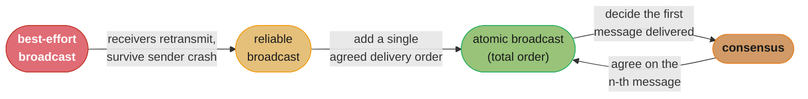
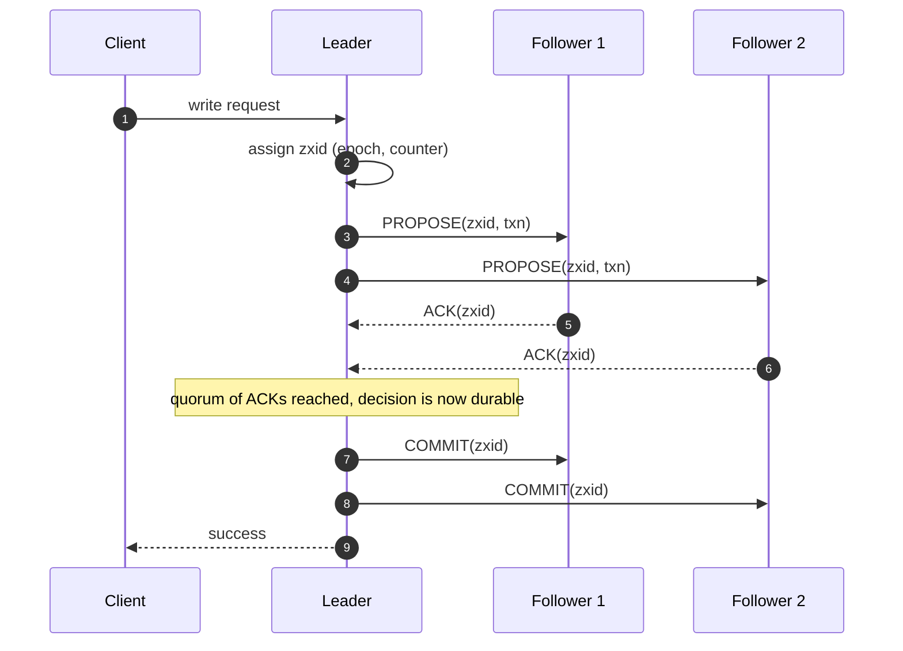
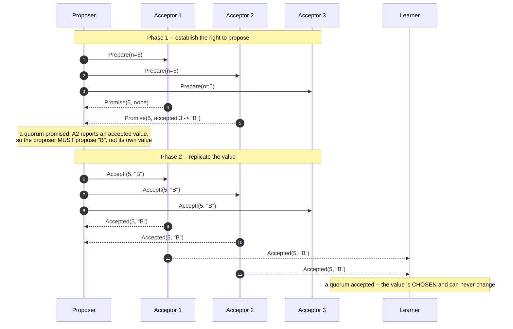
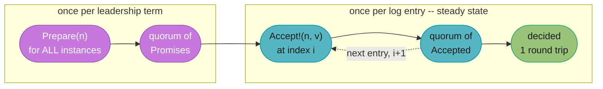
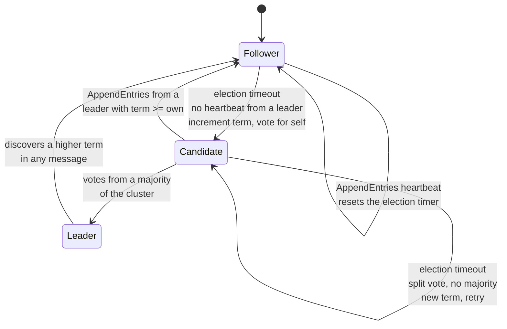
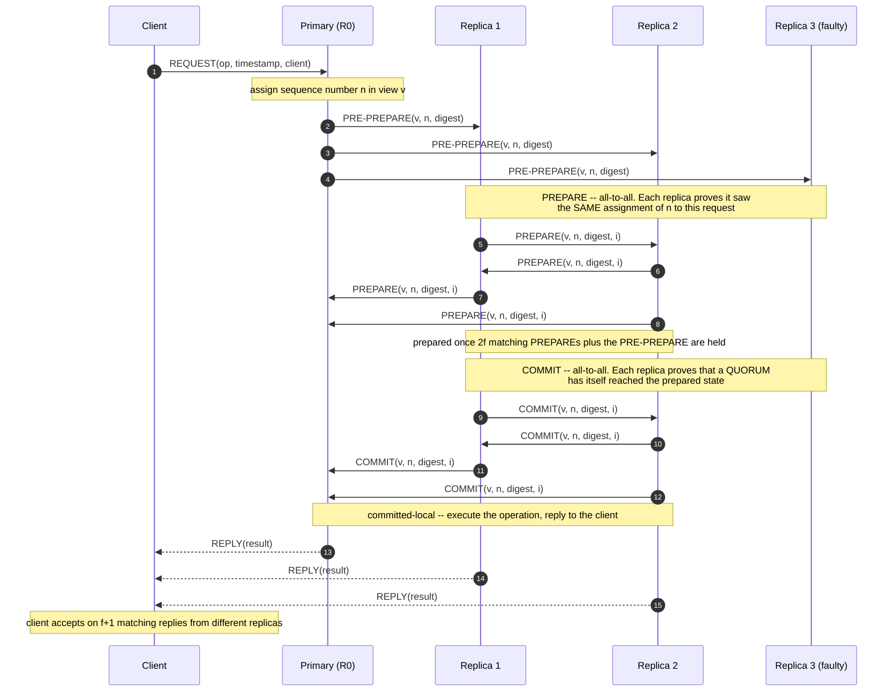
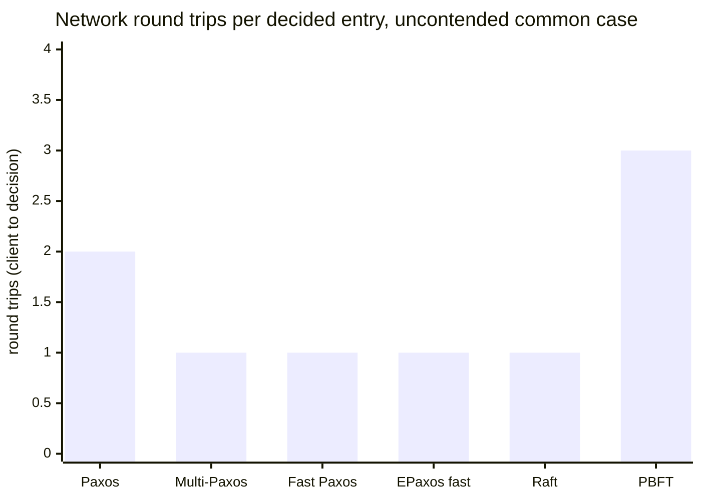

# Chapter 14: Consensus

> Part II — Distributed Systems · Database Internals (Petrov, 1st ed., O'Reilly 2019) · builds on Ch 13 (Distributed Transactions), closes the book

## Chapter Map

Chapter 13 showed that atomic commitment — getting every participant in a distributed
transaction to agree on commit or abort — is *not* consensus: two-phase commit requires
**all** participants to respond and blocks forever if the coordinator dies at the wrong
moment, and three-phase commit trades that for incorrectness under a network partition.
Chapter 14 is the chapter that finally supplies the missing primitive. Consensus lets a
group of processes agree on a single value with only a **majority** participating, which
means it survives the failure of a minority — and once you have that, you have leader
election (Ch 10), replicated state machines (Ch 11), consistent membership (Ch 12), and a
non-blocking commit protocol built on top of a fault-tolerant coordinator instead of a
single one.

The chapter is structured as a ladder rather than a catalogue. It starts with **broadcast**,
climbs from a best-effort send loop to **atomic (total order) broadcast**, and lands on the
structural insight that atomic broadcast and consensus are **the same problem wearing
different clothes** — each can be implemented from the other. It then walks the **Paxos**
family in order of the constraint each variant relaxes (Multi-Paxos removes a round trip,
Fast Paxos removes another at the cost of quorum size, EPaxos removes the leader, Flexible
Paxos removes the majority requirement itself), presents **Raft** as the same guarantees
packaged for comprehensibility, and closes with **PBFT**, which drops the assumption that a
faulty node merely stops rather than lying. This is the book's final chapter, and it is the
one that most directly earns its keep in a system-design interview.

**TL;DR:**
- Consensus must satisfy three properties — **agreement** (no two correct processes decide
  differently), **validity** (the decided value was proposed by someone, not invented), and
  **termination** (every correct process eventually decides). **FLP** proves all three are
  unachievable by a deterministic algorithm in a fully asynchronous system with even one
  crash failure, so every practical algorithm buys termination back with a partial-synchrony
  assumption, a failure detector, or randomization.
- Broadcast is a ladder: **best-effort** gives nothing if the sender crashes mid-send;
  **reliable** broadcast makes receivers retransmit so all-or-none delivery survives sender
  death; **atomic (total order)** broadcast additionally fixes a single delivery order that
  every correct process observes.
- **Atomic broadcast and consensus are equivalent.** Consensus gives you atomic broadcast
  (agree on the *n*-th message); atomic broadcast gives you consensus (decide the first
  message delivered). Every algorithm in the chapter is really one of the two.
- **Paxos** is two phases — `Prepare(n)`/`Promise(n, accepted)` and `Accept!(n, v)`/
  `Accepted(n, v)` — kept safe by exactly two rules: an acceptor that promised ballot *n*
  refuses anything lower, and a proposer that learns of an already-accepted value **must
  propose that value instead of its own**. Safety is never conditional; only termination is.
- **Multi-Paxos** elects a distinguished proposer so phase 1 is amortized over a whole log,
  turning two round trips per entry into one. **Fast Paxos** buys one more round trip with a
  larger quorum plus collision recovery. **EPaxos** removes the leader entirely and commits
  commuting commands out of order. **Flexible Paxos** shows the real requirement is that
  phase-1 and phase-2 quorums *intersect*, not that either is a majority.
- **Raft** is Paxos-strength consensus reorganized for understandability: terms as logical
  clocks, randomized election timeouts to break split votes, the Log Matching property, and
  the rule that a leader may only count replicas to commit an entry **from its own term**.
- **PBFT** needs **3f+1** replicas to tolerate *f* Byzantine faults where crash-tolerant
  consensus needs 2f+1, and needs a third message round (commit) because a Byzantine primary
  can show different replicas different things within the same view.

---

## The Big Question

> How do a group of processes, any minority of which may crash at any moment and whose
> messages may be delayed or reordered arbitrarily, agree on **one** value — permanently,
> with no possibility that two of them later disagree about what was decided?

The chapter frames this precisely. A consensus algorithm must satisfy three properties:

| Property | Statement | What breaks if you lose it |
|---|---|---|
| **Agreement** | No two correct processes decide different values. | Split brain. Two clients read two different "committed" states. |
| **Validity** | The decided value was proposed by one of the participants. | An algorithm that always decides `0` would be trivially agreeing and useless. |
| **Termination** | Every correct process eventually decides. | The algorithm is safe but may hang forever, which is 2PC's blocking problem again. |

And then it delivers the bad news: **FLP** (Fischer, Lynch, Paterson, 1985) proves that in a
**fully asynchronous** system — no bound on message delay, no bound on relative process
speed, no clocks — **no deterministic algorithm can guarantee all three in the presence of
even a single crash failure.** The intuition is exactly the ambiguity Chapter 9 spent a whole
chapter on: a process that has not answered is indistinguishable from a process that will
answer in a moment, so there is always an execution in which the algorithm is forced to wait
on a decision that a single well-timed delay keeps postponing forever.

This is the frame for everything that follows, and it is worth stating flatly because it
explains the *shape* of every algorithm in the chapter: **agreement and validity are never
given up; termination is.** Paxos and Raft are safe under any amount of asynchrony,
partition, or message loss — two nodes never decide differently, full stop. What they lose
under those conditions is progress. Each buys progress back with an assumption FLP does not
cover:

- **Partial synchrony** — after some unknown global stabilization time, message delay is
  bounded. Raft's randomized election timeouts and Multi-Paxos's leader leases both rely on
  this.
- **An unreliable failure detector** (Chapter 9) — an oracle that is eventually accurate
  enough to stop suspecting a correct leader forever.
- **Randomization** — Ben-Or-style algorithms terminate with probability 1 rather than
  deterministically, sidestepping FLP by not being deterministic.

Analogy: a committee of five that must ratify exactly one motion, where any two members may
step out of the room at any time without warning, and notes passed between them may be
delayed for hours or arrive out of order. The rule that keeps them safe is not "wait for
everyone" — that is 2PC, and one absent member stalls the room forever. The rule is
**majority overlap**: any three of them form a quorum, and any two groups of three share at
least one member, so a decision recorded by one quorum cannot be forgotten by the next.
Whoever asks the room for permission must first ask "has anything already been agreed?" —
and if any member says yes, the asker is obliged to re-propose *that* motion rather than the
one they walked in with. That obligation, not the voting, is what makes agreement permanent.

---

## 14.1 Broadcast

Consensus is usually reached not by a single agreement but by a *stream* of them, and the
communication primitive underneath that stream is **broadcast**: one process disseminates a
message to every other process in the group. The chapter builds the primitive up in layers,
each fixing a specific failure the layer below tolerates, and the ladder is worth learning as
a ladder because the top rung turns out to be consensus itself.


*The ladder, and the loop that closes it: atomic broadcast is not merely built on consensus,
it is inter-derivable with it — the double arrow is the chapter's central structural claim.*

### Best-Effort Broadcast

**Best-effort broadcast** is the naive implementation: the sender loops over the member list
and sends the message to each peer, one point-to-point send at a time. It guarantees delivery
only for as long as the sender keeps running.

The failure is trivial to construct and it is exactly why the primitive is not usable on its
own. Take a 5-node group, sender **N1** broadcasting message *m*:

```
  best-effort broadcast, sender crashes mid-loop

  N1  --m-->  N2      ✓ delivered
  N1  --m-->  N3      ✓ delivered
  N1  --X             ✗ N1 crashes here
      (never sent)    N4  has no m
      (never sent)    N5  has no m

  result: N2, N3 have m.  N4, N5 do not, and never will --
          the only process that knew about m is gone.
```
Caption: nothing in the protocol makes a receiver responsible for a message it already
holds, so a sender crash freezes the group in a permanently inconsistent state — half the
members have *m*, half will never learn it existed.

There is no retry that fixes this from the sender's side, because the sender is dead. The
fix has to move the responsibility to the receivers.

### Atomic Broadcast

Before the total-order layer, the chapter names the intermediate rung: **reliable broadcast**
guarantees that a message is delivered by **all** correct processes or **none** of them, even
if the sender fails partway through. The mechanism is retransmission by receivers: every
process that receives *m* for the first time re-broadcasts *m* to everyone else before
delivering it. In the crash above, N2 and N3 each forward *m* to N4 and N5, so the message
completes its dissemination without the sender. The cost is message complexity: the naive
eager form sends O(N²) messages per broadcast, which is why real systems use gossip-based
dissemination (Chapter 12) to trade some latency for a much lower message count.

Reliable broadcast still leaves one thing unspecified, and it is the thing databases care
about most: **order**. Two senders broadcasting concurrently can be delivered in opposite
orders by two different receivers. If those messages are `SET x = 1` and `SET x = 2`, the
two replicas now hold different values while both having "reliably delivered" everything.

**Atomic broadcast** — also called **total order broadcast** — adds exactly that missing
guarantee:

| Property | Guarantee |
|---|---|
| **Atomicity** | Every correct process delivers the message, or none does (inherited from reliable broadcast). |
| **Total order** | All correct processes deliver all messages in **the same order** — even messages from different senders, even concurrent ones. |

That pair is precisely what a **replicated state machine** needs. Feed the same deterministic
state machine the same sequence of commands starting from the same initial state, and every
replica ends in the same state, forever. This is the mechanism underneath every leader-based
replicated database in the book: the log *is* the totally ordered broadcast stream.

**The equivalence.** The chapter's key structural claim is that **atomic broadcast and
consensus are equivalent problems** — an algorithm for either can be used to implement the
other. Both directions are worth being able to sketch in an interview:

- **Consensus → atomic broadcast.** Run one consensus instance per log position. To broadcast
  *m*, propose *m* for the lowest position you believe is undecided. Each instance decides
  exactly one message, and every correct process learns the decisions in position order, so
  delivering in position order gives total order for free. This is exactly Multi-Paxos, and
  exactly Raft's log.
- **Atomic broadcast → consensus.** To reach consensus on a value, every proposer atomically
  broadcasts its proposal, and every process decides the value in the **first** message
  delivered. Total order means every correct process sees the same first message, so they all
  decide the same value — agreement. The value came from a real proposer — validity. And
  delivery guarantees termination.

Because of this equivalence, FLP applies to atomic broadcast too: no deterministic total
order broadcast can guarantee delivery in an asynchronous system with one faulty process.
There is no back door.

### Virtual Synchrony

**Virtual synchrony** is a group-communication framework that packages reliable broadcast
with dynamic membership. Processes join a **group**; the group's membership at any moment is
a **view**; and the framework guarantees that messages are delivered **within a view**, to
exactly the set of processes that view names.

The critical guarantee is the ordering of messages *relative to view changes*: if the
membership changes — a process joins, or is detected as failed and removed — every correct
process agrees on **where in the message stream** that change happened. All members of view
*V* deliver exactly the same set of messages before transitioning to view *V+1*. A message
never straddles a view boundary, delivered by some processes as part of the old membership
and by others as part of the new.

That eliminates a whole class of bugs that plague ad-hoc membership handling: a replica
cannot deliver an update believing there were 5 replicas while its peer delivers the same
update believing there were 4, and a process being evicted cannot leave behind messages that
only half the survivors saw. Virtual synchrony's own message ordering can be configured (FIFO
per sender, causal, or total), and only the total-order configuration gives you the atomic
broadcast of the previous section.

The chapter is candid about the outcome: virtual synchrony is an elegant and influential
model, implemented in group-communication systems like Isis, Totem, and Transis, but it has
**not been widely adopted in database systems**. Databases went the other way — a single
totally ordered replication log driven by a leader-based consensus protocol — which is what
the rest of the chapter is about.

### Zookeeper Atomic Broadcast (ZAB)

**ZAB** is the atomic broadcast protocol underneath Apache ZooKeeper, and it is the chapter's
concrete, shipping example of everything above. Processes take one of two roles: a single
**leader** and a set of **followers**. Clients' write requests are forwarded to the leader,
which is the only process allowed to propose.

Every ZAB state change carries a **zxid**, a 64-bit identifier split into two halves: the
high bits are the **epoch** (which leadership term produced it) and the low bits are a
monotonically increasing **counter** within that epoch. Comparing zxids is therefore a single
integer comparison that orders every operation the system has ever performed, across leader
changes. The epoch half is what makes a stale leader harmless: its zxids are numerically
lower than the new leader's, so its proposals are recognizable as belonging to a dead term.

ZAB runs in three phases:

- **1. Discovery.** A prospective leader collects the latest epoch and the most recent history
   from a quorum of followers. It picks a new epoch strictly higher than any it has seen and
   announces it. Followers that accept the new epoch stop accepting anything from the old one.
- **2. Synchronization.** The new leader brings every follower in the quorum up to date with its
   own history — replaying the transactions the follower is missing and having the follower
   discard any transaction the leader's history does not contain. When this phase completes,
   the quorum has a single agreed prefix. This is the recovery step, and it is where a
   partially-broadcast proposal from the previous epoch is either completed or dropped.
- **3. Broadcast.** Normal operation. The leader proposes, followers acknowledge, the leader
   commits.

The steady-state broadcast phase looks deliberately like two-phase commit with the blocking
removed:


*ZAB's broadcast phase is 2PC minus the blocking: the leader waits for a quorum of ACKs, not
for all of them, so a minority of slow or dead followers cannot stall the write.*

Two properties do the heavy lifting. **All communication channels are FIFO** (TCP), so once
ordering is established at the leader it is preserved end to end, and a follower can never
apply proposal 7 before proposal 6. And ZAB guarantees **primary order**: a new leader must
deliver everything the previous leader committed, in the original order, before proposing
anything of its own — which is exactly what the synchronization phase enforces. Together
these are what let ZooKeeper's clients rely on a single global sequence of state changes.

The chapter draws the comparison directly: ZAB is close in spirit to Multi-Paxos — a stable
distinguished leader amortizing the expensive phase over many operations — but it is
specified in terms of *broadcast* rather than in terms of agreeing on individual values, and
its epoch/zxid scheme makes the leader-change history explicit in every identifier.

---

## 14.2 Paxos

**Paxos** is the algorithm the rest of the field is measured against: the first proven
solution to consensus under crash faults with asynchronous messaging, published by Leslie
Lamport (*The Part-Time Parliament*, 1998, and the far more readable *Paxos Made Simple*,
2001). Its reputation for difficulty is real but misplaced — the core algorithm is short. What
is genuinely hard is that its *safety argument* depends on two rules that look like
bookkeeping and are in fact the whole point.

### Paxos Algorithm

Paxos assigns processes three roles, which are logical and routinely colocated in the same
physical node:

| Role | Responsibility |
|---|---|
| **Proposer** | Receives a value from a client and drives it through both phases. Any number may run concurrently. |
| **Acceptor** | The durable memory of the system. Votes on proposals and persists what it has promised and accepted. Quorums are counted over acceptors. |
| **Learner** | Learns the chosen value and applies it (executes the state machine command, answers the client). |

Every proposal attempt carries a **ballot number** (also called a proposal or round number)
that is **unique per proposer and monotonically increasing**. Uniqueness is usually achieved
by having each proposer draw from a disjoint sequence — with 3 proposers, proposer 1 uses
1, 4, 7, …, proposer 2 uses 2, 5, 8, …, proposer 3 uses 3, 6, 9, …. Two proposers therefore
never use the same ballot, and ballots are globally comparable.

The algorithm runs two phases with four message types:

**Phase 1 — Voting / prepare.**
- `Prepare(n)` — the proposer picks ballot *n* and asks a quorum of acceptors to promise.
- `Promise(n, (n_acc, v_acc))` — an acceptor that has not already promised a ballot **higher
  than n** replies with a promise never to accept any proposal numbered lower than *n*, and
  includes the highest-numbered proposal it has already accepted, if any. If it has promised
  something higher, it refuses (or stays silent).

**Phase 2 — Replication / accept.**
- `Accept!(n, v)` — having collected promises from a quorum, the proposer sends the value.
  **Which value it sends is not its own choice** — see the second safety rule below.
- `Accepted(n, v)` — an acceptor that has not promised a higher ballot in the meantime accepts
  and persists `(n, v)`, and notifies the learners. Once a quorum has accepted, the value is
  **chosen** — permanently, whether or not anybody has yet noticed.


*The whole safety argument lives in the annotated step: the proposer walked in wanting to
propose its own value and walked out obliged to propose "B", because one acceptor's promise
revealed that "B" might already have been chosen.*

**The two rules that make Paxos safe.** Everything else is plumbing.

- **Rule 1 — a promise refuses lower ballots.** Once an acceptor has promised ballot *n*, it will
   never accept a proposal numbered lower than *n*, and it says so in its promise. This is
   what lets a newer ballot invalidate an older one *without any process being able to
   observe both* — the acceptor's durable state is the arbiter.
- **Rule 2 — a proposer that learns of an already-accepted value must propose that value.** When the
   promises come back, the proposer scans them for accepted proposals and takes the value
   attached to the **highest-numbered** one. Only if *no* acceptor in the quorum reports an
   accepted value is the proposer free to propose its own.

Rule 2 is the one people skip, and it is the one that produces agreement. The reasoning: if
some value *v* was already chosen, it was accepted by a quorum. Any new quorum intersects
that one in at least one acceptor. That acceptor reports *v* in its promise. So the new
proposer is compelled to re-propose *v*, and no later ballot can ever choose anything else.
The intersection makes forgetting impossible; rule 2 makes remembering mandatory.

A subtle and often-missed consequence: **a proposer may never learn that its own value was
chosen, and a value may be chosen with nobody yet aware of it.** "Chosen" is a property of the
acceptors' collective durable state, not of anyone's knowledge. This is why learners exist as
a separate role, and why a client typically retries until it observes its own value in the
log rather than assuming success from a timeout.

### Quorums in Paxos

A **quorum** in Paxos is any set of acceptors large enough that any two quorums intersect.
With *N* acceptors the classic choice is a **strict majority**, `⌊N/2⌋ + 1`:

| Acceptors (N) | Majority quorum | Failures tolerated (F) |
|---|---|---|
| 3 | 2 | 1 |
| 5 | 3 | 2 |
| 7 | 4 | 3 |
| 2F+1 | F+1 | F |

Majorities are chosen not because the number matters but because **any two majorities of the
same set share at least one member**, which is the property rule 2 needs. That intersection is
the entire fault-tolerance story of the chapter, and it is why the cluster size formula is
`N = 2F + 1` for crash faults.

Two practical corollaries the chapter draws out:

- **Even-sized clusters buy nothing.** A 6-node cluster needs a quorum of 4 and therefore
  tolerates 2 failures — exactly what a 5-node cluster tolerates with a quorum of 3. The sixth
  node adds latency and message load without adding fault tolerance.
- **Bigger is not better for latency.** Every additional acceptor makes each round trip wait
  on a larger quorum drawn from a wider latency distribution, so 7-node and 9-node clusters
  are chosen for durability and read scaling, not for write speed.

### Failure Scenarios

Paxos's safety is unconditional, but the *shapes* of its failures are what an interview
actually probes. The chapter walks several; here they are with concrete ballots and node
names, on a 3-acceptor cluster (A1, A2, A3, quorum = 2).

**Scenario 1 — a proposer fails after phase 1, before sending any `Accept!`.**
P1 completes `Prepare(1)` with promises from A1 and A2, then crashes. Nothing has been
accepted. P2 comes along with `Prepare(2)`, gets promises reporting no accepted value, and is
free to propose its own value. Harmless: the only cost was one wasted round trip.

**Scenario 2 — a proposer fails partway through phase 2.**
P1 sends `Accept!(1, "X")`; only A1 accepts before P1 crashes. `"X"` is accepted by 1 of 3 —
**not** chosen, since 1 is not a quorum. Now P2 runs `Prepare(2)`. Two sub-cases, and the
difference is the whole reason rule 2 exists:

- P2's quorum is **{A1, A2}**. A1 reports `accepted (1, "X")`. Rule 2 forces P2 to send
  `Accept!(2, "X")` — P2's own value is discarded. `"X"` is *completed* rather than lost.
- P2's quorum is **{A2, A3}**. Neither has accepted anything, so P2 proposes its own `"Y"`,
  and `Accept!(2, "Y")` reaches a quorum. `"Y"` is chosen. A1's stale acceptance of `"X"` at
  ballot 1 is now unreachable: any future proposer that sees both will take the value from the
  **highest** ballot, which is `"Y"` at 2.

Both outcomes are safe. What can never happen is a quorum choosing `"X"` and a later quorum
choosing `"Y"`, because a chosen value would have been reported by the intersecting acceptor.

**Scenario 3 — acceptor failures.** As long as a quorum survives, nothing is lost, because
"chosen" is defined over quorums. Losing a minority costs availability of nothing. Losing a
majority costs progress but not safety — the surviving acceptors' durable state still
constrains any future proposal, so the system resumes correctly when the majority returns.
This is why acceptors **must fsync their promised and accepted state before replying**: an
acceptor that forgets its promise after a restart can accept a lower ballot it already
refused, and that single amnesia is enough to break agreement.

**Scenario 4 — duelling proposers and livelock.** The famous one, and the concrete form of
FLP's impossibility:

```
  duelling proposers -- Paxos livelock (safety intact, progress zero)

  P1: Prepare(1)   -> promised by A1,A2
  P2: Prepare(2)   -> promised by A1,A2      (2 > 1, so the promise supersedes)
  P1: Accept!(1,X) -> REJECTED, acceptors promised 2
  P1: Prepare(3)   -> promised by A1,A2      (P1 retries with a higher ballot)
  P2: Accept!(2,Y) -> REJECTED, acceptors promised 3
  P2: Prepare(4)   -> promised by A1,A2
  P1: Accept!(3,X) -> REJECTED, acceptors promised 4
  ... forever. Every Accept! is invalidated by the other proposer's newer Prepare.

  Nothing unsafe ever happens. Nothing is ever decided either.
```
Caption: two proposers each politely raising their ballot to get past the other produce an
infinite sequence of valid, safe, entirely useless rounds — this is FLP's non-termination
made concrete, and it is the reason Multi-Paxos exists.

The mitigation is not a fix to the safety rules — those are already correct. It is to stop
having concurrent proposers: elect a **distinguished proposer**, and back off randomly when
you do collide. Which is the next section.

### Multi-Paxos

Plain Paxos decides **one** value. A database needs a *sequence* of them — one per log entry.
Running full Paxos per entry costs **two round trips** per operation and reopens the duelling
window on every single one. **Multi-Paxos** fixes both with one idea: elect a **distinguished
proposer** (a **leader**) and let its phase 1 cover *all future log entries at once*.

The insight is that phase 1 is not about a value at all — it is about establishing the right
to propose at ballot *n*. There is no reason that right must be re-established per entry. So:

- The leader runs `Prepare(n)` **once**, for the whole log (formally, for every log position
  from the current one onward).
- Acceptors' promises now say "I will accept nothing below ballot *n* **in any instance**",
  and report any accepted values across the outstanding instances.
- Thereafter, for every new log entry, the leader skips straight to `Accept!(n, v)` at the
  next log index — **one round trip**: leader → acceptors → quorum acknowledged.


*Multi-Paxos amortizes the expensive phase over an entire leadership term: two round trips
become one for every entry after the first, which is the difference between a usable
replicated log and a research paper.*

Details the chapter emphasizes:

- **The leader is an optimization, not a safety requirement.** If two nodes both believe they
  are leader, Paxos's ballot rules still guarantee agreement — the stale leader's `Accept!`
  messages are simply rejected. This is a genuinely important property and it is where
  leader-based Paxos differs from a naive primary-backup scheme, which really does corrupt
  under split brain.
- **Leases.** The leader typically holds a time-bounded **lease**, renewed by heartbeats, which
  bounds how long a partitioned-away leader can keep believing it leads — this is what makes
  local leader reads safe without a round trip. Leases depend on bounded clock drift, which is
  a synchrony assumption, so they buy latency at the cost of an assumption.
- **Log gaps and no-ops.** A new leader may find instances that are partially accepted or
  entirely empty below its own high-water mark. It must resolve every one before serving reads
  — completing those it finds accepted values for (rule 2 again) and filling genuinely empty
  slots with a **no-op** so the log has no holes. A leader that serves reads before finishing
  this can return a state that is missing a committed write.
- **Failed leader → new ballot.** When the leader is suspected (Chapter 9's failure
  detectors), another proposer runs phase 1 with a higher ballot, which both invalidates the
  old leader and recovers the outstanding log entries in the same round trip.

### Fast Paxos

Multi-Paxos got the steady state down to one round trip *from the leader*. But the client is
not the leader: a client's write costs **client → leader → acceptors → leader → client**,
which is **two** network hops before the value is even chosen. **Fast Paxos** (Lamport, 2006)
removes the leader from the critical path by letting clients send their proposals **directly
to the acceptors**, saving that hop.

The price is quorum size and a new failure mode:

- A **classic round** uses a classic quorum, a majority as before.
- A **fast round** requires a **larger quorum** than a classic one. The reason is that fast
  rounds allow two different values to be accepted concurrently by different acceptors — with
  no leader serializing, two clients can send different values into the same instance — so the
  fast quorum must be big enough that after any such collision, the recovery round can still
  determine unambiguously which value (if either) might have been chosen. In the standard
  formulation this puts the fast quorum above three-quarters of the acceptors, versus just
  over half for a classic one.
- When two values do collide, the round fails to choose and the system falls back to a
  **classic round** to recover — **collision recovery**. So Fast Paxos is faster in the
  uncontended case and *slower* than Multi-Paxos in the contended one, because a collision
  costs the saved hop back plus a full recovery round.

The trade is therefore workload-shaped, not universally good: if instances are rarely
contended (partitioned keyspace, one writer per key), Fast Paxos wins a hop on nearly every
write. If many clients write the same key, collisions dominate and the extra quorum size and
recovery rounds make it a loss. The chapter presents it exactly this way — a targeted
optimization, not a replacement.

### Egalitarian Paxos

Every variant so far funnels all writes through one leader, which is a bottleneck, a latency
floor for geographically distant clients, and a single point whose failure stalls the system
until a new one is elected. **Egalitarian Paxos (EPaxos)** (Moraru, Andersen, Kaminsky, 2013)
removes the distinguished leader entirely: **every replica may propose commands**, and each
proposal is handled by that replica acting as the command leader for that command only.

The idea that makes this work is **dependency tracking with commutativity**. Two commands
that do not interfere — `SET x = 1` and `SET y = 2` touch different keys — can be executed in
either order without changing the final state. Total order is *sufficient* for a replicated
state machine but it is not *necessary*; what is necessary is that **interfering** commands
are ordered consistently everywhere.

So EPaxos:

1. Has the command leader send the command **along with the set of commands it believes the
   command depends on** (those it interferes with).
2. Takes the **fast path** — one round trip — when the replicas in the fast quorum agree with
   the proposed dependency set. Otherwise it takes a **slow path**: a second round to agree on
   the union of the dependencies the replicas reported.
3. Commits commands **out of order**, then **executes** them in an order derived from the
   dependency graph — a topological order, with cycles (strongly connected components) broken
   by a deterministic tiebreak such as sequence number, so every replica breaks them the same
   way.

The payoffs are real: **no leader election** on failure (there is no leader to lose), **load
spread evenly** across replicas rather than concentrated on one, and — the property that
motivates it in geo-distributed deployments — a client can commit through its **nearest**
replica instead of paying a round trip to a leader on another continent. The costs are equally
real: the dependency graph must be tracked, exchanged, and stored per command; execution is a
graph traversal rather than a log scan; and conflict-heavy workloads collapse onto the slow
path where EPaxos is more expensive than Multi-Paxos, not less. The chapter's framing is that
EPaxos trades *protocol simplicity* for *leaderlessness*, which pays only when the workload is
genuinely low-conflict.

### Flexible Paxos

**Flexible Paxos** (Howard, Malkhi, Spiegelman, 2016) is the chapter's most quietly
significant result, because it revises an assumption everyone had carried since 1998.

Paxos uses quorums in two distinct places: phase 1 (the `Prepare`/`Promise` exchange, call its
quorum **Q1**) and phase 2 (the `Accept!`/`Accepted` exchange, **Q2**). Classic Paxos takes a
majority for both. Flexible Paxos observes that **the safety argument never actually requires
either quorum to be a majority.** What it requires is that **every phase-1 quorum intersects
every phase-2 quorum**:

```
                        Q1 + Q2 > N
```

That is the whole condition. Majorities satisfy it (`(N/2+1) + (N/2+1) > N`) but they are one
solution among many, and not always the best one. Note also what is *not* required: two
phase-2 quorums need not intersect each other, and neither need two phase-1 quorums, because
rule 2's recovery argument only ever compares a *new* phase-1 quorum against an *old* phase-2
quorum.

Here is the N=5 trade laid out as a grid:

```
  Flexible Paxos on N = 5 acceptors -- pick any (Q1, Q2) with Q1 + Q2 > 5

    Q1 (phase 1, leader election / recovery)
       |  Q2=1   Q2=2   Q2=3   Q2=4   Q2=5
  -----+-----------------------------------
   Q1=1|   ✗      ✗      ✗      ✗      ✓
   Q1=2|   ✗      ✗      ✗      ✓      ✓
   Q1=3|   ✗      ✗      ✓      ✓      ✓     <- Q1=3,Q2=3 is CLASSIC Paxos
   Q1=4|   ✗      ✓      ✓      ✓      ✓     <- Q1=4,Q2=2 is the fast-write config
   Q1=5|   ✓      ✓      ✓      ✓      ✓

  ✓ = Q1 + Q2 > 5, so any phase-1 quorum shares >= 1 acceptor with any phase-2 quorum

  classic     (3,3): steady-state write waits on 3 of 5. Survives 2 acceptor failures.
  fast-write  (4,2): steady-state write waits on only 2 of 5 -- lower latency, less load.
                     But leader election now needs 4 of 5, so it survives only 1 failure
                     for the purpose of ELECTING a new leader.
  read-opt    (2,4): cheap leader election, expensive writes -- rarely useful.
```
Caption: the diagonal `Q1 + Q2 = 6` is the frontier; everything above it is safe and
everything below it can lose a decision. Classic Paxos sits at (3,3) not because it is
optimal but because a single majority rule was simpler to state.

The practical reading of the `(4,2)` configuration: **you can make the common case cheaper by
making the rare case more expensive.** Steady-state writes are constant and latency-sensitive;
leader elections happen rarely. Shrinking Q2 to 2 means every write acknowledges after the two
fastest acceptors reply instead of three, which both lowers tail latency and reduces load. The
cost is that leader recovery now needs 4 of 5 nodes available, so the *availability* of
recovery drops from tolerating 2 failures to tolerating 1. That is a genuine trade, not a free
lunch — and importantly, **safety is unaffected either way**. A configuration violating
`Q1 + Q2 > N` is not slow, it is *wrong*: a new leader can complete phase 1 without ever
touching an acceptor that accepted the previous value, and rule 2 then permits it to propose a
conflicting one.

### Generalized Solution to Consensus

The chapter closes the Paxos family by pulling back to the general form. **Generalized Paxos**
takes the same observation EPaxos exploits — that only *interfering* commands need to be
ordered relative to each other — and states it at the level of the consensus abstraction
itself, rather than as a specific protocol.

The mechanism is to replace "the decided value" with a **command structure (CStruct)**: a
partially ordered set of commands that grows monotonically as commands are appended. Replicas
need not agree on a single total sequence; they need to agree on CStructs that are compatible,
in the sense that any two replicas' structures can be extended to a common one. Non-commuting
commands force ordering constraints into the structure; commuting commands do not, and can be
appended in different orders at different replicas with identical results.

Framed this way, the whole family becomes points in one design space:

| The general algorithm's knob | Classic Paxos | Multi-Paxos | Fast Paxos | EPaxos | Flexible Paxos |
|---|---|---|---|---|---|
| Who may propose | any proposer | one distinguished leader | client, direct to acceptors | every replica | unchanged (any / leader) |
| Ordering agreed on | one value | one total order (a log) | one value, contention-permitting | a partial order by dependency | unchanged |
| Quorum rule | majority both phases | majority both phases | classic + larger fast quorum | fast/slow quorums | any Q1 + Q2 > N |
| What is optimized | nothing — the baseline | round trips per entry | one network hop | leaderlessness, locality | steady-state quorum size |

The pedagogical value the chapter draws from this is that you should not memorize five
algorithms. You should learn one — the two phases and the two rules — and then read each
variant as the answer to "which constraint did this one relax, and what did it pay?"

---

## 14.3 Raft

**Raft** (Ongaro and Ousterhout, 2014) was designed with an explicitly stated goal that is
unusual for a consensus algorithm: **understandability**. It provides the same guarantees as
Multi-Paxos — a fault-tolerant, totally ordered replicated log under crash faults with a
majority quorum — but it specifies the parts Paxos leaves as exercises: how a leader is
elected, how logs are reconciled after a leader change, and how membership changes safely.
That specificity is why it is the algorithm implemented in etcd, Consul, TiKV, CockroachDB,
and most systems built after 2014.

Raft's core structural decisions:

- **Strong leadership.** Log entries flow **only** from leader to followers, never the other
  way. A follower never appends an entry of its own. This single restriction removes most of
  the case analysis that makes Paxos hard to reason about.
- **Terms as logical clocks.** Time is divided into **terms**, numbered with consecutive
  integers. Each term begins with an election and has **at most one leader** — a term with a
  split vote has none and ends immediately. Every message carries a term. A node that sees a
  term higher than its own **immediately reverts to follower** and adopts that term; a node
  that receives a message from a *lower* term rejects it. The term number is Raft's ballot
  number, and this one rule is what neutralizes a stale leader.
- **Three roles, one at a time**: follower, candidate, leader.


*Every downward transition has the same trigger — seeing a term at least as high as your own
means someone else already won, so you step down without argument. That uniformity is most of
what makes Raft easier to reason about than Paxos.*

**Leader election.** A follower that receives no `AppendEntries` from a leader within its
**election timeout** becomes a candidate: it increments its term, votes for itself, and sends
`RequestVote` RPCs to all peers. A peer grants its vote if (a) it has not already voted in
this term, and (b) the candidate's log is **at least as up to date** as its own — compared by
last log term first, then last log index. That second condition is the **Election
Restriction**, and it is essential: it guarantees the winner already holds every committed
entry, so Raft never needs to ship missing entries *to* a new leader.

A candidate with votes from a **majority** becomes leader and immediately sends heartbeats to
suppress further elections.

**Log Matching Property.** Raft maintains an invariant that makes log reconciliation almost
mechanical: *if two logs contain an entry with the same index and term, then the logs are
identical in all entries up through that index.* It is enforced by a consistency check on
every `AppendEntries`: the message carries `prevLogIndex` and `prevLogTerm`, and a follower
rejects the append unless its own log contains a matching entry at that position. By
induction, one matching pair implies the entire prefix matches — so a single successful append
proves prefix agreement without comparing the whole log.

**Commitment, and the rule people get wrong.** An entry is **committed** once the leader has
replicated it to a majority — and then, by Log Matching, all preceding entries are committed
too. But a leader **may only count replicas to commit an entry from its own current term.**
An entry left over from a previous term is *not* committed just because it now sits on a
majority of nodes; it becomes committed indirectly, when a later entry **from the current
term** commits and carries the prefix with it. Skipping this rule produces a genuine safety
violation — the scenario the Raft paper devotes a figure to, in which an entry replicated to a
majority by an old leader is later overwritten by a different entry at the same index.

### Leader Role in Raft

Once elected, the leader is the only writer and does four things continuously:

- **1. Serves client writes.** It appends the command to its own log, then sends `AppendEntries`
   to all followers in parallel. Once a majority acknowledges, the entry is committed, the
   leader applies it to its state machine and answers the client. **One round trip in the
   steady state** — the same cost as Multi-Paxos, which is not a coincidence.
- **2. Heartbeats.** Empty `AppendEntries` messages sent at an interval well below the election
   timeout — typically a **heartbeat every 50 ms against an election timeout of 150–300 ms**
   — which suppress elections and carry the leader's updated commit index to followers.
- **3. Tracks per-follower progress.** For each follower the leader keeps `nextIndex` (the next
   entry to send) and `matchIndex` (the highest entry known replicated). On a rejected append
   it decrements `nextIndex` and retries, walking backwards until it finds the last agreeing
   position, then streams forward from there. Followers never argue about the content — they
   truncate and take the leader's version.
- **4. Advances the commit index** to the highest index replicated on a majority *and belonging
   to the current term*, per the rule above.

### Failure Scenarios

**Split vote.** Two followers time out at nearly the same instant, both become candidates in
term 5, and the votes split — in a 5-node cluster, 2 for one candidate, 2 for the other, 1
undecided or already spent. Neither reaches a majority. No leader is elected in term 5, and
after another timeout the candidates try again in term 6.

Left unmitigated this can repeat, which is Paxos's duelling-proposer livelock in a new hat.
Raft's answer is **randomized election timeouts**: each node draws its timeout uniformly from
a range (commonly 150–300 ms) and re-draws on each retry. The probability that two nodes draw
close values shrinks with each round, so in practice a leader is elected within one or two
terms. Note what this is doing in FLP terms — randomization is one of the three sanctioned
ways to buy termination back, and Raft spends it here.

**Log divergence after a leader change.** The interesting failure. A leader accepts writes,
replicates them to only part of the cluster, and dies. Concretely, with terms in the cells and
log indices across the top:

```
  log divergence after the term-2 leader crashes (5 nodes, index -> term)

  index:      1    2    3    4    5
  ---------------------------------------------------------------
  N1  (old leader, term 2)   1    1    2    2    2     <- crashed here
  N2                         1    1    2    2    -
  N3                         1    1    2    -    -
  N4                         1    1    -    -    -
  N5                         1    1    -    -    -

  committed?  yes  yes  yes  NO   NO
              (index 3 is on 3 of 5 = majority; 4 and 5 are on 2 of 5 and 1 of 5)

  Election restriction: only N1, N2, or N3 can win term 3 -- N4 and N5 have shorter
  logs than a majority of the cluster and will be refused votes by N1/N2/N3.

  Say N2 wins term 3 and appends its own entry at index 5:

  index:      1    2    3    4    5
  ---------------------------------------------------------------
  N2  (new leader, term 3)   1    1    2    2    3
  N3  after AppendEntries    1    1    2    2    3     <- index 4 backfilled
  N4  after AppendEntries    1    1    2    2    3
  N5  after AppendEntries    1    1    2    2    3
  N1  rejoins                1    1    2    2    3     <- its own index-5 (term 2)
                                                          entry is TRUNCATED and replaced

  N1's uncommitted term-2 entry at index 5 is discarded. It was never acknowledged to
  any client, so nothing is lost that was ever promised.
```
Caption: divergence is resolved unilaterally — the leader's log is the truth and followers
truncate to match. The Election Restriction is what makes that safe: a node missing a
committed entry can never win, so the leader's log always contains everything committed.

**A stale leader returning.** N1 wakes up still believing it leads in term 2 and sends
`AppendEntries`. Followers reject it because their term (3) is higher; the rejection carries
term 3; N1 sees a higher term and immediately steps down to follower. A client that was still
talking to N1 receives an error rather than a stale write. Note that N1 could have served a
**stale read** during its isolation if reads bypass the log — which is why production Raft
systems either route reads through the log, use **read leases** bounded by clock drift, or
confirm leadership with a heartbeat round (**ReadIndex**) before answering.

---

## 14.4 Byzantine Consensus

Every algorithm so far assumes the **crash-stop** (or crash-recovery) failure model: a faulty
process stops, or pauses, but never lies. It never sends a message it did not compute, never
sends different messages to different peers, never forges another node's identity. Chapter 8's
failure taxonomy also named the model where those assumptions fail — **Byzantine faults**,
where a process may behave arbitrarily, whether from a bug, memory corruption, a compromised
node, or genuine malice.

**Why the cluster size changes from 2f+1 to 3f+1.** This is the single most-asked fact in
this section, and the reason is worth understanding rather than memorizing.

Under crash faults, a quorum of `f+1` out of `2f+1` suffices because a message you *do*
receive is truthful. You need only enough responses to guarantee overlap with any previous
quorum.

Under Byzantine faults, a received message may be a lie, so a quorum must be large enough that
the honest members within it *outvote* the faulty ones — and it must do so while still being
reachable when *f* nodes are unresponsive. Work it through with N replicas and f faulty:

```
  why 3f + 1

  1. You cannot wait for more than N - f replies -- the f faulty nodes may never answer,
     and you cannot distinguish "faulty" from "slow" (Chapter 9).
     So the quorum size must satisfy:  Q <= N - f

  2. Any two quorums must intersect in at least one HONEST replica. Two quorums of size Q
     out of N overlap in at least  2Q - N  replicas. Up to f of those may be faulty, so:
                                    2Q - N > f     i.e.   Q > (N + f) / 2

  3. Combine:   (N + f)/2 < Q <= N - f
                (N + f)/2 < N - f
                 N + f    < 2N - 2f
                    3f    < N          ->   N >= 3f + 1

  Smallest useful cluster: f = 1  ->  N = 4, quorum = 2f + 1 = 3.
  Compare crash faults:    f = 1  ->  N = 3, quorum =  f + 1 = 2.
```
Caption: the extra `f` in the cluster size is the price of the intersection needing to contain
an honest node rather than merely *a* node — under crash faults any surviving node tells the
truth, so overlap of one is enough.

So a Byzantine-tolerant cluster needs `N ≥ 3f+1` replicas and a quorum of `2f+1`. Tolerating
one liar costs 4 nodes; tolerating two costs 7.

### PBFT Algorithm

**PBFT** — Practical Byzantine Fault Tolerance (Castro and Liskov, 1999) — is the algorithm
that made Byzantine consensus practical rather than theoretical, running in the partially
synchronous model with cryptographic message authentication (MACs for the common path,
digital signatures where non-repudiation is needed) and message digests so replicas can
compare state without shipping it.

Replicas are numbered, and in each **view** *v* one replica is the **primary** —
`p = v mod N` — with the rest as **backups**. Every request carries a **sequence number**
assigned by the primary, which is what establishes total order. The common path runs **three**
message rounds:


*Three rounds, and the third is not redundant: PREPARE establishes agreement on ordering
within a view, COMMIT establishes that enough replicas hold that agreement to carry it across
a view change.*

The phases in detail:

| Phase | Who sends | What it establishes | Threshold |
|---|---|---|---|
| **Pre-prepare** | primary → all backups | proposes the binding of sequence number *n* to this request in view *v* | 1 message |
| **Prepare** | every backup → all replicas | that a quorum agrees on that binding — the ordering within view *v* | 2f matching PREPAREs + the PRE-PREPARE → **prepared** |
| **Commit** | every replica → all replicas | that a quorum has *reached* the prepared state, so the ordering survives a view change | 2f+1 matching COMMITs → **committed-local**, then execute |

**Why the commit round is not redundant.** This is the question that separates people who
have read PBFT from people who have heard of it. The `prepared` predicate guarantees that no
two honest replicas prepare *different* requests for the same sequence number **within the
same view** — that is real agreement, and under crash faults it would be enough. It does not
guarantee that the request will still be ordered at *n* after a **view change**. A Byzantine
primary can send PRE-PREPARE to only some replicas and then stop; a subset becomes prepared,
the rest do not, and the primary is then replaced. Without a commit round, the new primary
cannot tell whether the old ordering must be preserved or may be discarded, and different
honest replicas could execute different requests at *n*. The COMMIT round fixes this by making
each replica announce "I know a quorum is prepared" — and because 2f+1 replicas announce it,
**any future quorum of 2f+1 must contain at least one honest replica that holds that
knowledge** and can prove it to the new primary. Commit is what makes agreement durable across
leadership changes, not merely within one.

Also note the client's rule: a client waits for **f+1 matching replies from different
replicas** before accepting a result. Since at most *f* replicas are faulty, f+1 matching
replies must include at least one honest one — and honest replicas only reply with a result
they actually computed after committing.

**View changes.** If the primary is faulty or unresponsive, backups drive a **view change**. A
backup whose timer expires on a request it forwarded broadcasts `VIEW-CHANGE(v+1, …)`
including its stable checkpoint and the set of requests it has prepared but not yet seen
committed. When the primary of view *v+1* collects **2f+1** VIEW-CHANGE messages, it computes
a new set of PRE-PREPAREs that preserves every request that could possibly have committed in a
previous view, and broadcasts `NEW-VIEW`. Requests that only reached the prepared state on a
minority are re-proposed or replaced with a no-op, exactly analogously to a Multi-Paxos leader
resolving its log gaps.

**Cost.** PBFT's common path is **O(N²) messages** per request, because both the PREPARE and
COMMIT rounds are all-to-all — with N=4 that is modest, but it is the reason PBFT-family
protocols are deployed at tens of replicas rather than thousands, and why cryptographic
verification cost per message matters as much as network cost.

### Recovery and Checkpointing

The three-round protocol leaves every replica holding a message log containing pre-prepares,
prepares, and commits for every request it has processed. Unbounded, that log grows forever
and makes recovery of a lagging or restarted replica impossible in practice. PBFT bounds it
with **checkpointing**.

Periodically — every *K* requests, with K commonly a round number like 100 — each replica
takes a **checkpoint** of its state and broadcasts `CHECKPOINT(n, state-digest, i)`. When a
replica collects **2f+1 matching CHECKPOINT messages** for sequence number *n* (including its
own), that checkpoint becomes **stable**: the collected messages form a **proof of
correctness** that a quorum agrees on the state digest at *n*. The replica can then discard
all pre-prepare, prepare, and commit messages for sequence numbers **at or below n**, plus all
earlier checkpoints.

Two mechanisms depend on this:

- **Watermarks.** Replicas maintain a **low watermark** *h*, the sequence number of the last
  stable checkpoint, and a **high watermark** `H = h + L` for some window size *L* (commonly a
  small multiple of K, e.g. 2K). Replicas **refuse to accept** a pre-prepare with a sequence
  number outside `(h, H]`. This bounds how far ahead a faulty primary can run — it cannot
  exhaust replicas' memory by assigning sequence number 10,000,000 to the next request, and it
  cannot make the log grow without the checkpoints that would advance *h*.
- **Recovery.** A replica that has fallen behind or restarted does not replay history from the
  beginning. It fetches the latest **stable checkpoint** — validated against the 2f+1 signed
  digests that made it stable, so a faulty peer cannot feed it a forged state — and then
  replays only the messages after that checkpoint. This is what makes the protocol survivable
  in practice: recovery cost is bounded by the checkpoint interval, not by uptime.

The design echoes Chapter 5's checkpointing in the recovery manager, and for the same reason:
a log you can never truncate is a log that eventually kills the system, and the truncation
point must be provable rather than assumed — here, provable against a Byzantine quorum.

---

## Beyond the book — where this line of work went after 2019

> The chapter, published in 2019, presents PBFT as *the* practical Byzantine protocol and
> presents the Paxos family and Raft as the crash-fault standards. It does not discuss the
> BFT protocols that followed PBFT, and it does not discuss formally verified consensus
> implementations. The paragraph below is the repo's editorial note, not Petrov's.

PBFT's O(N²) common path is the constraint that later work attacked. Protocols in the
**HotStuff** line (2018, and the basis of several blockchain consensus layers) restructure the
same three-phase idea around a leader-collected threshold signature, reducing common-path
message complexity toward O(N) and making the view change cost linear as well — which is what
makes hundreds of replicas viable rather than dozens. **Tendermint** popularized a
BFT-with-locking variant in the same period. On the crash-fault side, Raft's dominance since
2014 has held: the practical evolution has been in *implementations* rather than protocols —
formally verified cores, learner/witness replicas that vote without storing full state, and
joint-consensus membership changes — and in leaderless and multi-leader deployments where
EPaxos-style ideas resurface under different names. None of this changes a single claim in the
chapter; the two safety rules of Paxos, `Q1 + Q2 > N`, and `N ≥ 3f+1` are all exactly as
stated.

---

## Visual Intuition

**Quorum intersection is the entire idea.** Every algorithm in the chapter is a different
packaging of one geometric fact:

```
  why any two majorities of 5 must share a member

  acceptors:        A1   A2   A3   A4   A5

  quorum P (old):  [A1   A2   A3]  A4   A5      chose value "X"
  quorum Q (new):   A1  [A2   A3   A4]  A5      running a new ballot
                         ^^^^^^^^
                    overlap = A2, A3 -- at least one member of Q
                    already accepted "X" and will report it in its Promise

  There is NO way to pick 3 of 5 twice without overlapping: 3 + 3 = 6 > 5.
  Rule 2 then FORCES the new proposer to re-propose "X".

  Break the arithmetic (say a quorum of 2 of 5) and it fails immediately:
  quorum P = {A1, A2}, quorum Q = {A4, A5} -- disjoint. Q never hears about "X"
  and happily chooses "Y". Two values chosen. Agreement violated.
```
Caption: `2 + 2 = 4 ≤ 5` is not a performance problem, it is a correctness bug — and Flexible
Paxos's `Q1 + Q2 > N` is exactly this arithmetic, stated once instead of assumed twice.

**Round trips in the common case**, which is what latency budgets actually turn on:


*Classic Paxos pays two round trips per value because phase 1 is per-instance. Every crash-
fault optimization in the chapter is an attack on that number, and PBFT's three rounds are the
price of tolerating lies rather than only crashes.*

**The failure model determines the cluster size**, and nothing else does:

```
  cluster size for a given fault tolerance

  faults tolerated (f):     1        2        3
  ------------------------------------------------------
  crash faults, N=2f+1:     3        5        7      quorum = f+1  (2, 3, 4)
  Byzantine,    N=3f+1:     4        7       10      quorum = 2f+1 (3, 5, 7)

  the gap is the cost of "a reply may be a lie" -- you need the intersection to contain
  an honest replica, not merely a replica.
```
Caption: the same fault count costs one to three extra machines under the Byzantine model, and
the quorum roughly doubles — which is why Byzantine tolerance is reserved for genuinely
adversarial settings rather than being the default.

---

## Key Concepts Glossary

- **Consensus** — the problem of getting a group of processes to agree on a single value,
  satisfying agreement, validity, and termination.
- **Agreement** — no two correct processes decide different values.
- **Validity** — the decided value was proposed by one of the participants, not invented by
  the algorithm.
- **Termination** — every correct process eventually decides.
- **FLP impossibility** — the result that no deterministic algorithm guarantees all three
  consensus properties in a fully asynchronous system with even one crash failure.
- **Partial synchrony** — the assumption that message delay becomes bounded after some unknown
  point in time; the usual way termination is bought back.
- **Broadcast** — dissemination of a message from one process to every member of a group.
- **Best-effort broadcast** — a send loop with no guarantee if the sender crashes partway.
- **Reliable broadcast** — broadcast where all correct processes deliver the message or none
  do, achieved by having receivers retransmit.
- **Atomic broadcast / total order broadcast** — reliable broadcast plus a single delivery
  order observed identically by every correct process.
- **Equivalence of atomic broadcast and consensus** — each problem can be solved using an
  algorithm for the other.
- **Replicated state machine** — identical deterministic state machines fed the same ordered
  command sequence, therefore ending in identical states.
- **Virtual synchrony** — a group-communication model where messages are delivered within a
  **view**, and membership changes are ordered consistently relative to message delivery.
- **View (virtual synchrony)** — the group's membership at a point in time; a membership
  change begins a new view.
- **ZAB** — ZooKeeper Atomic Broadcast, a leader-based atomic broadcast protocol with
  discovery, synchronization, and broadcast phases.
- **zxid** — ZAB's 64-bit transaction identifier, `(epoch, counter)`, that totally orders every
  state change across leadership terms.
- **Epoch (ZAB)** — the leadership-term half of a zxid, which makes a stale leader's proposals
  numerically identifiable and therefore rejectable.
- **Primary order (ZAB)** — the guarantee that a new leader delivers everything the previous
  leader committed, in order, before proposing its own.
- **Paxos** — Lamport's two-phase consensus algorithm for crash faults, the basis of the family.
- **Proposer** — the Paxos role that drives a value through both phases.
- **Acceptor** — the Paxos role that votes and holds the durable promised/accepted state;
  quorums are counted over acceptors.
- **Learner** — the Paxos role that learns the chosen value and acts on it.
- **Ballot number / proposal number** — the unique, monotonically increasing identifier of a
  Paxos proposal attempt.
- **Prepare(n)** — Paxos phase-1 request asking acceptors to promise ballot *n*.
- **Promise(n, accepted)** — an acceptor's phase-1 reply: a commitment to refuse lower ballots,
  plus the highest-numbered proposal it has already accepted.
- **Accept!(n, v)** — Paxos phase-2 request carrying the value.
- **Accepted(n, v)** — an acceptor's phase-2 acknowledgement; a quorum of these makes the value
  **chosen**.
- **Chosen** — a value accepted by a quorum of acceptors; permanent, and possibly not yet known
  to any process.
- **Quorum** — a set of acceptors large enough that any two such sets intersect; classically a
  majority, `⌊N/2⌋+1`.
- **Duelling proposers** — two proposers repeatedly invalidating each other's ballots,
  producing livelock with no safety violation.
- **Multi-Paxos** — Paxos with a distinguished proposer whose single phase 1 covers a whole log,
  reducing steady state to one round trip per entry.
- **Distinguished proposer / leader** — the single proposer a Multi-Paxos cluster funnels
  proposals through; an optimization, never a safety requirement.
- **Lease** — a time-bounded, heartbeat-renewed grant of leadership that permits local reads;
  depends on bounded clock drift.
- **No-op (log gap filling)** — the empty entry a new leader writes into a log position it
  found genuinely undecided, so the log has no holes.
- **Fast Paxos** — a variant where clients send proposals directly to acceptors, saving a
  network hop at the cost of a larger fast quorum and collision recovery.
- **Collision (Fast Paxos)** — two different values accepted concurrently in one instance,
  forcing a fallback classic recovery round.
- **Egalitarian Paxos (EPaxos)** — a leaderless variant where any replica proposes, commands
  carry dependency sets, and commuting commands commit out of order.
- **Command interference / commutativity** — whether two commands' execution order changes the
  resulting state; only interfering commands need to be ordered.
- **Flexible Paxos** — the result that Paxos requires only `Q1 + Q2 > N`, not a majority in
  each phase, allowing the steady-state quorum to shrink as the recovery quorum grows.
- **Generalized Paxos / CStruct** — the general form in which replicas agree on a partially
  ordered command structure rather than a single total order.
- **Raft** — a crash-fault consensus algorithm designed for understandability, with strong
  leadership, terms, and a specified election and reconciliation procedure.
- **Term (Raft)** — a monotonically increasing integer acting as a logical clock; at most one
  leader per term.
- **Candidate** — the Raft role a follower assumes when its election timeout expires.
- **Election timeout** — the randomized interval (commonly 150–300 ms) after which a follower
  with no heartbeat starts an election.
- **Election Restriction** — Raft's rule that a vote is granted only to a candidate whose log
  is at least as up to date as the voter's, guaranteeing the winner holds every committed entry.
- **Log Matching Property** — if two logs hold an entry with the same index and term, the logs
  are identical in every preceding entry.
- **AppendEntries** — Raft's log-replication and heartbeat RPC, carrying `prevLogIndex` and
  `prevLogTerm` for the consistency check.
- **nextIndex / matchIndex** — the leader's per-follower bookkeeping for what to send next and
  what is known replicated.
- **Current-term commitment rule** — a Raft leader may only commit by replica count an entry
  from its own term; earlier entries commit indirectly with it.
- **Split vote** — an election in which no candidate reaches a majority, resolved by randomized
  timeouts and a new term.
- **Byzantine fault** — arbitrary process behaviour, including sending different or forged
  messages to different peers.
- **PBFT** — Practical Byzantine Fault Tolerance, a three-round Byzantine consensus protocol
  for the partially synchronous model.
- **View (PBFT)** — the numbered configuration in which one designated replica is primary;
  `p = v mod N`.
- **Primary / backup (PBFT)** — the replica that assigns sequence numbers in a view, and the
  rest.
- **Pre-prepare** — the primary's proposed binding of a sequence number to a request.
- **Prepare** — the all-to-all round establishing agreement on that binding within a view.
- **Commit (PBFT)** — the all-to-all round establishing that a quorum is prepared, so the
  ordering survives a view change.
- **Prepared / committed-local** — the predicates a replica reaches after 2f matching PREPAREs
  and 2f+1 matching COMMITs respectively.
- **View change** — the replacement of a faulty primary, driven by 2f+1 VIEW-CHANGE messages
  and concluded by NEW-VIEW.
- **Checkpoint (PBFT)** — a periodic state snapshot broadcast with its digest; **stable** once
  2f+1 matching CHECKPOINT messages prove a quorum agrees on it.
- **Low / high watermark** — the sequence-number window `(h, H]` outside which replicas refuse
  pre-prepares, bounding log growth and a faulty primary's reach.

---

## Tradeoffs & Decision Tables

**The chapter's algorithms side by side.** Round trips are counted in the uncontended common
case, from the client's perspective where noted.

| Algorithm | Round trips (common case) | Quorum | Leader required | Fault model | Distinctive cost |
|---|---|---|---|---|---|
| **Paxos** (classic, single decree) | 2 (phase 1 + phase 2) | majority both phases | no | crash | phase 1 per value; duelling proposers |
| **Multi-Paxos** | 1 per entry after election | majority both phases | yes (distinguished proposer) | crash | leader is a bottleneck and a failover event |
| **Fast Paxos** | 1, client direct to acceptors | classic majority + larger fast quorum | no, in the fast path | crash | collisions force a recovery round; bigger quorum |
| **EPaxos** | 1 on the fast path, 2 on the slow path | fast quorum, else classic | no — leaderless | crash | dependency tracking and graph-order execution |
| **Flexible Paxos** | as its base algorithm | any `Q1 + Q2 > N` | as its base | crash | shrinking Q2 shrinks recovery availability |
| **Raft** | 1 per entry after election | majority | yes, strong leadership | crash | all writes through one leader; election gap |
| **PBFT** | 3 (pre-prepare, prepare, commit) | 2f+1 of 3f+1 | yes (primary, per view) | Byzantine | O(N²) messages plus cryptographic verification |

**Which failure model do you actually need?**

| Situation | Model | Cluster for f=2 |
|---|---|---|
| One organization's own datacenters, trusted hardware and operators | crash-stop | 5 nodes |
| Same, but with suspect hardware — silent disk corruption, cosmic-ray bit flips | crash + checksums, not full BFT | 5 nodes plus end-to-end checksums |
| Mutually distrusting parties, or any adversarial participant | Byzantine | 7 nodes |

**Cluster sizing for crash-fault consensus.**

| N | Quorum | Tolerates | Comment |
|---|---|---|---|
| 3 | 2 | 1 | Minimum useful. One node down means zero headroom during maintenance. |
| 5 | 3 | 2 | The common production default: survives one failure *and* one planned restart. |
| 6 | 4 | 2 | Same tolerance as 5, more latency and load. Avoid even sizes. |
| 7 | 4 | 3 | Higher durability, wider quorum latency distribution. |

**Choosing between Raft and a Paxos variant.**

| If you need… | Reach for |
|---|---|
| A replicated log, an understandable spec, and an existing library | Raft |
| Maximum steady-state write throughput on a fixed cluster | Multi-Paxos with Flexible Paxos quorums (small Q2) |
| Writes committed at the client's nearest replica, low conflict rate | EPaxos |
| One network hop saved on rarely-contended keys | Fast Paxos |
| Tolerance of nodes that lie, not merely nodes that stop | PBFT or a successor |

---

## Common Pitfalls / War Stories

- **Confusing atomic commitment with consensus.** 2PC (Chapter 13) requires **every**
  participant to vote and blocks on coordinator failure; consensus requires only a
  **majority** and survives a minority failure. Building "distributed transactions" on a
  single non-replicated coordinator, then being surprised when its death hangs every
  in-flight transaction, is the canonical version of this mistake. The fix is not a better
  timeout, it is replicating the coordinator's decision log with consensus.
- **Skipping rule 2 and letting a proposer propose its own value.** The single most damaging
  Paxos implementation bug. It looks harmless — the proposer got its quorum of promises,
  surely it can now propose what the client asked for — and it silently breaks agreement the
  first time a previous ballot's value was partially accepted. The promises must be scanned,
  and the highest-numbered accepted value must win.
- **Acceptors not fsyncing promised/accepted state before replying.** An acceptor that
  acknowledges from memory and then restarts has *forgotten* a promise it made, and may accept
  a ballot it already refused. Two values get chosen. This class of bug is invisible under
  testing because it needs a crash in a specific microsecond window, and it is exactly what
  makes consensus implementations expensive to get right.
- **Committing a previous term's entry by replica count in Raft.** A leader sees an old entry
  now sitting on a majority and marks it committed. That entry can still be overwritten by a
  future leader, because the majority holding it may not include the nodes that will win the
  next election. Only entries from the **current** term may be committed by counting; earlier
  ones ride along.
- **Stale-leader reads.** A partitioned leader still believes it leads and answers reads from
  local state. Writes are safe — its `AppendEntries` are rejected — but reads are not, and a
  client can observe a value that was overwritten minutes ago. Route reads through the log,
  use a lease bounded by clock drift, or confirm leadership with a heartbeat round before
  answering.
- **Even-numbered clusters.** A 4-node cluster needs a quorum of 3 and tolerates 1 failure —
  identical tolerance to a 3-node cluster, at higher cost. A 6-node cluster tolerates 2, the
  same as 5. Every even size pays for a node that buys nothing.
- **Deploying two datacenters and expecting partition tolerance.** Split a 5-node cluster 3/2
  across two sites and the 2-node site is unavailable for writes during a partition — which is
  correct, and usually not what the person who drew the diagram expected. Consensus needs an
  odd number of *failure domains*, which is why three-site deployments and witness/tiebreaker
  nodes exist.
- **Choosing Flexible Paxos quorums without accounting for recovery.** Shrinking Q2 to 2 out
  of 5 makes writes fast and is perfectly safe — until two nodes are down and the cluster
  cannot assemble the Q1 of 4 needed to elect a new leader. Safety is preserved; availability
  of *recovery* is what was traded away, and it is easy to trade it away by accident.
- **Assuming a leader-based protocol is unsafe under split brain.** It is not, and treating it
  as if it were leads to bolt-on fencing that adds bugs. Two Multi-Paxos leaders or two Raft
  leaders in different terms cannot both commit — the higher ballot or term invalidates the
  lower. What *is* unsafe is a naive primary-backup scheme with no ballot mechanism, which is a
  different thing entirely.
- **Reaching for Byzantine tolerance where crash tolerance plus checksums would do.** PBFT
  costs a bigger cluster, O(N²) messages, and per-message cryptography. Silent data corruption
  from bad hardware is real, but it is addressed far more cheaply with end-to-end checksums and
  verification than with a full Byzantine protocol. Reserve BFT for genuinely mutually
  distrusting participants.

---

## Real-World Systems Referenced

**ZAB / atomic broadcast:** Apache ZooKeeper. **Paxos and Multi-Paxos:** Google Chubby (the
lock service whose Paxos implementation experience produced the well-known "Paxos Made Live"
account of the gap between the algorithm and a working system), Google Spanner (Multi-Paxos
per replica group), Apache Cassandra's lightweight transactions (Paxos for compare-and-set).
**Raft:** etcd (and therefore Kubernetes' control plane), HashiCorp Consul, TiKV/TiDB,
CockroachDB, RethinkDB. **Virtual synchrony:** the Isis toolkit and its descendants in the
group-communication line of research. **PBFT:** the practical Byzantine line originating with
Castro and Liskov's implementation, and the systems built on it where participants are
mutually distrusting.

---

## Summary

Consensus is the primitive that Chapter 13's atomic commitment protocols could not provide:
agreement among a group where only a **majority** must participate, so the failure of a
minority costs progress at worst and never costs correctness. The three properties —
**agreement**, **validity**, **termination** — cannot all be guaranteed deterministically in a
fully asynchronous system with a single crash failure, which **FLP** proves, so every
algorithm in this chapter keeps agreement and validity unconditionally and buys termination
back with partial synchrony, a failure detector, or randomization.

The chapter reaches consensus by way of **broadcast**. Best-effort broadcast is a send loop
that abandons half the group when its sender dies. **Reliable broadcast** makes receivers
retransmit, so delivery is all-or-none. **Atomic (total order) broadcast** adds a single
delivery order observed identically everywhere — exactly what a replicated state machine
needs — and it turns out to be **equivalent to consensus**: agree on the *n*-th message and you
have total order; decide the first message delivered and you have consensus. **Virtual
synchrony** packages reliable broadcast with view-consistent membership but was never widely
adopted by databases; **ZAB** is the shipping example, ordering every ZooKeeper state change
by an `(epoch, counter)` zxid across three phases of discovery, synchronization, and broadcast.

**Paxos** is two phases — `Prepare`/`Promise`, `Accept!`/`Accepted` — kept safe by two rules: a
promise refuses lower ballots, and a proposer that learns of an accepted value must propose
**that** value. Quorum intersection is why the second rule works, and why `N = 2F+1`. The
variants are each one relaxed constraint: **Multi-Paxos** amortizes phase 1 across a whole log
via a distinguished proposer, reaching one round trip per entry; **Fast Paxos** lets clients
address acceptors directly, paying a larger quorum and collision recovery; **EPaxos** removes
the leader entirely and commits commuting commands out of order under a dependency graph;
**Flexible Paxos** shows the real requirement was only ever `Q1 + Q2 > N`, so a smaller
steady-state quorum can be bought with a larger recovery one; and the **generalized** form
frames all of them as agreeing on a partially ordered command structure rather than a single
value. **Raft** delivers the same guarantees with the ambiguities specified away — terms as
logical clocks, randomized election timeouts against split votes, the Log Matching Property
for reconciliation, and the rule that only current-term entries may be committed by counting
replicas.

**Byzantine consensus** drops the assumption that a faulty process merely stops. Because a
received message may be a lie, quorums must intersect in an **honest** replica, which forces
`N ≥ 3f+1` instead of `2f+1`. **PBFT** runs pre-prepare, prepare, and commit — the third round
existing specifically so that agreement reached within a view survives a **view change** — with
periodic **checkpoints** made stable by 2f+1 matching digests, which bound the message log and
give a recovering replica a verifiable starting point.

The book places a short **Part II Conclusion** immediately after this chapter, closing the
volume: Part I built a storage engine from B-Trees and log-structured storage upward, Part II
built a distributed system from failure models and detectors through leader election,
replication, dissemination, transactions, and finally consensus — and the conclusion's message
is that the two halves are not separate subjects. A distributed database is a storage engine
whose durability and ordering guarantees are established by the protocols of Part II, and
every design decision in either half constrains the other.

---

## Interview Questions

**Q: What three properties must a consensus algorithm satisfy, and which one does FLP say you cannot always have?**
**Short:** Agreement, validity, and termination — FLP shows termination is the one you cannot deterministically guarantee.

Agreement means no two correct processes decide different values, validity means the decided value was actually proposed by a participant rather than invented, and termination means every correct process eventually decides. FLP (Fischer, Lynch, Paterson, 1985) proves that in a fully asynchronous system with even one crash failure, no deterministic algorithm guarantees all three — and every practical algorithm responds the same way, keeping agreement and validity unconditionally while giving up guaranteed termination. That is why Paxos and Raft are always safe but can stall under partition, and why they recover progress using a partial-synchrony assumption, a failure detector, or randomized timeouts.

**Q: Why are atomic broadcast and consensus described as equivalent problems?**
**Short:** Each can implement the other — agree on the n-th message to get total order, or decide the first message delivered to get consensus.

Given consensus, you build atomic broadcast by running one consensus instance per log position and delivering messages in position order, which is precisely what Multi-Paxos and Raft do. Given atomic broadcast, you build consensus by having every proposer broadcast its value and having every process decide the value in the first message it delivers — total order guarantees they all see the same first message, so they all decide the same thing. The practical consequence is that FLP applies to total order broadcast too, so there is no way to sidestep the impossibility by reaching for a broadcast primitive instead of a consensus one.

**Q: What are the two rules that make Paxos safe, and which one do implementations get wrong?**
**Short:** A promise refuses lower ballots, and a proposer that learns of an accepted value must propose that value — the second is the one implementations break.

Rule one is that an acceptor which has promised ballot n will never accept a proposal numbered below n, which is what lets a higher ballot invalidate a lower one through durable acceptor state rather than through anyone observing both. Rule two is that when the promises come back, the proposer must scan them for already-accepted proposals and adopt the value attached to the highest-numbered one, proposing its own value only if no acceptor in the quorum reported anything. Rule two is the one that gets skipped because it feels like bookkeeping, and skipping it silently breaks agreement the first time a previous ballot's value was partially accepted by an acceptor that ends up in the new quorum.

**Q: Why does a Paxos quorum have to be a majority, and what breaks if it is not?**
**Short:** Any two majorities intersect, so a new quorum always contains an acceptor that can report a previously chosen value.

If a value was chosen it was accepted by a quorum, and any later quorum overlapping that one contains at least one acceptor that will report the value in its promise, which rule two then forces the new proposer to re-propose. With five acceptors and a quorum of three, 3 + 3 = 6 > 5 makes overlap unavoidable. Drop the quorum to two and the sets {A1, A2} and {A4, A5} are disjoint, so a second proposer never hears about the first value and cheerfully chooses a different one — two values chosen, agreement violated, and this is a correctness bug rather than a tuning problem.

**Q: How does Multi-Paxos get from two round trips per value down to one?**
**Short:** It elects a distinguished proposer whose single phase 1 covers every future log entry, so each entry needs only phase 2.

Phase 1 does not concern any particular value — it establishes the right to propose at ballot n — so there is no reason to repeat it per log entry. Multi-Paxos runs `Prepare(n)` once for all future instances when a leader is elected, and thereafter goes straight to `Accept!(n, v)` at the next index, costing one leader-to-quorum round trip per entry. The leader is purely an optimization and never a safety requirement: if two nodes both believe they lead, the ballot rules still guarantee agreement because the stale leader's `Accept!` messages are simply rejected by acceptors that have promised a higher ballot.

**Q: What is Flexible Paxos's actual requirement on quorum sizes, and how would you exploit it on five nodes?**
**Short:** Only Q1 + Q2 > N is required, so on five nodes you can run phase-2 quorums of 2 by growing phase-1 quorums to 4.

Classic Paxos uses a majority in both phases, but the safety argument only ever compares a new phase-1 quorum against an old phase-2 quorum, so all that is required is that those two intersect — `Q1 + Q2 > N`. With N=5 the classic configuration is (3,3), but (4,2) is equally safe and makes every steady-state write acknowledge after just the two fastest acceptors, lowering tail latency and load. The cost is that electing a new leader now needs 4 of 5 nodes, so recovery tolerates only one failure instead of two — availability of recovery is what you traded, and violating `Q1 + Q2 > N` is not slow but outright incorrect.

**Q: In Raft, why can a leader not commit an entry from a previous term just because it is now replicated on a majority?**
**Short:** Such an entry can still be overwritten by a future leader, so Raft commits earlier entries only indirectly, via a current-term entry.

The Raft paper devotes a figure to this scenario: an entry from an old term sitting on a majority can still be replaced at that index by a later leader, because the majority holding it need not include the nodes that will win the next election. A leader may therefore only advance its commit index by replica count for entries belonging to its **own** term; when such an entry commits, the Log Matching Property carries the entire preceding prefix — including those older entries — into the committed state with it. Implementing the naive "majority means committed" rule produces a real safety violation in which a client is told a write succeeded and the write later disappears.

**Q: How does Raft resolve a split vote, and what is that mechanism doing in FLP terms?**
**Short:** Randomized election timeouts, commonly 150 to 300 ms — randomization is one of the sanctioned ways to buy termination back from FLP.

If two followers time out simultaneously they both become candidates in the same term and can split the vote so that neither reaches a majority; no leader is elected in that term, and after another timeout they retry in the next one. Left unmitigated this repeats indefinitely, which is exactly Paxos's duelling-proposer livelock. Raft has each node draw its timeout uniformly from a range and re-draw on every retry, so the probability of another collision falls sharply each round and a leader is normally elected within one or two terms — the deliberate use of randomization to escape a deterministic impossibility result.

**Q: Why does PBFT need 3f+1 replicas where crash-fault consensus needs only 2f+1?**
**Short:** The intersection between quorums must contain an honest replica, not merely any replica, because a Byzantine node's reply may be a lie.

You can never wait for more than N − f replies since the f faulty nodes may never answer and are indistinguishable from slow ones, so quorum size Q ≤ N − f. Two quorums of size Q overlap in at least 2Q − N replicas, and up to f of those may be faulty, so you need 2Q − N > f, that is Q > (N + f)/2. Combining the two gives (N + f)/2 < N − f, which reduces to N > 3f, hence N ≥ 3f+1 with a quorum of 2f+1 — tolerating one liar costs four nodes where tolerating one crash costs three.

**Q: Why does PBFT need a commit round when the prepare round already establishes agreement?**
**Short:** Prepare gives agreement within a view, commit makes that agreement survive a view change.

The prepared predicate guarantees that no two honest replicas prepare different requests for the same sequence number **in the same view**, which under crash faults would be enough. But a Byzantine primary can send pre-prepares to only some replicas and then stop, leaving a subset prepared and the rest not; when it is replaced, the new primary cannot tell whether that ordering must be preserved. The commit round has each replica announce that it knows a quorum is prepared, and because 2f+1 replicas announce it, any future quorum of 2f+1 must contain at least one honest replica holding that knowledge and able to prove it to the new primary.

**Q: What exactly does "chosen" mean in Paxos, and can a value be chosen without anyone knowing?**
**Short:** Chosen means accepted by a quorum of acceptors, and yes — it is a property of durable acceptor state, not of anyone's knowledge.

A value becomes chosen the instant a quorum has accepted it, whether or not any `Accepted` message has yet reached the proposer or a learner. A proposer can crash immediately after its value is chosen and never learn it succeeded, and a client can time out on a request that in fact committed. This is why learners are a separate role, why clients should retry idempotently and confirm by reading back rather than inferring failure from a timeout, and why "chosen" and "known to be chosen" are worth keeping as distinct words when reasoning about the protocol.

**Q: How do duelling proposers livelock Paxos, and is anything unsafe happening?**
**Short:** Two proposers keep invalidating each other's ballots with ever-higher Prepares, so nothing is decided — but nothing unsafe happens either.

P1 prepares ballot 1 and gets promises, P2 prepares ballot 2 and supersedes them, P1's `Accept!(1, X)` is rejected so P1 retries at ballot 3, which invalidates P2's pending accept, and so on forever. Every round is individually valid and no two acceptors ever accept conflicting values, so agreement and validity hold throughout — what is lost is termination, which is FLP's impossibility made concrete rather than an implementation bug. The mitigation is to stop having concurrent proposers, which is what Multi-Paxos's distinguished proposer and Raft's randomized backoff both accomplish.

**Q: What is the difference between atomic commitment and consensus, and why does it matter for a distributed transaction?**
**Short:** Atomic commitment needs every participant to vote and blocks on coordinator failure, consensus needs only a majority and survives a minority failure.

Two-phase commit requires a unanimous vote because any participant may hold a constraint that forces an abort, and a coordinator crash between prepare and commit leaves participants holding locks with no way to learn the outcome. Consensus asks a different question — agree on one value — and needs only a majority, so a minority failure costs nothing. The practical bridge is to stop treating them as alternatives: replicate the coordinator's decision log with consensus, so the commit decision survives coordinator death and any surviving replica can complete the transaction.

**Q: What does ZooKeeper's zxid encode, and why does its structure matter?**
**Short:** A 64-bit identifier split into an epoch and a counter, so a stale leader's proposals are numerically identifiable and rejectable.

The high bits are the epoch — which leadership term produced the change — and the low bits are a monotonically increasing counter within that epoch, so comparing any two operations the system has ever performed is a single integer comparison that works correctly across leader changes. A leader that was partitioned away and returns still carries its old, lower epoch, so its proposals are immediately recognizable as belonging to a dead term. Combined with ZAB's primary-order guarantee — a new leader must deliver everything the previous leader committed, in order, before proposing its own — this is what gives ZooKeeper clients a single global sequence of state changes.

**Q: What does EPaxos give up and what does it gain by removing the leader?**
**Short:** It gains leaderless writes at the nearest replica and even load, and gives up simplicity by tracking per-command dependency graphs.

Every replica may propose, sending each command along with the set of commands it believes that command interferes with; when the fast quorum agrees on that dependency set the command commits in one round trip, otherwise a slow path agrees on the union of reported dependencies. Commands then commit out of order and are executed in a topological order over the dependency graph, with cycles broken deterministically so every replica executes interfering commands identically. The gains are no leader election on failure, load spread evenly, and geo-local commits, but conflict-heavy workloads collapse onto the slow path where EPaxos is more expensive than Multi-Paxos, so it pays only when interference is genuinely rare.

**Q: What does Raft's Log Matching Property state, and how is it enforced so cheaply?**
**Short:** If two logs share an entry with the same index and term, their entire preceding prefixes are identical — enforced by one check per AppendEntries.

Every `AppendEntries` carries `prevLogIndex` and `prevLogTerm`, and a follower rejects the append unless it holds a matching entry at that position. By induction, a single matching pair implies agreement on the whole prefix, so one successful append proves prefix consistency without ever comparing entire logs. On a rejection the leader decrements `nextIndex` for that follower and retries, walking backwards to the last agreeing position and then streaming forward — and followers never negotiate content, they truncate their divergent suffix and take the leader's version.

**Q: Fast Paxos saves a network hop — what does it pay for it?**
**Short:** A larger fast quorum and a collision recovery round, making it a loss on contended instances.

Clients send proposals directly to acceptors rather than through a leader, removing the client-to-leader hop from the critical path. But with no leader serializing, two clients can push different values into the same instance concurrently, so the fast quorum must be large enough — above three-quarters of the acceptors in the standard formulation, versus just over half classically — that recovery can still determine unambiguously what might have been chosen. When a collision does occur the round chooses nothing and the system falls back to a classic round, so Fast Paxos wins on rarely-contended instances and loses on hot ones.

**Q: Two nodes both believe they are the Raft leader. Can they both commit conflicting entries?**
**Short:** No — the higher term wins, and the stale leader's AppendEntries are rejected the moment a follower compares terms.

Every message carries a term, a node seeing a higher term immediately reverts to follower and adopts it, and a node receiving a message from a lower term rejects it outright. So the stale leader cannot assemble a majority of acknowledgements: its followers have already moved to the newer term and refuse its appends, and their rejections carry the higher term, which forces it to step down. The genuine risk from a stale leader is not a conflicting write but a **stale read** if reads bypass the log, which production systems address with read leases bounded by clock drift or with a heartbeat confirmation round before answering.

**Q: Why is a six-node consensus cluster a mistake?**
**Short:** It needs a quorum of four and tolerates two failures — identical tolerance to five nodes, at higher latency and message cost.

Fault tolerance for crash-fault consensus is governed by `N = 2F + 1`, so tolerance only increases on odd sizes: three tolerates one, five tolerates two, seven tolerates three. Adding a sixth node raises the quorum from three to four without raising tolerance past two, so every write now waits on a larger quorum drawn from a wider latency distribution for no gain in availability. The same arithmetic explains why splitting a five-node cluster evenly across two datacenters disappoints — consensus needs an odd number of failure domains, which is what witness nodes and three-site deployments exist to provide.

**Q: What makes a PBFT checkpoint "stable", and what does stability buy?**
**Short:** 2f+1 matching CHECKPOINT messages proving a quorum agrees on the state digest, which lets replicas truncate their message logs.

Each replica periodically snapshots its state and broadcasts the sequence number with a digest; once it holds 2f+1 matching CHECKPOINT messages for that sequence number, the collected set constitutes a proof of correctness and the checkpoint is stable. The replica can then discard every pre-prepare, prepare, and commit message at or below that sequence number, which is the only thing preventing unbounded log growth. Stability also bounds recovery: a lagging or restarted replica fetches the latest stable checkpoint, validated against those 2f+1 digests so a faulty peer cannot feed it forged state, and replays only what came after.

**Q: What are PBFT's low and high watermarks for?**
**Short:** They bound the sequence-number window replicas will accept, so a faulty primary cannot exhaust their memory with wild sequence numbers.

The low watermark h is the sequence number of the last stable checkpoint and the high watermark is H = h + L for some window size L, typically a small multiple of the checkpoint interval. Replicas refuse any pre-prepare whose sequence number falls outside (h, H], which means a Byzantine primary cannot assign sequence number ten million to the next request and force every replica to allocate log space it will never reclaim. Because h only advances when a checkpoint becomes stable, the window also ties log growth directly to genuine, quorum-verified progress rather than to whatever the primary claims.

**Q: What does virtual synchrony guarantee, and why did databases not adopt it?**
**Short:** Messages are delivered within a view, with membership changes consistently ordered relative to delivery — but databases chose leader-based logs instead.

A group's membership at any moment is a view, and virtual synchrony guarantees every member of view V delivers exactly the same set of messages before moving to view V+1, so a message never straddles a membership change with some processes seeing it as part of the old membership and others as part of the new. That eliminates a real class of bugs where replicas disagree about how many peers an update was replicated to. The chapter notes plainly that despite its elegance and its implementations in group-communication systems, virtual synchrony has not been widely adopted in database systems, which converged instead on a single totally ordered replication log driven by leader-based consensus.

**Q: A new Multi-Paxos leader takes over and finds gaps in its log. What must it do before serving reads?**
**Short:** Resolve every undecided instance — completing any it finds accepted values for, filling genuinely empty slots with no-ops.

A leader's phase 1 returns the acceptors' highest accepted proposals across outstanding instances, and some positions below its high-water mark may be partially accepted or entirely empty. For each partially accepted one, rule two obliges the new leader to re-propose the reported value rather than anything of its own; for each genuinely empty one it proposes a no-op so the log has no holes. Serving reads before this completes can return state that is missing a committed write, which is the same class of bug as a stale-leader read and just as invisible in testing.

**Q: How would you explain the difference between what Paxos guarantees under a network partition and what it does not?**
**Short:** Safety is unconditional — agreement and validity always hold — while progress is what a partition takes away.

No amount of asynchrony, message loss, reordering, or partitioning can cause two Paxos or Raft nodes to decide different values, because the guarantee rests on durable acceptor state and quorum intersection rather than on timing. What a partition removes is termination: the minority side cannot assemble a quorum and simply stops making progress, and duelling proposers on a flapping network can trade ballots indefinitely without deciding anything. The practical framing for an interview is that consensus systems are CP — they choose consistency over availability during a partition — and that the minority side becoming unavailable for writes is the algorithm working correctly, not failing.

---

## Cross-links in this repo

- [hld/consensus_algorithms/ — Paxos, Raft, and ZAB as system-design building blocks](../../../hld/consensus_algorithms/consensus_algorithms.md)
- [database/consistency_models_and_consensus/ — where linearizability and consensus meet in a database](../../../database/consistency_models_and_consensus/consistency_models_and_consensus.md)
- [database/distributed_transactions/ — 2PC, 3PC, and the coordinator-replication fix this chapter enables](../../../database/distributed_transactions/distributed_transactions.md)
- [book/ddia_2e Ch 10 — Kleppmann's own treatment of total order broadcast and consensus](../../ddia_2e/10_consistency_and_consensus/10_consistency_and_consensus.md)
- [book/understanding_distributed_systems Part 2 — Vitillo on coordination, Raft, and leader election](../../understanding_distributed_systems/02_coordination/02_coordination.md)
- Sibling chapters: [Ch 9 Failure Detection](../09_failure_detection/09_failure_detection.md) · [Ch 10 Leader Election](../10_leader_election/10_leader_election.md) · [Ch 11 Replication and Consistency](../11_replication_and_consistency/11_replication_and_consistency.md) · [Ch 12 Anti-Entropy and Dissemination](../12_anti_entropy_and_dissemination/12_anti_entropy_and_dissemination.md) · [Ch 13 Distributed Transactions](../13_distributed_transactions/13_distributed_transactions.md)

## Further Reading

- Fischer, Lynch, and Paterson, "Impossibility of Distributed Consensus with One Faulty
  Process," JACM 1985 — the FLP result that frames the entire chapter.
- Lamport, "The Part-Time Parliament," ACM TOCS 1998 — the original Paxos paper.
- Lamport, "Paxos Made Simple," 2001 — the readable restatement, and the right place to start.
- Chandra, Griesemer, and Redstone, "Paxos Made Live — An Engineering Perspective," PODC 2007 —
  Google Chubby's account of the distance between the algorithm and a working implementation.
- Lamport, "Fast Paxos," Distributed Computing 2006.
- Moraru, Andersen, and Kaminsky, "There Is More Consensus in Egalitarian Parliaments," SOSP
  2013 — the EPaxos paper.
- Howard, Malkhi, and Spiegelman, "Flexible Paxos: Quorum Intersection Revisited," OPODIS 2016.
- Lamport, "Generalized Consensus and Paxos," Microsoft Research Technical Report, 2005.
- Ongaro and Ousterhout, "In Search of an Understandable Consensus Algorithm," USENIX ATC 2014 —
  the Raft paper, including the figure on committing entries from previous terms.
- Junqueira, Reed, and Serafini, "Zab: High-performance Broadcast for Primary-backup Systems,"
  DSN 2011.
- Birman and Joseph, "Exploiting Virtual Synchrony in Distributed Systems," SOSP 1987.
- Castro and Liskov, "Practical Byzantine Fault Tolerance," OSDI 1999 — the PBFT paper,
  including view changes, checkpointing, and watermarks.
- Lamport, Shostak, and Pease, "The Byzantine Generals Problem," ACM TOPLAS 1982.
