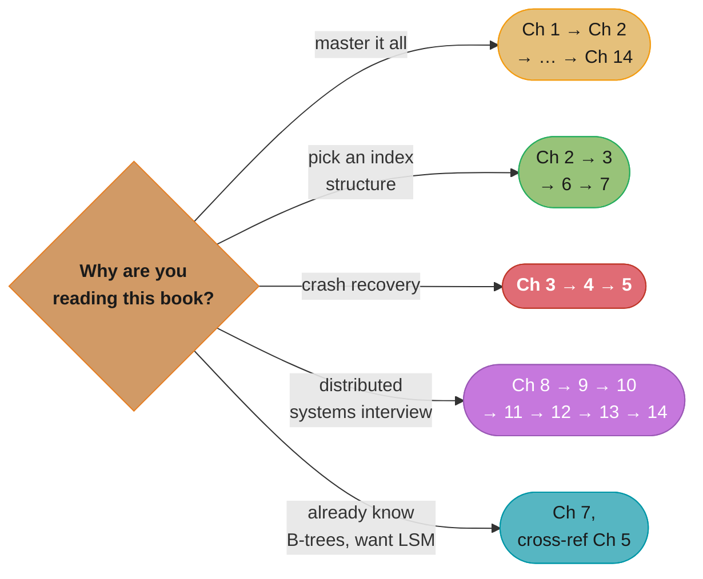

# Database Internals: A Deep Dive into How Distributed Data Systems Work

> Alex Petrov · **1st edition, O'Reilly, September 2019** · 370 pages · ISBN 9781492040347 ·
> "Work confidently with distributed data systems." A chapter-by-chapter, in-depth summary —
> read this folder in order and you have read the book.

---

## The Book's Thesis

Most engineers treat a database as a sealed box: you send it queries, it sends back answers.
Petrov's argument is that this box is worth opening, because the two halves of the box are
answers to two genuinely different engineering problems. **Part I** asks how a *single node*
stores bytes on disk so that they survive a crash and can be found again in logarithmic time —
the storage-engine question, answered by two competing families of on-disk structure (B-trees
and LSM-trees) that trade write cost for read cost in opposite directions. **Part II** asks how
*several* of those nodes agree on anything at all when the network connecting them drops
messages, reorders them, and delays them unpredictably — the distributed-systems question,
answered by failure detectors, leader election, replication, anti-entropy, and consensus.

The throughline the book keeps returning to: every mechanism inside a database exists because
something in the environment cannot be trusted — a machine can lose power mid-write, a network
link can vanish for an unbounded time, a disk seek costs ten million times more than a register
access. Storage engines and distributed algorithms are both, in the end, engineering responses
to untrustworthy hardware and networks; Part I studies the response at the scale of one machine,
Part II at the scale of a cluster.

---

## The Two Parts (Part Map)

```mermaid
flowchart TD
    classDef io      fill:#61afef,stroke:#2e86c1,color:#1a1a1a,font-weight:bold
    classDef frozen  fill:#c678dd,stroke:#9b59b6,color:#fff
    classDef train   fill:#98c379,stroke:#27ae60,color:#1a1a1a
    classDef mathOp  fill:#d19a66,stroke:#e67e22,color:#1a1a1a,font-weight:bold
    classDef lossN   fill:#e06c75,stroke:#c0392b,color:#fff,font-weight:bold
    classDef req     fill:#56b6c2,stroke:#0097a7,color:#1a1a1a
    classDef base    fill:#e5c07b,stroke:#f39c12,color:#1a1a1a

    root(["Database Internals"]) --> P1
    root --> P2

    subgraph P1["Part I — Storage Engines<br/>(one machine, on disk)"]
        C1("Ch 1<br/>Introduction<br/>and Overview") --> C2("Ch 2<br/>B-Tree<br/>Basics") --> C3("Ch 3<br/>File<br/>Formats") --> C4("Ch 4<br/>Implementing<br/>B-Trees") --> C5("Ch 5<br/>Transaction Processing<br/>and Recovery") --> C6("Ch 6<br/>B-Tree<br/>Variants") --> C7("Ch 7<br/>Log-Structured<br/>Storage")
    end

    subgraph P2["Part II — Distributed Systems<br/>(many machines, over a network)"]
        C8("Ch 8<br/>Introduction<br/>and Overview") --> C9("Ch 9<br/>Failure<br/>Detection") --> C10("Ch 10<br/>Leader<br/>Election") --> C11("Ch 11<br/>Replication and<br/>Consistency") --> C12("Ch 12<br/>Anti-Entropy and<br/>Dissemination") --> C13("Ch 13<br/>Distributed<br/>Transactions") --> C14("Ch 14<br/>Consensus")
    end

    class root io
    class C1 io
    class C2,C6 mathOp
    class C3,C4 base
    class C5 lossN
    class C7 train
    class C8 io
    class C9 lossN
    class C10 mathOp
    class C11 frozen
    class C12 req
    class C13 lossN
    class C14 mathOp
```

*Colour follows the content: framing chapters in blue, B-tree structure and variants in orange,
byte-level file format and implementation mechanics in gold, the two crash-and-failure chapters
(recovery, failure detection) and the hardest correctness chapter (distributed transactions) in
red, LSM storage in green, replication in purple, gossip/anti-entropy in teal, consensus back in
orange as the algorithmic peer of the B-tree.*

Part I stays on one machine throughout — every mechanism (buffer pool, WAL, B-tree, LSM-tree)
exists to answer "how do I store more data than fits in memory, survive a crash, and still find
a record in `O(log n)` disk seeks." Part II drops the single-machine assumption and asks what a
*cluster* of these storage engines needs on top: a way to tell a slow node from a dead one
(Ch 9), a way to pick one node to coordinate (Ch 10), a way to keep several copies in sync
(Ch 11), a cheap background way to catch stragglers (Ch 12), a way to make several writes atomic
across nodes (Ch 13), and a way to get every node to agree despite all of the above going wrong
at once (Ch 14).

---

## Chapter Index

| # | Chapter | Folder | One-line summary | Repo deep-dive |
|---|---------|--------|------------------|----------------|
| 1 | Introduction and Overview | [01_introduction_and_overview/](01_introduction_and_overview/01_introduction_and_overview.md) | DBMS architecture, disk vs memory, row vs column, primary index as indirection | [database/storage_engines_internals/](../../database/storage_engines_internals/storage_engines_internals.md) |
| 2 | B-Tree Basics | [02_btree_basics/](02_btree_basics/02_btree_basics.md) | Why balanced binary trees fail on disk; the B-tree's node fanout fix | [database/indexing_deep_dive/](../../database/indexing_deep_dive/indexing_deep_dive.md) |
| 3 | File Formats | [03_file_formats/](03_file_formats/03_file_formats.md) | Binary encoding, page layout, slotted pages, checksumming | [database/storage_engines_internals/](../../database/storage_engines_internals/storage_engines_internals.md) |
| 4 | Implementing B-Trees | [04_implementing_btrees/](04_implementing_btrees/04_implementing_btrees.md) | Page headers, split/merge propagation, rebalancing, bulk loading, vacuum | [database/postgresql_internals/](../../database/postgresql_internals/postgresql_internals.md) |
| 5 | Transaction Processing and Recovery | [05_transaction_processing_and_recovery/](05_transaction_processing_and_recovery/05_transaction_processing_and_recovery.md) | Buffer management, WAL recovery (ARIES), isolation levels, locking, B-link trees | [database/concurrency_control_and_locking/](../../database/concurrency_control_and_locking/concurrency_control_and_locking.md) |
| 6 | B-Tree Variants | [06_btree_variants/](06_btree_variants/06_btree_variants.md) | Copy-on-write, lazy B-trees, FD-trees, Bw-trees, cache-oblivious trees | [database/mysql_innodb_internals/](../../database/mysql_innodb_internals/mysql_innodb_internals.md) |
| 7 | Log-Structured Storage | [07_log_structured_storage/](07_log_structured_storage/07_log_structured_storage.md) | LSM-trees, compaction, bloom filters, the RUM conjecture, WiscKey | [database/storage_engines_internals/](../../database/storage_engines_internals/storage_engines_internals.md) |
| 8 | Introduction and Overview | [08_distributed_systems_introduction/](08_distributed_systems_introduction/08_distributed_systems_introduction.md) | Processes, links, and the two-generals-style impossibility results that motivate Part II | [hld/consensus_algorithms/](../../hld/consensus_algorithms/consensus_algorithms.md) |
| 9 | Failure Detection | [09_failure_detection/](09_failure_detection/09_failure_detection.md) | Heartbeats, Phi Accrual, SWIM/gossip-style failure detection | [hld/consensus_algorithms/](../../hld/consensus_algorithms/consensus_algorithms.md) |
| 10 | Leader Election | [10_leader_election/](10_leader_election/10_leader_election.md) | Bully, ring, and other leader-election algorithms | [database/consistency_models_and_consensus/](../../database/consistency_models_and_consensus/consistency_models_and_consensus.md) |
| 11 | Replication and Consistency | [11_replication_and_consistency/](11_replication_and_consistency/11_replication_and_consistency.md) | Consistency models, linearizability, session guarantees, CAP | [database/replication_and_high_availability/](../../database/replication_and_high_availability/replication_and_high_availability.md) |
| 12 | Anti-Entropy and Dissemination | [12_anti_entropy_and_dissemination/](12_anti_entropy_and_dissemination/12_anti_entropy_and_dissemination.md) | Merkle trees, gossip protocols, HyParView | [database/replication_and_high_availability/](../../database/replication_and_high_availability/replication_and_high_availability.md) |
| 13 | Distributed Transactions | [13_distributed_transactions/](13_distributed_transactions/13_distributed_transactions.md) | Atomic commitment, 2PC/3PC, atomic broadcast | [database/distributed_transactions/](../../database/distributed_transactions/distributed_transactions.md) |
| 14 | Consensus | [14_consensus/](14_consensus/14_consensus.md) | Paxos, Raft, and the CALM theorem | [hld/consensus_algorithms/](../../hld/consensus_algorithms/consensus_algorithms.md) |

All fourteen chapters are present. Chapter 8's folder is named `08_distributed_systems_introduction/`
rather than `08_introduction_and_overview/` so it does not collide with Chapter 1, which carries the
same title in the book — Petrov opens both parts with a chapter called "Introduction and Overview."

---

## Recommended Reading Path

- **Cover to cover (recommended):** Ch 1 → … → Ch 14, the book's own order. Part I's storage
  engine is the thing Part II replicates, shards, and reaches consensus over — reading Part I
  first makes every Part II mechanism concrete rather than abstract.
- **"I just need to pick an index structure" path:** Ch 2 → 3 → 6 → 7. B-tree fundamentals, the
  byte-level page format underneath them, the variants that fix specific B-tree weaknesses, and
  the LSM-tree alternative — enough to make an informed storage-engine choice.
- **Crash-recovery deep dive:** Ch 3 (page format) → Ch 4 (page mutation) → Ch 5 (WAL, ARIES,
  isolation) — the three chapters that together explain how a database survives `kill -9`
  mid-write without losing or corrupting data.
- **Distributed-systems crash course:** Ch 8 → 9 → 10 → 11 → 12 → 13 → 14, read in order — each
  chapter's algorithm assumes the failure model and primitives the previous one built.
  Interview-critical, and dense: Ch 11 (consistency models) and Ch 14 (consensus) carry the most
  weight in system-design interviews.
- **"I already know B-trees, I want LSM"** path: Ch 7 alone, cross-referenced against Ch 5's
  recovery material — the LSM-tree's own memtable-flush-and-WAL story only makes sense against
  the B-tree engine's WAL as a baseline.

*Five goals, five subsets of the same fourteen chapters — the distributed-systems path (purple)
is the one most heavily cross-linked to this repo's `database/` and `hld/` consensus and
replication deep dives.*

---

## Build Manifest

Per-file build status for this book. Update the row to `done` the moment a chapter file is
completed and diagram-linted.

| # | File | Status |
|---|------|--------|
| 1 | `01_introduction_and_overview/01_introduction_and_overview.md` | done |
| 2 | `02_btree_basics/02_btree_basics.md` | done |
| 3 | `03_file_formats/03_file_formats.md` | done |
| 4 | `04_implementing_btrees/04_implementing_btrees.md` | done |
| 5 | `05_transaction_processing_and_recovery/05_transaction_processing_and_recovery.md` | done |
| 6 | `06_btree_variants/06_btree_variants.md` | done |
| 7 | `07_log_structured_storage/07_log_structured_storage.md` | done |
| 8 | `08_distributed_systems_introduction/08_distributed_systems_introduction.md` | done |
| 9 | `09_failure_detection/09_failure_detection.md` | done |
| 10 | `10_leader_election/10_leader_election.md` | done |
| 11 | `11_replication_and_consistency/11_replication_and_consistency.md` | done |
| 12 | `12_anti_entropy_and_dissemination/12_anti_entropy_and_dissemination.md` | done |
| 13 | `13_distributed_transactions/13_distributed_transactions.md` | done |
| 14 | `14_consensus/14_consensus.md` | done |

---

## Cross-Reference Map (Database Internals → repo deep dives)

| Book concept | Primary deep-dive module |
|--------------|--------------------------|
| Row vs column storage, wide-column stores | [database/wide_column_databases/](../../database/wide_column_databases/wide_column_databases.md) |
| B-tree structure, node splits/merges | [database/indexing_deep_dive/](../../database/indexing_deep_dive/indexing_deep_dive.md) |
| Page format, buffer pool, WAL | [database/storage_engines_internals/](../../database/storage_engines_internals/storage_engines_internals.md) |
| InnoDB clustered B-tree, ARIES-style recovery in practice | [database/postgresql_internals/](../../database/postgresql_internals/postgresql_internals.md), [database/mysql_innodb_internals/](../../database/mysql_innodb_internals/mysql_innodb_internals.md) |
| Isolation levels, MVCC, locks and latches | [database/concurrency_control_and_locking/](../../database/concurrency_control_and_locking/concurrency_control_and_locking.md) |
| LSM-trees, compaction strategies, bloom filters | [database/storage_engines_internals/](../../database/storage_engines_internals/storage_engines_internals.md) |
| Key-value stores built on LSM/B-tree engines | [database/key_value_stores/](../../database/key_value_stores/key_value_stores.md) |
| In-memory and embedded engines | [database/in_memory_databases/](../../database/in_memory_databases/in_memory_databases.md), [database/embedded_and_edge_databases/](../../database/embedded_and_edge_databases/embedded_and_edge_databases.md) |
| Replication topologies, failover, consistency models | [database/replication_and_high_availability/](../../database/replication_and_high_availability/replication_and_high_availability.md) |
| Linearizability, consensus, logical clocks | [database/consistency_models_and_consensus/](../../database/consistency_models_and_consensus/consistency_models_and_consensus.md) |
| Distributed transactions, 2PC, sagas | [database/distributed_transactions/](../../database/distributed_transactions/distributed_transactions.md) |
| Raft/Paxos consensus algorithms | [hld/consensus_algorithms/](../../hld/consensus_algorithms/consensus_algorithms.md) |
| DDIA 2e's storage engine chapter (LSM vs B-tree from a different author) | [book/ddia_2e/04_storage_and_retrieval/](../ddia_2e/04_storage_and_retrieval/04_storage_and_retrieval.md) |
| DDIA 2e's replication chapter (the distributed side, from a different author) | [book/ddia_2e/06_replication/](../ddia_2e/06_replication/06_replication.md) |

---

## Further Reading

- Book website / errata: <https://www.databass.dev/>
- O'Reilly catalog page: <https://www.oreilly.com/library/view/database-internals/9781492040330/>
- Community reading-group notes (used to verify this folder's chapter section lists):
  <https://github.com/Akshat-Jain/database-internals-notes>
