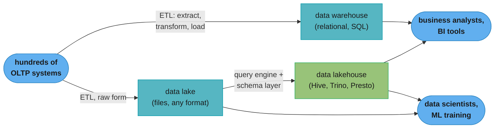
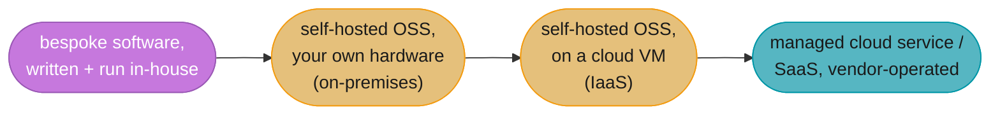
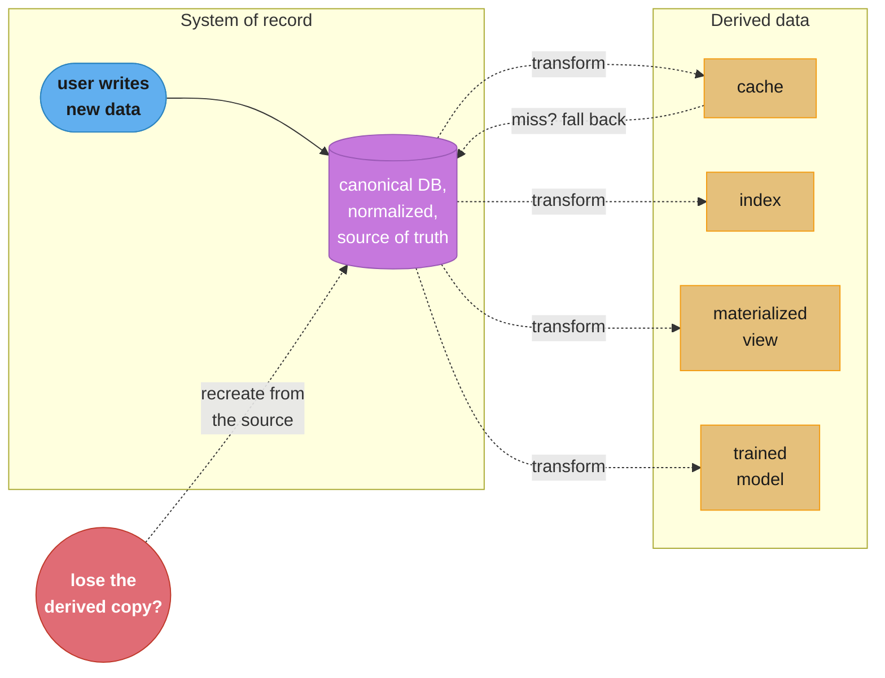
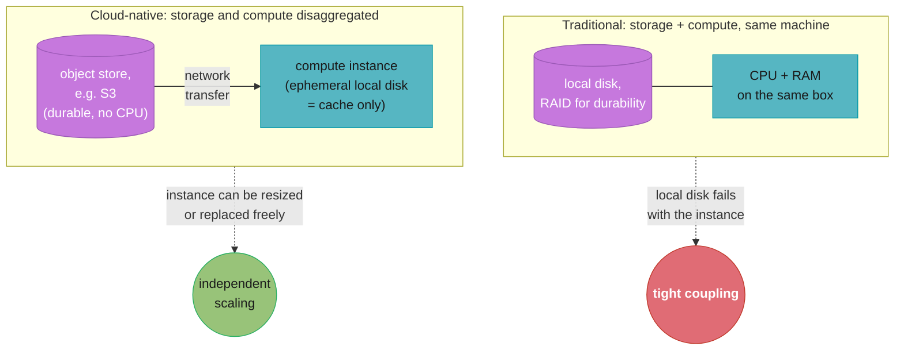
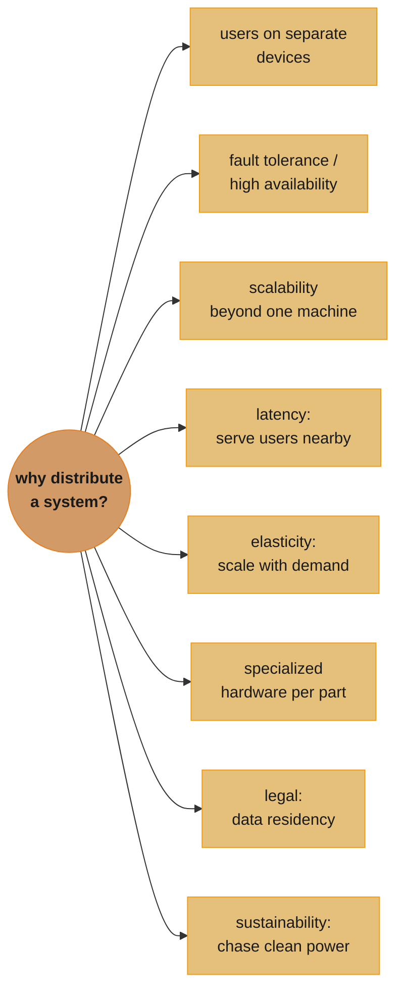

# Chapter 1: Trade-Offs in Data Systems Architecture

> Part I — Foundations of Data Systems · DDIA (Kleppmann & Riccomini, 2nd ed., O'Reilly 2026) · opens the book, leads to Ch 2 (nonfunctional requirements)

## Chapter Map

This is the opening chapter of the book, and it does two jobs at once: it hands you the
vocabulary the rest of the book leans on (*data-intensive*, *frontend/backend*, *OLTP/OLAP*,
*system of record*, *cloud-native*), and it walks through four recurring trade-offs that shape
almost every architecture decision a data-systems engineer makes. None of the four axes has a
universally correct answer — Kleppmann and Riccomini's point, stated up front via the Thomas
Sowell epigraph, is that there are no solutions, only trade-offs you reason about deliberately.

**TL;DR:**
- **Operational (OLTP) vs analytical (OLAP) systems** split because they serve different people
  (backend engineers vs analysts/data scientists) with different access patterns (point queries
  vs aggregate scans), which is why data warehouses, data lakes, and lakehouses exist as the
  bridge between them.
- **Cloud services vs self-hosting** is a build-vs-buy decision: cloud tends to win when your
  load is unpredictable or you lack in-house expertise; self-hosting tends to win when load is
  steady and you already know how to run the system. Cloud-native architecture additionally
  separates storage from compute, which self-hosted software rarely does.
- **Distributed vs single-node systems**: distribution buys fault tolerance, scale, low latency,
  elasticity, specialized hardware, legal compliance, and sustainability — but it costs you
  network failure modes, harder troubleshooting, and cross-service consistency. If a single
  machine can do the job, that is usually the simpler and cheaper answer.
- **The needs of the business vs the rights of the user**: privacy law (GDPR, CCPA, the EU AI
  Act) and broader ethical responsibility now shape architecture decisions directly — including
  ones that clash with common data-system building blocks like append-only logs.

## The Big Question

> "There are no solutions, there are only trade-offs. [...] But you try to get the best
> trade-off you can get, and that's all you can hope for."
>
> — Thomas Sowell, quoted as the chapter's epigraph

Analogy: choosing a data-systems architecture is like choosing where to live. There is no
objectively "best" neighborhood — only ones that trade off commute time against space, noise
against price, proximity to family against privacy. An engineer who has only ever lived in one
neighborhood assumes its trade-offs are universal laws; this chapter's job is to show you the
shape of the whole city — operational vs analytical, cloud vs self-hosted, single-node vs
distributed, business needs vs user rights — before you have to pick a street.

---

## 1.1 Analytical versus Operational Systems

An enterprise's data is touched by several different kinds of people, and Kleppmann and Riccomini
use this fact to introduce the chapter's first split. **Backend engineers** build the services
that read and write data on behalf of external (or internal) users. Two other groups also need
the data: **business analysts**, who build reports for management decisions (*business
intelligence*, BI), and **data scientists**, who look for novel insights or build user-facing
features powered by data analysis and ML (recommendations, risk scoring, spam filtering, search
ranking). Analysts and data scientists both do *analytics* — they read the data backend services
generate but generally don't modify it, aside from fixing mistakes.

This produces a durable split that the whole book uses as vocabulary:

- **Operational systems** — the backend services and data infrastructure where data is *created*;
  application code both reads and writes based on user actions.
- **Analytical systems** — serve analysts and data scientists; they hold a read-only copy of
  operational data, optimized for analytical access patterns.

Two newer specialist roles bridge them: **data engineers**, who integrate operational and
analytical systems and own the wider data infrastructure, and **analytics engineers**, who model
and transform data to make it more useful to analysts and data scientists.

### Characterizing Transaction Processing and Analytics

The word *transaction* originally meant a commercial transaction — a sale, an order, a salary
payment — and stuck even once databases moved into domains with no money involved (social media
posts, game moves, address-book contacts). A *transaction* in this loose, chapter-1 sense is
simply a group of reads and writes that form a logical unit; [Chapter 8](../08_transactions/08_transactions.md)
gives the term its precise meaning.

An operational system's basic access pattern is the **point query** — look up a small number of
records by key, then insert/update/delete them based on user input. Because this pattern is
interactive, it became known as **online transaction processing (OLTP)**. Analytics has a
different shape entirely: a query scans a huge number of records and computes an aggregate
(count, sum, average) rather than returning individual rows — "total revenue per store in
January," "how many more bananas did we sell during the promotion," "which baby-food brand
co-occurs with diaper brand X." This pattern is **online analytic processing (OLAP)**; the book
notes that the meaning of "online" in OLAP is genuinely unclear, and probably just signals that
analysts interact with the system for exploratory queries rather than only running predefined
reports.

| Property | Operational systems (OLTP) | Analytical systems (OLAP) |
|---|---|---|
| Main read pattern | Point queries (fetch individual records by key) | Aggregate over a large number of records |
| Main write pattern | Create, update, delete individual records | Bulk import (ETL) or event stream |
| Human user example | End user of web/mobile app | Internal analyst, decision support |
| Machine use example | Checking if an action is authorized | Detecting fraud/abuse patterns |
| Type of queries | Fixed set, predefined by application | Analyst can write arbitrary queries |
| Data represents | Latest state (current point in time) | History of events over time |
| Dataset size | Gigabytes to terabytes | Terabytes to petabytes |

OLTP systems mostly run a fixed, application-baked set of queries — users are not given free rein
to run custom SQL, both because that risks reading/modifying data they shouldn't touch and
because an expensive ad hoc query would degrade performance for everyone else. Analytic databases
invert this: they generally let users write arbitrary SQL by hand or generate it via a BI tool
such as Tableau, Looker, or Microsoft Power BI. A third category sits between them: **product
analytics** (or *real-time analytics*) — analytical workloads embedded directly into user-facing
products, served by systems purpose-built for this, such as Pinot, Druid, and ClickHouse.

### Data Warehousing

At first the same database served both OLTP and OLAP — SQL is flexible enough for both. In the
late 1980s/early 1990s, companies began pulling analytics onto a **separate database system**
called a **data warehouse**. A large enterprise may run dozens or hundreds of independent OLTP
systems (customer-facing site, point-of-sale, inventory, routing, supplier management, HR, and
more), each complex enough to need its own team, and each operating mostly independently.
Querying those OLTP systems directly for analytics is undesirable for several reasons:

- the data analysts need is spread across many operational systems — **data silos** — making a
  single combined query hard;
- the schemas and layouts good for OLTP are poorly suited to analytics (see
  [Chapter 3](../03_data_models_and_query_languages/03_data_models_and_query_languages.md), "Stars
  and Snowflakes");
- analytic queries are expensive, and running them against an OLTP database would degrade
  performance for other users; and
- OLTP systems may sit on a network that analysts are not permitted to reach for security or
  compliance reasons.

A data warehouse is a separate database analysts can query freely, without touching OLTP
operations — and (as [Chapter 4](../04_storage_and_retrieval/04_storage_and_retrieval.md) covers)
it typically stores data in a way that looks very different internally from an OLTP database. The
warehouse holds a read-only copy of every OLTP system's data, brought in via **Extract–Transform–
Load (ETL)**: data is extracted (periodic dump or continuous update stream), transformed into an
analysis-friendly schema, cleaned, and loaded. Swap the order of the last two steps and you get
**ELT** instead — the transform happens inside the warehouse, after loading. Some ETL sources are
external SaaS products (CRM, email marketing, card processing) reachable only through a vendor
API; specialist connector services such as Fivetran, Singer, or Airbyte handle that extraction.

**Hybrid transactional/analytic processing (HTAP)** systems try to offer both OLTP and analytics
without an ETL hop between separate systems. The book is careful to note that many HTAP systems
are, internally, an OLTP engine coupled to a separate analytical engine hidden behind one
interface — so the OLTP/OLAP distinction still matters for understanding how they work. HTAP does
**not replace data warehouses**: it's common practice for each operational system to have its own
database (see "Microservices and Serverless" below), so an enterprise ends up with hundreds of
operational databases but usually just one data warehouse combining them for cross-system
analysis. HTAP instead fits scenarios where *the same application* needs both large aggregate
scans and low-latency individual reads/writes — fraud detection is the book's example.

#### From data warehouse to data lake

A data warehouse's relational model, queried via SQL, suits business analysts well but is a poor
fit for data scientists, who often need to: turn table rows/columns into numerical **feature**
vectors for model training (**feature engineering** — hard to express in SQL), or extract
structured information from unstructured data (sentiment/topics from text via NLP, structured
data from images via computer vision). Despite efforts to bolt ML operators onto SQL, most data
scientists prefer Python libraries (pandas, scikit-learn), R, or distributed frameworks like
Spark — covered further in Chapter 3's "Dataframes, Matrices, and Arrays."

The answer to this mismatch is a **data lake**: a centralized repository holding a copy of any
data that might be useful for analysis, fed by ETL from operational systems, but — unlike a
warehouse — imposing **no particular file format or data model**. A data lake can hold encoded
database records (Avro, Parquet — see [Chapter 5](../05_encoding_and_evolution/05_encoding_and_evolution.md)),
or equally text, images, video, sensor readings, sparse matrices, feature vectors, genome
sequences, anything. It's also usually cheaper, since it can run on commoditized object storage.

ETL generalized into **data pipelines**, and the data lake often becomes an intermediate stop
before the warehouse, holding data in "raw" form so each downstream consumer transforms it to fit
their own needs — the **sushi principle**: "raw data is better." Running typical warehousing
workloads (SQL, BI) directly against the lake's files, alongside data-science workloads, is a
**data lakehouse** — it needs a query engine plus a metadata/schema layer on top of the lake's
file storage. Apache Hive, Spark SQL, Presto, and Trino are examples.



Caption: ETL feeds both a schema-imposing warehouse and a schema-free lake from the same
operational systems; a lakehouse is what you get when you point a warehouse-style query engine at
the lake's files instead of moving the data again.

#### Beyond the data lake

As analytics matured, organizations paid more attention to *operating* analytics systems and
pipelines (captured in the DataOps manifesto), including governance, privacy, and compliance with
GDPR/CCPA (discussed further under "Data Systems, Law, and Society" and in
[Chapter 14](../14_doing_the_right_thing/14_doing_the_right_thing.md)). Analytical data is
increasingly delivered not just as files/tables but as **streams of events** (see
[Chapter 12](../12_stream_processing/12_stream_processing.md)): file-based analysis can only be
re-run periodically, while stream processing lets analytics react in seconds — useful for, say,
blocking fraud in near real time.

Sometimes analytics output flows *back* into operational systems — **reverse ETL**. A model
trained on warehouse/lake data might be deployed to production to power live recommendations
("people who bought X also bought Y"); such deployed outputs are called **data products**, and
tools like TFX, Kubeflow, or MLflow handle that deployment.

### Systems of Record and Derived Data

A related, orthogonal distinction the book introduces: **systems of record** vs **derived data
systems**.

Systems of record
:   Also called the *source of truth* — holds the authoritative, *canonical* version of data.
    New data (e.g. user input) is written here first, each fact represented exactly once
    (typically *normalized*; see Chapter 3's "Normalization, Denormalization, and Joins"). If
    another system disagrees with the system of record, the system of record is correct by
    definition.

Derived data systems
:   Data here results from taking existing data from elsewhere and transforming/processing it.
    Lose it, and you can recreate it from the original source — a cache is the classic example
    (serve from cache if present, fall back to the underlying database otherwise). Denormalized
    values, indexes, materialized views, transformed representations, and trained models all
    count.

Derived data is technically *redundant* — it duplicates information that exists elsewhere — but
it's often essential for read performance, and you can derive several datasets from one source to
view the data from different angles. Analytical systems are usually derived systems (they consume
data created elsewhere); operational services often mix both — a primary database as the system
of record, plus indexes/caches as derived data speeding up reads the system of record can't
answer efficiently. The distinction is about *how you use* a database, not the tool itself: most
databases, storage engines, and query languages are neither inherently a system of record nor a
derived system. Being explicit about which data derives from which brings clarity to an otherwise
confusing architecture — and it raises the question of *how* you keep derived data updated when
the system of record changes, since many databases assume you'll only ever use that one database
and don't make cross-database propagation easy. [Chapter 13](../13_philosophy_of_streaming_systems/13_philosophy_of_streaming_systems.md)
covers *data integration* — composing multiple systems to do what one alone cannot.

---

## 1.2 Cloud versus Self-Hosting

For anything an organization needs done, the first question is build-or-buy, in-house-or-
outsourced. The received management wisdom: keep your core competency / competitive advantage
in-house, outsource what's non-core, routine, or commonplace (few companies generate their own
electricity, unless they *are* an energy company). With software, two separate decisions get
outsourced to varying degrees — **who builds it** and **who deploys it** — spanning a spectrum
from bespoke in-house software at one end to a fully external cloud service / SaaS product at the
other, with **self-hosted** off-the-shelf software (open source or commercial, run on your own
hardware or on cloud IaaS) in between. *How* you deploy — e.g. via Kubernetes — is a separate
axis the book deliberately treats as out of scope, since other factors dominate data-systems
architecture more.



Caption: the spectrum outsources "who builds" and "who deploys" independently — self-hosting on a
cloud VM still means you administer the software yourself; only the right-hand end hands
operation to the vendor.

### Pros and Cons of Cloud Services

Using a cloud service outsources the *operation* of that software to the provider. Whether it's
actually cheaper than self-hosting depends heavily on your existing skills and workload shape:
if you already know how to run the system and your load is fairly predictable, self-hosting
(buying your own machines) is often cheaper. If you'd otherwise have to hire and train staff to
learn an unfamiliar system, adopting the cloud service is usually quicker and easier — though you
still need an operations team either way (see "Operations in the Cloud Era" below); outsourcing
basic administration just frees that team for higher-level work. A specialist provider running
the same service for many customers can gain operational expertise a solo team can't match; on
the other hand, self-hosting lets you tune the system for your particular workload in ways a
shared vendor service is unlikely to accommodate.

Cloud services are most valuable when **load varies a lot over time**: provisioning for peak load
that then sits idle most of the time is wasteful, and cloud elasticity lets you return unused
resources to the provider instead of paying to keep them idle. Analytics workloads are the
book's example of extreme variability — a big analytical query needs a lot of parallel compute
for a short time, then goes idle until the next query; predefined queries can be scheduled to
smooth this out, but interactive queries get more variable the faster you want them.

**Decoding the elasticity argument.** The chapter argues this qualitatively without a worked
number; putting one on it makes the shape of the argument concrete. Take an illustrative
analytics workload where demand swings between a quiet trough and a busy peak over a day:

```
  self-hosted, provisioned for peak:
    capacity purchased        = peak demand (100 units)
    average demand over a day = 15 units
    average utilization       = 15 / 100 = 15%   -- the other 85% sits idle, but you paid for it

  cloud, scaled to match demand each hour:
    capacity paid for at any hour = that hour's demand
    average utilization            ~ 100%          -- by construction, you never provision more
                                                        than you're using at that moment
```

This illustrative 15%-vs-100% gap is not a number the book states — it's a derived example
showing *why* the book calls variable load the case where cloud elasticity pays off, and why the
same argument is weak for a workload with flat, predictable demand: there, self-hosted
utilization is already close to 100%, so the cloud has nothing to reclaim.

The biggest downside of a cloud service is **you have no control over it**:

- missing a feature you need → you can only ask the vendor, not build it yourself;
- the service goes down → you wait;
- your usage triggers a bug or a performance problem → you can't get OS-level metrics, debugging
  info, or server logs the way you could running the software yourself;
- the service shuts down, gets expensive, or the vendor changes it in a way you dislike → you're
  forced to migrate, since running an old version is usually not an option — mitigated somewhat if
  a compatible alternative exists, but many cloud services have no standard API, raising the cost
  of switching (**vendor lock-in**);
- the provider must be trusted to keep your data secure, complicating privacy/security compliance.

Despite this, building new applications on cloud services (or a hybrid mix) has become
increasingly popular, though cloud will not subsume every in-house system: many older systems
predate the cloud, and specialist requirements existing cloud services can't meet — the book's
example is high-frequency trading, which needs full control of the hardware for latency reasons —
still demand in-house systems.

### Cloud-Native System Architecture

Beyond a different economic model (subscription vs buying hardware/licenses), the cloud has
changed *how* data systems are technically built. **Cloud-native** describes an architecture
designed to take advantage of cloud services specifically. In principle almost anything
self-hostable could be offered as a managed cloud service too, and indeed managed versions of
many popular systems now exist — but systems designed cloud-native from the ground up show better
performance on the same hardware, faster failure recovery, quicker scaling to match load, and
support for larger datasets.

| Category | Self-hosted systems | Cloud-native systems |
|---|---|---|
| Operational/OLTP | MySQL, PostgreSQL, MongoDB | AWS Aurora, Azure SQL DB Hyperscale, Google Cloud Spanner |
| Analytical/OLAP | Teradata, ClickHouse, Spark | Snowflake, Google BigQuery, Azure Synapse Analytics |

#### Layering of cloud services

Most self-hosted systems need only generic resources: a conventional OS, files on a filesystem,
TCP/IP networking (a few need GPUs or RDMA, but that's the exception). In the cloud, such software
runs on **Infrastructure as a Service (IaaS)** — one or more VM instances with an allocation of
CPU/memory/disk/network, provisioned faster and in more sizes than physical machines, but
otherwise administered by you like any traditional computer.

Cloud-native services go further: they build on lower-level cloud services to create higher-level
ones. **Object storage** (Amazon S3, Azure Blob Storage, Cloudflare R2) stores large files behind
a more limited API than a filesystem, but hides the underlying machines entirely — data is spread
across many machines automatically, so you never run out of disk space on one, and losing a
machine or a disk loses no data. Other services build on object storage in turn — Snowflake, for
instance, is a cloud analytic database that relies on S3 for storage, and some services build atop
Snowflake itself. As with any abstraction, there's no universally right layer to build on: a
higher-level system serves its target use case with much less effort if your needs match it; if
none does, building from lower-level components is your only option.

#### Separation of storage and compute

Traditionally, disk storage is assumed durable, and **RAID** (Redundant Array of Independent
Disks, hardware or software) protects against single-disk failure while staying transparent to
applications. In the cloud, compute instances may still have local disks, but cloud-native systems
treat these as an **ephemeral cache**, not long-term storage — the local disk becomes unreachable
if its instance fails or gets resized onto different physical hardware to match changing load.

The alternative is **virtual disk storage** that detaches from one instance and reattaches to
another (Amazon EBS, Azure managed disks, Google persistent disks) — not a physical disk at all,
but a service, provided by a separate fleet of machines, emulating a **block device** (typically
4 KiB blocks). This lets traditional disk-based software run unmodified in the cloud, but the
block-device emulation adds overhead a ground-up cloud-native design avoids, and it makes the
application very sensitive to network glitches, since every I/O on a virtual disk is really a
network call.

Cloud-native services therefore generally avoid virtual disks and build instead on dedicated
storage services tuned per workload: object stores like S3 are built for long-term storage of
fairly large files (hundreds of KB to several GB), far bigger than a single database row or value
— so cloud databases typically manage small values in a separate service and store larger blocks
of many values in an object store ([Chapter 4](../04_storage_and_retrieval/04_storage_and_retrieval.md)
covers how). In short, cloud-native systems **disaggregate** storage and compute — S3 only stores
files; analyzing that data means running analysis code somewhere else, transferring the data over
the network (see "Distributed versus Single-Node Systems" below). Cloud-native systems are also
often **multitenant**: rather than one machine per customer, several customers' data and
computation share the same hardware and service. Multitenancy improves hardware utilization,
scalability, and manageability, but demands careful engineering so one customer's activity can't
degrade performance or security for another.

### Operations in the Cloud Era

Traditionally, **database administrators (DBAs)** and **system administrators (sysadmins)** ran
an organization's server-side data infrastructure. More recently many organizations merged
development and operations into shared-responsibility teams under the **DevOps** philosophy;
Google's implementation of that idea is the **Site Reliability Engineer (SRE)** role.

Operations means reliably delivering services (configuring infrastructure, deploying
applications) and keeping production stable (monitoring, diagnosing). Self-hosted operations
traditionally involves a lot of per-machine work — capacity planning (watch disk space, add disks
before running out), provisioning new machines, moving services between machines, OS patching.
Many cloud services hide individual machines behind an API instead: cloud storage swaps fixed-size
disks for **metered billing**, charging for space actually used rather than requiring upfront
capacity planning, and many cloud services stay highly available even as individual machines fail.

This shift in *where* the work happens changed operations' emphasis, not its goal. DevOps/SRE
practice leans toward: automation over manual one-off jobs; ephemeral VMs/services over long-lived
servers; frequent application updates; learning from incidents; and preserving institutional
knowledge as people come and go. It has also bifurcated the role: infrastructure-company ops
teams specialize in reliably serving many customers, while those customers' own teams spend as
little time on infrastructure as possible — though they still need operations, now focused on
choosing the right service, integrating services together, and migrating between them. Metered
billing removes traditional capacity planning, but you still need to know what you're using and
why, or you waste money — **capacity planning becomes financial planning, and performance
optimization becomes cost optimization**. Cloud services also impose resource **quotas** (e.g. max
concurrent processes) you need to know and plan around.

Integration between services remains a particular pain point, since a growing number of vendors
offer an ever-broader range of services with no real standards to ease combining them — often
requiring significant manual effort. Other operational work simply can't be outsourced to a cloud
provider at all: securing the application and its libraries, managing interactions between your
own services, monitoring load, and tracking down performance degradations or outages. The role of
operations is changing; the need for it is undiminished.

---

## 1.3 Distributed versus Single-Node Systems

A system of several machines communicating over a network is a **distributed system**; each
participating process is a **node**. There are many distinct reasons you might want a system to
be distributed, and the book is explicit that these reasons apply both to code you write yourself
and to off-the-shelf software you deploy:

| Reason | Why it forces (or favors) distribution |
|---|---|
| Inherently distributed systems | Two or more users on their own devices must communicate over a network — unavoidable |
| Requests between cloud services | Data stored in one service, processed in another, must cross the network |
| Fault tolerance / high availability | Redundant machines let another take over when one (or a datacenter) fails |
| Scalability | Data volume or compute needs exceed one machine, so load spreads across several |
| Latency | Serve geographically distributed users from nearby servers to cut round-trip time |
| Elasticity | Scale up/down with demand; a single machine must be sized for peak, always |
| Using specialized hardware | Different subsystems use different hardware (disks, CPU/RAM, GPUs) matched to their workload |
| Legal compliance | Data residency laws require storing/processing data within specific jurisdictions |
| Sustainability | Flexibility on where/when jobs run lets you favor renewable power and cut carbon/cost |

### Problems with Distributed Systems

Distribution has real costs. Every network-crossing request/call must handle the possibility of
failure — interruption, overload, crash, timeout — and a timed-out request leaves you not knowing
whether it was received, which means retrying it might not be safe ([Chapter 9](../09_trouble_with_distributed_systems/09_trouble_with_distributed_systems.md)
covers this in depth). Even fast datacenter networks make a call to another service vastly slower
than a function call in the same process. When operating on large data volumes, it can be faster
to bring the computation to the machine that already holds the data than to ship the data to a
separate compute machine. And **more nodes are not always faster**: the book cites cases where a
single-threaded program on one computer beats a 100+ core cluster.

Troubleshooting is often hard: if the system responds slowly, where's the problem? This is the
domain of **observability** — collecting execution data and letting it be queried both at the
metrics level and the individual-event level. **Tracing** tools (OpenTelemetry, Zipkin, Jaeger)
track which client called which server for which operation and how long each call took.

Databases give you consistency mechanisms within themselves ([Chapter 6](../06_replication/06_replication.md),
[Chapter 8](../08_transactions/08_transactions.md)) — but once each service has its own database,
keeping data consistent *across* services becomes the application's problem. **Distributed
transactions** ([Chapter 8](../08_transactions/08_transactions.md)) are a possible technique, but
they're rarely used in microservices because they run against the goal of keeping services
independent, and many databases don't even support them.

For all these reasons, doing something on a single machine is often much simpler and cheaper than
distributing it — and modern single-node databases (DuckDB, SQLite, KùzuDB) plus larger, faster,
more reliable CPUs/memory/disks mean many workloads that once "needed" distribution now run fine
on one node ([Chapter 4](../04_storage_and_retrieval/04_storage_and_retrieval.md) explores this
further).

### Microservices and Serverless

The most common way to distribute a system is the client/server split, most commonly over HTTP
(see [Chapter 5](../05_encoding_and_evolution/05_encoding_and_evolution.md), "Dataflow Through
Services: REST and RPC") — and the same process can be both a server and a client of other
services. This pattern, historically called **service-oriented architecture (SOA)**, has been
refined into the **microservices** architecture: each service has one well-defined purpose (S3's
purpose is file storage), exposes a network-callable API, and is owned by one team, letting a
complex application decompose into many independently-managed services.

Advantages: independent per-service updates (less cross-team coordination); per-service hardware
allocation; implementation details hidden behind the API so owners can change internals freely.
It's common — and deliberate — for each service to own its own database rather than share one:
sharing would make the database's internal structure effectively part of the service's API
(hard to change later) and let one service's queries hurt another's performance.

Downsides: many services breed their own complexity — deployment infrastructure, resource
scaling, log collection, health monitoring, on-call alerting per service. **Orchestration**
frameworks like Kubernetes provide a foundation for this. Testing gets harder, since exercising
one service often means running everything it depends on. Evolving microservice APIs is
especially tricky: clients expect certain fields, and adding/removing fields can break them —
often not discovered until the updated API reaches staging or production. Standards like OpenAPI
and gRPC help manage client/server API relationships (see [Chapter 5](../05_encoding_and_evolution/05_encoding_and_evolution.md)).

Kleppmann and Riccomini are direct about the real driver here: **microservices are primarily a
technical solution to a people problem** — letting different teams progress independently without
constant coordination. That's valuable at large-company scale; in a small company with few teams,
microservices are likely unnecessary overhead, and the simplest implementation is preferable.

**Serverless** (function-as-a-service, FaaS) outsources infrastructure management to the cloud
vendor entirely. With VMs you explicitly start/stop instances; serverless has the provider
allocate and free hardware automatically as requests arrive, shifting more operational burden to
the provider and enabling usage-based billing. In exchange, providers commonly impose execution
time limits, restrict the runtime environment, and can suffer slow **cold starts** on first
invocation. "Serverless" is arguably a misnomer — every invocation still runs on *some* server,
just possibly a different one each time — and the term has been adopted more loosely by
infrastructure like BigQuery and various Kafka offerings to signal auto-scaling and usage-based
billing, not necessarily FaaS itself. Just as cloud storage replaced disk capacity planning with
metered billing, serverless brings metered billing to code execution: you pay only for time your
code actually runs, not for pre-provisioned capacity.

### Cloud Computing versus Supercomputing

Cloud computing isn't the only way to build large-scale systems — **high-performance computing
(HPC)**, a.k.a. **supercomputing**, is the alternative, with different priorities and techniques.

| | HPC / supercomputing | Cloud computing / enterprise datacenters |
|---|---|---|
| Typical workload | Scientific computing: weather/climate modeling, molecular dynamics, PDEs, optimization | Online services, business systems needing high availability |
| Failure handling | Stop the whole cluster, repair the node, restart from the last checkpoint | Keep serving; avoid stopping the whole cluster |
| Node communication | Shared memory / RDMA — high bandwidth, low latency, assumes mutual trust | IP/Ethernet, mutually untrusting tenants — needs isolation, encryption, auth |
| Network topology | Specialized: multi-dimensional meshes, toruses, tuned for known communication patterns | IP/Ethernet Clos topologies for high bisection bandwidth |
| Geography | Nodes assumed close together | Nodes span multiple geographic regions |

Large-scale analytics systems sometimes share HPC characteristics, so the techniques are worth
knowing if you work in that space — but this book focuses on services that must stay continually
available, the subject of [Chapter 2](../02_defining_nonfunctional_requirements/02_defining_nonfunctional_requirements.md)'s
"Reliability and Fault Tolerance."

---

## 1.4 Data Systems, Law, and Society

Architecture is shaped not only by technical goals but by the human needs of the organizations
data systems serve — and, increasingly, by a responsibility to society at large that goes beyond
serving one's own business. Since 2018, the **General Data Protection Regulation (GDPR)** has
given residents of many European countries stronger legal control over their personal data;
similar regulation exists elsewhere (the **California Consumer Privacy Act**, CCPA), and rules
like the **EU AI Act** further restrict how personal data may be used.

Beyond directly regulated areas, there's growing recognition of computer systems' broader effects:
social media reshapes how people consume news, which shapes political opinion and can affect
election outcomes; automated systems increasingly make consequential decisions about loans,
insurance, job interview invitations, and criminal suspicion. Kleppmann and Riccomini frame a
basic awareness of legal and ethical principles as being as important to a data-systems engineer
as foundational distributed-systems knowledge — not that everyone must become a lawyer or ethicist.

Legal considerations are already reshaping how data systems are designed at a technical level. The
GDPR's **right to be forgotten** grants individuals the right to have their data erased on
request — but many data systems are built on **immutable constructs** like append-only logs
specifically because immutability is architecturally convenient. How do you delete data from the
middle of a file meant to be immutable? How do you handle deletion once that data has propagated
into derived datasets (see "Systems of Record and Derived Data" above), including ML training
data? The book is candid that these are open engineering challenges, not solved problems — there
is no clear, agreed technical definition of "GDPR-compliant," because the regulation deliberately
avoids mandating specific technologies (which age quickly) in favor of high-level, interpretable
principles.

The cost-benefit calculus of storing data is broader than the storage bill: it must also weigh the
risk of liability and reputational damage from a leak or compromise, and the risk of legal costs
and fines for non-compliant storage/processing. Governments and police can also compel companies
to hand over data — and where the data could reveal criminalized behavior (the book's examples:
homosexuality in parts of the Middle East and Africa, seeking an abortion in several US states),
merely storing it creates real safety risk. A log of IP addresses over time, for instance, can
reveal approximate location — enough to expose a trip to an abortion clinic.

Weighing these risks can make **not storing** some data the right call — **data minimization**
(the German term **Datensparsamkeit** is sometimes used) directly opposes the "big data"
philosophy of hoarding data speculatively in case it's useful someday. It aligns with the GDPR,
which requires personal data be collected only for a specified, explicit purpose, never later
repurposed, and never kept longer than that purpose requires.

Businesses have their own compliance regimes on top of law: credit card companies require payment
processors to meet **PCI** (Payment Card Industry) standards, verified by independent audits;
software buyers increasingly require vendors to meet **SOC 2** (Service Organization Control Type
2), also third-party audited. The chapter's closing point: balancing business needs against the
rights of the people whose data you collect and process is now a standing part of the job —
[Chapter 14](../14_doing_the_right_thing/14_doing_the_right_thing.md) goes much deeper into ethics,
legal compliance, bias, and discrimination.

---

## Visual Intuition



Caption: a system of record is written once and is correct by definition; every derived copy
(cache, index, view, model) is redundant on purpose — losing one costs you a rebuild, never the
truth, because the truth still lives in the system of record.



Caption: separating storage from compute means every read/write crosses the network on purpose —
the payoff is that compute can be resized, failed over, or multiplied without touching the durable
data at all.



Caption: none of these nine reasons requires the others — an inherently distributed chat app
(reason 1) may run on one region with no elasticity need at all, while a single-region analytics
cluster may distribute purely for reason 3 (scalability) and never touch reason 7 (compliance).

---

## Key Concepts Glossary

- **Data-intensive application** — one where data management, not raw computation, is the primary challenge.
- **Compute-intensive application** — one whose main challenge is parallelizing a large computation.
- **Frontend** — client-side code (browser or mobile) presenting the UI to one user.
- **Backend** — server-side code handling requests on behalf of *all* users, backed by data infrastructure.
- **Data infrastructure** — the databases, caches, and message queues a backend relies on.
- **OLTP (online transaction processing)** — the operational access pattern: point queries, record-level writes.
- **OLAP (online analytic processing)** — the analytical access pattern: aggregate queries over many records.
- **Point query** — a lookup of a small number of records by key.
- **Business intelligence (BI)** — reporting on organizational activity to support management decisions.
- **Operational systems** — backend services and infrastructure where data is created and modified.
- **Analytical systems** — systems holding a read-only copy of operational data, optimized for analytics.
- **Data engineer** — integrates operational and analytical systems; owns data infrastructure broadly.
- **Analytics engineer** — models/transforms data to make it more useful for analysts and data scientists.
- **Product analytics / real-time analytics** — analytical workloads embedded in products (Pinot, Druid, ClickHouse).
- **Data warehouse** — a separate, read-only analytics database fed by ETL from OLTP systems.
- **Data silo** — data spread across multiple operational systems, hard to combine in one query.
- **ETL (Extract–Transform–Load)** — the pipeline moving data from operational systems into a warehouse or lake.
- **ELT** — ETL with transform and load swapped: transform happens inside the warehouse.
- **HTAP (hybrid transactional/analytic processing)** — a system aiming to serve OLTP and OLAP without a separate ETL hop.
- **Data lake** — a repository of raw, format-agnostic data fed by ETL, serving data-science workloads.
- **Feature engineering** — transforming raw data into numerical features for model training.
- **Sushi principle** — "raw data is better": keep lake data untransformed so each consumer shapes it themselves.
- **Data lakehouse** — a query engine plus metadata/schema layer added on top of a data lake.
- **DataOps** — operational discipline (per the DataOps manifesto) for analytics systems and pipelines.
- **Reverse ETL** — pushing analytics-system outputs back into operational systems.
- **Data product** — a deployed output of an analytics system (e.g. a live recommendation model).
- **System of record** — the authoritative, canonical source of truth for a piece of data.
- **Derived data system** — data produced by transforming data from elsewhere; recreatable from the source.
- **Normalization** — representing each fact exactly once, typical of a system of record.
- **Cloud-native** — an architecture designed from the ground up to exploit cloud services.
- **IaaS (Infrastructure as a Service)** — renting VM instances (CPU/memory/disk/network) you administer yourself.
- **SaaS (Software as a Service)** — a fully vendor-operated product, accessed via web UI or API.
- **On-premises** — self-hosted on hardware you control, whether on-site or in a rented rack.
- **Object storage** — a service (S3, Blob Storage, R2) storing large files behind a limited API, hiding the underlying machines.
- **Block device** — an emulated virtual disk (typically 4 KiB blocks) provided as a network service (EBS, managed/persistent disks).
- **RAID** — redundant disk arrays protecting against single-disk failure on one machine.
- **Disaggregation (separation of storage and compute)** — storage and compute as independent services rather than co-located.
- **Multitenancy** — multiple customers' data and computation sharing the same hardware/service.
- **DBA / sysadmin** — traditional roles running server-side data infrastructure.
- **DevOps** — merging development and operations into shared-responsibility teams.
- **SRE (Site Reliability Engineer)** — Google's implementation of the DevOps idea.
- **Metered billing** — paying for resources actually used, replacing upfront capacity planning.
- **Quota** — a cloud provider's resource limit (e.g. max concurrent processes) you must plan around.
- **Distributed system** — several machines (nodes) communicating over a network to form one system.
- **Node** — one process participating in a distributed system.
- **Observability** — collecting and querying execution data to diagnose distributed-system problems.
- **Tracing** — following one request's path and timing across services (OpenTelemetry, Zipkin, Jaeger).
- **Distributed transaction** — a transaction spanning multiple services/databases; rare in microservices.
- **Service-oriented architecture (SOA)** — the precursor pattern microservices refined.
- **Microservices** — an architecture of small, independently owned, API-exposing services.
- **Orchestration** — infrastructure (e.g. Kubernetes) for deploying and managing many services.
- **Serverless / function-as-a-service (FaaS)** — infrastructure management outsourced entirely to the vendor, billed per execution.
- **Cold start** — the startup latency penalty on a serverless function's first invocation.
- **HPC (high-performance computing) / supercomputing** — large-scale computing optimized for scientific workloads.
- **Clos topology / bisection bandwidth** — cloud datacenter network design maximizing overall network throughput.
- **GDPR (General Data Protection Regulation)** — EU law granting individuals control over personal data, including the right to be forgotten.
- **CCPA (California Consumer Privacy Act)** — US state-level analogue to GDPR.
- **EU AI Act** — EU regulation restricting how personal data may be used in AI systems.
- **Right to be forgotten** — the GDPR right to have one's personal data erased on request.
- **Data minimization (Datensparsamkeit)** — collecting/retaining only the data you need, opposing speculative "big data" hoarding.
- **PCI (Payment Card Industry) standards** — compliance requirements for payment processors.
- **SOC 2 (Service Organization Control Type 2)** — a third-party-audited vendor compliance standard.

---

## Tradeoffs & Decision Tables

| | Operational (OLTP) | Analytical (OLAP) |
|---|---|---|
| Who uses it | Backend engineers, end users | Business analysts, data scientists |
| Read shape | Point queries | Aggregates over many rows |
| Write shape | Record-level create/update/delete | Bulk ETL or event stream |
| Query freedom | Fixed, application-defined | Arbitrary, ad hoc |
| Data represents | Current state | History over time |

| | Self-hosting | Cloud service |
|---|---|---|
| Best when | Predictable load, in-house expertise already exists | Variable load, or the system is unfamiliar to your team |
| Control | Full — tune, patch, debug at the OS level | Limited — can only ask the vendor |
| Cost model | Capital + ops staff | Metered / usage-based |
| Biggest risk | Staffing and operational overhead | Vendor lock-in, outages outside your control |

| | Self-hosted (IaaS-style) | Cloud-native |
|---|---|---|
| Storage model | Local/virtual disk, co-located with compute | Object storage, disaggregated from compute |
| Failure unit | Whole instance (disk lost with it) | Storage survives independent of any one compute instance |
| Performance | Bound by virtual-disk network emulation overhead | Tuned per-service, avoids that emulation layer |
| Scaling | Resize the instance (and its attached disk) | Scale compute and storage independently |

| Distribution reason | Optional or forced? |
|---|---|
| Inherently distributed (multi-device users) | Forced |
| Fault tolerance / HA | Optional — a design choice |
| Scalability | Forced once one machine's limit is hit |
| Latency (geo-distributed users) | Optional |
| Elasticity | Optional |
| Legal compliance (data residency) | Forced by jurisdiction |
| Sustainability | Optional |

---

## Common Pitfalls / War Stories

- **Running analytics directly on the OLTP database.** An expensive ad hoc analytic scan on the
  same database serving live users degrades performance for everyone, and analysts may end up
  with access to data they shouldn't touch. The fix is the pattern the chapter spends most of
  §1.1 on: extract into a separate warehouse/lake via ETL, so analytics load never touches the
  operational path.
- **Assuming HTAP replaces the data warehouse.** The book is explicit that it doesn't: most
  operational systems still benefit from one database per service, while an enterprise still wants
  a single warehouse combining all of them for cross-system analysis. HTAP solves a narrower
  problem — one application needing both large scans and low-latency point access.
  Treating it as a warehouse replacement misreads the chapter.
- **Assuming the cloud is always cheaper.** The chapter's own framing is conditional: cloud tends
  to win under variable load or unfamiliar systems, self-hosting tends to win under predictable
  load with existing in-house skill. Skipping the "which situation am I in" question and defaulting
  to "cloud is obviously cheaper" ignores the chapter's central point that there is no universal
  answer.
- **Treating "runs on a cloud VM" as "cloud-native."** Self-hosted software lifted onto an IaaS
  instance is still self-hosted — you still administer it, and it still gets none of the
  performance, recovery, or scaling advantages the chapter attributes specifically to systems
  built to disaggregate storage and compute from the ground up.
- **Distributing a system that didn't need to be.** The chapter warns that more nodes are not
  always faster, and that a single-threaded program on one machine can beat a 100+ core cluster —
  reaching for a distributed architecture before confirming a single, modern node (DuckDB,
  SQLite, KùzuDB-class hardware and software) genuinely can't handle the load adds network failure
  modes and troubleshooting difficulty for no real benefit.
- **Retrying a timed-out distributed request without checking safety.** A timeout only tells you
  the response didn't arrive in time — not whether the request was received and processed. Blindly
  retrying can duplicate the effect of the original request; this is exactly the class of problem
  [Chapter 9](../09_trouble_with_distributed_systems/09_trouble_with_distributed_systems.md) covers
  in depth.
- **Treating GDPR's right to be forgotten as a solved problem.** Immutable, append-only log designs
  are common precisely because immutability is architecturally convenient — but the book is candid
  that deleting data cleanly from such a log, and from every derived dataset (including ML training
  data) built on it, is an open engineering challenge with no agreed technical definition of
  "compliant," not a checkbox you tick once.
- **Adopting microservices without the people problem that motivates them.** The chapter states
  plainly that microservices are primarily a solution to a coordination problem between many teams
  — a small company with few teams gets the deployment, monitoring, and API-versioning overhead
  without the coordination benefit that justifies it.

---

## Real-World Systems Referenced

Pinot, Druid, ClickHouse (product/real-time analytics); Fivetran, Singer, Airbyte (ETL/data
connectors for SaaS sources); Apache Hive, Spark SQL, Presto, Trino (data lakehouse query
engines); TFX, Kubeflow, MLflow (deploying models as data products); AWS Aurora, Azure SQL DB
Hyperscale, Google Cloud Spanner (cloud-native OLTP); Snowflake, Google BigQuery, Azure Synapse
Analytics (cloud-native OLAP); Teradata, ClickHouse, Spark (self-hosted OLAP); MySQL, PostgreSQL,
MongoDB (self-hosted OLTP); Amazon S3, Azure Blob Storage, Cloudflare R2 (object storage); Amazon
EBS, Azure managed disks, Google persistent disks (virtual block devices); DuckDB, SQLite, KùzuDB
(modern single-node databases); Kubernetes (orchestration); OpenTelemetry, Zipkin, Jaeger
(tracing); Tableau, Looker, Microsoft Power BI (BI/dashboard tools).

---

## Summary

The chapter's theme is trade-offs: for most architecture questions there's no single right answer,
only approaches with different costs and benefits. Kleppmann and Riccomini walk through the most
consequential of these trade-offs and hand the reader terminology the rest of the book depends on.

Operational (OLTP) and analytical (OLAP) systems differ not just in access pattern but in
audience, which is why data warehouses and data lakes exist to bridge operational systems' data
into a form analysts and data scientists can use — a distinction [Chapter 4](../04_storage_and_retrieval/04_storage_and_retrieval.md)
returns to when it covers why the two kinds of systems use very different internal storage
layouts. Cloud services, a comparatively recent development, are compared against the traditional
self-hosted paradigm; which wins depends heavily on your situation, but cloud-native architecture
— especially the separation of storage from compute — is undeniably reshaping how data systems get
built regardless of which side of the build-vs-buy line you land on. Cloud systems are
intrinsically distributed, which motivates a broader look at distributed-vs-single-node trade-offs:
distribution is sometimes unavoidable, but the chapter advises against rushing into it when a
single machine will do, a theme [Chapter 9](../09_trouble_with_distributed_systems/09_trouble_with_distributed_systems.md)
returns to in depth. Finally, data-systems architecture is shaped not only by business needs but
by privacy regulation protecting the people whose data is processed — an aspect the book notes
many engineers are prone to ignoring, and one whose translation into concrete technical practice
is still an open question the book keeps returning to.

---

## Interview Questions

**Q: Why can't you just run analytics directly on your OLTP database?**
**Short:** Analytic queries are expensive and would degrade the OLTP database's live performance.
Running arbitrary, expensive analytic scans against the same database serving live user requests risks two things at once: it can degrade OLTP performance for everyone else, and it may expose data to analysts who shouldn't have direct query access to it. There's also a data-silo problem — the data an analyst needs is usually spread across many independent OLTP systems, which a single OLTP database can't combine. This is exactly why the book introduces the separate data warehouse, fed by ETL, as the analytics-safe alternative.

**Q: Does HTAP replace the need for a data warehouse?**
**Short:** No — Kleppmann and Riccomini say HTAP does not replace data warehouses.
No. The book is explicit that HTAP does not replace data warehouses: it remains good practice for each operational system to have its own database, so an enterprise ends up with many operational databases but typically still needs one data warehouse to combine them for cross-system analysis. HTAP instead fits a narrower case — a single application that needs both large aggregate scans and low-latency point reads/writes in the same system, such as fraud detection.

**Q: Is cloud always cheaper than self-hosting?**
**Short:** No — the book says it depends heavily on your skills and how predictable your load is.
Not according to the chapter's own framing: if you already have the skills to operate a system and your load is fairly predictable, self-hosting (buying your own machines) is often cheaper. Cloud services tend to win instead when you'd otherwise have to learn an unfamiliar system from scratch, or when your load varies a lot over time, since cloud elasticity lets you return unused capacity instead of paying to keep it idle. Treating "cloud is cheaper" as a universal rule contradicts the chapter's central point that there is no one-size-fits-all answer.

**Q: Does running self-hosted software on a cloud VM make it "cloud-native"?**
**Short:** No — that's still self-hosting on IaaS, not the cloud-native architecture the book means.
No. The book treats "self-hosted software running on a cloud VM (IaaS)" as still self-hosting — you provision and administer it yourself just as you would on physical hardware, and it doesn't automatically get the performance, faster-recovery, and elastic-scaling advantages the book attributes to systems designed cloud-native from the ground up, in particular ones that disaggregate storage from compute rather than relying on a locally attached or virtual disk.

**Q: What is the "biggest downside" of using a cloud service, according to the book?**
**Short:** You lose control — of features, uptime, debugging access, and the vendor relationship.
The book frames it as losing control: if a feature is missing you can only ask the vendor, not build it; if the service goes down you can only wait; if your usage triggers a bug or performance problem you lack the OS-level metrics, debugging tools, and server logs you'd have running it yourself; and if the vendor shuts down, raises prices, or changes the product, you're often forced to migrate, since a lack of standard APIs across many cloud services raises the cost of switching — the classic vendor lock-in problem.

**Q: The book claims "more nodes are not always faster." What's the mechanism behind that claim?**
**Short:** Network calls between nodes are vastly slower than function calls, and coordination adds overhead.
Distribution introduces costs that a single machine never pays: every network-crossing call is vastly slower than an in-process function call, must handle possible failure and ambiguous timeouts, and moving data to a remote compute node can be slower than moving the computation to where the data already sits. The book cites cases where a single-threaded program on one machine outperforms a cluster with over 100 CPU cores, because those coordination and network costs can outweigh the parallelism gained by adding nodes.

**Q: Why does the book say microservices are "primarily a technical solution to a people problem"?**
**Short:** Kleppmann and Riccomini say microservices mainly solve team-coordination, not a technical need.
Because the main benefit the book credits to microservices — letting different teams update, deploy, and scale their piece of the system independently without constant cross-team coordination — is an organizational benefit, not a purely technical one. In a small company with few teams there's little coordination overhead to relieve, so the book advises that microservices there are likely unnecessary overhead and a simpler, non-distributed implementation is preferable.

**Q: Is "serverless" a misleading name? What does the book say is actually happening?**
**Short:** Yes — every serverless invocation still runs on some server, just not one you manage.
The book calls it potentially misleading: each serverless function execution still runs on an actual server, it's just that the cloud provider allocates and frees that server automatically per request, and successive invocations of the same function may land on different underlying machines. What "serverless" really signals is that infrastructure management is outsourced to the vendor and billing shifts to usage-based metering — which is also why services like BigQuery and some Kafka offerings borrow the term even outside the strict function-as-a-service model.

**Q: What's the difference between a system of record and a derived data system?**
**Short:** A system of record is the canonical source of truth; derived data can be rebuilt from it.
A system of record holds the authoritative, canonical version of a fact — new data is written there first, and if any other system disagrees with it, the system of record is correct by definition. A derived data system holds data produced by transforming existing data from elsewhere, so if you lose it you can recreate it from the original source; caches, indexes, materialized views, and trained models are all derived data. The distinction depends on how a database is *used* in your architecture, not on the tool itself — most databases are neither inherently one nor the other.

**Q: What is the "sushi principle," and why does it matter for data lake design?**
**Short:** The sushi principle says "raw data is better" — keep data lake data untransformed.
The sushi principle — "raw data is better" — is the design idea behind keeping a data lake's contents in their original, untransformed form rather than pre-shaping them into one schema, unlike a data warehouse. It matters because different consumers of the same raw data (a data scientist doing feature engineering, an analyst running SQL via a lakehouse engine) have different needs; keeping the data raw lets each consumer transform it into the form that best suits their own use, instead of inheriting one team's transformation choices.

**Q: How does the book distinguish OLTP from OLAP, beyond "transactions vs analytics"?**
**Short:** OLTP does point queries on current state; OLAP does aggregates over historical data.
OLTP's main read pattern is the point query — fetching a small number of records by key, typically representing the current state of the data — with writes that create, update, or delete individual records based on user actions, usually via a fixed, application-defined set of queries. OLAP's main pattern is scanning a large number of records to compute aggregates (counts, sums, averages), typically over the history of events rather than current state, and usually allows the analyst to write arbitrary ad hoc queries rather than a fixed set.

**Q: Why does the book treat the choice of deployment tooling (e.g. Kubernetes) as out of scope?**
**Short:** The book treats deployment tooling as separate from the cloud-vs-self-host spectrum.
Because "how you deploy" (which orchestration framework you use) is a separate axis from the "who builds it / who deploys it" spectrum the chapter is actually mapping — you can self-host with or without Kubernetes, and use a managed cloud service with or without it too. The book judges that other factors have a much greater influence on data-systems architecture, so it deliberately leaves deployment tooling choices out of its scope.

**Q: What does "separation of storage and compute" mean, and why do cloud-native systems favor it over virtual disks?**
**Short:** It means storage and compute run as independent services rather than on one machine.
It means treating storage (e.g. an object store like S3) and compute (a processing instance) as independent, disaggregated services rather than co-locating both on one machine as traditional systems do. Cloud-native systems favor dedicated storage services like object stores over virtual block devices (EBS-style) because the block-device emulation adds overhead and makes the application very sensitive to network glitches, since every virtual-disk I/O is secretly a network call; using a purpose-built storage service instead avoids that emulation layer.

**Q: What is multitenancy, and what does the book warn it requires?**
**Short:** Multitenancy means several customers share hardware; it requires isolation engineering.
Multitenancy is a cloud-native pattern where data and computation from several different customers run on the same shared hardware and service, rather than each customer getting a dedicated machine. The book notes it improves hardware utilization, scalability, and management for the provider, but warns it also requires careful engineering to ensure one customer's activity can't degrade the performance or compromise the security of the system for other customers sharing it.

**Q: How does the role of operations change under DevOps/SRE and the cloud, according to the book?**
**Short:** The goal (reliable service) stays; the work shifts from per-machine tasks to service choices.
The high-level goal — reliably delivering a service — stays the same, but the work shifts. Traditional operations meant a lot of per-machine effort: capacity planning, provisioning, patching, moving services between machines. DevOps/SRE practice emphasizes automation, ephemeral infrastructure over long-running servers, frequent updates, and learning from incidents, and cloud customers' operations work shifts toward choosing the right service, integrating services together, and migrating between them — with capacity planning becoming financial planning, since metered billing removes upfront disk/machine planning but not the need to track what you're spending and why.

**Q: According to the book, what makes GDPR's "right to be forgotten" an engineering challenge rather than a checkbox?**
**Short:** Kleppmann and Riccomini call deleting data from immutable logs an open engineering problem.
Because many data systems are deliberately built on immutable constructs like append-only logs, and deleting a specific record from the middle of a file meant to be immutable is not straightforward — and that's before considering that the same data may already have propagated into derived datasets, including data used to train ML models. The book states plainly that there's no clear, agreed technical definition of what makes a system "GDPR-compliant," since the regulation intentionally sets high-level principles rather than mandating specific technologies.

**Q: What is "data minimization" (Datensparsamkeit), and how does it conflict with the "big data" philosophy?**
**Short:** Data minimization means storing only what you need now, opposing speculative big-data hoarding.
Data minimization — sometimes called by the German term Datensparsamkeit — is the principle that, once you weigh the full costs of storing data (breach liability, reputational damage, legal/compliance risk, not just the storage bill), it may be reasonable to decide some data simply isn't worth keeping and should be deleted. This directly opposes the "big data" instinct to store everything speculatively in case it becomes useful later, and it aligns with GDPR's requirement that personal data be collected only for a specific purpose, not repurposed, and not retained longer than that purpose requires.

**Q: What's the difference between a data warehouse and a data lake?**
**Short:** A warehouse imposes a relational schema; a lake stores raw files in any format.
A data warehouse typically uses a relational data model queried via SQL, with data transformed into an analysis-friendly schema before loading — well suited to business analysts, less so to data scientists who need custom feature engineering or NLP/computer-vision extraction that's awkward to express in SQL. A data lake is a centralized repository that instead imposes no particular file format or data model, holding raw data (encoded records, text, images, video, feature vectors, anything) obtained via the same kind of ETL process, which is generally cheaper since it can run on commoditized object storage.

**Q: What is a data lakehouse, and what two things does it add to a plain data lake?**
**Short:** A lakehouse adds a query engine and a metadata/schema layer on top of lake storage.
A data lakehouse lets you run typical warehousing workloads — SQL queries, BI/dashboard tooling — directly against the files sitting in a data lake, alongside data-science and ML workloads on the same data, rather than first loading a copy into a separate warehouse. To do that it needs two things a plain lake doesn't have on its own: a query execution engine, and a metadata layer (schema management) sitting on top of the lake's raw file storage. Apache Hive, Spark SQL, Presto, and Trino are the book's examples.

**Q: List at least five of the book's reasons a system might need to be distributed.**
**Short:** Inherent multi-device use, fault tolerance, scale, latency, elasticity, hardware, law, and green power.
The book lists nine: systems are inherently distributed when users on separate devices must communicate over a network; requests crossing between cloud services also cross a network; fault tolerance/high availability needs redundant machines; scalability is needed once one machine can't hold the data or load; latency improves when users are served from nearby servers; elasticity lets capacity track demand instead of being sized for peak; specialized hardware (GPUs, disk-heavy nodes) suits different subsystems; legal compliance can require data residency within a jurisdiction; and sustainability lets workloads chase times/places with clean power available.

**Q: How does the book distinguish HPC/supercomputing from cloud computing?**
**Short:** HPC assumes trusted, co-located nodes and restarts from checkpoints; cloud assumes neither.
HPC/supercomputing typically runs large scientific batch jobs (weather modeling, molecular dynamics, PDE solving) that checkpoint periodically, and on a node failure the common response is to stop the whole cluster, repair the node, and restart from the last checkpoint — acceptable because the workload isn't continuously user-facing. Cloud computing instead serves continually available online services, so stopping the entire cluster on a failure isn't acceptable; it also assumes mutually untrusting tenants sharing IP/Ethernet networks (needing isolation and encryption) and often spans multiple geographic regions, whereas HPC nodes use trusted, high-bandwidth interconnects like RDMA and are assumed to sit close together.

---

## Cross-links in this repo

- [database/analytical_databases_and_olap/ — OLAP engines, star/snowflake schemas, columnar storage](../../../database/analytical_databases_and_olap/analytical_databases_and_olap.md)
- [database/database_security_and_compliance/ — GDPR, PCI, SOC 2 in database design](../../../database/database_security_and_compliance/database_security_and_compliance.md)
- [devops/cloud_fundamentals_and_aws/ — IaaS, object storage, the cloud service layers this chapter describes](../../../devops/cloud_fundamentals_and_aws/cloud_fundamentals_and_aws.md)
- [devops/cloud_cost_optimization_finops/ — capacity planning becoming financial planning](../../../devops/cloud_cost_optimization_finops/cloud_cost_optimization_finops.md)
- [devops/serverless_and_faas/ — FaaS, cold starts, metered billing in depth](../../../devops/serverless_and_faas/serverless_and_faas.md)
- [backend/microservices_fundamentals/ — the microservices trade-offs this chapter introduces](../../../backend/microservices_fundamentals/microservices_fundamentals.md)
- [hld/scalability/ — scaling a single machine into a distributed system](../../../hld/scalability/scalability.md)
- [llm/ai_regulations_and_compliance/ — GDPR, CCPA, and the EU AI Act applied to ML systems](../../../llm/ai_regulations_and_compliance/ai_regulations_and_compliance.md)

## Further Reading

- Kleppmann & Riccomini, DDIA 2nd ed., Chapter 1 — original text and full reference list
  (63 footnotes spanning cloud-native database papers, the DataOps manifesto, GDPR text, and more).
- Stonebraker & Çetintemel, "'One Size Fits All': An Idea Whose Time Has Come and Gone," ICDE 2005
  — the specialization argument behind the OLTP/OLAP split.
- Armbrust et al., "Lakehouse: A New Generation of Open Platforms that Unify Data Warehousing and
  Advanced Analytics," CIDR 2021 — the paper behind the lakehouse architecture.
- McSherry, Isard & Murray, "Scalability! But at What COST?," HotOS 2015 — the single-machine-
  beats-a-cluster result the chapter cites.
- Regulation (EU) 2016/679 (GDPR), *Official Journal of the European Union* L 119/1, 2016 — the
  legal text behind the right to be forgotten and data minimization.
