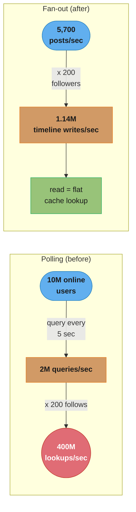
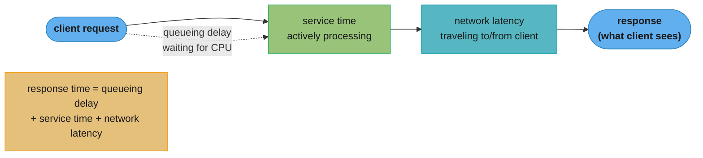
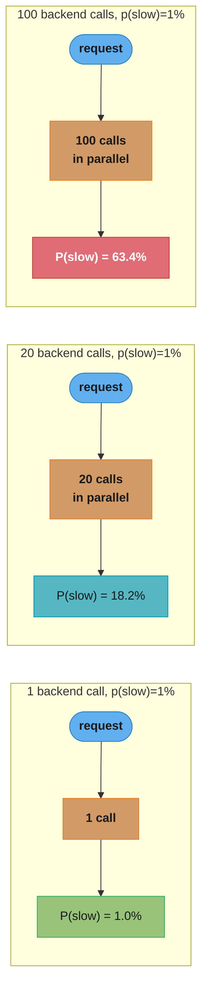

# Chapter 2: Defining Nonfunctional Requirements

> Part I — Foundations of Data Systems · DDIA (Kleppmann & Riccomini, 2nd ed., O'Reilly 2026) · builds on Ch 1, leads to Ch 3 (data models)

## Chapter Map

Chapter 1 argued that no single database is best at everything — every data system trades
one property against another. Chapter 2 gives you the vocabulary to say precisely *which*
properties you're trading. It works through a running case study — home timelines for an
X/Twitter-style social network — to make "performance," "reliability," "scalability," and
"maintainability" concrete rather than aspirational adjectives, then formalizes each one in
turn: response time versus throughput, percentiles versus averages, faults versus failures,
load versus capacity, and the three facets of long-term maintainability. Every later chapter
leans on this chapter's terms without re-defining them.

**TL;DR:**
- **Response time** is what the client experiences (service time + queueing + network
  latency); report it in **percentiles** (p50, p99, p999), never the mean — the mean hides
  the tail, and the tail is what your highest-value users experience.
- A **fault** is one component breaking; a **failure** is the whole system breaking. A
  system is **fault-tolerant** when it absorbs faults without becoming a failure — the
  distinction is scale-relative, not absolute.
- **Scalability** is not a single number — it's the answer to "what are our options as load
  grows along this dimension," and shared-nothing (horizontal) architecture is the dominant
  way of buying more of it.
- **Maintainability** decomposes into **operability** (easy to run), **simplicity** (easy to
  understand), and **evolvability** (easy to change) — three largely independent axes, and
  the chapter argues good abstractions are the best lever on all three.

## The Big Question

> "How do you turn 'the app should be fast, reliable, and easy to maintain' — the vague
> nonfunctional requirements nobody writes down — into something you can measure, design
> for, and defend in a postmortem?"

Analogy: functional requirements are the rooms and furniture a house needs; nonfunctional
requirements are whether the plumbing holds pressure, the foundation survives an earthquake,
and an electrician other than the original builder can safely rewire it in ten years. Nobody
puts "the walls should stay up" on the blueprint, but it's the requirement that decides
whether the house is worth living in. This chapter is about writing that requirement down
precisely enough to build to it.

---

## 2.1 Case Study: Social Network Home Timelines

The chapter grounds the whole vocabulary in one running example: a simplified X
(formerly Twitter)-style social network where users post messages and follow other users.
The assumed scale: **500 million posts/day** (5,700 posts/second on average, spiking to
**150,000 posts/second**), an average of **200 follows and 200 followers per user** (with a
long tail up to celebrities with over 100 million followers), and a *home timeline* — recent
posts from people you follow — as the main read path.

### Representing Users, Posts, and Follows

A naive relational schema has three tables — `users`, `posts`, `follows` — and the home
timeline is a straightforward join:

```sql
SELECT posts.*, users.* FROM posts
    JOIN follows ON posts.sender_id = follows.followee_id
    JOIN users ON posts.sender_id = users.id
    WHERE follows.follower_id = current_user
    ORDER BY posts.timestamp DESC
    LIMIT 1000
```

To keep followers seeing new posts within 5 seconds, the naive approach is **polling** —
the client re-runs this query every 5 seconds while online. With 10 million users online at
once, that's **2 million query executions per second**. And each execution isn't cheap: for
a user following 200 people, the database must look up recent posts from each of those 200
senders and merge the results — so 2 million timeline queries per second means **400 million
per-sender post lookups per second**, and users following tens of thousands of accounts make
this materially worse.

**Decoding the polling cost.** The book states the two numbers (2M queries/sec, 400M
lookups/sec) without showing the multiplication that connects them — writing it out makes
clear why *fan-out* (below) is not merely an alternative but a near-mandatory optimization:

```
  online_users = 10,000,000        poll_interval = 5 sec
  queries/sec  = online_users / poll_interval          = 2,000,000
  avg_follows_per_user = 200
  lookups/sec  = queries/sec x avg_follows_per_user     = 400,000,000
```

Every one of those 400 million lookups is redundant work the database repeats on a five-
second cycle regardless of whether anything new happened — the query re-derives an answer
that changed, on average, only a handful of times since the last poll.

### Materializing and Updating Timelines

The fix has two parts. First, replace polling with **push**: the server actively delivers
new posts to followers who are online. Second, **precompute** the home timeline — store, per
user, a data structure holding their recent followed-posts, so reading a timeline is a cache
lookup, not a join. Every time a user posts, the system looks up all of their followers and
inserts the post into each follower's precomputed timeline — "like delivering a message to a
mailbox." This is **fan-out**: one write becoming many downstream writes, and the *fan-out
factor* is the multiplier.

This process — precomputing and incrementally updating the result of a query — is called
**materialization**, and the per-user timeline is a **materialized view** (formalized later
in the book's stream-processing chapter). It buys fast, uniform-cost reads at the price of
extra work on every write.

**Decoding the fan-out arithmetic.** At 5,700 posts/second and a fan-out factor of 200
(the average follower count):

```
  posts/sec = 5,700          fan_out_factor = 200
  timeline_writes/sec = posts/sec x fan_out_factor      = 1,140,000
```

Just over **1 million writes/second** — far more work per post than before, but a large net
win versus the 400 million per-second *reads* the polling approach required: materialization
moves cost from the hot read path (every online user, every 5 seconds) to the write path
(only when someone actually posts), and reads become a flat, cheap lookup regardless of how
many people are following whom.

**Two extreme cases the averages hide:**

| Case | Problem | The book's fix |
|------|---------|----------------|
| A user follows a huge, high-posting-rate set of accounts | Their own timeline write-rate is very high | It's fine to **drop some writes** — they're unlikely to be reading every post anyway; show a sample |
| A celebrity account posts (millions of followers) | Fanning out to millions of timelines is expensive and can't be dropped | Store celebrity posts **separately** and **merge them in at read time**, instead of writing them into every follower's materialized timeline |

If a burst of posts spikes the fan-out rate (a viral event), the deliveries can be
**enqueued** rather than done synchronously — timelines stay fast to read (served from
cache) even while delivery is temporarily delayed.

---

## 2.2 Describing Performance

Two metrics dominate performance discussion:

| Metric | Definition | Unit |
|--------|------------|------|
| **Response time** | Elapsed time from request to received answer | seconds / ms / µs |
| **Throughput** | Requests (or data volume) processed per second | "somethings per second" |

In the case study, "posts per second" and "timeline writes per second" are throughput;
"time to load the home timeline" and "time until a post reaches followers" are response
time. As request throughput approaches the maximum a system's hardware can sustain,
response time increases sharply — a **queueing** effect: an incoming request often has to
wait for the CPU to finish an earlier one before it can even begin.

### When an overloaded system won't recover — metastable failure

A system pushed close to its throughput limit can enter a vicious cycle: a long request
queue inflates response times until clients time out and **retry**, which raises the
request rate further and worsens the queue — a **retry storm**. Even after the original load
subsides, the system can remain overloaded until it is rebooted or otherwise reset. This is
a **metastable failure**, and it is a real cause of serious production outages.

Mitigations the book names, client-side and server-side:

- **Exponential backoff** — increase and randomize the delay between retries.
- **Circuit breaker** / **token bucket** — temporarily stop sending requests to a service
  that has recently errored or timed out.
- **Load shedding** — the server proactively rejects requests as it detects it's
  approaching overload.
- **Backpressure** — the server explicitly asks clients to slow down.
- Choice of queueing and load-balancing algorithm can also matter.

### Latency and Response Time

The book fixes precise, non-interchangeable meanings for four terms (illustrated by its
Figure 2-4, a time-flows-left-to-right diagram with each node as a horizontal line and each
message as a diagonal arrow — a style used repeatedly through the book):

| Term | Meaning |
|------|---------|
| **Response time** | What the client sees — includes every delay anywhere in the system |
| **Service time** | Duration the service is *actively* processing the request |
| **Queueing delay** | Time waiting — e.g. for a free CPU, or for an outbound network buffer |
| **Latency** | Catch-all for time a request is *not* being actively processed, i.e. is *latent*; **network latency** specifically is time spent traveling through the network |

Response time varies run to run for the *same* request, driven by causes like a context
switch to a background process, TCP retransmission after a dropped packet, a GC pause, a
page fault forcing a disk read, or even mechanical vibration in the server rack. **Queueing
delay is often the largest source of that variability**: because a server can only process a
small number of things in parallel (bounded by CPU core count), a handful of slow requests
is enough to hold up everything queued behind them — **head-of-line blocking**. This is why
response time should be **measured client-side**: queueing delay isn't part of service time,
so a server-side measurement misses exactly the thing causing user-visible slowness.

### Average, Median, and Percentiles

Response time is a *distribution*, not a single number, so summarizing it with the
arithmetic **mean** hides the shape that matters: the mean is useful for estimating
throughput limits, but it says nothing about how many users actually experienced any
particular delay.

**Percentiles** are the better tool. Sort response times fastest-to-slowest; the **median**
(**p50**) is the halfway point — half of requests are faster, half slower. Higher
percentiles — **p95**, **p99**, **p999** (99.9th) — describe the tail: a p95 of 1.5 s means
95 of 100 requests finish under 1.5 s and 5 finish at or above it.

**Tail latencies matter disproportionately.** Amazon defines internal service response-time
requirements in terms of **p999**, even though it governs only 1 request in 1,000, because
the slowest-served customers tend to be the ones with the *most* data on their account —
they've made the most purchases, and are the most valuable customers to keep happy. The
book also notes diminishing returns: Amazon judged optimizing **p9999** (1 in 10,000) not
worth the cost — very high percentiles are dominated by random events outside your control.

### The user impact of response times

Reliable data quantifying "how much does latency cost in user behavior" is surprisingly
hard to find, and the book is explicit that several often-cited numbers don't hold up:

| Study | Claimed effect | The book's caveat |
|-------|-----------------|--------------------|
| Google, 2006 | 400ms→900ms slowdown associated with 20% drop in traffic/revenue | Cited widely but the underlying data isn't public |
| Google, 2009 | 400ms increase → only 0.6% fewer searches/day | Contradicts the 2006 figure |
| Bing, 2009 | 2-second load-time increase → 4.3% less ad revenue | — |
| Akamai (more recent) | 100ms increase → up to 7% lower e-commerce conversion | On inspection, very *fast* pages also correlate with *lower* conversion (they're often content-free 404 pages) — the study doesn't separate content effects from load-time effects, so its headline number is likely not meaningful |
| Yahoo | 20–30% more clicks on search results 1.25s+ faster, controlling for result quality | The one study the book treats as methodologically sound |

The takeaway isn't a number to quote — it's a caution against quoting one.

### Use of Response Time Metrics

**Tail latency amplification.** When a single end-user request fans out to multiple backend
calls (even in parallel), the end-user request can't finish before its *slowest* parallel
call does — so it takes just one slow backend call to slow the whole request. As the number
of backend calls per request grows, so does the chance that at least one lands in the slow
tail, meaning a *larger* share of end-user requests end up slow even if each individual
backend call is fast almost all the time.

**Decoding tail latency amplification.** The book states the effect without a formula;
putting a number on it shows why it compounds so fast. If each backend call independently
has probability `p` of being slow, and a request needs `k` of them:

```
  P(request is NOT slow) = P(every one of k calls is fast) = (1 - p)^k
  P(request IS slow)     = 1 - (1 - p)^k
```

| p (per-call P(slow)) | k = 1 | k = 5 | k = 20 | k = 100 |
|---|---|---|---|---|
| 1% | 1.0% | 4.9% | 18.2% | 63.4% |
| 0.1% | 0.1% | 0.5% | 2.0% | 9.5% |

At k = 100 backend calls per request — not unusual for a page assembled by many
microservices — a call that's slow only 1% of the time makes **63% of end-user requests**
slow. This is the same shape of amplification driving the scatter/gather cost analyzed in
the partitioning chapter (Ch 7), and it's why the book insists on p99/p999, not the mean, at
every layer of a multi-hop system.

**SLOs and SLAs.** Percentiles are the usual currency of a **service level objective**
(SLO) — e.g. "median response time under 200ms, p99 under 1s, at least 99.9% of valid
requests return non-error." A **service level agreement** (SLA) is a *contract* specifying
consequences (e.g. refunds) if the SLO is missed. The book is candid that defining good
availability metrics for SLOs/SLAs in practice is genuinely hard, not a solved problem.

### Computing percentiles

To chart response-time percentiles on a monitoring dashboard, you need to compute them
continuously and cheaply — e.g. over a rolling 10-minute window, recomputed every minute.
The naive approach (store every response time in the window, sort it every minute) works but
doesn't scale; approximation algorithms exist for when it doesn't — the book names
**HdrHistogram**, **t-digest**, **OpenHistogram**, and **DDSketch** as open-source options.

One trap called out explicitly: **averaging percentiles is mathematically meaningless** —
whether you're downsampling over time or combining data from several machines, the correct
way to aggregate response-time data is to **add the underlying histograms**, not average the
percentile values computed from each.

---

## 2.3 Reliability and Fault Tolerance

The book gives *reliability* a precise gloss — "continuing to work correctly, even when
things go wrong" — built on top of an intuitive checklist of what "working correctly" means:
doing what the user expects, tolerating user mistakes and unexpected usage, meeting
performance expectations under expected load, and preventing unauthorized access and abuse.

Two terms the book insists on distinguishing:

| Term | Definition |
|------|------------|
| **Fault** | A *part* of the system stops working correctly (a disk fails, a machine crashes, a dependency has an outage) |
| **Failure** | The system *as a whole* stops providing its required service — it misses its SLO |

The distinction is **scale-relative, not absolute**: a failed hard drive is a *failure* if
the system is just that one drive, but only a *fault* — one the bigger system may tolerate
by keeping a copy elsewhere — if the system contains many drives.

### Fault Tolerance

A system is **fault-tolerant** if it keeps providing its service despite certain faults
occurring. A part whose fault the system *cannot* tolerate is a **single point of failure**
(SPOF) — a fault there always escalates to a system failure. In the timeline case study: if
the machine doing fan-out delivery crashes mid-process, fault tolerance means another
machine takes over *without* missing or duplicating any post delivery — **exactly-once
semantics**, developed in depth later in the book (§13, "The End-to-End Argument for
Databases").

Fault tolerance is always bounded — tolerating "a maximum of two disks failing at once" or
"one of three nodes crashing," never *any* number of faults (if every node crashes there is
nothing left to do the tolerating). Counter-intuitively, fault-tolerant systems benefit from
**deliberately increasing** the fault rate — killing processes at random on purpose — because
many critical bugs trace back to poor error handling that's rarely exercised in practice;
continually triggering the fault-handling machinery, on purpose, is how you find out it
actually works before a real outage does. **Chaos engineering** is the discipline built
around this idea.

The book's overall preference is **tolerate faults over prevent them**, with one explicit
exception: **security**. A compromised system with exfiltrated sensitive data can't be
"tolerated back" — that event is irreversible, so prevention is the only lever. Most of the
rest of the book concerns faults that *can* be cured after the fact.

### Hardware and Software Faults

Concrete hardware failure rates the book cites, useful as calibration for how often "rare"
events actually happen at scale:

| Component | Rate |
|-----------|------|
| Magnetic hard drives | ~2–5% fail per year (improving, but still material) |
| SSDs | ~0.5–1% fail per year; uncorrectable errors occur roughly once/year even on lightly-worn drives — a higher rate than magnetic disks despite the lower failure percentage |
| CPU cores | ~1 in 1,000 machines has a core that occasionally computes a wrong result (manufacturing defect) — sometimes crashes, sometimes silently returns a wrong answer |
| RAM (even with ECC) | >1% of machines hit an uncorrectable memory error in a given year, typically crashing the machine |
| Whole datacenter | Rare, but can be destroyed outright (fire, flood, earthquake) or knocked out (power, network misconfiguration, even a solar storm inducing damaging currents in long-distance cabling) |

**Decoding the disk-failure rate.** The book states the annual rate and separately notes
"roughly one failure per day in a 10,000-disk cluster" — the arithmetic connecting them:

```
  annual_failure_rate ~= 3.5%  (midpoint of the 2-5% range)
  disks = 10,000
  expected_failures/year = disks x annual_failure_rate       = 350
  expected_failures/day  = expected_failures/year / 365      ~= 0.96, i.e. ~1/day
```

At cluster scale, a "rare" 3.5%-per-year event becomes a *daily* operational fact — which is
exactly the book's point: hardware faults are rare enough to ignore on one machine, and
routine enough to design around at fleet scale.

#### Tolerating hardware faults through redundancy

The first line of defense is redundancy at the component level: RAID across disks, dual
power supplies, hot-swappable CPUs, generator/battery backup for datacenters — this can keep
a single machine running uninterrupted for years. But redundancy's benefit depends on
**independence** of the underlying faults, and real correlated failures (a whole rack, a
whole datacenter going down together) happen more than a naive independence assumption
predicts — which is why cloud providers group co-located resources into **availability
zones**, so consumers of the abstraction know which resources are likely to fail *together*.

This is why the book's fault-tolerance techniques (developed across Ch 6 replication and
Ch 10 consistency/consensus) target the loss of **entire machines, racks, or availability
zones**, not just single components — letting a machine in one datacenter take over when
one in another fails. It has an operational payoff too: a multi-node fault-tolerant system
supports **rolling upgrades** (patch one node at a time, no downtime), where a single-server
system needs planned downtime for the same patch.

#### Software faults

Hardware faults are weakly correlated at best (other disks in the same machine are usually
fine when one fails); **software faults are often highly correlated**, because many nodes
run the *identical* code and therefore share the identical bug — which is why software
faults, though individually less "physical," cause more system failures overall. Named
examples from the book:

- **Simultaneous trigger:** the June 30, 2012 leap second hung many Java applications at
  once via a Linux kernel bug, taking down multiple Internet services simultaneously; a
  firmware bug caused certain SSD models to fail *all at once* after exactly 32,768 hours
  of operation (under 4 years), destroying the data on them.
- **Runaway resource consumption:** a process that exhausts a shared, limited resource
  (CPU, memory, disk, bandwidth, threads) — e.g. an OOM-killed process, or a client-library
  bug driving far more request volume than intended.
- **Downstream degradation:** a dependency slows down, stops responding, or starts
  returning corrupted data.
- **Emergent interaction:** two systems, each tested fine in isolation, misbehave only
  when combined.
- **Cascading failure:** overload in one component pushes load onto and overloads a
  neighboring component, which pushes it further.

These bugs typically lie dormant until an unusual circumstance reveals an assumption the
software was silently making — an assumption that was usually true, until it wasn't. There
is **no quick fix**; the book's list is a set of habits rather than a solution: careful
reasoning about assumptions and interactions, thorough testing, process isolation, letting
processes crash and restart cleanly, avoiding feedback loops like retry storms, and
continuous measurement/monitoring in production.

### Humans and Reliability

One study the book cites found **operator configuration changes** — not hardware — the
*leading* cause of large internet-service outages, with hardware faults (servers or network)
implicated in only 10–25% of them.

The book explicitly rejects treating this as "human error" to be fixed with tighter rules:
blaming individuals is counterproductive, because what gets labeled "human error" is usually
a *symptom* of a sociotechnical system where people are genuinely trying to do their jobs
well within the constraints they were given. Complex systems also exhibit **emergent
behavior** — unexpected component interactions that no individual "made a mistake" causing.

Concrete technical mitigations the book lists: thorough testing (hand-written *and*
**property testing** over randomized inputs), fast rollback for configuration changes,
gradual rollouts of new code, clear monitoring and observability tooling, and interfaces
designed to make "the right thing" easy and "the wrong thing" hard. All of these cost real
time and money, and the book is candid that organizations routinely — understandably —
prioritize revenue-generating features over them; when a preventable mistake later occurs
under that tradeoff, the fault lies with the *priority*, not the person who happened to be at
the keyboard.

**Blameless postmortems** are the organizational practice the book endorses: after an
incident, participants share full details without fear of punishment, so the organization
can actually learn — the process may surface a need to change priorities, invest in a
neglected area, fix misaligned incentives, or address some other systemic issue. As a
general discipline: be suspicious of simplistic answers on either side — "Bob should have
been more careful" is not useful, but neither is "we must rewrite the backend in Haskell."
The productive move is learning how the system actually works from the people who operate it
daily, and acting on that.

### How important is reliability?

Reliability isn't a nuclear-power-plant-only concern. Bugs in ordinary business
applications cost productivity and create legal exposure when figures are misreported;
e-commerce outages cost revenue and reputation directly. The book draws a sharp line between
a *temporary* outage (often tolerable) and *permanent data loss or corruption* (rarely so) —
illustrated with a parent's photos and videos of their children, and the question of whether
they'd even know how to recover from a backup if the database silently corrupted.

The book's most serious illustration is the **Post Office Horizon scandal**: between 1999
and 2019, hundreds of UK Post Office branch managers were convicted of theft or fraud because
the Horizon accounting software showed shortfalls in their accounts. Many of those shortfalls
turned out to be **software bugs**, and many convictions have since been overturned — widely
described as the largest miscarriage of justice in British legal history. The root legal
cause the book names: English law presumed computer evidence reliable unless proven
otherwise, an assumption reliability engineers should find uncomfortably optimistic.

That said, the book allows that some contexts genuinely justify **sacrificing reliability**
to cut development cost — an unproven-market prototype, for example — provided the team is
consciously choosing that tradeoff and aware of what it could cost later.

---

## 2.4 Scalability

Working reliably *today* doesn't guarantee working reliably as load grows — from 10,000
concurrent users to 100,000, from 1 million rows processed to 10 million, and so on.
**Scalability** is the system's ability to cope with that increase. The book pushes back on
"you're not Google, stop worrying about scale" as a maxim — whether it applies depends
entirely on what you're building: for a young product with few users, the dominant
engineering goal is usually staying **simple and flexible** enough to keep adapting to
customer needs, and investing in hypothetical future scale is often *wasted or actively
harmful* — it can lock you into an inflexible design before you know what you'll actually
need.

Crucially, **scalability is not one-dimensional** — "X is scalable" is a meaningless claim
on its own. The book reframes it as three concrete questions: if the system grows in a
*particular* way, what are the options for coping; how do you add resources to handle the
additional load; and, given current growth, when do you hit the limits of the current
architecture? Growing successfully is itself how you learn which dimension actually needs
scaling.

### Describing Load

Before asking "what happens if load doubles," you need a succinct load description — usually
a throughput measure (requests/sec, GB/day, checkouts/hour), sometimes a peak of some
quantity (simultaneous online users, as in the case study). Other statistical
characteristics often matter just as much: read/write ratio, cache hit rate, items per user
(followers per user, in the case study) — whether the *average* case or a small set of
*extreme* cases dominates your bottleneck is entirely application-specific.

Once load is described, there are two complementary questions to ask when it grows:

1. Holding resources fixed, how does performance degrade?
2. Holding performance fixed, how much do resources need to grow?

The goal is usually keeping performance within the SLA while minimizing cost — and cost
depends on which hardware is most cost-effective, which shifts over time as new hardware
becomes available. **Linear scalability** — doubling resources to handle double the load
with unchanged performance — is the good case; it's occasionally possible to do *better*
than linear (economies of scale, better peak-load distribution), but the book is clear that
**worse-than-linear is far more common**: processing one write against a large dataset is
typically more work than the same write against a small one, even at identical request size.

### Shared-Memory, Shared-Disk, and Shared-Nothing Architecture

The simplest way to add capacity is a bigger machine — **vertical scaling** / **scaling up**.
Multiple processes or threads on that one machine share the same RAM: a **shared-memory
architecture**. Its problem is cost curvature: a high-end machine with double the resources
typically costs *significantly* more than double, and bottlenecks mean a machine twice the
size often handles *less* than twice the load.

**Shared-disk architecture** uses several independent-CPU/RAM machines that all access a
common disk array over a fast network (NAS or SAN) — traditionally used for on-premises data
warehousing, but contention and locking overhead limit its scalability.

**Shared-nothing architecture** (**horizontal scaling** / **scaling out**) has gained the
most traction: a distributed system of nodes, each with its own CPU, RAM, and disk, with all
coordination handled at the software level over an ordinary network.

| Architecture | Coordination | Scaling potential | Downside |
|---|---|---|---|
| Shared-memory | Threads share RAM directly | Sub-linear; cost grows faster than capacity | Bottlenecks; expensive at the high end |
| Shared-disk | Independent CPU/RAM, common disk (NAS/SAN) | Limited | Contention, locking overhead |
| Shared-nothing | Software-level, over the network | Potentially linear | Requires explicit sharding (Ch 7); full distributed-systems complexity (Ch 9) |

Shared-nothing's advantages: near-linear scaling potential, freedom to pick whatever
hardware offers the best price/performance (especially in the cloud), easy incremental
resource adjustment, and — because it's already spread across nodes — the ability to
tolerate the loss of an entire datacenter by spreading across regions.

The book also flags a fourth, newer pattern: some cloud-native databases **separate storage
from compute** — multiple compute nodes share one storage *service*, not a raw filesystem
(NAS) or block device (SAN), but a specialized API purpose-built for the database's access
patterns. It resembles shared-disk in shape but is engineered to avoid shared-disk's
scalability ceiling.

### Principles for Scalability

There is **no generic "magic scaling sauce."** Architecture is highly application-specific —
a system built for 100,000 requests/sec of 1 kB each looks nothing like one built for 3
requests/minute of 2 GB each, even though both move the same 100 MB/sec of data. Worse, an
architecture tuned for one load level typically doesn't survive **10x** that load unchanged —
so a fast-growing service should expect to rethink its architecture roughly every order of
magnitude, and planning scale much further than one order of magnitude ahead is usually
wasted effort.

Two general principles the book offers:

1. **Decompose into independently-operable smaller components** — the shared idea behind
   microservices, sharding (Ch 7), stream processing (Ch 12), and shared-nothing
   architecture generally. The hard part is judgment: where exactly to draw the line
   between what stays together and what gets split apart.
2. **Don't over-complicate.** If a single-machine database does the job, prefer it over a
   complex distributed setup. Auto-scaling is appealing, but if load is fairly predictable,
   manual scaling can mean fewer operational surprises. A five-service system is simpler
   than a fifty-service one; good architectures are usually a pragmatic *mixture*, not a
   dogmatic commitment to one pattern.

---

## 2.5 Maintainability

Software doesn't wear out mechanically, but requirements drift, the runtime environment
changes (dependencies, platforms), and bugs need fixing — so most of software's *cost*
falls in ongoing maintenance (bug fixes, keeping it operational, investigating failures,
platform adaptation, new use cases, technical-debt repayment, new features), not initial
development. Maintenance is hard precisely because a long-lived system accumulates outdated
technology few current engineers understand, loses the institutional memory of *why* it was
built a certain way, and becomes as much a **people** problem as a technical one once it's
intertwined with the organization it serves. Every system successful enough to survive
becomes, eventually, a **legacy system** — so the book frames maintainability as three
distinct, largely independent design goals:

| Facet | Goal |
|-------|------|
| **Operability** | Make it easy for the organization to keep the system running smoothly |
| **Simplicity** | Make it easy for a new engineer to understand the system — well-understood, consistent patterns; no unnecessary complexity |
| **Evolvability** | Make it easy to change the system as requirements shift, including for unanticipated future use cases |

### Operability: Making Life Easy for Operations

Good human process is at least as important to reliable operations as good tooling — "good
operations can often work around the limitations of bad or incomplete software, but good
software cannot run reliably with bad operations." At the scale of thousands of machines,
manual maintenance is prohibitively expensive and automation is essential — but automation
is a two-edged sword: rare failure scenarios still need manual intervention, and because the
cases automation *can't* handle are, by construction, the hardest ones, more automation
actually demands a *more* skilled operations team, not a less-skilled one. An automated
system that goes wrong is also often harder to troubleshoot than one relying on a human
operator's manual actions — so "more automation is strictly better" is false; the right
amount is application- and organization-specific.

Concrete things a data system can do to make routine operational work easy:

- Support monitoring and **observability** tooling that gives real insight into runtime
  behavior, not just up/down.
- Avoid dependency on any individual machine — let machines go down for maintenance
  without the system as a whole going down.
- Provide clear documentation and a predictable operational model ("if I do X, Y happens").
- Ship good defaults, but let administrators override them when needed.
- **Self-heal** where appropriate, but leave administrators manual control when they need it.
- Behave **predictably** — minimize surprises.

### Simplicity: Managing Complexity

Small projects can stay delightfully simple; larger ones tend toward a **big ball of mud** —
complexity that slows down everyone touching the system and raises the odds of a bug slipping
through unnoticed assumptions or interactions. Reducing complexity is therefore a direct
maintainability lever, but "is this simple" is genuinely subjective — one system may hide
complex internals behind a simple interface, another may expose more detail through a simple
implementation, and there's no objective standard for which one is "simpler."

The book discusses, and then explicitly *distrusts*, the classic **essential vs. accidental
complexity** split (Brooks): essential complexity is inherent to the problem domain,
accidental complexity is an artifact of your tooling's limitations. The book's caveat is that
the line between the two shifts as tooling evolves, so the distinction, while a useful
heuristic, doesn't hold up as a rigorous boundary.

**Abstraction** is the book's best available tool for managing complexity — hiding
implementation detail behind a clean interface, reusable across a wide range of
applications, with the bonus that a quality improvement inside the abstraction benefits
every caller at once. Its canonical examples: a high-level language hiding machine code,
CPU registers, and syscalls; SQL hiding on-disk/in-memory structures, concurrent access, and
crash-recovery inconsistency. The book is explicit about its own scope here: application-
level abstraction methodologies like **design patterns** and **domain-driven design (DDD)**
are out of scope — this book is about the *general-purpose* abstractions (transactions,
indexes, event logs) you'd build a DDD-style application on top of, not the application-
level patterns themselves.

### Evolvability: Making Change Easy

Requirements are essentially never static — new facts, new use cases, shifting priorities,
new feature requests, platform churn, regulatory change, and growth-forced architectural
change are all normal, ongoing pressure. **Agile** methods (and technical practices like
TDD and refactoring) are the organizational-process answer at the level of a single
application; the book reserves a distinct term, **evolvability**, for the same idea applied
at the level of a *data system* composed of several applications or services with different
characteristics. Ease of modification tracks closely with simplicity and good abstraction —
loosely-coupled, simple systems are easier to change than tightly-coupled, complex ones.

One factor the book calls out specifically: **irreversibility**. An action that can't be
undone needs to be approached far more carefully than one that can — migrating from one
database to another is much higher-stakes if there's no way back than if rollback stays an
option. **Minimizing irreversibility is itself a flexibility strategy**, not just a safety
habit.

---

## Visual Intuition



Caption: materializing the timeline moves cost from a 400M/sec read-time computation,
repeated redundantly every 5 seconds regardless of what changed, to a 1.14M/sec write-time
computation that happens only when something actually changes — a ~350x reduction, at the
price of doing more work per post.



Caption: response time is the sum the client actually feels; service time is only the
active-processing slice inside it, which is why measuring on the server side under-counts
exactly the queueing delay that dominates variability under load.



Caption: tail latency amplification — `P(slow) = 1 - (1 - p)^k`; a per-call slowness rate as
small as 1% becomes the *majority* outcome once a request depends on 100 parallel calls,
which is why high-fan-out services must hold every hop to a tight p99, not just the average.

```
  Skewed response-time distribution (100 requests, gray bar = one request's time)

  count
    |                    #
    |                  # #
    |                # # #
    |              # # # #
    |            # # # # #
    |          # # # # # # #
    |        # # # # # # # # #
    |      # # # # # # # # # # #                       #     #
    +----------------------------------------------------------------> time
       fast <--- most requests cluster here --->            outliers
                       ^p50           ^p95              ^p99      ^p999

  mean sits pulled RIGHT of p50 by the long tail -- it overstates the "typical" case
```

Caption: the mean is dragged toward the tail by a few extreme outliers, which is exactly why
it misrepresents what a "typical" user experiences — the median (p50) and the tail
percentiles (p95/p99/p999) each answer a different, more honest question.

---

## Key Concepts Glossary

- **Functional requirement** — what the application's features and operations must do.
- **Nonfunctional requirement** — performance, reliability, scalability, maintainability,
  security, compliance — properties of *how well* it does it.
- **Fan-out** — the multiplier by which one initiating request produces many downstream
  requests (e.g. one post delivered to N followers' timelines).
- **Materialization / materialized view** — precomputing and incrementally maintaining the
  result of a query so reads become a cache lookup instead of a live computation.
- **Response time** — total elapsed time the client observes, end to end.
- **Throughput** — requests (or data volume) processed per unit time; a given resource
  allocation has a *maximum throughput*.
- **Queueing** — waiting for a busy resource (CPU, network buffer) before being processed;
  the dominant driver of response-time growth as throughput nears capacity.
- **Metastable failure** — an overloaded system that stays overloaded even after load
  subsides, until explicitly reset.
- **Retry storm** — retries from timed-out clients increasing load further, worsening the
  original overload.
- **Exponential backoff** — increasing, randomized delay between successive retries.
- **Circuit breaker** — stop sending requests to a recently-failing service for a cooldown
  period.
- **Token bucket** — a rate-limiting algorithm used to bound outgoing request/retry rate.
- **Load shedding** — a server proactively rejecting requests as it nears overload.
- **Backpressure** — a server explicitly signaling clients to slow down.
- **Service time** — duration a request is *actively* being processed (excludes queueing).
- **Latency** — catch-all for time a request spends not actively being processed;
  **network latency** is specifically time in transit.
- **Head-of-line blocking** — a small number of slow requests delaying everything queued
  behind them.
- **Jitter** — variation in network delay.
- **Percentile (p50/p95/p99/p999)** — the response-time threshold below which that
  percentage of requests fall; p50 = median.
- **Tail latency** — high-percentile (slow-end) response times.
- **Tail latency amplification** — the chance an end-user request is slow rises with the
  number of parallel backend calls it depends on.
- **Service level objective (SLO)** — a target for performance/availability.
- **Service level agreement (SLA)** — a contract specifying consequences for missing an SLO.
- **Fault** — one part of a system stops working correctly.
- **Failure** — the system as a whole stops meeting its SLO.
- **Fault-tolerant** — continues providing service despite certain faults.
- **Single point of failure (SPOF)** — a component whose fault always escalates to a
  system failure.
- **Fault injection** — deliberately triggering faults to test fault-tolerance machinery.
- **Chaos engineering** — a discipline built around fault injection experiments to build
  confidence in a system's resilience.
- **Availability zone** — a cloud provider's grouping of resources likely to fail together
  (physical co-location).
- **Rolling upgrade** — patching a multi-node system one node at a time with no downtime.
- **Blameless postmortem** — an incident review focused on systemic learning, not
  individual blame.
- **Property testing** — testing against a large space of randomized inputs, not just
  hand-picked cases.
- **Scalability** — a system's ability to cope with increased load along some dimension.
- **Linear scalability** — doubling resources to handle double the load with unchanged
  performance.
- **Vertical scaling (scaling up)** — moving to a more powerful single machine.
- **Horizontal scaling (scaling out)** — adding more machines; shared-nothing architecture.
- **Shared-memory architecture** — multiple threads/processes on one machine sharing RAM.
- **Shared-disk architecture** — independent CPU/RAM machines sharing a common disk array
  (NAS/SAN).
- **Shared-nothing architecture** — independent nodes (own CPU/RAM/disk), coordinating only
  over the network.
- **Separation of storage and compute** — cloud-native pattern where compute nodes share a
  specialized storage *service* rather than a raw filesystem/block device.
- **Operability** — ease of keeping a system running smoothly in production.
- **Simplicity** — ease of understanding a system, via well-understood patterns and reduced
  unnecessary complexity.
- **Evolvability** — ease of changing a data system's design as requirements change.
- **Big ball of mud** — a software project that has become so complex it's hard to
  understand or safely modify.
- **Essential vs. accidental complexity** — Brooks's split between complexity inherent to
  the problem and complexity from tooling limitations; the book flags the boundary as
  unstable over time.
- **Abstraction** — hiding implementation detail behind a clean, reusable interface.
- **Legacy system** — any system that has survived long enough to accumulate outdated
  technology and lost institutional knowledge.
- **Irreversibility** — an action that cannot be undone; the book treats minimizing it as a
  direct evolvability lever.

---

## Tradeoffs & Decision Tables

| | Mean | Median (p50) | p95/p99/p999 |
|---|---|---|---|
| What it answers | "typical" cost across all requests, skewed by outliers | typical single-user experience | worst-case experience for your unluckiest users |
| Good for | estimating throughput limits | representative UX number | SLOs, catching regressions that only hit a minority |
| Weakness | hides the tail entirely | says nothing about outliers | expensive to optimize further past p999; diminishing returns |
| Aggregation across machines/time | **never average it directly** | sum histograms, then re-derive | sum histograms, then re-derive |

| Architecture | Coordination model | Scaling ceiling | Typical use |
|---|---|---|---|
| Shared-memory (vertical) | Threads share RAM | Sub-linear cost growth; single-machine bottlenecks | Simple, small-to-medium systems |
| Shared-disk | Independent compute, common disk (NAS/SAN) | Limited by contention/locking | Legacy on-prem data warehousing |
| Shared-nothing (horizontal) | Software-level, over network | Potential linear scaling | Cloud-native, large-scale distributed systems |
| Separated storage/compute | Compute nodes share a storage *service* API | Avoids classic shared-disk ceiling | Modern cloud-native databases |

| Fault-tolerance lever | What it buys | What it costs |
|---|---|---|
| Component redundancy (RAID, dual PSU) | Keeps a single machine up for years | Doesn't help with correlated rack/DC failures |
| Multi-node / multi-DC replication | Tolerates loss of a whole machine, rack, or AZ | Full distributed-systems complexity (Ch 9) |
| Fault injection / chaos engineering | Confidence the fault-tolerance path actually works | Deliberately increases fault rate; needs discipline |
| Prevention (e.g. for security) | The only lever when the fault is irreversible | Doesn't compose with "just tolerate it" |

| Maintainability facet | Central question | Example lever |
|---|---|---|
| Operability | Is it easy to run day-to-day? | Observability tooling, good defaults, self-healing |
| Simplicity | Is it easy to understand? | Abstraction, avoiding accidental complexity |
| Evolvability | Is it easy to change? | Loose coupling, minimizing irreversible actions |

---

## Common Pitfalls / War Stories

- **Reporting the mean instead of percentiles.** The mean is pulled toward the tail by a
  small number of very slow outliers and tells you nothing about how many users actually
  hit that delay — always report p50 alongside p95/p99/p999, and be suspicious of any
  performance dashboard that shows only an average.
- **Measuring response time server-side.** Server-side timing captures only service time
  and misses queueing delay — often the *dominant* source of response-time variability
  under load — so the client (or as close to the client as possible) is where response time
  must be measured.
- **Averaging percentiles across machines or time windows.** This is mathematically
  meaningless; the book is explicit that the correct operation is to sum the underlying
  histograms and re-derive percentiles from the combined histogram, not average pre-computed
  percentile values.
- **Retry storms triggering a metastable failure.** Naive client retries on timeout, without
  backoff or a circuit breaker, add load to an already-overloaded system and can lock it
  into an overloaded state that survives even after the original load recedes — requiring a
  reboot to clear. Exponential backoff, circuit breakers, load shedding, and backpressure
  are the book's named defenses.
- **Treating "human error" as the root cause.** Naming an operator's mistake as the cause of
  an incident, and responding with tighter procedures, misses that the mistake was usually a
  symptom of a sociotechnical system under conflicting pressures (features vs. resilience
  investment) — the book's alternative is the blameless postmortem, aimed at systemic
  learning rather than individual blame.
- **Chasing hypothetical future scale too early.** Investing heavily in scalability before a
  young product has real load is, in the best case, wasted effort, and in the worst case
  locks the system into an inflexible design that makes it *harder* to adapt once real
  customer needs are understood.
- **Assuming an architecture survives its next order of magnitude.** An architecture tuned
  for today's load level typically breaks — not degrades gracefully, breaks — at roughly
  10x that load; the book's guidance is to expect a rethink at every order-of-magnitude
  growth step rather than to over-plan multiple orders ahead.
- **Fully automating rebalancing/failure response with no human check.** (Foreshadowed here,
  developed fully in Ch 7.) Coupling full automation with automatic failure detection can
  cascade — a node that merely *looks* overloaded gets more work redirected onto it, which
  makes it genuinely overloaded, triggering further automated action.

---

## Real-World Systems Referenced

X (formerly Twitter) — the chapter's running home-timeline case study, including the
"celebrity post" handling problem and 3% of Twitter's servers once being dedicated to
Justin Bieber traffic. Amazon — p999-based internal SLOs, and the Dynamo paper's rationale
for caring about tail latency (highest-spend customers correlate with slowest requests).
Google and Bing — cited (and partly debunked) studies on latency's effect on user
behavior/revenue. Akamai and Yahoo — further latency/conversion studies, one of which the
book treats as methodologically unsound. HdrHistogram, t-digest, OpenHistogram, DDSketch —
open-source percentile-estimation libraries. UK Post Office Horizon system — the software-
reliability failure the book uses to make the human stakes of "unreliable" concrete.

---

## Summary

This chapter turned four vague nonfunctional adjectives — fast, reliable, scalable,
maintainable — into vocabulary you can design and measure against, grounded throughout in a
social-network home-timeline case study. **Performance** is described with response time
(what the client feels) and throughput (what the system processes), and response time should
always be reported as a distribution via percentiles, never collapsed into a mean, because
the mean hides exactly the tail that matters most to your highest-value users; SLAs and SLOs
are typically expressed as percentile targets. **Reliability** means continuing to work
correctly when things go wrong, achieved via **fault tolerance** — techniques that let a
system absorb the fault of one part (hardware or software) without becoming a failure of the
whole — plus resilience to human mistakes, learned from via blameless postmortems rather than
blame. **Scalability** is never a single yes/no label; it's the set of options for coping
with growth along a specific dimension, most often bought today via shared-nothing
(horizontal) architecture, with decomposition into independent components as the general
principle and "don't over-complicate it" as the essential counterweight. **Maintainability**
breaks into operability, simplicity, and evolvability — three largely separable design goals
where good abstraction is the strongest available lever on all three at once. The rest of
the book builds specific technical machinery — replication, sharding, transactions,
consensus, batch and stream processing — that exists to deliver these four properties in
practice.

---

## Interview Questions

**Q: Why does the book insist on percentiles instead of the mean for response time?**
**Short:** The mean is skewed by outliers and hides how many users hit the slow tail.
The arithmetic mean is pulled toward whatever outliers exist in the distribution and tells you nothing about how many actual users experienced any particular delay — a single very slow request can distort the average without representing anyone's typical experience. Percentiles instead answer a direct question: the median (p50) tells you what half your users experience or better, and high percentiles like p99 or p999 tell you exactly how bad the worst-served requests are. The mean is still useful for one narrow purpose — estimating throughput limits — but as a description of "typical" experience it is actively misleading.

**Q: What is the difference between a fault and a failure, and why is the distinction scale-relative rather than absolute?**
**Short:** A fault is one part breaking; a failure is the whole system breaking — relative to scope.
A fault is a single part of a system stopping working correctly — one disk, one machine, one dependency's outage — while a failure is the system *as a whole* failing to provide its required service to the user. The same event can be either label depending on what "the system" refers to: if a hard drive is the entire system, its failure is a system failure; if it's one drive among many in a fault-tolerant array, the same event is merely a fault the larger system absorbs. This is why fault tolerance is always defined relative to a specific system boundary, never in the abstract.

**Q: Why can retries make an overloaded system's problem worse instead of better, and what's the book's name for the resulting state?**
**Short:** A retry storm can push a system into a metastable failure that outlives the original load.
When a system is already near its throughput limit, growing queues push response times up until clients time out and resend their requests, which increases the incoming request rate and worsens the very queueing delay that caused the timeouts in the first place — a retry storm. In the worst case this creates a metastable failure: the system stays overloaded and dysfunctional even after the original traffic spike subsides, because the retry-driven load is now self-sustaining, and it may require an explicit reboot or reset to recover. The book's countermeasures are exponential backoff with jitter, circuit breakers/token buckets, server-side load shedding, and backpressure.

**Q: Why is measuring response time on the client side, rather than the server side, the correct approach?**
**Short:** Server-side timing skips queueing delay, which is often the biggest source of slowness.
Server-side measurement typically only captures the service time — the interval the server was actively processing the request — and misses the queueing delay incurred before processing even began, for example while waiting for a free CPU. Since queueing delay is often the largest contributor to response-time variability under load, a server-side-only measurement systematically understates how slow the request actually felt to the user. Measuring from the client's perspective, or as close to it as possible, captures the full response time the user experiences.

**Q: The book says "averaging percentiles is mathematically meaningless." What's the correct way to combine response-time data across machines or time windows?**
**Short:** Add the underlying histograms together; never average pre-computed percentile values.
Averaging percentile values computed separately — say, per-machine p99s, or per-minute p99s over an hour — does not produce a valid percentile of the combined dataset, because percentiles are not linear statistics that average correctly. The book's stated fix is to combine the underlying histograms of raw response times (add them together) and then compute the percentile from that combined histogram. This matters practically whenever you're rolling up per-instance or per-time-bucket monitoring data into a fleet-wide or longer-window number.

**Q: What is tail latency amplification, and why does it get worse as a request depends on more backend calls?**
**Short:** More parallel backend calls per request raises the odds at least one lands slow.
Tail latency amplification is the effect where an end-user request that depends on several backend calls — even issued in parallel — can only finish once the slowest of those calls finishes, so it takes just one slow backend call to slow the entire request. As the number of backend calls per request grows, the probability that at least one of them lands in the slow tail rises, so a growing share of end-user requests end up slow even when each individual backend call is fast the vast majority of the time. This is why high-fan-out services need every hop held to a tight tail latency, not just a good average.

**Q: Why does the book recommend deliberately increasing fault rates in a fault-tolerant system (fault injection / chaos engineering)?**
**Short:** Untested fault-tolerance code is often broken; deliberate faults exercise it continuously.
Because fault-tolerance machinery that's rarely exercised in practice tends to accumulate the same class of bugs the book blames for most critical software failures: poor error handling in paths that are almost never hit. By deliberately triggering faults — killing processes at random, for example — you continually exercise the recovery path, which builds real confidence that it will work correctly when a fault occurs naturally rather than discovering it's broken during an actual incident. Chaos engineering formalizes this into a repeatable discipline of designed fault-injection experiments.

**Q: What is a single point of failure (SPOF), and how does the book's list of hardware fault-tolerance techniques address it?**
**Short:** An SPOF is a part whose fault always escalates to system failure; redundancy removes it.
A single point of failure is a component the system cannot tolerate losing — any fault there directly escalates into a failure of the system as a whole. The book's response is layered redundancy: component-level redundancy (RAID across disks, dual power supplies, generator backup) keeps a single machine running for years, and beyond that, multi-node and multi-datacenter fault tolerance lets a machine in one location take over when a machine (or an entire datacenter or availability zone) elsewhere becomes unavailable, which single-machine redundancy alone cannot provide.

**Q: The book distinguishes hardware faults from software faults. Why does it treat software faults as harder to deal with, even though hardware fails more "physically"?**
**Short:** Hardware faults are weakly correlated; software faults are strongly correlated across nodes.
Hardware faults tend to be close to independent across machines — if one disk fails, others in the same machine usually keep working fine for a while — so redundancy is an effective countermeasure. Software faults are frequently highly correlated instead, because many nodes commonly run the exact same code and therefore share the exact same bug, meaning a single triggering condition (like the 2012 leap-second bug) can take down many nodes at once regardless of how much hardware redundancy exists. This correlation is exactly what makes software faults, despite being "less physical," a larger overall cause of system failures than uncorrelated hardware faults.

**Q: According to the study the book cites, what is the leading cause of large internet-service outages, and what does the book argue is the wrong response to it?**
**Short:** Operator configuration changes lead outages; blaming "human error" is the wrong response.
The cited study found that configuration changes made by operators were the leading cause of outages at large internet services, with hardware faults implicated in only 10-25% of cases. The book argues strongly against the natural response of labeling this "human error" and tightening procedures or compliance rules, because what looks like human error is usually a symptom of a sociotechnical system where people are doing their best under real organizational pressures (e.g. prioritizing features over resilience investment) — and the productive response is a blameless postmortem that surfaces the underlying systemic issue, not individual discipline.

**Q: Why does the book say "scalability is not a one-dimensional label," and what questions does it propose asking instead of "is X scalable"?**
**Short:** Scalability depends on which dimension and how load grows, not a yes/no property.
Calling a system "scalable" or "not scalable" in the abstract is meaningless because a system that copes well with one kind of growth (more concurrent users) may cope badly with another (much larger individual records, or a much higher write rate) — scalability is always relative to a specific growth dimension. The book instead recommends asking concrete questions: if the system grows in a particular way, what are the options for coping with it; how can computing resources be added to handle the additional load; and, based on current growth, when will the current architecture hit its limits.

**Q: What is the practical difference between shared-nothing (horizontal) and shared-memory (vertical) scaling, and why has shared-nothing become dominant?**
**Short:** Shared-nothing scales near-linearly and flexibly; shared-memory hits a steep cost curve.
Shared-memory scaling means buying a bigger single machine, where all threads/processes share the same RAM; its cost typically grows faster than linearly (double the hardware resources cost significantly more than double), and bottlenecks mean a machine twice the size often handles less than twice the load. Shared-nothing scaling instead uses many independent nodes, each with its own CPU, RAM, and disk, coordinating only over the network; it has the potential for near-linear scaling, lets you pick whatever hardware has the best price/performance (especially useful in the cloud), and can tolerate the loss of a whole datacenter — at the cost of requiring explicit sharding and taking on full distributed-systems complexity.

**Q: Why does the book warn against over-investing in scalability for a young, low-traffic product?**
**Short:** Premature scalability investment is often wasted, or worse, locks in inflexibility.
For a product with few users, the dominant engineering priority is usually staying simple and flexible enough to adapt quickly as the team learns what customers actually need — architecture decisions made for hypothetical future scale, before that scale exists or is even confirmed to arrive, are in the best case wasted effort and in the worst case an inflexible design that makes the system *harder* to change once real requirements become clear. The book's guidance is to invest in scalability only once growth reveals which specific dimension is actually the bottleneck.

**Q: What are the three facets of maintainability the book defines, and how are they different from each other?**
**Short:** Operability, simplicity, and evolvability are three largely independent maintainability axes.
Operability is about making a system easy for an organization to keep running smoothly day to day — good monitoring, predictable behavior, sensible defaults. Simplicity is about making a system easy for a new engineer to understand, primarily by managing complexity through consistent patterns and good abstraction. Evolvability is about making a system easy to change over time as requirements shift, closely tied to simplicity and loose coupling. They're presented as largely independent: a system can be operable but hard to understand, or simple but brittle to change, so each needs to be pursued deliberately rather than assumed to follow from the others.

**Q: Why does the book treat "human error" as the wrong lens for understanding incidents, and what practice does it recommend instead?**
**Short:** "Human error" is usually a symptom of the system, not the incident's true root cause.
The book argues that labeling an incident "human error" and responding with tighter rules or compliance treats a symptom as if it were the cause: the operator was typically doing their best within a sociotechnical system shaped by organizational priorities, incomplete information, and tooling limitations, and the same conditions will keep producing similar mistakes regardless of individual discipline. Its recommended practice is the blameless postmortem — participants share full details of what happened without fear of punishment, which lets the organization learn the real, often systemic, causes (misaligned priorities, neglected investment, poor incentives) and act on them.

**Q: What does the book say makes irreversibility a maintainability concern, not just a safety concern?**
**Short:** Kleppmann and Riccomini treat minimizing irreversible actions as a direct evolvability lever.
An action that cannot be undone — like a database migration with no path back to the old system — forces far more caution and raises the stakes of every decision made around it, which directly slows down an organization's ability to adapt and change course. The book frames minimizing irreversibility as a concrete strategy for improving evolvability: keeping a migration reversible (able to switch back if problems surface) keeps future options open, whereas committing irreversibly closes off the flexibility that makes a system easy to evolve.

**Q: Why does the book distrust the "essential vs. accidental complexity" framework, even while discussing it?**
**Short:** The essential/accidental line shifts as tooling evolves, so it isn't a stable distinction.
The framework, from Brooks, splits complexity into what's inherent to the problem domain (essential) versus what exists only because of limitations in current tooling (accidental) — implying accidental complexity should be eliminable by better tools. The book's caveat is that the boundary between the two categories is not fixed: what counts as "accidental" complexity shifts as tooling evolves, since a limitation solvable by future tools would have looked essential before those tools existed. This makes the split a useful rough heuristic for thinking about complexity, but not a rigorous or stable classification.

---

## Cross-links in this repo

- [backend/fault_tolerance_patterns/ — circuit breakers, retries with backoff, backpressure in depth](../../../backend/fault_tolerance_patterns/fault_tolerance_patterns.md)
- [backend/chaos_engineering/ — fault injection practice built on this chapter's fault-tolerance ideas](../../../backend/chaos_engineering/chaos_engineering.md)
- [devops/sre_principles_and_slos/ — SLIs, SLOs, SLAs, and error budgets developed in full](../../../devops/sre_principles_and_slos/sre_principles_and_slos.md)
- [hld/scalability/ — vertical vs horizontal scaling and load-driven architecture decisions](../../../hld/scalability/scalability.md)
- [hld/load_balancing/ — routing load across shared-nothing nodes](../../../hld/load_balancing/load_balancing.md)
- [database/sharding_and_partitioning/ — the shared-nothing sharding this chapter foreshadows, developed in Ch 7](../../../database/sharding_and_partitioning/sharding_and_partitioning.md)
- [database/replication_and_high_availability/ — multi-node fault tolerance developed in Ch 6](../../../database/replication_and_high_availability/replication_and_high_availability.md)
- [backend/rate_limiting_in_depth/ — token buckets and load shedding as implemented mechanisms](../../../backend/rate_limiting_in_depth/rate_limiting_in_depth.md)

## Further Reading

- Kleppmann & Riccomini, DDIA 2nd ed., Ch 2 — original text and full reference list (98
  citations spanning fault-tolerance research, hardware failure-rate studies, and the
  response-time/user-behavior literature).
- Dean & Barroso, "The Tail at Scale," *Communications of the ACM*, 2013 — the paper behind
  this chapter's tail-latency-amplification discussion.
- Hidalgo, *Implementing Service Level Objectives*, O'Reilly, 2020 — a full-length treatment
  of the SLI/SLO/SLA framework this chapter introduces.
- Rosenthal & Jones, *Chaos Engineering*, O'Reilly, 2020 — the practice this chapter
  introduces via fault injection.
- Dekker, *The Field Guide to Understanding 'Human Error'*, 3rd ed., CRC Press, 2017 — the
  source for this chapter's stance against blaming individuals for incidents.
