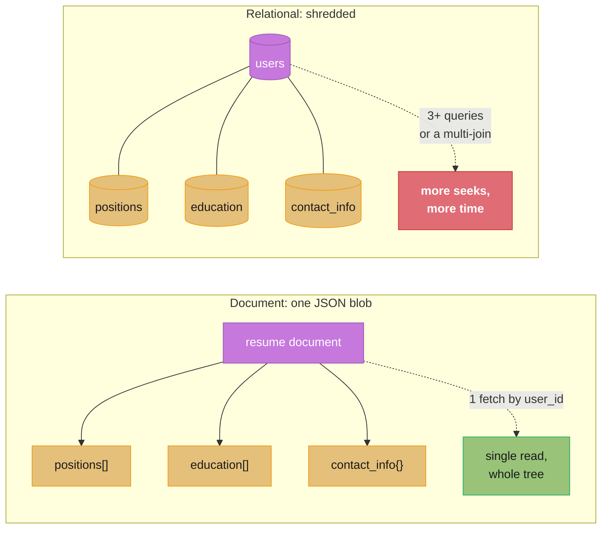
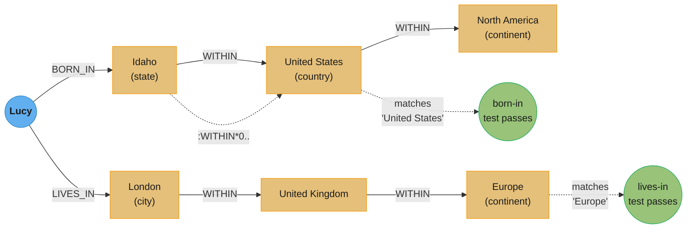
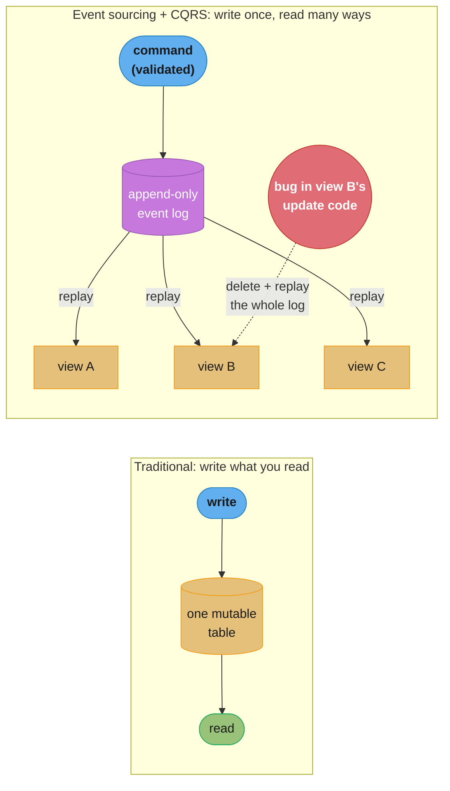

# Chapter 3: Data Models and Query Languages

> Part I — Foundations of Data Systems · DDIA (Kleppmann & Riccomini, 2nd ed., O'Reilly 2026) · builds on Ch 2, leads to Ch 4 (storage and retrieval)

## Chapter Map

Every application layers one data model on top of another: your objects and structures sit on
top of a general-purpose data model (JSON, relational tables, a graph), which in turn sits on
top of bytes on disk (Chapter 4), which sits on top of physics. This chapter is about the
*middle* layer — the general-purpose data model your application code talks to — because the
choice ripples upward into how you *think about the problem* you're solving, and downward into
how fast the database can answer you. The chapter compares five families (relational, document,
graph, event sourcing, dataframes) and the query languages that go with them, so you can tell
which shape fits which kind of data.

**TL;DR:**
- **Relational vs document**: document (JSON) wins when your data is a self-contained tree of
  one-to-many relationships fetched as a whole; relational wins once many-to-one and many-to-many
  relationships and joins dominate. **Normalization** (store an ID, look it up) trades write
  simplicity for read cost; **denormalization** (store the value directly) inverts that trade.
- **Graph models** (property graph, triple-store) target the opposite extreme from documents:
  data where almost anything can relate to almost anything, and queries need a variable number of
  hops. Cypher, SPARQL, and Datalog all express recursive traversal concisely; plain SQL can too
  (`WITH RECURSIVE`), but at a steep syntactic cost.
- **GraphQL** is a client-driven query language for fetching exactly the JSON shape a UI needs —
  deliberately *not* as expressive as Cypher/SPARQL/Datalog, because it must stay safe to expose
  to untrusted clients.
- **Event sourcing + CQRS** flips the usual "read what you wrote" model: write an immutable,
  append-only log of facts, then derive one or more read-optimized materialized views from it.
- **Dataframes** generalize relational tables toward the matrices that machine learning and
  scientific computing need, with a scripted rather than declarative interaction style.

## The Big Question

> *The limits of my language mean the limits of my world.*
>
> — Ludwig Wittgenstein, *Tractatus Logico-Philosophicus* (1922), quoted as the chapter's epigraph

Analogy: a data model is the language you're allowed to think in about your own application. Pick
a relational schema and you start seeing the world as rows connected by foreign keys; pick a
document model and the same world becomes trees of nested objects; pick a graph and it becomes
vertices and relationships that can point anywhere. None of these is a more accurate picture of
reality than the others — they're different vocabularies for describing the same résumé, the same
social network, the same conference booking system — and the vocabulary you choose quietly decides
which queries are a one-liner and which become a battle with the query planner.

---

## 3.1 Relational Model versus Document Model

SQL, built on the relational model Edgar Codd proposed in 1970, organizes data into *relations*
(tables in SQL terms) — unordered collections of *tuples* (rows). It was a theoretical proposal
that many doubted could even be implemented efficiently, yet by the mid-1980s relational database
management systems (RDBMS) had become the default choice for structured data, and they still
dominate business analytics via star and snowflake schemas (§3.1, "Stars and Snowflakes").

Competitors have come and gone: the *network model* and *hierarchical model* in the 1970s–80s,
object databases in the late '80s/early '90s, XML databases in the early 2000s. Each generated
hype, none lasted — instead SQL absorbed pieces of them, adding XML, JSON, and graph support over
the decades. The 2010s' *NoSQL* movement (not one technology, but a loose bundle of ideas around
new data models, schema flexibility, scalability, and open-source licensing) and its *NewSQL*
cousin (NoSQL-style scalability plus relational guarantees) were both very influential on data
system design, even as the terms themselves have faded from use. NoSQL's most durable legacy is
the popularity of the **document model** — data represented as JSON, popularized by MongoDB and
Couchbase, now also supported by most relational databases.

### The Object-Relational Mismatch

Most application code today is object-oriented, which produces a well-known friction: storing
objects in relational tables (rows and columns) requires an awkward translation layer between the
in-memory object graph and the on-disk relational schema. This gap has a name borrowed from
electronics — **impedance mismatch** (an electric circuit transfers power best when the output and
input impedances of two connected circuits match; a mismatch causes signal reflections and other
trouble).

#### Object-relational mapping (ORM)

ORM frameworks like ActiveRecord and Hibernate cut the boilerplate needed for this translation,
but they draw real criticism: they can't fully hide the two models, so developers still think in
both; they're mostly OLTP-facing, so schema design still matters for anyone preparing analytics
off the same schema; auto-generated relational schemas can be awkward to query directly and
inefficient on the underlying database; and they make it easy to accidentally write inefficient
queries — most notoriously the **N+1 query problem**.

**The N+1 query problem, concretely.** Say you're rendering a page of user comments: one query
fetches *N* comments, each carrying only the author's ID. Hand-written SQL would join `comments`
to `users` in that single query and return the author's name alongside each comment. An ORM,
left to its defaults, instead issues one query per comment to resolve its author — *N* additional
queries on top of the original one, for *N*+1 total round trips.

```
The chapter states the N+1 problem qualitatively; putting a number on it shows why it hurts:

  page of 50 comments, ORM issues one lookup query per comment's author

  naive ORM behavior:   1 query (fetch comments)  +  50 queries (one per author)  = 51 round trips
  hand-written join:    1 query (comments JOIN users)                             =  1 round trip

  51x more round trips for the same page -- and each round trip pays a full network hop,
  not just the query execution time, so the gap widens further under real network latency
```

The fix is not to abandon ORMs but to tell them to fetch the author eagerly, in the same query as
the comments — most ORMs support this, but it must be requested explicitly per query path, and
it's easy to forget on a new one.

Nevertheless ORMs earn their keep: for genuinely relational data, some translation layer between
persistent tables and in-memory objects is unavoidable, and an ORM cuts the boilerplate of writing
it by hand (complicated queries can still be dropped down to raw SQL). Many also help with query
result caching and with managing schema migrations.

#### The document data model for one-to-many relationships

Not all data fits a relational shape comfortably. Take a résumé — a LinkedIn-style profile. Fields
like `first_name` and `last_name` occur once per person, so they're naturally columns on a `users`
table. But most people have had several jobs (*positions*), several periods of education, and any
number of contact details — **one-to-many relationships**. One way to represent these relationally
is separate `positions`, `education`, and `contact_info` tables, each holding a foreign key back to
`users`.

An alternative, arguably closer to how the data looks in application code, is a single JSON
document:

```json
{
    "user_id": 251,
    "first_name": "Barack",
    "last_name": "Obama",
    "headline": "Former President of the United States of America",
    "region_id": "us:91",
    "positions": [
        {"job_title": "President", "organization": "United States of America"},
        {"job_title": "US Senator (D-IL)", "organization": "United States Senate"}
    ],
    "education": [
        {"school_name": "Harvard University", "start": 1988, "end": 1991},
        {"school_name": "Columbia University", "start": 1981, "end": 1983}
    ],
    "contact_info": {
        "website": "https://barackobama.com",
        "twitter": "https://twitter.com/barackobama"
    }
}
```

The JSON form has better *locality* (§3.1, "Data locality for reads and writes") than the
multi-table schema: fetching a whole profile relationally means either several queries by
`user_id` or a messy multi-way join, while the JSON representation puts everything needed in one
place, both faster and simpler to query. The one-to-many relationships from profile to positions,
education, and contact info form a tree, and the JSON representation makes that tree explicit.

This kind of relationship — a résumé's small number of positions — is sometimes called
**one-to-few** rather than one-to-many. Where a relationship genuinely can hold many thousands of
items (comments on a celebrity's post), embedding them all in one document becomes unwieldy, so
the relational, separate-table approach is preferable instead.

### Normalization, Denormalization, and Joins

In the example above, `region_id` is stored as an ID (`"us:91"`), not the plain-text string
`"Washington, DC, United States"`. Standardized, ID-referenced lists of regions buy: consistent
spelling, disambiguation (which "Washington"?), single-place updates (rename once, not everywhere),
localization (translate the list, not every record), and better search (a region can encode "is on
the US East Coast" in a way a free-text string can't).

**Normalization** means storing the human-meaningful information (`"Washington, DC"`) in exactly
one place, referenced everywhere else by an ID that carries no meaning of its own. Storing the text
directly instead — duplicating it into every record that uses it — is **denormalization**. The
advantage of an ID is that it never needs to change even when the thing it names does; anything
human-meaningful may need to change eventually, and if it's duplicated, every copy needs updating
(more code, more writes, more disk, and a real risk that some copies get updated and others don't).
The cost of an ID is the reverse: displaying a record now requires an extra lookup — a **join** —
to resolve the ID into something readable:

```sql
SELECT users.*, regions.region_name
    FROM users
    JOIN regions ON users.region_id = regions.id
    WHERE users.id = 251;
```

Document databases can store either normalized or denormalized data, but tend toward
denormalization — the JSON model makes it easy to add extra denormalized fields, and weak or
absent join support in many document databases makes normalization inconvenient. Where a document
database lacks joins entirely, you perform them in application code: fetch a document with an ID,
then a second query to resolve it. MongoDB's aggregation pipeline offers a `$lookup` operator that
performs a join server-side:

```mongodb-json
db.users.aggregate([
    { $match: { _id: 251 } },
    { $lookup: {
        from: "regions",
        localField: "region_id",
        foreignField: "_id",
        as: "region"
    } }
])
```

#### Trade-offs of normalization

The résumé's `organization` and `school_name` fields are plain strings, not IDs — a denormalized
choice: many people worked at the same company, but nothing links them. Making these entities
(referenced by ID) would carry the same benefits region IDs do. Consider adding a company/school
logo: a denormalized representation stores the logo URL on every profile — self-contained but
painful the moment the logo changes, since every occurrence of the old URL must be found and
updated. A normalized representation creates an organization/school entity, storing the logo URL
once; every résumé references its ID, and updating the logo is a single write.

As a general rule, **normalized data is faster to write** (one copy to update) **but slower to
query** (requires joins); **denormalized data is faster to read** (no joins) **but more expensive
to write** (more copies, more disk). Denormalization can be viewed as a form of derived data
(Chapter 1's "Systems of Record and Derived Data") — you need a process to keep the redundant
copies updated, and if that process crashes partway through, consistency depends on whether the
database offers atomic transactions across the affected records (Chapter 8) or you rely on stream
processing to keep things in sync (Chapter 12).

Normalization tends to suit OLTP systems, where both reads and updates must be fast; analytics
systems often fare better denormalized, since they update in bulk and read performance is the
dominant concern. In small-to-moderate-scale systems a normalized model is usually best — join cost
is acceptable, and you avoid the headache of keeping copies consistent — but at very large scale,
join cost itself can become the problem.

#### Denormalization in the social networking case study

Chapter 2's social network home-timeline case study compared a normalized representation (a
`posts`/`follows` join) against a denormalized one (precomputed, materialized timelines) — the join
was too expensive at scale, and the materialized timeline is effectively a cache of that join's
result. But the real implementation at X (formerly Twitter) doesn't store each entry's full post
text — only the post ID, the poster's user ID, and a little metadata for reposts/replies. It's a
precomputed version of roughly:

```sql
SELECT posts.id, posts.sender_id
    FROM posts
    JOIN follows ON posts.sender_id = follows.followee_id
    WHERE follows.follower_id = current_user
    ORDER BY posts.timestamp DESC
    LIMIT 1000
```

Reading the timeline therefore still requires two joins performed at read time: look up the post
ID to get content and current like/reply counts, and look up the sender's profile by ID for
username and photo. This lookup-by-ID-at-read-time is called **hydrating** the IDs — a join done in
application code. It's kept unmaterialized because the referenced data changes fast: like/reply
counts can move several times a second on a popular post, and users change their username or photo;
denormalizing that into the timeline would show stale counts and cost far more storage.

This example undercuts the common claim that joins at read time are inherently an obstacle to
high-performance, scalable services: hydrating post and user IDs scales well because it
parallelizes cleanly and its cost doesn't depend on how many people you follow or who follows you.
The right call — denormalize some things, leave others normalized — depends on how often each piece
of data changes and the relative cost of reads and writes; normalization and denormalization are
neither inherently good nor bad, only a trade-off.

### Many-to-One and Many-to-Many Relationships

`positions` and `education` are one-to-few relationships; `region_id` is a **many-to-one**
relationship (many people share a region, each person has one region at a time). Once
organizations and schools become referenced entities, the relationship from person to organization
becomes **many-to-many** (one person worked at several organizations; one organization has many
past/present employees). Relationally this is usually an *associative table* / *join table*: each
row in a `positions` table links one user ID with one organization ID.

Many-to-one and many-to-many relationships don't fit neatly inside one self-contained JSON
document — they lean toward a normalized representation. A document model can represent them by
grouping the closely-held data into one document and representing links to organizations/schools
as references to other documents — each `positions` entry keeps its `job_title` and dates, but
swaps the inline `organization` string for an `org_id` such as `513`, pointing at a separate
organization document.

Such relationships are usually queried in **both directions** — which organizations has this
person worked for, and which people worked at this organization. Storing ID references on both
sides is denormalized (the relationship lives in two places, and can drift out of sync). A
normalized representation stores it once and relies on **secondary indexes** (Chapter 4) to answer
both directions efficiently: relationally, index both `user_id` and `org_id` on the `positions`
table; in the document model, index the `org_id` field inside the `positions` array — something
most document databases and JSON-capable relational databases support.

### Stars and Snowflakes: Schemas for Analytics

Data warehouses (Chapter 1) are usually relational, and their schemas follow a few widely-used
conventions optimized for business analysts: a **star schema**, **snowflake schema**,
**dimensional modeling**, and **one big table** (OBT). ETL translates operational data into these
shapes.

A **star schema** centers on a *fact table* — in a grocery retailer's example, `fact_sales`. Each
row is an event at a point in time (here, a customer's purchase of a product; for a website it
might be a page view or click). Facts are captured per-event for maximum future analytical
flexibility, so fact tables can grow enormous — a large enterprise may hold petabytes of history,
mostly as fact tables.

Some fact-table columns are direct attributes (sale price, supplier cost — letting you compute
margin). Others are foreign keys into *dimension tables*, which represent the *who, what, where,
when, how,* and *why* of the event — for example, `dim_product` holds each product's SKU,
description, brand, category, package size, and so on, with `fact_sales` referencing which product
was sold via foreign key. Even date/time is often a dimension table, so extra facts (public
holidays) can be attached and queries can distinguish holiday from non-holiday sales. The name
"star" comes from the visual layout: the fact table in the middle, surrounded by dimension tables
like the rays of a star.

A **snowflake schema** breaks dimensions further into sub-dimensions — separate `brand` and
`category` tables referenced by `dim_product`, rather than storing brand/category as plain strings
on `dim_product`. Snowflake schemas are more normalized than star schemas, but star schemas are
often preferred because they're simpler for analysts to work with.

Warehouse tables run wide: fact tables often exceed 100 columns, sometimes several hundred;
dimension tables can be equally wide (a `dim_store` table might carry service offerings, whether it
has a bakery, square footage, opening date, last remodel date, distance to the nearest highway).

A star or snowflake schema is mostly many-to-one relationships (many sales for one product, in one
store) — the fact table's foreign keys point into dimensions, or dimensions into sub-dimensions.
Other relationship shapes are usually denormalized away for query simplicity: a multi-item purchase
isn't represented as one transaction row; instead each product gets its own fact-table row, and
those rows simply happen to share a customer ID, store ID, and timestamp.

**One big table (OBT)** pushes denormalization further still, dropping dimension tables entirely
and folding their columns directly into the fact table — effectively precomputing the
fact-dimension join. It costs more storage but can make queries faster. In an analytics context
this kind of denormalization is unproblematic: the data is typically an unchanging historical log
(aside from occasional error corrections), so the consistency and write-overhead concerns that
matter for OLTP denormalization mostly don't apply.

### When to Use Which Model

The document model's case rests on schema flexibility, better locality-driven performance, and (for
some applications) closer alignment with the application's object model. The relational model
counters with better support for joins, many-to-one, and many-to-many relationships.

If your data has a document-like shape — a tree of one-to-many relationships typically loaded as a
whole — a document model is probably right. The relational technique of **shredding** (splitting a
document-like structure across multiple tables, as with `positions`/`education`/`contact_info`
above) can produce cumbersome schemas and unnecessarily complicated application code. Documents do
have a real limitation, though: you can't refer directly to a nested item — you must say something
like "the second item in the list of positions for user 251" instead of addressing it by its own
ID. Where direct references to nested items matter, relational works better.

Some applications need user-controlled ordering — a to-do list or issue tracker with drag-to-reorder
tasks. The document model handles this naturally: store item IDs in a JSON array, and array order
*is* item order. Relational databases have no standard equivalent; the usual tricks are an integer
sort column (requiring renumbering on mid-list inserts), a linked list of IDs, or fractional
indexing.

#### Schema flexibility in the document model

Most document databases (and relational JSON support) enforce no schema on document contents; XML
support in relational databases usually offers *optional* schema validation. No schema means
arbitrary keys/values can appear, and readers have no guarantee what fields are present.

Calling document databases **schemaless** is misleading — the code reading the data still assumes
*some* structure; the schema is implicit rather than enforced. The more accurate term is
**schema-on-read** (structure is implicit, interpreted only when read), contrasted with
**schema-on-write** (the traditional relational approach: schema is explicit, and the database
enforces it at write time). This maps to dynamic vs. static type checking in programming
languages, and, like that debate, there's no universally right answer.

The difference shows most clearly when you need to change your data's format — say, splitting a
combined `name` field into `first_name` and `last_name`. In a document database you just start
writing new documents with the new fields, and handle the old shape in application code:

```mongodb-json
if (user && user.name && !user.first_name) {
    // Documents written before Dec 8, 2023 don't have first_name
    user.first_name = user.name.split(" ")[0];
}
```

Every reader has to carry this compatibility logic indefinitely for old documents. A
schema-on-write database instead runs a **migration**:

```sql
ALTER TABLE users ADD COLUMN first_name text DEFAULT NULL;
UPDATE users SET first_name = split_part(name, ' ', 1); -- PostgreSQL
UPDATE users SET first_name = substring_index(name, ' ', 1); -- MySQL
```

Adding a column with a default is fast and unproblematic even on huge tables in most relational
databases, but the `UPDATE` that backfills it rewrites every row and can be slow, as can changing a
column's type. Background schema-change tools exist to run such migrations without downtime, but
they remain operationally challenging at scale — one workaround is to add the column with a `NULL`
default (fast) and fill it in lazily at read time, effectively borrowing the document-database
approach inside a relational one.

Schema-on-read is advantageous when items are genuinely heterogeneous — many different object
types where a per-type table isn't practical, or where an external system you don't control defines
the structure and may change it unpredictably. Where all records really do share a structure,
schemas remain a useful mechanism for documenting and enforcing that structure — Chapter 5 covers
schema evolution in more depth.

#### Data locality for reads and writes

A document is usually stored as one continuous string (JSON, XML, or a binary variant such as
MongoDB's BSON). If your application often needs the *entire* document — rendering a profile page,
say — this **storage locality** is a real performance win: a relational schema split across
multiple tables needs multiple index lookups, more disk seeks, more time. The locality advantage
only pays off when you actually need large parts of the document at once — the database typically
loads it entirely, wasteful if you only need a small piece, and any update usually rewrites the
whole document. That's why documents are generally recommended fairly small, with infrequent small
updates.

Locality isn't a document-only idea, though. Google Spanner offers the same benefit relationally by
letting a schema declare that a table's rows should be *interleaved* (nested) within a parent
table; Oracle offers something similar via *multi-table index cluster tables*. Google Bigtable's
**wide-column** model (also used by HBase, Accumulo) achieves a related effect through *column
families*.

#### Query languages for documents

Relational databases mostly share SQL; document databases vary far more. Some offer only
key-value access by primary key, some add secondary indexes into document contents, some offer
rich query languages. XML databases typically use XQuery/XPath (which support cross-document
joins and format results as XML); JSON Pointer and JSONPath serve a similar role for JSON.

For a taste of a document query language's expressiveness beyond simple lookups, an aggregation:
counting shark sightings per month. In PostgreSQL:

```sql
SELECT date_trunc('month', observation_timestamp) AS observation_month,
    sum(num_animals) AS total_animals
FROM observations
WHERE family = 'Sharks'
GROUP BY observation_month;
```

`date_trunc('month', timestamp)` rounds a timestamp down to the start of its calendar month. The
same query in MongoDB's aggregation pipeline chains a `$match` stage (filter to `family: "Sharks"`)
into a `$group` stage (bucket by year/month via `$year`/`$month`, sum `numAnimals`) — similar
expressiveness to this subset of SQL, in a JSON-based pipeline syntax rather than SQL's
English-sentence style; the difference is largely taste.

#### Convergence of document and relational databases

Document and relational databases began as very different approaches but have converged over time:
relational databases gained JSON types, JSON query operators, and the ability to index inside
documents; document databases (MongoDB, Couchbase, RethinkDB among them) gained joins, secondary
indexes, and declarative query languages. This is good news for application developers, because
relational and document models work best *combined* in the same database — many document use cases
need relational-style references, and many relational schemas benefit from a pocket of schema
flexibility. Relational-document hybrids are a genuinely powerful combination.

Notably, Codd's original relational-model paper already allowed something JSON-like — *nonsimple
domains*, where a row's value could be a nested relation (table) rather than only a primitive type,
producing an arbitrarily nested tree structure decades before SQL formally added JSON/XML support.

---

## 3.2 Graph-Like Data Models

Where the type of relationship in your data leans one-to-many (tree-shaped), the document model
fits. Where many-to-many relationships dominate and connections keep multiplying in complexity, a
**graph** becomes the more natural fit. A graph has two kinds of objects: **vertices** (nodes,
entities) and **edges** (relationships, arcs). Typical examples: social graphs (vertices are
people, edges are "knows"); the web graph (vertices are pages, edges are HTML links); road/rail
networks (vertices are junctions, edges are roads/lines). Well-known algorithms operate on these
directly — shortest-path search for navigation, PageRank for ranking web pages by popularity.

Graphs can be represented as an **adjacency list** (each vertex stores the IDs of its immediate
neighbors — good for traversal) or an **adjacency matrix** (a 2-D array, rows/columns are vertices,
cell value is 1 if an edge exists, 0 otherwise — good for machine learning; see §3.4).

Graphs aren't restricted to one homogeneous vertex type. Facebook maintains a single graph mixing
people, locations, events, checkins, and comments as vertices, with edges for friendship,
"checked in at," "commented on," and "attended." Knowledge graphs record facts about entities that
recur in search queries (organizations, people, places), obtained by crawling and analyzing web
text, sometimes published directly in structured form (Wikidata).

This chapter covers the **property graph** model (Neo4j, Memgraph, KùzuDB, and others) and the
**triple-store** model (Datomic, AllegroGraph, Blazegraph, and others) — fairly similar in
expressive power, and some databases (Amazon Neptune) support both — plus four query languages
(Cypher, SPARQL, Datalog, GraphQL) and SQL's own graph-query support. Other graph languages exist
(Gremlin), but these four give a representative overview.

The running example throughout: two people, Lucy (born in Idaho, USA) and Alain (born in Saint-Lô,
France), married, both now living in London. Each person and place is a vertex; their relationships
are edges — chosen because it surfaces queries that are easy in graph databases and painful in
other models.

### Property Graphs

In the **property graph** (aka **labeled property graph**) model, each **vertex** has: a unique
ID, a label naming its type, a set of outgoing edges, a set of incoming edges, and a collection of
key-value properties. Each **edge** has: a unique ID, a tail vertex (start), a head vertex (end), a
label naming the relationship kind, and its own properties.

You can picture a graph store as two relational tables — one for vertices, one for edges (here
using PostgreSQL's `jsonb` type for properties):

```sql
CREATE TABLE vertices (
    vertex_id integer PRIMARY KEY,
    label text,
    properties jsonb
);

CREATE TABLE edges (
    edge_id integer PRIMARY KEY,
    tail_vertex integer REFERENCES vertices (vertex_id),
    head_vertex integer REFERENCES vertices (vertex_id),
    label text,
    properties jsonb
);

CREATE INDEX edges_tails ON edges (tail_vertex);
CREATE INDEX edges_heads ON edges (head_vertex);
```

Indexing both `tail_vertex` and `head_vertex` is what makes a property graph efficiently
traversable in *both* directions — without the second index, following incoming edges means
scanning the whole edges table. Three properties fall out of this shape:

1. Any vertex can connect to any other vertex — no schema restricts which kinds of things may
   associate.
2. Given any vertex, both its incoming and outgoing edges are cheap to find, so you can **traverse**
   — follow a chain of vertices — forward and backward.
3. Different labels on different vertices/relationships let one graph hold several kinds of
   information while staying a clean data model.

The `edges` table generalizes the many-to-many associative table from §3.1 to allow many different
relationship *types* in the same table, and can itself carry indexes on labels and properties for
efficient lookup by attribute. A real limitation: an edge only ever connects *two* vertices, while
a relational join table can express three-way-or-higher relationships via multiple foreign keys on
one row. Higher-degree relationships in a graph need either an extra vertex representing what would
have been the join-table row (with edges to/from it), or a **hypergraph**.

This flexibility lets the running example represent things a relational schema struggles with:
different regional structures per country (France's *départements*/*régions* vs. the US's
counties/states), historical quirks (a country within a country), and varying granularity (Lucy's
current residence is a city; her birthplace is only a state). The graph could keep growing — food
allergies as vertices with edges to the people who have them and the foods that contain them, for
instance — which is why graphs are described as good for **evolvability**: extending the data
structure as an application grows new features.

### The Cypher Query Language

**Cypher** is a property-graph query language originally built for Neo4j, later standardized as
*openCypher*; besides Neo4j it's supported by Memgraph, KùzuDB, Amazon Neptune, and Apache AGE
(backed by PostgreSQL storage). It's named after a character in *The Matrix*, unrelated to
cryptographic ciphers.

Inserting part of the running example:

```
CREATE
    (namerica :Location {name:'North America', type:'continent'}),
    (usa :Location {name:'United States', type:'country' }),
    (idaho :Location {name:'Idaho', type:'state' }),
    (lucy :Person {name:'Lucy' }),
    (idaho) -[:WITHIN ]-> (usa) -[:WITHIN]-> (namerica),
    (lucy) -[:BORN_IN]-> (idaho)
```

Symbolic names (`namerica`, `idaho`, `lucy`) exist only within the query, to wire up edges; the
arrow notation `(idaho) -[:WITHIN]-> (usa)` creates a `WITHIN`-labeled edge with `idaho` as tail and
`usa` as head. With the whole graph loaded, we can ask something genuinely interesting: *find the
names of all the people who emigrated from the United States to Europe* — vertices with both a
`BORN_IN` edge reaching a US location and a `LIVES_IN` edge reaching a European one:

```
MATCH
    (person) -[:BORN_IN]-> () -[:WITHIN*0..]-> (:Location {name:'United States'}),
    (person) -[:LIVES_IN]-> () -[:WITHIN*0..]-> (:Location {name:'Europe'})
RETURN person.name
```

`MATCH` uses the same arrow notation to find graph patterns: `(person) -[:BORN_IN]-> ()` matches
any two vertices joined by a `BORN_IN` edge, binding the tail to `person` and leaving the head
unnamed. In words: find any `person` such that following an outgoing `BORN_IN` edge and then zero
or more outgoing `WITHIN` edges reaches a `Location` named `"United States"`, **and** following an
outgoing `LIVES_IN` edge and then zero or more `WITHIN` edges reaches a `Location` named `"Europe"`;
return each such `person`'s name.

The query engine has real freedom in how it executes this: it could scan all people and check each
one's birthplace/residence, or (if `name` is indexed) start from the two `Location` vertices, walk
*backward* along incoming `WITHIN` edges to enumerate every location within the US and within
Europe, then look for people reachable via incoming `BORN_IN`/`LIVES_IN` edges at any of those
locations.

### Graph Queries in SQL

Since graph data can be stored relationally (as in Example 3-3's two-table schema), can it be
queried with SQL too? Yes, but awkwardly. Every edge traversed in a graph query is effectively a
join against the `edges` table — and in a relational query you normally know in advance exactly how
many joins you need, while a graph query may need a *variable* number of hops before reaching the
target vertex.

That's exactly what `() -[:WITHIN*0..]-> ()` expresses in the Cypher query above: a person's
`LIVES_IN` edge might point straight at a city, or at something several levels up a location
hierarchy (city within region within state within country). `:WITHIN*0..` means "follow a `WITHIN`
edge zero or more times" — like the `*` operator in a regular expression.

SQL:1999 added **recursive common table expressions** (`WITH RECURSIVE`) to express exactly this
kind of variable-length path. The same emigration query, in SQL:

```sql
WITH RECURSIVE

    -- in_usa is the set of vertex IDs of all locations within the United States
    in_usa(vertex_id) AS (
        SELECT vertex_id FROM vertices
            WHERE label = 'Location' AND properties->>'name' = 'United States'
      UNION
        SELECT edges.tail_vertex FROM edges
            JOIN in_usa ON edges.head_vertex = in_usa.vertex_id
            WHERE edges.label = 'within'
    ),

    -- in_europe is the set of vertex IDs of all locations within Europe
    in_europe(vertex_id) AS (
        SELECT vertex_id FROM vertices
            WHERE label = 'location' AND properties->>'name' = 'Europe'
      UNION
        SELECT edges.tail_vertex FROM edges
            JOIN in_europe ON edges.head_vertex = in_europe.vertex_id
            WHERE edges.label = 'within'
    ),

    -- born_in_usa is the set of vertex IDs of all people born in the US
    born_in_usa(vertex_id) AS (
        SELECT edges.tail_vertex FROM edges
            JOIN in_usa ON edges.head_vertex = in_usa.vertex_id
            WHERE edges.label = 'born_in'
    ),

    -- lives_in_europe is the set of vertex IDs of all people living in Europe
    lives_in_europe(vertex_id) AS (
        SELECT edges.tail_vertex FROM edges
            JOIN in_europe ON edges.head_vertex = in_europe.vertex_id
            WHERE edges.label = 'lives_in'
    )

    SELECT vertices.properties->>'name'
    FROM vertices
    -- join to find those people who were both born in the US *and* live in Europe
    JOIN born_in_usa ON vertices.vertex_id = born_in_usa.vertex_id
    JOIN lives_in_europe ON vertices.vertex_id = lives_in_europe.vertex_id;
```

`in_usa` starts from the "United States" vertex, then repeatedly follows incoming `within` edges
into the recursive union until no more locations are within the US; `in_europe` does the same for
Europe. `born_in_usa` and `lives_in_europe` then follow `born_in`/`lives_in` edges from those
location sets back to people, and the final join intersects the two sets of people.

```
The chapter's own point, made numerically: a 4-line Cypher query became a 31-line SQL query --
roughly an 8x expansion for identical semantics -- and that's before touching cycle handling
or the choice between breadth-first and depth-first traversal, which the book flags as further
detail SQL's recursive CTEs don't make easy either.
```

Oracle has a different SQL extension for this, which it calls *hierarchical* queries. Looking
ahead, a graph query language called **GQL** is planned for the SQL standard, syntactically
inspired by Cypher, GSQL, and PGQL.

### Triple-Stores and SPARQL

The **triple-store** model is largely equivalent to the property graph model under different
vocabulary, but worth knowing because of the tooling and languages built around it. Every fact is a
three-part statement — (*subject*, *predicate*, *object*). In (*Jim*, *likes*, *bananas*), *Jim* is
the subject, *likes* the predicate (verb), *bananas* the object.

The subject corresponds to a graph vertex. The object is one of two things:

1. A primitive value (string, number) — then predicate and object play the role of a property's
   key and value. `(lucy, birthYear, 1989)` is like vertex `lucy` with property `{"birthYear": 1989}`.
2. Another vertex — then the predicate is an edge label, the subject the tail vertex, the object
   the head vertex. `(lucy, marriedTo, alain)` makes `lucy` and `alain` vertices connected by an
   edge labeled `marriedTo`.

Databases offering a triple-like model often extend the tuple with metadata — AWS Neptune uses
quads (a graph ID added to each triple), Datomic uses 5-tuples (adding a transaction ID and a
deletion flag) — but the book still calls all of these *triple-stores*, since they retain the basic
subject-predicate-object shape.

Turtle (a subset of Notation3/N3) is one way of writing triples:

```
@prefix : <urn:example:>.
_:lucy a :Person.
_:lucy :name "Lucy".
_:lucy :bornIn _:idaho.
_:idaho a :Location.
_:idaho :name "Idaho".
_:idaho :type "state".
_:idaho :within _:usa.
_:usa a :Location.
_:usa :name "United States".
_:usa :type "country".
_:usa :within _:namerica.
_:namerica a :Location.
_:namerica :name "North America".
_:namerica :type "continent".
```

`_:someName` names a vertex only within this file — it exists purely so triples referring to the
same vertex can be tied together. Semicolons let you say multiple things about the same subject
without repeating it (`_:lucy a :Person; :name "Lucy"; :bornIn _:idaho.`), which makes Turtle
noticeably more readable than spelling out every triple on its own line.

Some of the research behind triple-stores grew out of the **Semantic Web**, an early-2000s effort
to make internet-wide data exchange machine-readable, not just human-readable. That original vision
did not succeed, but its legacy persists in *linked data* standards (JSON-LD), biomedical
*ontologies*, Facebook's Open Graph protocol (used for link unfurling), knowledge graphs such as
Wikidata, and `schema.org`'s standardized structured-data vocabularies. Triple-stores themselves
have found use well beyond the Semantic Web — they can be a good internal application data model
regardless of any interest in that original goal.

#### The RDF data model

Turtle encodes the **Resource Description Framework** (RDF), a data model designed for the Semantic
Web. RDF can also be written more verbosely in XML — the same Idaho/USA/North-America nesting shown
in Turtle above becomes a deeply nested `<Location>`/`<within>` element tree — and tools like Apache
Jena convert between RDF encodings automatically, so the choice of encoding rarely matters to
application code that only talks to the RDF model through a library.

RDF's quirks come from being designed for internet-wide exchange: subject, predicate, and object
are often URIs, so a predicate might be `<http://my-company.com/namespace#within>` rather than a
bare `WITHIN` — the point being that combining your data with someone else's `within` predicate
never conflicts, since theirs is actually a different URI (`<http://other.org/foo#within>`). The
URL doesn't need to resolve to anything; RDF treats it as a namespace only, and the examples above
use non-resolvable `urn:example:` prefixes for exactly that reason — declare the prefix once, then
forget about it.

#### The SPARQL query language

**SPARQL** ("SPARQL Protocol and RDF Query Language," pronounced "sparkle") is the RDF triple-store
query language. It predates Cypher, and since Cypher's pattern matching borrows from SPARQL, the
two look quite similar. The same emigration query:

```
PREFIX : <urn:example:>

SELECT ?personName WHERE {
 ?person :name ?personName.
 ?person :bornIn / :within* / :name "United States".
 ?person :livesIn / :within* / :name "Europe".
}
```

SPARQL variables start with `?`. The pattern below is equivalent to the Cypher fragment above it:

```
(person) -[:BORN_IN]-> () -[:WITHIN*0..]-> (location) # Cypher

?person :bornIn / :within* ?location. # SPARQL
```

Because RDF has no separate notion of "property" versus "edge" — both are just predicates — the
same syntax matches properties too; `?usa :name "United States".` binds `usa` to any vertex with a
`name` property equal to `"United States"`, the SPARQL counterpart of Cypher's
`(usa {name:'United States'})`. SPARQL is supported by Amazon Neptune, AllegroGraph, Blazegraph,
OpenLink Virtuoso, Apache Jena, and other triple-stores.

### Datalog: Recursive Relational Queries

**Datalog** predates SPARQL and Cypher by decades, arising from 1980s academic research. It's
less familiar to working engineers and not widely embedded in mainstream databases, but it deserves
to be better known — it's a genuinely expressive language, particularly strong for complex,
recursive queries. Datomic, LogicBlox, CozoDB, and LinkedIn's LIquid use it as their query language.

Datalog is built on a *relational* data model, not a graph one — it appears in this graph-focused
section because recursive graph queries are one of its particular strengths. A Datalog database's
contents are **facts**, each corresponding to a relational row. `location(2, "United States",
"country")` says the `location` table has a row where ID=2, name="United States", type="country" —
generally, `table(val1, val2, ...)` means `table` has a row with those column values.

The running example's left-hand side, in Datalog:

```
location(1, "North America", "continent").
location(2, "United States", "country").
location(3, "Idaho", "state").

within(2, 1). /* US is in North America */
within(3, 2). /* Idaho is in the US */

person(100, "Lucy").
born_in(100, 3). /* Lucy was born in Idaho */
```

`within` and `born_in` are two-column join tables representing edges; Lucy (ID 100) was born in
Idaho (ID 3), so `born_in(100, 3)`. Unlike Cypher or SPARQL's jump-right-to-`SELECT` style, Datalog
builds a query in small steps by defining **rules** that derive new *virtual* tables from
underlying facts — like SQL views, they're not stored, but can be queried like a stored table:

```sql
within_recursive(LocID, PlaceName) :- location(LocID, PlaceName, _). /* Rule 1 */

within_recursive(LocID, PlaceName) :- within(LocID, ViaID), /* Rule 2 */
 within_recursive(ViaID, PlaceName).

migrated(PName, BornIn, LivingIn) :- person(PersonID, PName), /* Rule 3 */
 born_in(PersonID, BornID),
 within_recursive(BornID, BornIn),
 lives_in(PersonID, LivingID),
 within_recursive(LivingID, LivingIn).

us_to_europe(Person) :- migrated(Person, "United States", "Europe"). /* Rule 4 */
/* us_to_europe contains the row "Lucy". */
```

The name and columns of a derived table appear before `:-`; `migrated(PName, BornIn, LivingIn)` is
a three-column virtual table (person's name, birth place name, current residence name). What
follows `:-` is the pattern to match against existing tables — `person(PersonID, PName)` matches
`person(100, "Lucy")`, binding `PersonID = 100` and `PName = "Lucy"`. A rule applies once *every*
pattern to its right of `:-` finds a match, at which point it's as if the rule's left-hand side
(with variables substituted) had been added to the database.

Walking the rule application: `location(1, "North America", "continent")` exists, so Rule 1 fires
and generates `within_recursive(1, "North America")`; `within(2, 1)` plus that result lets Rule 2
fire, generating `within_recursive(2, "North America")`; `within(3, 2)` plus *that* result lets
Rule 2 fire again, generating `within_recursive(3, "North America")`. Repeated application of Rules
1 and 2 this way fills `within_recursive` with every location contained in any
other location in the database. Rule 3 then finds people whose birthplace and residence names can
both be resolved via `within_recursive`; Rule 4 filters that to `BornIn = "United States"` and
`LivingIn = "Europe"`, giving the same answer ("Lucy") as the Cypher and SPARQL versions.

Datalog demands a different kind of thinking than the other languages here — rules built up and
referring to other rules, much like decomposing code into functions that call each other. Just as
functions can recurse, so can Datalog rules (Rule 2 calls itself), which is exactly what enables
graph traversal in Datalog.

### GraphQL

**GraphQL** is deliberately far more restrictive than the other languages in this chapter. Its job
is letting client software (a mobile app, a JS frontend) request a JSON document shaped exactly to
its UI's needs, so client code can change its queries freely without server-side API changes.

That flexibility has costs: organizations adopting GraphQL often need tooling to translate GraphQL
queries into calls against internal REST or gRPC services (Chapter 5), plus real work on
authorization, rate limiting, and performance. GraphQL's language is deliberately limited *because*
queries come from an untrusted client — nothing that could be expensive to execute is allowed, or
users could DoS the server by running expensive queries. Concretely: GraphQL forbids recursive
queries (unlike Cypher, SPARQL, SQL, or Datalog) and arbitrary search conditions like "people born
in the US and living in Europe," unless the service owners specifically build and expose that
search.

Despite the restriction, GraphQL is genuinely useful — for example, implementing a Discord/Slack-like
group chat's channel view: all channels the user can access, each with the 50 most recent
messages, each message's timestamp/content/sender name/photo, and (for a reply) the original
message's content and sender:

```
query ChatApp {
    channels {
        name
        recentMessages(latest: 50) {
            timestamp
            content
        sender {
            fullName
            imageUrl
        }
    replyTo {
        content
        sender {
            fullName
        }
    }
    }
    }
}
```

A response mirrors the query's shape exactly — only the requested fields, no more, no less: each
channel object carries just its `name` and up to 50 `recentMessages`, each message just its
timestamp, content, `sender` (with `fullName`/`imageUrl`), and — where applicable — a `replyTo`
carrying the original message's content and sender name. That mirroring means the server never
needs to know which attributes a given UI needs; the client just asks for them, and adding a new UI
field is a client-only change (add `imageUrl` under `replyTo.sender`, say) with no server change
required.

The response also shows GraphQL's deliberate acceptance of duplication for simplicity: a sender's
name and photo repeat on every message they send, rather than being deduplicated, and the
replied-to message's content is duplicated under `replyTo` rather than returned as a bare ID the
client would then need a second request to resolve. The server itself can store data much more
normalized —
message rows referencing a sender's user ID and a `replyTo` message ID — resolving those references
into the response only when the query runs; but the client can only request joins the GraphQL
schema explicitly offers.

Despite its name and its document-shaped responses, GraphQL is not tied to any one storage model —
it can sit in front of a relational, document, or graph database equally well.

---

## 3.3 Event Sourcing and CQRS

Every model covered so far is queried in the same shape it's written — JSON documents, rows,
vertices and edges. But a sufficiently complex application often can't find one representation that
serves every way its data must be queried and displayed. The alternative: write in one form, then
**derive** several representations, each optimized for a different kind of read.

This continues Chapter 1's "Systems of Record and Derived Data" idea (ETL toward a data warehouse
is one instance of it), taken further: if you're deriving one representation from another anyway,
choose write-optimized and read-optimized shapes independently. What's the simplest, fastest,
least-constrained way to *write*, if efficient querying isn't a concern yet? An **event log** —
every write becomes a self-contained, timestamped, immutable fact appended to a sequence. Events
are never modified or deleted, only appended (a later event may supersede an earlier one); an event
can carry any properties you like.

Picture a conference management system: attendees register and pay by card, companies bulk-order
seats and pay by invoice, some seats are reserved for speakers/sponsors/volunteers, reservations can
be cancelled, and the organizer might move the event to a bigger or smaller room. Even a "how many
seats remain" query becomes genuinely hard under all that churn. Under event sourcing, every state
change — registrations opening, a booking made, a booking cancelled — is first stored as an event.
Each time an event is appended, one or more **materialized views** (also called *projections* or
*read models*) update to reflect it: one view might track each booking's status, another might feed
the organizer's dashboard, a third might generate badge-printing files (see "Visual Intuition"
below for the write-once, read-many-ways picture this produces).

Using events as the source of truth, expressing every state change as an event, is **event
sourcing**; keeping separate read-optimized representations derived from the write-optimized one is
**command query responsibility segregation (CQRS)**. Both terms come from the domain-driven design
(DDD) community, though the underlying idea is older — for instance, *state machine replication*
(Chapter 10).

A user request is a **command**, and it must be validated before it becomes a fact: only once a
command is executed and found valid (enough seats existed for the requested reservation, say) does
it turn into an event appended to the log. So the event log should hold only valid events, and a
consumer building a materialized view is never allowed to reject an event it reads. Events should
be named in the **past tense** ("the seats were booked") because an event records something that
already happened — even a later cancellation doesn't erase the fact that a booking once existed; the
cancellation is simply another, later event.

Event sourcing resembles a star-schema fact table (§3.1) in that both are collections of past
events. They differ in two ways: fact-table rows all share the same columns, while event sourcing
typically has many event *types*, each with its own properties; and a fact table is an *unordered*
collection, while in event sourcing **order matters** — processing a cancellation before its
booking makes no sense.

**Advantages:**

- Events communicate *intent* far better than a row diff: "the booking was cancelled" reads far
  more clearly than "row 4001's `active` column was set to `false` and a refund row was inserted" —
  driving the change from a named event makes the *reason* explicit, even though those same row
  changes still happen inside a materialized view's own update logic.
- Materialized views are derived **reproducibly**: delete one and rebuild it by replaying the same
  events in the same order with the same code, which also makes a view-maintenance bug easy to
  chase down — fix the code, delete the view, replay, inspect.
- Multiple views can each be optimized for their own query pattern, in any data model, even kept
  purely in memory and recomputed on restart if persisting them isn't necessary — and adding a new
  view, or a new event type for a new feature, costs nothing to the events already written.
- A mistakenly-written event can simply be deleted and views rebuilt without it, unlike a database
  where reversing a committed transaction is often hard — reducing irreversible actions aids
  evolvability (Chapter 2) — and the log itself doubles as an audit trail, valuable wherever
  auditability is a regulatory requirement.

**Downsides:**

- Care is needed around external information. If an event stores a price in one currency and a view
  needs it converted, fetching a *current* exchange rate at processing time would make the
  materialized view non-deterministic (recomputing it on a different date would give a different
  answer). Either embed the exchange rate in the event itself, or ensure any lookup of a historical
  rate always returns the same result for the same timestamp.
- Immutability clashes with personal data and rights like the GDPR's right to deletion. Per-user
  logs can simply be deleted wholesale, but a log mixing multiple users' events can't be trimmed
  that easily; storing personal data outside the event, or encrypting it under a key you can later
  discard, helps but complicates recomputing derived state.
- Reprocessing events needs care wherever there are externally visible side effects — you probably
  don't want to resend every confirmation email each time you rebuild a materialized view.

Event sourcing can be built atop any database, but specialized systems exist for it —
EventStoreDB, MartenDB (built on PostgreSQL), Axon Framework — and message brokers like Apache Kafka
can also hold the event log, with stream processors maintaining the materialized views (Chapter 12
returns to this). The one non-negotiable requirement: every materialized view must process events
in exactly the log's order — not always easy to guarantee in a distributed system (Chapter 10).

---

## 3.4 Dataframes, Matrices, and Arrays

The models covered so far generally serve both transaction processing and analytics (Chapter 1).
Two more models show up mostly in analytical/scientific contexts, rarely in OLTP: **dataframes**
and multidimensional number arrays such as **matrices**.

Dataframes are supported by R, Python's Pandas, Apache Spark, ArcticDB, Dask, and others — a
popular tool for data scientists preparing ML training data, but equally used for exploration,
statistics, and visualization. At a glance a dataframe resembles a relational table or a
spreadsheet, and supports relational-like bulk operators — apply a function to every row, filter
rows by condition, group and aggregate, and join one dataframe with another on a key (what a
relational database calls *join*, a dataframe typically calls *merge*).

The interaction model differs, though: instead of a declarative query like SQL, a dataframe is
manipulated through a sequence of commands that transform its structure and content — matching how
data scientists actually work, incrementally *wrangling* data into whatever shape answers the
question at hand. This wrangling usually happens on the scientist's own local copy of the dataset,
though the end result may be shared.

Dataframe APIs go well beyond relational operators, and the model is often used quite differently
from typical relational modeling — a common use case is transforming relational-shaped data into a
matrix or multidimensional array, the input form many ML algorithms expect. A simple example:
starting from a relational table of user movie ratings (1–5, one row per user-movie pair) and
pivoting it into a matrix where each column is a movie and each row is a user — much like a
spreadsheet pivot table. This matrix is typically **sparse** (most user-movie combinations have no
rating), which is fine — the matrix could have many thousands of columns and would fit poorly in a
relational database, but dataframes and sparse-array libraries (NumPy) handle it easily.

A matrix can only hold numbers, so non-numeric data needs a transformation to fit: dates can be
scaled to floating-point numbers in a suitable range, and columns limited to a small fixed set of
values (a movie's genre) are typically **one-hot encoded** — one column per possible value ("comedy",
"drama", "horror", ...), a 1 in the column matching the row's actual value and 0s elsewhere; this
representation generalizes cleanly to items with several simultaneous values (a movie in multiple
genres).

Once data is a matrix of numbers, it's ready for the linear algebra operations underlying many ML
algorithms — the ratings matrix above could feed a movie recommendation system directly. Dataframes
let data move gradually from a relational shape toward a matrix shape, while leaving the data
scientist in control of exactly which representation best serves the analysis or model training at
hand.

Beyond dataframes, dedicated **array databases** such as TileDB specialize in storing large
multidimensional number arrays, most often for scientific datasets — geospatial raster grids,
medical imaging, astronomical telescope observations. Dataframes also see heavy use in finance for
representing **time series data**, such as asset prices and trades over time.

---

## Visual Intuition



Caption: the same one-to-few relationships (positions, education, contact info) form an explicit
tree in the document model, fetched in one read; the relational schema shreds that tree across
tables, trading write-time normalization for read-time joins.



Caption: `:WITHIN*0..` walks a chain of unknown length until it lands on the target — the same
question in plain SQL needs a `WITH RECURSIVE` block per direction because SQL has no built-in
"follow this edge type any number of times" operator.



Caption: the traditional model reads back what it wrote; event sourcing separates the write path
(an immutable log) from any number of read-optimized projections, each fully rebuildable by
replaying the log from the start — which is also how a buggy view gets fixed, by deleting and
recomputing it rather than patching data in place.

---

## Key Concepts Glossary

- **Relational model** — data as unordered *relations* (tables) of *tuples* (rows); Codd, 1970.
- **Document model** — data as self-contained JSON (or XML/BSON) documents, usually schema-on-read.
- **Impedance mismatch** — the translation gap between an object-oriented model and a relational schema.
- **ORM (object-relational mapping)** — a framework (Hibernate, ActiveRecord) automating that translation.
- **N+1 query problem** — an ORM issuing one lookup query per row instead of a single join.
- **One-to-few relationship** — a one-to-many relationship where the "many" side stays small (a résumé's positions).
- **Normalization** — storing each fact once, referenced elsewhere by ID.
- **Denormalization** — duplicating human-meaningful values directly into every record that needs them.
- **Join** — a query-time lookup resolving an ID reference into the record it names.
- **Shredding** — splitting a document-like tree structure across multiple relational tables.
- **Hydrating** — resolving stored IDs into human-readable data at read time, a join done in application code.
- **Many-to-one relationship** — many records reference one shared entity (many people, one region).
- **Many-to-many relationship** — records on both sides can each reference several on the other side.
- **Associative table (join table)** — a relational table representing a many-to-many relationship.
- **Star schema** — a fact table surrounded by dimension tables, joined via foreign keys.
- **Snowflake schema** — a star schema whose dimensions are further normalized into sub-dimensions.
- **Fact table** — a warehouse table where each row is an event (a sale, a click) at a point in time.
- **Dimension table** — a warehouse table describing the who/what/where/when/how/why of a fact.
- **One big table (OBT)** — a denormalized warehouse schema folding dimensions directly into the fact table.
- **Schema-on-read** — structure implicit, interpreted only when data is read (typical of documents).
- **Schema-on-write** — structure explicit and enforced by the database at write time (typical of relational).
- **Storage locality** — keeping related data physically together so a whole-record read needs fewer seeks.
- **Property graph (labeled property graph)** — vertices/edges each with a label and key-value properties.
- **Vertex (node)** — a graph entity, uniquely identified, with a label and properties.
- **Edge (relationship)** — a labeled, directed connection between a tail and head vertex, with its own properties.
- **Adjacency list** — a graph representation storing each vertex's immediate neighbors; good for traversal.
- **Adjacency matrix** — a 2-D array representation of a graph; good for machine learning use.
- **Traverse** — follow a chain of vertices via their connecting edges, forward or backward.
- **Cypher** — a property-graph query language (Neo4j, openCypher standard).
- **Recursive common table expression (`WITH RECURSIVE`)** — SQL's mechanism for variable-length path queries.
- **Triple-store** — a data model storing facts as (subject, predicate, object) triples.
- **RDF (Resource Description Framework)** — the Semantic Web's triple data model.
- **Turtle / Notation3 (N3)** — a human-readable text format for writing RDF triples.
- **SPARQL** — the RDF triple-store query language.
- **Datalog** — a recursive, rule-based query language over relational facts, based on Prolog.
- **Fact (Datalog)** — a stored row in a Datalog database.
- **Rule (Datalog)** — a definition deriving a virtual table from facts and other rules.
- **GraphQL** — a client-driven query language returning a JSON shape matching the query's structure.
- **Event sourcing** — using an append-only, immutable log of events as the system of record.
- **CQRS (command query responsibility segregation)** — deriving separate read-optimized views from a write-optimized event log.
- **Command** — an incoming request, validated before it may become an event.
- **Event** — an immutable, timestamped, past-tense record of something that happened.
- **Materialized view (projection, read model)** — a read-optimized representation derived from the event log.
- **Dataframe** — a table-like structure (Pandas, R, Spark) manipulated via a sequence of commands rather than declarative queries.
- **Merge** — a dataframe's term for what a relational database calls a join.
- **One-hot encoding** — representing a categorical value as a 0/1 column per possible value.
- **Sparse matrix** — a matrix where most cells hold no value, common after pivoting relational data.
- **Array database** — a database (TileDB) specialized for large multidimensional numeric arrays.

---

## Tradeoffs & Decision Tables

| | Relational model | Document model | Graph model |
|---|---|---|---|
| Best-fit relationship shape | Many-to-one, many-to-many | One-to-few, tree-shaped | Anything-to-anything, variable-depth |
| Schema | Schema-on-write (usually) | Schema-on-read (usually) | Usually schema-on-read |
| Locality | Split across tables | Whole document together | Depends on implementation |
| Query language | SQL (declarative) | Varies; some rich, some key-only | Cypher, SPARQL, Datalog (declarative) |
| Weakness | Awkward for deep trees (shredding) | Awkward for many-to-many, no direct nested-item ref | Rarely a general-purpose OLTP default |

| | Normalized | Denormalized |
|---|---|---|
| Write cost | Low — one copy to update | High — every copy must update |
| Read cost | Higher — requires a join | Lower — value is already there |
| Consistency risk | Low — single source | Real — copies can drift |
| Best for | OLTP, small-to-moderate scale | Analytics, very large scale, rarely-changing values |

| | Star schema | Snowflake schema | One big table (OBT) |
|---|---|---|---|
| Normalization | Dimensions are flat | Dimensions further normalized | No dimension tables at all |
| Analyst ergonomics | Simple, preferred in practice | More joins to write | Simplest — no joins needed |
| Storage | Moderate | Lowest | Highest |

| | Cypher / SPARQL (property graph / triple-store) | GraphQL |
|---|---|---|
| Recursive traversal | Native | Forbidden |
| Arbitrary search conditions | Supported | Only what the schema explicitly exposes |
| Trust model | Typically internal/trusted callers | Designed for untrusted client callers |
| Underlying storage | Purpose-built graph/triple engine | Any (relational, document, graph) behind a resolver layer |

| | Traditional (read what you wrote) | Event sourcing + CQRS |
|---|---|---|
| Source of truth | Current mutable state | Immutable append-only event log |
| Read optimization | One shape serves all reads | Any number of independently-optimized materialized views |
| Recovering from a bug in derived data | Manual data-fix | Delete the view, replay the log |
| Deleting personal data (GDPR) | Straightforward | Genuinely hard if the log mixes multiple users |

---

## Common Pitfalls / War Stories

- **The N+1 query problem.** An ORM's default lazy-loading issues one query per related row instead
  of a single join — a page of 50 comments becomes 51 round trips instead of 1. Tell the ORM to
  eager-load the relationship for that specific query path, or drop to hand-written SQL.
- **Treating "schemaless" as "no assumed structure."** Document databases enforce no schema, but
  application code reading the data still assumes one implicitly — it just isn't checked by the
  database. Calling this "schemaless" invites bugs when an old document's shape silently diverges
  from what new code expects; call it schema-on-read and design defensive reads accordingly.
  See [database/document_databases](../../../database/document_databases/document_databases.md).
- **Denormalizing fast-changing data into a materialized view.** X's home-timeline implementation
  deliberately does *not* store post text or like counts in the precomputed timeline — those change
  too often, so it stores only IDs and hydrates them at read time. Denormalizing a value that
  changes multiple times a second produces stale reads and wastes storage on every update.
- **Assuming GraphQL is a general-purpose graph query language.** Despite the name, GraphQL
  deliberately forbids recursive traversal and arbitrary search — it is a client-shaped-response
  language, not a Cypher/SPARQL/Datalog substitute. Reaching for it to answer "find everyone
  connected within 3 hops" will not work unless that specific traversal is explicitly built into the
  schema. See [backend/graphql](../../../backend/graphql/graphql.md).
- **Forgetting event sourcing's GDPR problem until an erasure request arrives.** An append-only,
  immutable log resists exactly the kind of targeted deletion the right to be forgotten requires,
  especially once the log mixes multiple users' events. Plan for this at design time (per-user logs,
  or personal data stored outside the event and separately erasable), not after the first request.
- **Recomputing an exchange-rate-dependent materialized view and getting a different answer.**
  Fetching a *current* exchange rate while replaying old events makes the replay non-deterministic —
  rebuild the same view twice on different days and get two different numbers. Embed the rate in
  the event, or look it up by the event's own timestamp from a source that returns the same
  historical value every time.

---

## Real-World Systems Referenced

MongoDB, Couchbase (document databases; MongoDB's `$lookup` aggregation join); Neo4j, Memgraph,
KùzuDB, Amazon Neptune, Apache AGE (property graphs, Cypher); Datomic, AllegroGraph, Blazegraph,
OpenLink Virtuoso, Apache Jena (triple-stores, SPARQL); LogicBlox, CozoDB, LinkedIn's LIquid
(Datalog); Oracle (hierarchical SQL queries, multi-table index cluster tables); Google Spanner
(interleaved/nested tables for locality); Google Bigtable, HBase, Accumulo (wide-column, column
families); X (formerly Twitter, home-timeline hydration example); EventStoreDB, MartenDB, Axon
Framework (dedicated event-sourcing systems); Apache Kafka (event log storage for CQRS); R, Pandas,
Apache Spark, ArcticDB, Dask (dataframes); NumPy (sparse arrays); TileDB (array database);
Wikidata, `schema.org` (Semantic Web legacy); Percona/gh-ost/pg-osc/pgroll (online schema-change
tools, referenced for the ALTER TABLE migration cost discussion).

---

## Summary

Data models are a huge subject, and the chapter surveys a broad range without exhausting any one of
them. The **relational model**, more than half a century old, remains dominant, especially for data
warehousing and business analytics via star/snowflake schemas and SQL. Several alternatives serve
different domains well: the **document model** targets self-contained JSON with rare cross-document
relationships; **graph models** go the opposite direction, targeting data where anything can relate
to anything and queries may need to traverse multiple hops (expressible via recursive Cypher,
SPARQL, or Datalog queries); **dataframes** generalize relational data toward the multidimensional
arrays that machine learning, statistics, and scientific computing need.

One model can, to a degree, be emulated inside another — graph data can live in a relational
schema — but the result can be awkward, as the 31-line recursive-CTE version of a 4-line Cypher
query demonstrates. Specialist databases exist for each model, optimized query languages and
storage engines included, but there's also a steady trend of databases expanding into neighboring
niches: relational databases growing JSON support, document databases growing joins, SQL slowly
growing graph-query support.

**Event sourcing** represents data as an append-only log of immutable events, translated via CQRS
into read-optimized materialized views — good for writing (Chapter 4), and it lets you build
exactly the read shapes you need without compromising the write path. Non-relational models
generally share one trait: they typically don't enforce a schema, which can ease adapting to
changing requirements — though your application still assumes *some* structure; the only real
question is whether that structure is explicit (schema-on-write) or implicit (schema-on-read).

The chapter closes by naming models it didn't have room to cover: genome sequence-similarity search
(GenBank and similar specialist software), double-entry-accounting ledgers (including specialist
databases like TigerBeetle, and distributed ledgers/blockchains for cryptocurrencies), and
full-text search (covered briefly, alongside vector search, in Chapter 4). The next chapter turns
to *implementing* the data models introduced here — the trade-offs that show up once you ask how
each one is actually stored and retrieved.

---

## Interview Questions

**Q: What is the N+1 query problem, and how do ORMs cause it?**
**Short:** An ORM issues one query per related row instead of a single join, N+1 total queries.
An ORM's default lazy-loading fetches a batch of N records (say, comments) with only foreign-key IDs, then issues a *separate* query per record to resolve each one's related data (its author), for N+1 total database round trips instead of the single join a hand-written query would use. It's easy to trigger accidentally — a page rendering 50 comments can silently become 51 queries — and the fix is telling the ORM to eager-load the relationship for that specific query path, or writing the join by hand.

**Q: What is the trade-off between normalized and denormalized data, in one sentence?**
**Short:** Normalized data is faster to write; denormalized data is faster to read.
Normalized data stores each fact exactly once (referenced elsewhere by ID), so a write only ever touches one place, but reading requires a join to resolve the reference — it's faster to write, slower to query. Denormalized data duplicates the human-readable value directly into every record that needs it, so reads skip the join, but a write that changes the value must find and update every copy, risking some copies going stale if the update process is interrupted. Neither is "correct" in general; it's a trade-off you make deliberately based on read:write ratio and how volatile the duplicated value is.

**Q: Why is "schemaless" a misleading term for document databases?**
**Short:** Document databases skip an enforced schema, but the reading code still assumes one.
The database itself enforces no structure — arbitrary keys and values can appear in any document — but the application code that reads those documents almost always assumes *some* structure exists; that structure is just implicit rather than checked by the database. The more accurate term is "schema-on-read": the schema exists, but it's interpreted only when data is read, in contrast to a schema-on-write database like a traditional RDBMS, which enforces its schema at write time.

**Q: Why does the chapter say GraphQL deliberately forbids recursive queries and arbitrary search conditions?**
**Short:** GraphQL restricts its language because queries come from untrusted client code.
Because GraphQL queries originate from client software the server doesn't fully trust — a mobile app or browser frontend — allowing recursive traversal or arbitrary ad hoc search conditions (the kind Cypher, SPARQL, Datalog, or SQL freely allow) would let a malicious or buggy client construct an arbitrarily expensive query and effectively denial-of-service the server. So GraphQL only exposes exactly the joins and lookups the service owners have explicitly built into the schema, trading expressive power for a language that's safe to expose to the open internet.

**Q: When does the document model beat the relational model, and when does the reverse hold?**
**Short:** Document wins for tree-shaped one-to-few data; relational wins for many-to-many data.
The document model is the better fit when your data naturally forms a tree of one-to-many (really one-to-few) relationships that are typically loaded together as a whole, like a résumé's positions and education — the relational technique of shredding that tree across tables produces cumbersome schemas and unnecessarily complex application code for this shape. The relational model wins once many-to-one and, especially, many-to-many relationships dominate, since those don't fit inside one self-contained document and the relational model's join support handles them far more naturally than nested references between documents.

**Q: What is "hydrating" IDs, and why does X's timeline implementation rely on it instead of denormalizing post content?**
**Short:** Hydrating resolves stored IDs to full records at read time, a join in application code.
Hydrating means looking up human-readable data (a post's text, a user's name and photo) by the ID stored in a materialized record, performed at read time as a join executed in application code rather than by the database. X's precomputed home timeline stores only post IDs and sender IDs, not post text or like counts, because those fields change too fast (likes can update multiple times a second, users rename themselves) — denormalizing them into the timeline would show stale data and cost far more storage, so the timeline hydrates them fresh on every read instead.

**Q: Why can't SQL express "follow this edge type any number of times" as concisely as Cypher's `*` operator?**
**Short:** SQL lacks a native variable-length-path operator; `WITH RECURSIVE` must build it manually.
Cypher's `-[:WITHIN*0..]->` pattern is a first-class language feature for "follow zero or more `WITHIN` edges," similar to a regex `*`. SQL has no equivalent built-in operator; SQL:1999's recursive common table expressions (`WITH RECURSIVE`) can express the same computation, but only by hand-writing the recursive base case and inductive step as a query, one CTE per direction of traversal — turning a 4-line Cypher pattern-match into roughly 31 lines of SQL for the same semantics.

**Q: How does Datalog's rule-based approach differ from Cypher/SPARQL's pattern-matching approach?**
**Short:** Datalog builds queries from small composable rules; Cypher/SPARQL match a pattern directly.
Cypher and SPARQL jump straight into a `MATCH`/`WHERE` pattern describing the shape you want to find in one step. Datalog instead defines a sequence of *rules*, each deriving a new virtual table from existing facts or other rules — much like decomposing code into functions that call each other, including recursively, which is exactly what lets a Datalog rule invoke itself to express graph traversal (as `within_recursive` does by calling itself in Example 3-12).

**Q: Why does the book warn against calling most hash-partitioned graph/property-graph traversal "just another join," and what's the actual difference from a normal relational join?**
**Short:** A relational join count is fixed in advance; a graph traversal's join count is not.
In an ordinary relational query, you know in advance exactly which and how many joins you'll perform. A graph traversal is different: the number of hops needed to reach the target vertex is not known ahead of time — it might be zero, one, or many, depending on how deep the location hierarchy happens to be for a given record — so each traversed edge is effectively a join, but the *number* of joins is a runtime property of the data rather than something fixed at query-writing time.

**Q: What is the impedance mismatch, and where does the term come from?**
**Short:** Impedance mismatch is the friction between an object model and a relational schema.
The impedance mismatch is the awkward translation layer required between an object-oriented application's in-memory objects and a relational database's tables, rows, and columns — the two models don't map onto each other cleanly. The name is borrowed from electronics: connecting circuits whose input and output impedances don't match causes signal reflections and other problems, which is the electrical analogue of what happens when an object graph is forced into relational rows without a proper translation layer.

**Q: What's the difference between a star schema and a snowflake schema, and why do analysts often prefer the star?**
**Short:** Snowflake normalizes dimensions further; the star schema stays flatter and simpler.
A star schema has a central fact table (one row per event) surrounded directly by flat dimension tables (product, store, date); a snowflake schema further normalizes those dimensions into sub-dimension tables (say, splitting brand and category out of the product dimension). The snowflake schema is more normalized and saves some storage, but the star schema is generally preferred in practice because it requires fewer joins and is simpler for business analysts to write queries against.

**Q: How does the property graph's vertex/edge model differ from a triple-store's subject-predicate-object model?**
**Short:** Property graphs bundle properties on vertices/edges; triple-stores reduce all of it to triples.
They're largely equivalent in expressive power, using different vocabulary. A property graph vertex bundles an ID, a label, and a set of key-value properties in one object, with edges as separately labeled, directed connections carrying their own properties. A triple-store instead reduces everything to (subject, predicate, object) statements — a property becomes a triple whose object is a primitive value, and an edge becomes a triple whose object is another vertex — so what a property graph stores as an attribute on a vertex, a triple-store stores as just another triple with that vertex as subject.

**Q: What must be true of the event storage system for CQRS's materialized views to stay correct?**
**Short:** All materialized views must process the log's events in exactly the same order.
Every materialized view must process events in exactly the same order they appear in the event log — processing a cancellation before the booking it cancels, for instance, would produce nonsense. This is a strict ordering guarantee the storage/streaming layer underneath the log must provide, and the book notes it is not always easy to achieve in a distributed system, which is why Chapter 10's consensus and ordering machinery matters directly to whether event sourcing works correctly at scale.

**Q: Why does GDPR's right to be forgotten clash specifically with event sourcing?**
**Short:** An immutable, append-only log resists exactly the targeted deletion GDPR requires.
Event sourcing's core design principle is that events, once appended, are never modified or deleted — but the GDPR right to be forgotten requires a system to be able to erase a specific individual's data on request. If the event log is scoped per user, the whole log for that user can simply be deleted, but a shared log mixing many users' events can't be trimmed that easily without breaking replay for everyone else; workarounds include storing personal data outside the event itself, or encrypting it under a key that can later be discarded so the ciphertext becomes unrecoverable.

**Q: Why is recomputing a materialized view that depends on an external, time-varying value (like an exchange rate) risky under event sourcing?**
**Short:** Fetching a live external value during replay makes materialized-view rebuilds non-deterministic.
Because a core promise of event sourcing is that a materialized view can always be deleted and rebuilt from the same events with the same result — but if the view's processing code fetches a *current* value from an external source (today's exchange rate) rather than the value that was true at the time the event happened, replaying the same events on two different days produces two different answers. The fix is to make the dependency deterministic: embed the needed value directly in the event when it's created, or query an external system by the event's own historical timestamp in a way that's guaranteed to return the same answer every time.

**Q: Why does the chapter treat Codd's original relational-model paper as having anticipated JSON support?**
**Short:** Codd's original design already allowed a nested table as a row's value, decades early.
Codd's 1970 paper allowed *nonsimple domains* — a row's value didn't have to be a primitive type like a number or string, it could be another nested relation (table), producing an arbitrarily nested tree structure inside a relational row. That's conceptually the same idea SQL's JSON and XML support finally added over thirty years later, so the "JSON inside a relational database" feature many treat as a recent NoSQL-influenced addition actually revives something in the model's own original specification.

---

## Cross-links in this repo

- [database/document_databases — MongoDB internals, schema-on-read patterns, aggregation pipelines](../../../database/document_databases/document_databases.md)
- [database/graph_databases — property graphs, Cypher, Neo4j internals, traversal algorithms](../../../database/graph_databases/graph_databases.md)
- [database/schema_design_and_normalization — normal forms, normalization/denormalization tradeoffs](../../../database/schema_design_and_normalization/schema_design_and_normalization.md)
- [database/analytical_databases_and_olap — star/snowflake schemas, OLAP cubes, columnar storage](../../../database/analytical_databases_and_olap/analytical_databases_and_olap.md)
- [database/wide_column_databases — Bigtable/HBase column families and locality](../../../database/wide_column_databases/wide_column_databases.md)
- [backend/event_sourcing_and_cqrs — event sourcing and CQRS implementation patterns](../../../backend/event_sourcing_and_cqrs/event_sourcing_and_cqrs.md)
- [backend/graphql — GraphQL schema design, resolvers, N+1 mitigation with DataLoader](../../../backend/graphql/graphql.md)
- [hld/event_sourcing_cqrs — event sourcing and CQRS at system-design-interview altitude](../../../hld/event_sourcing_cqrs/event_sourcing_cqrs.md)
- [01_tradeoffs_in_data_systems_architecture — Chapter 1's systems-of-record/derived-data distinction this chapter builds on](../01_tradeoffs_in_data_systems_architecture/01_tradeoffs_in_data_systems_architecture.md)
- [04_storage_and_retrieval — Chapter 4, how these data models are actually stored on disk](../04_storage_and_retrieval/04_storage_and_retrieval.md)

## Further Reading

- Kleppmann & Riccomini, DDIA 2nd ed., Chapter 3 — original text and full reference list.
- Edgar F. Codd, "A Relational Model of Data for Large Shared Data Banks," *CACM*, 1970 — the
  relational model's founding paper, including the "nonsimple domains" idea referenced above.
- Michael Stonebraker and Andrew Pavlo, "What Goes Around Comes Around... And Around...," *ACM
  SIGMOD Record*, 2024 — on the decades-long convergence and re-divergence of data models.
- Ralph Kimball and Margy Ross, *The Data Warehouse Toolkit*, 3rd ed., 2013 — the canonical
  reference on dimensional modeling, star and snowflake schemas.
- Nadime Francis et al., "Cypher: An Evolving Query Language for Property Graphs," SIGMOD 2018.
- Alin Deutsch et al., "Graph Pattern Matching in GQL and SQL/PGQ," SIGMOD 2022 — on the emerging
  GQL standard.
- Greg Young, "CQRS Documents," 2010 — the original write-up defining CQRS.
