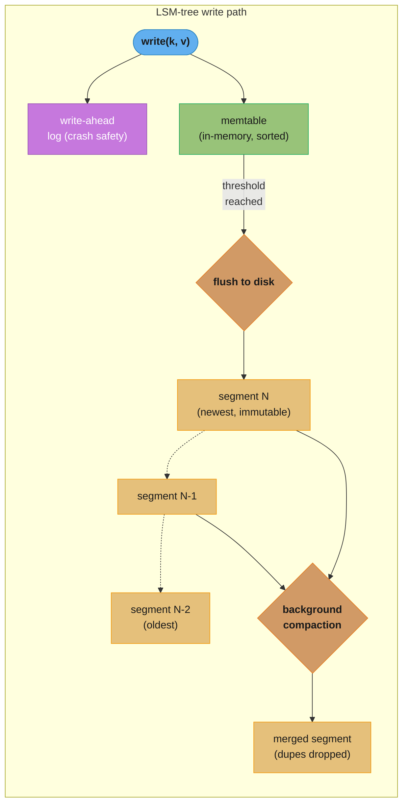
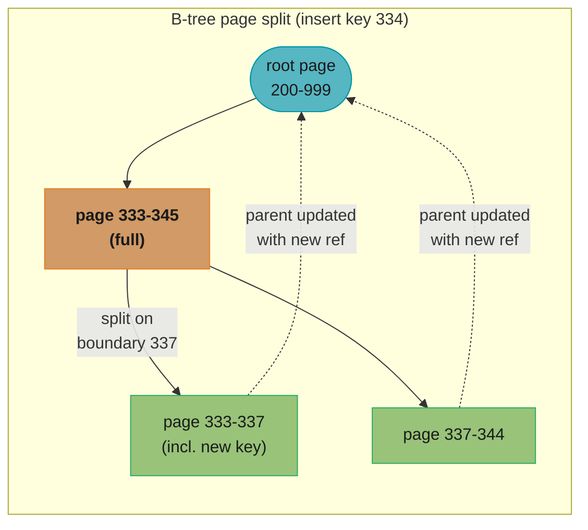
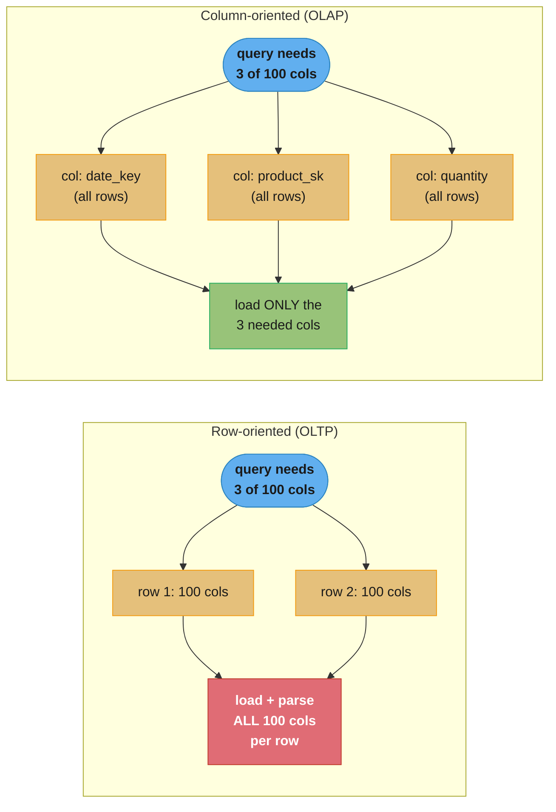
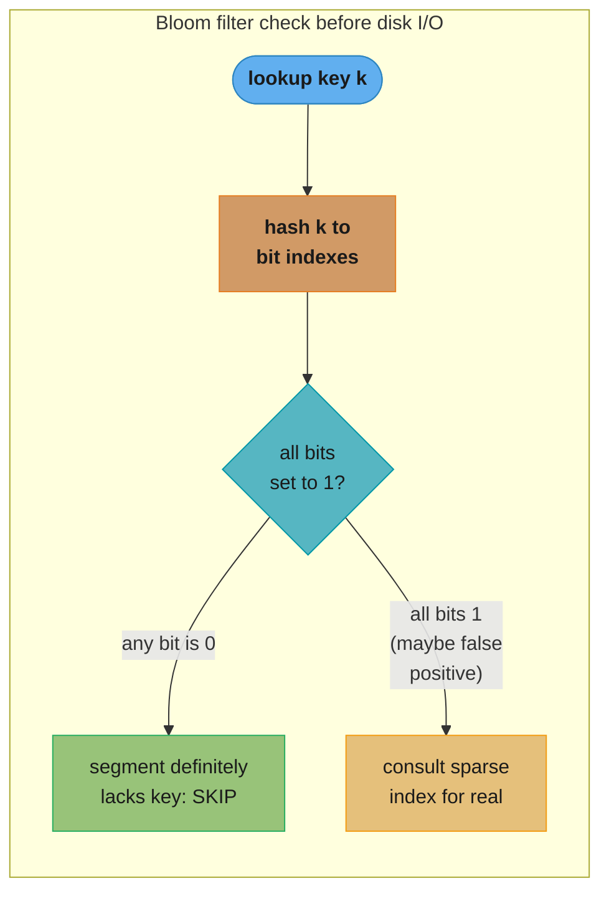

# Chapter 4: Storage and Retrieval

> Part I — Foundations of Data Systems · DDIA (Kleppmann & Riccomini, 2nd ed., O'Reilly 2026) · builds on Ch 3, leads to Ch 5 (encoding and evolution)

## Chapter Map

[Chapter 3](../03_data_models_and_query_languages/03_data_models_and_query_languages.md) looked
at storage and retrieval from the application's side — the data model and query language you
hand the database. This chapter flips to the database's own point of view: how does a storage
engine actually keep the bytes you give it, and how does it find them again fast? The chapter
opens with Feynman's observation that a computer is, underneath the arithmetic, "primarily a
filing system," and spends the rest of its pages on two families of filing cabinet for OLTP
workloads (log-structured and B-tree), one family for OLAP (column-oriented), and a closing tour
of indexes for harder queries — multidimensional, full-text, and vector/semantic search.

**TL;DR:**
- Every index is a trade-off: it speeds up the reads it's built for and slows down every write,
  because the index has to be kept current. Databases don't index everything by default — you
  choose indexes using your knowledge of the application's query patterns.
- **OLTP** storage engines split into two schools: **log-structured** (SSTables, LSM-trees —
  append-only, background-merged, generally better write throughput) and **update-in-place**
  (B-trees — fixed-size pages overwritten directly, generally better read throughput and
  predictable latency).
- **OLAP** (analytics) storage flips the layout: **column-oriented storage** puts each column's
  values together on disk so a query touching 3 of 100 columns reads only those 3, and it
  compresses far better than row-oriented storage (bitmap encoding, run-length encoding on sorted
  columns).
- Beyond single-attribute indexes, the chapter covers **multidimensional indexes** (R-trees for
  geospatial, concatenated indexes for phone-book-style lookups), **full-text search** (inverted
  indexes, postings lists, trigram indexes, Levenshtein automata for fuzzy match), and **vector
  embeddings** (flat, IVF, and HNSW indexes) for semantic search.

## The Big Question

> "On the most fundamental level, a database needs to do two things: when you give it some data,
> it should store the data, and when you ask it again later, it should give the data back to
> you."

Analogy: a database is a filing system, and every indexing structure in this chapter is a
different way to organize a filing cabinet. A hash-map index is sticky notes on the front of each
drawer telling you exactly which folder to open — fast, but useless for "show me everything filed
between D and M." A sorted, merged log (an LSM-tree) is a librarian who keeps today's returns in a
neat pile on the desk and periodically re-shelves them into the main collection, alphabetized, in
big batches. A B-tree is a filing cabinet that's always kept perfectly alphabetized, drawer by
drawer, at the cost of having to shuffle folders every time something new arrives out of order.
Column stores turn the cabinet sideways: instead of one folder per customer holding every fact
about them, there's one long folder per *fact* (every customer's ZIP code, in order) so a query
that only cares about ZIP codes never has to touch the rest. The chapter's job is to show you why
each shape exists and what it costs.

---

## 4.1 Storage and Indexing for OLTP

The chapter opens with "the world's simplest database" — two Bash functions. `db_set` appends
`key,value` to a file; `db_get` greps the file for the key and takes the last (`tail -n 1`) match,
since old values for an updated key are never overwritten:

```bash
db_set () {
  echo "$1,$2" >> database
}

db_get () {
  grep "^$1," database | sed -e "s/^$1,//" | tail -n 1
}
```

`db_set` is fast, because appending to a file is one of the cheapest operations a filesystem
offers. Many real databases internally use a **log** — an append-only sequence of records — for
exactly this reason (the book is explicit that this "log" is not the human-readable application
log; it may be binary and purely internal). `db_get`, though, is *O(n)*: every lookup scans the
whole file. Doubling the number of records doubles every lookup. That's the problem the rest of
the chapter's OLTP half solves: building an **index**, an additional structure derived from the
primary data, that trades write cost and disk space for faster reads. Indexes are opt-in for a
reason — every index slows writes, since it must be maintained on every write, so databases make
you choose them deliberately rather than indexing everything.

### Log-Structured Storage

The first fix for `db_get` is a hash map in memory: key → byte offset of that key's most recent
value in the log. A write appends to the log and updates the hash map; a read looks up the offset
and seeks straight to it (no disk I/O at all if that page is in the filesystem cache). This is
much faster, but it still has four problems: disk space is never reclaimed from overwritten
entries; the hash map isn't persisted, so a restart means rescanning the whole log; the hash table
must fit in memory (on-disk hash maps are hard to make fast — lots of random I/O, expensive to
grow, fiddly collision handling); and range queries are hopeless (there's no way to scan "all keys
between 10000 and 19999" except looking each one up individually).

#### The SSTable file format

The fix used in practice is to keep data **sorted by key** instead of hashed. A **Sorted String
Table (SSTable)** stores key-value pairs sorted by key, each key appearing once. Because the file
is sorted, you don't need every key in memory — you can group entries into **blocks** of a few
kilobytes and keep only the *first key of each block* in a **sparse index** (stored separately,
e.g. as an immutable B-tree or trie). To find `handiwork`, and the sparse index only has
`handbag` and `handsome` as block-starts, you know `handiwork` (if present) is between them: seek
to `handbag`'s offset and scan forward through that one block. Each block can also be compressed,
saving disk space and I/O bandwidth at the cost of a bit more CPU.

#### Constructing and merging SSTables

Appending directly to a sorted file would destroy the sort order, so writes go through a
log-structured hybrid:

1. A write lands in an in-memory sorted structure (red-black tree, skip list, or trie) called the
   **memtable**. It supports insertion in any order plus efficient sorted iteration.
2. When the memtable exceeds a threshold (typically a few MB), it's written to disk as a new,
   immutable SSTable **segment**, sorted. The database starts a fresh memtable and keeps serving
   writes while the old one is flushed.
3. A read checks the memtable first, then each on-disk segment from newest to oldest, stopping at
   the first hit (or concluding the key doesn't exist if it hits the oldest segment with nothing).
4. A background **merging and compaction** process periodically combines segment files and drops
   overwritten or deleted values.

Merging works like **mergesort**: read the input segments side by side, repeatedly copy the
smallest key across to the output, and if the same key shows up in more than one input segment
keep only the value from the newest one. Because the durability of a write to the memtable
depends on it surviving a crash, storage engines also keep a separate, unsorted **write-ahead
log**: every write is appended there first, purely to rebuild the memtable after a crash; once a
memtable is flushed to an SSTable, the corresponding log portion can be discarded. Deleting a key
appends a **tombstone** record; when segments merge, the tombstone causes prior values for that
key to be dropped, and the tombstone itself is dropped once it reaches the oldest segment.

This is essentially the algorithm behind RocksDB, Cassandra, Scylla, and HBase, all descended
from Google's Bigtable paper (which coined *SSTable* and *memtable*). It was first published in
1996 as the **Log-Structured Merge-Tree (LSM-Tree)**, building on earlier log-structured
filesystem work — hence **LSM storage engines** as the umbrella name for anything built around
merging and compacting sorted files. Because a segment, once written, is never modified again,
crash recovery is simple (delete any unfinished SSTable and start over), merging/compaction can
run in the background while reads continue against the old segments, and segment files don't have
to live on local disk — SlateDB and Delta Lake write LSM-style segments to object storage.

*(beyond the book)* **Embedded storage engines.** The book's sidebar notes that not every
database exposes a network API — RocksDB, SQLite, LMDB, DuckDB, and KùzuDB are libraries that run
in-process, reading/writing local files, common in mobile apps and viable server-side when data
fits on one machine with few concurrent transactions (e.g. one embedded instance per tenant in a
multitenant system with no cross-tenant queries). The techniques in this chapter apply to embedded
and client-server databases alike; scaling a database across machines is Chapters 6 and 7.

#### Bloom filters

Checking a key that doesn't exist (or was last written long ago) is slow in an LSM engine, because
you may have to check every segment before concluding it's absent. A **Bloom filter** — a compact,
probabilistic bitmap stored alongside each segment — answers "might this key be here?" fast. For
each key, several hash functions produce bit indexes that are set to 1; querying a key checks the
same bits. If *any* checked bit is 0, the key is **definitely not** in that segment — skip it. If
*all* the bits are 1, the key is *probably* there — consult the sparse index for real, since it
might be a **false positive** (bits set to 1 coincidentally by other keys). A rule of thumb: 10
bits of Bloom filter space per key gives roughly a 1% false-positive rate, and every 5 additional
bits per key cuts that rate by 10×. False positives cost only a bit of unnecessary work; they
never cause a wrong answer, because the sparse-index check catches them.

#### Compaction strategies

LSM engines let you pick a compaction strategy:

- **Size-tiered compaction** — successively merges newer, smaller SSTables into older, larger
  ones. Older segments can grow very large and merging them needs substantial temporary disk
  space, but it sustains very high write throughput.
- **Leveled compaction** — splits the key range into smaller SSTables organized into "levels," so
  compaction proceeds incrementally and uses less disk space; it's more read-efficient because
  fewer SSTables typically need checking for a given key.

Rule of thumb: size-tiered wins for mostly-writes/few-reads workloads; leveled wins when reads
dominate, and also helps when you write a small number of keys frequently and a large number
rarely.

### B-Trees

The other major OLTP index family is the **B-tree**, introduced in 1970 and "ubiquitous" within a
decade — still the standard index in almost all relational databases and many nonrelational ones
too. Like SSTables, B-trees keep keys sorted (supporting efficient lookups and range queries), but
the design philosophy diverges completely: instead of immutable segments, B-trees break the
database into fixed-size **pages** (4 KiB traditionally; PostgreSQL now uses 8 KiB, MySQL 16 KiB
by default) that are overwritten in place.

Each page has a page number, letting one page reference another the way a pointer does, but on
disk. One page is the **root**; every lookup starts there and follows child-page references, each
child owning a continuous key range, until reaching a **leaf page** holding the actual values (or
references to them). The number of child references per page is the **branching factor** — the
book's diagram uses six, but real branching factors are typically several hundred (limited by how
much space page references and range boundaries need).

Inserting into a full page triggers a **page split**: the page divides into two half-full pages,
and the parent page is updated with the new boundary key; if the parent doesn't have room either,
the split cascades upward, all the way to the root if necessary (which is how a B-tree grows a new
level — a new root is created above the old one). Deletion, which may require merging nodes, is
more complex. This splitting keeps the tree **balanced**: a B-tree with *n* keys always has depth
*O*(log *n*). Most databases fit in a tree three or four levels deep — a four-level tree of 4 KiB
pages with branching factor 500 can store up to **250 TB**.

#### Making B-trees reliable

The basic B-tree write is "overwrite a page on disk," which assumes the page doesn't move and
every reference to it stays valid. Overwriting several pages at once (a page split) is dangerous:
a crash partway through can leave a corrupted tree — an **orphan page** with no parent, or a
**torn page** if the hardware can't atomically write a whole page. The standard fix is a
**write-ahead log (WAL)**: every B-tree modification is appended to this log *before* it's applied
to the tree's actual pages, so a crash can be recovered by replaying the log (filesystems call the
equivalent mechanism *journaling*). To keep performance up, B-tree implementations buffer modified
pages in memory rather than writing every change immediately; the WAL, once flushed with `fsync()`,
is what makes the data durable regardless of when the buffered page actually reaches disk.

#### B-tree variants

- **Copy-on-write** (e.g. LMDB) — instead of overwriting pages and relying on a WAL, a modified
  page is written to a new location and the parent pages are rewritten to point at it. Also useful
  for concurrency control (see Chapter 8's snapshot isolation).
- **Abbreviated keys** — interior pages don't need the full key, only enough to act as a range
  boundary, so packing more keys per page raises the branching factor and shortens the tree.
- **Sequential leaf layout** — some implementations try to lay leaf pages out sequentially on disk
  to speed up sorted scans, though maintaining that order as the tree grows is hard.
- **Sibling pointers** — leaf pages reference their left/right siblings, allowing in-order scans
  without walking back up to the parent.

### Comparing B-Trees and LSM-Trees

Rule of thumb: **LSM-trees suit write-heavy workloads; B-trees are faster for reads** — but
benchmarks are workload-sensitive, and the boundary isn't strict (some engines blend both, e.g.
multiple B-trees merged LSM-style).

#### Read performance

A B-tree lookup reads one page per tree level — few levels, so fast and predictable. An LSM lookup
may have to check several SSTables at different compaction stages, though Bloom filters cut the
actual disk I/O substantially. Range queries favor B-trees outright: LSM range scans must scan all
overlapping segments in parallel and merge results, and Bloom filters don't help (you'd need to
hash every possible key in the range), making range queries costlier than point queries on LSM
engines. High write throughput can also cause **latency spikes** in log-structured engines if the
memtable fills faster than compaction can keep up — many engines (including RocksDB) apply
**backpressure**, suspending reads and writes until the memtable is flushed. On modern NVMe SSDs,
which can serve many independent reads in parallel, both LSM and B-trees can hit high read
throughput, but the storage engine has to be designed to exploit that parallelism.

#### Sequential vs. random writes

A B-tree scatters writes across the disk wherever the pages being overwritten happen to live —
**random writes**. A log-structured engine writes whole segment files at once — **sequential
writes**, much larger than a single B-tree page. Disks generally sustain higher sequential than
random write throughput, so LSM engines generally handle more write throughput on the same
hardware; the gap is largest on spinning HDDs and smaller (but still noticeable) on SSDs.

*(beyond the book)* **Why SSDs still favor sequential writes.** Flash memory reads/writes one
*page* (typically 4 KiB) at a time but erases only a whole *block* (typically 512 KiB) at a time.
Before erasing a block, the SSD controller must relocate any still-valid pages elsewhere — **garbage
collection (GC)**. A sequential write workload tends to fill whole blocks with data from one file,
so deleting that file lets the whole block be erased with no GC; a random write workload leaves
blocks with a mix of valid and stale pages, forcing the controller to do more GC work before
erasing. GC steals write bandwidth from the application and wears the flash faster — so random
writes wear out an SSD quicker than sequential ones, even without HDD-style mechanical seek delay.

#### Write amplification

One application write can turn into several I/O operations. In an LSM engine a value is written
to the log, again when the memtable flushes, and again on every compaction it's swept up in
(unless values are stored separately from keys, compacting only the keys+references, which cuts
this overhead). A B-tree writes every piece of data at least twice — once to the WAL, once to the
tree page — and sometimes has to rewrite an entire page for a tiny change, to guarantee correct
crash recovery. **Write amplification** = total bytes written to disk ÷ bytes that a bare
append-only log with no index would have needed (sometimes measured in I/O operations instead of
bytes). It matters directly for write-heavy throughput (higher amplification = fewer effective
writes/sec for a given disk bandwidth) and for SSD wear. For typical workloads LSM-trees tend to
have *lower* write amplification, since they avoid rewriting whole pages and can compress SSTable
chunks — another reason LSM suits write-heavy workloads. Measuring write throughput on an empty
LSM-tree is misleading, since there's no compaction competing for bandwidth yet; the effect only
shows up once the database has grown and compaction is ongoing.

#### Disk space usage

B-trees **fragment**: deleting many keys leaves unused pages that new inserts can reuse but that
can't easily be returned to the OS (they sit in the middle of the file), so a background process —
PostgreSQL's `vacuum`, for instance — has to periodically reorganize pages. LSM-trees fragment
less, because compaction rewrites data files anyway and SSTables have no unused page space; blocks
also tend to compress better in SSTables, often yielding smaller files than B-trees overall.
Overwritten keys/values still consume space until compacted away, but this overhead is low under
leveled compaction (size-tiered uses more disk, especially transiently during compaction). Multiple
on-disk copies also complicate compliant deletion: in most LSM engines a deleted record can persist
until the tombstone propagates through every compaction level, which can take a while (specialist
designs propagate deletions faster). On the plus side, SSTables' immutability makes point-in-time
**snapshots** cheap — write the memtable and record which segment files existed, with no copying
needed as long as those files aren't deleted — something a B-tree, whose pages get overwritten,
can't do as easily.

### Multi-Column and Secondary Indexes

Everything above is a key-value index — like a **primary key** index, which uniquely identifies
one row/document/vertex that other records can reference. **Secondary indexes**, created in
relational databases via `CREATE INDEX`, let you search by non-primary-key columns, and are built
from a key-value index the same way, with one twist: the indexed values aren't necessarily unique,
so multiple rows can share an index entry. Two fixes: make each index value a *list* of matching
row IDs (like a postings list), or make each entry unique by appending a row identifier to it.
Both B-trees and log-structured storage can implement either kind of index.

#### Storing values within the index

The value stored under an index key can be one of three things:

- **Clustered index** — the actual row/document/vertex is stored directly inside the index
  structure. MySQL InnoDB's primary key is always clustered; SQL Server lets you designate one
  clustered index per table.
- **Reference + heap file** — the index value is a reference (the primary key, or a direct disk
  location) to the row, which lives in a **heap file** storing rows in no particular order
  (possibly append-only, possibly reusing deleted-row slots). PostgreSQL uses the heap file
  approach.
- **Covering index (index with included columns)** — a middle ground: some of a table's columns
  are duplicated into the index alongside the full row on the heap or clustered index, letting
  some queries be answered from the index alone (the index is said to *cover* the query), at the
  cost of extra disk space and slower writes.

Updating a value without changing its key can overwrite it in place in a heap file *if* the new
value isn't larger than the old one; if it's larger, the record likely has to move, requiring every
index pointing at it to be updated, or a forwarding pointer left at the old location.

### Keeping everything in memory

Everything so far answers disk's awkwardness — disk is durable and cheaper per gigabyte than RAM,
which is why we tolerate it. But as RAM gets cheaper, many datasets fit comfortably in memory
(possibly distributed across several machines), giving rise to **in-memory databases**. Some, like
Memcached, are cache-only — losing data on restart is acceptable. Others aim for durability via
special hardware (battery-backed RAM), an on-disk log of changes, periodic snapshots, or
replication of in-memory state to other machines; on restart such a database reloads from disk or
over the network. It's still "in-memory" because disk is used only as an append-only durability
log — reads are served entirely from memory — and durability-via-disk has an operational bonus:
files on disk are easy to back up, inspect, and analyze externally. VoltDB, SingleStore, and
Oracle TimesTen are relational in-memory databases; RAMCloud is an open-source in-memory key-value
store with log-structured durability both in memory and on disk; Redis and Couchbase provide
weaker durability via asynchronous disk writes.

Counterintuitively, in-memory databases aren't fast merely because they skip disk reads — a
disk-based engine backed by enough RAM may *also* never actually hit disk, since the OS caches
recently used blocks anyway. The real speed gain is avoiding the overhead of *encoding* in-memory
structures into a disk-writable form. In-memory databases also enable data models that are hard to
implement with disk-based indexes — Redis's priority queues and sets, for example, are simple to
implement precisely because everything stays in memory.

---

## 4.2 Data Storage for Analytics

A data warehouse's data model is usually relational, because SQL fits analytic queries well, and
many graphical analysis tools generate SQL and let analysts drill down or slice-and-dice results.
On the surface a warehouse and an OLTP database look alike (both speak SQL), but their internals
diverge sharply because they're optimized for very different query patterns; most vendors now
specialize in one or the other rather than both. A few products — Microsoft SQL Server, SAP HANA,
SingleStore — support transaction processing and warehousing in one product, but these **hybrid
transactional/analytical processing (HTAP)** systems are increasingly two separate storage and
query engines sharing only a common SQL interface.

### Cloud Data Warehouses

Established vendors (Teradata, Vertica, SAP HANA) sell both on-premises and cloud warehouses, but
as customers move to the cloud, newer **cloud data warehouses** — Google Cloud BigQuery, Amazon
Redshift, Snowflake — have taken hold, exploiting scalable cloud infrastructure such as object
storage and serverless compute. They tend to integrate better with other cloud services (automatic
log ingestion, easy hookup to Dataflow or Kinesis) and are more elastic, because they **decouple
query computation from the storage layer** — data lives on object storage, so storage capacity and
compute resources for queries scale independently.

Open source warehouses (Apache Hive, Trino, Apache Spark) have followed the cloud into data lakes
on object storage, and what used to be one integrated system (like Hive) has split into separate
components:

- **Query engine** — parses SQL, optimizes it into an execution plan, and executes it, usually via
  parallel distributed tasks. Trino, Apache DataFusion, and Presto are examples; some provide
  built-in task execution, others lean on Spark or Flink for it.
- **Storage format** — how a table's rows are encoded as bytes in a file stored on object storage
  or a distributed filesystem, accessible to the query engine and to other applications sharing
  the data lake. Examples: Parquet, ORC, Lance, Nimble.
- **Table format** — since storage-format files are typically immutable once written, a table
  format (Apache Iceberg, Databricks Delta) defines which files constitute a table plus its
  schema, and adds features like *time travel* (querying a table as of a past point in time),
  garbage collection, and even transactions.
- **Data catalog** — defines which tables comprise a database, the way a table format defines
  which files comprise a table; used to create/rename/drop tables. Snowflake's Polaris and
  Databricks's Unity Catalog run as standalone services queried over REST; Iceberg also ships a
  catalog runnable in-client or standalone. Decoupling catalogs from query engines (they used to
  be tightly integrated) has let separate data-discovery and data-governance systems consume
  catalog metadata too.

### Column-Oriented Storage

Data warehouse fact tables are often over 100 columns wide, but a typical query touches only 4 or 5
of them (`SELECT *` is rare in analytics). The chapter's running example queries `fact_sales` for
2024 fruit/candy sales grouped by weekday, touching only `date_key`, `product_sk`, and `quantity`
out of the full row:

```sql
SELECT
    dim_date.weekday, dim_product.category,
    SUM(fact_sales.quantity) AS quantity_sold
FROM fact_sales
    JOIN dim_date ON fact_sales.date_key = dim_date.date_key
    JOIN dim_product ON fact_sales.product_sk = dim_product.product_sk
WHERE
    dim_date.year = 2024 AND
    dim_product.category IN ('Fresh fruit', 'Candy')
GROUP BY
    dim_date.weekday, dim_product.category;
```

Most OLTP databases (and document databases) store data **row-oriented**: all values of one row
sit together on disk. Even with indexes on `date_key`/`product_sk`, a row-oriented engine still has
to load every one of the matching rows — each with 100+ attributes — from disk, parse the whole
row, and discard what the query doesn't need. **Column-oriented (columnar) storage** flips this:
store all the values of each *column* together instead. A query then reads and parses only the
columns it actually uses. The layout depends on every column storing rows in the *same order*, so
reconstructing row 23 means taking the 23rd entry from each column. In practice, columnar engines
don't store an entire column (potentially trillions of rows) as one blob — they break the table
into blocks of thousands-to-millions of rows and store each column's slice separately per block,
often choosing block boundaries by timestamp range so date-scoped queries only load overlapping
blocks. Columnar storage is now near-universal in analytics: cloud warehouses (Snowflake), embedded
engines (DuckDB), product-analytics systems (Pinot, Druid), file formats (Parquet, ORC, Lance,
Nimble), and in-memory formats (Apache Arrow, Pandas/NumPy) all use it; some time-series databases
(InfluxDB IOx, TimescaleDB) do too.

*(beyond the book)* Parquet applies column storage to a *document* (nested) data model — not just
flat relational tables — using a technique called *shredding* or *striping*, based on Google's
Dremel paper.

#### Column Compression

Column-oriented layout compresses unusually well, because the values within one column repeat a
lot. **Bitmap encoding** is particularly effective in warehouses: for a column with *n* distinct
values, build *n* bitmaps (one per distinct value), one bit per row, set to 1 if that row has that
value. Because these bitmaps are usually **sparse** (mostly zero), they can additionally be
**run-length encoded** — storing the count of consecutive zeros/ones rather than every bit; some
engines (**roaring bitmaps**) switch between dense and run-length representations, whichever is
more compact. This shape is a natural fit for warehouse query patterns:

- `WHERE product_sk IN (31, 68, 69)` — load the three bitmaps and take their bitwise **OR**.
- `WHERE product_sk = 30 AND store_sk = 3` — load the two bitmaps and take their bitwise **AND**,
  which works precisely because both bitmaps' *k*-th bit refers to the same row.

Bitmaps generalize past filtering, too — they can answer graph queries such as "users followed by
X who also follow Y."

*(beyond the book)* Don't confuse **column-oriented** storage with the **wide-column**
(column-family) *data model*, where a row can have thousands of columns and rows needn't share the
same columns (Bigtable, Accumulo, HBase). Despite the similar name, wide-column databases are
row-oriented internally — they store a whole row's values together.

#### Sort Order in Column Storage

Row order within a column store doesn't matter functionally — insertion order is simplest, since a
new row is just an append to every column — but you can *impose* an order, as with SSTables, and
use it as an indexing mechanism. You can't sort each column independently (you'd lose which values
belong to which row — reconstruction relies on the *k*-th item of every column belonging to the
same row); instead the whole row is sorted as a unit, even though it's physically stored by column.
The administrator picks sort columns based on common query patterns — e.g. `date_key` first if
queries commonly scope to a recent date range, so the engine only scans the relevant rows; a second
sort column (e.g. `product_sk`) then orders ties, grouping same-product-same-day sales together to
help queries that filter or group by product within a date range.

Sorting also boosts compression: if the *primary* sort column has few distinct values, sorting
produces long runs of the same value, which run-length encoding can compress to a few kilobytes
even over billions of rows. This effect is strongest on the first sort key; later sort keys are
progressively more "jumbled" within ties on earlier keys, so they compress less well — but sorting
the first few columns is still a net win overall.

#### Writing to Column-Oriented Storage

Column storage, compression, and sorting all speed up the large-aggregation reads warehouses live
on; warehouse writes are typically bulk imports (often via ETL). Writing an individual row into the
*middle* of a sorted columnar table would be very inefficient — every compressed column would need
rewriting from the insertion point onward — but a *bulk* write amortizes that cost across many
rows. So a log-structured approach is common here too: writes land first in a row-oriented, sorted,
in-memory store, and once enough accumulate they're merged with the on-disk column-encoded files
into new files written in bulk. Old files stay immutable and new files are written in one shot, so
object storage suits this well. Queries transparently combine the on-disk column data with recent
in-memory writes, so from an analyst's view, inserts/updates/deletes are immediately reflected —
Snowflake, Vertica, Pinot, and Druid all do this.

### Query Execution: Compilation and Vectorization

A complex analytic SQL query compiles down to a **query plan** of **operators**, potentially
distributed for parallel execution; the query planner chooses which operators to use, in what
order, and where to run each. Within an operator, the engine needs to compare/compute over column
values — is a value in a set, is it greater than 15 — and combine multiple columns for the same
row (e.g. "product is bananas AND store is X"). At the scale of millions of scanned rows, both disk
I/O *and* CPU time matter: a naive row-by-row interpreter (checking a query data structure for what
to do on every row) is too slow. Two faster approaches have emerged:

- **Query compilation** — generate code (often via LLVM) for the specific query, iterating
  row-by-row through the columns of interest, running the required comparisons/calculations, and
  copying results to an output buffer, then compile that generated code to machine code before
  running it against the in-memory column data. Analogous to JIT compilation in the JVM.
- **Vectorized processing** — stay interpreted, but process a whole *batch* of column values at
  once through a fixed set of predefined operators, rather than iterating row by row. E.g. pass
  `product_sk` and the "bananas" ID into an equality operator to get back a bitmap; pass
  `store_sk` and the target store ID into the same operator for another bitmap; bitwise-AND the
  two bitmaps to get sales of bananas at that store.

Both are used in practice and both lean on the same modern-CPU characteristics: sequential over
random memory access (fewer cache misses); tight inner loops with few instructions/no function
calls (keeps the instruction pipeline full, avoids branch mispredictions); multi-threading and
SIMD; and operating directly on *compressed* data without decoding it first, saving allocation and
copy costs.

### Materialized Views and Data Cubes

A **materialized view** is a table-like object holding the *actual, on-disk copy* of a query's
results, versus a **virtual view**, which is just a shorthand the SQL engine expands into its
underlying query on every read. Some databases update materialized views automatically; systems
like Materialize specialize in materialized-view maintenance. Maintaining one adds write cost but
speeds up repeated identical reads.

**Materialized aggregates** apply this to the `COUNT`/`SUM`/`AVG`/`MIN`/`MAX` aggregates warehouse
queries lean on: if many queries reuse the same aggregate, crunching the raw data every time is
wasteful, so a **data cube (OLAP cube)** caches a grid of aggregates grouped by different
dimensions. With two dimensions (`date_key`, `product_sk`), imagine a 2D table where each cell
holds `SUM(net_price)` for that date-product combination; summing along a row or column collapses
one dimension (sales by product regardless of date, or vice versa). Real fact tables usually have
more than two dimensions (the book's example has five: date, product, store, promotion, customer),
so the "cube" is really a five-dimensional hypercube, with each cell holding the aggregate for one
combination across all five, repeatedly summarizable along any dimension. The advantage: certain
queries become effectively precomputed lookups (total sales per store yesterday = read the totals
along that dimension, no row scan needed). The disadvantage: a cube is inflexible versus querying
raw data — the book's example is that you can't compute "what proportion of sales came from items
over $100" from a cube if price isn't one of the cube's dimensions. Most warehouses therefore keep
as much raw data as possible and use cubes only as a targeted performance boost.

---

## 4.3 Multidimensional and Full-Text Indexes

B-trees and LSM-trees answer range queries over a *single* attribute (e.g. usernames starting with
L), but sometimes a single attribute isn't enough. The most common multi-column structure is a
**concatenated index** — combine several fields into one key by appending one column to another,
in a defined order (like a paper phone book indexing (*lastname*, *firstname*) → phone number: you
can efficiently find a last name, or a last-name+first-name combination, but not "everyone with
first name X" — the phone book gives you no leverage there).

**Multi-dimensional indexes**, by contrast, let you query several columns *at once*. The classic
case is geospatial data: a restaurant-search site querying all restaurants inside a rectangular
map viewport needs a two-dimensional range query —

```sql
SELECT * FROM restaurants WHERE latitude > 51.4946 AND latitude < 51.5079
    AND longitude > -0.1162 AND longitude < -0.1004;
```

— and a concatenated index over (latitude, longitude) can't answer this efficiently: it can give
you a latitude range at any longitude, or a longitude range at any latitude, but not both bounded
simultaneously. One option translates the 2D location to a single number via a **space-filling
curve** and indexes that with a regular B-tree; more commonly, specialized structures like
**R-trees** or **Bkd-trees** divide space so nearby points land in the same subtree (PostGIS
implements geospatial indexes as R-trees on top of PostgreSQL's Generalized Search Tree facility).
Regularly spaced grids of triangles, squares, or hexagons are another option. Multidimensional
indexes aren't only for geography — a 3D index over (red, green, blue) could search products by
color range; a 2D index over (date, temperature) could efficiently find every 2013 observation
between 25°C and 30°C, which a single-dimensional index can't do without scanning one dimension in
full and filtering the other.

### Full-Text Search

**Full-text search** lets you search text documents by keywords that could appear anywhere in the
text. It's a large, specialist field on its own — language-specific word segmentation (several
Asian languages have no spaces between words), typo/grammatical-form matching, and synonyms are
all beyond this book's scope — but at its core, full-text search is another form of
multidimensional query: each possible term is a dimension, and a document has value 1 in a term's
dimension if it contains that term, 0 otherwise. Searching "red apples" is a query for a 1 in the
*red* dimension AND a 1 in the *apples* dimension, over what may be a very large number of
dimensions (one per possible term).

The structure many search engines use is an **inverted index**: a key-value structure mapping each
**term** to the **postings list** — the IDs of every document containing it. With sequential
document IDs, a postings list can itself be a sparse bitmap (the *n*-th bit is 1 if document *n*
contains the term), the same representation used for warehouse bitmap indexes. Finding documents
containing both term *x* and term *y* is then the same operation as the vectorized warehouse query
earlier: load both bitmaps and take the bitwise AND, which stays efficient even if the bitmaps are
run-length encoded. Lucene (the engine behind Elasticsearch and Solr) works exactly this way,
storing term-to-postings-list mappings in SSTable-like sorted files merged in the background with
the same log-structured approach seen earlier in the chapter. PostgreSQL's GIN index type also uses
postings lists, for both full-text search and indexing inside JSON documents.

An alternative to word-based indexing is **n-grams**: index every substring of length *n* (the
trigrams of `"hello"` are `"hel"`, `"ell"`, `"llo"`). An inverted index of trigrams supports
arbitrary substring search — even regular expressions — at the cost of a much larger index. To
tolerate typos, Lucene can match words within a given **edit distance** (edit distance 1 = one
character added, removed, or replaced), implemented by storing the term set as a finite state
automaton over characters (similar to a trie) and transforming it into a **Levenshtein automaton**
that efficiently searches for words within that edit distance.

### Vector Embeddings

**Semantic search** goes beyond synonyms and typos to match on *meaning* — a help page titled
"cancelling your subscription" should surface for a search of "how to close my account," despite
sharing no words. Semantic search indexes use **embedding models** to turn a document into a
**vector embedding**: a point in a multi-dimensional space, where each float represents the
document's position along one axis. A good embedding model places semantically similar inputs near
each other in that space. A three-float toy example: a Wikipedia agriculture page might embed to
`[0.1, 0.22, 0.11]`, a vegetables page nearby at `[0.13, 0.19, 0.24]`, and a star-schemas page far
away at `[0.82, 0.39, -0.74]` — you can see the first two are closer than the third. Real embedding
models use much larger vectors, often 1,000+ numbers, with the same underlying principle: the
individual numbers carry no independent meaning, only relative position does. Search engines
compare vectors with distance functions — **cosine similarity** (the angle between two vectors) or
**Euclidean distance** (straight-line distance). Early text embedding models include Word2Vec,
BERT, and GPT (usually implemented as neural networks); embedding models for video, audio, and
images followed, and more recent architectures are **multimodal**, generating embeddings for
multiple modalities from a single model.

A semantic search engine embeds the user's query (plus context, e.g. location) the same way it
embedded documents, then uses a **vector index** to find documents with nearby embeddings. R-trees
don't work well at high dimensionality, so specialized vector indexes are used instead:

- **Flat indexes** — vectors stored as-is; a query measures distance to *every* vector. Accurate,
  but slow.
- **Inverted file (IVF) indexes** — the vector space is clustered into partitions (**centroids**)
  to cut how many vectors get compared. Faster than flat, but approximate — a query and a document
  vector can land in different partitions despite being close. A query specifies **probes** (how
  many partitions to check); more probes trade speed for accuracy.
- **Hierarchical Navigable Small World (HNSW)** — maintains multiple layers over the vector space,
  each a graph whose nodes are vectors and edges connect nearby vectors. A query starts at the
  nearest vector in the sparse top layer, drops to the same node one layer down, follows edges in
  that denser layer toward a closer vector, and repeats until reaching the bottom layer. Also
  approximate, like IVF.

Facebook's Faiss library implements many variants of both IVF and HNSW, and PostgreSQL's pgvector
supports both; the book leaves the full algorithmic detail to their original papers.

---

## Beyond the book — where this chapter's engines live in the wider repo

> The chapter names specific systems (RocksDB, Cassandra, HBase, PostgreSQL, DuckDB, Snowflake,
> Lucene, Faiss, pgvector, and more) as examples of each technique but does not go deep into any
> one engine's internals, operational tuning, or production incident patterns. The cross-links
> below point to this repo's dedicated deep dives on several of those named systems — that
> operational detail is not a claim about what this chapter itself covers.

---

## Visual Intuition



Caption: a write always lands in the WAL and the memtable first; only when the memtable fills does
it become an immutable on-disk segment, and only compaction ever merges or discards data —
segments themselves are never edited in place.



Caption: a B-tree insert that overflows a page splits it in two and rewrites the parent's boundary
keys — the same overwrite-in-place operation that makes a write-ahead log necessary for crash
safety, unlike the LSM-tree's append-only segments.



Caption: the same 3-of-100-column query forces a row store to touch every column of every matching
row, while a column store loads only the columns the query names — the structural reason columnar
storage wins on wide analytic tables.



Caption: a Bloom filter can only rule a segment OUT with certainty (a 0 bit means "definitely
absent"); a positive result still requires the real index check, which is why false positives cost
extra work but never cause a wrong answer.

---

## Key Concepts Glossary

- **Log** — an append-only sequence of records on disk; the basic building block of log-structured
  storage.
- **Index** — an additional structure, derived from primary data, that speeds up queries at the
  cost of extra disk space and slower writes.
- **Memtable** — the in-memory, sorted data structure a write lands in before being flushed to
  disk as an SSTable.
- **SSTable (Sorted String Table)** — an immutable, key-sorted file of key-value pairs, indexed by
  a sparse index of block-start keys.
- **Sparse index** — an index that stores only some keys (e.g. one per block), relying on sort
  order to locate the rest by scanning.
- **Segment** — one immutable SSTable file produced by flushing a memtable or by compaction.
- **Log-Structured Merge-Tree (LSM-tree)** — the umbrella name for storage engines built around
  merging and compacting sorted, immutable segment files.
- **Compaction** — the background process that merges segments, discarding overwritten/deleted
  values (size-tiered or leveled strategy).
- **Tombstone** — a special deletion record that causes prior values for a key to be discarded
  during compaction.
- **Write-ahead log (WAL)** — an append-only log of pending modifications, written before they're
  applied, used to recover B-trees (and memtables) after a crash.
- **Bloom filter** — a probabilistic bitmap that quickly rules out (with certainty) or flags
  (probably, may be a false positive) whether a key is present in a segment.
- **B-tree** — a balanced, sorted tree of fixed-size pages, updated in place, that is the standard
  index implementation in most relational databases.
- **Page (block)** — a fixed-size unit of storage (typically 4-16 KiB) a B-tree overwrites
  in-place.
- **Branching factor** — the number of child-page references one B-tree page holds.
- **Page split** — dividing a full B-tree page into two half-full pages when an insert overflows
  it, propagating a new boundary key up to the parent.
- **Torn page** — a partially written page left behind when hardware can't atomically write an
  entire page during a crash.
- **Write amplification** — total bytes written to disk divided by the bytes a bare append-only
  log would have needed for the same data.
- **Clustered index** — an index where the actual row data is stored directly inside the index
  structure.
- **Heap file** — a file storing rows in no particular order, referenced by index entries that
  hold pointers rather than the data itself.
- **Covering index (index with included columns)** — an index that duplicates some non-key columns
  so certain queries can be answered from the index alone.
- **In-memory database** — a database that serves reads entirely from memory, using disk (if at
  all) only as an append-only durability log.
- **Data warehouse** — a separate analytical database that consolidates data from many operational
  (OLTP) systems.
- **Hybrid transactional/analytical processing (HTAP)** — a system supporting both OLTP and OLAP,
  increasingly implemented as two separate engines behind one SQL interface.
- **Query engine / storage format / table format / data catalog** — the four components a
  once-integrated open-source warehouse (like Hive) has split into.
- **Column-oriented (columnar) storage** — storing all values of one column together on disk,
  rather than all values of one row.
- **Bitmap encoding** — representing a column with *n* distinct values as *n* bitmaps, one bit per
  row per value.
- **Run-length encoding** — compressing a sparse bitmap by storing counts of consecutive
  zeros/ones instead of every bit.
- **Roaring bitmaps** — a bitmap representation that switches between dense and run-length-encoded
  forms, whichever is smaller.
- **Wide-column (column-family) data model** — a data model allowing thousands of differently
  named columns per row; despite the name, stored row-oriented (Bigtable, HBase, Accumulo).
- **Query compilation** — generating and JIT-compiling machine code for a specific query, executed
  against in-memory column data.
- **Vectorized processing** — executing a query by passing batches of column values through
  predefined operators, rather than interpreting row by row.
- **Materialized view** — a table-like object holding an actual, on-disk, kept-current copy of a
  query's results (versus a virtual view, expanded on read).
- **Data cube (OLAP cube)** — a precomputed grid of aggregates grouped by multiple dimensions.
- **Concatenated index** — a multi-column index built by appending one column's value to another's
  in a fixed order.
- **Multi-dimensional index** — an index (e.g. R-tree) that supports range queries over several
  columns simultaneously, unlike a concatenated index.
- **Inverted index** — a key-value structure mapping each term to a postings list of the documents
  containing it.
- **Postings list** — the list (or bitmap) of document IDs containing a given term.
- **n-gram** — a substring of length *n*, used as an alternative indexing unit to whole words for
  substring/regex search.
- **Levenshtein automaton** — a finite state automaton supporting efficient search for terms within
  a given edit distance, used for fuzzy/typo-tolerant text search.
- **Vector embedding** — a vector of floating-point numbers representing a document's position in
  a multi-dimensional semantic space, produced by an embedding model.
- **Cosine similarity / Euclidean distance** — the two distance functions used to compare vector
  embeddings for closeness.
- **Flat index** — a vector index that compares a query to every stored vector; accurate but slow.
- **Inverted file (IVF) index** — a vector index that clusters vectors into centroids/partitions to
  cut comparisons, at the cost of approximate results.
- **Hierarchical Navigable Small World (HNSW)** — a multi-layer graph vector index that narrows
  from a sparse top layer to a dense bottom layer; approximate.

---

## Tradeoffs & Decision Tables

| | Log-structured (LSM-tree) | Update-in-place (B-tree) |
|---|---|---|
| Underlying write op | Append to a new segment | Overwrite a page in place |
| Write throughput | Generally higher (sequential writes) | Generally lower (random writes) |
| Read throughput / latency | Slower, less predictable (checks multiple segments); Bloom filters help | Faster, predictable (O(log n) page reads) |
| Range queries | Costlier — must scan+merge all overlapping segments; Bloom filters don't help | Efficient — sorted tree structure |
| Crash recovery | Simple — discard unfinished segment | Needs a write-ahead log |
| Fragmentation | Low — compaction rewrites files anyway | Higher — needs a background vacuum/reorg process |
| Write amplification | Typically lower for many workloads | Typically higher (WAL + page rewrites) |
| Snapshots | Cheap (immutable segments) | Harder (pages get overwritten) |
| Examples | RocksDB, Cassandra, Scylla, HBase, Lucene | Most relational databases, many nonrelational ones |

| | Row-oriented storage | Column-oriented storage |
|---|---|---|
| Best for | OLTP — point queries on whole records | OLAP — aggregates over few columns, many rows |
| Disk I/O per query | Loads full rows even if few columns are needed | Loads only the needed columns |
| Compression | Weaker (mixed data types per row) | Strong (repetitive, single-typed columns; bitmap/RLE) |
| Write pattern | Individual inserts/updates | Bulk import / batched merge |

| Vector index | Accuracy | Speed | Mechanism |
|---|---|---|---|
| Flat | Exact | Slowest | Compare query to every vector |
| IVF | Approximate | Faster | Cluster into centroids, probe a subset |
| HNSW | Approximate | Fastest (typically) | Multi-layer proximity graph, coarse-to-fine search |

| Secondary index value storage | What's stored | Extra cost |
|---|---|---|
| Clustered index | Full row, inside the index | Only one index can be clustered per table |
| Heap file + reference | Pointer to row in unordered heap | Extra hop to fetch the row |
| Covering index | Selected columns duplicated in the index | Disk space + slower writes, but avoids the heap hop for some queries |

---

## Common Pitfalls / War Stories

- **Treating "consistent hashing" and Bloom filter false positives the same way — assuming a hit
  is proof.** A Bloom filter answering "maybe present" is not confirmation; skipping the sparse
  index check on a positive result silently serves stale or wrong data. Only a *negative* Bloom
  filter result is a certainty — always fall through to the real index on a positive.
- **Choosing a compaction strategy backwards for the workload.** Size-tiered compaction under a
  read-heavy workload leaves too many segments for a point read to check; leveled compaction under
  an extremely write-heavy workload can't keep up and triggers memtable backpressure, stalling
  reads and writes together. Match the strategy (size-tiered for write-heavy, leveled for
  read-heavy) to the actual access pattern, not the default.
- **Forgetting write amplification when sizing disk bandwidth for a write-heavy service.** A naive
  capacity plan based on the *application's* write rate ignores that one logical write can turn
  into several physical writes (WAL + page rewrite for B-trees; log + memtable flush + repeated
  compaction sweeps for LSM-trees) — under-provisioned disk bandwidth then throttles writes well
  before the "planned" ceiling.
- **Letting a B-tree fragment without a vacuum/reorg process.** Deleted rows leave holes that
  aren't returned to the OS, so disk usage grows even as logical data shrinks; skipping routine
  vacuuming (PostgreSQL's `vacuum`) eventually degrades both space usage and page-locality read
  performance.
- **Building a concatenated index and expecting it to answer a query on the second column alone.**
  A (lastname, firstname) index can find "Smith" or "Smith, John" efficiently but is useless for
  "everyone named John" — the chapter's phone-book analogy. Needing that access pattern calls for
  a genuinely multi-dimensional index, not a bigger concatenated one.
- **Confusing "vector" in vectorized query processing with "vector" in embeddings.** The chapter
  flags this explicitly: a vectorized-processing "vector" is a batch of values processed together
  for CPU efficiency, while an embedding "vector" is a list of floats denoting a point in semantic
  space. Conflating the two in a design discussion talks past the actual question being asked.
- **Assuming IVF/HNSW vector search returns exact nearest neighbors.** Both are approximate —
  tuning probes (IVF) or layer traversal (HNSW) trades recall against latency, and a query and its
  true nearest neighbor can land in different partitions/paths. Systems that need guaranteed
  correctness (not just "usually close") need a flat index or an exact re-ranking pass.

---

## Real-World Systems Referenced

RocksDB, Cassandra, Scylla, HBase, Google Bigtable (LSM-tree lineage); SlateDB, Delta Lake
(segment files on object storage); RocksDB (backpressure on memtable saturation); LMDB (B-tree
copy-on-write); PostgreSQL (heap files, `vacuum`, GIN index, PostGIS/R-trees, pgvector); MySQL
InnoDB (clustered index, 16 KiB pages); SQL Server (per-table clustered index); VoltDB,
SingleStore, Oracle TimesTen (in-memory relational); RAMCloud (in-memory key-value, log-structured
durability); Redis, Couchbase (weak-durability in-memory); Microsoft SQL Server, SAP HANA,
SingleStore (HTAP); Teradata, Vertica, SAP HANA (on-prem + cloud warehouses); Google Cloud
BigQuery, Amazon Redshift, Snowflake (cloud data warehouses); Apache Hive, Trino, Apache Spark,
Apache DataFusion, Presto, Apache Flink (open-source query engines); Parquet, ORC, Lance, Nimble
(storage formats); Apache Iceberg, Databricks Delta (table formats); Snowflake Polaris, Databricks
Unity Catalog (data catalogs); DuckDB, Apache Pinot, Apache Druid, InfluxDB IOx, TimescaleDB
(columnar analytics/time-series); Apache Arrow, Pandas/NumPy (in-memory columnar formats); Lucene,
Elasticsearch, Solr (inverted index, full-text); Materialize (materialized-view maintenance);
Word2Vec, BERT, GPT (early embedding models); Facebook Faiss, pgvector (vector indexes,
IVF/HNSW).

---

## Summary

The chapter's own close: storage engines optimized for OLTP look very different from those
optimized for analytics. OLTP engines handle a high volume of small, fast, primary-or-secondary-
key requests via ordered key-to-record indexes that also support range queries; analytic engines
handle complex queries scanning huge numbers of records, generally using column-oriented, compressed
storage to minimize disk I/O and either JIT compilation or vectorization to minimize CPU time.

On the OLTP side, two schools of thought: the **log-structured** approach (append-only, delete
obsolete files, never modify a written file — SSTables, LSM-trees, RocksDB, Cassandra, HBase,
Scylla, Lucene), which tends toward high write throughput; and the **update-in-place** approach
(fixed-size pages overwritten directly — B-trees, used in essentially every relational OLTP
database and many nonrelational ones), which tends toward higher read throughput and lower response
times. Beyond single-key indexes, the chapter covered indexes answering harder queries at once:
multidimensional indexes (R-trees for latitude/longitude, or any pair/tuple of simultaneously
bounded columns), full-text search (inverted indexes matching keywords anywhere in a document), and
vector databases for semantic search (comparing high-dimensional embeddings by similarity). Armed
with this internals knowledge, an application developer is better positioned to choose the right
storage engine for a workload and to reason about what a given tuning parameter actually changes —
even without becoming an expert in any one engine's full documentation.

---

## Interview Questions

**Q: Why does virtually every index in this chapter slow down writes, and why don't databases just index every column by default?**
**Short:** Every index must be kept current on every write, so more indexes means slower writes.
An index is an additional, derived structure alongside the primary data — the moment you write a record, every index over it must also be updated, so more indexes directly means more work per write. Databases leave indexing manual (`CREATE INDEX`) rather than indexing everything, because the administrator, using knowledge of the application's actual query patterns, can choose only the indexes that pay for themselves in faster reads without imposing unnecessary write overhead. This is a foundational trade-off the whole chapter is built around, not an implementation detail specific to one engine.

**Q: A Bloom filter says a key "might be present" in a segment. What must the storage engine do next, and why can it never skip that step?**
**Short:** It must still check the real (sparse) index — a positive Bloom result can be a false positive.
It must consult the segment's sparse index and decode the relevant block to confirm the key is actually there, because a Bloom filter's positive result can be a false positive — bits set to 1 coincidentally by other keys' hashes. It can never skip this step on a positive result, because doing so would silently return wrong answers whenever a false positive occurs. The one shortcut that IS safe is skipping a segment entirely when the Bloom filter says "definitely absent" (any checked bit is 0), since that result has no false-negative case.

**Q: Why must the segment files in an LSM-tree be immutable, and what does that buy you?**
**Short:** Immutability makes crash recovery, concurrent reads during compaction, and snapshots all simple.
A segment is written once — either flushed from a memtable or produced by merging older segments — and never modified again; compaction produces new merged segments and deletes the old ones, but nothing is edited in place. This buys three things directly: crash recovery is simple (an unfinished segment from a crash can just be deleted and rewritten from scratch), reads can keep being served from old segments while compaction runs in the background undisturbed, and point-in-time snapshots are cheap (record which segment files existed; no copying needed as long as those files aren't deleted). A B-tree, whose pages are overwritten, can't get any of these three for free.

**Q: Why do B-tree implementations need a write-ahead log, when LSM-trees also have crash-recovery needs?**
**Short:** A B-tree overwrites pages in place, so a crash mid-write can corrupt the tree structure itself.
A B-tree's basic write overwrites an existing page on disk; a page split overwrites several pages at once, and a crash partway through can leave an orphan page (no valid parent reference) or a torn page (only partially written), corrupting the tree's structure. The write-ahead log records every modification before it touches the actual B-tree pages, so a crash can be recovered by replaying the log against the last consistent state. LSM-trees only ever append new segments and never overwrite existing ones, so a crash mid-flush just leaves an incomplete segment to discard — the memtable's own separate log (also called a WAL by the book) exists only to rebuild the memtable's in-memory state, not to repair a corrupted on-disk structure.

**Q: Why do range queries perform worse on LSM-trees than on B-trees, and why can't a Bloom filter help there?**
**Short:** A range scan must merge all overlapping segments, and Bloom filters can't hash a whole range.
On an LSM-tree, a range query has to scan every segment that could overlap the range in parallel and merge the results, since the data for that range is scattered across however many segments currently exist. Bloom filters can't help skip segments for a range query, because you'd need to hash every possible key within the range to check membership, which is impractical for anything but a tiny range. A B-tree's sorted, single-structure layout makes a range query a straightforward walk across contiguous leaf pages, with no merging step at all.

**Q: What is write amplification, and why do B-trees typically have higher write amplification than LSM-trees for a given workload?**
**Short:** Write amplification is disk bytes written versus bytes a bare log would need; B-trees pay it via WAL-plus-page rewrites.
Write amplification is the ratio of total bytes actually written to disk to the bytes you'd need for a bare append-only log with no index — a higher ratio means more physical I/O per logical write. A B-tree writes every change at least twice (once to the WAL, once to the tree page) and sometimes must rewrite an entire page for a tiny modification, to guarantee crash-safe recovery. LSM-trees typically achieve lower amplification for many workloads because they never rewrite whole pages and can compress SSTable chunks during compaction — one of the reasons the chapter gives for LSM-trees generally suiting write-heavy workloads better.

**Q: Why does a wide-column (column-family) database like Bigtable or HBase NOT count as column-oriented storage, despite the similar name?**
**Short:** Wide-column is a data model (rows with many differently-named columns); it's stored row-oriented.
"Wide-column" (column-family) describes a *data model* — a row can have thousands of columns and different rows needn't share the same set of columns — not a storage layout. Despite the naming overlap, wide-column databases like Bigtable, Accumulo, and HBase store all values from one row together on disk, which is row-oriented storage. True column-oriented storage instead physically groups all values of a single column together across every row, which is what lets an analytic query skip loading columns it doesn't need — an orthogonal, storage-layer decision from the data model.

**Q: In a data warehouse fact table with 100+ columns, why does column-oriented storage help even before any compression is applied?**
**Short:** A typical analytic query touches only 4-5 of 100+ columns, and columnar layout loads only those.
Because a typical warehouse query accesses only 4 or 5 of a fact table's 100+ columns (`SELECT *` is rare in analytics), a row-oriented engine still has to load, from disk, and parse every column of every matching row before discarding the ones the query doesn't need — wasted I/O and CPU proportional to the full row width. Column-oriented storage groups each column's values together, so the query engine reads and parses only the specific columns it references, independent of any compression benefit that layout also happens to unlock.

**Q: How does sort order in a column store improve compression, and why does that benefit shrink for later sort columns?**
**Short:** Sorting the first sort column produces long repeated runs; later columns stay unsorted within ties.
Sorting the whole row by its first sort column produces long consecutive runs of the same value in that column specifically, which run-length encoding can compress down to a few kilobytes even across billions of rows. A second sort column only determines order *within* ties on the first column, so its values are less uniform and compress less well; a third sort column is more jumbled still, and columns further down the sort priority appear essentially in random order and barely compress from sorting at all. The first one or two sort columns capture most of the compression win; choosing them is a deliberate administrator decision based on common query filters.

**Q: What's the difference between a concatenated index and a genuinely multi-dimensional index, and when does the difference matter?**
**Short:** A concatenated index needs the first column bound; a multidimensional index bounds several columns at once.
A concatenated index appends one column's value to another's in a fixed order (like a phone book's (lastname, firstname) → number), so it can efficiently answer queries bound by the first column, or by the first-then-second column together, but is useless for a query bound only on the second column. A multi-dimensional index (an R-tree, for instance) instead supports range queries across several columns *simultaneously* with no leading-column requirement — needed whenever a query bounds two or more dimensions independently, such as a geospatial bounding-box search on latitude AND longitude together, which a concatenated lat-then-long index cannot answer efficiently.

**Q: Why is Bloom filter false-positive rate a tunable trade-off, and what's the book's rule of thumb for the relationship?**
**Short:** More bits per key lowers the false-positive rate; roughly 10 bits/key gives about 1%.
The false-positive rate depends on the number of keys, bits set per key, and total bits in the filter — more bits allocated per key means fewer coincidental bit collisions, so the false-positive rate drops, at the cost of more memory/disk for the filter. The book's rule of thumb: allocating about 10 bits of Bloom filter space per key in the SSTable yields roughly a 1% false-positive probability, and every additional 5 bits per key reduces that probability by another factor of 10. In an LSM engine, a lower false-positive rate directly reduces unnecessary sparse-index lookups on segments that don't actually contain the queried key.

**Q: Why is an in-memory database (like Redis) fast — is it mainly because it avoids reading from disk?**
**Short:** No — a disk-backed engine with enough RAM rarely hits disk either; the real win is skipping on-disk encoding overhead.
Counterintuitively, no: a disk-based storage engine backed by sufficient RAM may also almost never actually read from disk, because the operating system caches recently used disk blocks in memory regardless of the storage engine's design. The real performance advantage of a purpose-built in-memory database is avoiding the overhead of encoding in-memory data structures into a form suitable for writing to disk — that encode/decode cost, not the disk I/O itself, is what disappears. This is also why some in-memory databases (Redis, RAMCloud) can offer data models, like priority queues, that are comparatively difficult to implement efficiently on top of disk-based indexes.

**Q: How does a data cube (OLAP cube) speed up queries, and what's its fundamental limitation?**
**Short:** A cube precomputes aggregates per dimension combination, but can't answer a query on a dimension it never indexed.
A data cube precomputes and caches aggregates (like `SUM(net_price)`) grouped by every combination of chosen dimensions — date, product, store, and so on — so a query like "total sales per store yesterday" becomes a direct lookup along the relevant dimension instead of scanning millions of raw rows. Its fundamental limitation is inflexibility: the book's example is that you cannot compute "what proportion of sales came from items priced over $100" from a cube if price was never included as one of its dimensions, because the raw per-row detail needed for that filter was already discarded during aggregation. This is why most warehouses keep the raw data around and use cubes only as a targeted performance boost for known, repeated query shapes, not as a replacement for it.

**Q: What's the structural difference between IVF and HNSW vector indexes, and why are both considered approximate?**
**Short:** IVF partitions vectors into clusters to probe; HNSW searches a coarse-to-fine layered graph.
An IVF index clusters the vector space into partitions (centroids) up front, and a query checks only a chosen number of "probe" partitions rather than every vector, trading probe count against both speed and accuracy. An HNSW index instead builds multiple graph layers over the vector space — sparse at the top, densely connected at the bottom — and a query starts at the nearest vector in the sparse top layer, then follows edges downward through progressively denser layers toward the closest match. Both are approximate because the query's true nearest neighbor can end up in a partition IVF didn't probe, or reachable only via a graph edge HNSW's greedy descent didn't follow, so neither guarantees the exact nearest neighbor the way a flat index's exhaustive comparison does.

**Q: Why does the chapter distinguish "vectorized processing" (query execution) from "vector embeddings" (semantic search) so explicitly?**
**Short:** Both use the word "vector" but mean unrelated things — a value batch versus a semantic-space point.
The chapter flags this because the two concepts share a name but nothing else: in vectorized query processing, a "vector" is a batch of column values (or a bitmap of results) processed together through a CPU-efficient operator to speed up analytic query execution. In semantic search, a "vector embedding" is a list of floating-point numbers representing a document's location in an abstract multi-dimensional meaning space, produced by an embedding model, with no relationship to query execution strategy at all. Conflating them in a design discussion — e.g. assuming a vectorized query engine has anything to do with embedding-based search — talks past the actual question.

**Q: Why does the book describe HTAP (hybrid transactional/analytical processing) systems as "increasingly becoming two separate engines behind one SQL interface" rather than one unified engine?**
**Short:** OLTP and OLAP need fundamentally different storage layouts, so even HTAP products split them internally.
Because OLTP and OLAP workloads want structurally opposed storage layouts — OLTP favors row-oriented, small-record, point-query-optimized storage, while OLAP favors column-oriented, compressed, full-table-scan-optimized storage — a single storage engine can't be simultaneously ideal for both. Products like Microsoft SQL Server, SAP HANA, and SingleStore market themselves as HTAP and expose one SQL interface, but the book notes their internals increasingly run two genuinely separate storage and query engines under that shared interface rather than one engine serving both patterns equally well. This mirrors the same OLTP-versus-OLAP split the chapter opens with, just packaged behind a single product.

**Q: Why can a heap-file secondary index update in place for a smaller new value but not for a larger one?**
**Short:** A same-or-smaller value fits its old slot; a larger value must move, updating every pointer to it.
When a row's value shrinks or stays the same size, it can simply overwrite its existing slot in the heap file, since the space it already occupies is sufficient — no pointers to it need to change. When the new value is larger than the old one, it typically can't fit in its current location, so it must move to a new location in the heap with enough free space, which then requires either updating every index that points to it with the new heap location, or leaving a forwarding pointer behind at the old location so lookups can still find it. This asymmetry is why write-heavy workloads with frequently-growing records can suffer extra I/O that a fixed-size-record workload wouldn't.

---

## Cross-links in this repo

- [database/storage_engines_internals/ — B-tree and LSM-tree internals, page structure, WAL mechanics](../../../database/storage_engines_internals/storage_engines_internals.md)
- [database/indexing_deep_dive/ — secondary indexes, covering indexes, index selection](../../../database/indexing_deep_dive/indexing_deep_dive.md)
- [database/key_value_stores/ — LSM-tree key-value engines in production](../../../database/key_value_stores/key_value_stores.md)
- [database/wide_column_databases/ — Bigtable/Cassandra/HBase's column-family data model](../../../database/wide_column_databases/wide_column_databases.md)
- [database/in_memory_databases/ — Redis, durability tradeoffs, in-memory data structures](../../../database/in_memory_databases/in_memory_databases.md)
- [database/analytical_databases_and_olap/ — column-oriented storage, OLAP cubes, cloud warehouses](../../../database/analytical_databases_and_olap/analytical_databases_and_olap.md)
- [database/lakehouse_and_table_formats/ — Iceberg, Delta Lake, Parquet, data catalogs](../../../database/lakehouse_and_table_formats/lakehouse_and_table_formats.md)
- [database/search_engines/ — inverted indexes, postings lists, full-text search in depth](../../../database/search_engines/search_engines.md)
- [database/elasticsearch_internals/ — Lucene segment merging, the log-structured approach applied to text](../../../database/elasticsearch_internals/elasticsearch_internals.md)
- [database/vector_databases/ — HNSW/IVF internals, pgvector, Faiss in production](../../../database/vector_databases/vector_databases.md)
- [Chapter 3 — data models and query languages](../03_data_models_and_query_languages/03_data_models_and_query_languages.md)
- [Chapter 5 — encoding and evolution](../05_encoding_and_evolution/05_encoding_and_evolution.md)

## Further Reading

- Kleppmann & Riccomini, DDIA 2nd ed., Chapter 4 — original text and full reference list.
- Fay Chang et al., "Bigtable: A Distributed Storage System for Structured Data," OSDI 2006 — the
  paper that coined SSTable and memtable.
- Patrick O'Neil et al., "The Log-Structured Merge-Tree (LSM-Tree)," Acta Informatica, 1996 — the
  original LSM-tree paper.
- Burton H. Bloom, "Space/Time Trade-offs in Hash Coding with Allowable Errors," CACM, 1970 — the
  original Bloom filter paper.
- Rudolf Bayer and Edward M. McCreight, "Organization and Maintenance of Large Ordered Indices,"
  1970 — the original B-tree paper.
