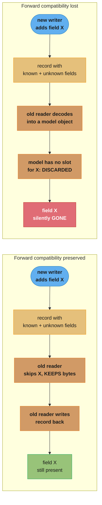
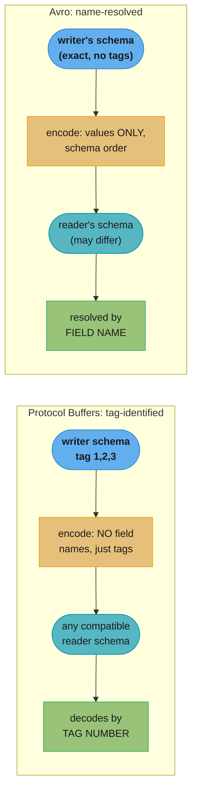
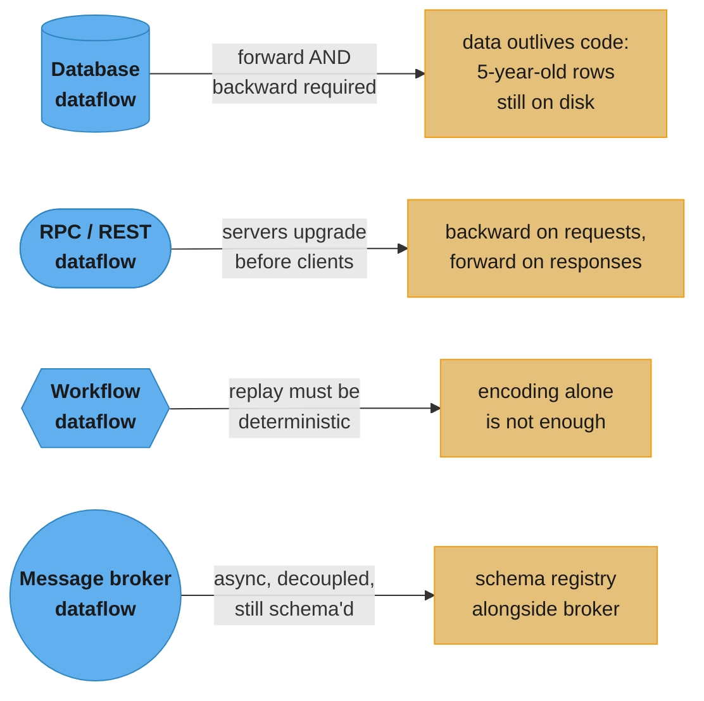

# Chapter 5: Encoding and Evolution

> Part I — Foundations of Data Systems · DDIA (Kleppmann & Riccomini, 2nd ed., O'Reilly 2026) · builds on Ch 4, closes Part I and leads to Ch 6 (replication)

## Chapter Map

Chapter 2 introduced *evolvability* — building systems that make change easy. This chapter is
where that promise gets cashed out at the byte level. Applications change, which means data
formats change, which means old code and new code — and old data and new data — end up coexisting
in the same running system, sometimes for years. The chapter's job is to explain *encoding*: the
translation between in-memory objects and the flat byte sequences you write to disk or send over a
wire, and how the choice of encoding format determines whether that coexistence is graceful or a
silent data-loss bug waiting to happen. It then follows the encoded bytes through the four places
data actually flows between processes — databases, RPC/REST services, workflow engines, and
message brokers — showing how each context reshapes the compatibility problem.

**TL;DR:**
- **Backward compatibility** (newer code reads older data) is usually easy; **forward
  compatibility** (older code reads newer data) is the hard direction, and losing it silently
  drops unknown fields when old code round-trips a record it doesn't fully understand.
- Language-specific encodings (Java serialization, pickle), and loose textual formats (JSON, XML,
  CSV), each have real problems — language lock-in and remote code execution risk for the former;
  number ambiguity, no binary strings, and no build-in schema discipline for the latter.
- **Protocol Buffers and Avro** are the schema-driven binary alternative: Protobuf identifies
  fields by numeric **tag**, forward/backward compatibility rules follow directly from what you're
  allowed to do to a tag; Avro has no tags at all and resolves a **writer's schema** against a
  **reader's schema** by field name, trading tag bookkeeping for schema-registry bookkeeping.
- The same forward/backward compatibility question recurs, reshaped, in every dataflow mode:
  databases (**data outlives code**), RPC/REST (**assume servers upgrade first**), durable-
  execution workflows (**replay determinism**, not just encoding), and message brokers/actors
  (**asynchronous, decoupled, and still needs a schema**).

## The Big Question

> "Old and new versions of the code, and old and new data formats, may potentially all coexist in
> the system at the same time."

Analogy: think of a large organization mid-reorg, where half the staff has the new org chart and
half is still working from last quarter's. A memo written under the new chart references a
department the old chart doesn't have a box for — if the person reading it under the old chart
just throws away anything they don't recognize, that department silently vanishes from every memo
they forward. The chapter is about designing your "memo format" — the encoding — so that neither
the old-chart reader nor the new-chart reader ever has to destroy information they don't
personally understand.

---

## 5.1 Formats for Encoding Data

Programs hold data in two different shapes: in memory as objects, structs, and pointer-linked
trees, optimized for CPU access; and as a flat, self-contained sequence of bytes when it has to
leave the process (a file, the network) since a pointer means nothing to anyone else. Converting
memory-shape into byte-shape is **encoding** (serialization, marshalling); the reverse is
**decoding** (parsing, deserialization, unmarshalling). The book deliberately avoids
"serialization" as a name for this to keep it distinct from the unrelated transaction-isolation
meaning of "serializable" covered in Chapter 8.

Not every system pays this cost — a database can operate directly on compressed on-disk data
without a conversion step (Chapter 4's vectorized execution), and *zero-copy* formats such as
Cap'n Proto and FlatBuffers are designed to be used identically at rest and at runtime. But most
systems do need this translation, and there is a large menu of formats to choose from.

### Language-Specific Formats

Java's `java.io.Serializable`, Python's `pickle`, Ruby's `Marshal`, and third-party libraries like
Kryo let you dump an in-memory object straight to bytes with almost no extra code. The
convenience hides four deep problems:

1. **Language lock-in** — the encoding is tied to one language; reading it from another is hard or
   impossible, which commits your data (and any integration partner) to that language indefinitely.
2. **Security** — decoding must be able to instantiate arbitrary classes to restore arbitrary
   object types. If an attacker controls the byte sequence you decode, they can often use this to
   achieve remote code execution — this is a well-documented, recurring vulnerability class
   (CWE-502), not a hypothetical.
3. **Versioning is an afterthought** — these libraries were built for quick, easy round-tripping,
   not for the forward/backward compatibility this chapter is about.
4. **Efficiency is often bad** — Java's built-in serialization in particular is notorious for slow
   encoding and bloated output.

The book's conclusion is blunt: don't use your language's built-in encoding for anything beyond
very transient, same-process purposes.

### JSON, XML, and Binary Variants

JSON and XML are the standardized, language-independent, human-readable alternatives; CSV is a
third, tabular-only option. All three are widely supported and widely disliked in roughly equal
measure. Underneath the "which syntax is prettier" debate sit real problems:

- **Number ambiguity.** XML and CSV can't distinguish a number from a digit-string without an
  external schema. JSON does distinguish strings from numbers but not integers from
  floating-point, and specifies no precision — IEEE 754 doubles can't exactly represent integers
  past 2^53, so large integers silently corrupt when parsed by a language (JavaScript) that treats
  all numbers as doubles. The book's concrete example: X (formerly Twitter) uses 64-bit post IDs
  and its JSON API includes each ID *twice* — once as a JSON number, once as a decimal string — as
  a workaround for the fact that JavaScript can't parse the number correctly.
- **No binary strings.** JSON and XML handle Unicode text well but have no native binary-string
  type. The workaround is Base64-encoding binary data as text, flagged by the schema — which works
  but inflates size by 33%.
- **Schema complexity.** XML Schema and JSON Schema are powerful but heavy; without them,
  encoding/decoding logic has to be hard-coded per application.
- **CSV has no schema at all** — meaning and column-add handling are entirely up to the
  application, and its escaping rules (quoting a value containing a comma or newline), though
  formally specified in RFC 4180, aren't consistently implemented.

Despite all this, the book is clear that JSON/XML/CSV remain and will remain good enough for many
purposes, especially cross-organization data interchange, where getting different organizations to
agree on *anything* matters more than elegance.

#### JSON Schema

JSON Schema is widely adopted for validating data exchanged or stored as JSON — it shows up inside
OpenAPI web-service definitions, in schema registries (Confluent, Apicurio), and inside databases
(PostgreSQL's `pg_jsonschema`, MongoDB's `$jsonSchema`). Beyond basic types (string, number,
integer, object, array, boolean, null), it layers on a *validation* spec — constraints like "`port`
must be between 1 and 65535."

The load-bearing design point: JSON Schema's content model defaults to **open**
(`additionalProperties: true`) — any field not in the schema is still allowed, of any type. So a
JSON Schema is usually a definition of what *isn't* permitted, not an exhaustive list of what is.
Because JSON's only container type is a generic string-keyed "object" (no dedicated map/dict type),
constraining a map from, say, integer IDs to strings requires `patternProperties` plus
`additionalProperties: false`:

```json
{
    "$schema": "http://json-schema.org/draft-07/schema#",
    "type": "object",
    "patternProperties": {
        "^[0-9]+$": { "type": "string" }
    },
    "additionalProperties": false
}
```

JSON Schema also supports conditional if/else logic, named types, and remote schema references —
powerful, but correspondingly hard to reason about for compatibility, a concern the book notes
applies just as much to XML Schema.

#### Binary encoding

JSON is less verbose than XML but both still cost real space versus a binary format — which
spawned a family of "binary JSON" encodings: MessagePack, CBOR, BSON, BJSON, UBJSON, BISON,
Hessian, Smile for JSON; WBXML and Fast Infoset for XML. None of these caught on as widely as
textual JSON/XML. Crucially, since none of them prescribe a schema, they still have to embed every
field *name* in the encoded bytes — they extend the datatype set (distinguishing ints from floats,
adding binary strings) but keep the same self-describing, name-carrying structure.

The book's running example, encoded three ways across this section:

```json
{
    "userName": "Martin",
    "favoriteNumber": 1337,
    "interests": ["daydreaming", "hacking"]
}
```

MessagePack encodes this record in **66 bytes** — barely less than the 81-byte whitespace-stripped
textual JSON. Walking the first few bytes shows why field names still dominate the size: `0x83`
marks an object of 3 fields, `0xa8` marks an 8-byte string, then the 8 literal ASCII bytes
`userName` follow, then a length-prefixed `Martin`, and so on for every field. The book's verdict:
it's unclear whether that modest size reduction (and maybe a parse speedup) is worth losing
human-readability — and the schema-driven formats that follow do dramatically better.

### Protocol Buffers

Protocol Buffers (protobuf), developed at Google, is a binary encoding library that **requires a
schema**. Apache Thrift (originally Facebook) is architecturally similar; nearly everything said
here about protobuf applies to Thrift too. The schema for the running example, in protobuf's IDL:

```protobuf
syntax = "proto3";

message Person {
    string user_name = 1;
    int64 favorite_number = 2;
    repeated string interests = 3;
}
```

A code-generation tool turns this schema into classes in your target language; application code
calls the generated code to encode/decode. The schema language itself is deliberately minimal — it
declares fields and types only, no value constraints like JSON Schema's.

Encoding the running example this way takes **33 bytes** — half of MessagePack's 66. The
structural difference is the point: there are **no field names in the encoded bytes at all**.
Instead each field carries a **field tag** — a small integer (`1`, `2`, `3`) that's a compact
stand-in for the field name, taken straight from the schema. Protobuf packs the field's type and
tag into a single byte, and encodes integers with a variable-length scheme where the top bit of
each byte flags "more bytes follow" — so `-64..63` fits in one byte, `-8192..8191` in two, and so
on. There's no dedicated list type; a `repeated` field is just the same tag occurring multiple
times in the record.

#### Field tags and schema evolution

An encoded protobuf record is simply its fields concatenated; a field with no value set is
omitted entirely. Because the tag number, not the field name, is what the wire format actually
encodes, the compatibility rules follow directly:

- **You can rename a field freely** — the encoded data never mentions names.
- **You cannot ever reuse a tag number** — that breaks every record ever written with that
  schema. Reserve retired tag numbers in the schema so nobody accidentally reassigns them.
- **Adding a field is safe** if it gets a fresh tag. Old code reading new data simply doesn't
  recognize the new tag, uses the type annotation to know how many bytes to skip, and — critically
  — preserves the unknown field rather than discarding it, which is exactly what avoids the
  Figure-5-1 problem (see The Big Question above). This is **forward compatibility**: old code
  reads new data.
- **Removing a field is adding-in-reverse**, with the compatibility directions swapped. New code
  reading old data that lacks a since-added field just gets the type's default (empty string,
  zero, etc.) — that's **backward compatibility**: new code reads old data, as long as every tag
  still means what it always meant.
- **Changing a field's type is possible for some type pairs but risky.** Widening a 32-bit int to
  64-bit: new code reading old data zero-fills happily. But old code reading data written by new
  code, if the actual value no longer fits in 32 bits, gets silently truncated.

### Avro

Apache Avro, started in 2009 as a Hadoop subproject (because protobuf was a poor fit for Hadoop's
needs), takes a structurally different approach: it also uses a schema, but the schema carries no
tag numbers at all. It has two schema languages — Avro IDL for humans, and a JSON-based one for
machines:

```
record Person {
    string                  userName;
    union { null, long }    favoriteNumber = null;
    array<string>           interests;
}
```

```json
{
    "type": "record",
    "name": "Person",
    "fields": [
        {"name": "userName",        "type": "string"},
        {"name": "favoriteNumber",  "type": ["null", "long"], "default": null},
        {"name": "interests",       "type": {"type": "array", "items": "string"}}
    ]
}
```

Encoded, the running example is just **32 bytes** — the smallest of every format in the chapter.
The reason is total: there's nothing in the byte stream identifying fields or types at all, just
values concatenated in schema-declared order (a length-prefixed UTF-8 string, a variable-length
integer, and so on). This means an Avro-encoded record is **only decodable by a reader using the
exact same schema the writer used** — decode it with any other schema and you get silently wrong
values, since nothing in the bytes says "this is a string" versus "this is an integer."

#### The writer's schema and the reader's schema

Avro resolves this by using *two* schemas at decode time, not one. The **writer's schema** is
whatever schema the encoding side used (e.g., compiled into that version of the application). The
**reader's schema** is what the decoding application currently expects. If the two match, decoding
is trivial. If they differ, Avro matches fields **by name**, not position, and resolves the
mismatch: a writer field absent from the reader's schema is ignored; a reader field absent from
the writer's schema is filled with the reader schema's declared default.

This is the fundamental structural contrast with Protocol Buffers: in Protobuf, one schema can
decode data from any (compatible) writer version because tags are stable identifiers baked into
the wire format itself. In Avro, decoding is inherently a two-schema operation — the reader's
schema is applied through a resolution step against whichever writer's schema actually produced
the bytes.

#### Schema evolution rules

Avro's forward compatibility means a new-schema writer, old-schema reader; backward compatibility
means a new-schema reader, old-schema writer. The single governing rule: **you may only add or
remove a field that has a default value.** Add a field with a default, and a new-schema reader
filling in that default for old (writer-lacking-the-field) data works fine. Add a field *without* a
default and old data breaks new readers — no backward compatibility. Remove a field without a
default and new data breaks old readers — no forward compatibility.

Avro is stricter about null than most languages: `null` is not a free default for any field —
you must declare a `union` type (e.g., `union { null, long, string } field;`), and `null` may only
be the union's *first* branch to serve as a default. More verbose than "everything nullable," but
it forces you to be explicit about what actually can be null.

Changing a field's type is possible if Avro can convert between the two types. Renaming a field is
possible via **aliases** declared in the reader's schema, matched against the writer's old
field name — which makes a rename backward compatible (new reader, old writer: alias resolves)
but **not** forward compatible (old reader has no alias for the new name). Adding a branch to a
union type has the identical asymmetry: backward compatible, not forward compatible.

#### But what is the writer's schema?

Since resolution needs the writer's schema at read time, and including the full schema with every
record would dwarf the compact encoding's benefit, Avro's answer depends on context:

- **Large single-schema file (batch/Hadoop use case)** — write the writer's schema once, at the
  top of an Avro *object container file*.
- **Database of individually-written records** — a version number travels with each record; the
  reader looks up the writer's schema for that version from a schema store. Confluent's Schema
  Registry for Kafka and LinkedIn's Espresso both work this way.
- **Bidirectional network connection** — negotiate the schema version once at connection setup,
  reuse it for the connection's lifetime; this is how Avro RPC works (see §5.2).

A schema-version database is useful regardless of mechanism — it doubles as documentation and lets
you check compatibility before deploying, using an incrementing integer or a schema hash as the
version key.

#### Dynamically generated schemas

The absence of tag numbers is what makes Avro friendlier to *dynamically generated* schemas —
concretely, dumping a relational database's contents to a binary file. Generate an Avro schema
from the relational schema (one record type per table, one field per column, column name → field
name) and export. When the database schema changes — a column added, a column dropped — you simply
regenerate the Avro schema and export with it; the export process needs no awareness that anything
changed, because field-name matching handles reconciling old and new readers automatically.

Doing the equivalent in Protocol Buffers requires someone to hand-assign field tags to database
columns and carefully avoid ever reusing a retired tag as the schema changes — automatable in
principle, but it was never a design goal of Protobuf the way it explicitly was for Avro.

### The Merits of Schemas

Protobuf's and Avro's schema languages are deliberately much simpler than XML Schema or JSON
Schema — no regex-on-field, no numeric-range validation — which is a large part of why they
implement easily across many languages. The book places both in a longer lineage: **ASN.1**, first
standardized in 1984, evolves schemas using tag numbers similarly to Protobuf and still underlies
SSL certificate encoding (X.509 via DER) today — but it's complex and poorly documented enough
that the book recommends against it for new work. Most relational databases also ship a
proprietary binary wire protocol of their own (what an ODBC/JDBC driver decodes), showing
schema-driven binary encoding is already the norm at the database-driver layer even where
application code never sees it.

Schema-driven binary encoding's advantages, gathered:

- **Compactness** — field names are never repeated in the data, unlike every binary-JSON variant.
- **Living documentation** — the schema is required to decode, so (unlike hand-maintained docs) it
  cannot silently drift out of sync with reality.
- **Pre-deployment compatibility checking** — a schema database lets you check forward/backward
  compatibility of a proposed change before anything ships.
- **Compile-time type checking** — for statically typed languages, generated code gives you
  compile-time safety that hand-parsed JSON never can.

The book's summary framing: schema evolution gives you the same operational flexibility a
schema-on-read (schemaless) JSON database gives you (Chapter 3), but with real guarantees and
better tooling layered on top.

---

## 5.2 Modes of Dataflow

Encoding is only meaningful in the context of *who* encodes and *who* decodes — compatibility is a
relationship between (at least) two processes, and there isn't one canonical shape that
relationship takes. The chapter walks four:

### Dataflow Through Databases

The process writing to a database encodes; the process reading decodes — and if it's the same
process at a later point in time, "storing something in a database" is, in the book's framing,
literally **sending a message to your future self**. Backward compatibility is non-negotiable
here: without it your future self can't read what you wrote.

More commonly several processes — different services, or multiple instances of the same service
mid rolling-upgrade — access the same database concurrently, some running old code, some new. A
value written by new code may subsequently be read by old code still running, so **forward
compatibility is routinely required for databases** too, not just an edge case.

#### Different values written at different times

A database can hold a value written five milliseconds ago right beside one written five years ago,
still in its original encoding — unless it's been explicitly rewritten. The book calls this **data
outlives code**: a rolling deploy can replace an entire fleet's code within minutes, but old data
just sits there, unconverted, unless you pay to migrate it. Most relational databases handle the
simple case — adding a nullable column — without a rewrite: reading an old row just fills the new
column with `null`. This lets the whole database *appear* uniformly schema'd even though its
underlying bytes span many historical schema versions.

More invasive changes — turning a single-valued attribute multi-valued, splitting data into a
new table — still require an actual rewrite, usually at the application level, and the book flags
maintaining forward/backward compatibility across such a migration as **still an open research
problem**, not a solved one.

#### Archival storage

A periodic snapshot (backup, or a load into a data warehouse per Chapter 1) is different: it's
written once and never mutated afterward, so re-encoding it consistently in the *latest* schema —
regardless of the mix of historical schema versions in the live source — costs nothing extra since
you're copying the data anyway. Avro object container files fit this immutable-batch shape well,
and it's also a natural point to switch into an analytics-friendly columnar format like Parquet
(Chapter 4's column compression). Chapter 11 covers archival storage's role in batch processing
further.

### Dataflow Through Services: REST and RPC

The client/server model — servers expose a network API (a **service**), clients call it — covers
the web itself (browsers making GET/POST against HTTP/HTML/TLS standards) as well as native and
JS-client apps that get back application data (usually JSON) instead of HTML for humans. Unlike a
database's arbitrary query language, a service's API is deliberately restricted to whatever
inputs/outputs its business logic predetermines — encapsulation by design. A microservices
architecture's whole point is independently deployable, independently evolvable services, each
owned by one team releasing on its own schedule — which means old and new server *and* client
versions coexist routinely, so the encoding across that boundary must stay compatible across
versions.

#### Web services

"Web service" covers three distinct contexts: (1) a user-device client calling a service over the
public internet, (2) one internal service calling another within the same organization/datacenter,
and (3) one organization's service calling another's (credit-card processing, OAuth). **REST**,
built on HTTP's own principles (URLs identify resources, HTTP verbs/headers handle caching,
auth, content negotiation), is the dominant design philosophy; an API following it is **RESTful**.

Clients still need to know which endpoint to call and what format to send/expect — service
developers document this with an **interface definition language (IDL)**. The two dominant ones:
**OpenAPI** (formerly Swagger) for JSON-over-HTTP services, and **gRPC**, which sends/receives
Protocol Buffers directly. A minimal OpenAPI definition:

```yaml
openapi: 3.0.0
info:
  title: Ping, Pong
  version: 1.0.0
paths:
  /ping:
    get:
      summary: Given a ping, returns a pong message
      responses:
        '200':
          description: A pong
          content:
            application/json:
              schema:
                type: object
                properties:
                  message: { type: string, example: Pong! }
```

Service frameworks (Spring Boot, FastAPI, gRPC's own generated scaffolding) implement the routing,
metrics, caching, and auth plumbing so developers write only the endpoint's business logic. The two
directions differ by which artifact is authored first: FastAPI-style frameworks write server code
and *derive* the IDL from it; gRPC-style tooling writes the IDL first and *generates* server
scaffolding. Either direction lets you generate client SDKs in multiple languages from the same
definition, and IDL tooling can additionally generate docs, verify compatibility across schema
changes, and provide an interactive query/test UI.

#### The problems with remote procedure calls (RPCs)

Web services are the latest in a long line of RPC-shaped technologies — EJB and Java RMI
(Java-only), DCOM (Microsoft-only), CORBA (excessively complex, no real forward/backward
compatibility), SOAP/WS-* (aimed at cross-vendor interop, plagued by complexity anyway) — all
built on the idea, dating to the 1970s, of making a network call look exactly like a local
function call (**location transparency**). The book's position is unambiguous: this abstraction
is fundamentally flawed, because a network call differs from a local call in six load-bearing ways:

| Local function call | Network request |
|---|---|
| Predictable — succeeds/fails only on parameters you control | Unpredictable — request/response can be lost to network issues outside your control |
| Returns, throws, or never returns (crash/infinite loop) | Has a *fourth* outcome — the **timeout** — where you never learn whether it ran |
| Retrying a failed call is free of side-effect duplication | Retrying after a lost *response* can duplicate the *action*, unless you build idempotence in |
| Roughly constant execution time | Wildly variable latency — sub-millisecond to many seconds under congestion |
| Passes pointers/references cheaply | Must encode every parameter into bytes — costly for large, mutable data |
| Same language on both ends, by definition | Client/server languages may differ, forcing type translation (JS's number problem again) |

The conclusion: don't try to make a remote service *look* like a local object — REST's real
contribution is treating network state transfer as visibly distinct from a function call, not as a
disguised one.

#### Load balancers, service discovery, and service meshes

Because every service call crosses the network, a client must locate the service instance to talk
to — **service discovery**. Hardcoding an IP:port works until the server moves, fails, or is
overloaded, forcing manual reconfiguration. Running multiple instances and spreading requests
across them is **load balancing**, and the book surveys four mechanisms:

- **Hardware load balancers** — dedicated data-center appliances; detect downstream failures and
  shift traffic away automatically.
- **Software load balancers** (Nginx, HAProxy) — the same behavior, running as ordinary software
  on standard machines rather than a special appliance.
- **DNS** — multiple IPs behind one domain name is a crude form of load balancing, but DNS is
  designed to propagate and cache slowly, so frequently churning instances leave clients holding
  stale, dead IPs.
- **Service discovery systems** — a centralized registry: instances register (host, port,
  metadata — shard ownership, datacenter) and heartbeat; clients query the registry for current
  endpoints rather than relying on DNS's slow propagation, and get richer metadata for smarter
  routing decisions.
- **Service meshes** — the most sophisticated combination: instead of a separate-machine load
  balancer, a mesh runs its balancer as an in-process library or sidecar on *both* client and
  server, so every hop is local-to-local. This centralizes TLS at the mesh layer (services never
  handle certificates directly) and provides deep, real-time observability into who's calling
  whom, failure rates, and load — at the cost of real topological complexity. Istio and Linkerd
  (typically atop Kubernetes) are the book's named examples; dynamic orchestrated environments tend
  toward meshes, specialized infra (databases, message systems) often builds its own purpose-fit
  balancer, and simple deployments are fine with a plain software load balancer.

#### Data encoding and evolution for RPC

RPC dataflow lets you make one simplifying assumption databases can't: it's reasonable to assume
**all servers upgrade before any clients do**. So you only strictly need **backward compatibility
on requests** (server handles old-format requests from not-yet-upgraded clients) and **forward
compatibility on responses** (not-yet-upgraded clients can parse new-format responses) — the
inherited compatibility rules of whichever encoding is in play: gRPC/Avro RPC follow their
encoding's own rules directly; RESTful JSON APIs generally treat adding optional request params
and adding response fields as compatible changes.

Cross-organizational RPC makes this harder still: the service owner usually can't force clients to
upgrade at all, so compatibility may need to hold *indefinitely*, and a breaking change often forces
running multiple API versions side by side. There is, the book notes, no industry agreement on how
API versioning itself should even be signaled — common approaches put a version number in the URL,
in an `Accept` header, or (for API-key-identified clients) store the client's chosen version
server-side, changeable through a separate admin interface.

### Durable Execution and Workflows

Multi-service architectures split one business operation across many services — the book's
example: a payment processor that must call a fraud-detection service, then a credit-card service,
then a bank-integration service. This chain of steps is a **workflow**, each step a **task**
(Temporal calls it an *activity*; other systems say *durable function* — same concept, different
name). Workflows may be defined in a general-purpose language, a DSL, or a graphical notation like
BPMN. A **workflow engine** — split into an **orchestrator** (schedules tasks) and an **executor**
(runs them) — decides when/where each task runs, what happens on failure, and how much runs in
parallel; execution is triggered by a schedule, an external service, or a human. Airflow, Dagster,
and Prefect target ETL orchestration; Camunda and Orkes offer graphical (BPMN) workflow definition;
Temporal and Restate specifically provide **durable execution**.

#### Durable execution

The payment example motivates durable execution directly: a mid-workflow failure could leave a
credit card charged with no matching bank deposit — and you can't wrap cross-service calls in a
single database transaction, especially once a third-party payment gateway is involved. Durable
execution frameworks solve this by giving workflows **exactly-once semantics**: on a task failure,
the framework re-executes the task but *skips replaying* any RPC call or state change that already
succeeded, instead returning the previously recorded result. This works because every RPC and state
change is logged to durable storage — a write-ahead log, in effect — as it happens.

```python
@workflow.defn
class PaymentWorkflow:
    @workflow.run
    async def run(self, payment: PaymentRequest) -> PaymentResult:
        is_fraud = await workflow.execute_activity(
            check_fraud, payment,
            start_to_close_timeout=timedelta(seconds=15),
        )
        if is_fraud:
            return PaymentResultFraudulent
        credit_card_response = await workflow.execute_activity(
            debit_credit_card, payment,
            start_to_close_timeout=timedelta(seconds=15),
        )
```

This buys real safety but with real edges: **external services must themselves be idempotent** —
the framework's replay protection doesn't help if the third-party gateway double-charges on a
retried call, so developers must pass unique IDs to those APIs. Because the framework replays
logged RPC calls **in the original order**, code changes are brittle: reordering function calls in
an existing workflow definition can introduce undefined behavior on replay. The safer path is to
deploy the changed logic as a *new* workflow version, letting in-flight (already-started)
executions keep running the old version to completion while only new invocations pick up the new
code. Replay also requires **deterministic** execution — the same inputs must always produce the
same outputs — so random number generators and system clocks are landmines unless you use the
framework's own deterministic substitutes; Temporal's `workflowcheck` static-analysis tool exists
specifically to catch nondeterminism before it ships.

### Event-Driven Architectures

The final dataflow mode: **events** (or **messages**), where the sender doesn't wait for the
recipient and typically doesn't even talk to it directly — an intermediary **message broker**
(event broker, message queue, message-oriented middleware) buffers the message. Against direct RPC
this buys several things at once: buffering when the recipient is slow/down (reliability), automatic
redelivery to a crashed consumer (no lost messages), no service-discovery requirement (senders
never need the recipient's address), fan-out to multiple recipients, and logical decoupling — the
sender just publishes and doesn't care who, if anyone, consumes it. Communication is inherently
**asynchronous**; a synchronous RPC-like request/response can still be built on top by having the
sender wait on a separate reply channel.

#### Message brokers

The commercial-enterprise era (TIBCO, IBM WebSphere, webMethods) gave way to open-source brokers
(RabbitMQ, ActiveMQ, HornetQ, NATS, Apache Kafka) and, more recently, managed cloud services
(Amazon Kinesis, Azure Service Bus, Google Cloud Pub/Sub) — compared in depth in Chapter 12. Two
distribution patterns dominate regardless of implementation:

- **Queue** — a message is added to a named queue; if multiple consumers exist, exactly *one*
  receives each message.
- **Topic** — a message is published to a named topic; if multiple subscribers exist, *all* of
  them receive each message.

Brokers themselves impose no data model — a message is bytes plus metadata, so any encoding works.
The common pattern pairs Protobuf, Avro, or JSON with a **schema registry** deployed alongside the
broker to hold every valid schema version and check compatibility (AsyncAPI plays OpenAPI's role
for message schemas). Durability also varies by broker: many persist to disk to survive a crash,
but — unlike a database — most auto-delete a message once consumed, unless explicitly configured
to retain indefinitely, which is exactly what's required to support event sourcing (Chapter 3). And
the same unknown-field-preservation concern from earlier in the chapter reappears here: a consumer
that republishes a message onward to another topic must be careful not to drop fields it doesn't
itself understand.

#### Distributed actor frameworks

The **actor model** is fundamentally a single-process concurrency model: instead of threads and
their associated race conditions/locking/deadlock hazards, logic lives in **actors**, each with
private local state, communicating only via asynchronous messages that are not guaranteed to be
delivered — and since each actor processes one message at a time, it never has to reason about
threads at all.

**Distributed actor frameworks** — Akka, Orleans, Erlang/OTP — extend this same model across
multiple *nodes*: the identical message-send/receive mechanism is used whether sender and recipient
share a process or sit on different machines, with cross-node sends transparently encoded, sent,
and decoded. Location transparency works noticeably better here than it did for RPC, precisely
because the actor model already assumes messages can be lost even *within* a single process —
there's no fundamental mismatch to paper over, only a latency difference. Functionally, a
distributed actor framework is a message broker and the actor programming model fused into one
package — but rolling-upgrade forward/backward compatibility is still your problem: messages can
cross from a new-version node to an old-version node and back, so you still need one of this
chapter's encodings underneath.

---

## Visual Intuition



Caption: the chapter's Figure 5-1 in miniature — the difference between the two paths is entirely
whether the decoder preserves bytes it doesn't understand or discards them when re-encoding.



Caption: the two schema-driven formats solve the "how does the reader know what the writer meant"
problem in opposite ways — Protobuf bakes a stable numeric tag into the wire format itself, Avro
carries no tag and instead resolves two schema *copies* against each other by field name.



Caption: one compatibility question — can old and new code coexist safely — gets a differently
shaped answer in each of the four dataflow modes the chapter walks through.

---

## Key Concepts Glossary

- **Encoding (serialization, marshalling)** — translating an in-memory data structure into a flat
  byte sequence.
- **Decoding (parsing, deserialization, unmarshalling)** — the reverse: bytes back into an
  in-memory structure.
- **Backward compatibility** — newer code can read data written by older code.
- **Forward compatibility** — older code can read data written by newer code (the harder
  direction).
- **Rolling upgrade (staged rollout)** — deploying a new version to a few nodes at a time.
- **Zero-copy format** — a format (Cap'n Proto, FlatBuffers) usable identically at rest and at
  runtime, with no explicit encode/decode step.
- **JSON Schema open content model** — the default (`additionalProperties: true`); the schema
  defines what's forbidden, not an exhaustive allow-list.
- **Field tag** — Protocol Buffers' numeric field identifier; stable across renames, never
  reusable once retired.
- **Writer's schema / reader's schema** — Avro's two-schema model; encoding uses the writer's,
  decoding resolves it against the reader's by field name.
- **Schema resolution** — Avro's process of matching writer and reader schemas field-by-field.
- **Union type (Avro)** — Avro's explicit mechanism for a nullable field; `null` must be the
  first branch to serve as a default.
- **Schema registry** — a service (Confluent's, Apicurio) tracking valid schema versions and
  checking compatibility, commonly deployed alongside Kafka or another broker.
- **Data outlives code** — old-format data persists in a database long after the code that wrote
  it has been fully replaced.
- **Service (in a client/server architecture)** — a network-exposed API restricted to
  predetermined, business-logic-defined inputs/outputs.
- **RESTful API** — an API following REST's HTTP-native design principles.
- **Interface definition language (IDL)** — OpenAPI or gRPC's Protobuf-based schema for defining
  and documenting a service API.
- **Location transparency** — the (flawed) RPC premise that a network call can be made to look
  like a local function call.
- **Idempotence** — designing an operation so repeating it (e.g., on retry) has the same effect as
  doing it once.
- **Service discovery** — the general problem of a client locating the network address of the
  service instance to call.
- **Load balancing** — spreading requests for a service across its multiple running instances.
- **Service mesh** — a sophisticated load-balancer/service-discovery combination run as an
  in-process library or sidecar on both client and server.
- **Workflow / task (activity, durable function)** — a graph of steps spanning multiple services;
  each individual step.
- **Workflow engine (orchestrator + executor)** — the system that schedules and runs workflow
  tasks.
- **Durable execution** — a framework technique giving workflows exactly-once semantics by logging
  every RPC/state change and skipping already-completed work on retry.
- **Determinism (in durable execution)** — the requirement that replayed workflow code produce the
  same outputs given the same inputs, ruling out unguarded randomness/clocks.
- **Event / message** — an asynchronous, broker-mediated request where the sender does not wait
  for the recipient.
- **Message broker (event broker, message queue)** — an intermediary that stores and forwards
  messages between processes.
- **Queue vs topic distribution** — one consumer gets each queued message; all subscribers get
  each topic message.
- **Actor model** — a concurrency model where isolated actors communicate only via asynchronous
  message passing.
- **Distributed actor framework** — an actor-model implementation (Akka, Orleans, Erlang/OTP)
  extended transparently across multiple nodes.

---

## Tradeoffs & Decision Tables

| Encoding family | Compactness | Schema required | Cross-language | Human-readable | Named example |
|---|---|---|---|---|---|
| Language-specific (pickle, Java serialization) | Varies, often bloated | No | Poor — often single-language | No | Kryo |
| Textual (JSON/XML/CSV) | Low | Optional | Excellent | Yes | REST APIs |
| Binary-JSON variants (MessagePack, CBOR, BSON) | Medium | No | Good | No | MessagePack (66 B for the example) |
| Protocol Buffers / Thrift | High | Yes, with tags | Good (codegen) | No | gRPC (33 B) |
| Avro | Highest | Yes, no tags | Good (name-based) | No | Hadoop/Kafka pipelines (32 B) |

| Compatibility rule | Protocol Buffers | Avro |
|---|---|---|
| Add a field | New tag number; safe | Must carry a default; safe |
| Remove a field | Retire the tag, never reuse; safe | Field must have had a default; safe |
| Rename a field | Always safe (tags, not names, are encoded) | Backward-only, via reader-side aliases |
| Change type | Some conversions safe; risk of truncation (e.g. 64→32 bit) | Safe if Avro can convert the types |
| Identifies fields by | Numeric tag, in the wire bytes | Field name, resolved via schema-pair matching |
| Needs schema database? | Optional, but recommended | Effectively required (writer's-schema lookup) |

| Dataflow mode | Who encodes / decodes | Compatibility needed | Governing concern |
|---|---|---|---|
| Database | Writer process / (later) reader process, possibly your future self | Both directions, routinely | Data outlives code |
| RPC / REST | Client encodes request, server decodes+re-encodes response | Backward (requests), forward (responses) | Servers assumed to upgrade first |
| Workflow / durable execution | Orchestrator logs, executor replays | Determinism, not just encoding | Replay must reproduce exact call order |
| Message broker / actors | Publisher encodes, every subscriber decodes | Both directions, indefinitely | Schema registry alongside the broker |

---

## Common Pitfalls / War Stories

- **Discarding unknown fields on round-trip.** Decoding a record into a model object that has no
  slot for a field it doesn't recognize, then re-encoding and writing it back, silently deletes
  that field for every other reader — even though the field was perfectly valid, just newer than
  the code that touched it. This is the chapter's Figure 5-1 and the single reason forward
  compatibility gets its own name instead of being "compatibility, but harder."
- **JavaScript and 64-bit IDs.** Treating a large integer ID as a plain JSON number breaks once it
  exceeds 2^53, because JSON specifies no integer precision and JavaScript parses every number as
  an IEEE 754 double. X's API works around this by shipping the same post ID twice — as a number
  and as a string — rather than trusting every client to handle it correctly.
- **Reusing a retired Protobuf tag number.** Because the tag, not the name, is what's actually on
  the wire, assigning a previously-used tag to a new field makes every historically-written record
  decode as if it were the new field — silently wrong data, not a crash. Reserve retired tags in
  the schema explicitly.
- **Deserializing untrusted bytes with a language-native serializer.** Java serialization, pickle,
  and similar libraries must be able to instantiate arbitrary classes to reconstruct arbitrary
  objects — handing an attacker-controlled byte string to that decoder is a well-known remote code
  execution vector (CWE-502), not a theoretical concern.
- **Reordering calls inside a durable-execution workflow.** Because the framework replays logged
  RPC calls in their original order, reordering them in an in-place code edit can produce undefined
  behavior for in-flight executions. Ship the change as a new workflow version instead, and let
  already-running executions finish on the old one.
- **Nondeterminism inside replayed workflow code.** A random number generator or `now()` call
  inside durable-execution logic breaks the "same inputs, same outputs" guarantee replay depends
  on. Use the framework's deterministic substitutes (Temporal ships a static analyzer,
  `workflowcheck`, specifically to catch this).
- **Assuming RPC is "just a function call."** Treating a network call as interchangeable with a
  local one skips designing for its extra failure mode (the timeout, where you never learn what
  happened) and its duplicate-execution risk on retry — idempotence has to be designed in, it's
  not free the way it is locally.

---

## Real-World Systems Referenced

Java `java.io.Serializable`, Python `pickle`, Ruby `Marshal`, Kryo (language-specific encoding);
MessagePack, CBOR, BSON, WBXML (binary JSON/XML variants); Protocol Buffers and Apache Thrift
(tag-based binary encoding); Apache Avro, Confluent Schema Registry, LinkedIn Espresso
(name-resolved binary encoding, writer/reader schema); ASN.1 / DER / X.509 (the older lineage);
OpenAPI/Swagger, gRPC, Spring Boot, FastAPI (service IDLs and frameworks); EJB, Java RMI, DCOM,
CORBA, SOAP/WS-* (earlier RPC technologies the book argues against); Nginx, HAProxy (software load
balancers); Istio, Linkerd, Kubernetes (service mesh); Airflow, Dagster, Prefect, Camunda, Orkes,
Temporal, Restate (workflow engines and durable execution); TIBCO, IBM WebSphere, webMethods,
RabbitMQ, ActiveMQ, HornetQ, NATS, Apache Kafka, Amazon Kinesis, Azure Service Bus, Google Cloud
Pub/Sub (message brokers); Akka, Orleans, Erlang/OTP (distributed actor frameworks); AsyncAPI
(message schema IDL); X (formerly Twitter) (the 64-bit-ID JSON example).

---

## Summary

Encoding turns in-memory data into a self-contained byte sequence for storage or transmission, and
its details shape not just efficiency but your application's whole capacity to *evolve*. Because
rolling upgrades and client-side update lag mean old and new code (and old and new data) coexist
routinely, every encoding decision must be judged on both backward compatibility (new code reads
old data) and the harder forward compatibility (old code reads new data, without silently
discarding what it doesn't recognize). Language-specific encodings are language-locked and often
neglect compatibility outright; textual formats (JSON, XML, CSV) are near-universal but vague about
numbers and binary strings; schema-driven binary formats (Protocol Buffers, Avro) trade
human-readability for compactness plus explicit, checkable compatibility rules — Protobuf via
stable numeric tags, Avro via name-resolved writer/reader schema pairs. That same compatibility
question then reappears, reshaped, in every mode data actually flows between processes: databases
(where data outlives code, sometimes by years), RPC/REST services (where you can assume servers
upgrade first), durable-execution workflows (where determinism matters as much as encoding), and
message brokers/distributed actors (asynchronous and decoupled, but still schema-governed). With
care, the book's authors conclude, backward/forward compatibility and rolling upgrades are
thoroughly achievable — closing Part I on the note that evolvability, not just correctness, is a
first-class design goal.

---

## Interview Questions

**Q: Why is forward compatibility harder to achieve than backward compatibility?**
**Short:** Backward compatibility only needs new code to know old formats; forward needs old code to safely ignore new data.
Backward compatibility just requires the newer code's author to know what older code wrote and handle it explicitly — you control both the format and the handling code. Forward compatibility requires the *older* code, which was written before the new format existed, to correctly ignore fields or structures it has no way of anticipating, and — critically — to preserve them if it re-encodes the record, rather than silently dropping them as it decodes into a model object with no slot for the unknown data. That preservation step is exactly what protobuf's and Avro's binary formats are designed to make automatic.

**Q: What is Figure 5-1's data-loss scenario, and how do schema-driven binary encodings prevent it?**
**Short:** Old code that discards unknown fields on decode silently deletes them when it writes the record back.
A newer version writes a record with a new field into a database; an older version, which doesn't know that field exists, later reads the record, updates something else, and writes it back — and if the old code decoded into a model object with no slot for the unknown field, that field is now silently gone. Protocol Buffers and Avro's binary encodings avoid this because their decoders read each field generically (Protobuf via its type-annotated tag, Avro via schema-driven parsing) and can preserve bytes they don't specifically need to interpret, rather than being forced through a fixed, name-based object model that has nowhere to put unrecognized data.

**Q: In Protocol Buffers, why can you rename a field freely but never reuse a retired tag number?**
**Short:** Protobuf's wire format encodes tag numbers, never field names, so only tags carry meaning.
Because the encoded bytes never contain the field's name at all — only its numeric tag and a type annotation — renaming a field in the schema changes nothing about what's on the wire, so it's always safe. A tag number, in contrast, *is* the wire-level identity of the field; every record ever written under the old schema still has that tag meaning what it originally meant, so reassigning it to a new field would make every old record decode as garbage or as the wrong field. The fix is to reserve retired tag numbers in the schema so nobody accidentally reassigns them later.

**Q: How does Avro achieve a smaller encoding than Protocol Buffers despite having no field tags at all?**
**Short:** Avro's decoder trusts the writer's schema completely, so it stores neither names nor tags.
Avro's encoded bytes contain nothing to identify a field or its type — just the values concatenated in the exact order the schema declares them, so there's no name and no tag number taking up space anywhere. This works only because Avro insists the reader use the *exact* writer's schema (or resolve against it) to know what each value means and where each field boundary falls; Protobuf, by contrast, still spends a byte or two per field on the type+tag annotation so that any schema version, old or new, can self-describe enough to skip fields it doesn't recognize. The book's own numbers on its running example: MessagePack 66 bytes, Protobuf 33, Avro 32.

**Q: What is the writer's schema vs the reader's schema in Avro, and why does decoding need both?**
**Short:** Avro encodes with the writer's schema and decodes by resolving it against the reader's.
The writer's schema is whichever schema version the application used at the moment it encoded a given record — it might be compiled into an old binary from years ago. The reader's schema is what the *current* decoding application expects its records to look like. Because Avro's binary format carries no field names or tags, decoding requires matching the writer's schema field-by-field against the reader's schema by name — fields present in the writer's but not the reader's are dropped, fields in the reader's but missing from the writer's are filled from the reader schema's declared default — so both schemas, not just one, are needed to interpret any given record correctly.

**Q: Why does the book warn against using a language's built-in serialization (Java Serializable, pickle) for anything but transient use?**
**Short:** Built-in serializers are single-language, insecure to decode, and rarely versioned well.
Four compounding reasons: the encoding is normally unreadable outside its own language, locking you into that language for as long as the data lives; decoding must be able to instantiate arbitrary classes to reconstruct arbitrary objects, which is a well-documented remote-code-execution vector (CWE-502) if an attacker controls the bytes being decoded; these libraries were built for quick round-tripping and usually treat forward/backward compatibility as an afterthought; and their efficiency is often poor — Java's built-in serialization specifically is called out as notoriously slow and bloated. The guidance is to use them only for short-lived, same-process purposes, never for anything crossing a process boundary or living long-term.

**Q: Why can't a large integer ID be safely round-tripped through plain JSON, and how did X (Twitter) work around it?**
**Short:** JSON specifies no integer precision, and JS parses all numbers as 64-bit doubles.
JSON distinguishes numbers from strings but not integers from floating-point numbers, and specifies no precision limit — so a number larger than 2^53 can't be represented exactly by an IEEE 754 double, which is how JavaScript (and other languages using floating-point for all numbers) represents every JSON number. X uses 64-bit integers to identify posts, which regularly exceed that threshold, so its JSON API includes each post ID *twice*: once as a native JSON number (which JS clients may misparse) and once as a decimal string (which any client can parse exactly), letting careful clients use the string form.

**Q: What is the "assume servers upgrade first" simplifying assumption for RPC, and what does it buy you?**
**Short:** RPC assumes servers deploy before clients, so you only need request-backward/response-forward compatibility.
The chapter's simplifying assumption for RPC/REST dataflow (unlike databases, which must handle any deploy order) is that all server instances get upgraded to the new version before any client does. That narrows what you must guarantee: the server only needs *backward* compatibility on incoming requests (so not-yet-upgraded clients keep working against the new server), and clients only need *forward* compatibility on responses (so they can parse whatever the newly-deployed server now returns). You don't have to design for a server encountering a request format from the future, because by assumption that can't happen.

**Q: Why does durable execution require deterministic workflow code, and what breaks that determinism?**
**Short:** Replay must reproduce identical outputs from identical inputs, so randomness/clocks are landmines.
Durable execution achieves exactly-once semantics by logging every RPC call and state change and, on failure, *replaying* the workflow's code from the log rather than blindly re-running it — which only produces correct results if replaying the same logged inputs always yields the same logged outputs. A call to a system clock or a random-number generator breaks this, because a replay would compute a different value than the original execution did, diverging from what was actually logged. Frameworks typically ship deterministic substitutes for these (and Temporal ships a static analyzer, `workflowcheck`, specifically to catch code that skips them).

**Q: Why is reordering code inside an existing durable-execution workflow dangerous, and what's the safer alternative?**
**Short:** Replay expects logged RPC calls in their original order; deploy changed logic as a new version instead.
Because durable execution frameworks log each RPC call as it happens and replay them, on retry, in that exact logged order, reordering the calls in an in-place code edit means an in-flight (already-partially-executed) workflow instance's replay no longer lines up with what was actually logged — producing undefined behavior. The safer pattern the book recommends is to deploy the changed logic as a distinct new version of the workflow, so already-started executions keep replaying against the old version to completion while only newly-started executions pick up the new code path.

**Q: What does a message broker give you that direct RPC doesn't, and what's the cost?**
**Short:** A broker buys buffering, redelivery, and decoupling, at the cost of asynchronous delivery.
A broker sitting between sender and recipient buys several things at once: it buffers messages if the recipient is slow or down (reliability), automatically redelivers to a consumer that crashed mid-processing (no lost messages), removes the need for the sender to do service discovery at all, lets the same message fan out to multiple recipients, and logically decouples sender from recipient — the publisher never needs to know or care who, if anyone, is listening. The cost is that communication becomes inherently asynchronous: the sender doesn't wait for delivery or processing, though a synchronous request/response pattern can still be layered on top via a separate reply channel if needed.

**Q: Why does the actor model handle location transparency better than RPC does, according to the book?**
**Short:** The actor model already assumes messages can be lost even locally, so remote loss isn't a new failure mode.
RPC's location-transparency abstraction is fundamentally flawed because it tries to make a network call, which can fail or time out in ways a local call never can, look identical to a local call. The actor model sidesteps this specific mismatch because it *already* treats message delivery as unreliable even between actors in the same process — an actor never assumes a message it sends definitely arrives. So extending the same message-passing mechanism across nodes in a distributed actor framework (Akka, Orleans, Erlang/OTP) doesn't introduce a new class of failure the local case didn't already have to handle; it only adds latency, not a fundamentally different failure model.

**Q: What is the open content model in JSON Schema, and why does it matter for compatibility?**
**Short:** JSON Schema defaults to allowing any undeclared field, so it constrains what's invalid, not what's allowed.
JSON Schema's `additionalProperties` defaults to `true`, meaning any field not explicitly declared in the schema is still permitted, of any type — an *open* content model. Practically, this means a JSON Schema is usually a specification of what values are *invalid* for the fields it does define, rather than an exhaustive allow-list of everything a document may contain. This matters for compatibility because it's naturally forgiving of unknown fields (unlike a closed model, which would reject them), but it also means the schema alone can't guarantee a document contains only what you expect.

**Q: How does adding a field with no default value break compatibility differently in Avro than in Protocol Buffers?**
**Short:** Avro requires a default to add/remove a field safely; Protobuf never required one at all.
Avro's rule is that you may only add or remove a field if it carries a default value — add a field with no default and a new-schema reader has no value to substitute when reading data from an old writer that never had that field, breaking backward compatibility outright. Protocol Buffers never had this constraint in the first place: any field not present in the encoded data is simply given its type's zero-value default (empty string, zero, etc.) automatically, with no explicit schema-level default declaration required. So the same "add a field" change is unconditionally safe in Protobuf but conditionally safe in Avro, gated on remembering to declare a default.

**Q: What's the practical difference between a message broker's queue pattern and its topic pattern?**
**Short:** A queue delivers each message to exactly one consumer; a topic delivers it to every subscriber.
In the queue pattern, one process adds a message to a named queue and, if multiple consumers are attached, the broker delivers that message to exactly *one* of them — useful for distributing work across a pool of workers. In the topic pattern, a process publishes a message to a named topic and the broker delivers a copy to *every* subscriber currently attached — useful for fan-out notification, where multiple independent consumers each need to react to the same event. The same broker can typically support both patterns; which one a given producer/consumer pair uses is an application design choice, not a broker-imposed constraint.

**Q: Why does the book recommend generating an Avro schema from a relational schema, rather than a Protobuf one, for dumping a database to a file?**
**Short:** Avro's name-based, tagless schema needs no manual bookkeeping when the database schema changes.
Because Avro fields are matched by name rather than by a manually-assigned numeric tag, a schema-generation tool can regenerate an Avro schema straight from the current relational schema every time it runs, with zero awareness of what changed — readers just resolve old and new field names against each other automatically. Doing the same with Protocol Buffers would require assigning a stable numeric tag to every database column and carefully never reassigning a tag that was ever used for a now-dropped column, bookkeeping that would have to be done by hand (or by very careful tooling) every time the database schema evolved — a design goal Avro had from the start and Protobuf never did.

---

## Cross-links in this repo

- [backend/grpc_and_protobuf/ — Protocol Buffers wire format, gRPC service definitions](../../../backend/grpc_and_protobuf/grpc_and_protobuf.md)
- [backend/api_contracts_and_schema_governance/ — schema registries, compatibility checking, versioning policy](../../../backend/api_contracts_and_schema_governance/api_contracts_and_schema_governance.md)
- [backend/rest_api_design/ — REST principles, OpenAPI, API versioning strategies](../../../backend/rest_api_design/rest_api_design.md)
- [backend/kafka_deep_dive/ — Kafka's own schema registry usage, topics, message durability](../../../backend/kafka_deep_dive/kafka_deep_dive.md)
- [backend/messaging_patterns/ — queue vs topic patterns, broker delivery semantics in depth](../../../backend/messaging_patterns/messaging_patterns.md)
- [backend/event_driven_fundamentals/ — event-driven architecture patterns beyond this chapter's scope](../../../backend/event_driven_fundamentals/event_driven_fundamentals.md)
- [backend/service_mesh_and_service_discovery/ — load balancing, service discovery, Istio/Linkerd detail](../../../backend/service_mesh_and_service_discovery/service_mesh_and_service_discovery.md)
- [backend/microservices_fundamentals/ — independently deployable services, the organizational context for §5.2](../../../backend/microservices_fundamentals/microservices_fundamentals.md)
- [technologies/temporal_durable_execution/ — Temporal internals, activities, determinism in practice](../../../technologies/temporal_durable_execution/temporal_durable_execution.md)
- [01_tradeoffs_in_data_systems_architecture — this chapter's Part I opener](../01_tradeoffs_in_data_systems_architecture/01_tradeoffs_in_data_systems_architecture.md)
- [06_replication — where Part II picks up after this chapter](../06_replication/06_replication.md)

## Further Reading

- Kleppmann & Riccomini, DDIA 2nd ed., Ch 5 — original text and full reference list.
- Kleppmann, "Schema Evolution in Avro, Protocol Buffers and Thrift" (2012) — the source of this
  chapter's byte-count comparisons.
- Waldo, Wyant, Wollrath, Kendall, "A Note on Distributed Computing" (Sun Microsystems, 1994) —
  the foundational argument against RPC's location-transparency premise.
- Helland, "Data on the Outside Versus Data on the Inside" (CIDR 2005) — the services-vs-databases
  encapsulation distinction the chapter draws on.
- Litt, van Hardenberg, Henry, "Project Cambria: Translate your data with lenses" (Ink & Switch,
  2020) — on the open research problem of forward/backward compatible complex schema migrations.
