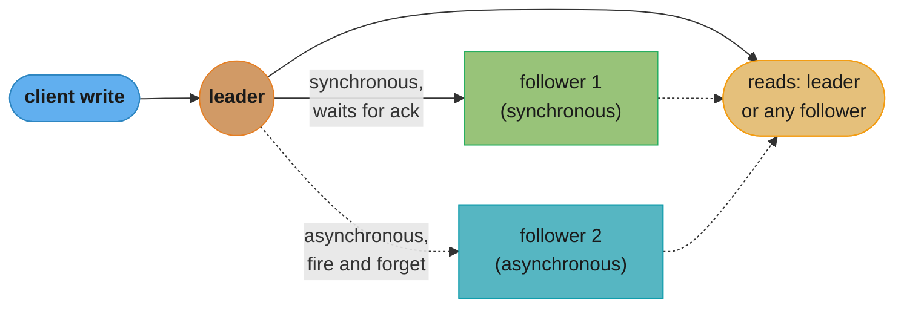
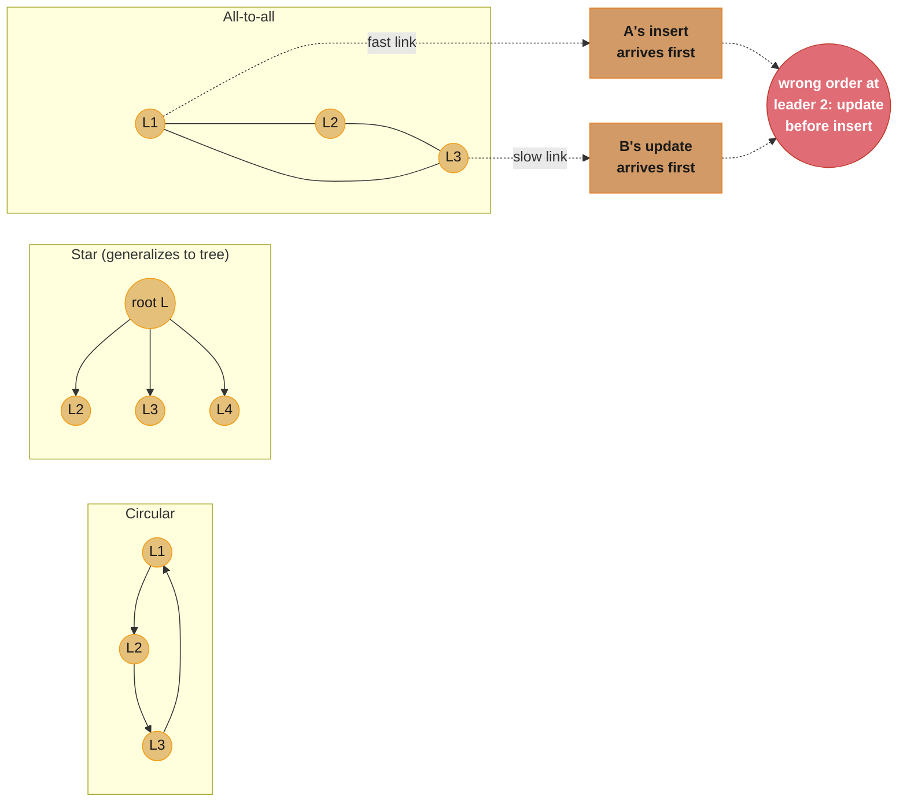
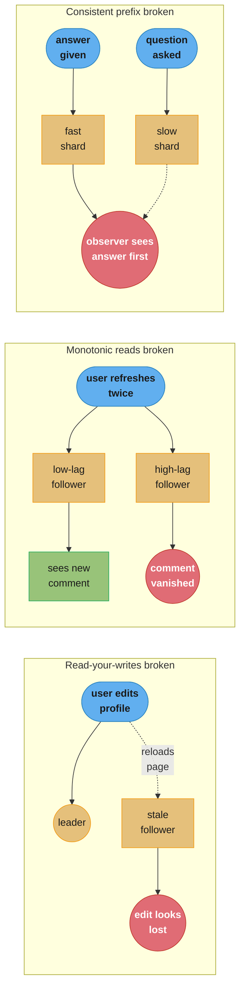
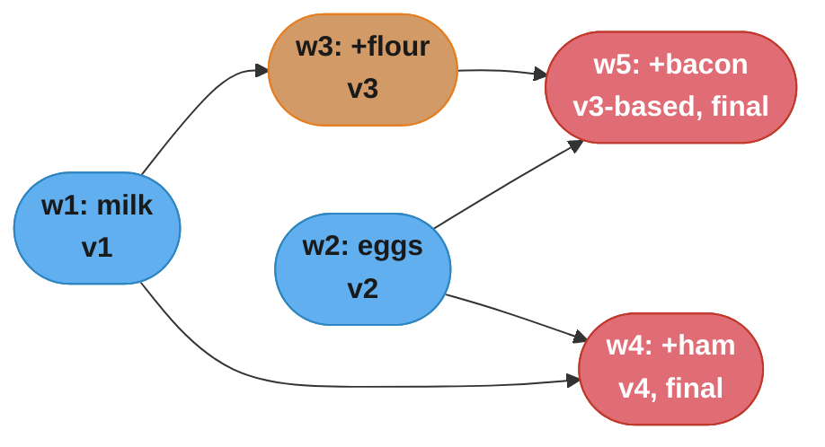

# Chapter 6: Replication

> Part II — Distributed Data · DDIA (Kleppmann & Riccomini, 2nd ed., O'Reilly 2026) · opens Part II, leads to Ch 7 (sharding)

## Chapter Map

Part I assumed one machine. Part II opens by relaxing that assumption in the way that changes
the least about the data model while changing everything about the failure modes:
**replication** — keeping a copy of the *same* dataset on several machines connected by a
network, with each machine still holding the whole thing. (Chapter 7 relaxes the other
assumption, splitting a dataset too big for one machine into shards; the two techniques
combine, but this chapter studies replication alone.) If data never changed, replication would
be a one-time copy. Everything hard about this chapter follows from data *changing*: three
families of algorithm — **single-leader**, **multi-leader**, and **leaderless** — propagate
those changes differently, and each makes a different trade among consistency, availability,
and tolerance of network and node failure.

**TL;DR:**
- **Single-leader replication** routes every write through one leader, which streams a
  replication log to followers; it is popular because it is easy to reason about and gives
  strong consistency, but reads from a lagging **asynchronous** follower can be stale, and a
  leader failure requires a risky **failover**.
- Async replication produces **eventual consistency**, whose visible symptoms are three
  distinct anomalies: broken **read-your-writes**, broken **monotonic reads**, and broken
  **consistent prefix reads** — each has its own targeted fix, and none of them is "just wait."
- **Multi-leader replication** accepts writes on more than one node (useful across regions, or
  when a device must work offline / a browser tab must collaborate in real time), at the cost
  of **write conflicts** that single-leader systems never see.
- **Leaderless replication** (Dynamo-style) sends every write and read to several replicas in
  parallel and uses **quorums** (`w + r > n`) to make staleness *unlikely* rather than
  impossible; it trades the risk of a disruptive failover for constant, low-grade uncertainty.
- Multi-leader and leaderless systems both need a way to tell **concurrent** writes from
  causally ordered ones — the **happens-before relation**, captured with **version vectors** —
  before they can safely apply a conflict-resolution algorithm such as last-write-wins, manual
  merge, or a **CRDT** / **operational transformation**.

## The Big Question

> "Every write to the database needs to be processed by every replica; otherwise, the replicas
> would no longer contain the same data." — but nodes crash, networks drop packets, and clocks
> lie. How do you keep several copies of changing data honest, fast, and available, when the
> network between them cannot be trusted to behave?

Analogy: replication is like several people transcribing the same live dictation in different
rooms. If they can always hear the speaker clearly and in order, their transcripts match. The
book's three architectures are three different microphone arrangements: **single-leader** puts
one designated stenographer in the room who reads her transcript aloud to everyone else
(everyone agrees, but if she leaves the room nobody knows what to write next); **multi-leader**
lets several people transcribe independently and compare notes afterward (nobody is ever
blocked, but if two of them mishear the same sentence differently, someone has to decide whose
version wins); **leaderless** has everyone shout their transcript to whoever is listening and
relies on a show of hands — a quorum — to decide what was actually said. The whole chapter is
choosing which room you can afford to be in.

---

## 6.1 Single-Leader Replication

A machine holding a copy of the database is a **replica**. With several replicas, every write
must reach every replica, or they drift apart. The dominant solution — **leader-based
replication**, also called **primary-backup** or **active/passive** — designates one replica
the **leader** (**primary**/**source**); clients must send writes to it. The leader writes
locally, then streams the change to its **followers** (**read replicas**/**secondaries**/**hot
standbys**) as a **replication log** (**change stream**); each follower applies the log in the
same order the leader processed it. Reads may go to the leader *or* any follower — only writes
are leader-only.

If the database is sharded (Chapter 7), each shard has its own leader; different shards can
have their leaders on different nodes. §6.3 covers the alternative where a single shard has
more than one leader at once.

Single-leader replication is the default: PostgreSQL, MySQL, Oracle Data Guard, and SQL
Server's Always On Availability Groups build it in; so do MongoDB, DynamoDB, Kafka, the
replicated block device DRBD, and some network filesystems. Consensus algorithms such as
Raft — used by CockroachDB, TiDB, etcd, and RabbitMQ quorum queues — are also single-leader
underneath, with the added ability to elect a new leader automatically (Chapter 10). The older
term *master-slave replication* means the same thing but is widely considered offensive and
should be avoided.

### Synchronous Versus Asynchronous Replication

Whether replication is **synchronous** or **asynchronous** is the single most consequential
knob in this chapter. Synchronous: the leader waits for a follower's acknowledgment before
telling the client the write succeeded and before making it visible to other clients. That
follower is then guaranteed up to date — if the leader dies right after, the data survives on
it. But the leader must **block all writes** if that follower is slow or down for any reason,
so making *every* follower synchronous means one dead node halts the whole database.

In practice, if a database supports synchronous replication at all, usually only *one* follower
is synchronous at a time (**semi-synchronous**) — if it becomes unavailable, an asynchronous
one is promoted to take its place, keeping the invariant "an up-to-date copy exists on at least
two nodes" without ever blocking on more than one. Some systems instead make a **majority**
(e.g., 3 of 5, including the leader) synchronous — a **quorum**, generalized in §6.4.

Fully asynchronous replication drops even that guarantee: the leader confirms the write and
moves on without waiting for anyone, so an unrecoverable leader crash loses any writes not yet
shipped — a confirmed write is not necessarily durable. Despite that, fully async replication is
common, especially with many followers or geographically distant ones, because the leader never
blocks on a follower it can't control. Most systems replicate changes in well under a second in
normal operation, but there is **no upper bound** — a recovering follower, an overloaded system,
or a network problem can push the lag to minutes.

### Setting Up New Followers

Adding a follower — to scale out reads or replace a failed node — cannot be a plain file copy:
the leader's files are constantly changing underneath you, so a naive copy sees different parts
of the database at different instants and can be nonsensical. Locking the leader for the
duration would work but destroys availability. The standard procedure avoids both:

1. Take a **consistent snapshot** of the leader's data, ideally without locking the whole
   database (most databases support this, since backups need the same feature; MySQL sometimes
   needs a third-party tool such as Percona XtraBackup).
2. Copy that snapshot to the new follower.
3. Connect the follower to the leader and request every change since the snapshot's exact
   position in the replication log — PostgreSQL's **log sequence number** (LSN), or MySQL's
   **binlog coordinates** / **global transaction identifiers** (GTIDs).
4. Once the backlog is applied, the follower has **caught up** and switches to consuming the
   live stream like any other follower.

The mechanics vary hugely by database — fully automated in some, an arcane manual runbook in
others. Archiving the replication log to an object store alongside periodic full snapshots
doubles as a backup/disaster-recovery strategy and lets a new follower bootstrap from that
archive instead of the live leader; WAL-G does this for PostgreSQL, MySQL, and SQL Server, and
Litestream does the equivalent for SQLite.

### Databases Backed by Object Storage

Object storage — Amazon S3, Google Cloud Storage, Azure Blob Storage — has moved beyond backup
archival into serving live queries directly. It is cheap relative to block storage, so a
database can keep its rarely queried data there while serving the working set from memory, SSD,
or NVMe; it offers multi-zone/dual-region/multi-region replication with very high durability out
of the box, and can bypass inter-zone network fees; its **conditional write** (compare-and-set)
operation can implement transactions and leader election directly; and storing several
databases' data in the same object store, in open formats such as Apache Parquet or Apache
Iceberg, simplifies data integration between systems.

The costs are real: object stores have much higher read/write latency than local disks or
virtual block devices such as EBS, often charge per API call (which forces batching, which adds
more latency), and rarely expose a standard filesystem interface — FUSE mounts exist but often
lack POSIX features such as non-sequential writes or symlinks. Systems cope in different ways:
**tiered storage** keeps hot data on SSD/NVMe/memory and cold data on the object store; others
keep only their write-ahead log on a fast, low-latency store (EBS, or Neon's Safekeepers) while
using object storage as the primary tier for everything else. The most aggressive pattern, a
**zero-disk architecture** (ZDA), persists everything to object storage and uses local disk and
memory purely as cache, so nodes carry no durable local state — this is what WarpStream,
Confluent Freight, Buf's Bufstream, and Redpanda Serverless (all Kafka-compatible), most modern
cloud data warehouses, the vector search engine Turbopuffer, and the LSM engine SlateDB all do.

### Handling Node Outages

Nodes go down — unexpectedly (crashes, power loss) or on purpose (a kernel patch reboot). The
goal is to keep the system running as a whole and to make each individual outage's blast radius
as small as possible.

#### Follower failure: Catch-up recovery

A follower keeps its own log of applied changes, so after a crash or network blip it knows the
last transaction it processed and can simply ask the leader for everything since then — the
same catch-up mechanism used to bootstrap a brand-new follower. This is conceptually simple but
can be expensive: a follower offline for a long time, or a leader under high write throughput,
means a large backlog, which loads both the recovering follower and the leader while it drains.
The leader also has to decide how long to keep old log entries around: retain them until every
follower has acknowledged (risking the leader's own disk filling up), or prune anyway and force
a long-absent follower to rebuild from a fresh backup instead of the log.

#### Leader failure: Failover

Losing the leader is harder: a follower must be promoted, clients redirected, and the remaining
followers repointed at the new leader — collectively, **failover**. It can be manual (an
operator intervenes) or automatic, and automatic failover is generally three steps:

1. **Detect the failure.** There is no foolproof detector, so most systems use a timeout —
   e.g., no response for 30 seconds means "assume dead." (Planned maintenance sidesteps this.)
2. **Elect a new leader**, either via a vote among the remaining replicas or via a preassigned
   **controller node** — this is a consensus problem (Chapter 10). The best candidate is
   whichever follower has the most up-to-date data, to minimize data loss.
3. **Reconfigure the system.** Clients must send writes to the new leader; if the old leader
   comes back believing it is still in charge, it must be forced to step down and become a
   follower of the new leader.

Failover is a minefield:

- With asynchronous replication the new leader may be missing recent writes; the standard
  resolution is to simply **discard** the old leader's unreplicated writes when it rejoins,
  meaning a write you were told succeeded may turn out not to have been durable.
- Discarding writes is dangerous when *other* systems were coordinated with the database. In one
  real incident, GitHub promoted an out-of-date MySQL follower to leader; its autoincrementing
  primary-key counter lagged behind the old leader's, so it reused primary keys the old leader
  had already assigned — keys also used to reference rows in Redis, so the collision leaked
  private data to the wrong users.
- **Split brain** — two nodes both believing they are the leader — can happen in certain fault
  scenarios (Chapter 9); if both accept writes with no conflict-resolution process, data is
  likely lost or corrupted. Some systems auto-shut-down a node when split brain is detected —
  called **fencing**, or more bluntly **STONITH** (Shoot The Other Node In The Head) — but a
  poorly designed fencing mechanism can shut down *both* nodes, and even a correctly designed
  one may act too late to prevent the corruption.
- The failure-detection timeout itself is a trade-off: too long delays recovery; too short
  triggers spurious failovers on a transient load spike or network glitch — and an unnecessary
  failover, kicked off exactly when the system is already struggling, tends to make things
  worse, not better.

There is no clean solution to any of this, which is why some operations teams keep failover
manual even when their software can do it automatically. The one rule that always applies:
prefer the most up-to-date follower — the one the leader waited for under semi-sync, or the one
with the highest log sequence number under async — because losing a fraction of a second of
writes is tolerable and losing several days of them is not.

### Implementation of Replication Logs

Several distinct techniques implement "stream of changes from leader to followers."

#### Statement-based replication

The simplest approach logs and forwards the literal write statements (`INSERT`/`UPDATE`/
`DELETE`) for each follower to re-execute. It breaks in several ways: nondeterministic
functions (`NOW()`, `RAND()`) produce different values per replica; statements that depend on
existing data (`UPDATE ... WHERE <condition>`) must execute in *exactly* the same order
everywhere or diverge, which limits concurrent transaction execution; and triggers, stored
procedures, or UDFs with non-deterministic side effects can diverge too. Workarounds exist
(the leader can log a fixed value in place of a nondeterministic call), and executing
deterministic statements in a fixed order is the same idea as **event sourcing** (Chapter 3) —
also called **state machine replication**, revisited formally in Chapter 10. MySQL used
statement-based replication before 5.1 and still falls back to it in some cases, though it
switches to row-based replication by default whenever a statement is nondeterministic; VoltDB
uses it and requires deterministic transactions to make it safe. In practice, guaranteeing
determinism is hard enough that most databases prefer another method.

#### Write-ahead log (WAL) shipping

Chapter 4 introduced the WAL as the mechanism that makes a B-tree storage engine crash-safe:
every modification is written there before it touches the tree. Since it already contains
everything needed to reconstruct the on-disk state, the leader can also ship it across the
network — a follower that replays it ends up with byte-identical files. PostgreSQL and Oracle
use this. The catch: the WAL describes changes at the level of *which bytes changed in which
disk block*, so it is tightly coupled to the storage engine's on-disk format — you generally
cannot mix storage-engine versions between leader and follower. That has an outsized operational
consequence: if the replication protocol tolerated a version mismatch, you could upgrade
followers first and fail over to make one the new leader for a zero-downtime upgrade. WAL
shipping usually forbids exactly that mismatch, so upgrades typically require downtime.

#### Logical (row-based) log replication

The alternative is to use a **logical log** — a format decoupled from storage-engine internals —
alongside (or instead of) the physical WAL. A logical log for a relational database is a
sequence of per-row records: an insert logs the new values of every column; a delete logs
enough to identify the row (usually the primary key, or every old column value if there is no
primary key); an update logs enough to identify the row plus the new values of changed columns.
A multi-row transaction produces one record per row plus a final commit marker. MySQL's
**binlog** is a separate logical log kept alongside the WAL when row-based replication is
configured; PostgreSQL implements logical replication by decoding the physical WAL back into
row-level insert/update/delete events.

Because a logical log is decoupled from the storage engine, it can stay backward compatible,
letting leader and follower run *different* database versions — which is what enables
minimal-downtime upgrades. It is also far easier for an external system to parse, which is
exactly what you want when streaming a database's contents to a data warehouse or into custom
indexes and caches — the technique is called **change data capture**, covered fully in
Chapter 12.



Caption: the leader accepts every write; whether a follower blocks the leader depends only on
whether *its* replication link is synchronous — reads can hit any of the three nodes, which is
exactly the setup that makes §6.2's staleness anomalies possible.

---

## 6.2 Problems with Replication Lag

Tolerating node failure is only one motive for replication; the others are scaling read
throughput and placing data close to users (Chapter 1). Because only the leader accepts writes
but any replica can serve reads, a read-heavy workload can add followers purely to spread read
load — **read-scaling**. This only works with *asynchronous* replication: synchronously
replicating to every one of many followers means any single node outage or network hiccup makes
the whole system unwritable, and the more followers you add, the more likely one of them is
briefly unreachable.

The price is that a query against an async follower can return outdated results — running the
same query against the leader and a follower simultaneously can disagree, simply because not
every write has propagated yet. Left alone long enough (no new writes), the followers converge
with the leader — hence **eventual consistency**, a term coined by Douglas Terry et al.,
popularized by Werner Vogels, and often associated with NoSQL even though *any* asynchronously
replicated leader-based relational database has exactly the same property. "Eventually" is
deliberately unbounded: **replication lag** is usually a fraction of a second, invisibly, but
can stretch to seconds or minutes under load or network trouble, at which point the
inconsistency stops being theoretical and starts being a real product problem. Three specific
anomalies show up, each with its own name and its own fix.

### Reading Your Own Writes

A user submits data, then immediately views it — this is common (edit a profile, post a
comment) and appropriate when data is read far more often than written. With async replication,
if the user's *read* lands on a follower that hasn't caught up yet, their own submission appears
to have vanished — understandably upsetting. The needed guarantee is **read-after-write**
(**read-your-writes**) **consistency**: after a user's own write, they will always see it on
reload, though the guarantee says nothing about seeing *other* users' writes promptly.

Implementation options the book lists:

- Read anything the current user might have modified from the leader (or a synchronous
  follower); read everything else from an async follower. This needs a cheap way to know
  whether something *might* have been edited without querying it — e.g., "always read a user's
  own profile from the leader, everyone else's from a follower," since only the owner can edit
  their own profile.
- If most content is user-editable, that collapses back to "read almost everything from the
  leader," defeating read-scaling. An alternative heuristic: read from the leader for one minute
  after the *last* write, or monitor per-follower lag and refuse to serve a user from a follower
  more than one minute behind.
- Have the client remember the **timestamp of its own last write**, then require any replica
  serving that user's reads to be caught up to at least that point — routing the read elsewhere,
  or making it wait, if the chosen replica isn't there yet. The timestamp can be a **logical
  timestamp** (something that indicates write order, e.g. a log sequence number) or a real clock
  reading, which pulls in clock-synchronization concerns (Chapter 9).
- If replicas span regions, any leader-bound request must be routed to the leader's region.

**Cross-device** read-after-write is a harder variant of the same problem: the same user on a
desktop and a mobile app should see their own edits regardless of which device made them. The
timestamp-remembering approach now needs *centralized* metadata, since neither device knows what
the other one wrote, and even routing all of a user's devices to the same region gets harder
because different devices commonly take different network paths (home broadband vs. cellular)
that need not land in the same region.

#### Regions and Availability Zones

A **region** is one or more datacenters in a single geographic location; each individual
datacenter within it is an **availability zone** (**zone**), a physically separate facility with
its own power and cooling. Zones in a region are linked by very high-speed connections, so a
system spread across zones in one region behaves almost as if it were in a single zone, and can
survive a **zonal outage**. Surviving a **regional outage** — every zone in a region going
down — requires spreading the system across *multiple regions*, which brings higher latency,
lower throughput, and a bigger cloud networking bill (§6.3 examines this trade-off further).

### Monotonic Reads

The second anomaly: a user can see data appear to move **backward in time**. If a user's reads
land on different replicas with different lag — plausible if page refreshes are load-balanced to
random servers — an earlier query might reach a low-lag replica and see a comment that just
appeared, while a later query lands on a high-lag replica and doesn't see it, making it look as
if the comment vanished. **Monotonic reads** is the guarantee against this: weaker than strong
consistency, stronger than plain eventual consistency, and specifically about *one user's*
sequence of reads never regressing, not about what value they see. The common fix: route each
user to the *same* replica consistently (e.g., chosen by a hash of the user ID rather than
randomly), rerouting only if that replica fails.

### Consistent Prefix Reads

The third anomaly is a causality violation. Take a short exchange: "How far into the future can
you see?" — "About ten seconds usually." If a third party overhears this through replicas with
different lag — the answer replicated fast, the question replicated slow — they could see the
answer *before* the question, which reads as an impossible feat of clairvoyance. **Consistent
prefix reads** is the guarantee that a sequence of causally related writes is always read back
in the order it was made. This is a particular hazard in sharded databases (Chapter 7): if
different shards operate independently with no global write ordering, a reader can legitimately
see some parts of the database in an older state and others in a newer one at the same instant.
One fix is to route causally related writes to the same shard so they share an ordering; another
is to explicitly track causal dependencies, a topic Chapter 13 returns to.

### Solutions for Replication Lag

Before shipping an eventually-consistent design, ask how the application behaves if lag grows to
minutes or hours. "No problem" is a fine answer; a bad user experience is a sign you need a
stronger guarantee such as read-after-write, and pretending replication is synchronous when it
is actually asynchronous is a recipe for surprises later. Handling this purely in application
code — as the techniques above do — is complex and easy to get wrong.

The simplest programming model is to pick a database offering strong replica consistency, such
as **linearizability** (Chapter 10), together with ACID **transactions** (Chapter 8) — this lets
you mostly ignore replication and treat the database as if it were a single node. The early-2010s
**NoSQL** movement argued these features were a scalability tax that large systems couldn't
afford, pushing eventual consistency instead. Since then, a wave of databases has combined strong
consistency and transactions *with* the fault tolerance, availability, and scalability of a
distributed system — the trend called **NewSQL** (Chapter 3), which is less about SQL
specifically than about new approaches to scalable transaction management. Even so, weaker
consistency still has good reasons to exist — better resilience under network interruption, and
lower overhead than a fully transactional system — which is the rest of this chapter's subject.

---

## 6.3 Multi-Leader Replication

Single-leader replication has one structural weakness: every write funnels through one node, so
if you can't reach it, you can't write, period. The natural extension is to let more than one
node accept writes — **multi-leader** replication (**active/active**, **bidirectional**), where
every leader is simultaneously a follower of every other leader. Making it *synchronous* just
recreates single-leader semantics (a write to A that must wait for a sync ack from B behaves
exactly as if B were the sole leader), so the chapter — and the rest of this section — considers
only **asynchronous** multi-leader, where each leader keeps processing writes even while cut off
from the others.

### Geographically Distributed Operation

Multi-leader rarely earns its complexity *within* one region — but it is a natural fit for a
database replicated across several regions (for regional fault tolerance, or user proximity):
put one leader per region, use ordinary leader-follower replication inside each region, and let
each region's leader asynchronously replicate to the other regions' leaders.

| | Single-leader (one leader region) | Multi-leader (leader per region) |
|---|---|---|
| **Write latency** | Every write crosses the internet to the leader's region | Every write is local; inter-region delay is hidden from the user |
| **Regional outage** | Failover promotes a follower in another region | Each region keeps operating independently; catches up when the outage ends |
| **Inter-region link problems** | Very sensitive — a client in a non-leader region blocks on that link for every write | Tolerant — each region's leader keeps processing writes during a temporary interruption |
| **Consistency** | Can offer serializable transactions (Ch 8) | Much weaker — can't guarantee a global constraint (unique username, non-negative balance) across leaders |

The consistency row is the deep limitation, not an implementation detail: it is always possible
for two different leaders to accept writes that are individually fine (paying out part of an
account balance; registering a username) but that violate a constraint *together*. That is a
fundamental limitation of distributed systems, not a bug any particular database can engineer
away — if your application truly needs such constraints enforced, single-leader is the safer
choice, though §6.3's later sections show multi-leader can still give you useful consistency
properties for apps that don't need them.

Multi-leader is supported by MySQL, Oracle, SQL Server, and YugabyteDB, and is available as an
add-on for others (Redis Enterprise, EDB Postgres Distributed, pglogical). Because it is often a
retrofitted feature, it comes with subtle pitfalls — autoincrementing keys, triggers, and
integrity constraints in particular — which is why it is frequently described as dangerous
territory best avoided if you can.

#### Multi-leader replication topologies

A **replication topology** is the set of paths writes travel between leaders. With exactly two
leaders there's only one option (each sends to the other); with more, several topologies are
used: **all-to-all** (every leader sends directly to every other leader), **circular** (each
node forwards to one neighbor, including anything it received from elsewhere), and **star** (one
root forwards to every other node — generalizes to a tree). Note: this is a network topology,
unrelated to the *star schema* data model of Chapter 3. To stop a write looping forever around a
circular or star topology, each write is tagged with the identifiers of every node it has
already passed through, and a node ignores any change already tagged with its own ID.

#### Problems with different topologies

Circular and star topologies share a weakness: one failed node interrupts the flow between
everyone downstream of it until it's fixed, usually requiring a manual reconfiguration. A denser
topology such as all-to-all avoids that single point of failure — but introduces a subtler one:
different network links have different speeds, so replication messages can **overtake** each
other. If client A inserts a row on leader 1 while client B concurrently updates that same row
on leader 3, leader 2 might receive B's update *before* A's insert — from leader 2's point of
view, an update to a row that doesn't exist yet, immediately followed by the insert that should
have come first. This is the same causality problem as consistent prefix reads (§6.2): the
update depends on the insert, so all nodes must apply the insert first — and a plain timestamp
cannot fix it, because clocks cannot be trusted to agree closely enough (Chapter 9). The proper
fix is **version vectors** (§6.4). Many multi-leader systems in the wild don't actually implement
good event ordering, so treat this as a class of bug to test for explicitly, not assume away.



Caption: circular and star save bandwidth but let one dead node cut the chain; all-to-all is
more fault-tolerant but its independent links can deliver a causally later write before the one
it depends on — the overtaking problem version vectors exist to detect.

### Sync Engines and Local-First Software

Multi-leader also fits an application that must keep working while disconnected from the
internet — a calendar app across your phone, laptop, and other devices needs to read and write
meetings at any time, syncing changes only when connectivity returns. Each device holds a local
replica acting as its own leader, and an asynchronous multi-leader sync process runs between
devices whenever they're online — replication lag here can be hours or days. Architecturally
this is multi-region multi-leader taken to its extreme: each device is its own "region," and the
link between them is *extremely* unreliable.

#### Real-time collaboration, offline-first, and local-first apps

Modern collaborative apps — Google Docs and Sheets, Figma, Linear — feel instant because user
input reflects in the UI immediately, with no wait for a network round trip, while edits from
collaborators propagate to everyone else with low latency. That's a multi-leader architecture
too: every open browser tab is a replica, and edits replicate asynchronously to every other
open tab on the same document. Even without offline support, letting multiple users edit without
waiting on the server already makes it multi-leader.

Both offline editing and real-time collaboration need the same underlying machinery: capture the
user's local changes and either send them immediately (online) or queue them (offline);
receive and merge collaborators' changes into the local copy, resolving conflicts where needed;
and update the UI to match. A library implementing this is called a **sync engine**. An app that
lets a user keep editing while offline is **offline-first**; **local-first software** goes
further — it is not just offline-first but designed to keep working even if the developer who
built it shuts down every online service behind it, which requires a sync engine built on an
*open* sync protocol so multiple providers can serve the same client. Git is a local-first system
in this sense (though not a real-time-collaboration one) — you can sync via GitHub, GitLab, or
any other host.

#### Pros and cons of sync engines

Most web apps today keep little client state and call a server for every read or write; a sync
engine inverts this — persistent client-side state, with server communication pushed into the
background. That buys: a UI that can respond as fast as local data allows (some apps target the
*next frame* — under 16 ms at 60 Hz); continued operation offline, since a sync engine treats
"offline" as just "very high network delay" rather than a separate mode the app must build;
a simpler programming model, since every direct service call needs its own error handling
(Chapter 5) whereas local reads/writes almost never fail; and, combined with reactive
programming, a natural way to reflect other users' edits live.

The catch: sync engines work best when *all* the data a user might need can be downloaded and
kept locally in advance — fine for a user's own content, not for an entire e-commerce catalog.
The idea traces back to Lotus Notes in the 1980s (before the term existed); today's options split
between proprietary backends (Google Firestore, Realm, Ditto) and open-source ones suited to
local-first software (PouchDB/CouchDB, Automerge, Yjs). Multiplayer games solve a similar
problem — reconciling local input against other players' asynchronous actions — under the name
**netcode**, but the techniques are specific enough to games that the book doesn't pursue them
further.

### Dealing with Conflicting Writes

The central problem shared by geo-distributed multi-leader databases *and* local-first sync
engines: concurrent writes on different leaders can conflict, and someone has to resolve that.
Take a wiki page simultaneously edited by two users: user 1 changes the title A → B on one
leader, user 2 independently changes A → C on another; each succeeds locally, and only when the
changes replicate does the conflict surface. This never happens in a single-leader database. The
two writes are called **concurrent** not because they literally happened at the same instant,
but because neither was aware of the other when it was made — whether they occurred at the same
real-world moment is irrelevant; what matters is whether one occurred in a state where the other
had already taken effect. (§6.4 covers *how* a database actually determines this. For now,
assume conflicts can be detected and ask how best to resolve them.)

#### Conflict avoidance

The cheapest strategy is preventing conflicts from arising at all: if the application can
guarantee every write for a given record always goes through the *same* leader, no conflict is
possible even in an overall multi-leader database. This doesn't work for an offline sync-engine
client, but it's a real option server-side — e.g., route a user to their "home" region (perhaps
by geographic proximity) so all writes to their own data are effectively single-leader from that
user's perspective, even though different users may have different home regions.

The catch: sometimes you need to *change* which leader is designated for a record — a region
outage forcing a reroute, or a user relocating closer to a different region — and a write that
races the reassignment can still conflict, falling back to one of the resolution strategies
below. Conflict avoidance therefore only holds as long as the designated leader never changes.
A second example: assigning unique auto-incrementing IDs with two leaders by having one generate
only odd numbers and the other only even ones, guaranteeing they never collide (Chapter 10
discusses other ID-assignment schemes).

#### Last write wins (discarding concurrent writes)

If conflicts can't be avoided, the simplest resolution attaches a timestamp to every write and
keeps whichever has the greatest one (breaking exact ties by, say, alphabetical order of the
value) — **last write wins** (LWW). The name is misleading: for genuinely concurrent writes,
which one is "earlier" or "later" is undefined, so the timestamp ordering between them is
effectively random. LWW's real behavior is: when the same record is concurrently written on
different leaders, one write is randomly declared the winner and the rest are silently
discarded, *even though each succeeded on its own leader* — replicas converge, but at the cost of
quietly losing data.

LWW is safe if conflicts genuinely can't occur — e.g., inserting records under unique keys
(UUIDs) and never updating them. Once you update existing records, or different leaders can
insert under the same key, you must decide whether silently lost updates are acceptable; if not,
use one of the resolution strategies below instead. A second hazard: if the timestamp is a real
wall-clock reading, LWW becomes hostage to clock skew — a node whose clock runs fast can have its
writes always win, silently discarding writes from other nodes that clearly happened later in
real time. The fix is a **logical clock** rather than a physical one (Chapter 10).

#### Manual conflict resolution

If randomly discarding data isn't acceptable, resolve conflicts manually — the same idea as a
Git merge conflict. It would be impractical to halt all replication until a human resolves every
conflict, so instead the database stores *all* the concurrently written values for a record (both
B and C from the wiki example) as **siblings**; the next read returns all of them rather than
just one, and the application (or the end user) decides how to combine them — e.g., concatenating
B and C into "B/C" — then writes the resolved value back. CouchDB works this way. Three problems
recur:

- The API shape changes: a field that was a plain string now sometimes returns a *set* of
  strings, complicating application code.
- Asking a user to merge siblings is real work for both the developer (who must build a merge
  UI) and the user (who may not understand why they're being asked); automatic merging is often
  the better user experience.
- Naive automatic merges can misbehave: Amazon's shopping cart once merged conflicting cart
  states by taking the **union** of every sibling's items — so removing an item from your cart on
  one device, while another sibling still listed it, made the removed item **reappear**. And
  if independent nodes concurrently resolve the *same* conflict inconsistently (one merges B and
  C into "B/C," another into "C/B"), merging those two resolutions can itself produce garbage
  like "B/C/C/B."

#### Automatic conflict resolution

For many applications, the best answer is an algorithm that merges concurrent writes
automatically so all replicas **converge** to the same state regardless of the order writes
arrived in. LWW is a crude example; more sophisticated, datatype-specific algorithms preserve
the intent of every concurrent update instead of discarding all but one:

- **Text** — track which characters were inserted/deleted between versions, preserving all
  insertions and deletions from every sibling; concurrent insertions at the same position are
  ordered deterministically so every node lands on the same merged result.
- **Collections** (ordered to-do lists, unordered shopping carts) — merge the same way, by
  tracking insertions and deletions rather than taking a set union — this is precisely what
  avoids the Amazon reappearing-item bug: tracking that Book and DVD were *deleted* means the
  merged cart correctly ends up as `{Soap}`, not `{Soap, Book, DVD}`.
- **Counters** (e.g., a post's like count) — track how many increments and decrements happened
  on each sibling and sum them, avoiding both double-counting and dropped updates.
- **Key-value maps** — merge per key using whichever of the above algorithms fits that key's
  value type; different keys merge completely independently of each other.

There are hard limits: a constraint like "this list holds at most five items" cannot be
preserved if concurrent adds push the total past five — something has to be dropped. Even so,
automatic conflict resolution is sufficient for a wide range of real apps, and once you've
committed to building an offline-first or local-first product, conflict resolution is
unavoidable, so automating it is usually the right call.

### CRDTs and Operational Transformation

Two algorithm families dominate automatic conflict resolution: **Conflict-free replicated
datatypes** (**CRDTs**) and **Operational Transformation** (**OT**). Different design
philosophies and performance profiles, both can merge every data type above. Consider two
replicas starting from the text "ice": one prepends "n" to get "nice," the other concurrently
appends "!" to get "ice!" — both should converge to "nice!":

```
  start:         i     c     e
  index:         0     1     2

  OT (index-based)
    insert "n" at 0              ->  n  i  c  e            (later positions shift right)
    insert "!" at 3 (naive)      ->  n  i  c  !  e          WRONG: lands before the "e"
    TRANSFORM index 3 -> 4, to account for the already-applied insert of "n"
    insert "!" at 4 (correct)    ->  n  i  c  e  !          "nice!"

  CRDT (stable-ID-based)
    every character gets a permanent ID:     i=1A   c=2A   e=3A
    insert "n": new ID 4B, preceding-ID = nil        ->  n[4B] i[1A] c[2A] e[3A]
    insert "!": new ID 5B, preceding-ID = 3A          ->  n[4B] i[1A] c[2A] e[3A] ![5B]
    no index is ever recomputed; IDs alone fix the order   ->  "nice!"
```

**OT** records the *index* where a character was inserted or deleted; because a concurrently
applied earlier edit can shift every later index, each incoming operation's index must be
**transformed** to account for edits already applied locally before it is safe to apply
verbatim. **Most CRDTs** instead give every character a permanent, unique ID and record
insertions relative to a preceding character's ID (`nil` for "insert at the start"); concurrent
insertions at the same position are ordered deterministically by ID, so no transformation step
is ever needed — replicas converge purely by applying operations, in any order. Lists and other
collection types generalize the same way; key-value maps compose easily on top. There are
performance and functionality trade-offs between the two families, and it is possible to combine
their advantages in a single algorithm.

OT is the technique behind Google Docs' real-time editing; CRDTs show up in distributed
databases such as Redis Enterprise, Riak, and Azure Cosmos DB. Sync engines for JSON data exist
in both styles — CRDT-based (Automerge, Yjs) and OT-based (ShareDB).

#### What is a conflict?

Some conflicts are unambiguous — two concurrent writes setting the same field to two different
values, as in the wiki example. Others are subtler: a meeting-room booking system must ensure no
two bookings overlap for the same room, but if two different bookings for the same room and time
are created on two different leaders — even if each leader checked availability first — that's a
conflict too, and there is no ready-made answer for detecting it in general. Chapter 8 revisits
this class of problem, and Chapter 13 covers scalable techniques for detecting and resolving it.

---

## 6.4 Leaderless Replication

Single-leader and multi-leader both funnel every write through some designated leader that
determines ordering, with followers applying writes in that same order. **Leaderless**
replication drops the concept of a leader entirely: any replica can accept a write directly from
a client. Some of the earliest replicated systems were leaderless, before the idea fell out of
favor during the relational-database era; it returned to fashion after Amazon's internal
**Dynamo** system (2007), which is why leaderless systems in this style — Riak, Cassandra,
ScyllaDB among them — are often called **Dynamo-style**. (The original Dynamo was described only
in a paper and never released outside Amazon; the similarly named **DynamoDB** is a different,
newer AWS product that is actually single-leader, built on the Multi-Paxos consensus algorithm.)
Some implementations let the client write directly to several replicas; others route through a
coordinator node on the client's behalf — but unlike a leader, that coordinator never imposes an
ordering on writes.

### Writing to the Database When a Node Is Down

Take three replicas, one currently unreachable — say it's mid-reboot. A leaderless client sends
its write to all three in parallel; the two reachable replicas accept it and the third misses it.
If the design only requires two of three acknowledgments for success, the client sees "ok" from
two and considers the write done, simply ignoring that the third missed it — there is no
failover, because there was never a leader to fail.

When the unreachable replica returns and clients start reading it again, any writes made during
its downtime are missing there — a read hitting it can be **stale**. The fix mirrors the write
side: send *reads* to several replicas in parallel too, tag every stored value with a version
number or timestamp (the same idea used for LWW in §6.3), and have the client keep whichever
response carries the greatest version — even if only one replica returned it.

#### Catching up on missed writes

Three mechanisms bring a lagging replica current in a Dynamo-style store:

- **Read repair** — a parallel read exposes a stale response; the client (or coordinator)
  detects it and writes the newer value back to the stale replica. Effective for frequently read
  values, since it only fires on a read.
- **Hinted handoff** — while a replica is unreachable, another replica stores the write on its
  behalf as a **hint**; once the intended replica recovers, the hint is delivered and discarded.
  This catches values that are rarely read, which read repair alone would never reach.
- **Anti-entropy** — a background process that periodically diffs replicas and copies over
  whatever's missing, without any particular ordering, so it can lag significantly behind the
  live write stream.

#### Quorums for reading and writing

Generalize the two-of-three example: with **n** replicas, require **w** to confirm a write and
query at least **r** for a read. As long as **w + r > n**, every read is guaranteed to overlap
with at least one node that has the most recent successful write — a **quorum** read/write, with
**r** and **w** as the minimum number of votes needed to make the operation valid. In Dynamo-
style databases n, w, and r are typically configurable; a common default makes n odd (3 or 5)
and w = r = ⌈(n + 1) / 2⌉, though any combination satisfying the inequality works. A read-heavy,
write-light workload might instead set w = n and r = 1 for the fastest possible reads — at the
cost that a single unreachable node blocks every write. (Note: n can be smaller than the total
node count, since sharding — Chapter 7 — means any given value lives on only n of the cluster's
nodes.) Reads and writes are still normally sent to all n replicas in parallel; w and r only
determine how many responses are waited for before declaring success, and either operation
errors out if fewer than the required count responds, for whatever reason — the system doesn't
distinguish a crashed node from a full disk from a network partition; a non-response is just a
non-response.

**Decoding the quorum tolerance.** The book gives two worked cases; the general form behind
them, derived directly from the same `w + r > n` relation:

```
  writes tolerate  n - w  unreachable replicas before the write itself fails
  reads   tolerate  n - r  unreachable replicas before the read itself fails

    n = 3, w = 2, r = 2   ->  tolerates 1 unreachable node   (the book's own example)
    n = 5, w = 3, r = 3   ->  tolerates 2 unreachable nodes  (the book's own example)
    n = 5, w = 4, r = 2   ->  writes tolerate 1, reads tolerate 3 (still w + r = 6 > 5)
```

The last row is the point: the SAME cluster size buys different failure tolerance on the write
side versus the read side depending on how you split w and r between them — majority quorums
(w = r) are the common default because they split that tolerance evenly, not because the
inequality demands it. The set-overlap picture behind the inequality is worked in full under
Visual Intuition below.

---

### Limitations of Quorum Consistency

`w + r > n` generally returns the latest value, because the read and write node-sets are
guaranteed to overlap by at least one node (illustrated above). Majorities (more than n/2) are
the common choice because they satisfy the inequality while still tolerating up to ⌊n/2⌋ node
failures, but quorums need not be majorities — the sets only need to overlap somewhere, which
gives real flexibility in how a distributed algorithm assigns them. You can also deliberately
pick w + r ≤ n: requests still go to all n nodes, but success needs fewer acknowledgments,
trading a higher chance of stale reads for lower latency and higher availability — the system
only becomes unavailable once reachable replicas drop below w (for writes) or r (for reads).

Even with w + r > n satisfied, several edge cases produce results that don't match the naive
"you always get the latest value" intuition:

- A node holding the new value fails and is restored from a replica that still has the *old*
  value — the count of nodes holding the new value can drop below w, silently breaking the
  quorum guarantee going forward.
- While rebalancing is in progress (Chapter 7), different nodes can briefly disagree about which
  n nodes are even supposed to hold a given value's replicas, so the read and write quorums can
  fail to overlap at all.
- A read concurrent with a write may or may not observe it — and it's possible for one read to
  see the new value while a later read sees the old one (Chapter 10 covers this precisely, under
  linearizability).
- A write that succeeds on fewer than w replicas (say, because some had a full disk) is reported
  as **failed** but is *not rolled back* on the replicas where it did land — so a subsequent read
  may or may not return data from a write you were told failed.
- If write ordering uses real-clock timestamps (as Cassandra and ScyllaDB do), a node with a
  fast clock can silently drop a write from another node that actually happened later — the same
  LWW clock-skew hazard from §6.3 (Chapter 9 covers clock reliance in depth).
- Two writes racing each other can be applied in a different order at different replicas,
  producing the same kind of conflict multi-leader systems see (§6.3) — covered fully below in
  "Detecting Concurrent Writes."

So although quorums *look* like an absolute guarantee, in practice they aren't one. Dynamo-style
databases are built for workloads that can tolerate eventual consistency; tuning w and r changes
the *probability* of a stale read, not a certainty either way.

#### Monitoring staleness

Even when an application can tolerate stale reads, operators need to know how stale replication
actually is, so they can investigate a network problem or an overloaded node before it becomes
worse. Leader-based systems make this easy: since every node applies writes in the *same* order,
subtracting a follower's log position from the leader's gives a precise lag number. Leaderless
systems have no fixed write order to measure against, which makes monitoring genuinely harder —
the count of hints pending handoff is one available proxy, but it's difficult to interpret
usefully on its own. Eventual consistency is deliberately vague as a *guarantee*, but operating
one reliably requires being able to put a number on "eventual."

### Single-Leader vs. Leaderless Replication Performance

Reading only from the leader guarantees freshness but has real performance costs: read
throughput caps out at the leader's own capacity (unlike read-scaling across async followers,
which trades freshness for it); a leader failure means waiting through detection and failover
before service resumes, and even a fast failover is noticeable to users, while a slow one causes
a real outage; and the whole system's latency is hostage to the leader's — if it's overloaded or
contended, every user feels it immediately.

Leaderless architectures are more resilient to exactly these problems, because there's no
failover to wait for and requests already go to multiple replicas in parallel — one slow or
down replica barely moves response times, since the client just uses whichever responses are
fastest, a technique called **request hedging** that measurably reduces tail latency. The
underlying reason is structural: a leaderless system doesn't distinguish the normal case from
the failure case, which is especially valuable against **gray failures** — a node that isn't
fully down but is running in a degraded, unusually slow state — and against ordinary overload
(recovering via hinted handoff, for instance, adds load exactly when a node is already
stressed). A leader-based system must actively *decide* whether a situation is bad enough to
justify a disruptive failover; in a leaderless system that decision simply never has to be made.

Leaderless systems have their own performance costs, though:

- Detecting an unreachable replica and storing hints on its behalf, then delivering and clearing
  those hints on recovery, adds load precisely when the system is already under strain.
- More replicas means bigger quorums, meaning more responses to collect before a request
  completes — even waiting only for the fastest w or r of them, a larger quorum size raises the
  odds of hitting at least one slow replica, pushing up overall response time.
- A large-scale network interruption disconnecting a client from many replicas can make forming
  any quorum impossible. Some leaderless databases offer a **sloppy quorum** (Riak's and
  Dynamo's term; Cassandra and ScyllaDB call it **consistency level ANY**) that lets *any*
  reachable node — not necessarily one of the value's usual n replicas — accept the write
  instead of failing it outright. There's no guarantee a subsequent read will see that value, but
  for many applications that's still preferable to an outright failed write.

Multi-leader replication can be even more resilient to network interruption than leaderless,
since a request only ever needs to reach one (often co-located) leader — but because that
leader's writes propagate to the others asynchronously, reads elsewhere can be arbitrarily
stale. Quorum reads and writes sit between the two: solid fault tolerance, and a high (though
not perfect) likelihood of freshness.

#### Multi-region operation

Leaderless replication also suits multi-region deployment, since it's already built to tolerate
conflicting writes, network interruptions, and latency spikes. Cassandra and ScyllaDB extend
their normal leaderless model across regions directly: the client writes straight to replicas in
every region, choosing a consistency level that decides how many acknowledgments count — a
quorum spanning *all* regions, a separate quorum *within* each region, or a quorum confined to
just the client's *local* region (fastest, but likelier to be stale). Riak instead keeps all
client-to-node communication within one region (so n counts only that region's replicas), with
cross-region replication happening asynchronously in the background — architecturally closer to
multi-leader.

### Detecting Concurrent Writes

Like multi-leader databases, leaderless ones allow concurrent writes to the same key, and the
resulting conflicts may only surface later — during read repair, hinted handoff, or
anti-entropy, not necessarily at write time. The root cause is that events can arrive in
different orders at different nodes, due to variable network delay and partial failures. Picture
clients A and B writing concurrently to key X across three nodes: node 1 gets only A's write (a
transient outage drops B's write entirely); node 2 gets A then B; node 3 gets B then A. If each
node just naively overwrote on receipt, the replicas would end up permanently disagreeing — node
2 believes X = B while nodes 1 and 3 believe X = A. Converging requires the same
conflict-resolution toolkit as multi-leader: LWW (used by Cassandra and ScyllaDB), manual
resolution, or CRDTs (used by Riak). LWW is trivial to implement but blind — a timestamp alone
can't distinguish "these two writes were truly concurrent" from "one happened strictly after the
other," so resolving conflicts *explicitly* needs a proper way to detect concurrency.

#### The "happens-before" relation and concurrency

Two examples build the intuition: in the topology-overtaking example (§6.3), A's insert and B's
update are **not** concurrent — B's update is applied to the row A inserted, so B's write
*depends on* A's, meaning A **happens-before** B. In the three-node example just above, A's and
B's writes genuinely are concurrent — neither client knew, when it wrote, that the other was
writing too. Formally: operation A happens-before operation B if B knows about A, depends on A,
or builds upon A in some way; two operations are **concurrent** precisely when *neither* happens
before the other, i.e., neither is aware of the other. For any pair of operations there are
exactly three possibilities: A before B, B before A, or concurrent. If one happens before the
other, the later one should simply overwrite the earlier; if they're concurrent, that's a
genuine conflict requiring resolution.

Whether two operations are concurrent has nothing to do with whether they overlapped in
*physical* time — clocks in a distributed system can't reliably establish that anyway (Chapter
9). What matters is mutual awareness: two operations separated by real time can still count as
concurrent if a network problem prevented either from learning about the other before it
completed, in the same way special relativity treats two events as unable to affect each other
if there wasn't enough time for information to travel between them at light speed.

#### Capturing the happens-before relationship

Start with a single replica (the multi-replica case follows in the next section). Two clients
add items to the same shopping cart, empty at the start, in five writes:

1. **Client 1 adds `milk`** — first write, so the server assigns **version 1**, stores it, and
   echoes `[milk]` + version 1 back.
2. **Client 2 adds `eggs`**, unaware of client 1's write. The server assigns **version 2**,
   stores `eggs` and `milk` as **siblings** (both, since neither is known to supersede the
   other), and returns *both* values plus version 2.
3. **Client 1 adds `flour`**, still only knowing version 1, so it submits `[milk, flour]` tagged
   with version 1. The server sees this supersedes the version-1 value `[milk]` but is
   concurrent with the version-2 sibling `[eggs]` — it assigns **version 3** to `[milk, flour]`,
   discards `[milk]`, and keeps `[eggs]` as a sibling, returning both.
4. **Client 2 adds `ham`**, having last seen `[milk]` and `[eggs]` together at version 2, so it
   merges them and submits `[eggs, milk, ham]` tagged with version 2. The server sees this
   supersedes `[eggs]` but is concurrent with the version-3 sibling `[milk, flour]` — it assigns
   **version 4**, keeping `[milk, flour]` (v3) and `[eggs, milk, ham]` (v4) as the two siblings.
5. **Client 1 adds `bacon`**, having last seen `[milk, flour]` (v3) and `[eggs]` (v2), merges
   them, and submits `[milk, flour, eggs, bacon]` tagged with version 3. The server sees this
   supersedes `[milk, flour]` but is concurrent with `[eggs, milk, ham]` (v4) — both remain as
   final siblings.

The algorithm underneath: the server keeps one version number per key, incrementing it on every
write; a read returns *every* sibling not yet superseded, plus the latest version number; a write
must include the version number from the client's prior read and must have merged together
everything that read returned; on receipt, the server can discard any stored value at or below
the submitted version (it's provably been merged in) but must keep anything with a *higher*
version as a sibling (it's concurrent with the incoming write). A write submitted with no
version number at all is, by definition, concurrent with everything and never overwrites
anything — it just joins the sibling set. Crucially, the server never has to interpret the
*value* to make this decision — comparing version numbers is enough, which is why the same
mechanism works for any datatype. The resulting causal-dependency graph — which write knows
about which — is worked as a diagram under Visual Intuition below.

#### Version vectors

The cart example used a single global version counter, sufficient for one replica but not for
several replicas accepting writes concurrently with no leader. The generalization needs a
version number **per replica, per key**: each replica increments its own counter on a write and
also tracks the highest counter it has *seen* from every other replica, and that combined
picture is enough to tell which stored values to overwrite and which to keep as siblings. This
collection of per-replica counters is a **version vector**. Several variants exist; the most
notable is the **dotted version vector**, used in Riak 2.0, which works in essentially the same
spirit as the single-replica cart algorithm above.

Version vectors travel the same way the single version number did — sent from replica to client
on a read, sent back from client to replica on the next write (Riak encodes it as an opaque
string it calls the **causal context**) — and they let the database distinguish a genuine
overwrite from a concurrent write. They also make it safe to read from one replica and then
write back to a *different* one: doing so may generate extra siblings, but never loses data, as
long as siblings are merged correctly on the way back in.

A **version vector** is sometimes loosely called a **vector clock**, but the two aren't quite
the same structure — the difference is subtle, but when the goal is comparing replica *state*
(rather than ordering arbitrary events), the version vector is the right tool for the job.

---

## Visual Intuition



Caption: all three anomalies share one cause — different replicas lag by different amounts — but
each needs a distinct fix: read-your-writes needs the user's own reads pinned to a fresh replica,
monotonic reads needs one user pinned to one replica, and consistent prefix needs causally
related writes ordered or shard-colocated.

```
  5 replicas:        R1    R2    R3    R4    R5

  write set (w=3)     W     W     W     .     .    3 replicas ack the write
  read  set (r=3)     .     R     R     R     .    3 replicas answer the read

  overlap ------------------>  ^     ^             R2 and R3 hold BOTH marks

  w + r = 3 + 3 = 6,  n = 5,  6 > 5  =>  overlap is guaranteed for ANY 3-of-5 choice

  drop to  w=2, r=2:  w + r = 4  <  5  =>  overlap is no longer guaranteed;
                      lower latency and higher availability, at the cost of
                      occasionally reading a value that is not the latest
```

Caption: the quorum condition is pure set arithmetic — whatever 3 nodes you write to and
whatever 3 you read from, out of 5, at least one node is in both sets; shrink w or r below the
n + 1 threshold and that guarantee disappears.

```
  start:         i     c     e
  index:         0     1     2

  OT (index-based)
    insert "n" at 0              ->  n  i  c  e            (later positions shift right)
    insert "!" at 3 (naive)      ->  n  i  c  !  e          WRONG: lands before the "e"
    TRANSFORM index 3 -> 4, to account for the already-applied insert of "n"
    insert "!" at 4 (correct)    ->  n  i  c  e  !          "nice!"

  CRDT (stable-ID-based)
    every character gets a permanent ID:     i=1A   c=2A   e=3A
    insert "n": new ID 4B, preceding-ID = nil        ->  n[4B] i[1A] c[2A] e[3A]
    insert "!": new ID 5B, preceding-ID = 3A          ->  n[4B] i[1A] c[2A] e[3A] ![5B]
    no index is ever recomputed; IDs alone fix the order   ->  "nice!"
```

Caption: OT keeps positions as plain integers and must rewrite them whenever an earlier
concurrent edit shifts the string; a CRDT keeps positions as permanent IDs that never shift, so
merging never needs a transform step — the trade is bookkeeping (one ID per character, forever)
for simplicity (no transform logic to get subtly wrong).



Caption: the happens-before graph for the shopping-cart walkthrough — w1 and w2 start concurrent,
every arrow is a direct "built on" dependency captured by a submitted version number, and w4/w5
never merge into each other because no client ever read both before writing again.

---

## Key Concepts Glossary

- **Replica** — one machine holding a copy of the whole dataset being replicated.
- **Leader (primary, source)** — the single replica that accepts writes in leader-based replication.
- **Follower (read replica, secondary, hot standby)** — a replica that applies the leader's changes and may serve reads.
- **Replication log (change stream)** — the ordered stream of changes a leader sends its followers.
- **Synchronous replication** — the leader waits for a follower's ack before confirming a write.
- **Asynchronous replication** — the leader confirms a write without waiting for any follower.
- **Semi-synchronous** — exactly one follower is kept synchronous; the rest are async.
- **Log sequence number (LSN)** — PostgreSQL's exact position marker within the replication log.
- **Binlog coordinates / GTID** — MySQL's two ways of marking a position in its replication log.
- **Catch up** — a follower applying the backlog of changes since a snapshot or outage.
- **Zero-disk architecture (ZDA)** — nodes persist everything to object storage and hold no durable local state.
- **Tiered storage** — hot data on fast local storage, cold data on cheaper object storage.
- **FUSE** — filesystem-in-userspace interface that lets an object store be mounted like a filesystem.
- **Failover** — promoting a follower to leader after the old leader fails.
- **Split brain** — two nodes simultaneously believing they are the leader.
- **Fencing / STONITH** — forcibly shutting down a node to prevent split-brain data corruption.
- **Statement-based replication** — forwarding the literal write statements for followers to re-execute.
- **State machine replication** — applying the same deterministic operations in the same order on every replica.
- **WAL shipping** — replicating the write-ahead log itself; tightly coupled to the storage engine's format.
- **Logical (row-based) log** — a replication log describing row-level changes, decoupled from storage internals.
- **Binlog** — MySQL's separate logical replication log, distinct from its WAL.
- **Change data capture (CDC)** — streaming a database's logical log to external consumers.
- **Read-scaling** — adding followers purely to spread read load, only viable with async replication.
- **Eventual consistency** — replicas converge to the same state only after writes stop arriving.
- **Replication lag** — the delay between a write on the leader and its appearance on a follower.
- **Read-after-write (read-your-writes) consistency** — a user always sees their own submitted writes.
- **Region** — one or more datacenters in a single geographic location.
- **Availability zone (zone)** — one physically separate datacenter within a region.
- **Monotonic reads** — one user's sequence of reads never appears to go backward in time.
- **Consistent prefix reads** — causally related writes are always read back in the order they were made.
- **NewSQL** — databases combining strong consistency/transactions with distributed scalability.
- **Multi-leader replication (active/active, bidirectional)** — more than one node accepts writes for the same data.
- **Geo-distributed (geo-replicated)** — replicas spread across multiple geographic regions.
- **Replication topology** — the paths along which writes propagate between leaders.
- **All-to-all / circular / star topology** — the three named multi-leader propagation shapes.
- **Sync engine** — a library that syncs local client state with a server (and other clients) in the background.
- **Offline-first** — an app that keeps working, and lets the user keep editing, while offline.
- **Local-first software** — offline-first software also designed to survive its vendor shutting down.
- **Netcode** — the game-industry term for a sync engine, tuned specifically for multiplayer games.
- **Conflict avoidance** — routing all writes for a record through one leader so conflicts can't occur.
- **Last write wins (LWW)** — resolving a conflict by keeping the value with the greatest timestamp, discarding the rest.
- **Siblings** — the set of concurrently written values a database keeps instead of picking one.
- **Manual conflict resolution** — returning all siblings to the application or user to merge explicitly.
- **Automatic conflict resolution** — an algorithm that merges concurrent writes without human input.
- **Conflict-free replicated datatype (CRDT)** — a datatype with a built-in, transform-free automatic merge rule.
- **Operational Transformation (OT)** — a merge technique that transforms operation indexes to account for concurrent edits.
- **Leaderless replication** — any replica can accept writes directly; no node determines a global write order.
- **Dynamo-style** — the family of leaderless databases descended from Amazon's Dynamo design.
- **Coordinator (leaderless)** — an optional node that relays a client's writes to replicas without ordering them.
- **Read repair** — fixing a stale replica's value the moment a parallel read exposes it.
- **Hinted handoff** — an available replica temporarily storing writes on behalf of an unreachable one.
- **Anti-entropy** — a background process that diffs and repairs replicas independent of any read or write.
- **Quorum reads/writes** — reads/writes that require r/w acknowledgments out of n replicas, with w + r > n.
- **n, w, r** — total replica count, required write acknowledgments, required read responses.
- **Sloppy quorum / consistency level ANY** — accepting a write on any reachable node during a partition, not just the usual n.
- **Request hedging** — using whichever of several parallel replica responses returns first.
- **Gray failure** — a node that is degraded and unusually slow rather than cleanly down.
- **Happens-before relation** — operation A happens-before B if B knows about, depends on, or builds on A.
- **Concurrent operations** — two operations where neither happens-before the other.
- **Version vector** — one version counter per replica per key, used to detect concurrency across replicas.
- **Dotted version vector** — the version-vector variant used by Riak 2.0.
- **Causal context** — Riak's name for the version vector it hands back to clients.
- **Vector clock** — a related but subtly different structure from a version vector; not interchangeable.

---

## Tradeoffs & Decision Tables

| | Synchronous | Semi-synchronous | Fully asynchronous |
|---|---|---|---|
| Durability if leader dies | Guaranteed on that follower | Guaranteed on the one sync follower | Not guaranteed — unshipped writes are lost |
| Availability | Any follower outage blocks all writes | One follower outage triggers reassigning sync role | Leader never blocks on a follower |
| Typical use | Rare, or majority-quorum systems | Common default when sync is offered at all | Common for many/distant followers |

| | Single-leader | Multi-leader | Leaderless |
|---|---|---|---|
| Who can accept writes | One node | Several designated leaders | Any replica |
| Consistency achievable | Strong (linearizable, ACID) | Weak — no cross-leader constraints | Weak, tunable via w/r |
| Conflict handling | None needed | Required (LWW, manual, CRDT/OT) | Required (same toolkit) |
| Worst-case write availability | Blocked without the leader | Any single leader keeps working | Blocked only if fewer than w reachable |
| Best fit | Single region, strong guarantees needed | Multi-region, offline devices, real-time collab | Multi-region, high write availability, tolerant of staleness |

| Conflict resolution | Data loss risk | Application complexity | Example systems |
|---|---|---|---|
| Conflict avoidance | None (if leader never changes) | Low | Any leader-per-owner routing scheme |
| Last write wins | Silent, real | Lowest | Cassandra, ScyllaDB |
| Manual resolution | None (defers to human/app) | High — API shape changes | CouchDB |
| Automatic (CRDT / OT) | Minimal, by design | Moderate — needs typed merge logic | Riak, Redis Enterprise, Automerge, Yjs, Google Docs |

| Replication log format | Cross-version replication | Determinism required | Example |
|---|---|---|---|
| Statement-based | Easy (compact, SQL-level) | Yes — breaks on nondeterministic calls | Old MySQL (< 5.1), VoltDB |
| WAL shipping | Usually forbidden (byte-level, engine-coupled) | No | PostgreSQL, Oracle |
| Logical (row-based) | Supported by design | No | MySQL binlog, PostgreSQL logical decoding |

---

## Common Pitfalls / War Stories

- **The GitHub autoincrement/Redis incident.** An out-of-date MySQL follower was promoted to
  leader during a failover; its primary-key counter lagged, so it reused keys the old leader had
  already assigned. Those keys were also referenced in Redis, and the collision leaked private
  data to the wrong users. Lesson: async-replication data loss on failover isn't abstract —
  anything outside the database that depends on the discarded IDs breaks too.
- **STONITH gone wrong.** A fencing mechanism meant to shut down a rogue old leader during split
  brain can, if not carefully designed, end up shutting down *both* nodes — turning a
  consistency risk into a full outage.
- **The Amazon shopping-cart anomaly.** Merging conflicting sibling values by taking their set
  union looks safe but resurrects deliberately deleted items — deleting Book on one device while
  a stale sibling still lists it means Book reappears after the merge. The fix is tracking
  *deletions*, not just unioning surviving items.
- **LWW plus a fast clock.** If last-write-wins uses real wall-clock timestamps, a node whose
  clock runs ahead can have every write "win," silently discarding writes from other nodes that
  actually happened later — a correctness bug that looks like random data loss until someone
  checks NTP drift.
- **WAL-shipping upgrades that need downtime.** Because the WAL format is coupled to the storage
  engine, leader and follower versions usually can't diverge — teams expecting a rolling,
  zero-downtime upgrade discover mid-rollout that WAL shipping doesn't support the version skew,
  forcing a maintenance window they didn't plan for.
- **Read repair/hinted handoff load spikes.** A replica that's been down for a while comes back
  to a large backlog of hints and stale reads to repair simultaneously, loading the recovering
  node — and the node(s) serving it — at exactly the moment they're least able to absorb it.
- **Sloppy quorum silently accepting an unrecoverable write.** Accepting a write on any reachable
  node during a partition (consistency level ANY) keeps writes flowing, but nothing guarantees a
  later read will ever see that value if the "wrong" node holding it never gets folded back in.
- **Inconsistent manual-merge resolution.** Two nodes independently resolving the same sibling
  conflict differently ("B/C" on one, "C/B" on the other) can merge those two resolutions into
  garbage like "B/C/C/B" — manual resolution needs a deterministic tie-break, not "whoever
  merges first wins."

---

## Real-World Systems Referenced

**Single-leader:** PostgreSQL, MySQL, Oracle Data Guard, SQL Server Always On Availability
Groups, MongoDB, DynamoDB, Kafka, DRBD; Raft-based CockroachDB, TiDB, etcd, RabbitMQ quorum
queues. **Setup/backup tooling:** Percona XtraBackup, WAL-G, Litestream. **Object storage /
zero-disk:** Amazon S3, Google Cloud Storage, Azure Blob Storage, Neon (Safekeepers), WarpStream,
Confluent Freight, Buf's Bufstream, Redpanda Serverless, Turbopuffer, SlateDB. **Statement-based:**
old MySQL (< 5.1), VoltDB. **Multi-leader:** MySQL, Oracle, SQL Server, YugabyteDB, Redis
Enterprise, EDB Postgres Distributed, pglogical. **Sync engines / local-first:** Google Docs and
Sheets, Figma, Linear, Lotus Notes, Google Firestore, Realm, Ditto, PouchDB/CouchDB, Automerge,
Yjs, ShareDB, Git. **Manual conflict resolution:** CouchDB, and Amazon's shopping cart (the
union-merge anomaly). **CRDTs:** Redis Enterprise, Riak, Azure Cosmos DB. **Leaderless
(Dynamo-style):** Amazon Dynamo (internal, never released), Riak, Cassandra, ScyllaDB; AWS
DynamoDB is named similarly but is single-leader on Multi-Paxos, not leaderless.

---

## Summary

Replication serves four purposes: **high availability** (surviving node, zone, or region
failure), **disconnected operation** (working through a network interruption), **latency**
(placing data near users), and **scalability** (spreading reads across replicas). Keeping copies
in sync is deceptively hard, because it means grappling with every way a network and its nodes
can fail. Three families of algorithm handle it: **single-leader** replication (all writes to
one leader, reads anywhere, popular for its simplicity and strong consistency, but reads from a
follower can be stale); **multi-leader** replication (writes to several leaders, useful for
multi-region and offline/collaborative apps, at the cost of write conflicts); and **leaderless**
replication (writes and reads both go to several replicas in parallel, using quorums to detect
and correct stale nodes). Synchronous versus asynchronous replication is the fork in the road
that determines what happens when something breaks — asynchronous is fast in the common case but
risks losing recently committed writes on failover. Replication lag produces three named,
independently fixable anomalies — broken read-your-writes, broken monotonic reads, broken
consistent prefix reads — and neither multi-leader nor leaderless replication is free of write
conflicts, which are resolved by discarding data (LWW), asking a human (manual resolution), or
merging automatically (CRDTs, operational transformation), underpinned by the happens-before
relation and captured with version vectors. This chapter assumed every replica holds the *whole*
dataset; Chapter 7 relaxes that, covering **sharding** — spreading a dataset too large for one
machine across many.

---

## Interview Questions

**Q: Why is "eventual consistency" not a NoSQL-specific concept?**
**Short:** Async leader-based replicas are eventually consistent too, not only NoSQL systems.
Any asynchronously replicated database exhibits eventual consistency, because a follower that hasn't caught up can return stale results until it does — that's true of async PostgreSQL or MySQL replication just as much as Cassandra or Riak. The term became closely associated with NoSQL because the early-2010s NoSQL movement embraced weaker consistency as a deliberate scalability trade-off and popularized the vocabulary, not because the underlying phenomenon is unique to non-relational databases. In an interview, naming it correctly as a property of *asynchronous replication* rather than of a database category signals you understand the mechanism, not just the marketing term.

**Q: Why can't you just make every follower synchronous to guarantee no data loss?**
**Short:** One synchronous follower down blocks every write until it recovers.
Because a synchronous follower must acknowledge before the leader confirms the write, so if that follower crashes, is network-partitioned, or is merely slow, the leader has to block all writes until it responds — and the more followers you make synchronous, the more likely at least one is briefly unavailable at any given moment. That's why real systems keep at most one follower (or a majority quorum) synchronous rather than all of them, accepting a bounded durability guarantee in exchange for the database staying writable.

**Q: What's wrong with using a real wall-clock timestamp for last-write-wins conflict resolution?**
**Short:** Clock skew can silently discard a write that actually happened later in real time.
If one node's clock runs ahead of the others, its writes will systematically carry higher timestamps and "win" LWW comparisons even against writes from other nodes that occurred later in real time — the losing write is discarded with no warning, and the bug looks like unpredictable data loss rather than a clock problem until someone checks synchronization. The fix is to base the ordering on a logical clock (something that tracks causal write order) rather than a physical wall-clock reading, which sidesteps clock-synchronization concerns entirely.

**Q: What actually happened in the GitHub MySQL/Redis incident, and why does it matter beyond MySQL?**
**Short:** An out-of-date MySQL follower promoted to leader reused primary keys, leaking data via Redis.
An out-of-date MySQL follower was promoted to leader after a failover, and because its autoincrementing primary-key counter had fallen behind, it reused keys the old leader had already assigned to different rows; those same keys were also used to reference data in Redis, so the collision caused private data to be disclosed to the wrong users. The general lesson is that discarding an old leader's unreplicated writes during failover is dangerous whenever *other* systems reference values (IDs, keys) the database generated — the blast radius isn't confined to the database that failed over.

**Q: What is split brain, and why isn't "shut down the old leader" a complete solution?**
**Short:** STONITH can misfire and shut down both leaders, or act too late after corruption.
Split brain is when two nodes simultaneously believe they are the leader and both accept writes, risking lost or corrupted data if there's no conflict-resolution process. Fencing (STONITH — "Shoot The Other Node In The Head") shuts down the stale leader as a safety catch, but a poorly designed fencing mechanism can end up shutting down *both* nodes at once, turning a consistency risk into a full outage, and even correctly designed fencing may not act fast enough to prevent the corruption from happening in the first place.

**Q: Why does WAL shipping usually block a zero-downtime database version upgrade?**
**Short:** WAL format is coupled to the storage engine, so mismatched versions can't replicate.
Because the write-ahead log describes changes at the physical level — which bytes changed in which disk block — it's tightly coupled to the storage engine's exact on-disk format, so leader and follower generally can't run different database versions without breaking replication. That forecloses the usual zero-downtime trick of upgrading followers first and then failing over to one of them; a logical (row-based) replication log avoids the coupling and does support that trick, which is why systems that need rolling upgrades often prefer it over WAL shipping.

**Q: Why can't multi-leader replication enforce a constraint like "usernames must be unique"?**
**Short:** Two leaders can independently accept writes that individually pass but jointly violate it.
Because each leader validates a write against its own local state before the other leader's concurrent writes have replicated in, two different leaders can each accept a write that is individually valid — registering the same username, or paying out part of the same account balance — while the combination violates the constraint once both writes are known everywhere. This is a fundamental limitation of distributed systems, not a specific database's bug, so an application that truly needs such constraints enforced should stick with single-leader replication rather than trying to engineer around it in a multi-leader setup.

**Q: What's the Amazon shopping-cart anomaly, and what actually causes it?**
**Short:** Merging cart siblings by set union resurrects items a user had deliberately removed.
When conflicting sibling versions of a shopping cart were merged by taking the union of all items across siblings, deleting an item on one device while a stale sibling still listed it caused the deleted item to reappear after the merge, since the union-based merge had no way to distinguish "never added" from "added, then deleted." The fix used by proper automatic conflict resolution is to explicitly track deletions (and insertions) rather than blindly unioning surviving state, which is exactly what a CRDT for collection types does.

**Q: In a leaderless system, what does w + r > n actually guarantee, and what does it not guarantee?**
**Short:** It guarantees the read and write node-sets overlap by at least one node, nothing more.
It guarantees that any set of r nodes you read from and any set of w nodes you wrote to must share at least one common node, so a read is likely to see the most recent write — that's a set-overlap fact, not a promise of strong consistency. It does not protect against a node with the new value later being restored from a stale backup, a rebalance temporarily scrambling which n nodes hold a value, a read racing a concurrent write, or a "failed" write that partially succeeded and was never rolled back — all of which the chapter lists as real ways w + r > n can still return an unexpected result.

**Q: How do OT and CRDTs differ in how they merge concurrent text edits?**
**Short:** OT transforms operation indexes on receipt; CRDTs give characters stable, order-fixing IDs.
Operational Transformation records where a character was inserted or deleted as a plain integer index, and because an earlier concurrent edit can shift every later index, each incoming remote operation must be transformed to account for edits already applied locally before it can be applied correctly. Most CRDTs sidestep this by giving every character a permanent, unique ID and recording insertions relative to a neighboring character's ID rather than an index, so concurrent insertions at the same position are ordered deterministically by ID with no transformation step ever required — replicas converge purely by applying operations in whatever order they arrive.

**Q: What is read-after-write (read-your-writes) consistency, and how is it typically implemented?**
**Short:** A guarantee that users always see their own submitted writes, even from a stale replica.
It guarantees that after a user submits data, they will always see it on their own subsequent reads, though it makes no promise about how quickly *other* users see it. Common implementations include reading anything the current user might have edited from the leader rather than a follower, using a time-since-last-write heuristic to decide when it's safe to read from a follower, or having the client remember the timestamp/version of its own last write and requiring the serving replica to be caught up to at least that point before answering.

**Q: What is monotonic reads, and how do you guarantee it cheaply?**
**Short:** Route each user consistently to the same replica so time never appears to go backward.
Monotonic reads guarantees that once a user has seen data as of a certain point in time, they will never subsequently see an earlier state — it doesn't promise fresh data, only that a sequence of reads from one user never regresses. The cheap implementation is routing each user's reads to the same replica every time (for example, chosen by hashing the user ID rather than round-robin), so their own sequence of reads always progresses through that one replica's consistent view, rerouting only if that specific replica becomes unavailable.

**Q: What is consistent prefix reads, and why does sharding make it worse?**
**Short:** Causally related writes must be read in the order they were made; independent shards break that.
Consistent prefix reads guarantees that if a sequence of writes happened in a certain order, anyone reading them sees them appear in that same order — otherwise a reader can see an "answer" before its "question," a pure causality violation rather than staleness. It's especially likely in sharded databases because different shards commonly replicate independently with no global write ordering, so a reader can legitimately see one shard's state as newer than another's at the same moment; the fixes are routing causally related writes to the same shard or explicitly tracking causal dependencies.

**Q: What is the "happens-before" relation, and how does it define concurrency?**
**Short:** Two operations are concurrent only if neither knows about or depends on the other.
Operation A happens-before operation B if B knows about A, depends on A, or builds on A in some way — for instance, an update that modifies a row a prior insert created happens after that insert. Two operations are concurrent precisely when neither happens before the other, meaning neither was aware the other existed at the time it ran; this has nothing to do with whether they overlapped in real clock time, only with mutual awareness, since network delay can make operations concurrent even if one technically executed somewhat later.

**Q: How do version vectors generalize the single-replica version-number algorithm?**
**Short:** They track one version counter per replica per key instead of a single global counter.
The single-replica cart example used one global version number per key, incremented on every write, which is enough to distinguish overwrites from concurrent writes when there's only one place writes can happen. With multiple leaderless replicas all accepting writes independently, that collapses to one counter per (replica, key) pair — each replica increments its own counter and tracks the highest counters it has seen from every other replica — and that combined per-replica picture, the version vector, is what lets any replica correctly tell which stored siblings a new write supersedes and which remain genuinely concurrent.

**Q: Why is request hedging in leaderless systems especially effective against gray failures?**
**Short:** Parallel reads to multiple replicas let the client just use whichever answers fastest.
Because a leaderless client already sends reads and writes to multiple replicas in parallel, it can simply act on whichever responses come back first and disregard a slow one — request hedging — without needing to detect or diagnose why that replica is slow. This matters most for gray failures, where a node isn't cleanly down but is running in a degraded, unusually slow state that's hard to detect reliably; a leader-based system has to actively decide whether such a node's slowness justifies a disruptive failover, while a leaderless system's normal operating mode already tolerates it with no special-case logic.

**Q: Why can a "failed" write still show up on a later read in a leaderless system?**
**Short:** A write can succeed on some replicas below the w threshold and is never rolled back there.
If a write succeeds on fewer than w replicas — say, because a couple of nodes had a full disk — the operation is reported to the client as failed, but the database does not roll it back on the replicas where it *did* succeed. A subsequent read that happens to reach one of those replicas can therefore return data from a write the client was told never went through, which is a genuinely counterintuitive edge case worth knowing rather than assuming "failed" means "definitely absent everywhere."

**Q: What is a sloppy quorum, and what does it trade away?**
**Short:** It lets any reachable node accept a write during a partition, at the cost of read guarantees.
A sloppy quorum (Riak's and Dynamo's term; Cassandra and ScyllaDB call it consistency level ANY) lets a write succeed on any reachable node during a network problem, rather than requiring w of the value's normal n designated replicas — keeping the write path available when the usual replicas can't be reached. The cost is that a subsequent read using the normal quorum has no guarantee of seeing that value, since it wasn't written to any of the nodes a normal read would query, until anti-entropy or hinted handoff eventually reconciles it.

---

## Cross-links in this repo

- [database/replication_and_high_availability/ — leader election, failover mechanics, replica lag operations](../../../database/replication_and_high_availability/replication_and_high_availability.md)
- [database/consistency_models_and_consensus/ — eventual, causal, and strong consistency models in depth](../../../database/consistency_models_and_consensus/consistency_models_and_consensus.md)
- [hld/consensus_algorithms/ — Raft/Paxos leader election underneath automatic failover](../../../hld/consensus_algorithms/consensus_algorithms.md)
- [database/sharding_and_partitioning/ — how a shard's data is also replicated (Ch 7's subject)](../../../database/sharding_and_partitioning/sharding_and_partitioning.md)
- [hld/case_studies/design_google_docs.md — a worked real-time collaboration / OT case study](../../../hld/case_studies/design_google_docs.md)
- Sibling chapters: [Ch 7 Sharding](../07_sharding/07_sharding.md) · [Ch 9 The Trouble with Distributed Systems](../09_trouble_with_distributed_systems/09_trouble_with_distributed_systems.md) · [Ch 10 Consistency and Consensus](../10_consistency_and_consensus/10_consistency_and_consensus.md)

## Further Reading

- Lindsay et al., "Notes on Distributed Databases," IBM Research Report RJ2571, 1979 — the
  original replication principles, unchanged since.
- Terry, "Replicated Data Consistency Explained Through Baseball," Microsoft Research, 2011 —
  and Terry et al., "Session Guarantees for Weakly Consistent Replicated Data," PDIS 1994, the
  source of read-your-writes and monotonic reads.
- Vogels, "Eventually Consistent," ACM Queue, 2008 — the paper that popularized the term.
- DeCandia et al., "Dynamo: Amazon's Highly Available Key-Value Store," SOSP 2007 — the paper
  that revived leaderless replication.
- Gifford, "Weighted Voting for Replicated Data," SOSP 1979 — the original quorum formulation.
- Shapiro et al., "A Comprehensive Study of Convergent and Commutative Replicated Data Types,"
  INRIA Research Report, 2011 — the CRDT paper.
- Sun and Ellis, "Operational Transformation in Real-Time Group Editors," CSCW 1998.
- Lamport, "Time, Clocks, and the Ordering of Events in a Distributed System," CACM, 1978 — the
  origin of happens-before.
- Bailis et al., "Quantifying eventual consistency with PBS," VLDB Journal, 2014.
- Dean and Barroso, "The Tail at Scale," CACM, 2013 — the basis for request hedging.
- Huang et al., "Gray Failure: The Achilles' Heel of Cloud-Scale Systems," HotOS 2017.
- Kleppmann, Wiggins, van Hardenberg, and McGranaghan, "Local-first software: You own your
  data, in spite of the cloud," Onward! 2019.
