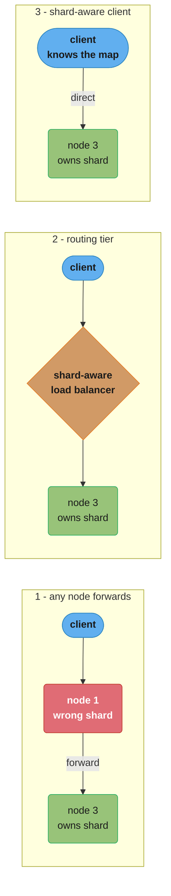
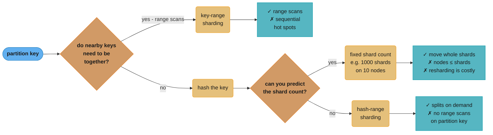
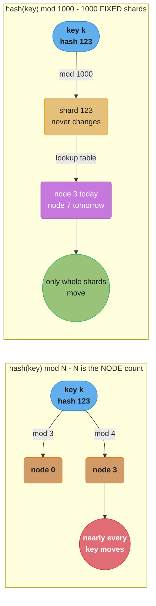
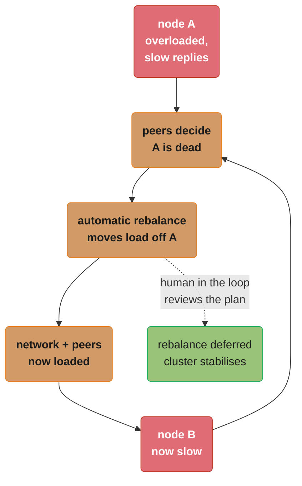

# Chapter 7: Sharding

> Part II — Distributed Data · DDIA (Kleppmann & Riccomini, 2nd ed., O'Reilly 2026) · builds on Ch 6, leads to Ch 8 (transactions)

## Chapter Map

A distributed database spreads data across nodes in exactly two ways. Chapter 6 covered the
first: **replication**, keeping a copy of the same data on several nodes. This chapter covers
the second: **sharding**, splitting a large dataset into smaller *shards* so that different
shards live on different nodes. Each record belongs to exactly one shard, so each shard is in
effect a small database of its own. In practice the two are combined — each shard is also
replicated — and because the choice of sharding scheme is largely independent of the choice of
replication scheme, the chapter sets replication aside and reasons about sharding alone.

**TL;DR:**
- Shard for **scalability** only. Sharding is a heavyweight solution that mostly matters at
  large scale, and a single machine can do a lot nowadays; if read throughput is the problem,
  read scaling (Ch 6) is the cheaper answer.
- Two schemes: **key range** (sorted, range scans work, hot-spot-prone) and **hash of key**
  (uniform, range scans on the partition key do not work). Hash-*range* sharding combines them
  by giving each shard a contiguous range of hash values.
- Never use `hash(key) % N` where N is the node count — a node change moves most keys. Use a
  fixed large shard count, or splittable hash ranges.
- Uniform *keys* do not mean uniform *load*: a hot key (a celebrity) still lands on one shard.
  A random suffix splits the writes, never the reads.
- Secondary indexes shard two ways: **local** (document-partitioned — cheap writes,
  scatter/gather reads) and **global** (term-partitioned — one-shard reads, multi-shard writes
  that are often asynchronous and therefore stale).

## The Big Question

> "My data volume or write throughput has outgrown one machine. How do I split the records
> across many machines so that data *and* query load land evenly — without creating a hot spot,
> without making every secondary-index query hit every node, and without a rebalance that moves
> nearly everything?"

Analogy the chapter itself uses: a printed encyclopedia sharded by key range. Volume 1 holds A
and B; volume 12 holds T through Z. The boundaries are deliberately uneven, because the *data*
is uneven and the volumes should be roughly equal in thickness. Finding "Trilobite" is trivial —
you read the spines and pull one book. But if the world suddenly starts writing only about
topics beginning with T, one volume gets all the traffic while eleven sit on the shelf. That
tension — locality versus evenness — is the whole chapter.

---

## 7.1 Pros and Cons of Sharding

The primary reason for sharding a database is **scalability**: it is a solution when the volume
of data or the write throughput has grown beyond what a single node can handle. It is one of the
main tools for **horizontal scaling** (a scale-out architecture): growing capacity by adding
more, smaller machines rather than moving to a bigger one. Divide the workload so each shard
handles a roughly equal share, assign shards to different machines, and data and queries are
processed in parallel.

The authors are pointed about when *not* to do this. Replication is useful at both small and
large scale because it buys fault tolerance and offline operation. **Sharding is a heavyweight
solution that is mostly relevant at large scale**, and if your data volume and write throughput
fit on a single machine — "and a single machine can do a lot nowadays" — it is often better to
avoid sharding and stay on a single-shard database.

The costs that justify that advice:

| Cost | Why it bites |
|------|--------------|
| You must choose a **partition key** | All records with the same partition key go to the same shard. Access is fast *if you know the shard*; if you don't, you do an inefficient search across all shards |
| The scheme is hard to change | Resharding is expensive and sometimes cannot be done while writes are in flight |
| Relational access patterns fight it | Sharding works well for key-value data you can shard by key; it is harder when you search by secondary index or join records scattered across shards (§7.4) |
| Cross-shard writes need distributed transactions | Single-node transactions are common (Ch 8), but consistency across shards requires a distributed transaction — usually much slower, potentially a system-wide bottleneck, and unsupported in some systems |

### The naming zoo: shard, partition, range, region, tablet, vnode, vBucket

What this chapter calls a *shard* has a different name in almost every system: a **partition**
in Kafka, a **range** in CockroachDB, a **region** in HBase and TiDB, a **tablet** in Bigtable
and YugabyteDB, a **vnode** in Cassandra, ScyllaDB and Riak, a **vBucket** in Couchbase.

Some databases treat the two words as genuinely distinct concepts. In PostgreSQL, *partitioning*
splits a large table into several files on the same machine (which makes dropping an entire
partition very fast), whereas *sharding* splits a dataset across multiple machines. In many
other systems, partitioning is simply another word for sharding.

The word "shard" itself is unexplained folklore. One theory traces it to the online role-play
game *Ultima Online*, where a magic crystal was shattered and each shard refracted a copy of the
game world — so *shard* came to mean one of a set of parallel game servers, and was later carried
over to databases. Another theory has *shard* as an acronym of *System for Highly Available
Replicated Data*, reportedly a 1980s database whose details are lost.

One warning worth memorizing before Chapter 9: **partitioning has nothing to do with network
partitions** (netsplits), which are a fault in the network between nodes.

### Sharding inside one machine

Sharding is not only a multi-machine technique. Some systems shard on a single machine, typically
running **one single-threaded process per CPU core** — to exploit CPU parallelism, or to take
advantage of a **NUMA** (nonuniform memory access) architecture where some banks of memory are
closer to one CPU than to others. **Redis, VoltDB and FoundationDB** use one process per core and
rely on sharding to spread load across cores in the same machine.

### Sharding for Multitenancy

SaaS products and cloud services are often **multitenant**: each tenant is a customer with a
self-contained dataset separate from other tenants (an email marketing service gives each
business its own signups and delivery data). Sharding is one way to implement this — either one
shard per tenant, or several small tenants grouped into a larger shard. The shards may be
physically separate databases or separately manageable portions of one logical database.

The advantages the chapter lists:

| Advantage | What it buys |
|-----------|--------------|
| **Resource isolation** | An expensive operation by one tenant is less likely to hurt tenants on other shards |
| **Permission isolation** | A bug in access-control logic is less likely to leak one tenant's data to another when the datasets are physically separate |
| **Cell-based architecture** | Shard the *services* too: a self-contained *cell* of services plus storage for a set of tenants, so a fault stays inside its cell (fault isolation) |
| **Per-tenant backup and restore** | Restore one tenant's state from backup without touching the others — useful when a tenant deletes or overwrites their own data |
| **Regulatory compliance** | GDPR-style access and deletion rights become simple export/delete operations on one shard, if each person's data is its own shard |
| **Data residence** | A region-aware database can pin a tenant's shard to the jurisdiction its data must live in |
| **Gradual schema rollout** | Migrations can be rolled out one tenant at a time, detecting problems before they reach everyone — though this is hard to do transactionally |

And the three challenges:

- It assumes **each tenant fits on a single node**. A tenant too big for one machine forces you
  to shard *within* that tenant, which puts you back in the scalability case.
- **Many small tenants** make per-tenant shards too expensive in overhead. Grouping them into a
  bigger shard reintroduces the problem of moving tenants between shards as they grow.
- **Cross-tenant features** become joins across shards.

---

## 7.2 Sharding of Key-Value Data

The goal is to spread data and query load **evenly**. If every node takes a fair share then, in
theory, 10 nodes handle 10 times the data and 10 times the read and write throughput of one node
(ignoring replication). And when a node is added or removed, we want to **rebalance** so the load
is even again across 11, or the remaining 9.

The vocabulary the rest of the chapter uses:

- **Skewed** — sharding is unfair; some shards have more data or queries than others.
- **Hot shard / hot spot** — a shard with disproportionately high load. In the extreme, all load
  lands on one shard: 9 of 10 nodes idle and the bottleneck is one busy node.
- **Hot key** — a *single* key with particularly high load, e.g. a celebrity in a social network.

So we need an algorithm that takes a record's **partition key** and returns its shard. In a
key-value store the partition key is usually the key, or the first part of it; in a relational
model it may be some column of a table, not necessarily its primary key. That algorithm has to
be amenable to rebalancing so hot spots can be relieved.

### Sharding by Key Range

Assign a **contiguous range of partition keys**, from some minimum to some maximum, to each
shard — the encyclopedia layout. To look up a title you find the volume whose key range contains
it and pull that book off the shelf.

Ranges are **not evenly spaced**, because the data is not evenly distributed. Volume 1 covers A
and B; volume 12 covers T, U, V, W, X, Y and Z. One volume per two letters would make some
volumes much bigger than others; to distribute data evenly the shard boundaries have to adapt to
the data.

Boundaries may be chosen by an administrator or by the database:

| Who picks the boundaries | Systems |
|--------------------------|---------|
| Manual | **Vitess** (a sharding layer for MySQL) |
| Automatic | **Bigtable**, **HBase**, MongoDB's range-based sharding option, **CockroachDB**, **RethinkDB**, **FoundationDB** |
| Both | **YugabyteDB** (manual and automatic tablet splitting) |

Within each shard keys are stored in **sorted order** (in a B-tree or SSTables, per Ch 4), which
makes range scans easy and lets you treat the key as a concatenated index to fetch several
related records in one query. The canonical win: a sensor network where the key is the
measurement timestamp — a range scan fetches all readings for a month.

**And the canonical loss is the same key.** If the key is a timestamp, shards correspond to
ranges of time — one shard per month — so writing measurements as they happen sends *every*
write to the shard for this month while the others sit idle.

```
  BROKEN — key = timestamp

    shard: 2026-06     2026-07     2026-08  <-- all writes land here
           [ idle ]    [ idle  ]   [ ###### HOT ###### ]

  FIXED  — key = (sensor_id, timestamp)

    shard: hash/range of sensor_id
           [ ## ]      [ ## ]      [ ## ]      [ ## ]
           writes from many sensors spread across all shards
```

The fix is to use something other than the timestamp as the *first* element of the key — prefix
each timestamp with the sensor ID, so ordering is first by sensor and then by time. Assuming many
sensors are active at once, write load spreads. **The cost is real:** fetching several sensors'
values within a time range now needs a separate range query per sensor.

#### Rebalancing key-range sharded data

A fresh database has no key ranges to split. Some systems — **HBase**, **MongoDB** — let you
configure an initial set of shards on an empty database, called **pre-splitting**. That requires
you to already know roughly what the key distribution will look like, so you can pick sensible
boundaries.

Later, growth is handled by **splitting** a shard into two or more smaller shards, each holding a
contiguous sub-range; the resulting shards are distributed across nodes. If large amounts of data
are deleted, adjacent small shards may need to be **merged**. The process is similar to what
happens at the top level of a B-tree.

Where the database manages boundaries automatically, a split is typically triggered by:

- the shard reaching a configured size — **on HBase the default is 10 GB**; or
- in some systems, write throughput persistently above a threshold, so a **hot shard can be split
  even when it is not storing much data**, purely to distribute its write load.

| | Key-range sharding |
|--|--|
| Advantage | The **number of shards adapts to the data volume** — few shards and low overhead when there is little data; bounded shard size when there is a lot |
| Disadvantage | **Splitting is expensive** — all the shard's data is rewritten into new files, like a compaction. And a shard that needs splitting is often already under high load, so the cost of splitting can push it over |

### Sharding by Hash of Key

If you do not care whether nearby partition keys land together — tenant IDs in a multitenant
application, say — hash the partition key first. A good hash function takes skewed data and makes
it uniformly distributed: a 32-bit hash of a string returns a seemingly random number between 0
and 2^32 − 1, evenly spread even for very similar inputs, and the same input always produces the
same output.

The hash **need not be cryptographically strong**. MongoDB uses MD5; Cassandra and ScyllaDB use
Murmur3. But a language's built-in hash may be unusable: in **Java's `Object.hashCode()` and
Ruby's `Object#hash` the same key may hash differently in different processes**, which makes them
unsuitable for sharding.

#### Hash modulo number of nodes — the trap

The obvious next step is `hash(key) % N` for N nodes. It is easy to compute and completely wrong.
**If N changes, most keys have to move.** Going from three nodes to four: the key with hash 3
moves to node 3, hash 6 moves to node 2, hash 9 moves to node 1, and so on — a near-total
reshuffle of unnecessary data movement.

#### Fixed number of shards

The simple, widely-used fix: create **many more shards than nodes** and assign several shards to
each node. A cluster of 10 nodes might be split into **1,000 shards from the outset, 100 per
node**. A key is stored in shard `hash(key) % 1000`, and the system separately tracks which shard
lives on which node.

Add a node and the system reassigns some shards to it until distribution is fair again; remove a
node and the reverse happens. **Only entire shards move** — cheaper than splitting. The number of
shards does not change, nor does the key-to-shard assignment; only the shard-to-node assignment
changes. That change is not immediate, since transferring a lot of data takes time, so the old
assignment serves reads and writes while the transfer is in progress.

It is common to choose a shard count **divisible by many factors**, so the dataset splits evenly
across various node counts without requiring a power of two. You can even account for mismatched
hardware: assign more shards to more powerful nodes so they take a greater share of the load.

Used by **Citus** (a sharding layer for PostgreSQL), **Riak**, **Elasticsearch** and
**Couchbase**. It works well *as long as you estimate the shard count well at creation time*, and
it carries a hard ceiling: **you cannot have more nodes than shards.**

The failure mode is expensive. If you reach a scale needing more nodes than shards, resharding
must split every shard and write it to new files, using a lot of extra disk space, and **some
systems do not allow resharding while writes are concurrent** — which makes changing the shard
count without downtime difficult. Choosing the number is hardest when the dataset size is highly
variable: each shard holds a fixed *fraction* of the data, so shard size grows with the cluster's
total data. Very large shards make rebalancing and failure recovery expensive; very small ones
carry too much overhead. Best performance needs shards that are "just right," which a fixed count
cannot deliver against a varying dataset.

#### Sharding by hash range

If the shard count cannot be predicted, use a scheme where it can adapt: give each shard a
**range of hash values** rather than a range of keys. With a 16-bit hash returning 0 to 65,535,
even consecutive-timestamp keys hash uniformly across the range, so you can assign 0–16,383 to
shard 0, 16,384–32,767 to shard 1, and so on.

Like key-range sharding, a hash-range shard **can be split** when it grows too big or too hot —
still expensive, but on demand, so the shard count adapts to the data volume instead of being
fixed in advance. The downside versus key-range sharding is that **range queries over the
partition key are not efficient**, since keys in the range are scattered across all shards.

The escape hatch is the compound key: if keys consist of two or more columns and **only the first
is the partition key**, range queries over the second and later columns stay efficient, because
all records in the range share a partition key and therefore live in one shard.

> **Partitioning and range queries in data warehouses.** BigQuery, Snowflake and Delta Lake
> support a similar indexing approach with different terminology. In BigQuery the partition key
> determines the partition and "cluster columns" determine sort order within it. Snowflake
> assigns records to "micro-partitions" automatically but lets users define cluster keys.
> Delta Lake supports both manual and automatic partition assignment plus cluster keys.
> Clustering improves not only range-scan performance but compression and filtering too.

Hash-range sharding is used in **YugabyteDB** and **DynamoDB**, and is an option in **MongoDB**.

**Cassandra and ScyllaDB use a variant:** the hash space is split into a number of ranges
**proportional to the number of nodes**, with *random* boundaries between them. Some ranges are
therefore bigger than others, but with multiple ranges per node the imbalances even out. The
defaults are concrete: **8 ranges per node in Cassandra, 256 per node in ScyllaDB.** When nodes
are added or removed, boundaries are added and removed and shards split or merge accordingly —
adding a third node has two existing nodes each hand over parts of their ranges, giving the
newcomer a roughly fair share without transferring more data than necessary.

#### Consistent hashing

A **consistent hashing** algorithm maps keys to a specified number of shards such that:

1. the number of keys mapped to each shard is roughly equal, and
2. when the number of shards changes, **as few keys as possible move**.

"Consistent" here has **nothing to do with replica consistency (Ch 6) or ACID consistency
(Ch 8)** — it describes the tendency of a key to stay in the same shard.

Cassandra and ScyllaDB's algorithm is similar to the original 1997 definition (Karger et al.),
but several other consistent-hashing algorithms exist: **highest random weight**, also known as
**rendezvous hashing**, and **jump consistent hash**. They differ in what happens when a node
joins. With Cassandra's algorithm a small number of existing shards are split into sub-ranges;
with rendezvous and jump consistent hashing the new node is assigned **individual keys that were
previously scattered across all the other nodes**. Which is preferable depends on the application.

### Skewed Workloads and Relieving Hot Spots

Consistent hashing ensures keys are uniformly distributed. **It does not ensure load is.** If the
workload is skewed — far more data under some partition keys, or far more requests to some keys —
you still end up with some servers overloaded and others nearly idle.

The chapter's example is a social media celebrity with millions of followers whose activity
causes a storm: a large volume of reads and writes to the same key, where the partition key is
the celebrity's user ID or the ID of the action people are commenting on.

Two responses, at two layers:

- **In the database.** A system that defines shards by ranges of keys (or of hashes) can put an
  individual hot key **in a shard of its own**, and perhaps give it a dedicated machine.
- **In the application.** If one key is known to be very hot, add a random number to the
  beginning or end of it. **A two-digit decimal random number splits writes evenly across 100
  keys**, which can then land on different shards.

The costs of the application-level trick are the part people forget:

| Cost | Detail |
|------|--------|
| Reads get more expensive | A read must fetch all 100 keys and combine them. **The read volume per shard is not reduced — only the write load is split** |
| Bookkeeping | It only makes sense for the small number of hot keys; for the vast majority it is pure overhead. You need a way to track which keys are split and a process to convert a regular key into a specially-managed hot key |
| Load moves over time | A viral post may be hot for a couple of days and then calm down |
| Read-hot ≠ write-hot | Some keys are hot for writes, others for reads, needing different strategies |

Some systems, especially cloud services designed for large scale, automate this: **Amazon calls
it *heat management* or *adaptive capacity*.** The chapter explicitly puts the details of how
those work beyond its scope.

### Operations: Automatic or Manual Rebalancing

Does splitting and moving happen automatically or manually? Some systems decide without any human
interaction; others leave sharding to be configured explicitly by an administrator. And there is
a middle ground: **Couchbase and Riak generate a suggested shard assignment automatically but
require an administrator to commit it.**

Fully automated rebalancing is convenient — less operational work, and such systems can auto-scale
with the workload. **DynamoDB** is promoted as being able to add and remove shards to adapt to
big load swings within minutes.

But automatic shard management can be unpredictable. Rebalancing is expensive: it reroutes
requests and moves a lot of data. Done carelessly it can overload the network or the nodes and
harm other requests. The system must keep processing writes throughout, and **if a system is near
its maximum write throughput the shard-splitting process might not keep up with incoming writes.**

The dangerous interaction is with automatic failure detection:

```
  1. node A is overloaded, so it responds slowly
  2. other nodes conclude A is dead
  3. cluster automatically rebalances load AWAY from A
  4. that rebalance loads the network and the remaining nodes
  5. another node slows down  -->  back to step 2
                                   = cascading failure
```

For that reason it can be a good thing to keep **a human in the loop**. Slower than a fully
automatic process, but it prevents operational surprises.

---

## 7.3 Request Routing

If you want to read or write a particular key, how do you know which node — which IP address and
port — to connect to? The chapter calls this **request routing**, and notes it is very similar to
**service discovery** (Ch 5). The difference that matters: application-service instances are
usually stateless, so a load balancer can send a request to any of them, whereas **a request for
a key can only be handled by a node that is a replica for the shard containing that key**.

So routing has to know the assignment from keys to shards, and from shards to nodes. Three
high-level approaches:



*Three placements of the same knowledge. Moving the shard map outward — node, then routing tier,
then client — removes a network hop per request but widens the set of processes that must be
told when a shard moves.*

In all three, the same key problems appear:

- **Who decides which shard lives on which node?** A single coordinator is simplest, but then how
  is it made fault-tolerant if that node dies — and if the coordinator role can fail over, how do
  you prevent a **split brain** in which two coordinators make contradictory assignments?
- **How does the routing component learn about changes** to the shard-to-node assignment?
- **What about the cutover?** While a shard moves, the new node has taken over but requests to the
  old node may still be in flight.

The dominant answer is a **separate coordination service** — ZooKeeper or etcd — using consensus
algorithms (Ch 10) for fault tolerance and split-brain protection. Each node registers itself;
ZooKeeper maintains the authoritative shard-to-node mapping; routing tiers and shard-aware clients
subscribe, and ZooKeeper notifies them whenever a shard changes ownership or a node joins or
leaves.

| System | How it tracks shard assignment |
|--------|-------------------------------|
| HBase, SolrCloud | ZooKeeper |
| Kubernetes | etcd (which service instance runs where) |
| MongoDB | Its own **config server** implementation, with **mongos** daemons as the routing tier |
| Kafka, YugabyteDB, TiDB | Built-in implementations of the **Raft** consensus protocol |
| Cassandra, ScyllaDB, Riak | A **gossip protocol** among the nodes |

The gossip approach is the interesting outlier. It provides **much weaker consistency than a
consensus protocol — split brain is possible**, with different parts of the cluster holding
different node assignments for the same shard. Leaderless databases tolerate this because they
make weak consistency guarantees anyway (Ch 6, "Limitations of Quorum Consistency").

Clients using a routing tier, or sending to a random node, still need IP addresses. Those change
far more slowly than shard assignments, so **DNS is often sufficient** for that layer.

One scope note the chapter makes explicitly: this discussion is about finding the shard for an
**individual key**, which is the sharded-OLTP case. Analytic databases shard too, but a query
there typically aggregates and joins data from many shards in parallel rather than executing in
one — parallel query execution is Chapter 11's material.

---

## 7.4 Sharding and Secondary Indexes

Everything so far assumed the client knows the partition key of the record it wants. That is easy
in a key-value model, where the partition key is the first part of (or all of) the primary key.

**Secondary indexes break the assumption.** A secondary index usually does not identify a record
uniquely; it is a way of searching for occurrences of a value: all actions by user `123`, all
articles containing `hogwash`, all cars whose color is `red`. Key-value stores often lack them,
but they are the bread and butter of relational databases, common in document databases, and the
*raison d'être* of search engines like Solr and Elasticsearch. **The problem is that they do not
map neatly onto shards**, and there are exactly two ways out.

The running example: a used-car site. Each listing has a unique ID used as the partition key
(IDs 0–499 in shard 0, 500–999 in shard 1). Users want to filter by `color` and by `make`.

> **A warning the chapter puts in a box.** If your database supports only a key-value model, you
> may be tempted to build a secondary index yourself by mapping values to IDs in application code.
> If you do, you must take great care that the index stays consistent with the underlying data —
> race conditions and intermittent write failures, where some changes were saved and others were
> not, very easily push the two out of sync.

### Local Secondary Indexes

Each shard maintains **its own secondary indexes, covering only the records in that shard**. When
a red car is added, that shard adds its ID to the index entry `color:red` — the list of IDs is a
**postings list** (Ch 4). Each shard is completely separate and does not care what other shards
hold. Also called a **document-partitioned index** in information retrieval.

- **Writes are cheap.** To add, remove or update a record you only deal with the one shard
  containing it.
- **Reads depend on what you know.** If you already know the partition key, search that shard. If
  you only want *some* results rather than all, send the request to any shard.
- **Reads are expensive when you want everything.** If you want all results and do not know their
  partition keys, you must query **all** shards and combine — red cars appear in shard 0 and
  shard 1 both.

Two consequences worth stating separately, because they are the reasons this design has a
ceiling:

1. Even querying shards in parallel, it is **prone to tail latency amplification** (Ch 2) — the
   query is as slow as the slowest shard.
2. It **limits scalability**: adding shards lets you store more data, but **does not increase
   query throughput**, because every shard has to process every query anyway.

Local secondary indexes are nevertheless widely used: **MongoDB, Riak, Cassandra, Elasticsearch,
SolrCloud and VoltDB** all use them.

### Global Secondary Indexes

Build one index covering data in **all** shards. It cannot live on a single node — that would be
a bottleneck defeating the purpose of sharding — so the global index is itself sharded, **but
sharded differently from the primary key index**: by the indexed value.

In the used-car example, the IDs of red cars from all shards appear under `color:red`, and the
index is sharded so colors starting *a*–*r* are in index shard 0 and *s*–*z* in index shard 1.
The make index is partitioned similarly. Also called a **term-partitioned index** — a *term* is
a keyword you can search for, generalized here to any value searchable in a secondary index. The
term is the partition key, so given a value you know which shard to ask. Terms may be assigned by
contiguous range or by hash of the term.

```
  LOCAL (document-partitioned)          GLOBAL (term-partitioned)

  shard 0: cars 0-499                   idx shard 0: terms a-r
           idx: color:red -> {4,71}                  color:red -> {4,71,533}
  shard 1: cars 500-999                 idx shard 1: terms s-z
           idx: color:red -> {533}                   color:silver -> {88,904}

  read "all red":  ask BOTH shards      read "all red":  ask ONE index shard
  write one car:   touch ONE shard      write one car:   touch MANY index shards
```

The trade is a clean inversion of the local index:

| | Local (document-partitioned) | Global (term-partitioned) |
|--|--|--|
| Read one condition | Query **all** shards, merge | Query **one** shard for the postings list |
| Fetch the records themselves | From the shards that matched | Still **all** shards holding those IDs |
| Multi-term AND | Handled within each shard | Terms likely on **different** shards; intersecting long postings lists over the network can be slow |
| Write one record | **One** shard | Possibly **many** index shards — every term may be on a different one |
| Keeping index in sync | Naturally atomic within the shard | Harder; one option is a distributed transaction over the record's shard and the index shards (Ch 8) |

Global secondary indexes are used by **CockroachDB, TiDB and YugabyteDB**; **DynamoDB supports
both local and global**. In DynamoDB's case **writes are reflected in global indexes
asynchronously, so reads from a global index may be stale** — the same shape of problem as
replication lag in Chapter 6. Global indexes are useful when read throughput exceeds write
throughput and postings lists are not too long.

---

## Beyond the book — the sharding vocabulary this repo uses elsewhere

> The chapter deliberately settles on the word *shard* and lists the other names systems use
> (partition, range, region, tablet, vnode, vBucket). It does **not** discuss Vitess resharding
> workflows, shard-key selection checklists, or online resharding tooling in any depth — the
> notes below are this repo's pointers, not the authors'. Everything above this heading is the
> chapter; everything in this section is signposting.

This repo's own deep dive, [`database/sharding_and_partitioning/`](../../../database/sharding_and_partitioning/sharding_and_partitioning.md),
uses "partitioning" and "sharding" the way the chapter says most systems do — interchangeably —
which means a reader moving between the two documents should treat "partition key" and
"shard key" as the same idea. The chapter's PostgreSQL note is the exception to keep in mind:
there, *partitioning* is a single-machine table split and *sharding* is the multi-machine one.

---

## Visual Intuition



*The chapter's decision as a single path. The first question is about locality, the second about
whether you can size the cluster in advance; every leaf carries the thing you gave up.*



*Why the modulus must never be the node count. Both diagrams compute the same hash; only the
right-hand one keeps the key-to-shard mapping stable when the cluster changes size.*



*The cascading-failure loop the chapter warns about. Automatic rebalancing plus automatic failure
detection is a positive feedback cycle; the dashed edge is the only exit it offers.*

```
  HOT-KEY SPLIT — what the random suffix actually buys

  before:   key "celebrity:42"          writes: ##########  reads: ##########
            shard 7                             ^ overloaded       ^ overloaded

  after:    "celebrity:42:00" .. ":99"  writes: #  #  #  #   (spread over 100 keys)
            spread across shards        reads:  ########## (EVERY read hits all 100)

  writes/shard: 1/100 of before        reads/shard: UNCHANGED in total volume
```

*The trick halves nothing on the read side. Splitting a hot key is a write-load remedy; a
read-hot key needs caching or a dedicated shard instead.*

---

## Key Concepts Glossary

| Term | One-line definition |
|------|---------------------|
| **Shard** | A subset of a dataset, stored on one node (with its replicas); each record belongs to exactly one |
| **Partition** | In most systems a synonym for shard; in PostgreSQL, a same-machine table split, distinct from sharding |
| **Partition key** | The value that determines a record's shard; all records with the same partition key land together |
| **Skew** | Unfair sharding — some shards hold more data or serve more queries than others |
| **Hot shard / hot spot** | A shard with disproportionately high load, which becomes the cluster's bottleneck |
| **Hot key** | A single key with very high load, e.g. a celebrity user ID |
| **Rebalancing** | Redistributing shards across nodes so load is even again after a node is added or removed |
| **Pre-splitting** | Configuring an initial set of shards on an empty database, requiring advance knowledge of the key distribution |
| **Key-range sharding** | Each shard owns a contiguous range of partition keys, stored sorted |
| **Hash sharding** | The partition key is hashed first, destroying key order but spreading keys uniformly |
| **Hash-range sharding** | Each shard owns a contiguous range of *hash values*, so shards can still be split on demand |
| **Consistent hashing** | A hash scheme where shards get roughly equal key counts and a shard-count change moves as few keys as possible; unrelated to replica or ACID consistency |
| **Rendezvous hashing** | Also *highest random weight*; a consistent-hashing algorithm where a new node takes individual keys scattered across all others |
| **Jump consistent hash** | Another consistent-hashing algorithm, with the same new-node behaviour as rendezvous hashing |
| **Multitenancy** | One system serving many customers, each with a self-contained dataset |
| **Cell-based architecture** | Grouping services *and* storage for a set of tenants into a self-contained cell, so a fault stays inside it |
| **NUMA** | Nonuniform memory access; some memory banks are closer to one CPU than others, motivating one process per core |
| **Request routing** | Determining which node holds the shard for a key — the sharded-database form of service discovery |
| **Split brain** | Two coordinators making contradictory shard assignments after a failover |
| **Gossip protocol** | Peer-to-peer dissemination of cluster state, weaker than consensus and able to produce split brain |
| **Local secondary index** | Also *document-partitioned*; each shard indexes only its own records |
| **Global secondary index** | Also *term-partitioned*; one index over all shards, itself sharded by the indexed value |
| **Postings list** | The list of record IDs stored under one index entry |
| **Term** | A keyword you can search for; generalized here to any value indexed in a secondary index |
| **Tail latency amplification** | A parallel scatter query is as slow as its slowest shard, so p99 worsens as shard count grows |
| **Heat management / adaptive capacity** | Amazon's names for automated handling of hot shards |

---

## Tradeoffs & Decision Tables

| Dimension | Key-range | Hash (fixed count) | Hash-range |
|-----------|-----------|--------------------|------------|
| Range scan on partition key | ✓ efficient | ✗ scattered | ✗ scattered |
| Sequential-write hot spot | ✗ likely | ✓ avoided | ✓ avoided |
| Shard count adapts to data | ✓ splits on demand | ✗ fixed at creation | ✓ splits on demand |
| Rebalance cost | Split = rewrite the shard | Move whole shards (cheaper) | Split = rewrite the shard |
| Ceiling | None inherent | **Nodes cannot exceed shards** | None inherent |
| Named users | Bigtable, HBase, CockroachDB, Vitess, FoundationDB, YugabyteDB | Citus, Riak, Elasticsearch, Couchbase | YugabyteDB, DynamoDB, MongoDB option; Cassandra/ScyllaDB variant |

| Dimension | Local secondary index | Global secondary index |
|-----------|----------------------|------------------------|
| Read one condition | All shards, merged | One index shard |
| Write one record | One shard | Potentially many index shards |
| Staleness | None beyond the shard's own | Often stale — DynamoDB updates global indexes asynchronously |
| Throughput scaling with shards | ✗ every shard runs every query | ✓ reads hit one shard |
| Named users | MongoDB, Riak, Cassandra, Elasticsearch, SolrCloud, VoltDB, DynamoDB | CockroachDB, TiDB, YugabyteDB, DynamoDB |

| Rebalancing control | Behaviour | Named users |
|--------------------|-----------|-------------|
| Fully automatic | Convenient, can auto-scale in minutes; unpredictable and dangerous with automatic failure detection | DynamoDB |
| Propose-then-commit | Automatic plan, human approval | Couchbase, Riak |
| Fully manual | Slowest, fewest surprises | Vitess-style administrator-managed ranges |

---

## Common Pitfalls / War Stories

- **Timestamp as the leading key element.** Every write goes to the current time range while
  every other shard idles. The chapter's App Engine Datastore reference is exactly this:
  monotonically increasing values are bad. Fix by prefixing with something that varies —
  and accept that multi-sensor time-range queries now need one range query per sensor.
- **`hash(key) % node_count`.** Adding one node reshuffles nearly the whole dataset. The fix is
  not a better hash function, it is to stop making the node count the modulus.
- **Guessing the fixed shard count too low.** You hit a scale needing more nodes than shards, and
  now resharding must split every shard, write new files, consume a lot of extra disk — and in
  some systems cannot run while writes are concurrent, so it needs downtime.
- **Guessing it too high.** Shards too small carry too much overhead; the chapter is explicit
  that the sweet spot is "just right," and a fixed count against a varying dataset cannot hold it.
- **Assuming uniform hashing means uniform load.** It does not. One celebrity key still lands on
  one shard. The chapter cites the Justin Bieber case — 3% of Twitter's servers dedicated to one
  account.
- **Splitting a hot key and expecting reads to improve.** Splitting across 100 keys divides
  *writes* by 100 and leaves the total read volume unchanged, while making every read a 100-key
  fan-out and combine.
- **Forgetting the bookkeeping around split keys.** Suffixing only makes sense for the small set
  of hot keys, so you need to track which keys are split and a process to promote a regular key
  into a managed hot key — and load moves, so a viral post is hot for days and then is not.
- **Automatic rebalancing plus automatic failure detection.** An overloaded node looks dead, load
  is moved off it, that load overloads its peers, and the cluster cascades. The chapter's remedy
  is not a smarter algorithm but a human commit step.
- **Hand-rolling a secondary index over a key-value store.** Race conditions and partial write
  failures push index and data out of sync; the chapter flags this in a warning box and points at
  the need for multi-object transactions.
- **Scaling out and expecting local-index query throughput to scale with it.** More shards store
  more data but do not raise throughput when every shard must process every query.
- **Reading a DynamoDB global secondary index and expecting your own write back.** Global index
  writes are asynchronous; the read may be stale in the same way a replication-lagged read is.

---

## Real-World Systems Referenced

| System | What the chapter says about it |
|--------|-------------------------------|
| Kafka | Calls a shard a *partition*; uses built-in Raft for coordination |
| CockroachDB | Calls a shard a *range*; automatic key-range sharding; global secondary indexes |
| HBase | Calls a shard a *region*; automatic key-range sharding; pre-splitting; ZooKeeper for assignment; default split size 10 GB |
| TiDB | Calls a shard a *region*; built-in Raft; global secondary indexes |
| Bigtable | Calls a shard a *tablet*; automatic key-range sharding |
| YugabyteDB | *Tablet*; both manual and automatic tablet splitting; hash-range sharding; Raft; global secondary indexes |
| Cassandra | *vnode*; Murmur3 hash; hash ranges with random boundaries, **8 per node by default**; gossip; local secondary indexes |
| ScyllaDB | *vnode*; Murmur3; **256 ranges per node**; gossip; local secondary indexes |
| Riak | *vnode*; fixed shard count; propose-then-commit rebalancing; gossip; local secondary indexes |
| Couchbase | *vBucket*; fixed shard count; propose-then-commit rebalancing |
| PostgreSQL | Treats partitioning (same machine) and sharding (across machines) as distinct |
| Citus | Sharding layer for PostgreSQL; fixed shard count; schema-based sharding for multitenancy |
| Vitess | Sharding layer for MySQL; manual key-range sharding |
| MongoDB | MD5 hash; range-based sharding option and hash-range option; config server plus mongos routing tier; local secondary indexes; pre-splitting |
| DynamoDB | Hash-range sharding; automatic shard add/remove in minutes; heat management / adaptive capacity; both local and global secondary indexes, globals updated asynchronously |
| Elasticsearch | Fixed shard count; local (document-partitioned) secondary indexes |
| SolrCloud | ZooKeeper for shard assignment; local secondary indexes |
| Solr | Named alongside Elasticsearch as a full-text search engine built around secondary indexes |
| VoltDB | One process per core; local secondary indexes |
| Redis | One process per core, sharding across cores in one machine |
| FoundationDB | One process per core; automatic key-range sharding |
| RethinkDB | Automatic key-range sharding |
| ZooKeeper / etcd | Coordination services holding the authoritative shard-to-node map |
| Kubernetes | Uses etcd to track which service instance runs where |
| BigQuery / Snowflake / Delta Lake | Warehouse analogues: partition key plus cluster columns, micro-partitions, manual and automatic partition assignment |
| Amazon S3 | Cited for heat management of hot shards |

---

## Summary

Sharding splits a large dataset into smaller subsets, and is necessary when storing and
processing it on a single machine is no longer feasible. The goal is to spread data *and query
load* evenly across machines, avoiding hot spots — which requires a sharding scheme appropriate
to your data plus rebalancing when nodes join or leave.

The two main approaches:

- **Key-range sharding.** Keys are sorted and a shard owns everything from some minimum to some
  maximum. Sorting makes efficient range queries possible, at the risk of hot spots when the
  application often writes keys that are close together in sorted order. Rebalancing is typically
  done by splitting a range into two subranges when a shard gets too big.
- **Hash sharding.** A hash is applied to each key and a shard owns a range of hash values (or
  another consistent-hashing algorithm maps hashes to shards). This destroys key ordering, making
  range queries inefficient, but distributes load more evenly. It is common to create a fixed
  number of shards in advance, assign several to each node, and move entire shards when nodes are
  added or removed — though splitting is also possible.

A widely used middle path: make **the first part of the key the partition key** and sort records
within the shard by the rest of the key, so range queries among records sharing a partition key
stay efficient.

Secondary indexes must be sharded too, and again there are two methods. **Local** indexes live in
the same shard as the primary key and value: only one shard is updated on write, but a lookup
requires reading from all shards. **Global** indexes are sharded separately by the indexed value:
an entry may refer to records from all primary shards, so a write may touch several index shards,
but a postings-list read is served from one (fetching the actual records still needs multiple
shards).

Finally, routing queries to the right shard is a service-discovery problem, and a coordination
service is often used to hold the authoritative shard-to-node assignment.

The chapter closes by naming the question it has deferred. **By design, every shard operates
mostly independently — that is what lets a sharded database scale.** But operations that write to
several shards are problematic: what happens if the write to one shard succeeds and another
fails? That is Chapter 8.

---

## Interview Questions

**Q: When should you NOT shard a database?**
**Short:** Kleppmann and Riccomini argue sharding is a large-scale tool and a single machine can handle far more than people assume.

When your data volume and write throughput still fit on one machine. The chapter is explicit that replication is useful at all scales because it buys fault tolerance and offline operation, whereas sharding is a heavyweight solution mostly relevant at large scale — and "a single machine can do a lot nowadays." It also singles out the case people most often get wrong: **if read throughput is the problem, you do not necessarily need sharding at all**, because read scaling through replicas (Ch 6) solves it. Reach for sharding when data volume or *write* throughput is the constraint.

**Q: Why must you never define a shard as `hash(key) % N` where N is the number of nodes?**
**Short:** Making the node count the modulus reshuffles nearly every key whenever a node joins or leaves.

Because the shard number then depends on N, so changing N reassigns most keys. The chapter's worked example: with three nodes, adding a fourth moves the key with hash 3 to node 3, hash 6 to node 2, hash 9 to node 1 — a near-total reshuffle of unnecessary data movement. The fix is to decouple the key-to-shard mapping from the node count: hash into a large *fixed* number of shards (`hash(key) % 1000`) and rebalance by moving whole shards, or use hash ranges that can be split, so only a small fraction of data moves.

**Q: What is the difference between key-range and hash sharding, and what does each give up?**
**Short:** Key-range sharding keeps range scans efficient; hash sharding spreads load evenly instead.

Key-range sharding assigns contiguous ranges of partition keys to shards and stores keys sorted within a shard, so range scans are efficient and the key can be used as a concatenated index — but it is prone to hot spots when writes cluster in one region of the key space, the classic case being a timestamp key sending all of today's writes to one shard. Hash sharding hashes the partition key first, spreading keys uniformly and eliminating sequential hot spots, but adjacent keys land on different shards so range scans over the partition key must query every shard. You trade locality for evenness or vice versa.

**Q: Uniform hashing distributes keys evenly. Why can you still have a hot shard?**
**Short:** Hashing evens out keys, not load — a single hot key still lands on exactly one shard.

Because consistent hashing guarantees keys are uniformly distributed, not that *load* is. The chapter's example is a social-media celebrity with millions of followers: a storm of reads and writes hits the same key, whose partition key is the celebrity's user ID or the ID of the post being commented on, so it all lands on one shard. Hashing cannot help because the requests share a key. The remedies are to give the hot key its own shard (possible in range-based schemes, and perhaps its own machine), or to split it at the application level with a random suffix.

**Q: If you add a two-digit random suffix to a hot key, what actually improves?**
**Short:** Only the write load is split; total read volume is unchanged and every read becomes a 100-key fan-out.

Writes only. A two-digit decimal suffix splits writes evenly across 100 keys that can land on different shards, so per-shard write load drops. But reads must now fetch all 100 keys and combine them, and **the volume of reads is not reduced** — the chapter states this directly. It also adds bookkeeping: suffixing only makes sense for the small number of hot keys, so you need to track which keys are split and a process for converting a regular key into a specially-managed hot key. And load changes over time, since a viral post is hot for a couple of days and then calms down.

**Q: Compare local (document-partitioned) and global (term-partitioned) secondary indexes.**
**Short:** Local indexes make writes cheap and reads scatter/gather; global indexes invert that.

A local index keeps each shard's index of only its own records, so a write touches just one shard, but a read that needs all matches and does not know the partition key must query every shard and merge — red cars appear in both shards. A global index is one index over all shards, itself sharded by the indexed value, so a single-condition read goes to exactly one index shard; but writing one record may update several index shards because every term may live on a different one. The chapter notes DynamoDB updates global indexes asynchronously, so global-index reads may be stale.

**Q: Why does adding shards fail to increase query throughput with local secondary indexes?**
**Short:** Every shard must process every scatter/gather query, so more shards add storage but not throughput.

Because a local-index query whose partition key is unknown must be sent to all shards. Adding shards lets you store more data, but each new shard also has to run each query, so the per-query work grows with the cluster and total query throughput does not improve. Worse, the query completes only when the slowest shard replies, so it suffers **tail latency amplification** — the more shards, the higher the chance one of them is slow, and the worse the p99. That combination is why global indexes exist despite their more expensive writes.

**Q: Why is fully automatic rebalancing dangerous, and what is the usual mitigation?**
**Short:** Automatic rebalancing plus automatic failure detection is a positive feedback loop that can cascade.

Rebalancing is expensive — it reroutes requests and moves large amounts of data — so if done carelessly it overloads the network or nodes and harms other requests; near maximum write throughput, the split process may not even keep up with incoming writes. The dangerous interaction is with automatic failure detection: an overloaded node replies slowly, peers conclude it is dead, load is automatically moved away, that extra load slows another node, and the cycle repeats into cascading failure. The chapter's mitigation is a human in the loop — Couchbase and Riak generate a suggested assignment automatically but require an administrator to commit it.

**Q: What is "consistent hashing" actually defined as, and what is it NOT?**
**Short:** It means roughly equal shard sizes plus minimal key movement when the shard count changes — nothing to do with replica or ACID consistency.

A consistent hashing algorithm maps keys to a specified number of shards such that each shard gets roughly equal key counts and, when the shard count changes, as few keys as possible move. The chapter is explicit that "consistent" here has **nothing to do with replica consistency (Ch 6) or ACID consistency (Ch 8)** — it describes a key's tendency to stay in the same shard. Cassandra's algorithm resembles the 1997 Karger et al. definition, but rendezvous hashing (highest random weight) and jump consistent hash are alternatives that behave differently on a node join: they assign the new node individual keys scattered across all others, rather than splitting a few existing ranges.

**Q: How does the fixed-shard-count approach work, and what is its hard ceiling?**
**Short:** Create far more shards than nodes and move whole shards; you can never have more nodes than shards.

Create many more shards than nodes — 1,000 shards on 10 nodes, 100 each — and store a key in `hash(key) % 1000`, tracking separately which shard is on which node. Adding a node reassigns some shards to it; only whole shards move, which is cheaper than splitting, and the key-to-shard mapping never changes. Choose a count divisible by many factors so the data splits evenly across various node counts, and give more shards to more powerful hardware. The ceiling is that **you cannot have more nodes than shards**; passing that scale forces an expensive resharding that rewrites every shard into new files and, in some systems, cannot run while writes are concurrent.

**Q: What triggers a shard split in a system that manages boundaries automatically?**
**Short:** Reaching a configured size — 10 GB by default on HBase — or, in some systems, sustained high write throughput.

Two triggers. The first is size: the shard reaches a configured threshold, and the chapter gives HBase's default of 10 GB. The second, in some systems, is write throughput persistently above a threshold — which matters because it means **a hot shard can be split even when it holds little data**, purely so its write load can be spread more uniformly. The advantage of this scheme is that the number of shards adapts to the data volume; the cost is that splitting rewrites all of the shard's data into new files, like a compaction, and the shard being split is often already the one under high load.

**Q: How does request routing work, and what does ZooKeeper or etcd contribute?**
**Short:** Routing must map key to shard to node, and a consensus-backed coordination service holds the authoritative map.

Request routing directs a request to a node that is a replica for the shard holding the key — unlike stateless service load balancing, any node will not do. There are three shapes: any node forwards to the right one, a shard-aware routing tier forwards on the client's behalf, or a shard-aware client connects directly. ZooKeeper or etcd holds the authoritative shard-to-node mapping using consensus algorithms (Ch 10), which gives fault tolerance and protection against split brain; nodes register there and routing components subscribe, so a shard move notifies everyone. HBase and SolrCloud use ZooKeeper, Kubernetes uses etcd, MongoDB uses its own config server plus mongos, and Kafka, YugabyteDB and TiDB embed Raft directly.

**Q: Cassandra uses gossip rather than consensus for shard assignment. What does that cost, and why is it acceptable?**
**Short:** Gossip permits split brain — different parts of the cluster disagreeing on a shard's owner — which leaderless databases already tolerate.

Cassandra, ScyllaDB and Riak disseminate cluster state with a gossip protocol among the nodes rather than through a consensus service. That gives **much weaker consistency**: split brain is possible, with different parts of the cluster holding different node assignments for the same shard. It is acceptable because these are leaderless databases that make weak consistency guarantees anyway — the chapter points back to the limitations of quorum consistency in Chapter 6. If a system needs a single authoritative answer for who owns a shard, it uses consensus instead.

**Q: What are the three unresolved problems every request-routing design has to answer?**
**Short:** Who assigns shards to nodes, how routers learn of changes, and what happens to in-flight requests during a cutover.

First, who decides which shard lives on which node: a single coordinator is simplest but must be made fault-tolerant, and if the role can fail over you must prevent split brain where two coordinators make contradictory assignments. Second, how the routing component — a node, a routing tier or the client — learns about changes to the assignment. Third, the cutover: while a shard is moving, the new node has taken over but requests to the old node may still be in flight, and something has to handle them. Coordination services answer the first two; the third is why the old assignment keeps serving traffic during a transfer.

**Q: How can a hash-sharded database still support efficient range queries?**
**Short:** Make only the first column the partition key and sort the remaining columns within the shard.

By splitting the key into a partition key and a sort key. If keys consist of two or more columns and only the first is the partition key, all records sharing that partition key live in one shard, sorted by the rest of the key — so a range query over the second and later columns is an efficient in-shard scan. The chapter recommends this as a general pattern: use the first part of the key to identify the shard and sort records within the shard by the remainder. It is the same idea the sensor example uses, where prefixing timestamps with sensor ID spreads writes while keeping each sensor's time-range scan fast.

**Q: What advantages does sharding by tenant give a multitenant SaaS product?**
**Short:** Resource and permission isolation, cell-based fault isolation, per-tenant backup, compliance, data residence, and gradual schema rollout.

Resource isolation, because an expensive operation by one tenant is less likely to hurt tenants on other shards; permission isolation, because a bug in access-control logic is less likely to cross physically separate datasets; cell-based architecture, where services *and* storage for a set of tenants form a self-contained cell so faults stay inside it; per-tenant backup and restore; regulatory compliance, since GDPR access and deletion rights become simple operations on one shard; data residence, pinning a tenant's shard to a jurisdiction; and gradual schema rollout one tenant at a time. The limits are that each tenant must fit on one node, that many tiny tenants make per-tenant shards too costly, and that cross-tenant features become cross-shard joins.

**Q: Why does the chapter say sharding is "difficult to change" once chosen?**
**Short:** The partition key determines every access path, and resharding rewrites the whole dataset.

Because the partition key decides both where records live and how you find them: access is fast when you know the shard and requires searching all shards when you do not. Changing the scheme therefore changes every access path in the application, and physically it means splitting and rewriting every shard into new files, consuming a lot of extra disk — with some systems refusing to reshard while writes are concurrent, which forces downtime. This is one of the chapter's main arguments for not sharding until you have to: the decision is expensive to reverse.

**Q: Why are Java's `Object.hashCode()` and Ruby's `Object#hash` unsuitable for sharding?**
**Short:** The same key can hash to a different value in different processes, so nodes would disagree on where it belongs.

Because they are built for in-process hash tables, not for distribution. The chapter states that in both languages the same key may have a different hash value in different processes — so two nodes hashing the same key can compute different shards, and the record becomes unfindable or duplicated. A sharding hash does not need to be cryptographically strong (MongoDB uses MD5, Cassandra and ScyllaDB use Murmur3), but it must be **stable across processes and machines**. This is a case where a correct-looking local behaviour breaks only once the system is distributed.

**Q: Why do Redis, VoltDB and FoundationDB shard within a single machine?**
**Short:** One single-threaded process per CPU core exploits core parallelism and NUMA locality without multithreading the engine.

To use the parallelism in the CPU and to take advantage of NUMA. These systems run one single-threaded process per core and rely on sharding to spread load across the cores of one machine, rather than making a single engine multithreaded. NUMA matters because some banks of memory are physically closer to one CPU than to others, so pinning a shard's process and data to a core keeps memory accesses local. It is a useful reminder that sharding is a load-distribution technique, not inherently a multi-machine one.

**Q: A record is written and a global secondary index read immediately afterwards misses it. Is this a bug?**
**Short:** In DynamoDB it is expected — global index updates are asynchronous, so reads can be stale like a lagging replica.

Not necessarily. The chapter says DynamoDB reflects writes in global secondary indexes **asynchronously**, so reads from a global index may be stale in the same way a read from a lagging replica is (Ch 6, "Problems with Replication Lag"). The alternative, keeping index and data in step synchronously, would require a distributed transaction across the record's shard and each affected index shard, which is exactly the cost global indexes are trying to avoid. So the guidance is to treat global-index reads as eventually consistent unless the system documents otherwise, and use global indexes where read throughput exceeds write throughput and postings lists stay short.

---

## Cross-links in this repo

- [database/sharding_and_partitioning/ — shard-key selection, consistent hashing, Vitess, resharding](../../../database/sharding_and_partitioning/sharding_and_partitioning.md)
- [database/replication_and_high_availability/ — how each shard is also replicated](../../../database/replication_and_high_availability/replication_and_high_availability.md)
- [database/indexing_deep_dive/ — postings lists, secondary index internals](../../../database/indexing_deep_dive/indexing_deep_dive.md)
- [database/distributed_transactions/ — the cross-shard write problem Ch 8 picks up](../../../database/distributed_transactions/distributed_transactions.md)
- [hld/scalability/ — tail latency amplification and horizontal scaling](../../../hld/scalability/scalability.md)
- Sibling chapters: [Ch 6 Replication](../06_replication/06_replication.md) · [Ch 8 Transactions](../08_transactions/08_transactions.md) · [Ch 10 Consistency and Consensus](../10_consistency_and_consensus/10_consistency_and_consensus.md)

## Further Reading

- Karger, Lehman, Leighton, Panigrahy, Levine and Lewin, "Consistent Hashing and Random Trees," STOC 1997 — the original definition.
- Thaler and Ravishankar, "Using name-based mappings to increase hit rates," IEEE/ACM ToN 1998 — rendezvous hashing.
- Lamping and Veach, "A Fast, Minimal Memory, Consistent Hash Algorithm," 2014 — jump consistent hash.
- Kleppmann, "Java's hashCode Is Not Safe for Distributed Systems," 2012.
- Fidalgo, "Herding elephants: Lessons learned from sharding Postgres at Notion," 2021.
- Ganguli, Iaquinti, Zhou and Chacón, "Scaling Datastores at Slack with Vitess," 2020.
- Lee et al., "Shard Manager: A Generic Shard Management Framework for Geo-distributed Applications," SOSP 2021.
- Elhemali et al., "Amazon DynamoDB: A Scalable, Predictably Performant, and Fully Managed NoSQL Database Service," USENIX ATC 2022.
- Manning, Raghavan and Schütze, *Introduction to Information Retrieval*, 2008 — document- vs term-partitioned indexes.
- Oliveira, "Reducing the Scope of Impact with Cell-Based Architecture," AWS Well-Architected white paper, 2023.
