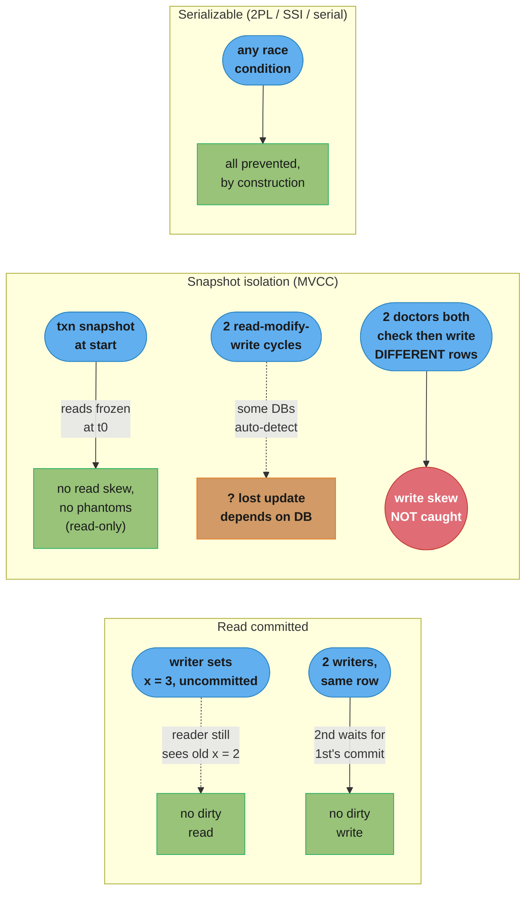
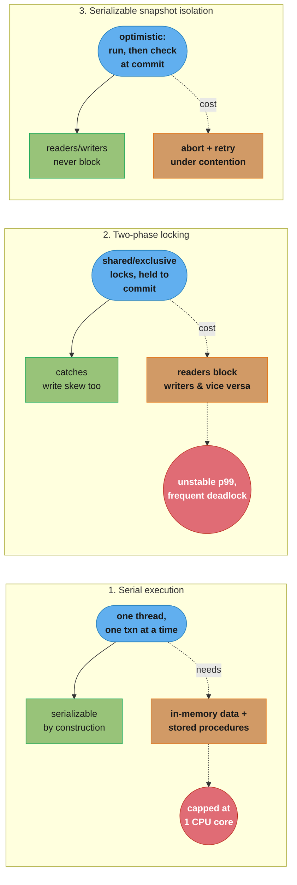
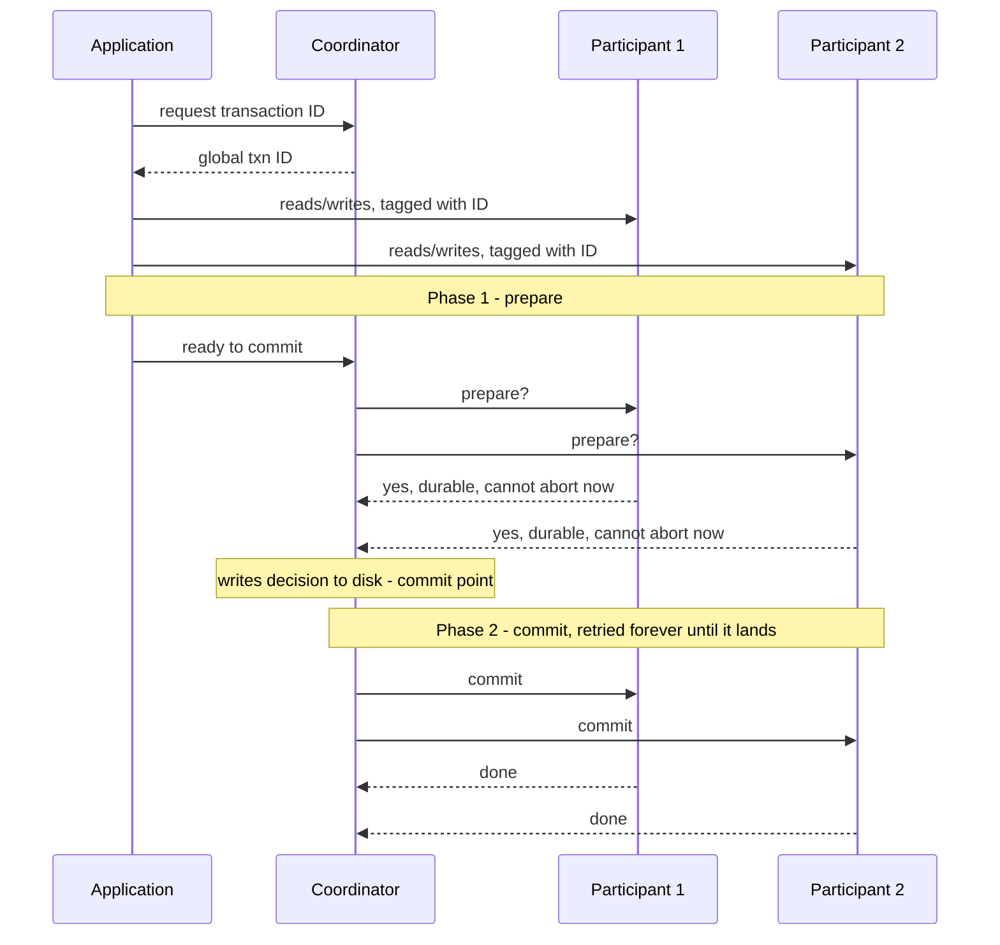

# Chapter 8: Transactions

> Part II — Distributed Data · DDIA (Kleppmann & Riccomini, 2nd ed., O'Reilly 2026) · builds on Ch 6-7, leads to Ch 9 (the trouble with distributed systems)

## Chapter Map

Chapters 6 and 7 showed how to keep multiple copies of data in sync (replication) and how to
split data across nodes (sharding). This chapter asks a different question: when several things
can go wrong at once — a crash mid-write, two clients touching the same row, a network partition
— what does the database *promise* you? The answer, for 50 years, has been **transactions**: a
way to group reads and writes into one logical unit so the application can pretend concurrency
and partial failure don't exist. The chapter works through the ACID acronym critically, spends
most of its length on the isolation levels databases actually ship (read committed, snapshot
isolation, serializable), and ends by extending atomicity across multiple nodes with two-phase
commit.

**TL;DR:**
- **ACID is mostly marketing.** Atomicity and durability are fairly well agreed; consistency is
  an application property, not a database one; isolation varies wildly by vendor and by default
  setting.
- **Weak isolation levels are the default almost everywhere.** Read committed stops dirty reads
  and dirty writes but nothing else; snapshot isolation (MVCC) stops read skew and most lost
  updates but not write skew or phantoms.
- **Write skew is the sneaky one.** Two transactions read overlapping data, then each writes to a
  *different* object based on what it saw — no lock ever catches it except a true serializable
  isolation level.
- **Only serializable isolation stops everything**, via one of three techniques: literal serial
  execution (single-threaded, needs stored procedures), two-phase locking (mature but slow and
  unstable under contention), or serializable snapshot isolation (optimistic, comparatively new,
  now the best default in several systems).
- **Distributed atomicity needs two-phase commit (2PC)**, which works well when every node runs
  the same database software but becomes an operational hazard (locks held indefinitely) across
  heterogeneous systems via XA — idempotent processing is usually the better fix.

## The Big Question

> "Many things can go wrong in a data system — crashes, network cuts, concurrent writers, partial
> updates. How do you stop these from corrupting your data, without forcing the application to
> think about every possible failure and every possible interleaving by hand?"

Analogy: a transaction is a promise from the database that a group of writes behaves like a
single atomic step, the way a bank teller either completes an entire wire transfer or does
nothing at all — never debiting one account and stalling before crediting the other, and never
letting a second customer see the half-finished transfer mid-flight. The whole chapter is about
how much of that promise a given isolation level actually keeps, because the honest answer is
"not always all of it," and a database that says "serializable" may mean something weaker than
you think.

## 8.1 What Exactly Is a Transaction?

Almost every relational database, and some nonrelational ones, follow transaction semantics that
trace back to IBM System R (1975) — the general idea has held for 50 years even as
implementation details changed. The 2000s NoSQL wave largely dropped transactions (or redefined
the word to mean something weaker) on the belief that transactions were fundamentally unscalable.
That belief has since been disproven: "NewSQL" systems — CockroachDB, TiDB, Spanner,
FoundationDB, YugabyteDB — combine sharding with consensus protocols (Chapter 10) to deliver
strong ACID guarantees at scale. Not needing transactions is still a legitimate choice for simple
access patterns, but "transactions don't scale" is no longer a valid excuse to avoid them.

### The Meaning of ACID

Theo Härder and Andreas Reuter coined **ACID** (Atomicity, Consistency, Isolation, Durability) in
1983 to pin down fault-tolerance terminology. In practice, one database's ACID does not equal
another's — isolation especially is ambiguous — so "ACID compliant" today is close to a marketing
label. Systems that don't meet ACID are sometimes called **BASE** (Basically Available, Soft
state, Eventual consistency), a term the book calls "even more vague than ACID," effectively
meaning "not ACID."

**Atomicity** is *not* about concurrency (that's isolation's job). It describes what happens if a
client's writes are interrupted partway by a fault: the transaction must be *abortable* — either
none of its writes take effect, or all of them do. Without atomicity, a caller can't tell which
of several writes landed and can't safely retry without risking duplication. The book suggests
"abortability" would have been the more honest name.

**Consistency** is "terribly overloaded" — the book lists five distinct meanings used elsewhere in
the book alone (replica consistency, a consistent snapshot, consistent hashing, CAP-consistency
i.e. linearizability, and ACID consistency). ACID consistency means an application-specific
invariant (credits and debits balance) that transactions preserve: if the database starts valid
and every transaction preserves validity, invariants hold forever, though they may be temporarily
violated mid-transaction. Declaring invariants as database *constraints* (foreign keys,
uniqueness, checks) lets the database enforce them; anything more complex is the application's
job, which is why the book stresses that "the C in ACID... is not a property of the database
alone."

**Isolation** means concurrently executing transactions don't step on each other. The classic
textbook formalization is **serializability**: each transaction can pretend it's the only one
running, and the database guarantees the committed result matches some serial (one-at-a-time)
ordering. Serializability has a real performance cost, so many databases — including some that
market an isolation level called "serializable" — actually implement something weaker (Oracle's
"serializable" is really snapshot isolation).

**Durability** promises that once a transaction commits, its writes survive hardware faults or
crashes — on a single node typically via `fsync()`'d nonvolatile storage plus a write-ahead log;
on a replicated system, via successful copying to some number of nodes before acknowledging the
commit. The book is blunt that "perfect durability does not exist": SSDs can lose data on power
loss even when `fsync` is used correctly (and PostgreSQL used `fsync` incorrectly for over 20
years), disk firmware has bugs, filesystem/storage-engine interactions corrupt files after
crashes, and 30-80% of SSDs develop at least one bad block within four years. Replication and
disk writes are complementary risk-reduction techniques, not alternatives — a correlated fault
(power outage, a crash-triggering bug hit on every replica) can wipe out replicas that never
touched disk, so disk durability still matters even when replicated.

### Single-Object and Multi-Object Operations

Atomicity and isolation both describe what happens across *several* writes at once —
**multi-object transactions**. The book's running example is an email app that denormalizes an
unread-message counter alongside the message list: without isolation, a reader can see the new
message but the old (stale) counter, a **dirty read**; without atomicity, a crash mid-update can
insert the email but never increment the counter, leaving them permanently out of sync. In
relational databases, a multi-object transaction is delimited by the client's connection —
everything between `BEGIN TRANSACTION` and `COMMIT` — and a dropped TCP connection aborts it.
Many nonrelational databases have no such grouping: even a multi-key API (a key-value store's
multi-put) may succeed for some keys and fail for others with no rollback.

**Single-object writes** still need atomicity and isolation even with one object: an interrupted
20 KB JSON write shouldn't leave an unparseable fragment on disk, a concurrent reader shouldn't
see a half-written value, and a power failure mid-overwrite shouldn't splice old and new bytes
together. Storage engines almost universally guarantee this at the single-object level — atomicity
via a crash-recovery log, isolation via a per-object lock. Some databases go further with atomic
**increment** operations and **conditional writes** (compare-and-set), but these single-object
guarantees are not "transactions" in the full sense: Cassandra/ScyllaDB "lightweight
transactions" and Aerospike "strong consistency" mode give linearizable single-object reads and
conditional writes, with **no guarantee across multiple objects**.

**Multi-object transactions are needed** whenever: (1) a relational foreign key or a graph edge
must stay valid across an insert of several related records; (2) a document database's
denormalized copies (used because it lacks joins) must be updated together; (3) a secondary index
must be updated in lockstep with the underlying record — without isolation, a record can appear
in one index but not another. All of this can technically be built without transactions, but
error handling gets much harder and concurrency bugs creep in — the reason this chapter exists.

### Handling errors and aborts

The defining ACID philosophy is: if a fault threatens atomicity, isolation, or durability, abandon
the transaction entirely rather than leave it half-finished. Leaderless-replication datastores
work on a "best effort" basis instead — do as much as possible, don't undo what's already done —
pushing recovery onto the application. Popular ORMs (Rails ActiveRecord, Django) commonly don't
even retry aborted transactions, throwing the input away, which the book calls "a shame,"
because the entire point of an abort is to make a safe retry possible.

Retrying is not free of subtlety, however:
- If the commit actually succeeded but the acknowledgment was lost in the network, a naive retry
  duplicates the transaction — you need application-level deduplication.
- Retrying under contention or overload can worsen the problem — use bounded retries, exponential
  backoff, and treat overload errors differently from other errors.
- Only *transient* errors (deadlock, isolation violation, network blip, failover) are worth
  retrying; a permanent error (constraint violation) never resolves on retry.
- Side effects outside the database (an email sent) can happen even if the transaction later
  aborts and gets retried — this is the case where two-phase commit (§8.4) can help.
- If the client crashes mid-retry, whatever it was trying to write is simply lost.

## 8.2 Weak Isolation Levels

Two transactions that touch disjoint data, or that are both read-only, can safely run in
parallel — races only matter when at least one write overlaps another transaction's reads or
writes. Concurrency bugs are notoriously hard to catch by testing because they need unlucky
timing to trigger, and they are hard to reason about in a large codebase where you can't audit
every concurrent caller. Concurrency bugs from weak isolation aren't hypothetical: the book cites
real cases of substantial financial losses, financial-audit investigations, and corrupted
customer data — and points out that "use an ACID database" misses the point, because many popular
relational databases labeled ACID still default to a weak isolation level that wouldn't have
prevented those bugs. An attacker can also deliberately fire a burst of concurrent requests to
exploit a concurrency bug on purpose, so this is a security concern, not merely a correctness one.

### Read Committed

The most basic isolation level makes two guarantees: no **dirty reads** (you never see another
transaction's uncommitted writes) and no **dirty writes** (you never overwrite another
transaction's uncommitted write). An even weaker level, **read uncommitted**, drops the no-dirty-
reads guarantee but keeps no-dirty-writes.

**No dirty reads** matters because (1) if a transaction updates several rows, a dirty read can
expose some of the update but not the rest — the unread-counter example — confusing readers or
causing them to act on bad data, and (2) if the writing transaction later aborts, a dirty reader
saw data that never actually existed in the committed history, which can force **cascading
aborts** of everything downstream that read it.

**No dirty writes** stops one transaction's write from silently clobbering another's uncommitted
write. The book's example: Aaliyah and Bryce both try to buy the same listed car — buying it
requires updating the `listings` row and inserting an `invoices` row. Without dirty-write
protection, Bryce could win the `listings` update while Aaliyah wins the `invoices` insert, so
the car is marked sold to Bryce but the invoice goes to Aaliyah. Read committed prevents this
specific mishap, but it does **not** prevent the classic lost-update counter race (Figure 8-1,
two concurrent increments landing on 43 instead of 44) — that race happens *after* both writers'
transactions have committed, so it's not a dirty write; it needs the mechanisms in §8.2's
"Preventing Lost Updates" section.

**Implementing read committed:** it is the default in Oracle, PostgreSQL, and SQL Server. Dirty
writes are almost always prevented with row-level exclusive locks held until commit or abort.
Dirty reads are trickier: briefly taking a read lock per row works but is bad for operability,
since one slow writer can stall every reader on that row, and a slowdown in one part of the app
knocks on into unrelated parts via lock waits. IBM Db2 and SQL Server's
`read_committed_snapshot=off` do use read locks anyway; the more common approach keeps both the
old committed value and the new in-flight value side by side, handing readers the old value until
the writer commits — the seed of MVCC (below).

### Snapshot Isolation and Repeatable Read

Read committed still allows **read skew** (a nonrepeatable read): Aaliyah has $500 in each of two
accounts; a $100 transfer moves money between them mid-query; if Aaliyah's balance check straddles
the transfer, she can see the *old* balance in one account and the *new* balance in the other,
making $100 appear to vanish, even though every value she read was genuinely committed at the
moment she read it. This is tolerable for a one-off page reload but not for **backups** (a
multi-hour copy that mixes old and new data becomes a permanently inconsistent restore point) or
**analytic queries / integrity checks** that scan large parts of the database and need it to hold
still.

**Snapshot isolation** is the standard fix: each transaction reads from a consistent snapshot
taken at its start — all data committed by that point, and nothing written afterward, regardless
of what else commits while the transaction runs. It's supported (with varying detail) by
PostgreSQL, MySQL/InnoDB, Oracle, and SQL Server; Oracle, TiDB, and Aurora DSQL even use it as
their *strongest* isolation level.

**Multi-version concurrency control (MVCC)** implements this: write locks still prevent dirty
writes, but reads take no locks at all — "readers never block writers, and writers never block
readers." Instead of one committed value plus one in-flight value (read committed's trick), MVCC
keeps several committed versions of a row side by side, because different in-progress
transactions may need to see the database at different points in time. PostgreSQL's mechanism
(the book's worked example): each transaction gets a monotonically increasing `txid` (a 32-bit
counter needing periodic vacuum to handle overflow at ~4 billion transactions); each row carries
`inserted_by` and `deleted_by` transaction-ID fields; a delete just sets `deleted_by` rather than
removing the row, and an update is internally a delete-plus-insert, so updating account 2's
balance from $500 to $400 leaves *two* physical rows — one at $500 marked deleted by the writer's
txid, one at $400 inserted by it — linked in a version chain, garbage-collected only once no
transaction can possibly still need the old version.

**Visibility rules** decide which row version a reader sees: at transaction start, the database
snapshots the set of not-yet-committed transaction IDs and ignores their writes even if they
later commit; it also ignores writes from transactions that started *later*; it ignores writes
from any aborted transaction, whenever that abort happened; everything else is visible. Put
differently, a row is visible only if its inserter had already committed before the reader's
transaction started, and it isn't deleted (or its deleter hadn't committed yet at that point
either). A long-running transaction can keep reading a snapshot long after other transactions
have overwritten or deleted those rows elsewhere — the cost is only that old versions must be
kept around a bit longer.

**Indexes** in a multi-version database point at one version of a matching row (oldest or
newest); a query walks the version chain to find the visible one. PostgreSQL avoids some index
churn when multiple versions of a row fit on the same page; some databases store deltas instead
of full row copies to save space. CouchDB, Datomic, and LMDB take a different approach —
*immutable, copy-on-write B-trees*: a write never overwrites a page in place, it creates a new
copy of the modified page and of every ancestor up to a new root; unaffected pages are shared
between old and new trees. A given root is by construction a consistent snapshot frozen at its
creation time, with no transaction-ID filtering needed — the tradeoff is a background compaction
and garbage-collection process to reclaim unreachable pages.

**Naming confusion:** the SQL standard predates snapshot isolation (it's based on System R's 1975
definitions) and has no concept of it — it defines "repeatable read" instead, which looks similar
but isn't the same thing. PostgreSQL calls its snapshot isolation level "repeatable read" for
standards-compliance branding; Oracle calls its snapshot isolation "serializable"; MySQL's
"repeatable read" is a *weaker* MVCC variant than snapshot isolation; IBM Db2's "repeatable read"
actually means serializability. The book's verdict: "nobody really knows what repeatable read
means" — always verify the actual guarantee, never trust the label alone.

### Preventing Lost Updates

Read committed and snapshot isolation mostly govern what a *reader* sees; they mostly ignore
write-write conflicts beyond dirty writes. The **lost update** problem arises from a
read-modify-write cycle: read a value, compute a new value, write it back. If two transactions do
this concurrently on the same object, the second write can clobber the first's change entirely
(the later write "clobbers" the earlier one) — the counter-increment race, a JSON list append, or
two users saving a wiki page by overwriting the whole document with what they had loaded earlier.

Four families of fix, in the book's order of preference:

1. **Atomic write operations** — `UPDATE counters SET value = value + 1 WHERE key = 'foo'`,
   MongoDB's atomic document-field updates, Redis's atomic structure operations — remove the
   read-modify-write cycle from application code entirely and are usually implemented via an
   exclusive read lock or single-threaded execution. ORMs make it easy to *accidentally* write an
   unsafe read-modify-write cycle instead of reaching for these, a subtle, hard-to-test bug
   source.
2. **Explicit locking** (`SELECT ... FOR UPDATE`) — needed when the update logic can't be
   expressed as one atomic database operation, e.g. validating a multiplayer game move before
   committing it. Locking multiple objects risks **deadlock**, which most databases detect
   automatically and resolve by aborting one transaction for retry.
3. **Automatic lost-update detection** — let read-modify-write cycles run concurrently and abort
   one if the transaction manager detects that an update was lost, pairing naturally with
   snapshot isolation. PostgreSQL repeatable read, Oracle serializable, and SQL Server snapshot
   isolation all do this automatically; **MySQL/InnoDB repeatable read does not** — which is why
   some authors argue MySQL doesn't actually provide snapshot isolation by the strict definition
   that requires lost-update prevention.
4. **Conditional writes (compare-and-set / CAS)** — `UPDATE ... WHERE id=1234 AND content='old'`
   applies only if nothing changed since you last read; if it has no effect, retry the
   read-modify-write cycle. A version-number column instead of comparing full content is called
   **optimistic locking**. Many MVCC implementations special-case the `WHERE` clause of `UPDATE`/
   `DELETE` to see concurrently committed values it would otherwise hide under normal visibility
   rules — otherwise CAS could never see the change it's supposed to detect.

**Replicated databases** add a dimension: multi-leader or leaderless replication allows
concurrent writes on different nodes with no single up-to-date copy, so locks and CAS don't
apply. The common alternative is to let concurrent writes create conflicting **siblings** and
merge them after the fact — safe for **commutative** operations (counter increments, set
additions — the idea behind CRDTs), but not for conditional writes, which can't be made
commutative. **Last write wins (LWW)**, the default conflict policy in many replicated
databases, is explicitly called out as prone to silently losing updates.

### Write Skew and Phantoms

Dirty writes and lost updates both involve two transactions racing to write the *same* object.
**Write skew** is subtler: two transactions read overlapping data, then each writes to a
*different* object, and the combination violates an invariant that held for either write alone.
The book's running example: a hospital on-call system requires at least one doctor on call per
shift. Aaliyah and Bryce, the two on-call doctors, both feel sick and both check "are ≥2 doctors
on call?" under snapshot isolation — both see `2`, both proceed, both go off call, and now
*zero* doctors are on call, even though the invariant was checked by both transactions.

**Characterizing write skew:** it's a generalization of lost update — when different transactions
happen to update the *same* object you get a dirty write or lost update; when they update
*different* objects that share a read-time invariant, you get write skew. It's harder to defend
against than lost updates: atomic single-object operations can't help (multiple objects
involved), and automatic lost-update detection does not catch it — PostgreSQL repeatable read,
MySQL/InnoDB repeatable read, Oracle serializable, and SQL Server snapshot isolation *all* miss
write skew. Options that remain: (a) a multi-object constraint if your database supports one
(most don't, natively); (b) explicit `SELECT ... FOR UPDATE` locking of the rows the decision
depends on — which works for the doctors case because the row being modified was among the rows
read.

**More examples the book gives:** a meeting-room booking system checking for overlapping
bookings before inserting a new one (not safe under snapshot isolation — two concurrent bookings
for the same room/time can both pass the check); a multiplayer game preventing two players moving
the *same* piece via a lock, but not preventing two players moving *different* pieces onto the
same square (needs a unique constraint or serializable isolation); claiming a unique username
(fixable cheaply with a uniqueness constraint, since only one object is involved — the
constraint check *is* the serialization point); preventing double-spending by summing a user's
spend items and checking the total stays positive (two concurrent tentative spends can each pass
the check and together drive the balance negative).

**Phantoms** are the common cause underneath most of these: (1) a `SELECT` checks whether some
condition holds by matching rows; (2) the app decides what to do based on the result; (3) if it
proceeds, a write changes the very set of rows that condition would match. Re-running the same
`SELECT` after the write gives a different answer. In the doctors example the modified row was
*among* the rows read, so `SELECT FOR UPDATE` can lock it; in the other four examples the query
checks for the **absence** of matching rows and the write **adds** one — there's nothing to
attach a row lock to, since the row didn't exist yet when the check ran. This effect — a write in
one transaction changing another transaction's query result — is the phantom.

**Materializing conflicts** is the book's described (not recommended) workaround: for the meeting
room case, pre-create a row per room per 15-minute slot for the next six months purely as a lock
target, so a booking transaction can `SELECT FOR UPDATE` a concrete row before checking for
overlaps. This turns a phantom into an ordinary lock conflict, but it's called "hard and
error-prone" and "ugly" to design and should be "a last resort if no alternative is possible" — a
serializable isolation level is strongly preferred.

## 8.3 Serializability

The chapter's assessment of everything above: isolation levels are hard to understand and
inconsistently implemented (the meaning of "repeatable read" varies by vendor), it's hard to tell
from application code whether a given isolation level is even safe for it, and there's no good
tooling to detect these race conditions — testing is unreliable because the bugs are
nondeterministic. This has been true since the 1970s, and the researchers' answer has never
changed: use **serializable** isolation. It's the strongest level — transactions may execute
concurrently, but the result matches *some* serial (one-at-a-time) execution order, so a
correctly written single-transaction program stays correct under any concurrent load. The chapter
covers the three techniques databases actually use to deliver it.

### Actual Serial Execution

The simplest way to eliminate concurrency bugs is to eliminate concurrency: run one transaction
at a time, on one thread. This is trivially serializable by construction. It only became feasible
in the 2000s once (1) RAM got cheap enough to keep the active dataset entirely in memory, removing
disk-wait stalls, and (2) database designers recognized that OLTP transactions are typically short
and touch few rows, while the long read-only analytic queries can run separately on a snapshot
outside the serial loop. VoltDB/H-Store, Redis, and Datomic implement this approach. It can
outperform a concurrent system by avoiding locking overhead entirely, but throughput is capped at
one CPU core, so transactions must be restructured to fit that constraint.

**Stored procedures.** Early database designers hoped an entire multi-step user interaction
(booking a flight end to end) could be one transaction, but humans are slow, and a database
can't efficiently hold huge numbers of mostly-idle concurrent transactions waiting on user input
— so OLTP transactions stay within a single request instead. Even so, the traditional
*interactive* style still sends one statement at a time over the network between application and
database, spending significant time on round trips. A single-threaded serial processor can't
tolerate that idle network wait, so it requires the entire transaction be submitted up front as a
**stored procedure**, executing without waiting on the network mid-transaction.

**Pros and cons of stored procedures:** historically maligned for vendor-specific languages
(Oracle PL/SQL, SQL Server T-SQL, PostgreSQL PL/pgSQL) that lag general-purpose languages and
their ecosystems; for being hard to debug, version, test, and monitor compared to application-
server code; for being more performance-sensitive since one database instance often serves many
app servers; and for the security risk of running untrusted tenant code in the database process.
Modern implementations sidestep the language problem — VoltDB uses Java or Groovy, Datomic uses
Java or Clojure, Redis uses Lua, MongoDB uses JavaScript — and stored procedures remain useful
wherever application logic can't live anywhere else, e.g. embedding validation logic behind a
GraphQL proxy that lacks its own complex-validation support. VoltDB additionally uses stored
procedures for **replication**: instead of shipping write results, it re-executes the same
deterministic procedure on every replica (**state machine replication**, revisited in Chapter 10)
— which forces procedures to avoid nondeterministic operations like reading the wall clock
directly.

**Sharding** is how serial execution scales past one CPU core: if a dataset can be sharded so
every transaction touches only one shard, each shard gets its own single-threaded processor and
throughput scales linearly with core count (VoltDB supports this). Cross-shard transactions,
though, need lock-step coordination across every shard they touch, and are vastly slower — VoltDB
reports roughly 1,000 cross-shard writes per second, orders of magnitude below single-shard
throughput, and this ceiling can't be raised by adding more machines. Whether an application's
transactions can stay single-shard depends heavily on its data model: simple key-value data
shards cleanly; data with multiple secondary indexes usually forces cross-shard coordination.

**Summary of serial execution's constraints:** every transaction must be small and fast (one slow
transaction stalls the whole system); the active dataset should fit in memory; write throughput
must fit one core, or the workload must shard cleanly; cross-shard transactions are possible but
their throughput is hard to scale.

### Two-Phase Locking (2PL)

For roughly 30 years, **two-phase locking** (2PL, sometimes "strong strict 2PL"/SS2PL) was the
*only* widely used serializability algorithm. It's an entirely different concept from **two-phase
commit** (2PC, §8.4) despite the similar name — the book warns readers to think of them as
unrelated concepts. 2PL strengthens ordinary write locking: several transactions may read an
object concurrently as long as nobody writes it, but a writer needs exclusive access, so a reader
blocks a would-be writer until it finishes and a writer blocks a would-be reader until it
finishes. Its mantra is the inverse of snapshot isolation's: under 2PL, writers block readers and
readers block writers, whereas snapshot isolation guarantees neither ever blocks the other.
Because it enforces this so strictly, 2PL prevents *every* race condition covered so far,
including write skew.

**Implementation:** MySQL/InnoDB and SQL Server's serializable level, and Db2's repeatable read
level, use 2PL. Every object carries a shared-or-exclusive lock: reading requires the shared lock
(many readers can hold it together, unless an exclusive lock is already held); writing requires
the exclusive lock (exclusive with everything, including other shared locks); a transaction that
reads then writes an object upgrades shared to exclusive; and — the "two-phase" name's origin —
every lock a transaction acquires is held until the transaction commits or aborts (phase one:
acquiring locks while running; phase two: releasing them all at the end). With this many locks in
flight, **deadlock** (A waits on B, B waits on A) is common; databases detect it automatically and
abort one side for the application to retry.

**Performance** is 2PL's well-known weakness — throughput and latency are markedly worse than
under weak isolation, both from lock bookkeeping overhead and, more importantly, from reduced
concurrency: any potential race forces one side to wait. A full-table read (backup, analytics,
integrity check) needs a shared lock on the whole table, so it first waits for in-flight writers
to finish, then blocks every writer for as long as the big read runs — the database effectively
stops accepting writes for that period. This makes 2PL databases prone to unstable, high-
percentile latency under contention, and deadlocks (rarer under read committed) occur much more
often under 2PL serializable, wasting the aborted transaction's work on every retry.

**Predicate locks** are 2PL's answer to phantoms: instead of locking one row, a predicate lock
covers *every* object — existing or future — matching a search condition (`room_id = 123 AND
overlaps noon-1pm`). A shared predicate lock blocks a conflicting insert/update/delete, and vice
versa, because the lock is checked against the condition, not against a specific row, so it
catches writes to rows that didn't exist at lock time. Fully general predicate locks perform
poorly, though — checking every active lock for a match on every write gets expensive as
concurrency grows.

**Index-range locks (next-key locking)** are the practical compromise most 2PL databases actually
implement: approximate a predicate by attaching a shared lock to a broader index entry or index
range that's guaranteed to *contain* the original predicate (lock all of room 123's bookings, or
lock all rooms' noon-1pm bookings, rather than exactly room 123 at noon-1pm). Because the
approximation is broader, anything matching the true predicate necessarily also touches the
locked index range, so protection is preserved at a fraction of the cost — at the price of
occasionally blocking a write that wouldn't actually have conflicted. If no suitable index
exists, the database falls back to locking the whole table — safe, but bad for write
concurrency.

### Serializable Snapshot Isolation (SSI)

The chapter frames this as resolving an apparent dead end: serial execution and 2PL both buy
serializability at a real cost (throughput cap or lock contention), while weak isolation levels
buy performance at the cost of write skew, phantoms, and lost updates. **Serializable snapshot
isolation (SSI)**, first described in 2008, delivers full serializability at only a small
performance penalty relative to plain snapshot isolation. It's now used in single-node databases
(PostgreSQL's serializable level, SQL Server's In-Memory OLTP/Hekaton, HyPer), distributed
databases (CockroachDB, FoundationDB), and embedded engines (BadgerDB).

**Pessimistic vs. optimistic concurrency control:** 2PL is *pessimistic* — if anything could
possibly go wrong, wait until it's safe, the mutual-exclusion approach borrowed from
multi-threaded programming. Serial execution is pessimism taken to the extreme, equivalent to an
exclusive lock on the entire database for a transaction's whole duration, made tolerable only by
keeping each transaction very fast. SSI is *optimistic* instead: transactions proceed without
blocking on the hope nothing goes wrong, and only at commit time does the database check whether
isolation was actually violated, aborting and forcing a retry if so — only transactions that
executed in a genuinely serializable way are allowed to commit. Optimistic concurrency control is
an old idea whose tradeoffs have been debated for decades: it performs badly under high
contention, where a large fraction of transactions must abort and retry, and can make an
already-saturated system worse; but with spare capacity and moderate contention it typically
outperforms pessimistic locking. Contention itself can be reduced by preferring commutative
atomic operations wherever possible.

SSI builds on snapshot isolation (all reads come from one consistent snapshot) and layers on a
conflict-detection algorithm that decides, at commit time, which transactions acted on
information that turned out to be stale.

**Decisions based on an outdated premise:** every write-skew example follows a pattern — read
some data (a *premise*, e.g. "2 doctors on call"), decide to act, then write based on that
decision. Under snapshot isolation, the premise can silently go stale between the read and the
commit because the underlying data changed in the meantime. The database can't know how the
application will use a query's result, so to be safe it must assume any change to that result
could invalidate the pending write, and abort if it detects the premise went stale. Two cases
require different detection mechanisms.

**Detecting stale MVCC reads:** MVCC readers ignore writes from transactions uncommitted at
snapshot-start time. If transaction 42 (uncommitted at the moment 43 took its snapshot) later
commits before 43 does, the write 43 ignored under visibility rules has *now* taken effect,
invalidating 43's premise. The database tracks which writes a transaction ignored due to MVCC
visibility, and checks at commit time whether any of them has since committed — if so, it aborts.
The check is deliberately deferred to commit time rather than done immediately: a purely
*read-only* transaction never needs to abort on this basis (no write-skew risk), the writer it
depends on might itself still abort, and premature aborting would sacrifice snapshot isolation's
support for long-running consistent reads.

**Detecting writes that affect prior reads:** the reverse case — another transaction writes data
*after* it was read. SSI reuses the index-range-lock idea from 2PL, but the lock acts as a
tripwire rather than a blocker: it doesn't stop the other transaction, it just records that a
read touched that index range so a later write can notify the reader that its premise may be
stale. In the book's example, transactions 42 and 43 both search `shift_id = 1234`; whichever
commits second is told its prior read may be outdated by the first, and must abort if the earlier
transaction's conflicting write has already landed.

**Performance:** the granularity of read/write tracking is a real engineering tradeoff — finer
tracking aborts fewer transactions unnecessarily but costs more bookkeeping; coarser tracking is
cheaper but over-aborts. PostgreSQL uses additional theory to prove some apparently-conflicting
reads are actually still serializable, reducing unnecessary aborts. SSI's chief advantage over
2PL is that no transaction blocks waiting on another's locks — readers and writers never block
each other, exactly as under plain snapshot isolation — giving far more predictable latency, which
particularly benefits read-heavy workloads. Unlike serial execution, SSI isn't capped at one CPU
core: FoundationDB distributes conflict detection across machines and can shard data across
multiple nodes while still guaranteeing serializable isolation. Compared to non-serializable
snapshot isolation, SSI's conflict checking is genuine overhead — the book notes this is
debated, with some arguing the overhead isn't worth it and others arguing SSI performance is now
good enough to make weaker snapshot isolation unnecessary. The abort rate governs overall SSI
performance: long-running read-write transactions accumulate conflicts and abort often, so SSI
needs read-write transactions to stay short (long read-only transactions remain fine), though SSI
is markedly less sensitive to slow transactions than either 2PL or serial execution.

## 8.4 Distributed Transactions

Everything above applies equally to single-node and distributed databases for isolation —
distributed serializability checking is harder to scale, but the underlying ideas transfer.
Consistency and durability likewise don't change much across the distributed boundary. What
*does* change is **atomicity**: on one node, commit atomicity reduces to the order data is
durably written to disk, first the data then a commit record in the write-ahead log — recovery
after a crash checks whether the commit record made it to disk before deciding whether the
transaction committed or must be rolled back. That single disk controller is the one device that
makes the commit atomic.

With multiple nodes involved — a multi-object transaction across shards, or a global secondary
index whose entry lives on a different node from the primary record — sending independent commit
requests to each node and hoping for the best isn't safe. A commit can succeed on some nodes and
fail on others: a constraint violation on one node while others are fine, a lost commit request
timing out on one node while others receive theirs, or a node crashing before its commit record
is durably written while others succeed. If nodes disagree, they become permanently inconsistent
with each other, and — crucially — a committed write becomes visible to other readers under read
committed or stronger isolation immediately, so it can't be quietly retracted later if it turns
out another node aborted; a reader who already acted on it would need reverting too. The fix is
**atomic commitment**: ensure every participating node either all commits or all aborts, with no
mixture ever possible.

### Two-Phase Commit (2PC)

**Two-phase commit** is the classic algorithm for atomic commit across nodes, used internally by
some databases and exposed to applications as **XA transactions** (via the Java Transaction API)
or WS-AtomicTransaction for SOAP services. It splits the single-node commit into two round trips
through a new component, the **coordinator** (transaction manager) — often a library embedded in
the requesting application process, sometimes a separate service (Narayana, JOTM, BTM, MSDTC).

**Phase 1 (prepare):** the coordinator asks every participant "can you commit?" **Phase 2:** if
every participant says yes, the coordinator tells them all to commit; if any says no, it tells
them all to abort. The book's marriage-ceremony analogy: the minister asks bride and groom
individually, and only pronounces them married after both say "I do" — either party saying no
aborts the whole ceremony before that point.

**A system of promises** — the mechanism behind why two phases work where one wouldn't:
1. The application requests a globally unique transaction ID from the coordinator.
2. It begins a single-node transaction on each participant, tagged with that ID, doing all reads
   and writes there; any failure at this stage lets anyone abort freely.
3. At commit time, the coordinator sends a *prepare* request, tagged with the transaction ID, to
   every participant; any failed or timed-out prepare causes the coordinator to abort the whole
   transaction.
4. On receiving *prepare*, a participant must guarantee it can definitely commit later under any
   circumstances — writing all transaction data durably to disk and checking constraints — before
   replying "yes." Replying "yes" **surrenders the right to abort**, without yet committing.
5. Once every participant has replied, the coordinator makes the final decision (commit only if
   every vote was "yes") and durably writes that decision to its own log — the **commit point**.
6. The coordinator then sends the final commit/abort to every participant, retrying forever on
   failure — there is no going back once the decision is written; if a participant crashed, it
   commits on recovery, since it already surrendered its right to abort.

The protocol has exactly two "points of no return": a participant's "yes" vote (an irrevocable
promise, though the coordinator may still abort), and the coordinator's durable decision (final,
period). Single-node atomic commit collapses both of these into the one act of writing a commit
record; distributed atomic commit needs them separated across the network.

**Coordinator failure** is the hard case. If the coordinator crashes before sending *any* prepare
requests, participants can safely self-abort. But once a participant has voted "yes," it has
surrendered the right to abort unilaterally and can only wait — this state is called **in doubt**
or **uncertain**. The book's worked failure: the coordinator decides to commit and tells database
2, but crashes before telling database 1 — database 1 cannot safely time out and abort (database
2 already committed, so aborting would make them inconsistent), and it cannot safely commit
either (some other participant might have voted no). Only the coordinator's own recovery resolves
this: once it restarts and reads its transaction log, any transaction lacking a commit record is
aborted, everything else is committed — meaning the "commit point" for the entire distributed
transaction really does come down to one ordinary single-node atomic commit, on the coordinator.

**Three-phase commit (3PC)** has been proposed as a *nonblocking* alternative that doesn't get
stuck waiting on the coordinator, but it assumes bounded network delay and bounded node response
times — assumptions that don't hold on real networks (Chapter 9), so it can't actually guarantee
atomicity in practice. The book's recommendation instead: replace the single-node coordinator
with a fault-tolerant *consensus* protocol (Chapter 10).

### Distributed Transactions Across Different Systems

Distributed transactions have "a mixed reputation" — valued for a safety guarantee that's hard to
get otherwise, criticized for operational problems, killed performance, and overpromising; many
cloud services skip them entirely for this reason. Much of the performance cost is the extra
`fsync` disk-forcing and network round trips 2PC requires. The book insists on separating two
things usually lumped together:

- **Database-internal distributed transactions** — every participating node runs the *same*
  database software (YugabyteDB, TiDB, FoundationDB, Spanner, VoltDB, MySQL Cluster/NDB). Because
  there's no cross-vendor compatibility requirement, these systems are free to use better,
  faster, more tailored protocols, and they generally work well.
- **Heterogeneous distributed transactions** — participants are genuinely different technologies
  (two vendors' databases, or a database plus a message broker). This is where the real problems
  live.

**Exactly-once message processing** motivates why anyone wants heterogeneous distributed
transactions: acknowledge a message from a queue *if and only if* the database transaction
processing it committed, by atomically committing both the ack and the DB writes together. If
either side fails, both abort, and the broker safely redelivers — giving effectively-exactly-once
processing even across retries. But this only works if every affected system can join the same
atomic commit protocol; a side effect outside that protocol (an email send, if the mail server
doesn't support 2PC) can still duplicate on retry.

**XA transactions** (X/Open XA, "eXtended Architecture," 1991) standardize 2PC across
heterogeneous systems. XA is a C API, not a network protocol, for talking to a coordinator;
widely bound into other languages, most notably Java's JTA atop JDBC and JMS drivers. The driver
calls into XA to learn whether an operation should join a distributed transaction and exposes
callbacks the coordinator uses to ask a participant to prepare, commit, or abort. In practice the
coordinator is usually a library loaded into the *application* process rather than a separate
service — meaning the coordinator's log lives on the application server's local disk, and if that
process or machine dies, the application server itself must be restarted before the coordinator
can recover in-doubt transactions from its log and drive participants to commit/abort via their
XA callbacks (participants can't reach the coordinator directly — everything routes through the
application's client library).

**Holding locks while in doubt** is the operational sting: databases usually hold row-level
exclusive locks (and, under 2PL serializable isolation, shared read locks too) until commit or
abort — which under 2PC means holding them for the entire in-doubt window. A coordinator that
takes 20 minutes to restart holds those locks for 20 minutes; a coordinator whose log is
permanently lost holds them **forever**, blocking every other transaction that touches that data,
until a human intervenes.

**Recovering from coordinator failure** should be automatic in theory, but *orphaned* in-doubt
transactions genuinely occur in practice — the coordinator's log corrupted or lost by a software
bug — leaving transactions unresolvable and permanently blocking. Rebooting doesn't help, since a
correct 2PC implementation must preserve in-doubt locks even across restarts (dropping them would
risk violating atomicity). Resolution then requires a human administrator to manually inspect
every participant of the stuck transaction, determine which outcome (if any) already happened
somewhere, and force the same outcome everywhere — usually during a high-pressure production
incident, "otherwise, why would the coordinator be in such a bad state?" Many XA implementations
offer an emergency escape hatch, **heuristic decisions**, letting a participant unilaterally
commit or abort an in-doubt transaction without the coordinator's say-so — the book is blunt that
"heuristic" here is "a euphemism for probably breaking atomicity," meant only for catastrophe
recovery, never routine use.

**Problems with XA transactions**, summarized: a single-node coordinator is a single point of
failure, and its local-disk log becomes as critical as the databases it's coordinating. Even a
replicated, highly-available coordinator doesn't fix XA's deeper flaw — the coordinator and
participants can *only* talk through the application code and its database drivers, never
directly, so the application process itself remains a single point of failure. Fixing that would
require redesigning how application code runs to be itself replicated or restartable (something
like the durable-execution pattern from Chapter 5), and the book notes no tooling actually does
this in practice. XA is also, by necessity, a lowest common denominator across heterogeneous
systems: it can't detect deadlocks that span different technologies (there's no standard protocol
for exchanging lock-wait information across vendors), and it's incompatible with SSI, which would
need its own cross-system conflict-identification protocol.

### Database-internal Distributed Transactions

The gap between XA's problems and internal-transaction success comes down to homogeneity:
"NewSQL" systems (CockroachDB, TiDB, Spanner, FoundationDB, YugabyteDB) and some message brokers
(Kafka) support internal distributed transactions across their own shards. Many still use 2PC
under the hood, yet avoid XA's failure modes because they never need to interoperate with foreign
technologies — freeing designers to fix XA's four biggest problems directly: replicate the
coordinator with automatic failover; let the coordinator and shards talk to each other directly,
bypassing application code; replicate the participating shards so a single shard's fault doesn't
force an abort; and couple the atomic-commit protocol with a distributed concurrency-control
protocol that supports cross-shard deadlock detection and consistent reads. **Consensus
algorithms** (Chapter 10) are the standard way to replicate both the coordinator and the shards
with automatic, human-free failover while preserving strong consistency. Both snapshot isolation
and serializable snapshot isolation are achievable across shards this way — the book defers
implementation details to the papers cited at the chapter's end.

**Exactly-once message processing, revisited:** the book shows exactly-once semantics does *not*
actually require distributed transactions across a broker and a database — only transactions
*within* the database. The pattern: give every message a unique ID and keep a table of processed
IDs; on receiving a message, start a DB transaction and check whether its ID is already recorded
— if so, it's already been handled, acknowledge and drop it; if not, record the ID, do the
processing writes, and commit all together; only after that commit succeeds, acknowledge the
broker; only after the broker acknowledges successfully, delete the ID row in a separate
transaction (a lingering un-deleted ID costs only a little storage, never correctness). A
uniqueness constraint on the ID table protects against a retry racing a concurrent in-flight
attempt. This makes message processing **idempotent** — safely retryable without duplicating side
effects — and the same technique underlies exactly-once semantics in stream-processing frameworks
like Kafka Streams (Chapter 12). Internal distributed transactions still add value here for
*scalability*: they let the message-ID table live on one shard and the actual processed data live
on others, while still guaranteeing atomic commit across that shard boundary.

## Beyond the book — where this chapter's threads get picked back up

> The chapter itself repeatedly forward-references later material without resolving it here — the
> book explicitly defers CRDT/operational-transformation mechanics, linearizability, consensus
> algorithms, durable execution, and "derived data vs. distributed transactions" to Chapters 6
> (already covered), 9, 10, 5, and 13 respectively. Nothing below states a claim the chapter
> doesn't make; this section only signposts where those threads live in this repo's coverage of
> the *rest* of the book, since Ch 9-13 have not been summarized in this pass.

- Chapter 9 (next) covers unreliable networks and clocks — the reason 3PC's bounded-delay
  assumption fails in practice, and the reason distributed atomic commit needs consensus rather
  than a lone coordinator.
- Chapter 10 covers consensus and state machine replication in depth — this chapter uses both
  terms (§8.3's VoltDB stored-procedure replication, §8.4's consensus-replicated coordinator) but
  treats their mechanics as out of scope until then.
- Chapter 13 covers "derived data versus distributed transactions" as an explicit alternative
  design philosophy to everything in §8.4 — this chapter names it once (in "The need for
  multi-object transactions") without elaborating.

## Visual Intuition

Caption: each isolation level closes a specific hole — read committed stops dirty reads/writes,
snapshot isolation additionally stops read skew, but write skew slips through every weak level
and needs true serializability to catch it.

Caption: the book's three serializable techniques trade the same underlying cost — no concurrent
interference — for different bottlenecks: a single core, lock contention, or an abort rate under
contention.

Caption: the two irrevocable moments in 2PC are a participant's "yes" (phase 1) and the
coordinator's durable decision (start of phase 2) — if the coordinator crashes between them, every
"yes" voter is stuck in doubt, still holding its locks, until the coordinator itself recovers.

---

## Key Concepts Glossary

- **Transaction** — grouping several reads/writes into one logical unit that commits (all take
  effect) or aborts (none do).
- **ACID** — Atomicity, Consistency, Isolation, Durability; coined 1983 by Härder & Reuter, now
  inconsistently implemented across vendors.
- **BASE** — Basically Available, Soft state, Eventual consistency; the book calls it "not ACID,"
  no more precise than that.
- **Atomicity** — a transaction's writes either all take effect or none do, even under a mid-way
  fault; not about concurrency.
- **Isolation** — concurrently running transactions don't interfere; **serializable** isolation is
  the strongest form.
- **Durability** — a committed transaction's writes survive crashes; never actually perfect in
  practice.
- **Dirty read** — seeing another transaction's uncommitted write.
- **Dirty write** — overwriting another transaction's uncommitted write.
- **Cascading abort** — a dirty reader must also abort when the transaction it read from aborts.
- **Read skew (nonrepeatable read)** — seeing different parts of the database at different points
  in time within one transaction.
- **Snapshot isolation** — every read in a transaction comes from one consistent snapshot taken
  at its start.
- **MVCC (multi-version concurrency control)** — implements snapshot isolation by keeping several
  committed versions of each row.
- **Lost update** — a read-modify-write cycle's write is silently clobbered by a concurrent one.
- **Optimistic locking** — conditional write (CAS) using a version number to detect a lost update.
- **Write skew** — two transactions read overlapping data, then each writes a *different* object,
  jointly violating an invariant neither write alone would.
- **Phantom** — a write in one transaction changes the result set of another transaction's search
  query.
- **Materializing conflicts** — creating rows purely to serve as lock targets, turning a phantom
  into an ordinary lock conflict; a last resort.
- **Serializability** — concurrent transactions produce a result equivalent to *some* serial
  (one-at-a-time) execution order.
- **Actual serial execution** — literally running one transaction at a time, on one thread.
- **Stored procedure** — transaction logic submitted to the database up front so it can execute
  without waiting on client round trips.
- **State machine replication** — replicating by re-executing the same deterministic procedure on
  every node, rather than shipping write results.
- **Two-phase locking (2PL)** — shared/exclusive locks held until commit/abort; readers and
  writers block each other.
- **Predicate lock** — a lock on every object, existing or future, matching a search condition.
- **Index-range lock (next-key lock)** — a cheaper approximation of a predicate lock, attached to
  an index entry or range.
- **Serializable snapshot isolation (SSI)** — optimistic serializability built on snapshot
  isolation, checking for conflicts only at commit time.
- **Pessimistic concurrency control** — block if anything could possibly go wrong (2PL, serial
  execution).
- **Optimistic concurrency control** — proceed anyway, check and possibly abort at commit time
  (SSI, CAS).
- **Atomic commitment** — the problem of ensuring every node in a distributed transaction either
  all commits or all aborts.
- **Two-phase commit (2PC)** — a coordinator-driven prepare-then-commit protocol for atomic
  commitment across nodes.
- **Coordinator (transaction manager)** — the component that runs 2PC's prepare/commit phases.
- **In doubt (uncertain)** — a participant's state after voting "yes" but before hearing the
  coordinator's final decision.
- **Commit point** — the moment the 2PC coordinator durably writes its final commit/abort
  decision.
- **Three-phase commit (3PC)** — a proposed nonblocking alternative to 2PC that needs bounded
  network delay to work, which real networks don't provide.
- **XA transactions** — the X/Open standard C API for 2PC across heterogeneous systems.
- **Heuristic decision** — an XA emergency escape hatch letting a participant unilaterally
  resolve an in-doubt transaction, "a euphemism for probably breaking atomicity."
- **Database-internal distributed transaction** — a distributed transaction where every
  participant runs the same database software.
- **Heterogeneous distributed transaction** — a distributed transaction spanning genuinely
  different technologies.
- **Exactly-once semantics** — a message is effectively processed exactly once even across
  retries, typically via idempotent processing rather than distributed atomic commit.
- **Idempotence** — safe to retry without duplicating side effects, e.g. via a processed-ID table.

---

## Tradeoffs & Decision Tables

| Isolation level | Dirty reads | Read skew | Phantom reads | Lost updates | Write skew |
|---|---|---|---|---|---|
| Read uncommitted | Possible | Possible | Possible | Possible | Possible |
| Read committed | Prevented | Possible | Possible | Possible | Possible |
| Snapshot isolation | Prevented | Prevented | Prevented | Depends on DB | Possible |
| Serializable | Prevented | Prevented | Prevented | Prevented | Prevented |

(Table 8-1 from the book.)

| Serializability technique | Throughput ceiling | Blocking behavior | Best fit |
|---|---|---|---|
| Actual serial execution | One CPU core (per shard) | N/A — no concurrency | Small, fast, in-memory OLTP (VoltDB, Redis, Datomic) |
| Two-phase locking (2PL) | Degrades under contention | Readers and writers block each other | Mature RDBMS engines; unpredictable p99 under load |
| Serializable snapshot isolation (SSI) | Scales across cores/shards | Never blocks; aborts and retries instead | Read-heavy or moderate-contention workloads (PostgreSQL, CockroachDB, FoundationDB) |

| Distributed transaction type | Coordinator/participant relationship | Typical outcome |
|---|---|---|
| Database-internal (Spanner, CockroachDB, TiDB, FoundationDB) | Same software everywhere; coordinator can talk to shards directly | Works well; can be replicated and made fast |
| Heterogeneous (XA across vendors/brokers) | Coordinator only reachable via application code | Locks held indefinitely on coordinator failure; orphaned in-doubt transactions |

---

## Common Pitfalls / War Stories

- **Trusting the word "serializable" on the label.** Oracle's isolation level named "serializable"
  actually implements snapshot isolation, a strictly weaker guarantee — the book calls this out
  explicitly as a reason ACID compliance claims can't be taken at face value. Verify what a
  vendor's isolation level actually prevents (Table 8-1) rather than trusting the name.
- **"Repeatable read" means five different things.** PostgreSQL's repeatable read is snapshot
  isolation; MySQL's is a weaker MVCC variant that doesn't even prevent all lost updates; Db2's
  means serializability. The book's own conclusion: "nobody really knows what repeatable read
  means" — always check the specific database's documented guarantee.
- **Write skew hiding behind "it passed the check."** Snapshot isolation happily lets two
  transactions each read a valid state, decide independently, and write to different objects in a
  way that jointly breaks an invariant — the on-call-doctors, meeting-room, and double-spend
  examples all follow this shape and none of them are caught by lost-update detection.
- **ORMs silently converting an atomic operation into an unsafe read-modify-write cycle**, a
  documented source of subtle, hard-to-test lost-update bugs — prefer the database's native atomic
  update or an explicit `SELECT ... FOR UPDATE` over ORM-generated read-then-save code.
  ORM-generated SQL is also called out as prone to write skew for the same reason.
  (Cross-cutting note: this same pitfall — ORM read-modify-write hiding a race — recurs across the
  book wherever object-mapping layers touch concurrent state.)
- **Holding 2PC locks across a dead coordinator.** A crashed coordinator with an unrecoverable log
  leaves every in-doubt participant holding its locks forever, blocking unrelated transactions
  until a human manually reconciles every participant — the book stresses this typically happens
  under time pressure during an active incident, which is exactly when you'd rather not be doing
  manual forensic reconciliation.
- **Reaching for XA "heuristic decisions" as a routine escape hatch** instead of a last resort —
  they let a participant unilaterally resolve an in-doubt transaction, which is explicitly
  "probably breaking atomicity," not a safe substitute for fixing the underlying coordinator
  problem.
- **Assuming distributed transactions are the only way to get exactly-once processing.** The
  book's message-ID-table pattern achieves the same effect with only single-node database
  transactions, avoiding XA entirely — reach for heterogeneous 2PC only when idempotent processing
  genuinely can't express what's needed.

---

## Real-World Systems Referenced

Oracle Database, PostgreSQL, SQL Server, MySQL/InnoDB, IBM Db2 (isolation-level implementations
and the "repeatable read" naming confusion); CockroachDB, TiDB, Spanner, FoundationDB, YugabyteDB,
MySQL Cluster/NDB (NewSQL and database-internal distributed transactions); VoltDB/H-Store, Redis,
Datomic, HyPer, SQL Server In-Memory OLTP/Hekaton, BadgerDB (serial execution and SSI
implementations); Cassandra, ScyllaDB, Aerospike (single-object lightweight/strong-consistency
transactions); MongoDB (atomic document updates, JavaScript stored procedures); CouchDB, LMDB
(immutable copy-on-write B-trees); Kafka (internal distributed transactions, exactly-once
semantics in Kafka Streams); Narayana, JOTM, BTM, MSDTC (2PC coordinator implementations).

---

## Summary

Transactions let an application pretend a whole class of concurrency and fault-tolerance problems
don't exist, collapsing a large space of error scenarios down to a single "transaction abort, try
again." Applications with very simple access patterns (single-record reads/writes) can often
manage without them, but for anything with denormalized data, secondary indexes, or multi-object
invariants, transactions dramatically cut the number of failure cases a developer must reason
about by hand.

The chapter went deepest on **concurrency control**, characterizing **read committed**,
**snapshot isolation** (a.k.a. "repeatable read" in some databases), and **serializable**
isolation through the specific race conditions each does and doesn't prevent (Table 8-1): dirty
reads and dirty writes (almost universally prevented), read skew (prevented from snapshot
isolation upward, via MVCC), lost updates (prevented in some but not all snapshot-isolation
implementations), and write skew / phantoms (prevented only by true serializable isolation).
Three techniques deliver serializability in practice: **actual serial execution** (simple and
effective if transactions are small, fast, and fit in memory or shard cleanly, but capped at one
core per shard); **two-phase locking** (the 30-year standard, but poor and unstable performance
under contention); and **serializable snapshot isolation** (a comparatively new optimistic
technique that avoids most of the other two's downsides by never blocking, checking for conflicts
only at commit time).

Finally, achieving atomicity when a transaction spans multiple nodes needs **two-phase commit**.
When every node runs the same database software, distributed transactions can work well — the
NewSQL systems prove it. Across heterogeneous storage technologies via **XA**, 2PC is genuinely
problematic: it's highly sensitive to faults in the coordinator and the application process
driving it, and it interacts badly with modern concurrency-control mechanisms like SSI.
Fortunately, **idempotence** delivers exactly-once semantics without needing atomic commit across
different storage technologies at all — a pattern the book returns to when discussing derived
data versus distributed transactions (Chapter 13) and stream processing fault tolerance
(Chapter 12). Everything in the chapter used a relational data model for its examples, but the
book is explicit that transactions are valuable regardless of which data model sits underneath.

---

## Interview Questions

**Q: What does ACID isolation actually mean, and why is "ACID compliant" close to a marketing term today?**
**Short:** ACID isolation formally means serializability, but vendors implement much weaker levels.
Isolation in the strict, textbook sense means serializability — each transaction can pretend it's the only one running, and the committed outcome matches some serial ordering. In practice, vendors label very different guarantees "serializable" or "ACID compliant" — Oracle's "serializable" level is actually snapshot isolation, a strictly weaker guarantee — so the label alone tells you little. Always check what specific race conditions (Table 8-1: dirty reads, read skew, lost updates, write skew) a given database's isolation level actually prevents before relying on it.

**Q: What is write skew, and why does neither read committed nor plain snapshot isolation prevent it?**
**Short:** Write skew is two transactions reading overlapping data then writing different objects.
Write skew happens when two transactions read overlapping data, each decides to act based on what it saw, and each writes to a *different* object — the combination violates an invariant that held for either write in isolation, as when two on-call doctors both see "2 doctors on call" and both go off call, leaving zero. Neither read committed nor snapshot isolation catches this because no single object is written by both transactions, so there's no dirty write and no lost update to detect — only a true serializable isolation level (2PL with predicate/index-range locks, or SSI) prevents it.

**Q: A meeting-room booking system checks for overlapping bookings before inserting a new one. Why does this fail under snapshot isolation, and what's the general name for the failure?**
**Short:** The check-then-insert query result changes after a concurrent insert — a phantom.
It fails because two transactions can each run the overlap-check query, both see zero conflicts under their own snapshot, and both proceed to insert — creating a double-booking neither transaction's own check would have permitted if run serially. This is a **phantom**: a write in one transaction changes the result of another transaction's search query, and it's especially dangerous here because the query checks for the *absence* of matching rows, so there's no existing row a lock like `SELECT FOR UPDATE` can attach to. Preventing it requires a predicate lock or its practical approximation, an index-range lock, which locks the search condition itself rather than any specific row.

**Q: Why is two-phase locking (2PL) not the same thing as two-phase commit (2PC), despite the name?**
**Short:** 2PL gives serializable isolation on one database; 2PC gives atomic commit across nodes.
Two-phase locking is a concurrency-control technique that delivers serializable isolation within a single database by having transactions acquire shared/exclusive locks in an acquiring phase and release them all in a releasing phase at commit/abort. Two-phase commit is an entirely unrelated protocol for atomic commitment of one transaction across multiple database nodes, using a prepare phase and a commit phase. The book explicitly warns to treat them as separate concepts and ignore the coincidental similarity in names — conflating them is a common and avoidable mistake.

**Q: Why can MySQL/InnoDB's "repeatable read" not be assumed to prevent lost updates, even though PostgreSQL's "repeatable read" does?**
**Short:** MySQL's repeatable read is a weaker MVCC variant that lacks automatic lost-update detection.
PostgreSQL names its snapshot isolation level "repeatable read" for SQL-standard compliance branding, and PostgreSQL's snapshot isolation automatically detects and aborts transactions that would lose an update. MySQL/InnoDB also calls its level "repeatable read," but it implements a weaker form of MVCC that does not automatically detect lost updates — the same name, genuinely different guarantee. Some authors argue MySQL therefore doesn't provide "true" snapshot isolation at all, since they consider lost-update prevention part of the definition; either way, the label "repeatable read" cannot be trusted across vendors without checking the specific implementation.

**Q: Why does holding locks during two-phase commit's "in doubt" state matter operationally, and what's the worst case?**
**Short:** An in-doubt participant holds every lock it acquired until the coordinator recovers.
Once a participant votes "yes" to a 2PC prepare request, it has surrendered the right to abort and must hold every row lock it acquired — exclusive locks on writes, and shared locks too under 2PL serializable isolation — until it hears the coordinator's final decision. If the coordinator crashes and takes 20 minutes to restart, those locks are held for 20 minutes, blocking every other transaction that touches the same data; if the coordinator's log is permanently lost, the locks are held **forever**, or until a human administrator manually inspects every participant and forces a consistent outcome across all of them.

**Q: How does SSI (serializable snapshot isolation) differ fundamentally from 2PL, and what does that buy you?**
**Short:** SSI is optimistic — it runs first and checks for conflicts only at commit time.
Two-phase locking is pessimistic: it blocks a transaction the moment a conflict is even possible, so readers and writers block each other for the transaction's whole duration. SSI is optimistic: transactions proceed without blocking, reading from a consistent snapshot exactly like plain snapshot isolation, and the database only checks for serialization conflicts when a transaction tries to commit, aborting it if the check fails. This means readers never block writers and writers never block readers under SSI — just like plain snapshot isolation — giving much more predictable latency than 2PL, at the cost of needing to abort and retry transactions when contention actually occurs.

**Q: Why does actual serial execution require stored procedures rather than ordinary interactive transactions?**
**Short:** A single-threaded processor can't tolerate network round trips mid-transaction.
An interactive transaction sends one statement at a time between the application and the database, spending significant time waiting on the network between round trips — tolerable when many transactions run concurrently, since the database keeps busy with other work while one waits, but fatal to throughput if only one transaction can run at a time, since the single thread would then sit idle waiting for the next statement. Submitting the entire transaction as a stored procedure ahead of time removes that idle wait, letting a single thread execute the whole transaction back-to-back once all its data is in memory.

**Q: Why can't XA transactions detect deadlocks across the different systems they coordinate?**
**Short:** XA is a lowest-common-denominator standard with no cross-vendor lock-exchange protocol.
Detecting a cross-system deadlock would require every participating technology to share information about which locks each of its transactions is waiting on, in some standardized format — but XA was designed to be a lowest common denominator across heterogeneous vendors and message brokers, and no such standard protocol for exchanging lock-wait state exists. The same limitation is why XA is incompatible with serializable snapshot isolation, which would similarly need a cross-system protocol for identifying conflicts that XA never defines.

**Q: How does exactly-once message processing work without distributed transactions across a broker and a database?**
**Short:** A processed-message-ID table inside one database transaction makes retries idempotent.
Give every message a unique ID and keep a table of already-processed IDs inside the database; on receiving a message, start a database transaction, check whether its ID is already present (if so, acknowledge and drop it — already handled), otherwise record the ID and do the processing writes in the same transaction, commit, then acknowledge the broker, and only afterward delete the ID row in a separate transaction. A uniqueness constraint on the ID table protects against a retry racing a still-in-flight attempt. This needs only single-node database transactions — no atomic commit across the broker and the database at all — because recording the ID makes processing idempotent and therefore safely retryable.

**Q: What's the difference between a dirty write and a lost update, and why does read committed stop one but not the other?**
**Short:** Read committed blocks a dirty write mid-transaction but not a lost update after commit.
A dirty write is one transaction overwriting *another transaction's still-uncommitted* write — read committed prevents this by making a second writer wait until the first transaction commits or aborts before it can write the same row. A lost update happens when two transactions each run a read-modify-write cycle and the second write, based on a stale read, silently overwrites the first's fully-committed change — this happens *after* both transactions have already committed individually, so there's no uncommitted value being overwritten, and read committed has no mechanism to catch it at all.

**Q: What is a predicate lock, and why do real databases use index-range locks instead?**
**Short:** Predicate locks are exact but slow; index-range locks approximate them cheaply.
A predicate lock covers every object matching a search condition, including objects that don't exist yet — so it correctly prevents phantoms by blocking any future insert/update/delete that would match a currently-locked condition. Checking every active predicate lock for a match on every write doesn't scale well as concurrency grows, so most 2PL databases instead attach a lock to a broader index entry or index range guaranteed to *contain* the original predicate (locking all of room 123's bookings rather than exactly noon-1pm). This trades a small amount of unnecessary blocking (locking more than strictly needed) for dramatically cheaper lock-matching.

**Q: Under snapshot isolation via MVCC, how does the database decide which version of a row a given transaction can see?**
**Short:** A row is visible only if its inserter committed before the reader's snapshot started.
At transaction start, the database records the set of transactions not yet committed and ignores all their writes for this transaction's entire duration, even if they commit later; it also ignores writes from transactions that started after this one. A row version is visible only if the transaction that inserted it had already committed at snapshot time, and either it isn't marked deleted or its deleter hadn't yet committed at that same point — everything else is filtered out, which is how a long-running transaction can keep reading a stable, self-consistent snapshot even as the underlying rows are repeatedly overwritten or deleted elsewhere.

**Q: Why does the book distinguish "database-internal" from "heterogeneous" distributed transactions, and why does that distinction matter for reliability?**
**Short:** Same-software transactions dodge XA's coordination limits; cross-vendor ones inherit them.
Database-internal distributed transactions run entirely within one database's own shards, all running the same software, so the designers are free to use tailored, faster protocols and to let the coordinator and shards communicate directly — this is how NewSQL systems like Spanner and CockroachDB deliver strong distributed transactions without XA's problems. Heterogeneous transactions span genuinely different technologies and can only coordinate through the standardized, lowest-common-denominator XA API, which forces communication through application code, can't detect cross-system deadlocks, and leaves the coordinator and the application process itself as single points of failure. The practical implication: reach for database-internal sharded transactions when possible, and treat heterogeneous XA transactions as a last resort with real operational risk.

**Q: What is materializing conflicts, and why does the book call it a last resort?**
**Short:** It turns a phantom into a lock conflict by pre-creating rows purely to serve as locks.
Materializing conflicts means artificially inserting rows ahead of time (e.g. one row per room per 15-minute slot for the next six months) purely so a transaction has something concrete to `SELECT FOR UPDATE` before it checks for overlaps — converting an otherwise-unlockable phantom into an ordinary row lock conflict. The book calls it "hard and error-prone" to design correctly and "ugly" because it leaks a concurrency-control mechanism into the application's data model, recommending it only when a serializable isolation level genuinely isn't available.

**Q: Under two-phase commit, what exactly makes the coordinator's decision "irrevocable," and why can't a participant just time out and decide on its own?**
**Short:** The coordinator's durably-logged decision is final; a lone participant can't safely guess.
Once the coordinator has collected every participant's "yes" vote, it writes its commit-or-abort decision durably to its own log — the commit point — and from that instant the decision is final and must be enforced no matter how many retries it takes. A participant that already voted "yes" cannot unilaterally time out and abort, because another participant might already have received and executed a commit, which would leave the two permanently inconsistent; it can't unilaterally commit either, because some other participant might have voted "no." Only the coordinator's own recovery — reading its durable log — can resolve the ambiguity, which is exactly why an unrecoverable coordinator log leaves participants stuck forever.

---

## Cross-links in this repo

- [database/concurrency_control_and_locking/ — locking, MVCC, and isolation mechanics from the implementer's side](../../../database/concurrency_control_and_locking/concurrency_control_and_locking.md)
- [database/distributed_transactions/ — 2PC, XA, and saga patterns in a production context](../../../database/distributed_transactions/distributed_transactions.md)
- [database/consistency_models_and_consensus/ — where consensus replaces a single 2PC coordinator](../../../database/consistency_models_and_consensus/consistency_models_and_consensus.md)
- [database/newsql_and_distributed_sql/ — CockroachDB, TiDB, Spanner as database-internal distributed transactions](../../../database/newsql_and_distributed_sql/newsql_and_distributed_sql.md)
- [hld/distributed_transactions/ — distributed transactions in the system-design interview framework](../../../hld/distributed_transactions/distributed_transactions.md)
- [hld/consensus_algorithms/ — the consensus machinery Chapter 10 builds toward](../../../hld/consensus_algorithms/consensus_algorithms.md)
- [Chapter 7 — Sharding](../07_sharding/07_sharding.md)
- [Chapter 9 — The Trouble with Distributed Systems](../09_trouble_with_distributed_systems/09_trouble_with_distributed_systems.md)

## Further Reading

- Härder, T. & Reuter, A. "Principles of Transaction-Oriented Database Recovery." *ACM Computing
  Surveys*, 1983 — the paper that coined ACID.
- Berenson, H. et al. "A Critique of ANSI SQL Isolation Levels." SIGMOD, 1995 — the formal
  critique of the SQL standard's isolation-level definitions the chapter leans on.
- Cahill, M., Röhm, U. & Fekete, A. "Serializable Isolation for Snapshot Databases." SIGMOD, 2008
  — the original SSI paper.
- Ports, D. & Grittner, K. "Serializable Snapshot Isolation in PostgreSQL." VLDB, 2012 — SSI as
  actually implemented in production.
- Corbett, J. et al. "Spanner: Google's Globally-Distributed Database." OSDI, 2012 — source of
  this chapter's opening epigraph on the cost/benefit tradeoff of distributed transactions.
- Kleppmann, M. "Hermitage: Testing the 'I' in ACID." 2014 — the empirical survey behind the
  chapter's isolation-level naming-confusion claims.
