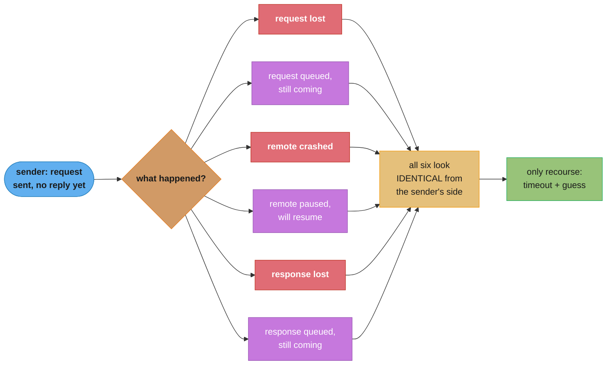
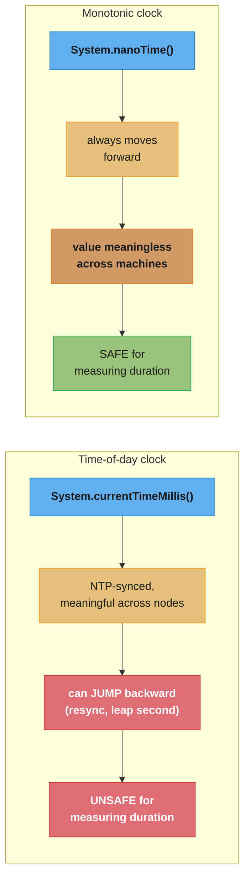
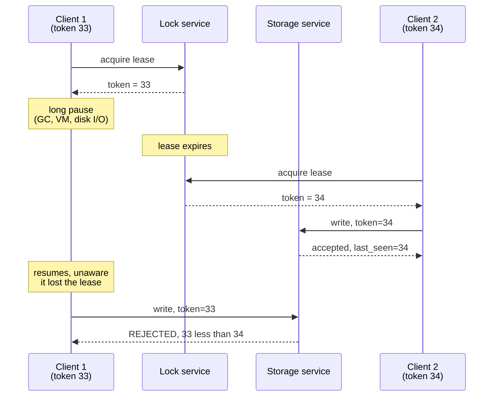
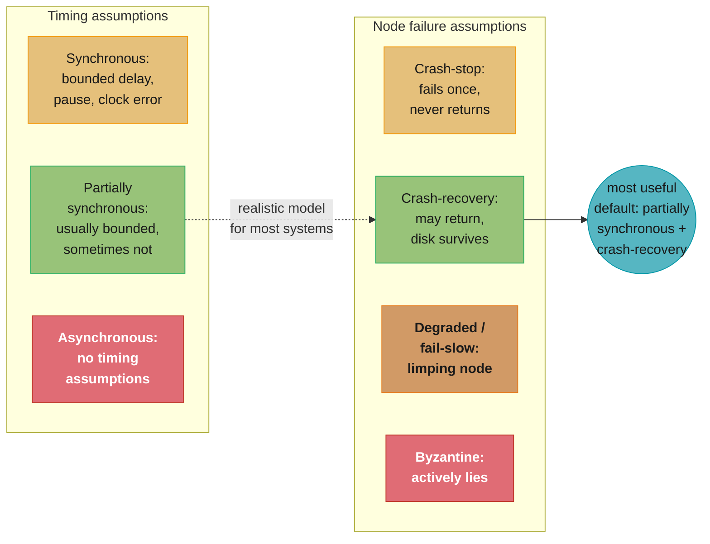

# Chapter 9: The Trouble with Distributed Systems

> Part II — Distributed Data · DDIA (Kleppmann & Riccomini, 2nd ed., O'Reilly 2026) · builds on Ch 8, leads to Ch 10 (consistency and consensus)

## Chapter Map

A single computer is deterministic: given working hardware, the same operation always
produces the same result, and when something does go wrong the machine usually fails
completely (a crash) rather than partially. A distributed system throws that guarantee away.
Once you connect several machines by a network, you get *partial failure* — some parts
broken, other parts fine, and no way to tell which is which from the outside. This chapter
turns pessimism to the maximum and catalogs everything that can go wrong: the network can
lose, delay, or reorder messages; each machine's clock can drift, jump, or simply lie; and a
process can be paused for an arbitrary length of time by garbage collection, virtualization,
disk I/O, or an operator's fat-fingered `kill -STOP`. It closes by asking how, given all that,
you can still say anything precise about what a distributed algorithm guarantees.

**TL;DR:**
- Networks are asynchronous and give **no delivery guarantee and no bound on delay** — a
  timeout is the only way to detect a fault, and a timeout can never tell you whether the
  request was lost, delayed, or successfully processed with the response lost.
- Clocks are unreliable in two independent ways: a **time-of-day clock** can jump backward or
  forward (NTP resync, leap seconds) and is unsuitable for measuring durations; a **monotonic
  clock** never jumps but its value is meaningless across machines and its resolution says
  nothing about its accuracy.
- A process can be **paused for an unbounded time** at any point (GC, VM pause, page fault,
  `SIGSTOP`) without noticing — code that assumes "very little time passes between these two
  lines" is silently unsafe in a distributed system.
- Distributed algorithms rely on a **quorum** (majority vote) rather than trusting any single
  node's judgment, use **fencing tokens** to block a "zombie" node that thinks it still holds a
  lease, and are usually designed to assume nodes are unreliable but honest — full **Byzantine
  fault tolerance** is reserved for adversarial or safety-critical settings.
- A **system model** (synchronous / partially synchronous / asynchronous, crossed with
  crash-stop / crash-recovery / Byzantine) states exactly what an algorithm may assume, and
  correctness is split into **safety** ("nothing bad ever happens," must hold always) and
  **liveness** ("something good eventually happens," allowed caveats).

## The Big Question

> "In a distributed system, a node cannot know anything for sure about another node — it can
> only make guesses based on messages it receives, or doesn't receive. How do you build
> anything reliable out of parts you can never be certain are even alive?"

Analogy: running software on a single machine is like talking to someone in the same room —
if they stop responding, you know immediately something is wrong with them. Running a
distributed system is like exchanging letters with someone overseas during a postal strike of
unknown duration: a letter (or its reply) might be lost, delayed by a day or by a year, or
sitting perfectly fine in a queue. If you stop receiving replies, you cannot tell whether your
correspondent died, the post office lost your letter, or your correspondent's reply is still
in transit. The whole chapter is a tour of how many different, independent ways that postal
system can misbehave — the network, the clocks, and the pauses — before Chapter 10 shows how
to build something trustworthy out of it anyway.

---

## 9.1 Faults and Partial Failures

A program on a single computer is either fully working or entirely broken; hardware faults
tend to cause total failure (kernel panic, blue screen) rather than a wrong-but-plausible
result, because that is a deliberate design choice — computers are built to crash rather than
silently corrupt data. This lets software present an idealized, deterministic model of the
machine even though the underlying physical reality (bit flips, disk corruption) is fuzzier
than that model admits.

Connect several machines over a network and this idealization breaks. Faults become far more
frequent, and — critically — they become *partial*: some nodes and links work while others
don't, and the failure is *nondeterministic*. The same operation across the network might
succeed this time and hang the next. Coda Hale's anecdote of a single limited operational
career already covering "long-lived network partitions in a single DC, PDU failures, switch
failures, accidental power cycles of whole racks, whole-DC backbone failures, whole-DC power
failures, and a hypoglycemic driver smashing his truck into a DC's HVAC system" makes the
point: the physical world offers a remarkably wide menu of ways to fail.

The payoff for tolerating partial failure is real: a system that can lose one node without
losing the whole service can be upgraded one node at a time (a rolling upgrade) with no
downtime — fault tolerance is what lets you build a *more* reliable system out of *less*
reliable parts, not despite them. But you only get that payoff if you first take the faults
seriously enough to test for them deliberately — the chapter's recurring advice is
"suspicion, pessimism, and paranoia pay off," and to artificially trigger the failures you
expect (see §9.4's fault injection) rather than hoping they don't happen.

## 9.2 Unreliable Networks

Most systems this book covers are **shared-nothing**: machines with their own memory and
disk, communicating only over the network (even access to shared storage like Amazon S3 goes
over the network). That network — the internet, and most datacenter Ethernet — is an
**asynchronous packet network**: a node can send a packet, but the network makes no promise
about *when*, or *whether*, it arrives. If you send a request and don't get a response, six
things could have happened: the request was lost; the request is queued and will arrive
later; the remote node crashed; the remote node paused and will resume; the response was
lost; or the response is queued and will arrive later. All six are indistinguishable from the
sender's point of view — the only fact you have is the absence of a reply so far.

```
  sent request, no reply yet -- which of these is true?

    (a) request lost in transit           ---X   [gone]
    (b) request queued, in flight         --->>  [still coming]
    (c) remote node crashed               [X]    [never will reply]
    (d) remote node paused (GC, VM)        ...    [will reply later]
    (e) response lost in transit          <---X   [gone]
    (f) response queued, in flight        <<---   [still coming]

  the sender's only signal is silence -- and silence is consistent
  with all six. a response, if one arrives, may itself be delayed
  or lost on the way back, so even "yes" can go missing.
```

The usual fix is a **timeout**: after some time, give up and assume no response is coming.
But a timeout that fires tells you nothing about whether the remote node actually processed
the request — the request could still be sitting in a queue somewhere, about to be delivered
to a recipient who has no idea the sender already gave up on it.

### The Limitations of TCP

TCP (and modern relatives like QUIC, SCTP, uTP) is often called "reliable" because it
retransmits lost packets, reorders out-of-order ones, and checksums for corruption, plus it
performs *congestion control* / *flow control* / *backpressure* to avoid overloading the
network. Writing to a socket does not send data immediately — it buffers, and the OS's
congestion-control algorithm decides when to actually push packets onto the wire.

But TCP's own retransmission relies on the same fallible timeout-based detection as anything
else: it can't tell whether an outbound packet or its acknowledgment was the thing that got
lost, and if the cable is unplugged, TCP cannot plug it back in — it eventually gives up and
signals an error. Worse: even a successful TCP acknowledgment only proves the remote
*kernel* received the bytes, not that the remote *application* processed them — the
application may have crashed in between. **If you need proof a request succeeded, you need a
positive response from the application itself**, not just a clean TCP close. Despite these
limits, TCP remains extremely useful for streaming data larger than one packet and for
carrying multiple request/response pairs over a single connection (typically length-prefixed
messages), which is how HTTP and most RPC protocols work.

### Network Faults in Practice

Decades of building networks have not made them reliable. Evidence the chapter cites:

- One medium-sized-datacenter study found **~12 network faults per month** — half
  disconnecting a single machine, half disconnecting an entire rack.
- Adding redundant networking gear does not proportionally reduce faults, because redundancy
  doesn't guard against **human error** (misconfigured switches), a major outage cause.
- Wide-area fiber has been severed by cows, beavers, sharks (rarer now, thanks to better
  submarine-cable shielding), accidental misconfiguration, scavenging, and sabotage.
- Cross-region round-trip times have been observed reaching **several minutes** at high
  percentiles; even within one datacenter, a switch software upgrade has caused packet delays
  over a minute during a topology reconfiguration.
- Networks can partially fail asymmetrically: A can talk to B, B can talk to C, but A cannot
  talk to C — and a network interface has been observed dropping all *inbound* packets while
  still sending outbound ones fine, so one direction working proves nothing about the other.
- A brief interruption's effects can outlast the interruption itself by a wide margin.

A **network partition** (or *netsplit*) is the name for one part of the network being cut off
from the rest — unrelated to storage-system *partitioning*/sharding (Chapter 7), despite the
shared word. If error handling for a network fault is undefined or untested, the outcome can
be arbitrarily bad: a permanently deadlocked cluster even after the network heals, or —
worst case — deletion of all your data. Handling faults doesn't require *tolerating* them: if
your network is normally reliable, showing users an error during an outage can be a
legitimate choice. What is not legitimate is not knowing how your system behaves when the
network misbehaves; deliberately injecting network problems to observe the response (*fault
injection*, §9.4) is how you find out before production does.

### Detecting Faults

Systems that need to route around a dead node — a load balancer taking a node out of
rotation, a database promoting a new leader after the old one fails — need *some* signal.
A few situations give explicit feedback:

- If the machine is reachable but no process is listening on the port, the OS sends a `RST`
  or `FIN` and the connection is refused/closed cleanly.
- If a node's process crashes but its OS is still up, a script can proactively notify other
  nodes (HBase does this), avoiding a full timeout wait.
- With direct access to datacenter switch management interfaces, link failures are detectable
  at the hardware level — but this is unavailable over the internet or in a shared datacenter
  without switch access.
- A router that knows an IP is unreachable may send an ICMP Destination Unreachable — but the
  router is itself just another participant subject to the same network limitations.

None of this is guaranteed. In general you must assume **no response at all**, retry a few
times, wait out a timeout, and only then declare the node dead.

### Timeouts and Unbounded Delays

There is no universally correct timeout value. A long timeout delays fault detection (users
wait, or see errors, longer); a short timeout detects faults faster but risks declaring a
merely-slow node dead. Declaring a live node dead prematurely is dangerous: if it was mid-way
through an action (say, sending an email) and another node takes over, the action can be
performed twice — and the load transferred to the "replacement" node can trigger a cascading
failure if the system was already near capacity (see the metastable-failure discussion in
Chapter 2), in the extreme case with every node declaring every other node dead.

In an imaginary network with a guaranteed maximum delay *d* and a guaranteed maximum
processing time *r*, you could safely use `2d + r` as a timeout: no response within that
window would unambiguously mean failure. Real asynchronous networks and real servers provide
neither guarantee — delays are unbounded, and it isn't enough to be fast *most* of the time,
because a low timeout only needs one transient round-trip-time spike to misfire.

#### Network congestion and queueing

Most of the variability in delay is **queueing**, not raw transmission time — the network
equivalent of road traffic congestion:

- A switch queues packets converging on the same outbound link from multiple senders; if the
  queue fills, packets are dropped and must be resent even though nothing is actually broken.
- A busy destination machine queues incoming packets at the OS level until an application
  thread is free to handle them.
- A paused virtual machine (while another VM uses the shared core) cannot consume network
  data, so the hypervisor buffers it, adding further delay variability.
- TCP's own congestion control deliberately holds data back at the sender to avoid
  overwhelming the network, adding queueing before a byte even reaches the wire.

TCP retransmission compounds this: the application never sees the *packet loss* directly, only
the resulting *delay* — the wait for the retransmit timeout plus the wait for the resend to
be acknowledged.

> UDP trades TCP's reliability for lower and more predictable delay variability, because it
> skips flow control and retransmission. Latency-sensitive uses like VoIP prefer it: a
> retransmitted audio packet that arrives after its playback slot has already passed is
> worthless, so the application fills the gap with silence and moves on — "the retry happens
> at the human layer instead" ("Could you repeat that, the sound just cut out").

In public clouds and multitenant datacenters, network links, switches, and even per-machine
NICs and CPUs are shared resources — a **noisy neighbor** consuming heavy bandwidth nearby can
inflate your delays with no visibility into why. Because of this, there is no theoretically
"correct" timeout: you have to measure the actual round-trip-time distribution over time and
across machines, and pick a value trading off detection speed against false-positive risk.
Better still, systems can track response-time variability (**jitter**) continuously and adapt
the timeout automatically — the **Phi Accrual failure detector** (used in Akka and Cassandra)
and TCP's own retransmission-timeout estimation both work this way.

### Synchronous Versus Asynchronous Networks

Why can't hardware simply make network delay bounded, the way the traditional (non-cellular,
non-VoIP) telephone network does? A phone call establishes a **circuit** — a fixed amount of
bandwidth reserved along the *entire* route for the call's duration (an ISDN network, for
example, guarantees each side exactly 16 bits of audio data every 250 microseconds, forever,
for the length of the call). Because bandwidth is pre-reserved at every hop, there is no
queueing, so end-to-end latency has a fixed upper bound — a **bounded delay**.

#### Can we not simply make network delays predictable?

A circuit is *not* the same thing as a TCP connection. A circuit statically reserves
bandwidth nobody else can touch, whether it's used or not; TCP packets opportunistically grab
whatever bandwidth is momentarily free, and an idle TCP connection uses essentially none.
Ethernet and IP are **packet-switched**, not circuit-switched, precisely because they are
optimized for **bursty traffic** — email, web pages, file transfers don't have a steady
bit-rate requirement the way a phone call does, they just want to finish as fast as possible.
Forcing bursty transfers onto reserved circuits means guessing a bandwidth allocation: guess
too low and the transfer is needlessly slow; guess too high and the circuit can't even be
granted, because the network won't promise bandwidth it can't guarantee. TCP's dynamic
adaptation avoids both failure modes at the cost of losing the delay guarantee.

Hybrid attempts exist — ATM in the 1980s (lost to Ethernet outside telephone core switches),
InfiniBand (link-layer flow control reduces but doesn't eliminate congestion), and newer
congestion-control work like **L4S** (Low Latency, Low Loss, Scalable Throughput) and Linux's
traffic controller (`tc`) for QoS-based reprioritization. None of this quality-of-service
machinery is turned on in multitenant public clouds or across the general internet today, so
in practice you must assume congestion, queueing, and unbounded delay will happen, and pick
timeouts experimentally rather than by formula.

> **Latency and resource utilization.** Bounded delay versus variable delay is not a law of
> nature — it's a cost/benefit trade-off in how a shared resource is partitioned. A telephone
> circuit statically reserves one of, say, 10,000 call slots on a wire — even if you're the
> only caller using it, your slot's bandwidth stays fixed and the other 9,999 slots sit idle
> if unused. The internet instead shares bandwidth *dynamically*: packets jostle for the wire
> moment to moment, which maximizes utilization (every byte you send is cheaper, since the
> fixed-cost wire is better used) at the price of queueing delay. The same trade-off shows up
> with CPU cores shared dynamically among threads — better hardware utilization, but a thread
> can be paused for a variable length of time waiting its turn in the run queue. Latency
> guarantees ARE achievable with static resource partitioning (dedicated hardware, exclusive
> bandwidth) — it is simply more expensive, because it sacrifices the utilization that dynamic
> sharing buys you.

BGP peering agreements between ISPs resemble circuit switching more closely than raw IP does —
dedicated bandwidth can be purchased at that level — but BGP routing operates on whole
*networks*, not individual host-to-host connections, and at a far longer timescale than a
single request needs.

## 9.3 Unreliable Clocks

Applications lean on clocks constantly — to measure *durations* (has this timed out? what's
the p99 response time? how many QPS in the last five minutes? how long did the user stay?)
and to record *points in time* (when was this published? when should the reminder fire? when
does this cache entry expire? what's the timestamp on this log line?). In a distributed
system, message delivery isn't instantaneous and the delay is variable, so working out *when*
something happened relative to something else on a different machine is genuinely hard. Each
machine also has its own physical clock (typically a quartz oscillator) that runs at a
slightly different rate from every other machine's — synchronization via **NTP** (the Network
Time Protocol, ultimately anchored to GPS or atomic-clock time sources) narrows but does not
eliminate the gap.

### Monotonic Versus Time-of-Day Clocks

Modern computers expose (at least) two distinct kinds of clock, and conflating them is a
recurring source of bugs.

**Time-of-day clocks** — `clock_gettime(CLOCK_REALTIME)` on Linux, `System.currentTimeMillis()`
in Java — return the current date/time as seconds (or milliseconds) since the Unix epoch
(midnight UTC, January 1 1970, not counting leap seconds). NTP-synchronized so that (ideally)
a timestamp means the same thing on two different machines, they nonetheless can **jump
backward** — if the local clock has drifted too far ahead of an NTP server, it may be forcibly
reset — and jump due to Daylight Saving Time transitions (avoided entirely by always using
UTC, which has no DST) or leap seconds. Older Windows systems even moved forward in coarse
10 ms steps. All of this makes time-of-day clocks **unsuitable for measuring elapsed time**.

**Monotonic clocks** — `clock_gettime(CLOCK_MONOTONIC)` / `CLOCK_BOOTTIME` on Linux,
`System.nanoTime()` in Java — are guaranteed to only ever move forward. Reading the clock
twice and taking the *difference* gives you an elapsed duration (a stopwatch, not a wall
clock); the *absolute* value is meaningless (perhaps nanoseconds since boot) and comparing
monotonic values from two different machines is meaningless. On multi-socket servers,
per-CPU timers may not be perfectly synchronized with each other, though the OS tries to
present a consistent monotonic view across cores — "with a pinch of salt." NTP may *slew*
(speed up or slow down, by up to 0.05% by default) the rate at which a monotonic clock
advances, but it will never make it jump. Resolution is typically microseconds or better.
For measuring elapsed time (timeouts), a monotonic clock is the right tool in a distributed
system, precisely because it makes no cross-node synchronization assumption.

### Clock Synchronization and Accuracy

Time-of-day clocks need external synchronization to be meaningful at all, and the mechanisms
for doing that are less trustworthy than intuition suggests:

- Quartz **drift** varies with temperature; Google assumes up to **200 ppm** drift for its
  servers, equivalent to ~6 ms drift if resynced every 30 seconds, or ~17 seconds if resynced
  once a day.
- A clock too far from its NTP server may refuse to sync, or be forcibly reset — either way,
  applications observing time across the reset can see it jump backward or forward.
- A node accidentally firewalled off from NTP can silently accumulate large drift, unnoticed.
- NTP accuracy is bounded by network delay: one experiment found a **~35 ms** minimum
  achievable error over the internet, spiking to around a second under congestion; large
  enough delays can make an NTP client give up on syncing entirely.
- Some NTP servers are simply misconfigured and report time off by hours — clients guard
  against this by querying several servers and discarding outliers.
- **Leap seconds** produce a 59- or 61-second minute, which has crashed systems not designed
  for it; the common mitigation is *smearing* the adjustment gradually over a day (behavior
  varies by NTP server). Leap seconds stop being used from 2035 onward.
- In virtual machines, a paused-and-resumed VM sees its clock **jump forward** — and NTP may
  keep reporting the clock as "in sync" even while it is several seconds behind real time.
- On devices you don't control (mobile, embedded), the hardware clock cannot be trusted at
  all — some users deliberately misset it, e.g. to cheat in games.

Very good accuracy IS achievable if you invest in it: MiFID II requires European
high-frequency trading firms to synchronize to **within 100 microseconds of UTC**, using GPS
receivers, atomic clocks, and the **Precision Time Protocol (PTP)** with careful deployment
and monitoring. GPS alone is riskier because signals can be jammed (notably near military
facilities); some cloud providers now offer high-accuracy VM clock sync. Even with investment,
a misconfigured NTP daemon or a firewall blocking NTP traffic can quickly reintroduce large
error.

### Relying on Synchronized Clocks

Clocks *seem* simple — but a day isn't reliably exactly 86,400 seconds, a time-of-day clock
can move backward, and one node's clock can be meaningfully different from another's. As with
networks, software has to be built assuming clocks will occasionally misbehave, and this is
harder than for networks because **incorrect clocks silently go unnoticed** — a broken NIC or
CPU fails loudly and gets fixed fast, but a slowly drifting quartz clock or a misconfigured
NTP client keeps everything *looking* fine while quietly corrupting whatever depends on
timestamp accuracy. If your system requires synchronized clocks, you must actively **monitor
clock offset between machines** and evict any node whose drift exceeds a threshold.

#### Timestamps for ordering events

It's tempting — and dangerous — to use time-of-day clocks to order events across nodes. In a
multi-leader replicated database, imagine client A writes `x = 1` on node 1 (replicated to
node 3), client B then increments `x` on node 3 (`x = 2`), and both writes replicate to
node 2. Even with clock skew under 3 ms between node 1 and node 3 — "probably better than you
can expect in practice" — the write of `x = 2` can end up with an *earlier* timestamp
(42.003s) than the causally-prior write of `x = 1` (42.004s). Under **last write wins (LWW)**
conflict resolution (Chapter 6), node 2 would then incorrectly decide `x = 1` is the newer
value and silently drop the increment.

```
  node 1: client A writes x=1        ---- ts=42.004s ---->
                                        \
  node 3: client B increments x=2        `-- ts=42.003s -->  (causally AFTER A's write,
                                                                but a SMALLER timestamp)

  node 2 receives both, applies LWW: keeps the LARGER timestamp
    -> keeps x=1 (ts 42.004), drops x=2 (ts 42.003)
    -> the increment is silently lost, even though B's write
       happened strictly after A's write really occurred
```

Some systems (Cassandra, ScyllaDB) accept this risk deliberately, using client-clock
timestamps with LWW because it lets them write to all replicas in a single round trip. The
book flags three concrete failure modes of doing so: (1) a node with a lagging clock cannot
overwrite a value written by a fast-clocked node until the skew has elapsed — data can vanish
with no error reported; (2) LWW cannot tell a genuinely sequential pair of writes apart from
truly concurrent ones — causality tracking (version vectors, Chapter 6) is needed for that;
(3) two nodes can independently generate identical millisecond-resolution timestamps, needing
a tiebreaker (e.g. a large random number) that can itself violate causality. Tighter NTP sync
cannot fix this in principle, because NTP's own accuracy is bounded by network round-trip
time — to guarantee correct ordering you'd need clock error significantly *below* network
delay, which isn't achievable. **Logical clocks** (incrementing counters, not oscillators) are
the safer alternative for ordering — they track relative order, not wall-clock time, and are
covered in depth in Chapter 10.

#### Clock readings with a confidence interval

Even microsecond- or nanosecond-resolution clock readings don't mean the reading is accurate
to that precision — drift alone can put a clock several milliseconds off even with per-minute
local NTP sync, and internet NTP sync's best realistic accuracy is tens of milliseconds,
spiking past 100 ms under congestion. A clock reading is therefore better modeled as a *range*
— e.g. "95% confident the time is between 10.3 and 10.5 seconds past the minute" — than as a
single point; if you only know the time to ±100 ms, the microsecond digits in a `clock_gettime()`
result are noise. Most APIs don't expose this uncertainty at all. Google Spanner's
**TrueTime** API and Amazon's **ClockBound** are exceptions: querying them returns
`[earliest, latest]` — the confidence interval itself, not a single number — whose width
depends on how long it's been since the last sync with a more accurate source.

#### Synchronized clocks for global snapshots

Multi-version concurrency control (MVCC, Chapter 8) needs a monotonically increasing
transaction ID so a snapshot can tell which writes are "before" it and which are "after." On
a single node a counter suffices; across many shards a global, causally-consistent ID
requires coordination that becomes a bottleneck under high transaction rates. Spanner instead
uses the TrueTime confidence interval directly: given two intervals `A = [Aearliest, Alatest]`
and `B = [Bearliest, Blatest]`, if they don't overlap (`Aearliest < Alatest < Bearliest <
Blatest`), then B definitely happened after A — no ambiguity. Spanner deliberately *waits out
the length of the confidence interval* before committing a read-write transaction, which
guarantees any later-reading transaction's interval won't overlap. Because the wait time is
proportional to the interval width, Spanner keeps that width small by deploying GPS receivers
or atomic clocks in every datacenter — achieving roughly **7 ms** synchronization. The atomic
clocks aren't strictly required by the *algorithm*; they only make the wait shorter. Other
systems have started adopting the same pattern — YugabyteDB uses ClockBound on AWS, for one.

### Process Pauses

Consider a leader election design: a single-leader database, sharded, where only the leader
accepts writes for its shard, and leadership is granted as a **lease** — a lock with a
timeout, renewed periodically, so a failed leader's lease naturally expires and lets another
node take over. A naive implementation checks the wall clock, renews the lease if under 10
seconds remain, and processes the request if the lease is still valid:

```js
while (true) {
    request = getIncomingRequest();

    // Ensure that the lease always has at least 10 seconds remaining
    if (lease.expiryTimeMillis - System.currentTimeMillis() < 10000) {
        lease = lease.renew();
    }

    if (lease.isValid()) {
        process(request);
    }
}
```

Two bugs. First, it compares an expiry set by a *different* machine's clock to the local
clock via `System.currentTimeMillis()` — if the two clocks are out of sync by more than a few
seconds, the logic misbehaves. Second — and this survives even switching to a local monotonic
clock — the code assumes negligible time passes between checking `lease.isValid()` and
finishing `process(request)`. If the thread is paused for, say, 15 seconds right around
`lease.isValid()`, the lease will very likely have expired — and another node may already have
taken over as leader — by the time `process(request)` actually runs, yet nothing tells this
thread that happened until its *next* loop iteration, by which point it may already have done
something unsafe.

Assuming a thread can pause for 15+ seconds sounds paranoid, but the chapter lists real
causes, roughly in order of how surprising they are:

- **Thread contention** for a shared lock/queue — can worsen, counterintuitively, when you
  add more CPU cores.
- **Garbage collection "stop-the-world" pauses** — historically minutes-long in the worst
  case; modern collectors (G1, ZGC, Shenandoah, CMS, Epsilon in Java; Go's simpler concurrent
  collector) usually keep this to a few milliseconds when properly tuned, but pauses remain
  noticeable.
- **VM suspend/resume**, including *live migration* between hosts — can happen at any point in
  execution, for an arbitrary duration.
- End-user device suspension (closing a laptop lid).
- Ordinary **OS/hypervisor context switching** — the "**steal time**" spent in other VMs on a
  shared core counts against you the same way.
- **Synchronous disk I/O** — can happen surprisingly, e.g. a Java classloader lazily loading
  a class file mid-execution; if the "disk" is really network-attached (Amazon EBS), it
  inherits all of §9.2's network delay variability too.
- **Swapping / paging** — a page fault pauses the thread while a page loads from disk; under
  memory pressure this can degrade into **thrashing**, which is why paging is often disabled
  outright on server machines.
- **`SIGSTOP`** — Ctrl-Z in a shell, or an operator's fat-fingered `kill`, halts a process
  immediately until `SIGCONT` resumes it.

All of these can preempt a thread at *any* point and resume it arbitrarily later, with the
thread itself none the wiser — the same fundamental problem as making single-machine
multithreaded code thread-safe, except the usual toolbox (mutexes, atomics, lock-free
structures) doesn't translate, because a distributed system has no shared memory to build
those primitives on top of. A node has to assume it can be paused mid-function at any time,
that the rest of the world keeps moving (and may declare it dead) during the pause, and that
it may resume with no awareness that any time passed at all until it happens to check a clock.

#### Response time guarantees

Some environments — aircraft, rockets, robots, cars — genuinely cannot tolerate an unbounded
pause: these are **hard real-time** systems with a specified *deadline*, where missing it can
mean physical failure (an airbag delayed by a GC pause is not an abstract concern). Achieving
this requires a real-time operating system (RTOS) with guaranteed CPU-time allocation,
library functions with documented worst-case execution times, restricted or eliminated
dynamic memory allocation (real-time garbage collectors exist, but the application must still
avoid overloading them), and heavy testing/measurement. This is expensive and narrows your
choice of languages/libraries/tools drastically, which is why hard real-time is reserved for
safety-critical embedded systems — and note "real-time" here is unrelated to the looser web
sense of "real-time" meaning low-latency data push (Chapter 12). Real-time is also *not* the
same as high-performance: prioritizing timely response above all else can mean *lower*
throughput than a system free to batch and optimize. Most server-side data systems find
real-time guarantees uneconomical and simply accept the pauses and clock instability of a
non-real-time environment.

#### Limiting the impact of garbage collection

GC used to be one of the biggest sources of process pauses; modern, well-tuned collectors
usually keep pauses to a few milliseconds. Languages that avoid GC entirely sidestep the
problem differently — Swift uses automatic reference counting, Rust and Mojo track object
lifetimes via the type system so the compiler determines deallocation points at compile time.
For garbage-collected languages, two mitigations reduce (not eliminate) impact: treating an
upcoming GC pause like a brief planned outage — stop routing new requests to that node, let
in-flight requests finish, run the GC, resume routing — which hides the pause from clients and
lowers the response-time tail; or restarting processes periodically before long-lived objects
accumulate enough to require a full GC, using the collector only for cheap short-lived
objects, shifting traffic away before the planned restart the same way a rolling upgrade does.

## 9.4 Knowledge, Truth, and Lies

Pulling together §§9.1–9.3: there is no shared memory in a distributed system, only unreliable
message passing, and the system can suffer partial failures, unreliable clocks, and arbitrary
pauses. The consequence is that **a node cannot know anything for certain about another
node** — it can only guess from the messages it receives (or the silence when it doesn't). A
remote node's true state is unknowable when it isn't responding, because a network problem
and a node problem look identical from the outside. Rather than chase philosophy for its own
sake, the practical move is to explicitly state the assumptions a system is designed to
satisfy (its **system model**) and prove the algorithm correct *within* that model — reliable
behavior is achievable even from an unreliable-seeming foundation, provided the assumptions
are stated honestly and the algorithm actually honors them.

### The Majority Rules

Consider a node with an asymmetric network fault: it receives everything sent to it, but
none of its outbound messages get through. From the rest of the cluster's point of view, the
node has gone silent; after a timeout, they declare it dead — even though it is, from its own
perspective, working perfectly and screaming "I'm not dead!" into a void nobody can hear.
(Two related nightmares the chapter walks through: the node might notice its own outbound
messages are going unacknowledged and correctly infer a fault, but still be powerless to stop
being declared dead; or a node that pauses for a full minute gets declared dead, then wakes up
completely unaware that any time passed, confused to find the cluster has already moved on
without it.)

The lesson: **a node cannot trust its own judgment of its situation**, and a distributed
system cannot rely exclusively on any single node's opinion, because that node might fail at
any moment. Instead, decisions — including the decision to declare another node dead — are
made by **quorum**: a vote among several nodes, most commonly requiring an absolute majority
(more than half). With 3 nodes you can tolerate 1 faulty node; with 5, you can tolerate 2. A
majority quorum is safe specifically because **there can only ever be one majority** in a
system at a time — two conflicting majority decisions can never coexist. If a quorum declares
a node dead, that node must abide by the decision and step down, however alive it still feels.

### Distributed Locks and Leases

Locks and leases in a distributed setting are a common source of bugs. A **lease** (a lock
with a timeout, introduced in §9.3) lets you enforce "only one of X" — one leader per shard
(avoiding split brain), one client updating a given resource, one node processing a given
input file. The blast radius of two nodes simultaneously believing they hold the lease varies
by use case: wasted compute in the "only one worker processes this file" case is cheap, but
lost or corrupted data in the leader-election or exclusive-write case is not.

A concrete failure (not theoretical — HBase actually had this bug): a client obtains a lease
from a lock service before writing to a shared file, but pauses long enough for its lease to
expire; a second client acquires the (now-available) lease and starts writing; the first
client resumes, still believes its now-expired lease is valid, and also writes — corrupting
the file via split brain. A second, related failure needs no pause at all: client 1 sends a
write just before crashing, that write is delayed in the network past the lease's expiry,
client 2 acquires the lease and writes, and *then* client 1's stale, delayed write arrives and
corrupts the result anyway.

#### Fencing off zombies and delayed requests

A former leaseholder that hasn't yet learned it lost the lease, and keeps acting like the
current holder, is called a **zombie**; making sure a zombie can't cause damage is **fencing
it off**. One approach — **STONITH** (Shoot The Other Node In The Head): disconnect it from
the network, power it down via the cloud provider's management API, or physically pull power.
This doesn't help against the delayed-message scenario above, can itself misfire (nodes
shutting each other down), and can act too late if damage is already done.

The more robust fix: **fencing tokens**. Every time the lock service grants a lease, it also
returns a monotonically increasing number — the fencing token (called a *sequencer* in
Chubby, an *epoch number* in Kafka, a *ballot number* in Paxos, a *term number* in Raft — same
idea under different names). Every write to the storage service must carry the client's
current fencing token, and the storage service rejects any write whose token is *lower* than
one it has already accepted:

```
  client 1 acquires lease  -> token 33
  client 1 pauses ... lease expires ...
  client 2 acquires lease  -> token 34  (tokens always increase)
  client 2 writes, token=34            -> storage accepts, remembers "last seen: 34"
  client 1 resumes, writes, token=33   -> storage REJECTS: 33 < 34 already seen
```

If ZooKeeper is the lock service, the transaction ID `zxid` or node version `cversion` can
serve as the token directly; with etcd, the revision number plus lease ID serves the same
role; Hazelcast's `FencedLock` API generates one explicitly. Where the storage service
supports an atomic compare-and-set (Amazon S3's *conditional writes*, Azure Blob Storage's
*conditional headers*, Google Cloud Storage's *request preconditions*), that alone can serve
the same purpose without a separate lock service at all.

#### Fencing with multiple replicas

If clients write to only a single conditional-write-capable storage service, the separate
lock service becomes somewhat redundant — the lease assignment could be implemented directly
on that storage service. But fencing tokens generalize past a single service: with a
leaderless, last-write-wins replicated store, put the fencing token in the most significant
digits of the write timestamp, guaranteeing any timestamp from the new leaseholder outranks
every timestamp the old leaseholder could ever produce, even for writes that physically land
*after* the old leaseholder's. If the new leaseholder's quorum write can't reach every
replica, a zombie's write may briefly succeed on the unreached replica — harmless, because a
subsequent quorum read prefers the higher-timestamped write, and read repair or anti-entropy
eventually overwrites the stray zombie value.

### Byzantine Faults

Fencing tokens defend against **inadvertent** error — a node that hasn't yet realized its
lease expired. They do nothing against a node that *deliberately* wants to subvert the
system, e.g. by forging a fencing token. This book's default assumption throughout is that
nodes are **unreliable but honest**: they may be slow, unresponsive, or stale, but if a node
responds at all, it is telling the truth as best it knows it. A node that can actively lie —
send arbitrary corrupted or contradictory messages, cast multiple conflicting votes — commits
a **Byzantine fault**, and reaching consensus despite it is the **Byzantine Generals Problem**
(a generalization of Lamport's earlier Two Generals Problem, where two generals coordinating
by messenger can't be certain any message got through — Lamport reportedly avoided naming it
after a real nationality on advice that "The Albanian Generals Problem" would not go over
well; "Byzantine" instead riffs on the word's older sense of "excessively complicated,
devious"). A system tolerant of this is **Byzantine fault-tolerant (BFT)**.

BFT genuinely matters in a few settings: aerospace, where cosmic radiation can flip memory
bits and a failure can kill people (flight control systems are built to tolerate it), and
systems with mutually distrusting participants who have incentive to cheat — cryptocurrencies
and blockchains exist largely to get such parties to agree on a shared transaction history
without a trusted central party. But for the kinds of systems this book is mostly about — a
datacenter you control, with radiation levels too low to matter — Byzantine faults are
usually assumed away. Multitenant systems isolate mutually distrusting tenants with firewalls
and access control, not BFT protocols. BFT protocols typically need a **supermajority of more
than two-thirds** of nodes behaving correctly, and are expensive; using BFT to guard against
your *own* software's bugs would require multiple genuinely independent implementations,
which almost nobody builds. A shared attacker compromising one node in a homogeneous fleet
can likely compromise the rest the same way, so traditional defenses — authentication, access
control, encryption, firewalls — remain the real protection, not consensus math. Web
applications must expect *client* behavior to be arbitrary and possibly malicious (hence
input validation, sanitization, output escaping against SQL injection and XSS), but this is
handled by making the server the sole authority, not by running BFT between server and
browser; peer-to-peer networks without any central authority are where BFT becomes more
directly relevant.

#### Weak forms of lying

Short of full BFT, it's still worth defending against **weak** lying — invalid messages from
hardware faults, software bugs, or misconfiguration, not from an adversary:

- Packet corruption sometimes evades TCP/UDP checksums; application-level checksums and
  TLS-encrypted connections add further protection.
- Public-facing services must sanitize user input (range-check values, cap string sizes
  against memory-exhaustion attacks); even internal, firewalled services benefit from basic
  protocol-parser sanity checks.
- NTP clients configured with multiple server addresses cross-check them, excluding any
  outlier that disagrees with the majority — one misconfigured server doesn't poison the sync.

### System Model and Reality

To design algorithms that don't depend on the specifics of any one deployment's hardware and
software, you formalize the assumptions into a **system model** — what an algorithm is
allowed to assume about timing and about how nodes can fail.

**Timing models:**

| Model | Assumption |
|-------|------------|
| Synchronous | Bounded network delay, bounded process pauses, bounded clock error — NOT the same as zero delay or perfectly synced clocks, just a fixed known upper bound on all three. Unrealistic for most real systems. |
| Partially synchronous | Behaves synchronously *most of the time*, but occasionally — unpredictably — exceeds the bounds. The realistic model for most practical systems. |
| Asynchronous | No timing assumptions at all — an algorithm in this model has no clock and cannot use timeouts. Very restrictive, but some algorithms are designed for it. |

**Node-failure models:**

| Model | Assumption |
|-------|------------|
| Crash-stop (fail-stop) | A node can fail only by crashing, and once crashed it never returns. |
| Crash-recovery | Nodes may crash and later resume; stable (nonvolatile) storage survives a crash, in-memory state does not. |
| Degraded performance / partial functionality | Nodes can go slow rather than stop — still answering health checks while too slow to do real work (a **limping node**, **gray failure**, or **fail-slow**), sometimes even harder to handle than a clean crash; or partially functional, e.g. a deadlocked background thread while the rest of the process keeps working. |
| Byzantine (arbitrary) | Nodes may do anything, including actively lying (§9.4 above). |

The **partially synchronous model combined with crash-recovery faults** is, in practice, the
most useful default for modeling real systems — it permits unbounded delay, pauses, and slow
nodes, which is the reality §9.2–9.3 established.

#### Defining the correctness of an algorithm

Correctness is defined by stating the algorithm's required **properties**, the same way "a
sorted list" is defined by the property "for any two distinct elements, the one further left
is smaller." For a fencing-token generator (§9.4), the chapter names three properties:
**Uniqueness** (no two requests get the same token), **Monotonic sequence** (if request *x*
completed before request *y* began, *x*'s token must be smaller than *y*'s), and
**Availability** (a non-crashed node requesting a token eventually gets a response). An
algorithm is correct *within a system model* if it always satisfies its properties in every
situation that model permits — which raises the question of what's achievable when the model
permits total failure (every node crashes, every delay becomes infinite).

#### Safety and liveness

Properties split into two kinds. **Safety** properties (uniqueness, monotonic sequence above)
mean "nothing bad ever happens" — if violated, you can point to the exact moment it broke, and
that violation can never be un-done. **Liveness** properties (availability above) mean
"something good eventually happens" — they may not hold *right now*, but there is always hope
they will later; the giveaway is the word "eventually" (which is also why **eventual
consistency**, per the chapter, is itself a liveness property). Distributed algorithms
typically require safety to hold **unconditionally**, in every situation the model allows —
even total node/network failure must never violate a safety property — while liveness is
allowed caveats ("a request gets a response, provided a majority of nodes haven't crashed and
the network eventually recovers"). The partially synchronous model's own definition bakes in
exactly this caveat: any period of network trouble is required to eventually end.

#### Mapping system models to the real world

System models are powerful for reasoning cleanly, but real implementations keep colliding
with reality anyway. Crash-recovery models assume stable storage survives a crash — but what
if the disk itself is corrupted, wiped by hardware failure or misconfiguration, or a firmware
bug makes a server fail to even recognize correctly-attached drives on reboot? Quorum
algorithms (Chapter 6) assume a node remembers what it claims to have stored — if a node can
suffer "amnesia" and forget previously-stored data, the quorum condition itself breaks, and
correctness with it. You could invent a model where stable storage "mostly" survives crashes
but occasionally doesn't — but such a model becomes markedly harder to reason about. In
non-Byzantine systems you inevitably have to assume *something* is simply off the table — and
real implementations still need code for the case where an assumed-impossible thing happens
anyway, even if that code is just `printf("Sucks to be you"); exit(666);`, handing the mess to
a human operator. ("This is one difference between computer science and software
engineering.") None of this makes theoretical system models worthless — quite the opposite:
they distill an overwhelming amount of real-world complexity down to a manageable set of
faults you can actually reason about systematically.

### Formal Methods and Randomized Testing

Given the huge state space created by concurrency, partial failure, and variable network
delay, how do you gain confidence an algorithm's properties genuinely hold in every reachable
state?

#### Model checking and specification languages

**Model checkers** verify that an algorithm behaves as specified, written in a purpose-built
specification language (TLA+, Gallina, FizzBee) that lets you focus on behavior without
implementation noise, then systematically explore all reachable states to check invariants.
Model checking cannot literally prove correctness for every possible state when the state
space is infinite (as most real algorithms' are) — a true proof of that kind requires formal
proof techniques, which are usually harder than just running a checker — so model checkers
instead approximate: reduce the model to something fully checkable, or bound execution (a
maximum message count, say), accepting that bugs only reachable with longer executions won't
be found. Even with that limitation, model checkers strike a useful balance of ease-of-use
against bug-finding power — CockroachDB, TiDB, and Kafka all use model specifications this
way, and TLA+ analysis has demonstrated real data-loss potential in viewstamped replication
caused by ambiguity in a prose description of the algorithm. Because a model checker runs a
*simplified model*, not your actual code, the specification and the real implementation can
silently drift apart over time; checking that the two remain behaviorally equivalent requires
extra instrumentation in the real implementation.

#### Fault injection

**Fault injection** verifies an implementation's actual behavior by deliberately injecting
failures — network faults, machine crashes, disk corruption, paused processes — into a
running system and observing what happens, ideally in an environment closely resembling
production (some teams inject directly into production; Netflix's **Chaos Monkey** popularized
this as **chaos engineering**, covered in Chapter 2). Practically, a fault-injection run
deploys the system under test alongside coordinators (deciding what faults to trigger and
when) and scripts (actually injecting them into individual nodes — `kill` to pause/kill a
process, `umount` a disk, firewall rules to sever a network link). The tooling sprawl this
requires is exactly why frameworks like **Jepsen** exist, bundling OS integrations and
pre-built fault injectors; Jepsen in particular has a strong track record of finding critical
bugs in widely-used systems.

#### Deterministic simulation testing

**Deterministic simulation testing (DST)** complements both of the above: like a model
checker it explores a huge randomized space of executions, but unlike a model checker it
exercises your actual code, not a simplified model. A simulator replaces network, I/O, and
clock timing with mocks it fully controls, letting it dictate exact ordering, timing, and
failure injection — and, crucially, **replay** any failing execution deterministically, which
plain fault injection generally cannot do. Three strategies for making code deterministic
enough for this:

- **Application-level** — the system is built from the ground up to make deterministic
  execution easy. FoundationDB's `Flow` async library provides an explicit injection point for
  a deterministic network simulation; TigerBeetle models its entire state as a single-event-loop
  state machine paired with mock deterministic clocks.
- **Runtime-level** — a language's async runtime is patched to force sequential execution.
  FrostDB patches Go's runtime to run goroutines sequentially; Rust's `madsim` supplies
  deterministic drop-in implementations of Tokio, the AWS S3 client, and the Kafka client.
- **Machine-level** — an entire machine is made deterministic via a custom hypervisor (e.g.
  Antithesis) that replaces every normally-nondeterministic OS-level operation (clocks,
  network, storage) with a deterministic equivalent, letting an unmodified distributed system
  run inside a fleet of containers under full deterministic control.

DST's payoff extends beyond replayability: tools like Antithesis actively branch a test
execution when it discovers a less-common code path, deliberately widening coverage, and
because clocks and network calls are mocked, simulated tests can run *faster* than real
wall-clock time — TigerBeetle's simulator can trigger a simulated timeout without actually
waiting out the real duration, letting far more code paths be explored per unit of wall time.

> **The Power of Determinism.** Nondeterminism — concurrency, network delay, process pauses,
> clock jumps, crashes — is the common root of every problem this chapter raises; wherever a
> system can be made *deterministic* instead, the problem space collapses. Besides DST itself,
> this idea recurs across the book: event sourcing (Chapter 3) is powerful precisely because a
> log of events can be deterministically replayed to rebuild derived views; workflow engines
> (Chapter 5) depend on workflow definitions being deterministic to provide durable-execution
> semantics; and **state machine replication** (Chapter 10) replicates data by independently
> executing the same sequence of deterministic transactions on every replica — statement-based
> replication and serial stored-procedure execution (Chapter 8) are two variants of the same
> idea already seen. Full determinism is still hard to achieve in practice: even after removing
> concurrency and mocking I/O, network, clocks, and RNGs, some languages iterate hash-table
> elements in a nondeterministic order, and whether you hit a resource limit (an allocation
> failure, a stack overflow) is itself nondeterministic.

---

## Visual Intuition



Caption: six distinct network/node failures collapse to the same observable symptom —
silence — which is why a timeout can detect "no answer yet" but never distinguish *why*.



Caption: the two clock types are safe for opposite purposes — a time-of-day clock's value is
comparable across machines but can jump; a monotonic clock's *difference* is trustworthy on
one machine but its absolute value and cross-machine comparisons are not.



Caption: the fencing token turns a race that used to depend on timing (who writes last wins,
maybe corrupting data) into a race decided by an incrementing number the storage service can
check unambiguously — the zombie's write can arrive whenever it likes, and is rejected either way.



Caption: a system model is a deliberate pair of choices — how bad can timing get, how bad can
node failure get — and "partially synchronous + crash-recovery" is the pairing that matches
most production systems, which is why Chapter 10's algorithms are built for it.

---

## Key Concepts Glossary

- **Partial failure** — some parts of a distributed system are broken while others work fine,
  and the boundary is not knowable from outside; the defining trait that separates distributed
  systems from single-machine software.
- **Asynchronous packet network** — a network (the internet, most datacenter Ethernet) that
  gives no guarantee packets are delivered, or delivered within any bound on time.
- **Timeout** — the only general-purpose mechanism for detecting an unresponsive node; firing
  never distinguishes *why* there was no response.
- **Congestion control / flow control / backpressure** — TCP's mechanisms for sending data as
  fast as possible without overwhelming the network or the receiver.
- **Network partition (netsplit)** — part of the network cut off from the rest; unrelated to
  storage-system sharding despite sharing the word "partition."
- **Fault injection** — deliberately triggering failures (network, disk, process) to observe
  a system's actual behavior under them.
- **Chaos engineering** — production fault injection, popularized by Netflix's Chaos Monkey.
- **Queueing delay** — the dominant source of variable network delay: packets waiting at
  switches, receiving OS buffers, hypervisor buffers, and TCP's own sender-side pacing.
- **Noisy neighbor** — another tenant on shared cloud infrastructure whose resource usage
  inflates your own network/CPU delay unpredictably.
- **Bounded delay / circuit switching** — a network (e.g. the phone network) that reserves
  fixed bandwidth per connection end-to-end, guaranteeing a maximum latency, at the cost of
  utilization.
- **Phi Accrual failure detector** — a failure detector (used in Akka, Cassandra) that
  continuously adapts its timeout to observed response-time variability (jitter).
- **Time-of-day clock** — returns calendar date/time (e.g. `System.currentTimeMillis()`);
  NTP-synced but can jump backward or forward; unsuitable for measuring durations.
- **Monotonic clock** — always moves forward (e.g. `System.nanoTime()`); its *difference*
  measures elapsed time reliably, but its absolute value is meaningless and not comparable
  across machines.
- **Clock drift** — a quartz clock running faster or slower than it should, worsened by
  temperature; Google assumes up to 200 ppm.
- **Clock slewing** — NTP adjusting the *rate* a monotonic clock advances (up to ±0.05% by
  default) rather than making it jump.
- **Leap second smearing** — spreading a leap second's adjustment gradually over a day to
  avoid the 59/61-second-minute problem crashing unprepared systems.
- **TrueTime / ClockBound** — clock APIs (Google Spanner, AWS) that return an explicit
  `[earliest, latest]` confidence interval instead of a single timestamp value.
- **Logical clock** — an incrementing counter used to order events by relative "happened
  before," never as a measure of wall-clock time; safer than physical clocks for ordering.
- **Lease** — a lock with a timeout, requiring periodic renewal, so a failed holder's lock is
  automatically released after the lease expires.
- **Zombie (in a distributed lock context)** — a former leaseholder that hasn't yet learned it
  lost the lease and keeps acting as though it still holds it.
- **Fencing (STONITH)** — forcibly disconnecting/powering down a suspected zombie node; can
  misfire and can act too late.
- **Fencing token** — a monotonically increasing number issued with each lease grant, used to
  reject any write from a stale (lower-numbered) holder — called a sequencer in Chubby, an
  epoch number in Kafka, a ballot/term number in Paxos/Raft.
- **Quorum** — a vote among nodes (commonly an absolute majority) used to make decisions no
  single node can be trusted to make alone, including declaring another node dead.
- **Byzantine fault** — a node that actively lies (sends arbitrary or contradictory messages),
  as opposed to merely being slow or unresponsive.
- **Byzantine Generals Problem** — the general form of reaching consensus when some
  participants may be lying, generalizing the earlier Two Generals Problem.
- **Byzantine fault tolerance (BFT)** — a system's ability to keep operating correctly even
  with some actively malicious or malfunctioning nodes; expensive, typically needs a
  supermajority of over two-thirds correct nodes.
- **System model** — a formal statement of what timing and failure behavior an algorithm may
  assume; combines a timing model (synchronous / partially synchronous / asynchronous) with a
  node-failure model (crash-stop / crash-recovery / degraded / Byzantine).
- **Limping node / gray failure / fail-slow** — a node that is up and answering health checks,
  but too slow to do real work; often harder to handle than a clean crash.
- **Safety property** — a "nothing bad ever happens" guarantee that must hold unconditionally
  and, once violated, stays violated.
- **Liveness property** — a "something good eventually happens" guarantee, allowed to not hold
  right now as long as it's guaranteed to hold later, under stated caveats.
- **Model checker** — a tool (TLA+, Gallina, FizzBee) that formally explores an algorithm
  specification's state space to check invariants hold.
- **Deterministic simulation testing (DST)** — running an algorithm's actual code inside a
  simulator that mocks network/clock/I/O nondeterminism, enabling exhaustive, replayable,
  faster-than-wall-clock exploration of failure scenarios.
- **State machine replication** — replicating data by independently running the same sequence
  of deterministic transactions on every replica; covered further in Chapter 10.

---

## Tradeoffs & Decision Tables

| | Time-of-day clock | Monotonic clock |
|---|---|---|
| Can jump backward/forward | Yes (NTP resync, leap second, DST) | No — always moves forward |
| Comparable across machines | Yes (if synced) | No — absolute value is meaningless |
| Right tool for | Timestamps, "when did X happen" | Durations, timeouts, elapsed time |
| Typical API | `System.currentTimeMillis()`, `CLOCK_REALTIME` | `System.nanoTime()`, `CLOCK_MONOTONIC` |

| Timing model | Delay/pause/clock-error bound | Realism |
|---|---|---|
| Synchronous | Fixed, known upper bound on all three | Unrealistic for most real systems |
| Partially synchronous | Usually bounded, occasionally not | Realistic default for most systems |
| Asynchronous | No bound assumed at all; no clock, no timeouts | Very restrictive |

| Node-failure model | What a node may do | Notes |
|---|---|---|
| Crash-stop | Crash once, never return | Simplest to reason about |
| Crash-recovery | Crash, later resume; disk survives, memory doesn't | Most useful practical default |
| Degraded / fail-slow | Stay up but answer too slowly to be useful | Often harder than a clean crash |
| Byzantine | Anything, including active lying | Expensive to tolerate; usually assumed away in-datacenter |

| Fencing approach | Stops zombies | Stops delayed messages | Failure mode |
|---|---|---|---|
| STONITH (shut down the node) | Partially | No | Can act too late; nodes can shoot each other |
| Fencing token (monotonic, checked on write) | Yes | Yes | Requires storage-side support for token checks |

| Verification technique | Tests real code? | Explores state space how | Best at |
|---|---|---|---|
| Formal proof | No (proves the spec) | Exhaustive, mathematical | Highest confidence, most labor |
| Model checking (TLA+, etc.) | No (a simplified model) | Bounded/approximated exhaustive search | Finding subtle protocol bugs cheaply |
| Fault injection / chaos engineering | Yes | Whatever faults are triggered, when | Validating real deployed behavior |
| Deterministic simulation testing | Yes | Randomized, replayable, faster than wall clock | Exhaustive coverage of real code's edge cases |

---

## Common Pitfalls / War Stories

- **Treating a timeout as proof of failure.** A timeout only proves you haven't heard back —
  it never proves the request wasn't processed. Code that assumes "timeout = definitely
  didn't happen" and retries blindly can duplicate an action (send an email twice, double a
  payment) if the original request actually succeeded and only the response was lost.
- **Using a time-of-day clock to measure a duration.** Because the clock can jump (NTP
  resync, leap second), a naive `end - start` on `System.currentTimeMillis()` can produce a
  negative or wildly wrong duration. Always use a monotonic clock for elapsed time.
- **Last-write-wins with client-supplied wall-clock timestamps.** Cassandra- and
  ScyllaDB-style LWW using the client's own clock can silently drop a causally-later write
  that happens to carry an earlier timestamp because of ordinary clock skew — no error is
  raised, the data is just gone.
- **A leader-lease check with no allowance for process pauses.** Checking "does the lease
  still have 10 seconds left" right before doing work is unsafe if the thread can pause for
  longer than that gap — the lease can expire mid-pause with the thread none the wiser,
  leading to the exact HBase-class split-brain corruption the chapter describes.
- **STONITH racing itself.** GitHub's 2012 incident (cited by the chapter) shows fencing
  nodes shutting each other down under network partition — the "shoot the other node" remedy
  can itself trigger a cascading outage if every node concludes every other node is the
  problem.
- **Assuming redundant network gear proportionally reduces faults.** Adding a second switch
  or load balancer doesn't guard against the human misconfiguration that causes a large share
  of real outages — redundancy defends against hardware failure, not operator error.
  Elasticsearch's well-known "call me maybe" partition-tolerance failures are exactly this
  class of gap between assumed and actual fault tolerance.
- **Declaring nodes dead too aggressively under load.** A short timeout catches real failures
  faster but also misfires on ordinary load spikes; the resulting "failover" adds load to the
  remaining nodes, which can push them over the edge too — a cascading, self-inflicted
  failure the chapter connects directly to the metastable-failure pattern from Chapter 2.
- **Model-and-implementation drift.** A model checker verifies the *specification*, not the
  code — if the two silently diverge over time (a common real-world failure mode the chapter
  calls out explicitly), a green TLA+ run proves nothing about the deployed binary.

---

## Real-World Systems Referenced

HBase (leader-notification-on-crash, and the historical lease-fencing bug); Akka, Cassandra,
ScyllaDB (Phi Accrual failure detector; Cassandra/ScyllaDB's client-clock LWW risk);
Chubby (Google's lock service; "sequencer" terminology); Kafka ("epoch number" fencing
terminology; TLA+ verification of Kafka transactions); ZooKeeper (`zxid`/`cversion` as fencing
tokens); etcd (revision number + lease ID as fencing token; Jepsen analysis); Hazelcast
(`FencedLock` API); Amazon S3, Azure Blob Storage, Google Cloud Storage (conditional
writes/headers/preconditions as CAS-based fencing); Google Spanner (TrueTime API, atomic
clocks/GPS in every datacenter, ~7 ms sync); Amazon ClockBound and AWS EC2 (high-accuracy
clock sync); YugabyteDB (ClockBound on AWS); CockroachDB (model specifications; clock-related
design discussion); FoundationDB (Flow async library, application-level DST pioneer);
TigerBeetle (event-loop state machine, simulation testing for liveness); FrostDB (Go runtime
patched for deterministic goroutines); Rust's `madsim` (deterministic Tokio/S3/Kafka mocks);
Antithesis (machine-level deterministic hypervisor); Netflix Chaos Monkey / Simian Army
(production fault injection); Jepsen (fault-injection framework; widely cited analyses,
including Elasticsearch and Cassandra); TiDB (chaos-practice testing); GitHub (2012 STONITH
incident; 2016 firmware/drive-recognition incident); Redis Sentinel (data-loss failure
scenario cited); Cloudflare (2017 leap-second DNS incident; asymmetric-partition "Byzantine
failure in the real world" post); MiFID II / European Securities and Markets Authority
(100-microsecond clock-sync regulatory requirement); TLA+, Gallina, FizzBee (specification
languages); Bitcoin and blockchains generally (Byzantine fault tolerance among mutually
distrusting parties); InfiniBand, ATM, L4S, Linux `tc` (network QoS/circuit-like mechanisms).

---

## Summary

This chapter surveyed everything that can go wrong once software runs on more than one
machine connected by a network: packets can be lost, arbitrarily delayed, or delivered out of
order, and the reply can suffer the same fate — so an absence of response is fundamentally
ambiguous about what actually happened. Clocks add a second, independent source of trouble: a
node's clock can drift meaningfully out of sync with every other node's despite your best NTP
efforts, can jump forward or backward without warning, and — because you almost never know
your clock's actual confidence interval — relying on it for anything beyond loose
approximation is dangerous. Processes add a third: a thread can be paused, for an essentially
unbounded length of time, at literally any point in its execution, get declared dead while
paused, and then resume with no awareness any time passed at all.

The shared name for all of this is **partial failure**, and it is the defining trait of
distributed systems: anything that reaches beyond a single node carries the possibility of
occasional failure, random slowness, or total silence followed eventually by a timeout.
Building tolerance for partial failure into software is how a distributed system keeps
functioning even while some of its constituent parts are actively broken. Detecting a fault
in the first place is already hard — most systems fall back on timeouts because there is no
generally reliable alternative, and timeouts cannot distinguish a genuinely dead node from a
merely slow network; a **limping node**, degraded but still nominally responsive, is harder
still. Once a fault is detected, *tolerating* it is not easy either, because there is no
shared memory and no common ground truth between machines — nodes cannot even agree on what
time it is, so major decisions are never entrusted to a single node; they require a
**quorum**.

Moving from single-machine to distributed development is a real shock precisely because
single-machine software gets to assume mathematical, deterministic perfection that
distributed software cannot. If scalability were the only reason to go distributed, the right
answer would often be to simply not: stay on one machine (an embedded storage engine, say)
where you can, since a modern single computer can do a great deal. But fault tolerance and
low-latency geographic proximity to users are equally valid reasons to distribute, and neither
is achievable on one node — a well-built distributed system, in principle, can run forever
without user-visible interruption because every fault and every piece of maintenance is
handled at the node level (in practice, a bad configuration rolled out everywhere at once can
still take the whole thing down). None of this unreliability is a law of nature — hard
real-time guarantees and bounded network delay ARE achievable, just expensive and at the cost
of lower resource utilization, which is why almost every non-safety-critical system chooses
cheap-and-unreliable over expensive-and-reliable instead. Having spent this whole chapter on
problems, Chapter 10 turns to solutions: the algorithms distributed systems actually use to
achieve fault tolerance despite everything catalogued here.

---

## Interview Questions

**Q: Why can't a timeout ever tell you whether your request actually succeeded?**
**Short:** A timeout only proves silence — the request, the response, or neither could be the cause.
A timeout fires purely because no reply arrived within the wait window — it cannot distinguish among the request being lost, the request still being queued for delivery, the remote node having crashed, the remote node being merely paused, the response being lost, or the response still being queued for delivery. All six look identical from the sender's side. If you need certainty that an action succeeded, you need a positive response from the application itself, not the mere absence of a timeout — which is why idempotent design matters far more in distributed systems than on a single machine.

**Q: What's the difference between a time-of-day clock and a monotonic clock, and why does mixing them up cause bugs?**
**Short:** Time-of-day clocks can jump; monotonic clocks never jump but can't compare across machines.
A time-of-day clock (`System.currentTimeMillis()`, `CLOCK_REALTIME`) reports calendar date/time and can jump backward or forward due to NTP resyncs or leap seconds, so using it to measure elapsed time can produce a negative or nonsensical duration. A monotonic clock (`System.nanoTime()`, `CLOCK_MONOTONIC`) is guaranteed to only move forward, so the *difference* between two readings reliably measures elapsed time — but its absolute value is meaningless and it cannot be compared across two different machines. The lease-checking bug walked through in the chapter shows the fix isn't just "switch to monotonic": even a monotonic-clock version is unsafe unless you also account for the thread being paused mid-check.

**Q: Why can't tightly synchronized NTP clocks safely order events across nodes using last-write-wins?**
**Short:** NTP accuracy is bounded by network round-trip time, which can exceed causal ordering needs.
Even with clock skew under 3 milliseconds between nodes, the chapter's own example shows a causally later write ending up with a smaller timestamp than the write it depended on, so last-write-wins conflict resolution silently discards the newer, causally dependent write. This can't be fixed by tighter NTP sync in principle, because NTP's own accuracy is fundamentally bounded by network round-trip time — guaranteeing correct ordering would require clock error significantly below network delay, which is not achievable. Logical clocks (incrementing counters that track relative happened-before order, not wall-clock time) are the safer alternative for ordering events.

**Q: What is a fencing token, and how does it stop a "zombie" leaseholder from corrupting data?**
**Short:** A fencing token is a monotonically increasing number the storage service uses to reject stale writes.
A fencing token is a number that increases every time a lock/lease service grants a lease, which the client must include with every write to a protected resource; the storage service rejects any write whose token is lower than the highest one it has already accepted. This means a "zombie" client — one that paused past its lease expiry and doesn't yet know it lost the lease — can still send its write whenever it wakes up, but the write is safely rejected because its token is stale, regardless of network delay or timing. It's a strictly stronger fix than STONITH (shooting the zombie down), which can't protect against a write that was already in flight before the shutdown.

**Q: Why is STONITH (Shoot The Other Node In The Head) not a complete fencing solution on its own?**
**Short:** STONITH doesn't stop an already-in-flight delayed write, and can itself cascade.
STONITH — disconnecting, powering down, or otherwise forcibly killing a suspected zombie node — does nothing to stop a write the zombie sent *before* being shut down but that is still delayed in transit, since that message can still arrive and be processed after the zombie is "dead." It can also misfire: nodes under network partition can end up shooting each other down simultaneously, and GitHub's cited 2012 incident is a real example of this cascading. Fencing tokens fix both problems because the storage service itself rejects the stale write on arrival, regardless of when the zombie was shut down or whether it was shut down at all.

**Q: Why does the book generally assume nodes are "unreliable but honest," and when is that assumption unsafe?**
**Short:** Byzantine fault tolerance is expensive and mostly unnecessary inside a single trusted datacenter.
The book assumes nodes may be slow, crash, or hold stale state, but that a node which *does* respond is telling the truth as best it knows — because in a datacenter you control, radiation-induced corruption is rare and all nodes run software you trust, so full Byzantine fault tolerance (protecting against actively lying nodes) is usually unnecessary expense. The assumption breaks down in aerospace/safety-critical hardware (cosmic-ray bit flips can genuinely happen) and in systems with mutually distrusting participants who have incentive to cheat, such as blockchains — both are called out explicitly as the exceptions where BFT is worth its cost.

**Q: A node believes it's healthy and receiving requests fine, but the rest of the cluster has declared it dead. What's going on, and what should the node do?**
**Short:** An asymmetric network fault can make outbound messages vanish while inbound ones arrive fine.
This is the chapter's asymmetric-fault scenario: the node's outbound messages are being dropped or delayed while its inbound messages arrive normally, so from its own point of view it's working perfectly, but the rest of the cluster has stopped hearing from it and, after a timeout, declared it dead. The node cannot simply override that judgment on its own authority — a distributed system cannot rely on any single node's opinion of its own health, including this node's. The correct behavior is to abide by the quorum's decision and step down, even though it "feels" alive, because trusting a single node's self-assessment is exactly the failure mode quorum decisions exist to prevent.

**Q: What is a "limping node" / gray failure, and why can it be worse than a clean crash?**
**Short:** A limping node stays up and answers health checks while too slow to do real work.
A limping node (also called gray failure or fail-slow) continues responding to health checks and appears alive to monitoring, but is too degraded — from a driver bug, memory pressure forcing constant GC, a failing SSD, or thermal/power issues — to actually get useful work done. It can be worse than a clean crash-stop failure because automated failure detection, which typically watches for total unresponsiveness, doesn't catch it: the node keeps "passing" its health check while dragging down overall throughput or latency, and diagnosing the cause takes active investigation rather than a simple binary alive/dead signal.

**Q: Why does declaring a node dead too aggressively risk making an outage worse, not better?**
**Short:** Premature failover shifts extra load onto surviving nodes, which can trigger cascading failure.
When a node is prematurely declared dead — perhaps it was only briefly overloaded, not actually failed — its responsibilities transfer to other nodes, adding load right as the system may already be struggling. If that additional load pushes those nodes into looking overloaded too, they can get declared dead in turn, and in the extreme case every node ends up declaring every other node dead, halting the whole system. This is the same metastable-failure pattern from Chapter 2 (an "overloaded system that won't recover"), and it's why timeout tuning is a genuine trade-off, not just "shorter is always safer."

**Q: What's the practical difference between safety and liveness properties, and why does it matter for how an algorithm is designed?**
**Short:** Safety must hold always and unconditionally; liveness is allowed caveats like "eventually."
A safety property ("nothing bad ever happens," e.g. no two fencing-token requests ever get the same token) must hold in every possible situation a system model permits, with no exceptions — if it's ever violated, you can point to the exact moment, and the damage can't be undone. A liveness property ("something good eventually happens," e.g. a non-crashed node eventually gets a response) is allowed to not hold right now as long as there's always hope it holds later, typically under a stated caveat such as "provided a majority of nodes haven't crashed." Distributed algorithms are designed to guarantee safety unconditionally while accepting caveated liveness, because guaranteeing both unconditionally is often impossible once total failure is on the table.

**Q: What's the difference between the crash-stop and crash-recovery failure models, and why does the choice matter for algorithm design?**
**Short:** Crash-stop assumes a crashed node never returns; crash-recovery assumes it can come back.
In the crash-stop (fail-stop) model, an algorithm may assume a node that crashes is gone forever and never needs to be reasoned about again. In the crash-recovery model, a node may crash and later resume, with stable (disk) storage assumed to survive the crash while in-memory state is lost — meaning the algorithm has to handle a node coming back with partially stale knowledge. The chapter identifies partially-synchronous timing combined with crash-recovery failures as the most useful default for modeling real systems, because real nodes really do come back after a restart, and algorithms that only handle crash-stop can be unsafe against that.

**Q: Why is queueing, not raw propagation delay, usually the dominant source of variable network latency?**
**Short:** Most delay variability comes from packets waiting in queues, not from travel time itself.
Packets queue at multiple independent points: at a switch when several senders target the same outbound link, at the receiving OS when all CPU cores are busy, in a hypervisor buffer while a paused VM can't consume incoming data, and even at the sender itself because TCP's congestion control deliberately holds data back to avoid overloading the network. Each of these adds delay that has nothing to do with the physical distance the packet travels, which is why round-trip times spike dramatically under load even though the cabling and routing haven't changed — and why "the network is slow" so often really means "something along the path is queueing."

**Q: How does Google Spanner use clock uncertainty (TrueTime) to order distributed transactions, and why does it deliberately wait before committing?**
**Short:** Spanner waits out its clock's confidence-interval width so non-overlapping intervals guarantee causal order.
TrueTime reports every clock reading as a confidence interval `[earliest, latest]` rather than a single value; if two transactions' intervals don't overlap, Spanner can be certain about which happened first with no ambiguity. To guarantee this for causally related transactions, Spanner deliberately waits for the length of the confidence interval before committing a read-write transaction, ensuring any transaction that might read the data afterward has an interval guaranteed not to overlap with the writer's. Because the wait time scales with interval width, Spanner invests in GPS receivers and atomic clocks in each datacenter specifically to keep that interval — and therefore the commit-time wait — as small as possible, achieving roughly 7 ms synchronization.

**Q: What makes deterministic simulation testing (DST) different from both model checking and ordinary fault injection?**
**Short:** DST tests real code like fault injection does, but is fully replayable like a model checker's search.
Model checking explores a huge state space exhaustively, but only against a simplified specification, not the actual implementation — so the spec can silently drift from the real code over time. Ordinary fault injection exercises the real, deployed code, but typically can't precisely reproduce a given failing execution, since the real system's timing isn't under the test's control. DST gets both properties at once: it runs the actual application code, but with network, I/O, and clock nondeterminism replaced by mocks the simulator fully controls, so a failing run's exact sequence of events can be captured and replayed deterministically — and because time itself is simulated, tests can explore far more failure scenarios than real wall-clock time would allow.

**Q: Give a concrete real-world example of the "process pause" problem, and explain what makes it different from a simple crash.**
**Short:** A stop-the-world GC pause can last long enough for a lease to expire without the process noticing.
A "stop-the-world" garbage collection pause (historically capable of running for minutes on unoptimized JVM configurations) freezes a thread's execution entirely at whatever line it happened to be on, for a duration the thread has no way to detect while it's happening. Unlike a crash, the process is not dead — it silently resumes exactly where it left off once the pause ends, with no built-in signal that any time passed, which is precisely why a naive lease-renewal check ("do I still have 10 seconds left") can be false by the time execution actually reaches the code it was guarding: the pause could have eaten the entire remaining lease window and then some.

**Q: Why does the book treat "network partition" as not fundamentally different from other network faults, despite the term's popularity?**
**Short:** A network partition is just one part of the network being cut off — an instance of general unreliability.
The book explicitly notes that a network partition (or netsplit) — one part of the network being isolated from the rest — is not a fundamentally distinct category of fault from packet loss, delay, or reordering; it's simply what happens when enough individual message failures occur in a correlated way. The term is also worth distinguishing from an unrelated, differently-named concept: storage-system *partitioning* (sharding, Chapter 7), which is a data-distribution technique, not a network failure mode, despite the shared word. Treating "partition" as its own special case, rather than as a pattern of the same underlying unreliable-network problems the rest of the chapter covers, tends to obscure that any single-message failure handling code already needs to cope with it.

---

## Cross-links in this repo

- [backend/tcp_ip_deep_dive/ — TCP internals, congestion control, connection lifecycle](../../../backend/tcp_ip_deep_dive/tcp_ip_deep_dive.md)
- [backend/udp_and_quic/ — UDP/QUIC tradeoffs referenced in the TCP-vs-UDP sidebar](../../../backend/udp_and_quic/udp_and_quic.md)
- [backend/fault_tolerance_patterns/ — timeouts, circuit breakers, retries built on this chapter's failure model](../../../backend/fault_tolerance_patterns/fault_tolerance_patterns.md)
- [backend/chaos_engineering/ — production fault injection in practice (Chaos Monkey and beyond)](../../../backend/chaos_engineering/chaos_engineering.md)
- [backend/distributed_system_operational_patterns/ — operational patterns for partial failure](../../../backend/distributed_system_operational_patterns/distributed_system_operational_patterns.md)
- [hld/consensus_algorithms/ — the algorithms Chapter 10 builds on this chapter's system models](../../../hld/consensus_algorithms/consensus_algorithms.md)
- [hld/coordination_and_contention/ — distributed locks, leases, leader election in practice](../../../hld/coordination_and_contention/coordination_and_contention.md)
- [database/consistency_models_and_consensus/ — quorum reads/writes, consensus in real databases](../../../database/consistency_models_and_consensus/consistency_models_and_consensus.md)
- [database/distributed_transactions/ — transaction coordination across the unreliable substrate this chapter describes](../../../database/distributed_transactions/distributed_transactions.md)
- [../06_replication/06_replication.md — the last-write-wins conflict resolution this chapter shows breaking under clock skew](../06_replication/06_replication.md)
- [../08_transactions/08_transactions.md — MVCC snapshot isolation, extended here to Spanner's cross-datacenter TrueTime snapshots](../08_transactions/08_transactions.md)
- [../10_consistency_and_consensus/10_consistency_and_consensus.md — where the algorithms tolerating everything in this chapter are built](../10_consistency_and_consensus/10_consistency_and_consensus.md)

## Further Reading

- Mark Cavage, "There's Just No Getting Around It: You're Building a Distributed System," *ACM Queue*, 2013.
- Peter Bailis and Kyle Kingsbury, "The Network Is Reliable," *ACM Queue*, 2014.
- Cynthia Dwork, Nancy Lynch, and Larry Stockmeyer, "Consensus in the Presence of Partial Synchrony," *Journal of the ACM*, 1988.
- Leslie Lamport, Robert Shostak, and Marshall Pease, "The Byzantine Generals Problem," *ACM Transactions on Programming Languages and Systems*, 1982.
- Leslie Lamport, "Time, Clocks, and the Ordering of Events in a Distributed System," *Communications of the ACM*, 1978.
- James C. Corbett et al., "Spanner: Google's Globally-Distributed Database," OSDI, 2012.
- Kyle Kingsbury, "Jepsen: On the Perils of Network Partitions," *aphyr.com*, 2013, and the ongoing Jepsen Analyses series.
- Bowen Alpern and Fred B. Schneider, "Defining Liveness," *Information Processing Letters*, 1985.
