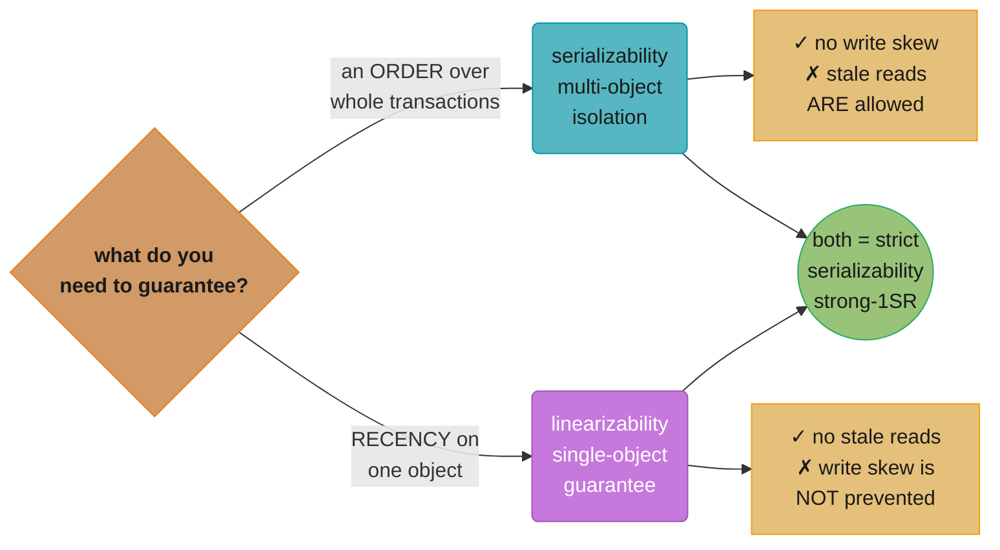
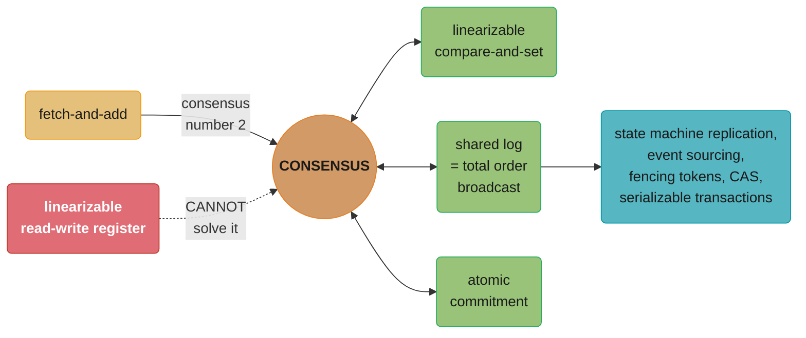
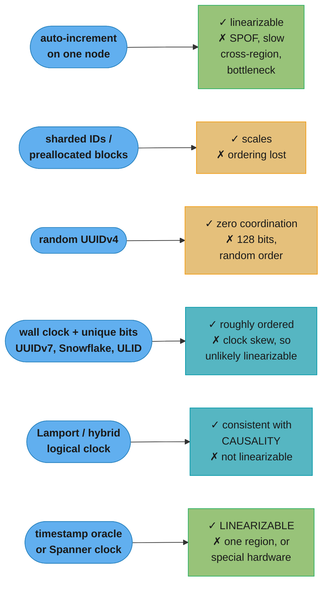

# Chapter 10: Consistency and Consensus

> Part II — Distributed Data · DDIA (Kleppmann & Riccomini, 2nd ed., O'Reilly 2026) · builds on Ch 9, closes Part II and leads to Ch 11 (batch processing)

## Chapter Map

Chapter 9 catalogued everything that goes wrong in a distributed system. This chapter is about
building services that keep working correctly anyway, using the best tool we have — replication —
without paying the price replication normally exacts in inconsistency. It opens with the two
competing philosophies (**eventual consistency**, which makes replication visible to the
application, and **strong consistency**, which hides it) and then dives into the strongly
consistent side in three movements: a precise definition of what "strong" means
(**linearizability**), the surprisingly connected problem of **generating IDs and timestamps**,
and finally **consensus**, the machinery that makes linearizability fault-tolerant. Its epigraph
is Brooks: *"Never go to sea with two chronometers; take one or three."*

**TL;DR:**
- **Linearizability is a recency guarantee**: behave as if there is a single copy of the data and
  every operation on it is atomic. Once one client reads a new value, no later read may return an
  older one.
- **It is not serializability.** Serializability is a multi-object isolation property that allows
  stale reads; linearizability is a single-object recency property that does not prevent write
  skew. Both together are **strict serializability**.
- **CAP is best avoided.** The chapter says so outright: narrow scope, idiosyncratic definitions,
  superseded by more precise results, of mostly historical interest.
- **Distributed ID schemes trade ordering for availability.** Lamport and hybrid logical clocks
  give causal ordering; only a linearizable ID generator gives linearizable ordering.
- **Single-value consensus, CAS, shared logs, and atomic commitment are all equivalent** — solve
  one and you have solved them all. In practice, **most consensus systems provide shared logs.**
- **Logical clocks are not enough for locks.** A node cannot tell whether its own timestamp is
  lowest without hearing from every other node, which is not fault tolerance. That gap is
  precisely what consensus fills.

## The Big Question

> "Replication gives me fault tolerance and takes away the illusion of a single copy. Can I get
> both — a system that survives node and network failures while still behaving like one machine —
> and what does it cost me when I do?"

The chapter frames the choice honestly before picking a side. **Eventual consistency** makes the
fact that a system is replicated visible to the application, and you as the developer are expected
to deal with the inconsistencies and conflicts — the usual home of multi-leader and leaderless
replication. **Strong consistency** says applications should not have to worry about internal
replication details and the system should behave as if it were single-node; the advantage is that
it is simpler for you, and **the disadvantage is that stronger consistency has a performance cost,
and some kinds of fault an eventually consistent system can tolerate cause outages in strongly
consistent ones.**

Which is better depends on the application. **If users can change data while offline, eventual
consistency is inevitable. If replicas sit in datacenters with fast, reliable communication, strong
consistency is often appropriate because its cost is acceptable.**

One caveat the authors state up front: **these topics are notorious for being hard to implement
correctly — it's very easy to build systems that behave fine with no faults but fall apart under an
unlucky combination the designer hadn't considered.** The chapter sticks to informal intuitions and
avoids the algorithmic nitty-gritty, formal models and proofs, and says plainly that **serious work
on consensus infrastructure requires going much deeper into the theory.**

---

## 10.1 Linearizability

If you want a replicated database to be as simple as possible to use, make it behave as if it
weren't replicated at all. That is the idea behind **linearizability** — also called *atomic
consistency*, *strong consistency*, *immediate consistency*, or *external consistency*. **The basic
idea is to make a system appear as if there were only one copy of the data, with all operations on
it atomic.**

The consequence: **as soon as one client successfully completes a write, all clients reading from
the database must be able to see the value just written.** Maintaining the single-copy illusion means
guaranteeing the value read is the most recent, not from a stale cache or replica. **Linearizability
is a recency guarantee.**

The chapter's opening example is a nonlinearizable sports website. Aaliyah and Bryce sit in the same
room checking their phones for a game result. Aaliyah refreshes, sees the winner, and excitedly
tells Bryce. Bryce hits reload, **his request goes to a lagging replica, and his phone shows the
game is still ongoing.** Had they reloaded simultaneously, two different results would have been
less surprising, since neither knows exactly when their request was processed. **But Bryce knows he
initiated his query *after* hearing the score, so he expects a result at least as recent as
Aaliyah's — and the stale result is a violation of linearizability.**

### What Makes a System Linearizable?

In distributed systems theory the object being read and written is a **register** — in practice one
key in a key-value store, one row, or one document. The operations:

| Notation | Meaning |
|----------|---------|
| *read*(x) ⇒ v | The client requested the value of register x, and the database returned v |
| *write*(x, v) ⇒ r | The client requested to set x to v; r is *ok* or *error* |
| *cas*(x, v_old, v_new) ⇒ r | Atomic **compare-and-set**: if x equals v_old, atomically set it to v_new; otherwise leave it unchanged and return an error |

Each request is drawn as a bar: the start is when the request was sent, the end is when the response
arrived. **Due to variable network delays, a client doesn't know exactly when the database processed
its request — only that it happened somewhere between sending and receiving.**

Given a write of 1 to a register initially 0, with two other clients polling:

- **A read that completes before the write begins must return the old value 0.**
- **A read that begins after the write completes must return the new value 1**, because it must have
  been processed after the write.
- **A read that overlaps the write may return either**, since we don't know whether the write had
  taken effect. Those reads are *concurrent* with the write.

But that is not yet sufficient. **If concurrent reads may freely return either value, a reader could
see the value flip back and forth several times while a write is going on — not what we expect of a
system emulating a single copy.** So linearizability adds a constraint: **there must be some point
in time, between the start and end of the write, at which the value atomically flips from 0 to 1.
Once one client's read returns the new value, all subsequent reads must also return it, even if the
write operation has not yet completed.**

```
  Each bar = one client request. The | inside marks the instant we say
  the operation took effect. Linearizability = those instants can be
  joined in an order that ALWAYS MOVES FORWARD in time, left to right.

  C  write(x,1)      [------|---------------]
  A  read(x)              [--|--] => 1
  B  read(x)                    [--|--] => 1     <-- MUST be 1: B's read
                                                     began after A's ended
  B' read(x)                          [--|--] => 0   <-- NOT LINEARIZABLE:
                                                     an earlier value after
                                                     a later one was read
```

A more complex example adds *cas* and shows several details worth internalising:

- **Requests may be reordered relative to when they were sent.** B sent a read first, then D a write
  of 0, then A a write of 1 — and B's read returns 1. That is acceptable, because the three requests
  are concurrent; perhaps B's read was slightly delayed in the network and reached the database
  after both writes.
- **A read can return a value before the writer has been told its write succeeded.** B's read
  returns 1 before A receives its *ok* — the response was simply delayed in the network.
- **The model assumes no transaction isolation.** Another client may change a value at any time; C
  reads 1 then 2 because B changed it in between. **A *cas* is how you check the value hasn't been
  concurrently changed** — B and C's *cas* requests succeed and D's fails, because by the time the
  database processes it x is no longer 0.
- **The violation to look for is a read going backwards.** B's final read is concurrent with C's
  *cas* updating x from 2 to 4; on its own, returning 2 would be fine. **But A already read 4 before
  B's read started, so B may not read an older value** — the Aaliyah-and-Bryce situation again.

It is possible, **though computationally expensive**, to test whether a system's behavior is
linearizable by recording the timings of all requests and responses and checking whether they can be
arranged into a valid sequential order.

Just as there are weak isolation levels besides serializability, **there are weaker consistency
models besides linearizability** — the *read-after-write*, *monotonic reads*, and *consistent prefix
reads* properties from Chapter 6 are examples. **Linearizability guarantees all these weaker
properties and more; it is the strongest consistency model in common use.**

> **Linearizability versus serializability.** These are easily confused, since both sound like "can
> be arranged in a sequential order," but they are quite different guarantees.
>
> - **Serializability** is an **isolation property of transactions**, where every transaction may
>   read and write **multiple objects**. It guarantees transactions behave as if executed in *some*
>   serial order, and **it is okay for that order to differ from the order they actually ran.**
> - **Linearizability** is a guarantee on reads and writes of a register — an **individual
>   object**. It does not group operations into transactions, so **it does not prevent write skew**.
>   But it is a **recency** guarantee: if one operation finishes before another starts, the later
>   one must observe a state at least as new. **Serializability has no such requirement — stale
>   reads are allowed by serializability.**
>
> Providing both is known as **strict serializability** or **strong one-copy serializability
> (strong-1SR)**. Single-node databases are typically linearizable. With distributed databases using
> optimistic methods like SSI it is more complicated: **CockroachDB provides serializability and some
> recency guarantees on reads, but not strict serializability**, because that would require
> expensive coordination between transactions. **Consistency model and isolation level can be chosen
> largely independently of each other.**

### Relying on Linearizability

Viewing a sports score a few seconds late is frivolous. Three areas where linearizability genuinely
matters:

#### Locking and leader election

A single-leader system must ensure there is **only one leader, not several (split brain)**. One way
to elect a leader is a **lease**: every node that starts up tries to acquire it and the one that
succeeds becomes leader. **However this is implemented, it must be linearizable — it should not be
possible for two nodes to acquire the lease at the same time.**

**ZooKeeper and etcd** are often used to implement distributed leases and leader election, using
consensus algorithms to provide linearizable operations in a fault-tolerant way. There are still
many subtle details — see the fencing issue in Chapter 9 — and **libraries like Apache Curator
provide higher-level recipes on top of ZooKeeper**, but a linearizable storage service is the basic
foundation.

> **Strictly speaking, ZooKeeper provides linearizable writes, but reads may be stale**, since
> there is no guarantee they are served from the current leader. **etcd since version 3 provides
> linearizable reads by default.**

Distributed locking is also used at a much finer grain in some databases: **Oracle Real Application
Clusters (RAC) uses a lock per disk page**, with multiple nodes sharing access to the same disk
storage. Since these linearizable locks sit on the critical path of transaction execution, **RAC
deployments usually have a dedicated cluster interconnect network** between database nodes.

#### Constraints and uniqueness guarantees

A username or email must uniquely identify one user; a file storage service cannot have two files
with the same path and filename. **If you want to enforce this as the data is written — so that two
concurrent creations return an error to one of them — you need linearizability.** The chapter's
framing is that registration is essentially acquiring a "lock" on the chosen username, and is very
similar to an atomic compare-and-set.

The same applies to an account balance never going negative, not selling more items than are in
stock, and two people not booking the same seat. **These constraints all require a single up-to-date
value that all nodes agree on.**

Two useful qualifications. **It is sometimes acceptable to treat such constraints loosely** — an
overbooked flight can move customers and offer compensation — in which case linearizability may not
be needed (Chapter 13 covers this). And **other kinds of constraints, such as foreign key or
attribute constraints, can be implemented without linearizability.** It is the *hard uniqueness
constraint* that requires it.

#### Cross-channel timing dependencies

The subtle detail in the sports example: **had Aaliyah not exclaimed the score, Bryce would never
have known his result was stale.** The violation was only observable because of **an additional
communication channel** — Aaliyah's voice to Bryce's ears.

The computing analogue: a website where users upload a video, with a background transcoder producing
a lower-quality version. **The video is too large for a message broker, so it is written to a file
storage service first, and only then is the transcoding instruction placed on the queue.**

```
  web server --(1) write video----> FILE STORAGE ---(5) fetch--> TRANSCODER
             --(3) enqueue job----> MESSAGE QUEUE --(4) deliver-->

  If FILE STORAGE is not linearizable, the QUEUE (3,4) can be FASTER than
  the storage service's internal replication.  At step 5 the transcoder
  sees an OLD version of the video -- or nothing at all -- and the original
  and transcoded videos become PERMANENTLY inconsistent.

  Two channels between the same pair of endpoints = a race condition,
  exactly like database replication vs Aaliyah's voice.
```

The same race occurs with **a mobile app that fetches data on receiving a push notification: the
push may go through quickly while the subsequent fetch hits a lagging replica** and misses the very
data the notification was about. **Linearizability is not the only way to avoid this, but it's the
simplest to understand** — if you control the extra channel, read-your-own-writes techniques work
too, at the cost of additional complexity.

### Implementing Linearizable Systems

Since linearizability means behaving as though there is a single copy with atomic operations, **the
simplest answer would be to really only use a single copy — but that cannot tolerate faults.**
Revisiting Chapter 6's replication methods:

| Method | Linearizable? | Why |
|--------|---------------|-----|
| **Single-leader replication** | **Potentially** | Reads and writes on the leader are likely linearizable — **but this assumes you know for sure who the leader is.** A node can think it is the leader when it is not, and a delusional leader serving requests is likely to violate linearizability. **With asynchronous replication, failover may even lose committed writes**, violating durability too. Sharding with a leader per shard doesn't affect it, since linearizability is a single-object guarantee |
| **Consensus algorithms** | **Likely** | Essentially single-leader replication with automatic election and failover, carefully designed to prevent split brain — **ZooKeeper uses Zab, etcd uses Raft.** But using consensus is not sufficient: **if reads are served from a node without checking it is still the leader, they may be stale** |
| **Multi-leader replication** | **No** | Writes are processed concurrently on multiple nodes and replicated asynchronously, producing conflicting writes that require resolution |
| **Leaderless replication** | **Probably not** | People sometimes claim quorum reads and writes (w + r > n) give "strong consistency"; **depending on the algorithm and the definition, this is not quite true.** Last-write-wins based on time-of-day clocks (Cassandra, ScyllaDB) is almost certainly nonlinearizable because **clock timestamps cannot be guaranteed consistent with actual event ordering** |

#### Linearizability and quorums

Intuitively quorums ought to be linearizable. **With variable network delays they are not:**

```
  n = 3, w = 3 (writer sends x=1 to all three), r = 2

  replica 1:  x=0 ---------> x=1
  replica 2:  x=0 ------------------> x=1
  replica 3:  x=0 ------------------> x=1

  client A reads {r1, r2}  -> sees the NEW value 1     [starts and ends first]
  client B reads {r2, r3}  -> sees the OLD value 0     [starts AFTER A ended]

  w + r > n is satisfied.  It is still NOT linearizable:
  B began after A completed, yet B returned the older value.
```

**Dynamo-style quorums can be made linearizable at the cost of reduced performance**: a reader must
perform **read repair synchronously** before returning results, and before writing, **a writer must
read the latest state of a quorum to fetch the latest timestamp of any prior write and ensure its
new write has a greater one.** But **Riak does not perform synchronous read repair due to the
performance penalty**, and **Cassandra does wait for read repair on quorum reads but loses
linearizability through its use of time-of-day clocks.**

And a hard limit: **only linearizable read and write operations can be implemented this way — a
linearizable compare-and-set cannot, because it requires a consensus algorithm.** So **it is safest
to assume a leaderless Dynamo-style system does not provide linearizability, even with quorum reads
and writes.**

### The Cost of Linearizability

Consider a two-region deployment where the network inside each region works but the regions cannot
reach each other — **a network partition.**

- **With multi-leader replication, each region continues operating normally**: writes from one
  region are asynchronously replicated to the other, so they queue up and are exchanged when
  connectivity returns.
- **With single-leader replication, the leader is in one region.** Writes and linearizable reads
  must go to the leader, so clients in the follower region cannot write, nor make linearizable
  reads. They can read from the follower, **but the results may be stale.** If the application
  requires linearizability, **it becomes unavailable in the regions that cannot reach the leader.**

#### The CAP theorem

**This is not a consequence of the particular replication method: any linearizable database has this
problem, however it is implemented**, and it is not specific to multi-region deployments — it can
occur on any unreliable network, even within one region.

| Choice | Behaviour under a partition |
|--------|-----------------------------|
| **CP** (consistent under network partitions) | The application *requires* linearizability, so disconnected replicas must either wait until the network is fixed or return an error — **either way they become unavailable** |
| **AP** (available under network partitions) | The application does *not* require linearizability, so each replica processes requests independently — **available, but not linearizable** |

Named by **Eric Brewer in 2000**, though **the trade-off had been known to designers of distributed
databases since the 1970s.** CAP was proposed as a rule of thumb without precise definitions, and it
deserves credit for a culture shift: at the time many distributed databases focused on linearizable
semantics on a cluster with shared storage, and **CAP encouraged engineers to explore
shared-nothing designs more suitable for large-scale web services — it helped trigger the NoSQL
movement.**

> **The unhelpful CAP theorem.** CAP is sometimes presented as *"Consistency, Availability,
> Partition tolerance: pick 2 of 3."* **This is misleading, because network partitions are a kind of
> fault — they are not something you have a choice about; they will happen whether you like it or
> not.** When the network works correctly a system can provide both consistency and total
> availability; only when a fault occurs must you choose. **A better phrasing is "either Consistent
> or Available when Partitioned."**
>
> The CP/AP scheme has further flaws: **"consistency" is formalized as linearizability** and the
> theorem says nothing about weaker models, and **the formalization of "availability" does not match
> the usual meaning of the term** — many highly available, fault-tolerant systems do not meet CAP's
> idiosyncratic definition. **Some systems, with good reason, provide neither, so they are neither
> CP nor AP.**

The chapter's verdict is unusually direct: **"there is a lot of misunderstanding and confusion
around CAP, and it does not help us understand systems better, so CAP is best avoided."** As
formally defined it considers **one consistency model (linearizability) and one kind of fault
(network partitions, which according to data from Google are the cause of less than 8% of
incidents).** It says nothing about network delays, dead nodes, or other trade-offs.

**PACELC** generalizes it: during a **P**artition choose between **A**vailability and
**C**onsistency; **E**lse, when there is no partition, choose between **L**atency and
**C**onsistency. **But it inherits several of CAP's problems, such as the counterintuitive
definitions.** The chapter's closing line on the subject: **CAP has now been superseded by more
precise results, so it is of mostly historical interest today.**

#### Linearizability and network delays

**Surprisingly few systems are actually linearizable in practice — even RAM on a modern multi-core
CPU is not.** If a thread on one core writes to a memory address and a thread on another reads it
shortly after, **it is not guaranteed to read the value written, unless a memory barrier or fence is
used.** Every core has its own cache and store buffer; memory access goes to the cache by default
and changes are written out to main memory asynchronously. **Since cache access is much faster than
main memory, this is essential for good performance — but it creates several asynchronously-updated
copies, so linearizability is lost.**

**And the reason is performance, not fault tolerance.** It makes no sense to invoke CAP here: within
one computer we assume reliable communication and don't expect a core to keep working while
disconnected from the rest of the machine. **The same is true of many distributed databases that
choose not to provide linearizability — they do so primarily to increase performance.
Linearizability is slow, and this is true all the time, not only during a network fault.**

Is a more efficient implementation possible? **Attiya and Welch prove that if you want
linearizability, the response time of read and write requests is at least proportional to the
uncertainty of delays in the network.** In a network with highly variable delays — which is most
computer networks — **linearizable response times are inevitably high. A faster algorithm does not
exist**, but weaker consistency models can be much faster.

---

## 10.2 ID Generators and Logical Clocks

Assigning a unique ID to database records gives you a primary key. **In single-node databases an
auto-incrementing integer is common**, storable in 64 bits (or 32 if you are sure you'll never
exceed 4 billion records, **but that is risky**). Its other advantage: **the order of the IDs tells
you the order in which records were created** — a chat application can display messages by
increasing ID and the threads make sense, with a question at ID 1 and its answer at a greater ID.

**A single-node ID generator is another example of a linearizable system.** Each fetch is a
*fetch-and-add*: atomically increment a counter and return the old value. **Linearizability ensures
that if one message's posting completes before another begins, the second gets the greater ID.** For
genuinely concurrent messages, linearizability doesn't specify the order, only that IDs are unique.

An in-memory version is easy — **the CPU's atomic increment instruction lets multiple threads safely
increment one counter** — and persistence takes a bit more effort so a crash doesn't reset the
counter and produce duplicates. **The real problems are three:**

- **Not fault-tolerant** — that node is a single point of failure.
- **Slow across regions** — creating a record elsewhere may require a round trip to the other side
  of the planet just to get an ID.
- **A bottleneck** at high write throughput.

The alternatives, and what each gives up:

| Scheme | How it works | What it costs |
|--------|-------------|---------------|
| **Sharded ID assignment** | Multiple nodes assign IDs — one only even, one only odd; generally, reserve bits for a shard number | Compact, **but you lose ordering**: with messages 16 and 17 you don't know which was sent first, since one node may have been ahead of the other |
| **Preallocated blocks** | Node A claims 1–1,000, node B claims 1,001–2,000, each hands out from its block and requests a new block when running low | **Doesn't ensure ordering either** — one message may get an ID in 1,001–2,000 while a later one gets an ID in 1–1,000 from a different node |
| **Random UUIDs** | Generated locally on any node with no communication; **version 4 is essentially a random number long enough that a collision is very unlikely** | **128 bits**, and **the order is also random** — comparing two tells you nothing about which is newer |
| **Wall-clock timestamp made unique** | An NTP-kept time-of-day timestamp in the most significant bits, remaining bits filled with a shard number plus per-shard sequence, or a long random value | Used by **UUIDv7, Twitter's Snowflake, ULIDs, Hazelcast's Flake ID generator, MongoDB ObjectIDs**; implementable in application code or within a database |

**All these generate unique IDs but have much weaker ordering guarantees than the single-node
scheme.** Wall-clock timestamps give at best an approximate order: **if an earlier write gets a
timestamp from a slightly fast clock and a later write's is from a slightly slow one, the timestamp
order is inconsistent with what actually happened** — and with clock jumps from a non-monotonic
clock, **even timestamps from a single node might be ordered incorrectly. ID generators based on
wall-clock time are therefore unlikely to be linearizable.**

You can reduce this with high-precision synchronization using atomic clocks or GPS receivers. **But
it would also be nice to generate unique, correctly ordered IDs without special hardware. That's
what logical clocks are about.**

### Logical Clocks

Time-of-day and monotonic clocks are both **physical clocks**: they measure the passing of seconds.
**A logical clock is an algorithm that counts the events that have occurred.** A logical timestamp
doesn't tell you what time it is, **but you can compare two of them to tell which is earlier.**

The requirements are typically:

- **Compact** (a few bytes) and **unique**;
- **Totally ordered** — any two timestamps can be compared;
- **Consistent with causality** — if operation A happened before B, A's timestamp is less than B's.

**A single-node ID generator meets these; the distributed ID generators above do not meet the causal
ordering requirement.**

#### Lamport timestamps

**A Lamport clock, proposed in 1978 by Leslie Lamport in what is now one of the most-cited papers in
distributed systems**, generates logical timestamps that *are* consistent with causality, usable as
a distributed ID generator.

```
  A Lamport timestamp = (counter, node ID)

  Each node has a unique ID and a counter of operations it has processed.
  RULE 1: every time a node generates a timestamp, it INCREMENTS its counter
          and uses the new value.
  RULE 2: every time a node SEES a timestamp from another node whose counter
          is greater than its local counter, it RAISES its counter to match.

  Aaliyah  --(1,"Aaliyah") post----\
  Caleb    --(1,"Caleb")   post----->  Bryce receives both, raises counter to 1
  Bryce    --(2,"Bryce")   reply ------ increments to 2 for his own message

  COMPARING: compare counters first; if equal, compare node IDs
             lexicographically.
    (1,"Aaliyah") < (1,"Caleb") < (2,"Bryce")
```

Two nodes may sometimes have the same counter value; **including the node ID makes each timestamp
unique.** In the example, Aaliyah had not yet seen Caleb's message when posting hers, and vice
versa, so both attach counter 1; Bryce raises his counter to 1 on receiving them, then increments to
2 for his reply to Aaliyah — which correctly orders after the message it answers.

#### Hybrid logical clocks

Lamport timestamps capture order well but have **two limitations**: they have **no direct relation
to physical time**, so you cannot use them to find all the messages posted on a particular date
without storing physical time separately; and **if two nodes never communicate, one node's counter
increments are never reflected in the other's**, so events generated around the same time on
different nodes can have wildly different counter values.

**A hybrid logical clock combines the advantages of physical time-of-day clocks with the ordering
guarantees of Lamport clocks.** Like a physical clock it counts seconds or microseconds; like a
Lamport clock, when a node sees a greater timestamp from another node it moves its own value
forward — **so if one node's clock runs fast, the others move forward too when they communicate.**
Every generated timestamp is also incremented, **which ensures the clock moves monotonically forward
even if the underlying physical clock jumps backwards, for example due to NTP adjustments.** The
hybrid clock might be slightly ahead of the physical clock, and the algorithm's details keep that
discrepancy as small as possible.

The result: **you can treat a hybrid logical timestamp almost like a conventional time-of-day
timestamp, with the added property that its ordering is consistent with the happens-before
relation.** It needs no special hardware, only roughly synchronized clocks. **Hybrid logical clocks
are used by CockroachDB.**

#### Lamport/hybrid logical clocks vs. vector clocks

Snapshot isolation is often implemented by giving each transaction an ID and letting it see writes
by lower-numbered transactions while hiding higher ones. **Lamport clocks and hybrid logical clocks
are a good way of generating those transaction IDs, because they ensure the snapshot is consistent
with causality.**

What they cannot do: **when multiple timestamps are generated concurrently, these algorithms order
them arbitrarily, so looking at two timestamps you generally can't tell whether they were concurrent
or one happened before the other.** (In the chat example you *can* tell Aaliyah's and Caleb's were
concurrent because the counters match, **but when counter values differ you can't tell.**) **To
determine when records were created concurrently you need a vector clock — whose timestamps are much
bigger, potentially one integer per node in the system.**

### Linearizable ID Generators

Lamport and hybrid logical clocks give useful ordering, **but weaker than a linearizable single-node
ID generator. Linearizability requires that if request A completed before request B began, B has the
higher ID even if A and B never communicated. A Lamport clock can only ensure a node generates
timestamps greater than any it has seen — it can say nothing about timestamps it hasn't seen.**

The chapter's example of what goes wrong is worth stating in full, because it is a privacy bug, not
a curiosity:

```
  User A, on a LAPTOP:  changes account settings public -> PRIVATE
  User A, on a PHONE:   uploads an embarrassing photo

  Account settings and photos live in SEPARATE databases (or shards), each
  assigning Lamport / hybrid-logical timestamps.  The photos database never
  read from the accounts database, so its local counter may LAG:

     photo upload      ts = 12    <-- lower, despite happening LATER
     settings -> private ts = 17

  A viewer (not a friend) reads A's profile under MVCC snapshot isolation
  at ts = 15:
     15 > 12  -> the photo IS visible
     15 < 17  -> the account still looks PUBLIC

  Result: the system shows the viewer the photo they were never meant to see.
```

The candidate fixes the chapter considers and rejects: **the photos database could read the account
status before writing, but it's easy to forget such a check**; and **if A's actions had been on the
same device, the app could track the latest timestamp of that user's writes — but with a laptop and
a phone that's not so easy. The simplest solution is a linearizable ID generator**, which would
guarantee the photo upload gets the greater ID.

#### Implementing a linearizable ID generator

**The simplest way is to actually use a single node.** It needs only to atomically increment a
counter and return its value, persist the counter so a crash doesn't produce duplicates, and
replicate it for fault tolerance using single-leader replication. **This is used in practice:
TiDB/TiKV calls it a *timestamp oracle*, inspired by Google's Percolator.**

**As an optimization, avoid a disk write and replication on every request**: persist and replicate a
record describing a *batch* of IDs, then hand them out in sequence, persisting the next batch before
running out. **Some IDs will be skipped if the node crashes or you fail over, but you won't issue
duplicate or out-of-order IDs.**

The limitations are structural. **You can't easily shard the ID generator**, since independent
shards handing out IDs no longer guarantee linearizable order, **and you can't easily distribute it
across regions** — in a geographically distributed database all ID requests go to a node in a single
region. **On the upside, the job is very simple, so one node can handle a large request throughput.**

The alternative is **Spanner's approach**: a physical clock returning **not a single timestamp but a
range indicating the uncertainty in the reading**, then **waiting for that uncertainty interval to
elapse before returning.** Assuming the interval is correct, this also ensures a later request gets
a greater timestamp — **and it does so without any communication, so even requests in different
regions are ordered correctly without cross-region waits. The downside is that you need hardware and
software support for tightly synchronized clocks** and for computing the uncertainty interval.

#### Enforcing constraints using logical clocks

A linearizable compare-and-set can implement locks and uniqueness constraints. **Is a logical clock
or a linearizable ID generator sufficient too? Not quite.**

You could assign timestamps to competing lock or username requests and pick the lowest as the
winner. With a linearizable clock, you know future requests will always get greater timestamps, so
**no future request can undercut the winner.** But:

> **How does a node know whether its own timestamp is the lowest? To be sure, it needs to hear from
> *every* other node that might have generated a timestamp.** If one of those nodes has failed or
> is unreachable, **the system grinds to a halt, because we can't be sure whether that node might
> have the lowest timestamp. This is not the kind of fault-tolerant system that we need.**

**To implement locks, leases and similar constructs in a fault-tolerant way, we need something
stronger: we need consensus.**

---

## 10.3 Consensus

Everything in this chapter is easy on a single node and hard with fault tolerance:

- **A database can be linearizable with a single leader** — but how do you fail over without split
  brain, and how do you ensure a node that believes it is the leader hasn't been voted out?
- **A linearizable ID generator is just a counter with atomic fetch-and-add** — but what if it
  crashes?
- **An atomic compare-and-set may be one CPU instruction** — but how do you make it fault-tolerant?

**All of these are instances of the same fundamental problem: consensus.** It is one of the most
important and fundamental problems in distributed computing, **infamously difficult to get right,
and many systems have got it wrong in the past.**

The best-known algorithms are **Viewstamped Replication, Paxos, Raft and Zab.** There are quite a
few similarities between them, **but they are not the same.** All work in a **non-Byzantine system
model**: network communication may be arbitrarily delayed or dropped and nodes may crash, restart
and disconnect, **but nodes otherwise follow the protocol correctly and do not behave maliciously.**
There are also **Byzantine fault tolerant (BFT)** consensus algorithms tolerating nodes that send
contradictory messages — **a common assumption is that fewer than one-third of nodes are
Byzantine-faulty** — used in blockchains, **but BFT is beyond the scope of the book.**

> **The impossibility of consensus.** The **FLP result** (Fischer, Lynch, Paterson) proves there is
> no algorithm always able to reach consensus if a node may crash. So how are we discussing
> consensus algorithms at all? **First, FLP doesn't say we can never reach consensus — only that we
> can't guarantee a consensus algorithm will *always* terminate.** Second, it is proved assuming a
> **deterministic algorithm in the asynchronous system model**, meaning the algorithm cannot use any
> clocks or timeouts. **If it can use timeouts to suspect a node has crashed — even if the suspicion
> is sometimes wrong — consensus becomes solvable. Even just allowing random numbers is sufficient
> to get around the impossibility result.** FLP is of great theoretical importance; **distributed
> systems can usually achieve consensus in practice.**

### The Many Faces of Consensus

Consensus can be expressed in several ways: **single-value consensus** (very similar to an atomic
compare-and-set, usable for locks, leases and uniqueness constraints); **an append-only log**,
usually formalized as **total order broadcast**, from which you build state machine replication,
leader-based replication and event sourcing; and **atomic commitment** of a multi-shard transaction.

**These problems are all equivalent to each other: if you have an algorithm that solves one, you can
convert it into a solution for any of the others.** The chapter calls this "quite a profound and
perhaps surprising insight," and it is why they are lumped together under one name despite looking
quite different on the surface.

#### Single-value consensus

One or more nodes **propose** values and the algorithm **decides** on one of them. The four
properties:

| Property | Statement | Kind |
|----------|-----------|------|
| **Uniform agreement** | No two nodes decide differently | Safety |
| **Integrity** | Once a node has decided one value, it cannot change its mind | Safety |
| **Validity** | If a node decides value *v*, then *v* was proposed by some node | Safety |
| **Termination** | Every node that does not crash eventually decides some value | **Liveness** |

**Agreement and integrity define the core idea**: everyone decides the same outcome and cannot
change their mind. **Validity rules out trivial solutions** — an algorithm that always decides
`null` would satisfy agreement and integrity but not validity. And **all the difficulty arises from
the need for fault tolerance**: without it, you could hardcode one node as "dictator," but if it
fails the system can no longer decide anything.

**Termination formalizes fault tolerance**: even if some nodes fail, the others must still reach a
decision. It is not enough to wait for a crashed node to recover — **imagine an earthquake and the
datacenter buried under 30 feet of mud; you must assume it is never coming back.**

There is a limit: **any consensus algorithm requires at least a majority of nodes to be functioning
correctly in order to assure termination**, and that majority can safely form a quorum. **But most
consensus algorithms ensure the safety properties are always met, even if a majority of nodes fail
or there is a severe network problem — so a large-scale outage can stop the system processing
requests, but it cannot corrupt it by causing inconsistent decisions.**

#### Compare-and-set as consensus

**Given a fault-tolerant, linearizable CAS, consensus is easy**: set the object to null; each node
proposing a value invokes CAS expecting null with its own value as the new one; the decided value is
whatever the object ends up set to.

**Conversely, given consensus you can implement CAS**: propose the new values via the consensus
protocol and set the object to whatever was decided, returning an error for invocations whose value
wasn't chosen; CAS invocations with different expected values use separate consensus runs. **So CAS
and consensus are equivalent.** A real distributed example is **conditional write operations for
object stores**, which allow a write only if the object hasn't been created or modified since the
client last read it.

But a weaker primitive is not enough: **a linearizable read-write register is not sufficient to
solve consensus.** The reasoning is elegant — FLP says consensus cannot be solved deterministically
in the asynchronous crash-stop model, **yet a linearizable register can be implemented using quorum
reads and writes in that same model. It follows that a linearizable register cannot solve
consensus.**

#### Shared logs as consensus

**A shared log is one where multiple nodes can request entries to be appended**, unlike a log with a
single writer. Single-leader replication is an example: any client asks the leader to write, the
leader appends to the replication log, and all followers apply the writes in the same order.

Formally, a shared log supports requesting a value be added and reading the entries, satisfying:

| Property | Statement |
|----------|-----------|
| **Eventual append** | If a non-crashing node requests a value be added, it must eventually read that value in a log entry |
| **Reliable delivery** | No entries are lost: if one node reads an entry, eventually every non-crashing node reads it |
| **Append-only** | Once read, an entry is immutable; new entries only go after it. Re-reading gives the same entries in the same order, even after a crash and restart |
| **Agreement** | If two nodes both read entry *e*, then prior to *e* they read exactly the same sequence in the same order |
| **Validity** | If a node reads an entry containing a value, some node previously requested that value be added |

> **A shared log is formally known as total order broadcast, atomic broadcast, or total order
> multicast** — the same thing in different words: requesting a value be added is "broadcasting" it,
> and reading a log entry is "delivering" it.

**Given a shared log, consensus is easy**: every node requests its value be added, and whichever
value comes back in the first log entry is decided. Since all nodes read entries in the same order,
they agree.

**Given consensus, you can implement a shared log**, with more care:

1. **A slot for every future log entry**, with a separate instance of the consensus algorithm per
   slot to decide what goes in it.
2. A node wanting to add a value **proposes it for a slot that has not yet been decided.**
3. When a slot is decided **and all previous slots have been decided**, the value is appended, along
   with any consecutive already-decided slots.
4. **If a proposed value was not chosen for some slot, the node retries by proposing it for a later
   slot.**

**So consensus is equivalent to total order broadcast and shared logs.** Note the liveness gap:
**single-leader replication without failover does not meet the liveness requirement, since it stops
delivering messages if the leader crashes — the challenge is performing failover safely and
automatically.**

#### Fetch-and-add as consensus

The linearizable ID generator **comes close to solving consensus but falls slightly short.**

Given CAS, fetch-and-add is easy: read the counter, then CAS with the read value as expected and
value+1 as new, retrying on failure. **Less efficient than a native fetch-and-add under contention
but functionally equivalent** — and since CAS follows from consensus, so does fetch-and-add.

**The converse fails.** Initialize a counter to zero and have every proposing node increment it. One
node reads zero and is the winner; the rest read something incremented. **But the others know only
that they are not the winner, not which node won.** The winner could announce itself — **but what if
it crashes before sending that message? The others are left hanging, unable to decide, so consensus
does not terminate. And they can't fall back to another node, because the node that read zero may
yet come back and rightly decide its own value.**

**The exception is exactly two proposers**: the nodes exchange their proposed values, then both
fetch-and-add; the one reading zero decides its own value and the one reading one decides the
other's. **This is why fetch-and-add has a *consensus number* of two, whereas CAS and shared logs
solve consensus for any number of proposers and have a consensus number of ∞.**

#### Atomic commitment as consensus

Atomic commitment ensures all shards in a distributed transaction either commit or abort, and 2PC
solves it **with a coordinator that is a single point of failure.** Consensus and atomic commitment
look similar, but there is **one important difference: with consensus it's okay to decide any value
that was proposed, whereas with atomic commitment the algorithm *must* abort if *any* participant
voted to abort.**

Formally, atomic commitment adds two properties to consensus's shape:

| Property | Statement |
|----------|-----------|
| **Uniform agreement** | No two nodes decide on different outcomes |
| **Integrity** | Once decided, a node cannot change its mind |
| **Validity** | **If a node decides to commit, all nodes must have previously voted to commit. If any node voted to abort, the nodes must abort** |
| **Non-triviality** | **If all nodes vote to commit and no communication timeouts occur, all nodes must decide to commit** |
| **Termination** | Every node that does not crash eventually decides commit or abort |

**Validity ensures a transaction can only commit if all nodes agree; non-triviality ensures the
algorithm can't simply always abort** (but permits an abort if communication times out).

**From consensus to atomic commitment**: every node sends its vote to every other node; a node that
received commit votes from itself and everyone proposes "commit" via consensus, while a node that
received an abort vote or experienced a timeout proposes "abort"; each node then commits or aborts
per the decision. **"Commit" is only proposed if all nodes voted to commit**, and if some nodes
propose abort while others propose commit because of a timeout, **it doesn't matter which is decided
as long as all do the same.**

**From atomic commitment to consensus**: each proposing node starts a transaction on a quorum, and
at each node performs a single-node CAS setting a register to the proposed value if not already set
by another transaction; success means voting commit, failure means abort. **If the protocol commits,
that value is decided; if it aborts, the node retries with a new transaction.** So **atomic commit
and consensus are also equivalent.**

### Consensus in Practice

Single-value consensus, CAS, shared logs and atomic commitment are all equivalent — **a valuable
theoretical insight, but it doesn't answer which formulation is most useful in practice.**

**The answer is that most consensus systems provide shared logs, also known as total order
broadcast. Raft, Viewstamped Replication and Zab provide shared logs right out of the box. Paxos
provides single-value consensus, but in practice most systems using Paxos actually use Multi-Paxos,
which also provides a shared log.**

#### Using shared logs

**A shared log is a good fit for database replication**: if every entry is a write and every replica
processes the same writes in the same order using deterministic logic, all replicas end up
consistent. **This is state machine replication, the principle behind event sourcing**, and shared
logs are also useful for stream processing (Ch 12). Similarly, **a shared log can implement
serializable transactions**: if each entry is a deterministic transaction executed as a stored
procedure and every node executes them in the same order, the transactions are serializable.

> **Sharded databases with a strong consistency model often maintain a separate log per shard**,
> which improves scalability **but limits the consistency guarantees they can offer across shards**
> (consistent snapshots, foreign key references). **Serializable transactions across shards are
> possible but require additional coordination.**

A shared log is powerful because it adapts to the other forms of consensus:

- **Single-value consensus and CAS**: decide the value that appears first in the log.
- **Many instances of single-value consensus** (one per theater seat): include the seat number in
  entries and decide the first entry containing that seat number.
- **Atomic fetch-and-add**: put the addend in a log entry; the current counter is the sum of entries
  so far. **A simple counter on log entries can generate fencing tokens — in ZooKeeper this sequence
  number is called `zxid`.**

#### From single-leader replication to consensus

Consensus is easy with a single "dictator," and a shared log is easy if a single leader is the only
appender. **The question is fault tolerance when that node fails.** Traditionally, single-leader
databases left failover to a human administrator, **which means significant downtime — there is a
limit to how fast humans react — and it doesn't satisfy the termination property.**

But this looks circular: **we need consensus to elect a leader, and a leader to solve consensus.**
The way out:

> **Consensus algorithms don't require that there is only one leader at any one time. They make a
> weaker guarantee: they define an *epoch number* — the *ballot number* in Paxos, *view number* in
> Viewstamped Replication, *term number* in Raft — and guarantee that within each epoch, the leader
> is unique.**

When a node believes the leader is dead because it hasn't heard from it within a timeout, **it may
start a vote for a new leader with a new, greater epoch number. If two leaders in different epochs
conflict — perhaps the previous leader wasn't dead after all — the leader with the higher epoch
prevails.**

Before appending the next entry, **a leader must check no other leader with a higher epoch might
append a different one, by collecting votes from a quorum — typically, but not always, a majority. A
node votes yes only if it is not aware of any leader with a higher epoch.**

```
  TWO ROUNDS OF VOTING

  round 1: elect a leader for epoch N   (quorum vote)
  round 2: approve each log entry       (quorum vote, per entry)

  The two quorums MUST OVERLAP: if a proposal vote succeeds, at least one
  voter also took part in the most recent successful leader election.
  So a proposal that passes without revealing a higher epoch proves no
  higher-epoch leader exists -- the entry can be appended safely.

  NOT two-phase commit, despite the resemblance:
    consensus  -- ANY node can start an election; needs only a QUORUM
    2PC        -- only the COORDINATOR requests votes; needs YES from EVERY
                  participant before it can commit
```

#### Subtleties of consensus

**This basic structure is common to Raft, Multi-Paxos, Zab and Viewstamped Replication**: a quorum
vote elects a leader, then another quorum vote is required for each entry the leader appends, and
**every new entry is synchronously replicated to a quorum before being confirmed to the client** —
which is what ensures the entry survives the leader failing.

**The devil is in the details, and that's where the algorithms differ.** When a new leader is
elected it must honor entries the old leader appended before failing: **Raft only allows a node to
become leader if its log is at least as up-to-date as a majority of its followers; Paxos allows any
node to become leader but requires it to bring its log up to date before appending new entries.**

> **Consistency vs. availability in leader election.** For the shared-log properties to hold
> strictly, **the new leader must be up to date with any confirmed entries before processing writes
> or linearizable reads. If a node with stale data became leader, it might write new values into
> entries the old leader had already written, violating the append-only property.**
>
> You may choose to weaken this for faster recovery: **Kafka offers *unclean leader election*,
> allowing any replica to become leader even if not up to date**, and with asynchronous replication
> you cannot guarantee any follower is current when the leader fails. **Dropping the requirement may
> improve performance and availability, but you are on thin ice, since the theory of consensus no
> longer applies** — fine with no faults, and Chapter 9's problems can easily cause a lot of data
> loss or corruption.

Two further practical points. **Linearizable reads must also go through a quorum vote, similarly to
a write, to confirm the node that believes it is the leader really still is up to date — this is how
linearizable reads work in etcd.** And **most consensus algorithms assume a fixed set of voting
nodes**, fixed when the cluster is created; **reconfiguration features extend them to add and remove
nodes**, which is especially useful when adding regions or migrating between locations by adding new
nodes and then removing the old ones.

#### Pros and cons of consensus

**Consensus is essentially "single-leader replication done right"** — automatic failover on leader
failure, no committed data lost, no split brain possible, even under Chapter 9's problems. Which
gives a sharp corollary: **since single-leader replication with automatic failover is essentially
one of the definitions of consensus, any system that provides automatic failover but does not use a
proven consensus algorithm is likely to be unsafe.** (Using one is not a guarantee that the whole
system is correct — **there are still plenty of other places where bugs can lurk — but it's a good
start.**)

The costs, which are why it isn't used everywhere:

| Cost | Detail |
|------|--------|
| **Strict majority required** | **Three nodes to tolerate one failure, five to tolerate two** |
| **No throughput scaling** | Every operation must communicate with a quorum, so **adding nodes doesn't increase throughput — in fact every node you add makes the algorithm slower** |
| **Minority partitions block** | **Only the majority portion can make progress**; the rest are blocked |
| **Timeout tuning** | Failure detection relies on timeouts, hard to tune with highly variable delays or across regions: **too large and recovery is slow; too small and you get constant leader elections, so the system spends more time choosing leaders than doing useful work** |
| **Sensitivity to specific network faults** | **Raft has unpleasant edge cases**: if everything works except one consistently unreliable link, **leadership can bounce between two nodes or the leader be continually forced to resign, so the system effectively never makes progress.** More robust algorithms are still an open research problem |

**For systems that want high availability without the cost of consensus, the only real alternative
is a weaker consistency model** — leaderless or multi-leader replication. **These generally don't
offer linearizability, but for applications that don't need it that is fine.**

### Coordination Services

Consensus is useful in any distributed database offering linearizable operations, **but one family
of systems is a particularly prominent user: coordination services such as ZooKeeper, etcd or
Consul.** They look superficially like key-value stores **but are not designed for general-purpose
data storage** — they exist to **coordinate between nodes of another distributed system.
Kubernetes relies on etcd; Spark and Flink in high-availability mode rely on ZooKeeper running in
the background.** They hold **small amounts of data that fit entirely in memory** (though still
written to disk for durability), replicated across nodes by a fault-tolerant consensus algorithm.

**Modeled after Google's Chubby lock service**, they combine consensus with four features that turn
out to be particularly useful:

| Feature | What it does | Needs consensus? |
|---------|--------------|------------------|
| **Locks and leases** | Built on atomic fault-tolerant CAS: if several nodes concurrently try to acquire the same lease, only one succeeds | **Yes** |
| **Support for fencing** | Monotonically increasing IDs per log entry as fencing tokens — **`zxid` and `cversion` in ZooKeeper, revision number in etcd** | **Yes** |
| **Failure detection** | Clients hold a long-lived session with periodic heartbeats; leases survive a temporary interruption or server failure, but **no heartbeat for longer than the lease timeout and the service assumes the client is dead and releases the lease (ZooKeeper calls these *ephemeral nodes*)** | No |
| **Change notifications** | A client can be notified when certain keys change — learning that another client joined, or failed because its session timed out and its ephemeral nodes disappeared — **saving the client from frequent polling** | No |

> **Managing configuration with coordination services.** Timeouts, thread pool sizes and similar
> parameters are sometimes stored as key-value pairs, with processes loading settings at startup and
> subscribing to change notifications, then either using a new setting immediately or restarting.
> **This doesn't need the consensus aspect at all** — it is convenient if you are already running
> the service, but **a process could equally poll a file or URL, avoiding the need for a specialized
> service.**

#### Allocating work to nodes

Two use cases. **Choosing one of several process instances as leader or primary**, with another
taking over on failure — necessary for single-leader databases and appropriate for job schedulers
and similar stateful systems. And **deciding which shard of a sharded resource is assigned to which
node**, moving shards to new nodes to rebalance and taking over a failed node's work.

**These are achieved by judicious use of atomic operations, ephemeral nodes and notifications.**
Done correctly, this lets the application recover from faults without human intervention. **It's not
easy, despite libraries such as Apache Curator providing higher-level tools on top of the ZooKeeper
client API — but it is still much better than implementing the consensus algorithms from scratch,
which would be very prone to bugs.**

The architectural payoff: **a dedicated coordination service can run on a fixed set of nodes,
usually three or five, regardless of how many nodes rely on it.** In a storage system with thousands
of shards **it would be terribly inefficient to run consensus over thousands of nodes; it's much
better to "outsource" consensus to a small number of nodes.**

And a scope limit: **the data is quite slow-changing** — "the node running on IP address 10.1.1.23
is the leader for shard 7" — with assignments changing on a timescale of minutes or hours.
**Coordination services are not intended for data that may change thousands of times per second**;
for that, use a conventional database, **or tools like Apache BookKeeper to replicate fast-changing
internal state.**

#### Service discovery

ZooKeeper, etcd and Consul are also often used for **service discovery** — finding which IP address
to connect to for a particular service. **In cloud environments, where virtual machines continually
come and go, you often don't know service IP addresses ahead of time**, so services register their
network endpoints at startup in a registry where others can find them.

It is convenient — **failure detection and change notification make it easy to track instances as
they come and go**, and if you already run the service for leases and leader election it already
knows which node should receive requests. **However, using consensus for service discovery is often
overkill: this use case often doesn't require linearizability, and it's more important that service
discovery is highly available and fast, since without it everything would grind to a halt.** So it
is **often preferable to cache service discovery information and accept slight staleness** —
**DNS-based service discovery uses multiple layers of caching** to get performance and availability.

**ZooKeeper supports *observers*** for exactly this: replicas that receive the log and maintain a
copy of the data **but do not participate in the consensus algorithm's voting.** Reads from an
observer **are not linearizable as they might be stale, but they remain available even if the
network is interrupted, and they increase read throughput by caching.**

---

## Beyond the book — how this chapter was re-cut from the first edition

> The chapter itself makes no comparison to the first edition. The note below is this repo's, for
> readers holding both `book/` folders side by side; nothing above this heading depends on it.

The second edition rewrote this chapter substantially, and two structural changes matter when
navigating between the editions. **Two-phase commit and the XA discussion now live in Chapter 8
(Transactions)**, where this chapter only refers back to them under "atomic commitment as
consensus"; in the first edition they sat here. And **the whole "ID Generators and Logical Clocks"
span — Lamport timestamps, hybrid logical clocks, linearizable ID generators — is new material at
this position.** So a reader following a first-edition reference to "Chapter 9, ordering
guarantees" will not find the same section layout here. The 1e summary in this repo is
[Ch 9, Consistency and Consensus](../../designing_data_intensive_applications/09_consistency_and_consensus/09_consistency_and_consensus.md).

---

## Visual Intuition



*The distinction the chapter says people most often collapse. Neither guarantee implies the other,
which is why the combination has its own name.*



*The equivalence class at the heart of the chapter. The two edges that are not double-headed are the
interesting ones: fetch-and-add stops at two proposers, and a linearizable register cannot get there
at all.*

```
  WHY QUORUMS ARE NOT ENOUGH (n=3, w=3, r=2)

  time ---->
  writer  set x=1 to all three   [==================================]
  r1      x=0 ------------------ x=1
  r2      x=0 ----------------------------------- x=1
  r3      x=0 ----------------------------------- x=1

  client A reads {r1,r2}   [--] => 1     w + r > n  ✓  quorum satisfied
  client B reads {r2,r3}        [--] => 0

  B STARTED after A FINISHED, and B saw the older value.
  Not linearizable.  Fixing it needs SYNCHRONOUS read repair on reads and a
  quorum read before every write -- and even then, only reads and writes.
  A linearizable compare-and-set still needs consensus.
```

*The counterexample worth memorising, because "w + r > n means strong consistency" is the single
most common thing this chapter corrects.*



*Six ID schemes on one axis: how much ordering you keep versus how much coordination you must pay
for. Only the last row buys the guarantee the privacy example needed.*

---

## Key Concepts Glossary

| Term | One-line definition |
|------|---------------------|
| **Eventual consistency** | The philosophy that replication is visible to the application, which must handle inconsistencies and conflicts |
| **Strong consistency** | The philosophy that the system should behave as if single-node, at a performance cost |
| **Linearizability** | Behaving as if there is a single copy of the data with all operations atomic; a **recency guarantee**. Also *atomic consistency*, *immediate consistency*, *external consistency* |
| **Register** | The distributed-systems-theory name for the object being read and written — a key, row, or document |
| **Compare-and-set (CAS)** | Atomically set a value only if it currently equals an expected value |
| **Strict serializability / strong-1SR** | Serializability plus linearizability |
| **Split brain** | Two nodes each believing they are the leader, making inconsistent decisions |
| **Lease** | A time-limited claim used to elect a leader or hold a lock; must be linearizable |
| **Cross-channel timing dependency** | A second communication path between endpoints that exposes a linearizability violation the primary path would have hidden |
| **CAP theorem** | Under a network partition, choose linearizability or availability — narrow, idiosyncratically defined, and **best avoided** |
| **PACELC** | A CAP generalization adding a latency-vs-consistency choice when there is no partition |
| **Memory barrier / fence** | The CPU instruction needed because multi-core RAM is not linearizable |
| **Logical clock** | An algorithm counting events rather than seconds, whose timestamps are compact, unique, totally ordered, and consistent with causality |
| **Lamport clock** | A (counter, node ID) pair; increment on each generated timestamp, raise the counter on seeing a higher one |
| **Hybrid logical clock** | A physical clock that also moves forward on seeing a higher remote timestamp, so its order is consistent with happens-before; used by CockroachDB |
| **Vector clock** | A clock that can detect concurrency, at the cost of potentially one integer per node |
| **Timestamp oracle** | A single-node linearizable ID generator, persisted and replicated — TiDB/TiKV's name, inspired by Percolator |
| **Fetch-and-add** | Atomically increment a counter and return the old value |
| **Consensus number** | How many proposers a primitive can solve consensus for — **two for fetch-and-add, infinity for CAS and shared logs** |
| **FLP result** | No deterministic algorithm in the asynchronous model always terminates when a node may crash; **timeouts or randomness get around it** |
| **Uniform agreement / integrity / validity / termination** | The four consensus properties; the first three are safety, termination is liveness |
| **Shared log** | A log multiple nodes can append to; formally **total order broadcast**, *atomic broadcast*, or *total order multicast* |
| **State machine replication** | Replicas applying the same deterministic writes in the same log order and ending in the same state |
| **Atomic commitment** | All participants in a distributed transaction commit or abort together; stricter than consensus because any abort vote forces abort |
| **Epoch number** | The per-election generation number guaranteeing a unique leader within it — *ballot* in Paxos, *view* in Viewstamped Replication, *term* in Raft |
| **Unclean leader election** | Kafka's option to let any replica become leader even if not up to date, trading consensus safety for availability |
| **Reconfiguration** | Consensus extensions for adding and removing voting nodes after cluster creation |
| **Coordination service** | ZooKeeper, etcd, Consul — small in-memory consensus-replicated stores for coordinating another system, modeled after Google's Chubby |
| **Ephemeral node** | A ZooKeeper node released when the client's session heartbeats stop |
| **Observer** | A ZooKeeper replica that receives the log but does not vote — stale but always-available reads and extra read throughput |

---

## Tradeoffs & Decision Tables

| Replication method | Linearizable? | Available under partition? |
|--------------------|---------------|----------------------------|
| Single-leader | Potentially, if you truly know the leader | Follower regions lose writes and linearizable reads |
| Consensus (Raft, Zab, Multi-Paxos) | Likely, if reads also go through a quorum | Only the majority partition makes progress |
| Multi-leader | No | Yes — each region keeps working, writes exchanged later |
| Leaderless quorums | Probably not, even with w + r > n | Yes |

| Guarantee | Prevents write skew | Prevents stale reads | Scope |
|-----------|--------------------|--------------------|-------|
| Serializability | ✓ | ✗ | Multiple objects, transactions |
| Linearizability | ✗ | ✓ | A single object |
| Strict serializability | ✓ | ✓ | Both |

| Consensus formulation | Consensus number | Given in practice by |
|-----------------------|------------------|----------------------|
| Linearizable read-write register | **Cannot solve consensus** | Quorum reads/writes |
| Fetch-and-add | **2** | A linearizable ID generator |
| Compare-and-set | ∞ | Coordination services |
| Shared log / total order broadcast | ∞ | **Raft, Zab, Viewstamped Replication, Multi-Paxos** |
| Atomic commitment | ∞ (equivalent) | 2PC, with a single-point-of-failure coordinator |

| Consensus cost | Consequence |
|----------------|-------------|
| Strict majority | 3 nodes tolerate 1 failure; 5 tolerate 2 |
| Quorum per operation | **Adding nodes does not raise throughput and makes the algorithm slower** |
| Timeout-based failure detection | Too long → slow recovery; too short → election storms and near-zero useful work |
| Specific link failures | Raft can bounce leadership between two nodes indefinitely |

---

## Common Pitfalls / War Stories

- **Assuming quorum reads and writes give linearizability.** With variable network delays, a read
  beginning after another completed can return an older value even with w + r > n. Fixing it
  requires synchronous read repair plus a quorum read before every write — **and even then only for
  reads and writes; CAS still needs consensus.**
- **Believing a node knows it is the leader.** A node can think it is the leader when it is not, and
  a delusional leader serving requests is likely to violate linearizability. With asynchronous
  replication, **failover may even lose committed writes.**
- **Assuming "we use consensus" means all operations are linearizable.** If reads are served from a
  node without checking it is still the leader, they may be stale after a new election. **ZooKeeper
  gives linearizable writes but potentially stale reads;** etcd v3 gives linearizable reads by
  default; in a consensus database, **a linearizable read needs its own quorum vote.**
- **Last-write-wins on time-of-day clocks.** Cassandra and ScyllaDB use them, and clock skew means
  timestamp order can contradict actual event order — almost certainly nonlinearizable.
- **Reasoning about a system with CAP.** The chapter's own advice: **CAP is best avoided** —
  "pick 2 of 3" is misleading because partitions are a fault, not a choice; its definitions of
  consistency and availability are idiosyncratic; and it has been superseded.
- **Assuming an eventually-consistent system is slow only during faults.** **Linearizability is slow
  all the time**, and its response time is provably at least proportional to network delay
  uncertainty.
- **Cross-channel races.** A message queue outrunning a storage service's internal replication makes
  a transcoder read a stale video and leaves the two permanently inconsistent; a push notification
  outrunning replication makes the app's fetch miss the very data it was notified about.
- **Ordering by a distributed ID scheme.** Sharded IDs, preallocated blocks and random UUIDs all
  break ordering, and **wall-clock schemes can even mis-order two writes from a single node if the
  clock jumps.**
- **Using a logical clock where linearizability is required.** The privacy example: a private-account
  setting and a photo upload in different databases get timestamps in the wrong order because the
  photos database's counter lagged, and a snapshot read in between shows the photo publicly.
- **Trying to build a lock out of logical timestamps.** A node cannot know its timestamp is lowest
  without hearing from every node that might have generated one — **so a single failure halts the
  system.**
- **Enabling unclean leader election casually.** It improves recovery time but **the theory of
  consensus no longer applies**, and Chapter 9's faults can then cause a lot of data loss.
- **Adding nodes to a consensus cluster for throughput.** Every operation still needs a quorum, so
  **every node you add makes the algorithm slower.**
- **Automatic failover without a proven consensus algorithm.** Since that combination *is* one of
  the definitions of consensus, such a system **is likely to be unsafe.**
- **Storing fast-changing data in a coordination service.** They are built for slow-changing
  assignments on the scale of minutes or hours, not thousands of writes per second.
- **Using consensus for service discovery.** Often overkill — it usually doesn't need
  linearizability, and availability and speed matter more; cache and accept staleness, or use
  ZooKeeper observers.

---

## Real-World Systems Referenced

| System | What the chapter says about it |
|--------|-------------------------------|
| **ZooKeeper** | Uses the **Zab** consensus algorithm; linearizable writes but possibly stale reads; `zxid` and `cversion` as fencing tokens; ephemeral nodes; change notifications; **observers** for stale-but-available reads; Apache Curator provides higher-level recipes |
| **etcd** | Uses **Raft**; **linearizable reads by default since version 3**, implemented via a quorum vote; revision numbers as fencing tokens; **Kubernetes relies on it** |
| **Consul** | Named alongside ZooKeeper and etcd as a coordination service and service registry |
| **Google Chubby** | The lock service coordination services are modeled after |
| **Oracle RAC** | A lock per disk page with nodes sharing disk storage; **a dedicated cluster interconnect network** because the locks sit on the transaction critical path |
| **CockroachDB** | Provides serializability and some read recency guarantees **but not strict serializability**; uses **hybrid logical clocks** |
| **Cassandra / ScyllaDB** | Last-write-wins on time-of-day clocks, almost certainly nonlinearizable; **Cassandra does wait for read repair on quorum reads** but still loses linearizability |
| **Riak** | **Does not perform synchronous read repair** due to the performance penalty |
| **Google Spanner** | Clocks returning an uncertainty range and waiting it out — **linearizable ID assignment with no communication, at the cost of special hardware** |
| **TiDB / TiKV** | The **timestamp oracle**, a single-node linearizable ID generator inspired by Google's Percolator |
| **Kafka** | Offers **unclean leader election**, trading consensus safety for faster recovery |
| **Spark, Flink** | Rely on ZooKeeper in high-availability mode |
| **Apache BookKeeper** | For replicating fast-changing internal service state, where a coordination service is the wrong tool |
| **UUIDv7, Snowflake, ULID, Hazelcast Flake, MongoDB ObjectID** | Wall-clock-plus-unique-bits ID schemes |
| **Raft, Multi-Paxos, Zab, Viewstamped Replication** | The four algorithms sharing the two-round quorum structure; **Raft requires an up-to-date log to become leader, Paxos lets any node become leader but must catch up first** |

---

## Summary

The chapter examined **strong consistency in fault-tolerant systems: what it is and how to achieve
it.** Linearizability, a popular formalization, **means replicated data appears as though there were
only a single copy with all operations atomic.** It is useful when you need data to be up to date
when read, or to resolve a race condition such as several nodes concurrently creating files with the
same name.

**Although appealing because it is easy to understand — it makes a database behave like a variable
in a single-threaded program — it has the downside of being slow, especially with large network
delays. And many replication algorithms don't guarantee it, even though they superficially might
seem to provide strong consistency.**

Applied to ID generators: **a single-node auto-incrementing counter is linearizable but not
fault-tolerant, and many distributed ID schemes don't guarantee that IDs are ordered consistently
with the order events actually happened. Logical clocks such as Lamport clocks and hybrid logical
clocks provide ordering consistent with causality, but not linearizability.**

That led to consensus: **deciding something in such a way that all nodes agree on what was decided
and cannot change their mind.** A wide range of problems reduce to it and are equivalent to each
other — **a linearizable compare-and-set, locks and leases, uniqueness constraints, shared logs
(total order broadcast), atomic commitment, and linearizable leader election** — so a solution to
one transforms into a solution for all the others. In practice **most consensus systems provide
shared logs**, which is what makes state machine replication, event sourcing and fencing tokens
possible. And **coordination services such as ZooKeeper, etcd and Consul package consensus together
with leases, fencing, failure detection and change notifications**, so applications can outsource
coordination to a small fixed set of nodes rather than implementing consensus themselves.

---

## Interview Questions

**Q: What is the difference between linearizability and serializability?**
**Short:** Serializability is a multi-object transaction isolation property; linearizability is a single-object recency guarantee — and neither implies the other.

Serializability guarantees transactions behave as if executed in *some* serial order, over multiple objects, and it is fine for that order to differ from the order in which they actually ran — so **stale reads are allowed by serializability.** Linearizability is a guarantee on reads and writes of a single register: it does not group operations into transactions, so **it does not prevent write skew**, but it requires that if one operation finishes before another starts, the later one observes a state at least as new. Providing both is called **strict serializability** or strong-1SR. The chapter notes that consistency model and isolation level can be chosen largely independently, and that CockroachDB provides serializability and some read recency but not strict serializability.

**Q: Does a quorum with w + r > n give you linearizability?**
**Short:** No — with variable network delays a read that begins after another completed can still return the older value.

No. The chapter's counterexample: n = 3, w = 3, a writer setting x from 0 to 1 across all replicas, client A reading a quorum of two and seeing 1, then client B reading a different quorum of two and seeing 0 from both. The quorum condition holds, but **B's request began after A's completed and B returned the older value** — a linearizability violation. You can make Dynamo-style quorums linearizable by **performing read repair synchronously before returning, and by having writers read a quorum first to ensure their timestamp is greater**, but Riak skips synchronous read repair for performance and Cassandra loses linearizability anyway through time-of-day clocks. And **only reads and writes can be fixed this way — a linearizable compare-and-set requires consensus.**

**Q: What does the chapter say about the CAP theorem?**
**Short:** That it is best avoided — narrow in scope, idiosyncratic in its definitions, and superseded by more precise results.

That it is historically important and practically unhelpful. "Pick 2 of 3" is **misleading, because network partitions are a kind of fault — not something you have a choice about.** A better phrasing is "either Consistent or Available when Partitioned." Beyond that, **consistency is formalized only as linearizability**, saying nothing about weaker models; **the formalization of availability does not match the usual meaning**, so many highly available fault-tolerant systems fail CAP's definition; and some systems deliberately provide neither, so they are neither CP nor AP. Its scope covers **one consistency model and one fault type — partitions, which per Google data cause less than 8% of incidents.** The chapter's conclusion: CAP "does not help us understand systems better, so CAP is best avoided."

**Q: Why is linearizability slow, and is that fixable?**
**Short:** Its response time is provably at least proportional to network delay uncertainty, so no faster algorithm exists.

It is slow because of an unavoidable lower bound: **Attiya and Welch prove that if you want linearizability, the response time of reads and writes is at least proportional to the uncertainty of delays in the network.** In networks with highly variable delay — most computer networks — that makes linearizable operations inevitably expensive. **A faster algorithm does not exist**, though weaker consistency models can be much faster. The chapter also emphasizes that this cost is paid **all the time, not only during a network fault**, and that many distributed databases give up linearizability primarily for performance rather than fault tolerance — the same reason multi-core CPU memory is not linearizable without a memory barrier.

**Q: What is a cross-channel timing dependency and why does it matter?**
**Short:** A second communication path between the same endpoints that can outrun replication and expose a stale read.

It is what makes a linearizability violation observable and harmful. In the sports example, Bryce only knew his result was stale because Aaliyah's voice was a second channel. The computing version: a web server writes a video to file storage, then enqueues a transcoding job. **If the storage is not linearizable, the message queue can be faster than the storage's internal replication**, so the transcoder fetches an old version or nothing, and the original and transcoded videos become permanently inconsistent. The same race occurs when a mobile app fetches data on a push notification and the fetch hits a lagging replica. **Linearizability is the simplest fix; if you control the extra channel, read-your-own-writes techniques work at the cost of complexity.**

**Q: Which distributed ID schemes preserve ordering, and which don't?**
**Short:** Sharded IDs, preallocated blocks and random UUIDs all lose it; wall-clock schemes only approximate it.

Almost none preserve it fully. **Sharded ID assignment** loses ordering because IDs 16 and 17 may come from different nodes at different points. **Preallocated blocks** lose it because a later message may get an ID from a lower block held by another node. **Random UUIDv4** generates locally with no communication but its order is random. **Wall-clock schemes** — UUIDv7, Snowflake, ULID, Hazelcast Flake, MongoDB ObjectID — give approximate order, but **a slightly fast clock on an earlier write and a slightly slow one on a later write invert the order, and a non-monotonic clock jump can mis-order even two writes from one node**, so they are unlikely to be linearizable.

**Q: How does a Lamport clock work, and what does it guarantee?**
**Short:** A (counter, node ID) pair incremented on each timestamp and raised on seeing a higher one; its order is consistent with causality.

Each node has a unique ID and a counter of operations processed, and a Lamport timestamp is the pair. **Every time a node generates a timestamp it increments its counter; every time it sees a timestamp from another node with a greater counter, it raises its local counter to match.** Comparison is by counter first, then node ID lexicographically. The guarantee is **a total order consistent with causality**: if A happened before B, A's timestamp is lower. What it does not give you is linearizability — **a Lamport clock can only ensure a node's timestamps exceed any it has seen; it can say nothing about timestamps it hasn't seen**, which is exactly what linearizability requires.

**Q: What does a hybrid logical clock add over a Lamport clock?**
**Short:** A relation to physical time, so timestamps are usable as wall-clock times while still ordering consistently with happens-before.

It fixes Lamport clocks' two limitations. Lamport timestamps have **no direct relation to physical time**, so you cannot use them to find all messages posted on a particular date, and **if two nodes never communicate their counters can drift wildly apart** for events generated around the same time. A hybrid logical clock counts seconds or microseconds like a physical clock, but moves forward when it sees a higher remote timestamp like a Lamport clock, and increments on every generated timestamp **so it moves monotonically forward even if the underlying physical clock jumps backwards from an NTP adjustment.** The result is usable almost like a conventional time-of-day timestamp, needs no special hardware, and is used by CockroachDB.

**Q: Give a concrete bug caused by using logical clocks where linearizability was needed.**
**Short:** A private-account change and a photo upload land in different databases, get out-of-order timestamps, and a snapshot read shows the photo publicly.

The chapter's privacy example. A user changes their account from public to private on a laptop, then uploads an embarrassing photo from their phone. The settings and photos live in different databases, each assigning Lamport or hybrid logical timestamps. **Because the photos database never read from the accounts database, its counter may lag, so the photo upload gets a lower timestamp than the settings change.** A viewer's MVCC snapshot read then lands between the two: greater than the photo's timestamp, less than the settings change's — **so the system decides the account is still public and shows the photo.** Rejected fixes: the photos database could read account status first, but that check is easy to forget; device-side timestamp tracking fails across a laptop and a phone. **The simplest solution is a linearizable ID generator.**

**Q: Why can't a linearizable ID generator implement a distributed lock?**
**Short:** A node cannot know its timestamp is the lowest without hearing from every node that might have generated one — so one failure halts it.

Because picking the lowest timestamp as the winner requires global knowledge. With a linearizable clock you know no *future* request can undercut the winner, **but a node still cannot tell whether its own timestamp is the lowest without hearing from every other node that might have generated a timestamp.** If one of those nodes has failed or is unreachable, **the system grinds to a halt, since that node might hold the lowest timestamp** — which is not fault tolerance. This is exactly the gap consensus fills, and it is why the chapter moves from logical clocks straight into consensus.

**Q: What are the four properties of consensus, and which one carries the difficulty?**
**Short:** Uniform agreement, integrity, validity and termination — and termination, the liveness property, is where fault tolerance lives.

**Uniform agreement:** no two nodes decide differently. **Integrity:** once decided, a node cannot change its mind. **Validity:** if a node decides *v*, then *v* was proposed by some node — which rules out an algorithm that always decides null. **Termination:** every node that does not crash eventually decides. The first three are safety properties and are easy without fault tolerance — hardcode a dictator node. **All the difficulty comes from termination**, which formalizes fault tolerance: the algorithm must make progress even if a node is buried under 30 feet of mud and never comes back. **It requires at least a majority of nodes functioning**, but most algorithms keep the three safety properties even when a majority fails.

**Q: Why is fetch-and-add insufficient for consensus among three or more nodes?**
**Short:** The losers learn they lost but not who won, and if the winner crashes before announcing, nobody can decide.

Because the primitive tells you your own result and nothing about anyone else's. Initialize a counter to zero and have every proposer increment it: one node reads zero and is the winner, the rest read something higher. **The losers know they are not the winner but not which node won.** The winner could announce itself, **but if it crashes first the others are left hanging, unable to decide — and they cannot fall back to another node, because the node that read zero may yet come back and rightly decide its own value.** With exactly two proposers it works, since they can exchange values first and the one reading one decides the other's — **which is why fetch-and-add has a consensus number of two, while CAS and shared logs have consensus number ∞.**

**Q: What is a shared log, and why do real systems provide that rather than single-value consensus?**
**Short:** It is total order broadcast, and it adapts trivially to CAS, per-item consensus, fetch-and-add and fencing tokens.

A shared log is one that multiple nodes can request appends to, satisfying eventual append, reliable delivery, append-only, agreement and validity — **formally known as total order broadcast, atomic broadcast, or total order multicast.** Systems provide it because it is the most useful formulation: **Raft, Viewstamped Replication and Zab give it out of the box, and Paxos in practice means Multi-Paxos, which also gives a shared log.** It is a natural fit for database replication via state machine replication, and it adapts easily — decide the first log entry for single-value consensus and CAS, include a seat number for many parallel instances, sum entries for fetch-and-add, and use the entry counter as a fencing token (`zxid` in ZooKeeper).

**Q: How do consensus algorithms escape the "need a leader to elect a leader" circularity?**
**Short:** They don't guarantee one leader at a time — only one leader per epoch, with the higher epoch number winning any conflict.

By weakening the guarantee. Consensus algorithms define an **epoch number** — ballot in Paxos, view in Viewstamped Replication, term in Raft — and guarantee that **within each epoch the leader is unique.** A node that hasn't heard from the leader within a timeout starts an election with a greater epoch number, and **if two leaders in different epochs conflict, the higher epoch prevails.** Before appending an entry, a leader collects votes from a quorum, and a node votes yes only if unaware of a higher-epoch leader. **The two quorums must overlap**, so a proposal that passes without revealing a higher epoch proves no higher-epoch leader exists.

**Q: How do consensus's two rounds of voting differ from two-phase commit?**
**Short:** Any node can start a consensus election and only a quorum must respond; in 2PC only the coordinator asks and every participant must say yes.

They look superficially similar and are very different protocols. In consensus, **any node can start an election, and it requires only a quorum of nodes to respond** — typically but not always a majority. In two-phase commit, **only the coordinator can request votes, and it requires a "yes" from *every* participant before it can commit**, which is why the coordinator is a single point of failure. The underlying reason is the difference in validity: consensus may decide any proposed value, whereas atomic commitment **must** abort if any participant voted to abort, so it cannot settle for a quorum.

**Q: When a new leader is elected, why must it be up to date, and what happens if you skip that?**
**Short:** A stale leader could overwrite entries the old leader already wrote, breaking the log's append-only property.

Because the shared log's append-only property depends on it. **If a node with stale data became leader, it might write new values into log entries that were already written by the old leader**, violating append-only and losing confirmed writes. Raft enforces this by **only allowing a node to become leader if its log is at least as up-to-date as a majority of its followers**; Paxos allows any node to become leader **but requires it to bring its log up to date before appending.** You can deliberately skip it — **Kafka's *unclean leader election* lets any replica become leader** — which improves recovery time and availability, **but the theory of consensus no longer applies**, and Chapter 9's problems can then cause a lot of data loss or corruption.

**Q: What are the practical costs of running a consensus system?**
**Short:** A strict majority, no throughput scaling from added nodes, blocked minority partitions, and timeouts that are hard to tune.

Four. It **always requires a strict majority — three nodes to tolerate one failure, five to tolerate two.** Every operation communicates with a quorum, so **adding nodes does not increase throughput; in fact every node added makes the algorithm slower.** Under a partition **only the majority portion makes progress.** And failure detection relies on timeouts that are hard to tune across regions: **too large and recovery is slow, too small and constant leader elections mean the system spends more time choosing leaders than doing useful work.** The chapter adds that **Raft has edge cases where a single consistently unreliable link makes leadership bounce indefinitely** — designing more robust algorithms is still open research.

**Q: If a system offers automatic leader failover but doesn't use a proven consensus algorithm, what should you conclude?**
**Short:** That it is likely unsafe — single-leader replication with automatic failover is essentially a definition of consensus.

That it is likely to be unsafe. The chapter's reasoning is definitional: **consensus is essentially "single-leader replication done right," with automatic failover, no committed data lost and no split brain possible.** So a system providing automatic failover is solving the consensus problem whether or not it acknowledges it, and **any such system not built on a proven consensus algorithm is likely unsafe.** The chapter is careful not to overclaim the converse: **using a proven algorithm is not a guarantee that the whole system is correct — there are plenty of other places for bugs — but it's a good start.**

**Q: What does a coordination service give you beyond a consensus algorithm?**
**Short:** Locks and leases, fencing tokens, session-based failure detection, and change notifications, on a fixed set of three or five nodes.

Four features layered on consensus. **Locks and leases** built on atomic fault-tolerant CAS. **Fencing support** via monotonically increasing per-entry IDs — `zxid` and `cversion` in ZooKeeper, revision numbers in etcd. **Failure detection** through long-lived sessions with heartbeats, where leases survive a brief interruption but are released if heartbeats stop for longer than the timeout (ZooKeeper's ephemeral nodes). And **change notifications** on key changes, saving clients from polling. **Only the first two need consensus.** The architectural benefit is that consensus runs on a fixed set of three or five nodes regardless of cluster size — **running consensus over thousands of shard-holding nodes would be terribly inefficient.**

**Q: Why is a coordination service often the wrong tool for service discovery?**
**Short:** Service discovery rarely needs linearizability and badly needs availability and speed, so caching stale data is usually better.

Because the requirements are inverted. **Service discovery often doesn't require linearizability, and it's more important that it is highly available and fast, since without it everything grinds to a halt.** So it is usually preferable to **cache the information and accept slight staleness** — DNS-based discovery uses multiple caching layers for exactly this. It can still be convenient to use a coordination service, since failure detection and change notifications make it easy to track instances and you may already run one for leases and leader election. **ZooKeeper supports this with *observers*: replicas that receive the log but don't vote, giving reads that may be stale but stay available during a network interruption and add read throughput.**

---

## Cross-links in this repo

- [database/consistency_models_and_consensus/ — linearizability, Raft, Paxos, CRDTs in depth](../../../database/consistency_models_and_consensus/consistency_models_and_consensus.md)
- [database/distributed_transactions/ — 2PC and atomic commitment, which Ch 8 now owns](../../../database/distributed_transactions/distributed_transactions.md)
- [database/replication_and_high_availability/ — leader election and failover in practice](../../../database/replication_and_high_availability/replication_and_high_availability.md)
- [database/concurrency_control_and_locking/ — serializability and the isolation side of the comparison](../../../database/concurrency_control_and_locking/concurrency_control_and_locking.md)
- Sibling chapters: [Ch 6 Replication](../06_replication/06_replication.md) · [Ch 8 Transactions](../08_transactions/08_transactions.md) · [Ch 9 The Trouble with Distributed Systems](../09_trouble_with_distributed_systems/09_trouble_with_distributed_systems.md) · [Ch 13 A Philosophy of Streaming Systems](../13_philosophy_of_streaming_systems/13_philosophy_of_streaming_systems.md)

## Further Reading

- Herlihy and Wing, "Linearizability: A Correctness Condition for Concurrent Objects," 1990 — the formal definition.
- Lamport, "Time, Clocks, and the Ordering of Events in a Distributed System," 1978 — Lamport clocks.
- Kulkarni et al. on hybrid logical clocks.
- Herlihy, "Wait-Free Synchronization," 1991 — consensus numbers.
- Fischer, Lynch and Paterson, "Impossibility of Distributed Consensus with One Faulty Process," 1985 — the FLP result.
- Chandra and Toueg, "Unreliable Failure Detectors for Reliable Distributed Systems," 1996 — why timeouts get around FLP.
- Ongaro and Ousterhout, "In Search of an Understandable Consensus Algorithm (Raft)," 2014.
- Lamport, "Paxos Made Simple," 2001, and Burrows, "The Chubby Lock Service for Loosely-Coupled Distributed Systems," 2006.
- Junqueira, Reed and Serafini, "Zab: High-performance Broadcast for Primary-backup Systems," 2011.
- Attiya and Welch, "Sequential Consistency versus Linearizability," 1994 — the response-time lower bound.
- Kleppmann, "A Critique of the CAP Theorem," 2015.
- Peng and Dabek, "Large-scale Incremental Processing Using Distributed Transactions and Notifications" (Percolator), OSDI 2010.
