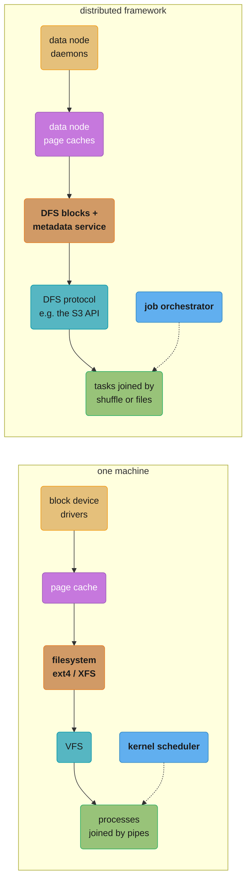
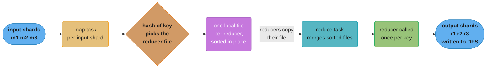
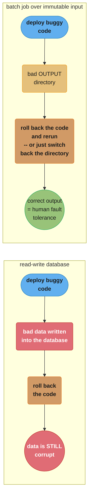
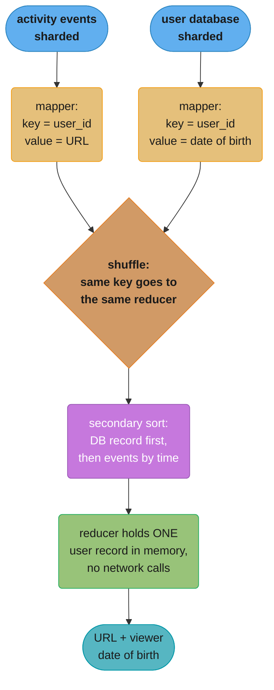
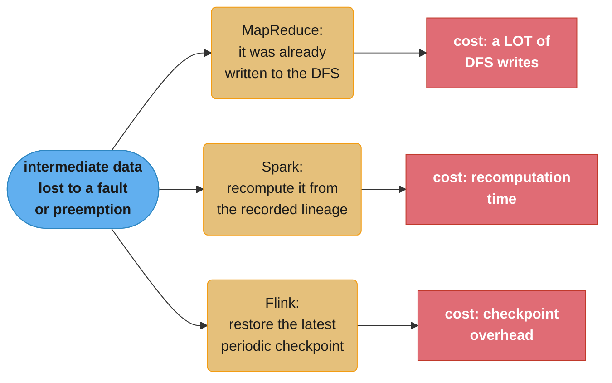

# Chapter 11: Batch Processing

> Part III — Derived Data · DDIA (Kleppmann & Riccomini, 2nd ed., O'Reilly 2026) · opens Part III, leads to Ch 12 (stream processing)

## Chapter Map

Everything up to here has been about *requests* and *responses* — online systems, whose primary
measure of performance is response time and which need fault tolerance to stay available. This
chapter turns to the other shape: **batch processing jobs**, or *offline systems*, which take
read-only input and produce output generated from scratch on every run. The primary measure is
throughput, not latency, and a job may run for minutes, hours or days. The chapter builds the
idea from a Unix pipeline on one machine, then shows that a distributed batch framework is
essentially a distributed operating system — filesystem, scheduler, and programs passing data —
before covering the processing models and the use cases.

**TL;DR:**
- A batch job derives output from **immutable** input, which buys **human fault tolerance**:
  roll back the code, rerun, and the output is correct again. A database with read-write
  transactions gives you nothing of the sort.
- **MapReduce is largely obsolete and no longer used at Google.** It is taught here because it
  influenced everything that followed; real work today runs on Spark, Flink, or warehouse query
  engines.
- A distributed batch framework has three parts: **orchestration** (where and when jobs run),
  **storage** (DFS or object store), and **computation**.
- **Shuffle is not random** — it is a distributed sort, and it is the foundation of joins and
  group-bys.
- **Do not write from a batch job straight into a production database.** Push to a stream, or
  build the database files in the job and bulk-load them.

## The Big Question

> "I need to process more data than fits in one interactive request — retrain a model, transform
> a whole dataset, compute analytics over petabytes. How do I make that computation fast,
> restartable, and safe to get wrong?"

The chapter's answer starts with a claim about *shape* rather than scale. Because a batch job
reads immutable input and writes fresh output, **if you introduce a bug and the output is wrong,
you roll back to a previous version of the code and rerun — or, even simpler, keep the old output
in a different directory and switch back to it.** Object stores and open table formats support
exactly this, known as **time travel**. Most databases with read-write transactions do not have
this property: deploy buggy code that writes bad data, and rolling back the code does nothing to
fix the data. That recoverability has a name — **human fault tolerance** — and it is the reason
the rest of the chapter's machinery is worth building.

---

## 11.1 Batch Processing with Unix Tools

The chapter's opening framing is worth stating before the tools. A batch job takes read-only
input and produces output **generated from scratch every time the job runs**; it does not mutate
data the way a read/write transaction would, so the output is *derived* from the input. If you
do not like the output, delete it, adjust the job logic, and run again. Treating inputs as
immutable and avoiding side effects (such as writing to external databases) buys four things:

| Benefit | Why it follows from immutability |
|---------|----------------------------------|
| **Human fault tolerance** | Roll back the code and rerun, or switch back to the previous output directory — object stores and open table formats call this *time travel* |
| **Faster feature development** | *Minimizing irreversibility* means mistakes are not permanent damage; the chapter ties this to Agile development |
| **Reusable inputs** | The same files feed many jobs, including monitoring jobs that compute metrics and compare a run's output against the previous run |
| **Efficient resource use** | Batch frameworks use computing resources efficiently; doing the same work through OLTP databases and application servers is much more expensive |

And two costs, stated equally plainly: with most frameworks, **output can only be processed by
other jobs after the whole job finishes**, and **any change to input data — even a single byte —
means reprocessing the entire input dataset.**

> The alternative shape is *stream processing*, where the job never finishes: it keeps watching
> the input and processes changes shortly after they happen. That is Chapter 12. The boundary is
> not always clear — a long-running database query looks quite like a batch process.

The chapter is direct about where MapReduce stands. It was published by Google in 2004 and
implemented in Hadoop, CouchDB and MongoDB; it is **a fairly low-level programming model, less
sophisticated than the parallel query execution engines found in data warehouses**; it was a step
forward for the scale achievable on commodity hardware; and **now it is largely obsolete, and no
longer used at Google.** Today's batch work runs on Spark, Flink, or warehouse query engines,
which rely on the same sharding and parallel execution but have far more sophisticated caching
and execution strategies. As operational concerns were solved, focus shifted to usability:
dataflow APIs, query languages and DataFrame APIs are now widely supported, and Hadoop-centric
workflow schedulers like **Oozie and Azkaban have been replaced by Airflow, Dagster and
Prefect.** Storage has shifted too — from distributed filesystems such as **HDFS, GlusterFS and
CephFS toward object storage such as S3** — while **BigQuery and Snowflake blur the line between
data warehouses and batch processing.**

### Simple Log Analysis

The running example is a web server access log in nginx's default format. One line:

```
216.58.210.78 - - [27/Jun/2025:17:55:11 +0000] "GET /css/typography.css HTTP/1.1"
200 3377 "https://martin.kleppmann.com/" "Mozilla/5.0 (Macintosh; Intel Mac OS X
10_15_7) AppleWebKit/537.36 (KHTML, like Gecko) Chrome/137.0.0.0 Safari/537.36"
```

against the format definition:

```
$remote_addr - $remote_user [$time_local] "$request"
$status $body_bytes_sent "$http_referer" "$http_user_agent"
```

So: on 27 June 2025 at 17:55:11 UTC the server received a request for */css/typography.css* from
216.58.210.78; the user was unauthenticated (`$remote_user` is a hyphen); the response status was
200 and the body 3,377 bytes; the browser was Chrome 137, following a reference from
*https://martin.kleppmann.com/*.

The chapter notes this is not a toy: **log parsing is a critical part of many modern technology
companies, used for everything from ad pipelines to payment processing, and was a driving force
behind the rapid adoption of MapReduce and the "big data" movement.**

Finding the five most popular pages, in a Unix shell:

```bash
cat /var/log/nginx/access.log |   # 1 read the log
  awk '{print $7}'            |   # 2 field 7 is the requested URL
  sort                        |   # 3 identical URLs become adjacent
  uniq -c                     |   # 4 collapse runs, prefix each with its count
  sort -r -n                  |   # 5 sort numerically, descending
  head -n 5                       # 6 keep the top five
```

Output:

```
4189 /favicon.ico
3631 /2016/02/08/how-to-do-distributed-locking.html
2124 /2020/11/18/distributed-systems-and-elliptic-curves.html
1369 /
 915 /css/typography.css
```

**It processes gigabytes of log files in a matter of seconds**, and modifying the analysis is a
one-token edit: `'$7 !~ /\.css$/ {print $7}'` omits CSS files; `'{print $1}'` counts top client
IP addresses instead of top pages. The chapter's aside is that surprisingly many data analyses
can be done in a few minutes with `awk`, `sed`, `grep`, `sort`, `uniq` and `xargs`, and they
perform surprisingly well.

### Chain of Commands Versus Custom Program

The same job in Python:

```python
from collections import defaultdict

counts = defaultdict(int)                    # 1 hash table, counter per URL

with open('/var/log/nginx/access.log', 'r') as file:
    for line in file:
        url = line.split()[6]                # 2 seventh field, zero-indexed
        counts[url] += 1                     # 3 increment

top5 = sorted(((count, url) for url, count in counts.items()), reverse=True)[:5]  # 4

for count, url in top5:                      # 5
    print(f"{count} {url}")
```

Less concise, fairly readable, and **which you prefer is partly a matter of taste.** But beneath
the syntactic difference is a real difference in execution flow, which only shows up on a large
file — and that is the next section.

### Sorting Versus In-memory Aggregation

The Python script keeps an **in-memory hash table**; the Unix pipeline **sorts** a list in which
repeated URLs are simply repeated. Which is better depends on how many *distinct* URLs there are.

The concept that decides it is the **working set** — the amount of memory to which the job needs
random access. Here it depends only on the number of *distinct* URLs: **a million log entries for
a single URL still costs one URL plus one counter.** For most small to mid-sized websites, all
distinct URLs plus their counters fit in, say, 1 GB, and an in-memory hash table works fine even
on a laptop.

```
  working set = f(distinct keys), NOT f(input size)

  10^9 log lines, 10^4 distinct URLs   ->  hash table holds 10^4 entries   ->  fits in RAM
  10^9 log lines, 10^9 distinct URLs   ->  hash table holds 10^9 entries   ->  does not

  when it does not fit, SORTING wins:
    sort chunks in memory -> write sorted segments to disk -> mergesort them
    sequential access, so disks are fast at it
```

When the working set exceeds available memory, sorting can make efficient use of disks — the same
principle as log-structured storage: chunks sorted in memory, written out as segment files, then
merged into a larger sorted file, with mergesort's sequential access patterns performing well on
disk. And the tool already does this: **GNU Coreutils `sort` automatically handles
larger-than-memory datasets by spilling to disk, and automatically parallelizes sorting across
multiple CPU cores.** So the simple Unix chain scales to large datasets without running out of
memory, with the bottleneck likely being the rate at which the input file can be read from disk.

**The limitation is the machine.** Unix tools run on one. Datasets too large to fit in memory or
local disk are where distributed batch processing frameworks come in.

---

## 11.2 Batch Processing in Distributed Systems

The chapter's organizing analogy: the machine running the Unix example has storage devices reached
through a filesystem interface, a scheduler deciding when processes run and how CPU is allocated,
and programs whose `stdin` and `stdout` are connected by pipes. **The same components exist in
distributed data processing frameworks — you can think of one as a distributed operating system**,
with filesystems, job schedulers, and programs sending data to each other.



*The analogy the chapter builds the section on. Each layer of a local machine has a distributed
counterpart, which is why "distributed operating system" is a useful mental model rather than a
slogan.*

### Distributed Filesystems

A local filesystem is layered: **block device drivers** speaking to the disk; a **page cache**
holding recently accessed blocks in memory; a **filesystem layer** (ext4, XFS on Linux) that
breaks large files into blocks and tracks inodes, directories and files; and the **virtual file
system (VFS)**, the common API that lets applications read and write in a standard way regardless
of the underlying filesystem.

Distributed filesystems work much the same way, with one systematic difference: **block size.**

| System | Block size |
|--------|-----------|
| ext4 (local) | 4,096 bytes |
| HDFS | **128 MB** default |
| JuiceFS and many object stores | **4 MB** |

Larger blocks mean **less metadata to track — which makes a big difference on petabyte-sized
datasets — and lower seek overhead relative to reading.** They also drop a constraint: most
physical storage devices cannot write partial blocks, so operating systems require whole-block
writes, but distributed filesystems, having larger blocks and usually sitting on top of OS
filesystems, do not. **A 900 MB file stored with 128 MB blocks has 7 blocks using 128 MB and 1
block using 4 MB.**

The rest of the layer map:

- **Data nodes.** DFS blocks are read by network requests to the machine storing the block. Each
  machine runs a daemon exposing an API for remote processes to read and write blocks as files on
  its local filesystem — **HDFS calls these DataNodes, GlusterFS calls them glusterfsd
  processes**; the book calls them *data nodes*.
- **The distributed page cache.** Because DFS blocks are stored as files on data nodes, reads and
  writes go through each data node's operating system and therefore its in-memory page cache. Some
  systems add tiers: **JuiceFS has client-side and local-disk caching.**
- **Metadata.** Just as ext4 and XFS track free space, block locations, directory structure and
  permissions, a DFS needs to track file locations spread across machines. **Hadoop has the
  NameNode; DeepSeek's 3FS has a metadata service persisting to a key-value store such as
  FoundationDB.**
- **The protocol is the VFS analogue.** A DFS must expose a protocol so batch systems can read and
  write, and that protocol acts as a **pluggable interface**: any DFS may be used so long as it
  implements it. **Amazon S3's API has been widely adopted by MinIO, Cloudflare's R2, Tigris,
  Backblaze's B2 and many others**, so a batch system with S3 support can use any of them.
- **POSIX compatibility.** Some DFSs present a POSIX-compliant filesystem to the OS's VFS, usually
  via **FUSE** or **NFS**. NFS is perhaps the best-known distributed filesystem protocol,
  originally built so multiple clients could read and write on a single server; **AWS EFS and
  Archil provide far more scalable NFS-compatible implementations** where clients still connect to
  one endpoint but distributed metadata services and data nodes sit underneath.

> **Distributed filesystems and network storage.** DFSs are based on the **shared-nothing**
> principle, in contrast to the **shared-disk** approach of NAS and SAN architectures. Shared-disk
> storage uses a centralized appliance, often with custom hardware and special network
> infrastructure such as Fibre Channel. Shared-nothing requires no special hardware — only
> computers connected by a conventional datacenter network.

Because many DFSs run on commodity hardware, which is cheaper but fails more often than
enterprise-grade hardware, **file blocks are replicated across machines.** That also helps the
scheduler distribute work evenly, since a task can run on any node holding a replica of its input.
Replication may be plain copies (Ch 6) or an **erasure coding** scheme such as Reed–Solomon codes,
which recovers lost data with **lower storage overhead than full replication.** The techniques
resemble RAID; the difference is that here file access and replication happen over a conventional
datacenter network without special hardware.

### Object Stores

**Amazon S3, Google Cloud Storage, Azure Blob Storage and OpenStack Swift** have become a popular
alternative to distributed filesystems for batch jobs, and the chapter says the line between the
two is somewhat blurry: FUSE drivers let users treat S3 as a filesystem, and **JuiceFS and Ceph
offer both object storage and filesystem APIs.** But **their APIs, performance and consistency
guarantees are very different, so care must be taken to make sure they behave as expected even
when they seem to implement the requisite APIs.**

The model: each object has a URL such as `s3://my-photo-bucket/2025/04/01/birthday.png`. The host
portion is the **bucket** (globally unique name) and the remainder is the object's **key**, which
must be unique within the bucket. Objects are read with `get` and written with `put`, and — unlike
files — **are immutable once written**: updating means fully rewriting with a `put`, key-value
style. **Azure Blob Storage and S3 Express One Zone support appends; most other stores do not.**
There are no file-handle APIs like `fopen` and `fseek`.

The directory illusion trips people up, so the chapter is precise about it. **Object stores have
no concept of directories** — the path structure is a convention and the slashes are part of the
key. Listing by prefix approximates a directory listing but differs in two ways:

- A prefix `list` behaves like a **recursive `ls -R`**: it returns everything starting with the
  prefix, including objects in subpaths.
- **Empty directories are impossible.** Remove all objects under
  `s3://my-photo-bucket/2025/04/01` and `01` disappears from a `list` on `.../2025/04`. The common
  workaround is a zero-byte object standing in for the directory.

| Operation | DFS (HDFS-style) | Object store |
|-----------|------------------|--------------|
| Hard links, symbolic links | Often supported | Not supported |
| File locking | Often supported | Typically not supported |
| Rename | Atomic | **Non-atomic** — copy to the new key, then delete the old |
| Rename a directory | One operation | **Rename every object individually**, since the directory name is part of the key |
| Compute co-location | Tasks can run on the machine holding a replica, avoiding a network transfer | Storage and computation are usually **separate** |

The size/latency positioning matters too. Key-value stores (Ch 4) are optimized for small values —
typically kilobytes — and frequent low-latency reads and writes; distributed filesystems and object
stores are optimized for **large objects, megabytes to gigabytes, and less frequent, larger
reads.** That is changing: **S3 Express One Zone now offers single-millisecond latency and a
pricing model more similar to key-value stores.**

On co-location, the chapter gives both sides. HDFS lets a task run where a copy of its file lives,
reading without sending it over the network — **which saves bandwidth if the task's executable code
is smaller than the file it reads.** Object stores keep storage and computation separate, which
may use more bandwidth, **but modern datacenter networks are very fast, so this is often
acceptable — and decoupling lets CPU and memory scale independently of storage.**

### Distributed Job Orchestration

Something has to actually run `awk`, `sort`, `uniq` and `head`: transfer data between processes,
allocate memory, schedule instructions fairly, enforce memory and I/O boundaries. On one machine
that is the kernel. **In a distributed environment it is a job orchestrator.**

A request to start a job carries: the number of tasks, the memory/CPU/disk needed per task, a job
identifier, access credentials, job parameters such as input and output data, required hardware
details such as GPUs or disk types, and where the job's executable code lives.

Orchestrators such as **Kubernetes and Hadoop YARN** combine that with cluster metadata using three
components:

| Component | What it does | YARN | Kubernetes |
|-----------|--------------|------|-----------|
| **Task executors** | A daemon on each node that runs tasks, sends liveness heartbeats, tracks task status and resource allocation; retrieves the job's executable code, starts the task, monitors it to completion or failure, and updates status. Many also work with the OS for security and performance isolation — **both use Linux cgroups** | NodeManager | kubelet |
| **Resource manager** | Stores per-node metadata: available CPUs, GPUs, memory, disks, task statuses, network location, node status — a global view of cluster state. Its centralized nature **can lead to scalability and availability bottlenecks** | State in **ZooKeeper** | State in **etcd** |
| **Scheduler** | Receives requests to start, stop or check a job; combines the request with resource-manager state to decide which tasks run on which nodes, then informs the executors | ResourceManager's scheduler | kube-scheduler |

> Scheduling sometimes needs **application-specific schedulers** aware of particular requirements,
> such as auto-scaling read replicas past a query threshold. These work together with the
> centralized scheduler. **YARN calls them ApplicationMasters; Kubernetes calls them operators.**

#### Resource Allocation

The scheduler's job is to allocate limited cluster resources among jobs with competing needs, and
**fundamentally its decisions must balance fairness and efficiency.**

The chapter's worked example: five nodes, **160 CPU cores total**, two job requests each wanting
**100 cores**.

```
  160 cores available, two jobs wanting 100 each

  (a) split         80 + 80, remaining 20 each start as tasks finish
  (b) gang schedule run ALL of job 1, start job 2 only when 100 cores free
  (c) first-come    give job 1 all 100 -- or hold some back for future jobs?

  gang scheduling:  reserving until 100 are simultaneously free
                    -> nodes sit IDLE, utilisation drops, DEADLOCK possible
                       if other jobs also reserve
  plain waiting:    other jobs grab cores meanwhile
                    -> 100 may not be free for a long time = STARVATION
  preemption:       kill some of job 1's tasks to make room
                    -> killed tasks must be restarted and re-run
                       = lower efficiency
```

Every option costs something, and this is a five-node example. Scale it to hundreds or millions of
job requests and **finding an optimal solution seems intractable — in fact the problem is NP-hard,
so it is prohibitively slow to compute an optimal solution for all but the smallest examples.**

In practice schedulers therefore use **heuristics** to make non-optimal but reasonable decisions:
**first-in first-out (FIFO), dominant resource fairness (DRF), priority queues, capacity or
quota-based scheduling, and various bin-packing algorithms.** The details are beyond the chapter's
scope.

#### Scheduling Workflows

The Unix example chained several commands with pipes, and the same pattern recurs in distributed
batch processing: one job's output becomes another's input, and a job may have several inputs
produced by other jobs. That is a **workflow**, or a **directed acyclic graph (DAG) of jobs.**

> "Workflow" means something different here than in Chapter 5's durable execution engines. There
> it is a sequence of steps typically performing RPCs; **in batch processing it is a sequence of
> batch processes, each taking input data and producing output data, normally not making RPCs to
> external services.** Durable execution engines typically process less data per request, though
> the line is somewhat fuzzy.

Three reasons a workflow is needed:

- **Fan-out to different teams.** If one job's output feeds several jobs maintained by different
  teams, the first job should write to a location all of them can read, and consumers can be
  scheduled on data updates or on their own schedule.
- **Crossing tools.** A Spark job outputs to HDFS, a Python script triggers a Trino SQL query that
  processes the HDFS files and outputs to S3.
- **Re-sharding between stages.** If one stage needs data sharded by one key and the next by a
  different key, the first stage can output data sharded the way the second needs it.

The connection style differs from Unix pipes in an important way. **A Unix pipe uses only a small
in-memory buffer and does not write to a file; when the buffer fills, the producer waits — a form
of backpressure.** Spark, Flink and other engines support a similar model where one task's output
passes directly to another (over the network if they are on different machines). **But in a
workflow it is more usual for a job to write its output to a distributed filesystem or object
store and for the next job to read it from there** — which decouples jobs so they can run at
different times, with the workflow scheduler waiting until all input-producing jobs have completed
successfully.

The two kinds of scheduler are easy to conflate and the chapter separates them explicitly:
**orchestration schedulers such as YARN's ResourceManager or Spark's built-in scheduler do
per-job scheduling and do not manage entire workflows.** Handling dependencies between job
executions is the job of **workflow schedulers — Airflow, Dagster, Prefect.** Their management
features matter at real scale: **workflows of 50 to 100 jobs are common in many data pipelines**,
and in a large organization many teams run jobs and workflows that read each other's output across
many systems.

#### Handling Faults

Long-running jobs with many parallel tasks are likely to experience at least one task failure —
hardware faults, especially on commodity hardware, or network interruptions. But there is a second
cause: **the scheduler may intentionally preempt (kill) a task.**

Preemption is useful with multiple priority levels: cheap low-priority tasks that run whenever
there is spare capacity, at the risk of being killed the moment a higher-priority task arrives.
These are **spot instances on Amazon EC2, spot virtual machines on Azure, and preemptible instances
on Google Cloud.** Because batch processing is often not time-sensitive, it suits them well — jobs
consume spare capacity that would otherwise be idle, raising cluster utilization. **The catch is
stated with a number's worth of force: preemptions occur more frequently than hardware faults.**

Recovery is easier than in online systems, because batch jobs regenerate output from scratch: the
system deletes the partial output from the failed execution and reschedules it elsewhere. Rerunning
the *whole* job for one task failure would be wasteful, so **MapReduce and its successors keep
parallel tasks independent of each other, allowing retry at the granularity of an individual
task.**

Intermediate data is where the approaches diverge:

| Framework | How intermediate data survives a failure |
|-----------|------------------------------------------|
| **MapReduce** | Always writes intermediate data back to the DFS and waits for the writing task to succeed before readers start. Works even where preemption is common, **but means a lot of DFS writes, which can be inefficient** |
| **Spark** | Keeps intermediate data in memory or spills to local disk, writing only the final result to the DFS; **tracks how the intermediate data was computed so it can recompute it if lost** |
| **Flink** | **Periodically checkpoints a snapshot of tasks** |

---

## 11.3 Batch Processing Models

The two most common models are **MapReduce** and **dataflow engines**. Dataflow engines have
largely replaced MapReduce in practice, but MapReduce is worth understanding because it influenced
many modern frameworks. Both have grown to support several programming models — low-level
programmatic APIs, relational query languages, and DataFrame APIs — which lets application
engineers, analytics engineers, business analysts and even non-technical employees process company
data.

### MapReduce

The processing pattern is the same shape as the Unix log analysis:

| Step | MapReduce | The Unix equivalent |
|------|-----------|---------------------|
| 1. Break input files into **records** | Handled by the input format parser; input lives in HDFS or an object store, in formats such as **Apache Parquet** (columnar) or **Apache Avro** (row-based) | `\n` as the record separator |
| 2. **Mapper** extracts a key and value per record | Your code | `awk '{print $7}'` — URL as key, empty value |
| 3. **Sort** all key-value pairs by key | **Implicit — you do not write it**; mapper output is always sorted before the reducer sees it | the first `sort` |
| 4. **Reducer** iterates the sorted pairs | Your code | `uniq -c` |

The two callbacks:

- **Mapper** — called once per input record, extracting the key and value. It may generate any
  number of key-value pairs including none, and **keeps no state from one record to the next**, so
  each record is handled independently.
- **Reducer** — the framework collects all values belonging to the same key and calls the reducer
  with an iterator over that collection, which can produce output records.

A second sorting stage (ranking URLs by request count) needs a **second MapReduce job** taking the
first's output as input. Seen this way, **the mapper's role is to prepare the data into a form
suitable for sorting, and the reducer's role is to process data that has been sorted.**

> **MapReduce and functional programming.** The programming model comes from functional
> programming: Lisp introduced *map* and *reduce* (or *fold*) as higher-order functions on lists,
> and they have reached mainstream languages such as Python, Rust and Java. Both are **composable**,
> which fits data processing; **map is embarrassingly parallel** since each input is processed
> independently, which simplifies parallel execution; and for reduce, different keys can be
> processed in parallel.

The chapter's verdict is unsentimental. **Implementing a complex job with the raw MapReduce APIs
is quite hard and laborious — any join algorithm would need to be implemented from scratch — and
MapReduce is quite slow compared to modern batch processors, one reason being that its file-based
I/O prevents job pipelining**, i.e. processing output data in a downstream job before the upstream
job is complete.

### Dataflow Engines

**Spark** and **Flink** are the best-known of the engines built to fix this. They differ in design
but share one thing: **they handle an entire workflow as one job, rather than breaking it into
independent subjobs.** Because they explicitly model the flow of data through several processing
stages, they are called **dataflow engines.**

Like MapReduce they support a low-level API calling a user-defined function per record, but they
also offer higher-level operators such as **join** and **group by**; they parallelize by sharding
inputs and copy one task's output over the network to become another's input; and **operators need
not alternate strictly between map and reduce but can be assembled in more flexible ways.** The
APIs use relational-style building blocks — joining on a field, grouping by key, filtering,
aggregating — implemented internally with the shuffle algorithms of the next section. The style
comes from research systems **Dryad** and **Nephele.**

Six advantages over MapReduce, all of them consequences of seeing the whole workflow at once:

1. **Expensive work such as sorting happens only where required**, rather than always between
   every map and reduce stage.
2. **Consecutive operators that do not change sharding** (map, filter) can be **combined into a
   single task**, reducing data copying.
3. Because **all joins and data dependencies are explicitly declared**, the scheduler can make
   locality optimizations — placing a consuming task on the same machine as the producer so data
   moves through a shared memory buffer instead of the network.
4. **Intermediate state can stay in memory or on local disk**, needing less I/O than writing to a
   DFS or object store where it must be replicated and written to disk on each replica. MapReduce
   already does this for mapper output; dataflow engines generalize it to all intermediate state.
5. **Operators start as soon as their input is ready** — no waiting for the entire preceding stage.
6. **Existing processes can be reused for new operators**, reducing startup overhead compared to
   MapReduce, which launches a new JVM per task.

### Shuffling Data

Both the Unix example and MapReduce are based on sorting, and batch processors need to sort
datasets **petabytes in size**, too large for one machine. That requires a distributed sorting
algorithm where **both input and output are sharded** — a **shuffle**.

> **Shuffle is not random.** Shuffling a deck of cards gives a random order; **this shuffle
> produces a sorted order with no randomness.** The name is confusing and the chapter says so.

Shuffling is foundational, used for joins and aggregations, and **MapReduce, Spark, Flink, Daft,
Dataflow and BigQuery all implement scalable shuffle algorithms.**

How Hadoop MapReduce's works, step by step:



*The shuffle in one picture. The hash of the key is what guarantees that two different mappers
emitting the same key land in the same reducer's file — everything else is sorting and merging.*

- The framework starts **a separate map task per input shard**. Each reads its assigned file,
  passing one record at a time to the mapper. The reduce side is also sharded: **the number of map
  tasks is determined by the number of input shards; the number of reduce tasks is configured by
  the job author** and can differ.
- The framework must ensure that **if two different mappers output the same key, those pairs reach
  the same reducer.** So each mapper creates **a separate output file on its local disk for every
  reducer**, and a **hash of the key** determines which file a pair is written to — the same idea
  as sharding by hash of key in Chapter 7.
- While writing, a mapper **also sorts the pairs within each file**, using the log-structured
  storage technique: collect batches in a sorted in-memory structure, write them out as sorted
  segments, and progressively merge smaller segments into larger ones.
- After each mapper finishes, **reducers connect to it and copy their file** to local disk. Once a
  reduce task has its share from all mappers, it **merges these files preserving sort order,
  mergesort-style**, so pairs with the same key are consecutive even when they came from different
  mappers. The reducer function is then called **once per key** with an iterator over that key's
  values.
- Records output by the reducer are written sequentially, **one file per reduce task**, and those
  files become the shards of the job's output dataset, written back to the DFS or object store.

Modern systems go further: **BigQuery has optimized its shuffle to keep data in memory and to
write to external sorting services**, which speed up shuffling and replicate shuffled data for
resilience.

#### JOIN and GROUP BY

The payoff of sorted data is that distributed joins and aggregations become easy. The example: a
log of **activity events** (clickstream data) on the left and a database of users on the right —
in star-schema terms (Ch 3) the event log is the fact table and the user database is a dimension.
The analysis: are certain pages more popular with younger or older users, using the date-of-birth
field?

The trick is that **the shuffle brings together all key-value pairs with the same key at the same
reducer, no matter which shard they started on.** Use the user ID as the key:

- One mapper walks the activity events and emits **page view URLs keyed by user ID.**
- Another mapper walks the user database row by row, emitting **user ID as key and date of birth
  as value.**
- The shuffle gives one reducer a user's date of birth *and* all that user's page views together.
  The job can even arrange for the reducer to see **the user-database record first, followed by the
  activity events in timestamp order — a technique known as a secondary sort.**
- The reducer stores the first value (the date of birth) in a local variable, then iterates the
  activity events with the same user ID, emitting each URL with the viewer's date of birth.

Two properties make this scale: **the reducer only needs one user record in memory at a time, and
it never makes a request over the network.** The algorithm is a **sort-merge join** — mapper output
sorted by key, reducers merging the sorted lists from both sides.

The next job in the workflow computes the age distribution per URL: shuffle by URL, then have each
reducer iterate all page views for one URL keeping a counter per age group. **That is a group-by
and aggregation.**

### Query languages

Execution engines have matured to the point of **storing and processing many petabytes on clusters
of over 10,000 machines**, and with the physical operation of batch processing at that scale
considered more or less solved, attention turned to the programming model.

**MapReduce, dataflow engines and cloud data warehouses have all embraced SQL as the lingua
franca.** The chapter's reasons are unglamorous and convincing: legacy data warehouses used SQL,
analytics and ETL tools already support it, and all developers and analysts know it. Beyond
needing less code than handwritten MapReduce jobs, a query-language interface **allows interactive
use** — writing analytical queries and running them from a terminal or GUI — which is an efficient
and natural way for business analytics, product managers, sales and finance teams to explore data.

High-level query languages also **improve execution efficiency at the machine level.** Query
engines convert SQL into batch jobs, and the translation from query to syntax tree to physical
operators is what allows optimization: **Hive, Trino, Spark and Flink have cost-based optimizers
that analyze the properties of join inputs and automatically choose the most suitable algorithm,
and may even reorder joins to minimize intermediate state.**

SQL is not the only option. **Apache Pig** was a relational-operator language letting pipelines be
specified step by step rather than as one big query; DataFrames have similar characteristics, and
**Morel** is a more modern language influenced by Pig. Some users adopt JSON query languages —
**jq, JMESPath, JsonPath.** And many graph processing frameworks support batch computation through
graph query languages such as **Apache TinkerPop's Gremlin.**

> **Batch processing and cloud data warehouses converge.** Historically data warehouses ran on
> specialized hardware appliances providing SQL analytics over relational data, while batch
> frameworks like MapReduce offered greater scalability and flexibility by supporting logic in a
> general-purpose language over arbitrary data formats. **The two have become much more similar.**
> Batch frameworks now support SQL and get good relational performance from columnar formats such
> as Parquet plus optimized execution; warehouses have grown more scalable by moving to the cloud
> and implementing the same scheduling, fault tolerance and shuffling techniques, many using
> distributed filesystems too. Warehouses have also adopted alternative processing models —
> **BigQuery offers a BigQuery DataFrames library, Snowflake's Snowpark integrates with Pandas** —
> and orchestrators like Airflow, Prefect and Dagster integrate with warehouses.
>
> **But not everything fits.** Iterative graph algorithms such as PageRank, complex machine
> learning, and AI data processing over non-relational, multi-modal data such as images, video and
> audio are difficult to express in SQL. Warehouses also struggle with certain workloads:
> **row-by-row computation is less efficient on column-oriented storage**, and warehouses tend to
> be **more expensive**, so large jobs can be more cost-efficient on Spark or Flink. Ultimately the
> choice comes down to cost, convenience, ease of implementation and availability — most large
> enterprises have many data processing systems, and smaller companies often get by with one.

### DataFrames

As data scientists and statisticians started using batch frameworks for machine learning, they
found existing processing models cumbersome: they were used to the **DataFrame** model from R and
Pandas. A DataFrame is similar to a relational table — a collection of rows where all values in a
column share a type — and instead of writing one big SQL query, users call functions corresponding
to relational operators for filters, joins, sorting, group by and so on.

DataFrame manipulation was originally local and in-memory, **so DataFrames were limited to datasets
that fit on a single machine.** Spark, Flink and Daft adopted DataFrame APIs so data scientists
could use the interface they knew against batch-scale datasets. One difference is a genuine trap:
**local DataFrames are usually indexed and ordered while distributed DataFrames generally are not,
which can lead to performance surprises when migrating to batch frameworks.**

The APIs look like dataflow APIs but implementations vary:

| Implementation | Execution model |
|----------------|-----------------|
| **Pandas** | Executes operations **immediately** when DataFrame methods are called |
| **Apache Spark** | **Translates all API calls into a query plan and runs query optimization** before executing on its distributed dataflow engine, which improves performance |
| **Daft** | Supports **both client and server-side computation** — smaller in-memory operations on the client, larger datasets and computation on the server |

**Columnar storage formats such as Apache Arrow offer a unified data model** that both client- and
server-side execution engines can share.

---

## 11.4 Batch Use Cases

Batch jobs are excellent for processing large datasets in bulk and bad for low-latency use cases,
so **you find them wherever there is a lot of data and data freshness is not important.** The
chapter argues that constraint is far less limiting than it sounds:

- **Accounting and inventory reconciliation** — verifying that transactions line up with bank
  accounts and inventory — are often done in batch.
- **Demand forecasting** in manufacturing is computed in periodic batch jobs.
- **Ecommerce, media and social media companies train their recommendation models** using batch
  jobs.
- **Many financial systems are batch-based** — the United States's banking network runs almost
  entirely on batch jobs.

### Extract–Transform–Load (ETL)

A data processing pipeline extracts data from a production database, transforms it, and loads the
result into a downstream system; batch jobs are often used for this, especially when the
downstream system is a data warehouse. (The chapter uses "ETL" to cover both ETL and ELT.)

Why batch fits ETL particularly well:

- **Parallelism.** Much of data transformation is "embarrassingly parallel" — filtering data,
  projecting fields and many other common warehouse transformations can all be done in parallel.
- **Robust workflow schedulers.** They make it easy to schedule, orchestrate and debug pipelines,
  **retry jobs to mitigate transient issues**, and mark repeatedly failing jobs as failed so
  developers can see which job stopped working. **Airflow ships built-in source, sink and query
  operators for MySQL, PostgreSQL, Snowflake, Spark, Flink and dozens of other systems.**
- **Debuggability.** Failed files can be inspected to see what went wrong, and jobs can be fixed
  and rerun. The chapter's example: an input file no longer contains a field a transformation job
  uses; engineers see the field is missing and update either the transformation or the job that
  produced the input.

Two organizational shifts round out the section. Pipelines **used to be managed by a single data
engineering team**, since asking product teams to write and manage complex batch pipelines was
considered unfair; improvements in processing models and metadata management have made it much
easier for engineers across an organization to manage their own, with **data mesh, data contract
and data fabric practices providing standards and tools for teams to safely publish data for
consumption by anybody.** And pipelines and analytic queries increasingly share not just processing
models but **execution engines — it is not uncommon to see both run as SparkSQL, Trino or DuckDB
queries**, further blurring the line between application engineering, data engineering, analytics
engineering and business analysis.

### Analytics

Analytic (OLAP) queries scan many records performing groupings and aggregations, and can run in a
batch system alongside other batch workloads: analysts write SQL that executes on a query engine
reading and writing a distributed filesystem or object store, with table metadata — table-to-file
mappings, names, types — managed by table formats such as **Apache Iceberg** and catalogs such as
**Unity**. **That architecture is known as a data lakehouse.**

Two query styles, with different requirements:

| Style | What it is | What it needs |
|-------|-----------|---------------|
| **Pre-aggregation** | Data rolled up into OLAP cubes or data marts to speed up queries; pre-aggregated data is queried in the warehouse or pushed to realtime OLAP systems such as **Apache Druid or Apache Pinot** | Runs at a **scheduled interval**, managed by workflow schedulers |
| **Ad hoc** | Queries answering specific business questions, investigating user behaviour, debugging operational issues | **Response times matter** — analysts query iteratively as they learn about the data, so fast execution reduces waiting |

SQL support is what lets batch frameworks integrate with spreadsheets and visualization tools —
**Tableau, Power BI, Looker, Apache Superset.** Tableau offers SparkSQL and Presto connectors;
Superset supports Trino, Hive, Spark SQL, Presto and many others that ultimately execute batch jobs.

### Machine Learning

Data scientists, ML engineers and AI engineers use batch frameworks to investigate data patterns,
transform data and train models. Three common uses:

- **Feature engineering** — raw data is filtered and transformed into data models can train on.
  Predictive models often need numeric data, so text or discrete values must be converted.
- **Model training** — training data is the input, and **the weights of the trained model are the
  output.**
- **Batch inference** — a trained model makes predictions in bulk where datasets are large and
  realtime results are not required, including evaluating predictions on a test dataset.

Frameworks provide explicit tooling: **Spark's MLlib and Flink's FlinkML** come with feature
engineering tools, statistical functions and classifiers.

Recommendation engines and ranking systems make heavy use of **graph processing.** Many graph
algorithms traverse one edge at a time, joining a vertex with an adjacent vertex to propagate
information, repeating until some condition is met — no more edges to follow, or a metric
converges. The **bulk synchronous parallel (BSP)** model has become popular for batch graph
processing, implemented by **Apache Giraph, Spark's GraphX API and Flink's Gelly API**, and **also
known as the Pregel model** after Google's Pregel paper.

Batch processing is also integral to **LLM data preparation and training.** Raw text such as
websites typically lives in a DFS or object store and must be pre-processed:

- **Plain text must be extracted from HTML and malformed text fixed.**
- **Low quality, irrelevant and duplicate documents must be detected and removed.**
- **Text must be tokenized (split into words) and converted into embeddings**, numeric
  representations of each word.

**Kubeflow, Flyte and Ray are purpose-built for such workloads — OpenAI uses Ray as part of its
ChatGPT training process.** They integrate with PyTorch, TensorFlow, XGBoost and others, and offer
built-in support for feature engineering, model training, batch inference and fine tuning.

Finally, data scientists experiment in **interactive notebooks such as Jupyter or Hex**, made of
**cells** — small chunks of markdown, Python or SQL executed sequentially to produce spreadsheets,
graphs or data. Many notebooks use batch processing via DataFrame APIs or query such systems with
SQL.

### Serving Derived Data

Batch jobs build pre-computed datasets — product recommendations, user-facing reports, features for
ML models — typically served from a production database, key-value store or search engine. So the
pre-computed data has to get from the batch processor's DFS or object store **back into the
database serving live traffic.**

The obvious approach is the wrong one:

```
  BROKEN — write to the production database from inside the batch job

    for record in output:
        prod_db.insert(record)      # one network request per record

  three problems:
    1. a network request per record is ORDERS OF MAGNITUDE slower than
       normal batch throughput -- even with client-side batching
    2. many tasks run in PARALLEL, all writing at batch rate ->
       the database is overwhelmed, query performance suffers,
       and that cascades into other parts of the system
    3. it breaks the ALL-OR-NOTHING guarantee: partial results become
       externally visible, and a retried task DUPLICATES its output

  FIXED — batch job -> Kafka topic -> the serving system ingests from Kafka
          (or: build the database files in the job and bulk-load them)
```

The chapter's preferred fix is to **push pre-computed datasets to streams such as Kafka topics.**
**Elasticsearch, Apache Pinot, Apache Druid, Venice and ClickHouse all have built-in ability to
ingest from Kafka**, and doing so fixes several of the problems:

- Streaming systems are **optimized for sequential writes**, suiting a batch job's bulk write
  workload.
- They act as **a buffer**: downstream systems throttle their read rate so they can keep serving
  production traffic comfortably.
- **One batch job's output can be consumed by multiple downstream systems.**
- They serve as a **security boundary** — deployable in a DMZ network between the batch processing
  network and the production network.

**Streams do not by themselves solve the all-or-nothing problem.** For that, batch jobs must
**notify downstream systems that the job is complete and the data can be served**, and consumers
must be able to keep received data invisible to queries — **like an uncommitted transaction under
read committed isolation** — until that notification arrives.

The other pattern, more common when bootstrapping, is to **build a brand-new database inside the
batch job and bulk load those files directly** from a DFS, object store or local filesystem. Bulk
import tools exist: **TiDB's Lightning, Apache Pinot's and Apache Druid's Hadoop import jobs, and
RocksDB's API to bulk import SSTs from batch jobs.** Building in batch and bulk importing is very
fast and **makes it easier for systems to atomically switch between dataset versions**, but **it
is challenging to incrementally update datasets built that way** — so a hybrid is common where both
bootstrapping and incremental loads are needed. **Venice supports hybrid stores allowing both batch
row-based updates and full dataset swaps.**

---

## Beyond the book — the products this chapter names, in this repo

> The chapter names a great many systems and describes what each contributes to batch processing,
> but it does not go into any of them in depth. The pointers below are this repo's, not the
> authors'; nothing above this heading depends on them.

Three of the systems the chapter treats as background have their own deep dives here:
[`technologies/apache_airflow/`](../../../technologies/apache_airflow/apache_airflow.md) for the
workflow scheduler the chapter names first,
[`technologies/apache_iceberg/`](../../../technologies/apache_iceberg/apache_iceberg.md) for the
open table format underpinning the lakehouse architecture in §11.4, and
[`hld/message_queues/`](../../../hld/message_queues/message_queues.md) for the Kafka-shaped
serving path in "Serving Derived Data."

---

## Visual Intuition



*The property the chapter builds the whole chapter's case on. Immutable input plus regenerated
output makes a code bug reversible; a mutating transaction makes it permanent.*

```
  WORKING SET vs INPUT SIZE -- why the same job needs two different algorithms

  input size    |##################################################| 1 TB of log lines
  working set   |#|                                                  10k distinct URLs
                 ^ hash table only ever holds THIS

  in-memory hash table:  cost = f(distinct keys)      -> fine on a laptop
  sort + uniq -c:        cost = f(input size), but
                         SEQUENTIAL, spills to disk   -> unbounded input

  GNU sort does the spilling AND parallelises across cores for you,
  so the Unix pipeline scales until the DISK READ RATE is the bottleneck.
```

*Why the chapter spends a whole section on two ten-line programs. The choice is not stylistic: it
is whether the job's cost tracks the number of distinct keys or the size of the input.*



*The sort-merge join. The reducer never queries the user database over the network — the shuffle
has already delivered the one row it needs, which is the entire reason this scales.*



*Three answers to one question. None is free — the frameworks differ in which cost they chose to
pay, and preemption frequency is what decides which choice suits your cluster.*

---

## Key Concepts Glossary

| Term | One-line definition |
|------|---------------------|
| **Online system** | A request/response system whose primary measure is response time, usually requiring fault tolerance for high availability |
| **Batch processing job / offline system** | A job taking read-only input and producing output generated from scratch each run; measured by throughput, running for minutes to days |
| **Derived data** | Output computed from input that can be regenerated by rerunning the job |
| **Time travel** | Support in object stores and open table formats for keeping and switching back to a previous output version |
| **Human fault tolerance** | The ability to recover from buggy code by rolling back and rerunning, which read-write databases lack |
| **Minimizing irreversibility** | The principle that reversible mistakes let feature development move faster |
| **Working set** | The amount of memory to which a job needs random access — for the log example, a function of distinct URLs, not input size |
| **Distributed filesystem (DFS)** | A filesystem whose files are split into blocks distributed across many machines; HDFS defaults to 128 MB blocks |
| **Data node** | The per-machine daemon exposing an API to read and write blocks as local files — DataNodes in HDFS, glusterfsd in GlusterFS |
| **NameNode** | Hadoop's cluster metadata service |
| **Erasure coding** | A redundancy scheme such as Reed–Solomon that recovers lost data with lower storage overhead than full replication |
| **Shared-nothing vs shared-disk** | DFSs use commodity machines on a conventional network; NAS and SAN use a centralized appliance with special hardware such as Fibre Channel |
| **Object store** | Immutable objects addressed by bucket plus key, read with `get` and written with `put`, with no directories, no file handles and non-atomic renames |
| **Bucket / key** | The globally unique object-store namespace and the per-bucket-unique object name; slashes in a key are convention, not structure |
| **Job orchestrator** | The distributed equivalent of an OS kernel — runs tasks, allocates resources, enforces isolation |
| **Task executor** | The per-node daemon running tasks and reporting liveness — YARN's NodeManager, Kubernetes's kubelet |
| **Resource manager** | The orchestrator's global view of cluster state; YARN stores it in ZooKeeper, Kubernetes in etcd |
| **Gang scheduling** | Running all of a job's tasks together, holding resources until enough are simultaneously free |
| **Starvation** | A job never getting its resources because others keep taking them |
| **Preemption** | Killing a running task to make room for another; decreases efficiency since killed tasks must be rerun |
| **Spot instance** | A cheap, low-priority instance that may be killed at any moment — spot VMs on Azure, preemptible instances on Google Cloud |
| **Workflow / DAG of jobs** | A dependency graph of batch jobs, where one job's output is another's input |
| **Workflow scheduler** | A scheduler managing dependencies between job executions — Airflow, Dagster, Prefect — as distinct from per-job orchestration schedulers |
| **Backpressure** | A producer waiting because the consumer has not drained the buffer, as with a full Unix pipe buffer |
| **Mapper** | A stateless callback called once per input record, emitting zero or more key-value pairs |
| **Reducer** | A callback receiving all values for one key via an iterator, emitting output records |
| **Secondary sort** | Arranging the reducer's input so records arrive in a chosen order within a key |
| **Dataflow engine** | An engine handling an entire workflow as one job with explicit stages — Spark, Flink |
| **Shuffle** | A distributed sort where both input and output are sharded; **produces sorted order, not random order** |
| **Sort-merge join** | Joining by sorting both sides on the join key so a reducer merges the sorted lists, needing one record in memory and no network calls |
| **DataFrame** | A collection of rows with per-column types, manipulated by calling relational-operator functions rather than writing one SQL query |
| **Data lakehouse** | Query engines over a DFS or object store with table formats such as Iceberg and catalogs such as Unity |
| **Bulk synchronous parallel (BSP) / Pregel** | The graph batch-processing model implemented by Giraph, Spark GraphX and Flink Gelly |
| **Data mesh / data contract / data fabric** | Practices providing standards and tools so teams can safely publish data for organization-wide consumption |

---

## Tradeoffs & Decision Tables

| Dimension | Batch processing | Online system |
|-----------|------------------|---------------|
| Primary measure | Throughput | Response time |
| Input | Read-only, bounded | Mutable, per-request |
| Output | Regenerated from scratch each run | Mutated in place |
| Recovering from a code bug | Roll back and rerun | Rolling back the code does not fix the data |
| Reaction to a one-byte input change | Reprocess the entire input | Handle just that change |
| Availability of results | Usually only after the whole job finishes | Immediately |

| Dimension | Distributed filesystem | Object store |
|-----------|------------------------|--------------|
| Mutability | Files are mutable | Objects **immutable once written** (appends only on Azure Blob Storage and S3 Express One Zone) |
| Directories | Real | A key-naming convention; empty directories impossible |
| Rename | Atomic | Copy-then-delete; renaming a directory means renaming every object |
| Links and locks | Often supported | Typically not |
| Compute locality | Task can run where the data is | Storage and compute separate; scale independently |
| Typical block size | HDFS 128 MB | ~4 MB in many stores |

| Dimension | MapReduce | Dataflow engines (Spark, Flink) |
|-----------|-----------|--------------------------------|
| Unit of work | Independent subjobs | **The entire workflow as one job** |
| Sorting | Always, between every map and reduce | Only where actually required |
| Operator shape | Strict alternating map and reduce | Flexibly assembled, with join and group-by operators |
| Intermediate state | Written to the DFS | In memory or local disk; only the final result goes to the DFS |
| Stage startup | Wait for the preceding stage to finish; new JVM per task | Start as soon as input is ready; reuse existing processes |
| Failure recovery of intermediate data | Already durable in the DFS | Spark recomputes from lineage; Flink restores a checkpoint |
| Status | **Largely obsolete, no longer used at Google** | What batch processing runs on today |

| Serving derived data | Behaviour |
|----------------------|-----------|
| Write directly to the production database | Slow per-record network calls, parallel tasks overwhelm the database, partial results become visible, retries duplicate |
| Push to a stream (Kafka) | Sequential writes, acts as a buffer, one output feeds many consumers, can sit in a DMZ — but still needs a completion notification for all-or-nothing |
| Build the database in the job and bulk load | Very fast, allows atomic version switches — but incremental updates are hard; hybrid stores such as Venice support both |

---

## Common Pitfalls / War Stories

- **Writing to the production database from inside a batch job.** A network request per record is
  orders of magnitude slower than batch throughput; many parallel tasks writing at batch rate can
  overwhelm the database and degrade its query performance, which then causes operational problems
  elsewhere; and it breaks the job's all-or-nothing guarantee, since partial output becomes
  externally visible and a retried task duplicates its writes.
- **Pushing to a stream and assuming the atomicity problem is solved.** It is not. Consumers must
  keep received data invisible to queries — like an uncommitted read-committed transaction — until
  the job notifies them it is complete.
- **Expecting an object store to behave like a filesystem because a FUSE driver makes it look like
  one.** APIs, performance and consistency guarantees are very different; renames are non-atomic,
  links and locks are typically absent, and renaming a "directory" means renaming every object.
- **Assuming a prefix `list` is a directory listing.** It behaves like `ls -R`, returning
  everything under the prefix, and an empty directory cannot exist — which is why the zero-byte
  placeholder object is a common practice.
- **Choosing an in-memory hash table when the working set exceeds memory.** The Python script has
  no fallback; `sort` spills to disk and parallelizes across cores automatically.
- **Reaching for MapReduce today.** It is largely obsolete and no longer used at Google; the raw
  APIs make complex jobs laborious (you would implement join algorithms from scratch), and
  file-based I/O prevents job pipelining.
- **Gang scheduling without watching utilization.** Reserving cores until enough are simultaneously
  free leaves nodes idle, drops cluster utilization, and can deadlock if other jobs reserve too.
- **Waiting instead of preempting.** Other jobs grab the cores meanwhile, the required capacity may
  not appear for a long time, and the job starves.
- **Preempting freely.** Killed tasks must be restarted and rerun, which is itself a loss of
  efficiency.
- **Running on spot instances and budgeting for hardware-failure rates.** Preemptions occur more
  frequently than hardware faults.
- **Expecting a distributed DataFrame to behave like a local one.** Local DataFrames are usually
  indexed and ordered; distributed ones generally are not, which produces performance surprises on
  migration.
- **Assuming Pandas and Spark DataFrames execute alike.** Pandas runs each method immediately;
  Spark builds a query plan and optimizes before executing.
- **Confusing "shuffle" with randomization.** It is a distributed sort producing sorted order with
  no randomness.
- **Assuming a cloud data warehouse is always the right home for a job.** Row-by-row computation is
  inefficient on columnar storage, warehouses tend to be more expensive, and iterative graph
  algorithms, complex ML and multi-modal AI data processing are hard to express in SQL.

---

## Real-World Systems Referenced

| System | What the chapter says about it |
|--------|-------------------------------|
| **MapReduce** | Published by Google in 2004; implemented in Hadoop, CouchDB, MongoDB; low-level, slow, **largely obsolete and no longer used at Google** |
| **Hadoop / HDFS** | 128 MB default block size; DataNodes; the NameNode as metadata service; tasks can run where the data is |
| **GlusterFS / CephFS** | Distributed filesystems being displaced by object storage; GlusterFS's data-node daemons are glusterfsd; Ceph offers both object and filesystem APIs |
| **JuiceFS** | 4 MB blocks; client-side and local-disk caching tiers; both object storage and filesystem APIs |
| **DeepSeek 3FS** | Metadata service persisting to a key-value store such as FoundationDB |
| **Amazon S3** | The API widely adopted by MinIO, Cloudflare R2, Tigris, Backblaze B2; S3 Express One Zone offers appends, single-millisecond latency and key-value-like pricing |
| **AWS EFS / Archil** | NFS-compatible distributed filesystems that are far more scalable than classic NFS |
| **Kubernetes** | kubelet executors, etcd for cluster state, operators as application-specific schedulers, cgroups for isolation |
| **Hadoop YARN** | NodeManager executors, ZooKeeper for cluster state, ApplicationMasters as sub-schedulers, cgroups for isolation |
| **Spark** | Dataflow engine; keeps intermediate data in memory or spills to local disk; **tracks lineage to recompute lost data**; DataFrame API compiles to an optimized query plan; MLlib, GraphX |
| **Flink** | Dataflow engine; **periodic checkpointing of task snapshots**; FlinkML, Gelly; cost-based query optimizer |
| **Daft** | DataFrame API supporting both client-side and server-side computation |
| **Airflow / Dagster / Prefect** | Workflow schedulers that replaced Oozie and Azkaban; Airflow ships operators for MySQL, PostgreSQL, Snowflake, Spark, Flink and dozens more |
| **BigQuery / Snowflake** | Cloud warehouses blurring the line with batch processing; BigQuery optimized shuffle with external sorting services and offers BigQuery DataFrames; Snowpark integrates with Pandas |
| **Hive / Trino / Presto** | Query engines with cost-based optimizers; connectors for Tableau and Superset |
| **Apache Parquet / Avro / Arrow** | Columnar, row-based, and the unified in-memory columnar model shared by client and server engines |
| **Apache Iceberg / Unity** | Table format and catalog underpinning the data lakehouse architecture |
| **Apache Druid / Apache Pinot** | Realtime OLAP systems receiving pre-aggregated data; both have Hadoop import jobs |
| **Kafka** | The recommended path from a batch job to serving systems |
| **Elasticsearch / ClickHouse / Venice** | Serving systems that ingest from Kafka; Venice supports hybrid batch row updates plus full dataset swaps |
| **TiDB Lightning / RocksDB** | Bulk import tooling — RocksDB can bulk import SSTs built by batch jobs |
| **Apache Giraph** | BSP/Pregel graph processing |
| **Kubeflow / Flyte / Ray** | Purpose-built for ML and LLM data workloads; **OpenAI uses Ray as part of its ChatGPT training process** |
| **Apache Pig / Morel / jq, JMESPath, JsonPath / Gremlin** | Non-SQL batch query languages |
| **Jupyter / Hex** | Interactive notebooks made of markdown, Python and SQL cells |
| **Dryad / Nephele** | The research systems dataflow engines are based on |

---

## Summary

The chapter began with the classic Unix toolchain — `awk`, `sort`, `uniq` — to illustrate the
fundamental batch primitives of sorting and counting, then scaled up to distributed systems.
Batch-style I/O processes **immutable, bounded input datasets to produce output data, allowing
reruns and debugging without side effects.** To process files, batch frameworks have three main
components: **an orchestration layer** deciding where and when jobs run, **a storage layer** to
persist data, and **a computation layer** to process it.

Distributed filesystems and object stores manage large files through **block-based replication,
caching and metadata services**, and modern frameworks interact with them through pluggable APIs.
Orchestrators schedule tasks, allocate resources and handle faults; job orchestrators schedule
individual jobs, while **workflow orchestrators manage the lifecycle of a collection of jobs
running in a dependency graph.**

On processing models: MapReduce and its canonical map and reduce functions came first; dataflow
engines like Spark and Flink offer simpler dataflow APIs and better performance; and the
**shuffle** is the foundational operation enabling grouping, joining and aggregation at scale. As
systems matured, focus shifted to usability — **high-level query languages like SQL and DataFrame
APIs** make batch jobs more accessible and easier to optimize, with query optimizers translating
declarative queries into efficient execution plans.

The use cases: **ETL pipelines** moving data between systems on scheduled workflows; **analytics**
supporting both pre-aggregated dashboards and ad hoc queries; **machine learning** preparing and
processing large training datasets; and **populating production-facing systems** from batch
outputs, via streams or bulk loading tools.

The chapter closes by naming what changes next. In stream processing the input is **unbounded** —
you still have a job, but its inputs are never-ending streams of data, so **the job is never
complete, because at any time there may still be more work coming in.**

---

## Interview Questions

**Q: What does treating batch input as immutable actually buy you?**
**Short:** Human fault tolerance — you can roll back buggy code and rerun, and the output is correct again.

Recoverability from your own mistakes. Because a batch job regenerates output from read-only input, introducing a bug means you roll back to a previous version of the code and rerun — or more simply keep the old output in a different directory and switch back, which object stores and open table formats support as **time travel**. The chapter contrasts this with read-write databases: deploy buggy code that writes bad data, and rolling back the code does nothing to fix what is already stored. It calls the property **human fault tolerance**, and adds three more consequences: faster feature development from minimizing irreversibility, reusable input files for monitoring jobs, and efficient use of computing resources.

**Q: Is MapReduce still the right model to build on?**
**Short:** No — the chapter says it is largely obsolete and no longer used at Google; Spark, Flink and warehouse engines replaced it.

No. The chapter states plainly that MapReduce was a step forward for the scale achievable on commodity hardware when it was new, but is **largely obsolete and no longer used at Google.** It is a fairly low-level programming model, less sophisticated than data warehouse query engines; complex jobs are hard and laborious to write, since any join algorithm must be implemented from scratch; and it is slow, partly because file-based I/O prevents job pipelining — a downstream job cannot process output before the upstream job completes. Batch processing today runs on Spark, Flink or warehouse query engines, which use the same sharding and parallel execution with far more sophisticated caching and execution strategies. Learn MapReduce because it influenced everything after it.

**Q: The Unix pipeline sorts; the Python script uses a hash table. Which is better?**
**Short:** It depends on the working set — the number of distinct keys — not on the size of the input.

It depends on how many *distinct* keys there are. The working set is the memory a job needs random access to, and here it is a function of distinct URLs only: a million log entries for one URL still costs one URL plus one counter. If all distinct URLs and their counters fit in, say, 1 GB, the in-memory hash table works fine even on a laptop. If the working set exceeds memory, sorting wins because it can use disks efficiently — sort chunks in memory, write sorted segments, mergesort them, with sequential access that disks handle well. And **GNU Coreutils `sort` spills to disk and parallelizes across cores automatically**, so the pipeline scales until the disk read rate becomes the bottleneck.

**Q: Why must you never write from a batch job directly into a production database?**
**Short:** Per-record network calls are far slower than batch throughput, parallel tasks overwhelm the database, and partial output leaks and duplicates.

Three reasons the chapter gives. A network request per record is orders of magnitude slower than a batch task's normal throughput, and performance is likely poor even where the client library supports batching. Batch frameworks run many tasks in parallel, so if they all write concurrently at batch rate the database can be overwhelmed, its query performance suffers, and that in turn causes operational problems elsewhere. And it breaks the all-or-nothing guarantee: a successful job normally produces the effect of running every task exactly once, but external writes are externally visible side effects that cannot be hidden, so partial results leak and a retried task duplicates its output. Push to a stream, or build the database inside the job and bulk load it.

**Q: What is a shuffle, and why is the name misleading?**
**Short:** It is a distributed sort where both input and output are sharded — it produces sorted order, with no randomness at all.

A shuffle is the distributed sorting algorithm batch processors use when the dataset is too large for one machine, with both input and output sharded. The chapter flags the name directly: shuffling a deck of cards gives a random order, whereas **this shuffle produces a sorted order with no randomness.** It is foundational, used for joins and aggregations, and implemented by MapReduce, Spark, Flink, Daft, Dataflow and BigQuery. Mechanically, each mapper writes one locally sorted file per reducer with a hash of the key choosing which; each reducer copies its file from every mapper and merges them preserving sort order, so identical keys become consecutive even across mappers.

**Q: How does a sort-merge join work, and why does it scale?**
**Short:** The shuffle delivers both sides of a key to one reducer, which needs one record in memory and makes no network calls.

Both sides are mapped to the join key. One mapper emits page-view URLs keyed by user ID; another walks the user database emitting user ID as key and date of birth as value. The shuffle brings all pairs with the same key to the same reducer regardless of original shard, so the reducer sees a user's date of birth and all of that user's events together — and a **secondary sort** can arrange for the database record to arrive first, followed by activity events in timestamp order. The reducer stores the date of birth in a local variable and iterates the events. It scales because it needs only one user record in memory at a time and **never makes a request over the network.**

**Q: What is the difference between a job orchestrator and a workflow scheduler?**
**Short:** Orchestrators schedule individual jobs onto nodes; workflow schedulers manage dependencies between job executions.

Different levels. A job orchestrator — Kubernetes, YARN — is the distributed OS kernel: task executors on each node, a resource manager holding global cluster state, and a scheduler deciding which tasks run where. **But YARN's ResourceManager and Spark's built-in scheduler do scheduling on a per-job basis and do not manage entire workflows.** Dependencies between job executions, where one job's output is another's input, are handled by **workflow schedulers such as Airflow, Dagster and Prefect**, which also bring management features that matter when workflows of 50 to 100 jobs are common and many teams read each other's output across systems.

**Q: Why is scheduler resource allocation genuinely hard?**
**Short:** It must balance fairness against efficiency, and finding an optimal allocation is NP-hard, so schedulers use heuristics.

Because every option costs something and the optimum is unreachable. With 160 cores and two jobs each wanting 100: splitting them 80/80 delays both; **gang scheduling** — holding resources until 100 are simultaneously free — leaves nodes idle, drops utilization and can deadlock if other jobs also reserve; simply waiting risks **starvation** as other jobs take the cores; and **preemption** lowers efficiency because killed tasks must be restarted and rerun. Scale that to hundreds or millions of requests and the problem is **NP-hard**, prohibitively slow to solve optimally for all but the smallest examples. Schedulers therefore use heuristics — FIFO, dominant resource fairness, priority queues, capacity or quota-based scheduling, and bin-packing.

**Q: If you run batch jobs on spot instances, what should you expect?**
**Short:** Preemptions occur more frequently than hardware faults, so tasks must be independently retryable.

Frequent task kills. Spot instances (spot VMs on Azure, preemptible instances on Google Cloud) are cheap low-priority capacity that the scheduler may preempt the moment a higher-priority task arrives. Batch processing suits them because it is often not time-sensitive and can consume spare capacity that would otherwise be idle, raising cluster utilization. The number to hold onto is that **preemptions occur more frequently than hardware faults.** That is survivable because batch jobs regenerate output from scratch: the system deletes the failed execution's partial output and reschedules it elsewhere, and MapReduce and its successors keep parallel tasks independent so retries happen at the granularity of one task rather than the whole job.

**Q: How do MapReduce, Spark and Flink each protect intermediate data from a task failure?**
**Short:** MapReduce writes it to the DFS, Spark recomputes it from tracked lineage, Flink restores a periodic checkpoint.

Three different bets. MapReduce always writes intermediate data back to the distributed filesystem and waits for the writing task to succeed before readers start — which works even where preemption is common, **but means a lot of DFS writes, which can be inefficient.** Spark keeps intermediate data in memory or spills to local disk, writing only the final result to the DFS, and **keeps track of how the intermediate data was computed so it can recompute it if lost.** Flink takes a different approach based on **periodically checkpointing a snapshot of tasks.** None is free; they differ in whether you pay in write volume, recomputation time, or checkpoint overhead.

**Q: What advantages do dataflow engines get from modelling the whole workflow as one job?**
**Short:** Sorting only where needed, fused operators, locality-aware scheduling, in-memory intermediate state, early operator start and process reuse.

Six, all following from seeing the whole graph. Expensive work such as sorting happens only where actually required, rather than always between every map and reduce stage. Consecutive operators that do not change sharding, such as map and filter, are combined into a single task, reducing data copying. Because all joins and dependencies are explicitly declared, the scheduler can place a consuming task on the same machine as its producer so data moves through a shared memory buffer instead of the network. Intermediate state can stay in memory or on local disk rather than being replicated across a DFS. Operators start as soon as their input is ready. And existing processes are reused for new operators, avoiding MapReduce's new JVM per task.

**Q: How does an object store differ from a distributed filesystem in ways that break code?**
**Short:** Objects are immutable, there are no real directories, renames are non-atomic, and links and locks are usually absent.

In several ways that a FUSE driver hides until something goes wrong. Objects are **immutable once written** — updating means a full `put`, and only Azure Blob Storage and S3 Express One Zone support appends. There are **no directories**: the path structure is a key convention, a prefix `list` behaves like a recursive `ls -R`, and an empty directory cannot exist, which is why people create zero-byte placeholder objects. **Renames are non-atomic** — copy to the new key, then delete the old — and renaming a directory means renaming every object inside it. Hard links, symbolic links and file locking are typically unsupported. The chapter's warning is to check that such systems behave as expected even when they seem to implement the requisite APIs.

**Q: Why are distributed filesystem blocks so much larger than local ones?**
**Short:** Fewer, larger blocks mean less metadata to track and lower seek overhead relative to reading — decisive at petabyte scale.

To keep metadata tractable. ext4 uses 4,096-byte blocks; **HDFS defaults to 128 MB, and JuiceFS and many object stores use 4 MB.** Larger blocks mean less metadata to keep track of, which makes a big difference on petabyte-sized datasets, and they lower the overhead of seeking to a block relative to reading it. A second, smaller consequence: local filesystems require whole-block writes because most physical storage devices cannot write partial blocks, but distributed filesystems sit on top of OS filesystems and have larger blocks, so they escape that — **a 900 MB file in 128 MB blocks is 7 full blocks plus one using 4 MB.**

**Q: What does HDFS give you that an object store does not, and does it still matter?**
**Short:** Compute co-location — running a task where its data lives — which matters less now that datacenter networks are fast.

Locality. HDFS allows computing tasks to run on the machine storing a copy of a particular file, so the task reads without sending the file over the network, **which saves bandwidth if the task's executable code is smaller than the file it needs to read.** Object stores usually keep storage and computation separate, which may use more bandwidth — **but modern datacenter networks are very fast, so this is often acceptable**, and separation brings its own advantage: CPU and memory can be scaled independently of storage because the two are decoupled. The chapter presents this as a real trade rather than a defect on either side.

**Q: Why did batch processing frameworks converge on SQL?**
**Short:** Warehouses, ETL tools and analysts already used it, it needs less code than handwritten jobs, and it enables query optimization.

For human and machine reasons. Humanly: legacy data warehouses used SQL, data analytics and ETL tools already support it, all developers and analysts know it, it needs far less code than a handwritten MapReduce job, and it enables **interactive use** — writing analytical queries from a terminal or GUI, which suits business analysts, product managers, and sales and finance teams exploring data. Mechanically: query engines translate SQL to a syntax tree to physical operators, and that translation is what allows optimization. **Hive, Trino, Spark and Flink have cost-based optimizers that analyze join inputs, choose the most suitable algorithm, and may reorder joins to minimize intermediate state.**

**Q: When is a batch framework a better home for a job than a cloud data warehouse?**
**Short:** When the job is row-by-row, very large, or not relational — iterative graph algorithms, complex ML, and multi-modal AI data.

When SQL over columnar storage is the wrong shape. The chapter names three cases: **not all batch jobs are easily expressed in SQL** — iterative graph algorithms such as PageRank, complex machine learning, and AI data processing over non-relational multi-modal data such as images, video and audio; **row-by-row computation is less efficient on column-oriented storage formats**; and **cloud warehouses tend to be more expensive**, so large jobs can be more cost-efficient on Spark or Flink. Its overall position is that the decision comes down to cost, convenience, ease of implementation and availability — most large enterprises have several data processing systems, and smaller companies often get by with one.

**Q: What surprises people migrating from Pandas to a distributed DataFrame API?**
**Short:** Distributed DataFrames are generally neither indexed nor ordered, and Spark optimizes a query plan rather than executing calls immediately.

Two things. **Local DataFrames are usually indexed and ordered while distributed DataFrames generally are not**, which the chapter says can lead to performance surprises when migrating to batch frameworks. And execution differs: **Pandas executes operations immediately when DataFrame methods are called, whereas Spark first translates all the API calls into a query plan and runs query optimization before executing on its distributed dataflow engine.** Daft goes further, supporting both client-side execution for smaller in-memory operations and server-side execution for larger datasets, with columnar formats such as Apache Arrow giving both sides a unified data model.

**Q: What is a data lakehouse?**
**Short:** Query engines running SQL over a distributed filesystem or object store, with table formats such as Iceberg and catalogs such as Unity.

The architecture where analytic queries run inside a batch processing system. Analysts write SQL that executes on a query engine reading and writing a distributed filesystem or object store, and table metadata — table-to-file mappings, names and types — is managed by table formats such as **Apache Iceberg** and catalogs such as **Unity**. Two query styles live on it: **pre-aggregation** queries that roll data into OLAP cubes or data marts on a schedule managed by a workflow scheduler, often pushing results to realtime OLAP systems such as Druid or Pinot; and **ad hoc** queries where response time matters because analysts iterate as they learn about the data.

**Q: Why does a batch workflow usually write to a filesystem between jobs rather than piping like Unix?**
**Short:** Writing to a DFS or object store decouples jobs so they can run at different times and be consumed by many downstream jobs.

For decoupling. A Unix pipe uses only a small in-memory buffer with backpressure when it fills, and Spark and Flink support a similar direct task-to-task model. But in a workflow **it is more usual for one job to write its output to a distributed filesystem or object store and for the next to read it from there**, which lets jobs run at different times and lets a workflow scheduler wait until all input-producing jobs have completed successfully. The chapter's three reasons for needing a workflow at all all point the same way: fan-out to jobs maintained by different teams, moving between processing tools, and re-sharding data between stages.

**Q: What role does batch processing play in LLM training?**
**Short:** It does the data preparation — extracting text from HTML, removing low-quality and duplicate documents, and tokenizing into embeddings.

Data preparation, plus the training itself. Raw text such as websites lives in a DFS or object store and must be pre-processed with steps well suited to batch frameworks: **plain text extracted from HTML and malformed text fixed; low quality, irrelevant and duplicate documents detected and removed; text tokenized into words and converted into embeddings.** Frameworks such as **Kubeflow, Flyte and Ray** are purpose-built for these workloads — **OpenAI uses Ray as part of its ChatGPT training process** — with built-in integrations for PyTorch, TensorFlow and XGBoost, and support for feature engineering, model training, batch inference and fine tuning.

---

## Cross-links in this repo

- [technologies/apache_airflow/ — the workflow scheduler this chapter names first](../../../technologies/apache_airflow/apache_airflow.md)
- [technologies/apache_iceberg/ — the open table format behind the lakehouse architecture](../../../technologies/apache_iceberg/apache_iceberg.md)
- [hld/message_queues/ — the Kafka path from a batch job to serving systems](../../../hld/message_queues/message_queues.md)
- [database/sharding_and_partitioning/ — the hash-of-key sharding the shuffle reuses](../../../database/sharding_and_partitioning/sharding_and_partitioning.md)
- [database/storage_engines_internals/ — the log-structured sort-and-merge the shuffle is built on](../../../database/storage_engines_internals/storage_engines_internals.md)
- Sibling chapters: [Ch 7 Sharding](../07_sharding/07_sharding.md) · [Ch 12 Stream Processing](../12_stream_processing/12_stream_processing.md) · [Ch 13 A Philosophy of Streaming Systems](../13_philosophy_of_streaming_systems/13_philosophy_of_streaming_systems.md)

## Further Reading

- Dean and Ghemawat, "MapReduce: Simplified Data Processing on Large Clusters," OSDI 2004.
- Zaharia et al. on Spark, and the Flink papers — the dataflow engines that replaced it.
- Isard et al., "Dryad," and the Nephele papers — the research systems dataflow engines derive from.
- Malewicz et al., "Pregel: A System for Large-Scale Graph Processing" — the BSP model.
- Drake, "Command-Line Tools Can Be 235x Faster than Your Hadoop Cluster," 2014.
- Vavilapalli et al. on Apache Hadoop YARN.
- Wang, Zhang, Zheng et al., "Introduction to HDFS Erasure Coding in Apache Hadoop," 2015.
- Warfield, "Building and Operating a Pretty Big Storage System Called S3," 2023.
- Armbrust et al. on the data lakehouse.
- GNU Coreutils documentation for `sort` — the spilling and parallel-sort behaviour the chapter relies on.
