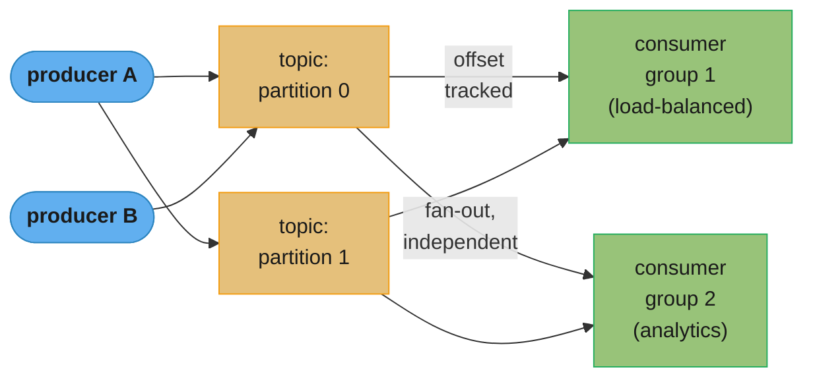
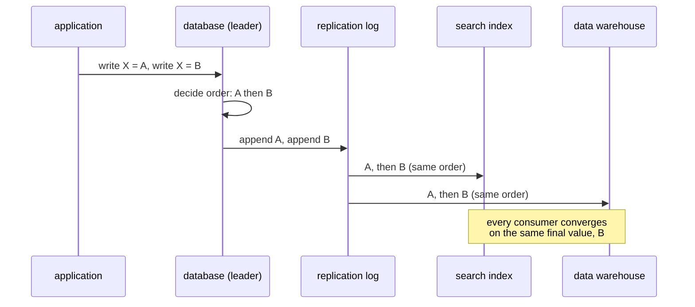

# Chapter 12: Stream Processing

> Part III — Derived Data · DDIA (Kleppmann & Riccomini, 2nd ed., O'Reilly 2026) · builds on Ch 11, leads to Ch 13 (a philosophy of streaming systems)

## Chapter Map

[Chapter 11](../11_batch_processing/11_batch_processing.md) assumed the input was **bounded** — a
batch job knows when it has read everything. Most real data isn't bounded: users keep producing
events tomorrow and the day after. This chapter is about **stream processing** — handling data
that arrives continuously and is processed incrementally, event by event, rather than in daily or
hourly slices. It covers how events are transmitted (messaging systems, log-based brokers), how
streams relate to databases (change data capture, event sourcing, materialized views), and how to
process streams (windowing, joins, fault tolerance) to produce derived streams or state.

**TL;DR:**
- Two broker families: **AMQP/JMS-style** (broker assigns and deletes individual messages, easy
  load balancing, no replay) versus **log-based** (Kafka-style: append-only partitions, consumers
  track an offset, replay is free, ordering only within a partition).
- **Change data capture (CDC)** turns a database's own write log into a stream, making the
  database the leader and every derived system (search index, cache, warehouse) a follower — this
  is the fix for the race condition in dual writes.
- **Log compaction** keeps only the latest value per key forever, so a compacted topic can
  rebuild a derived system from scratch without a separate snapshot.
- **Event time vs. processing time** is the central hazard: window by the wrong clock and you get
  phantom spikes when the pipeline restarts. **Tumbling, hopping, sliding, and session windows**
  are the four windowing shapes.
- Stream joins come in three flavors — **stream-stream** (window join), **stream-table**
  (enrichment), **table-table** (materialized view maintenance) — and **exactly-once** in the face
  of failures is achieved via microbatching/checkpointing plus atomic commit or idempotence, never
  by "just don't fail."

## The Big Question

> "A dataset that never ends — new events keep arriving forever. How do you compute anything
> useful over it, when 'read the whole input first' (which every batch algorithm assumes) is not
> an option, and a task that crashes halfway through can't simply restart from the beginning of a
> multi-year stream?"

Analogy: batch processing is like proofreading a finished manuscript — you can read it start to
finish, sort it, cross-reference every page against every other page, and republish cleanly if you
find a mistake. Stream processing is like being a live news ticker — the "manuscript" never
finishes, so you must produce a running commentary that's useful *now*, live with facts arriving
out of order (a correction to yesterday's story shows up today), and quietly correct or supersede
what you said five minutes ago instead of waiting for "the end" that never comes.

---

## 12.1 Transmitting Event Streams

The streaming equivalent of a batch job's input/output file is the **event** — a small,
self-contained, immutable record of something that happened at a point in time (a page view, a
sensor reading, a line of a web server log), usually carrying a timestamp. An event is generated
once by a **producer** and may be processed by multiple **consumers**; related events are grouped
into a **topic** or **stream**. Polling a database or file for new events works but gets expensive
as the poll interval shrinks — the more often you poll, the higher the fraction of empty polls —
so specialized systems exist to *push* notifications to consumers instead.

Two questions distinguish messaging systems: (1) what happens when producers outrun consumers —
**drop**, **buffer (queue)**, or **backpressure** (block the producer, as Unix pipes and TCP do);
and (2) what happens on a crash — is a message lost, and what does durability cost? Whether loss
is acceptable is application-specific: an occasional missed sensor reading is fine (a fresher one
follows soon), but an occasional missed event in a counter silently corrupts the count.

### Messaging Systems

**Direct messaging** connects producers to consumers without an intermediary: UDP multicast (stock
feeds, low latency, with application-level retransmission for reliability), brokerless libraries
like ZeroMQ, unreliable UDP-based metrics collection (StatsD), or webhooks (a consumer registers a
callback URL that a producer POSTs to on each event). These work well in the narrow case they're
designed for, but the application must handle message loss itself, and an offline consumer simply
misses whatever was sent while it was down.

A **message broker** (message queue) is a server that both producers and consumers connect to as
clients — essentially a database optimized for message streams. Centralizing durability in the
broker lets it tolerate clients connecting and disconnecting freely. Producers write asynchronously
(they wait only for the broker's buffering confirmation, not for consumer processing), and
consumers pull or receive pushed messages at some later, undetermined time.

**Message brokers vs. databases.** Despite some brokers participating in two-phase commit (XA/JTA),
important differences remain:

| | Databases | Message brokers (JMS/AMQP-style) |
|---|---|---|
| Retention | Until explicitly deleted | Deleted after successful delivery |
| Working-set assumption | Can be huge | Assumed small (short queues) |
| Query capability | Rich secondary indexes, query languages | Subscribe to a topic/pattern only |
| Notification on change | None (poll or repeat the query) | Yes — clients are notified of new messages |

This is the traditional model behind JMS, AMQP, and products like RabbitMQ, ActiveMQ, IBM MQ,
Azure Service Bus, and Google Cloud Pub/Sub.

**Load balancing vs. fan-out.** With multiple consumers on a topic, a broker offers **load
balancing** (each message goes to *one* consumer — good when messages are expensive to process and
order doesn't matter) or **fan-out** (each message goes to *all* consumers — several independent
readers "tune in" to the same broadcast, the streaming analogue of several batch jobs reading the
same file). Kafka's **consumer groups** combine both: load-balance within a group, fan out across
groups.

**Acknowledgments and redelivery.** A consumer must explicitly acknowledge a message once
processed; if the connection drops or times out before an ack, the broker assumes failure and
redelivers — possibly to a *different* consumer. Combined with load balancing, this reorders
messages: if consumer 2 crashes mid-way through message *m3* while consumer 1 is already handling
*m4*, the redelivered *m3* lands on consumer 1 *after* *m4*, so *m3* and *m4* process out of the
order producer 1 sent them in. A poison-pill message (e.g., malformed JSON missing a required key)
that a consumer can never successfully process triggers endless redelivery — a permanent blockage
under strict ordering, or wasted resources under reordering. **Dead letter queues (DLQs)** solve
this: after enough failed attempts the message is moved out of the main queue to a monitored DLQ
for an operator to drop, fix, or replay. Kafka Streams and Apache Pulsar now support DLQs natively.

### Log-based Message Brokers

AMQP/JMS brokers inherited a **transient** mindset from network protocols — even when they persist
messages to disk, they delete them promptly after delivery. This makes consuming *destructive*:
you can't re-run a consumer and expect the same result, and a newly added consumer only sees
messages sent after it registers. Databases and files take the opposite, **durable** stance:
everything is kept until explicitly deleted, and a new client can read arbitrarily far into the
past. **Log-based message brokers** combine both: durable storage with low-latency notification.

**Using logs for storage.** A log is an append-only sequence of records on disk; a producer appends,
a consumer reads sequentially and blocks (like `tail -f`) at the end for new data. To scale past a
single disk, the log is **sharded** — Kafka calls a shard a **partition** — and a **topic** is a
group of same-type partitions. Within a partition the broker assigns a monotonically increasing
**offset** to every message; ordering is total *within* a partition and undefined *across*
partitions. Apache Kafka and Amazon Kinesis Streams are log-based brokers of this shape (Google
Cloud Pub/Sub is architecturally similar internally but exposes a JMS-style API); they reach
millions of messages/second by sharding and replicate for fault tolerance.

**Logs vs. traditional messaging.** Fan-out is trivial in a log — many independent readers can
replay the same partition without affecting each other. Load balancing is coarser: whole
*partitions*, not individual messages, are assigned to consumer nodes, so parallelism tops out at
the partition count, and a slow message head-of-line-blocks everything behind it in its partition.
This makes the log-based approach the right fit when throughput is high, per-message processing is
cheap, and ordering matters; JMS/AMQP-style is the better fit when messages are expensive and
per-message parallelism or arbitrary reordering is fine. Kafka now blurs the line by also
supporting JMS/AMQP-style consumer groups that share a single partition. Because ordering only
holds within a shard, anything that needs consistent ordering (e.g., all events for one user) must
be routed to the same partition — usually by making the user ID the **partition key**.

**Consumer offsets** are cheap bookkeeping: everything below the current offset is processed,
everything above is not, so the broker tracks one number per consumer instead of per-message acks —
the same role as a **log sequence number** in single-leader database replication (the broker
behaves like a leader, the consumer like a follower). If a consumer crashes after processing
messages but before recording the new offset, it resumes from the last *recorded* offset and
reprocesses those messages — a source of duplicate processing addressed later in fault tolerance.

**Disk space and retention.** Old log segments are eventually deleted or archived, so the log acts
as a large **circular buffer**. Back-of-the-envelope: a 20 TB drive at 250 MB/s sequential write
takes about 22 hours to fill — so a disk-based log can buffer at least ~22 hours of full-rate
writes, and typically several days to weeks at realistic (non-saturating) rates. Modern brokers
(Kafka, Redpanda) increasingly tier older segments to object storage — some (WarpStream, Confluent
Freight, Bufstream) store everything there, as Iceberg tables, which also lets batch/warehouse jobs
query the log directly without copying it out.

A consumer that falls behind far enough that its offset points past a deleted segment silently
misses those messages — the log has "dropped" it, but only for that consumer; others are
unaffected. This isolation is an operational win: you can attach an experimental consumer to a
production log for testing without risking other consumers, and a shut-down consumer costs nothing
but its stored offset.

**Replaying old messages** is the log-broker's other superpower: since reading doesn't delete, you
can rewind a consumer's offset to yesterday, point its output somewhere new, and reprocess — as
many times, with as many code variants, as you like. This makes log-based messaging behave like
the repeatable, experiment-friendly batch processes of Chapter 11, rather than the one-shot,
destructive consumption of a traditional queue.

---

## 12.2 Databases and Streams

Log-based brokers borrowed ideas from databases; this section runs the idea in the other
direction — treating **every database write as an event stream**. A replication log is already a
stream of write events; **state machine replication** (Ch 10) already says that replicas
processing the same deterministic events in the same order converge — that *is* a stream in
disguise.

### Keeping Systems in Sync

Most nontrivial applications combine several storage technologies (an OLTP database, a cache, a
search index, a warehouse), each its own copy of overlapping data. Full-copy ETL batch jobs are one
way to sync them; **dual writes** — the application writes to each system explicitly — is a
common, tempting shortcut with two serious problems:

1. **Race conditions.** Two concurrent clients writing X=A then X=B (client 1) and X=B then X=A
   in reversed timing to two different systems can leave the database at B and the search index
   at A — permanently and silently inconsistent, with no error raised, unless you have a
   concurrency-detection mechanism like version vectors (Ch 6).
2. **Partial failure.** One write of the pair can succeed while the other fails; making both
   succeed-or-fail together is the atomic commit problem (2PC, Ch 8) — expensive to solve in
   general.

Neither system has a single leader determining write order in this picture, so conflicts are
possible even without any error occurring. The fix is to make there really be one leader — the
database — and turn the other systems into its followers.

### Change Data Capture

**Change data capture (CDC)** is the process of observing every write made to a database and
exposing it as a stream that other systems can consume — historically difficult because
replication logs were treated as a private implementation detail, not a public API. CDC solves the
dual-write race directly: the database decides one order for the two concurrent writes and puts
them in its log in that order; every downstream consumer (search index, warehouse, cache) applies
them in that same order and converges to the same final value.

**Implementation.** CDC effectively makes one database the leader and the rest followers, with a
log-based broker as the natural transport since it preserves ordering. Logical replication logs (Ch
6) are the usual mechanism; **Debezium** is the standard open-source project, with source
connectors for MySQL, PostgreSQL, Oracle, SQL Server, Db2, Cassandra, and more, feeding into Kafka
Connect. Maxwell (MySQL binlog parsing) and GoldenGate (Oracle) do something similar. CDC is
usually **asynchronous** — the source database doesn't wait for consumers — which keeps a slow
consumer from harming the source but reintroduces the replication-lag issues of Chapter 6.

**Initial snapshot.** Keeping the *entire* change history forever is often impractical, so a new
CDC consumer typically starts from a consistent snapshot (Ch 6's "Setting Up New Followers")
tagged with the exact log offset/position it corresponds to, then applies subsequent changes from
that point. Debezium uses Netflix's DBLog watermarking algorithm to take such snapshots
incrementally, without a long exclusive lock.

**Log compaction** offers an alternative to repeated snapshotting: the storage engine periodically
discards all but the most recent record for each key (a special **tombstone** value marks a
deletion), shrinking segments and merging them in the background. The same trick works for CDC: if
every change carries a primary key and each update fully replaces the prior value for that key, the
compacted log always contains at least the latest value for every key — so a new consumer can
rebuild a full copy of the database by scanning the compacted topic from offset 0, no separate
snapshot required. Kafka supports this as a built-in feature.

**API support for change streams.** Most databases now expose CDC as a first-class interface
rather than a reverse-engineered hack: MySQL and PostgreSQL send changes through their native
replication log; cloud vendors offer managed CDC (e.g., Datastream for Google Cloud's databases).
Even quorum-based systems like Cassandra now support CDC, though the lack of one single leader
makes it harder — Cassandra exposes raw per-node log segments and leaves it to the consumer to
merge them into one stream, echoing how a quorum reader itself must merge replicas.

**CDC vs. event sourcing.** Both log all changes as an append-only stream, but at different levels:
CDC extracts a low-level log from a database the application already treats as mutable (so write
order in the extracted log matches the true write order, avoiding the dual-write race); event
sourcing has the application *itself* write immutable events that describe intent at the
application level, with the event store append-only by design. CDC bolts onto an existing mutable
database with minimal application change; event sourcing is a bigger commitment the application
must be built around (see Ch 3).

> **CHANGE DATA CAPTURE AND DATABASE SCHEMAS.** CDC looks easier to adopt than event sourcing, but
> it has its own trap. In a microservices architecture the database is meant to be an internal
> implementation detail of one service — other services talk to its public API, not its schema.
> CDC, however, replicates using the *upstream database's own schema*, so that schema silently
> becomes a public API: dropping a column breaks every downstream CDC consumer, and because CDC is
> often wired straight into other production services (not just an offline warehouse ETL), that
> breakage can be a customer-facing outage. The **outbox pattern** decouples the two: a dedicated
> outbox table, with its own stable schema, is what CDC actually reads, while the service's
> internal domain tables stay free to change. This is, functionally, still a dual write — but
> because both writes land in the *same* database, they can be committed in a single transaction,
> sidestepping the race condition from "Keeping Systems in Sync" above. The cost: you must still
> maintain the internal→outbox transformation, and the extra table adds write volume.

### State, Streams, and Immutability

Just as immutable batch inputs let you rerun experimental jobs fearlessly, immutability underlies
both event sourcing and CDC. **Mutable state and an immutable event log are two views of the same
thing**: whatever the current state is, it's the result of the sequence of events that produced it.
If you're mathematically inclined: application state is the **integral** of an event stream over
time, and a changelog (a stream of changes) is the state **differentiated** by time — the analogy
has limits (a "second derivative" of state isn't meaningful) but is a useful frame. Jim Gray and
Andreas Reuter (1992) put the extreme version bluntly: "there is no fundamental need to keep a
database at all; the log contains all the information there is... The only reason for storing the
database... is performance."

**Advantages of immutable events.** Accountants have used this pattern for centuries — an
append-only ledger, with mistakes fixed by a *compensating* entry, never an erasure, preserved for
audit. The same benefit applies to software: buggy code that destructively overwrites data is much
harder to recover from than buggy code appending to an immutable log, and immutable logs also
capture information a mutable database would simply discard (a customer adding then removing a
cart item tells you something about intent, even though the net database effect is zero).

**Deriving several views from one log (CQRS).** Because multiple independent consumers can read
the same log without interfering, you can build several different read-optimized representations
from one write-optimized event log — this is **command query responsibility segregation (CQRS)**
(Ch 3), and it doesn't require full event sourcing; multiple materialized views built from a CDC
stream work the same way. Introducing a new feature becomes: build a new read view from the
existing log, run it alongside the old system, cut over, then retire the old one — often simpler
than an in-place schema migration. The social-network home-timeline cache (Ch 2) is exactly this:
a denormalized, write-fanned-out read view kept consistent by the event stream of new posts and
follow/unfollow events.

**Concurrency control.** CQRS's biggest downside is that view updates are normally asynchronous,
so a user can write, then immediately read a derived view and not see their own write (Ch 6,
"Reading Your Own Writes") — synchronous updates would need a distributed transaction or a wait
mechanism, both usually impractical. On the upside, an event-sourced design can simplify
concurrency control from the other direction: if one event is a self-contained description of one
user action, the only write needed is appending that event — trivially atomic — and if the log and
application state are sharded identically, a single-threaded consumer per shard needs *no*
concurrency control at all, because it processes exactly one event at a time by construction (the
log has already defined a serial order). Non-event-sourced systems lean on immutability for
concurrency control too: MVCC snapshot isolation (Ch 8) and version-control systems like Git all
use immutable data structures for the same reason.

**Limitations of immutability.** Keeping every change forever is only realistic when churn is low
relative to dataset size; high-update, high-delete workloads on a small dataset can make the
immutable history balloon, and compaction/GC performance becomes critical. Legally, some data must
actually be deleted — GDPR requires erasure on demand — and "just append a delete event" isn't
enough; you need to genuinely rewrite history (Datomic's **excision**, Fossil's **shunning**).
Truly deleting data is hard because copies persist in places you don't control — SSDs and storage
engines write to new locations rather than overwriting, and backups are deliberately immutable.
One workaround is **crypto-shredding**: store the data encrypted, and "delete" it by discarding the
key — which just moves the mutability problem from the data to the key store, and requires
deciding up front which records share a key (since you can only shred *all* or *none* of what
shares one).

---

## 12.3 Processing Streams

Once you have a stream, there are three things to do with it: (1) write it into a database, cache,
or index for others to query; (2) push it to a human (email, push notification, live dashboard); or
(3) feed it into one or more **operators**/**jobs** that transform it into other streams, possibly
chained into a pipeline before finally landing on (1) or (2). This section is about (3). Sharding
and parallelization work the same way as in batch (Ch 11), as do basic map/filter operations. The
one fundamental difference: **a stream never ends** — sorting doesn't make sense on an unbounded
input (so sort-merge joins are out), and fault tolerance can't simply mean "restart from the
beginning," because the beginning may be years ago.

### Uses of Stream Processing

Stream processing began with monitoring/alerting use cases — fraud detection on credit card usage
patterns, algorithmic trading on price changes, factory-floor anomaly detection, military threat
tracking — and has since broadened:

- **Complex event processing (CEP)**, from the 1990s, searches for *patterns* of events, the way a
  regex searches for patterns of characters — a query language or GUI describes the pattern, and
  the engine maintains a state machine over the incoming stream to detect matches, emitting a
  "complex event" when found. CEP inverts the usual database relationship: normally queries are
  transient and data is persistent; in CEP, **queries are stored long-term** and each new event is
  checked against all standing queries. Esper, Apama, and TIBCO StreamBase implement CEP; Flink
  and Spark Streaming add SQL support for it too.
- **Stream analytics** leans toward aggregation and statistics over many events rather than exact
  pattern matches — event rate, rolling averages, comparison to a prior period — usually over a
  **window** (a fixed time interval, covered next). Analytics systems often trade exactness for
  memory with probabilistic structures: Bloom filters for membership, HyperLogLog for cardinality,
  percentile-estimation algorithms — an optimization, not evidence that stream processing is
  inherently approximate. Open source: Storm, Spark Streaming, Flink, Samza, Beam, Kafka Streams;
  managed: Google Cloud Dataflow, Azure Stream Analytics.
- **Maintaining materialized views** — the CDC/event-sourcing pattern from §12.2 generalized: a
  materialized view usually needs *all* events since the beginning of time, not a bounded window,
  which cuts against analytics-oriented frameworks built to assume limited-duration windows. Kafka
  Streams and ksqlDB, built on Kafka's log compaction, are designed for this durable-forever case.
- **Search on streams** flips conventional search around: instead of indexing documents and
  running queries over the index, you index the *queries* and run each new document past them —
  again like CEP. Media-monitoring services matching news against saved search terms, or
  Elasticsearch's percolator feature, work this way; naively this means every document against
  every query, so at scale the queries themselves get indexed too, to narrow the candidate set.

**Event-driven architectures and RPC** (actor-model message passing, Ch 5) are related but
distinct from stream processing: actors manage concurrency/distributed execution and communicate
ephemerally and often cyclically, while stream processors run durable, multi-subscriber,
acyclic pipelines. Apache Storm's *distributed RPC* sits in the overlap, interleaving user queries
with the event stream itself. Actor frameworks used to process streams are usually not
fault-tolerant unless you add your own retry logic, since many don't guarantee delivery on a crash.

### Reasoning About Time

Windowed aggregation ("average over the last 5 minutes") sounds unambiguous but is not, because a
stream processor has (at least) two different clocks to choose from.

**Event time vs. processing time.** A batch job has no reason to look at the wall clock — it uses
timestamps embedded in the data, giving deterministic results no matter when the job runs. Many
stream frameworks instead default to the local system clock at processing time, which is simple and
fine *if* processing lag is negligible — but breaks down under queueing, network faults, broker
contention, consumer restarts, or reprocessing after a bug fix. If web server A and B handle two
requests from the same user in order, but B's event reaches the broker first, a stream processor
sees B before A even though A happened first — the *Star Wars* analogy: watching Episodes IV, V,
VI, then I, II, III, then VII, VIII, IX is watching in release (processing-time) order, not
narrative (event-time) order, and stream algorithms — unlike people — must be explicitly built to
cope with that mismatch. Confusing the two clocks produces artifacts: if a rate-of-requests
processor is redeployed and comes back up a minute later to a backlog, windowing by *processing*
time shows a fake spike while windowing by *event* time correctly shows the steady rate that
actually occurred.

**Handling straggler events.** You can never be *certain* a window is complete — some event for it
might still be in flight. Two choices once you decide to close a window anyway: **ignore
stragglers** (track the drop rate as a metric, alert if it grows) or **publish a correction** (an
updated value, possibly retracting the earlier one). A producer can also emit a watermark — "no
more events before time *t*" — that consumers use to trigger window closure, though with multiple
independent producers each tracking their own threshold, this gets harder to manage as producers
come and go.

**Whose clock, anyway?** A mobile app that buffers events offline and uploads them hours or days
later makes every event a straggler by the time it's seen, and worse, the device's own clock may
be wrong (accidentally or deliberately). One fix: log three timestamps — event time per the device
clock, send time per the device clock, and receive time per the (trusted) server clock. Subtracting
send-time from receive-time estimates the device/server clock *offset* (assuming negligible network
delay), which can then correct the event timestamp. This clock problem is not unique to streaming
— batch has it too — it's just more visible when you're constantly aware of the passage of time.

**Types of windows:**

| Window | Boundaries | Overlap | Example |
|---|---|---|---|
| Tumbling | Fixed length, fixed boundaries | None — each event in exactly one window | 1-minute buckets: 10:03:00–10:03:59, 10:04:00–... |
| Hopping | Fixed length, fixed hop | Yes, by design (smoothing) | 5-min window, 1-min hop: 10:03–10:07:59, then 10:04–10:08:59 |
| Sliding | Fixed length, relative to each event | Continuous, no fixed boundary | Events within 5 min of *each other*, not of a clock boundary |
| Session | No fixed length | N/A — bounded by inactivity | Ends after e.g. 30 min with no events for that user |

A tumbling window is implementable as rounding a timestamp down to the window length; a hopping
window as aggregating several adjacent tumbling windows; a sliding window as a time-sorted buffer
that expires old events. Fixed-size aggregations (a single counter) need constant state regardless
of window size, but sliding windows and stream joins must buffer events until the window closes —
so large windows or high-throughput streams can demand substantial memory/disk on the processing
nodes.

### Stream Joins

Just as batch jobs join datasets by key, stream processors join streams — but new events can
appear on either side at any time, which batch's "read everything, then sort-merge" approach can't
handle. Three shapes:

**Stream-stream join (window join).** Example: matching search-query events to search-*click*
events by session ID, to compute click-through rate. The click may never come (abandoned search),
or may come minutes, hours, or weeks later, and — due to variable network delay — could even arrive
*before* the search event. You pick a join window (e.g., one hour) and the processor keeps state
(recent events indexed by session ID on both sides); each new event checks the other side's index
for a match, emits a joined event if found, and emits an "unmatched" event if the window expires
without one. Simply embedding search context inside the click event isn't equivalent — it can't
tell you about searches with *no* click, which you need for an accurate click-through rate.

**Stream-table join (stream enrichment).** Example: augmenting an activity-event stream with user
profile data, joining on user ID — the streaming analogue of the batch activity/profile join in Ch
11. Querying a remote database per event is slow and risks overloading it; instead, load a local
copy (a **hash join** — an in-memory hash table or local disk index) and keep it current by
subscribing to a CDC changelog of the profile table alongside the activity stream. This is really a
join of two streams (activity events and profile-update events), where the profile-changelog side
uses a conceptually infinite window reaching back to "the beginning of time," with newer records
overwriting older ones, while the activity-event side may use no window at all.

**Table-table join (materialized view maintenance).** Example: the home-timeline cache from §12.2,
recast as maintaining the materialized view of

```sql
SELECT follows.follower_id AS timeline_id,
  array_agg(posts.* ORDER BY posts.timestamp DESC)
FROM posts
JOIN follows ON follows.followee_id = posts.sender_id
GROUP BY follows.follower_id
```

as posts and follow/unfollow events arrive — a new post fans out into the timeline of every
follower, a deleted post/account is removed from every timeline it touched, a new follow backfills
recent posts, an unfollow removes them. The stream processor must keep its own materialization of
the follower graph to know which timelines a new post touches.

> If you take the "stream is the derivative of a table" analogy from §12.2 seriously, and regard a
> join as a product of two tables *u·v*, something falls out of the product rule for
> derivatives: (u·v)′ = u′v + uv′. In words — any change to posts must be joined against the
> *current* followers, and any change to followers must be joined against the *current* posts.
> That is exactly the table-table join algorithm above, arrived at from calculus.

**Time-dependence of joins.** All three join types maintain state from one input and query it from
the other, so the *order* events are applied in matters (follow-then-unfollow is not the same as
unfollow-then-follow). Within one Kafka partition, order is preserved; across partitions or
streams, it typically is not — so if a profile update and an activity event land close together in
time, which "wins" the join is often undetermined, making the join **nondeterministic**: rerunning
the same job on the same input can produce a different result, because interleaving across streams
isn't fixed. Data warehouses call this a **slowly changing dimension (SCD)** problem (e.g., joining
a sale to the tax rate *at the time of sale*, not the current rate) and typically fix it by giving
every version of the changing record a stable identifier that the joined record carries forward —
at the cost of retaining every version (no log compaction) — or by denormalizing the relevant value
directly into the event at write time.

### Fault Tolerance

Batch jobs get fault tolerance almost for free: on failure, discard the partial output and restart
the task, because input is immutable and output is only made visible atomically at completion — so
the observable result is as if nothing failed, an **exactly-once** (more accurately,
**effectively-once**) outcome even though a task may have genuinely retried. A stream job can't
"finish, then reveal output," because the stream never finishes.

**Microbatching and checkpointing.** One fix is to slice the never-ending stream into small
batches and treat each like a miniature batch job — **microbatching**, used by Spark Streaming,
typically with a ~1-second batch size (a tradeoff: smaller batches raise coordination overhead,
larger ones raise result latency). Microbatching implicitly gives you a processing-time tumbling
window equal to the batch size; anything needing a larger window must explicitly carry state across
microbatch boundaries. Flink instead takes rolling **checkpoints** of operator state to durable
storage, triggered by barriers flowing through the stream (conceptually similar to microbatch
boundaries but without forcing a specific window size); on crash, restart from the last checkpoint
and discard anything produced since. Both approaches give exactly-once semantics *inside* the
framework — but the moment output leaves the framework (a database write, an external message, an
email), the framework can no longer discard it on failure, and a retried task duplicates that
external side effect.

**Atomic commit, revisited.** To make external effects exactly-once too, every effect of processing
one event — downstream messages, database writes, operator-state changes, and the input-offset
acknowledgment itself — must happen atomically, all or nothing (the same problem as distributed
transactions and 2PC, Ch 8). In restricted, single-vendor environments this is tractable: Google
Cloud Dataflow, VoltDB, and Kafka all implement an internal atomic-commit facility (unlike XA, they
don't try to span heterogeneous external technologies, only their own state + messaging), amortizing
the protocol's overhead across many events per transaction.

**Idempotence** is the other route: design the operation so applying it twice has the same effect
as once. Deleting a key is naturally idempotent; incrementing a counter is not — but can be made so
by tagging each write with metadata (e.g., the triggering Kafka offset), so a database write can
check "have I already applied this offset?" before applying it again. This requires: replays
reproduce the same messages in the same order (true of a log-based broker), processing is
deterministic, and no other node concurrently mutates the same value — and on failover between
processing nodes, **fencing** (Ch 9) may be needed to stop a node presumed-dead but actually still
running from interfering.

**Rebuilding state after a failure.** Any stateful operator (windowed counters, join indexes) needs
its state to survive a crash. Options: keep state in a remote, replicated datastore (simple, but a
remote round-trip per event is slow); replicate local state periodically (Flink snapshots to
durable storage; Kafka Streams replicates state changes to a compacted Kafka topic, essentially its
own CDC); or redundantly process every input on several nodes (VoltDB, echoing Ch 8's actual serial
execution). Sometimes no replication is needed at all — if state is a short-window aggregation, just
replay the relevant recent input; if it's a local CDC-maintained replica, rebuild it from the
compacted change stream. Which is cheapest depends on the relative cost of network vs. disk on your
actual infrastructure — there's no universally correct answer.

---

## Visual Intuition



Caption: two producers append to a two-partition topic; ordering holds only within a partition (A
and B interleave across 0/1 with no guaranteed order). Consumer group 1 load-balances the two
partitions across its members; group 2 independently fans out and reads everything — Kafka's
combination of the JMS load-balancing and fan-out patterns.



Caption: change data capture fixes the dual-write race from §12.2 by having a single leader (the
database) decide the write order once, in one log, that every downstream consumer replays
identically — no consumer can see the writes in a different order than another.

```
event time  ------------------------------------------------------->
            [ 10:03 ][ 10:04 ][ 10:05 ][ 10:06 ][ 10:07 ][ 10:08 ]
tumbling     |=======|=======|=======|=======|=======|=======|
             (disjoint, fixed boundaries, one window per event)

hopping      |===========|
             (5 min)  |===========|
                          |===========|
             (hop = 1 min: windows overlap by design, for smoothing)

sliding          .--5min--.    .--5min--.
              *--*    *----*  (window is relative to EACH event,
                 (no fixed clock boundary at all)

session      [user active >-----gap----->]  [new session]
              events < 30 min apart join    30+ min silence ends it
```

Caption: the same six minutes of events, windowed four different ways — tumbling gives disjoint
buckets, hopping deliberately overlaps for smoothing, sliding is defined per-event rather than
per-clock-boundary, and session has no fixed length at all, only an inactivity gap.

---

## Key Concepts Glossary

- **Event** — a small, immutable, timestamped record of something that happened; the streaming
  analogue of a batch record.
- **Producer / consumer** — the party that generates events onto a topic / reads them.
- **Topic (stream)** — a named grouping of related events.
- **Backpressure** — blocking the producer to enforce flow control when consumers can't keep up.
- **Message broker** — a server mediating producer/consumer messaging; JMS/AMQP-style deletes on
  ack, log-based (Kafka) retains and offers replay.
- **Load balancing vs. fan-out** — one consumer per message vs. every consumer per message; Kafka
  consumer groups do both at once.
- **Dead letter queue (DLQ)** — where a message goes after repeated processing failure, to unblock
  the main queue.
- **Partition (shard) / offset** — a log's independently ordered piece / the monotonic per-message
  sequence number within it.
- **Change data capture (CDC)** — extracting a database's writes as a consumable event stream.
- **Outbox pattern** — a dedicated table with a stable schema, exposed to CDC in place of internal
  domain tables, committed in the same transaction as the internal write.
- **Log compaction** — retaining only the latest record per key, discarding older versions and
  tombstoned (deleted) keys.
- **Event sourcing** — application state built by replaying an append-only log of intent-level
  events the application itself wrote.
- **CQRS (command query responsibility segregation)** — writing in one write-optimized form,
  deriving several read-optimized materialized views from it.
- **Changelog** — the stream of changes; state is its integral, the changelog is state's derivative.
- **Crypto-shredding** — "deleting" encrypted data by discarding its key.
- **Complex event processing (CEP)** — matching patterns across multiple events, with standing
  queries checked against each new event.
- **Stream analytics** — aggregations/statistics over event streams, often windowed.
- **Window (tumbling / hopping / sliding / session)** — the four shapes of grouping events by time.
- **Event time vs. processing time** — when an event happened vs. when it was processed; the
  central source of streaming's timing bugs.
- **Straggler** — an event arriving after its window was already declared closed.
- **Watermark** — a signal meaning "no more events before time t" used to trigger window closure.
- **Stream-stream / stream-table / table-table join** — window join, enrichment join, and
  materialized-view-maintenance join, respectively.
- **Slowly changing dimension (SCD)** — a data-warehouse term for a joined value that changes over
  time, requiring a versioned identifier to join deterministically.
- **Exactly-once (effectively-once) semantics** — output as if every event were processed exactly
  once, even though retries may process it more than once internally.
- **Microbatching / checkpointing** — slicing a stream into tiny batches, or periodically
  snapshotting operator state, to bound how much must be redone on failure.
- **Idempotence** — an operation safe to apply more than once with the same effect as once.
- **Fencing** — preventing a node presumed-dead (but still alive) from interfering after failover.

---

## Tradeoffs & Decision Tables

| | AMQP/JMS-style broker | Log-based broker (Kafka) |
|---|---|---|
| Message lifetime | Deleted after ack | Retained until segment expiry/compaction |
| Ordering | Broker tries to preserve, but redelivery breaks it | Total order within a partition |
| Parallelism unit | Individual message | Whole partition |
| Replay | Not possible (destructive read) | Trivial (rewind the offset) |
| Best for | Expensive-to-process messages, order doesn't matter | High throughput, cheap-per-message, order matters |

| | Dual writes | Change data capture |
|---|---|---|
| Ordering across systems | Not guaranteed — race possible | Guaranteed — one leader decides order |
| Failure atomicity | Needs 2PC to be safe | Async replication lag, but no split-brain order |
| New system integration | Application must add a new write path | Just add a new CDC consumer |

| | Stream-stream join | Stream-table join | Table-table join |
|---|---|---|---|
| Inputs | Two activity streams | Activity stream + table changelog | Two table changelogs |
| Window | Finite (e.g., 1 hour) | Infinite on the table side | Infinite on both sides |
| State kept | Recent events on both sides | Local replica of the table | Both underlying tables |
| Example | Search + click, ad attribution | Activity + user profile | Posts + follows (timeline) |

| Fault-tolerance mechanism | Handles framework-internal state | Handles external side effects |
|---|---|---|
| Microbatching | Yes | No, unless combined with idempotence/commit |
| Checkpointing | Yes | No, unless combined with idempotence/commit |
| Atomic commit (internal) | Yes | Yes, but only within the same vendor's ecosystem |
| Idempotence | N/A | Yes, if replay order + determinism + no concurrent writer hold |

---

## Common Pitfalls / War Stories

- **Windowing by processing time on a redeployed job.** A stream processor measuring
  requests-per-second by processing time shows a fake traffic spike after any restart, because it's
  crunching through a backlog in a shorter wall-clock window than the events actually spanned —
  always window by embedded event timestamps for anything downstream will alert on.
- **The poison-pill infinite redelivery loop.** A producer emits one malformed message (say, a
  required JSON key is missing); every consumer that reads it fails immediately, no ack is sent, the
  broker redelivers it, and the loop repeats forever — burning resources or, under strict ordering,
  fully blocking the partition. Route to a dead letter queue after N failures instead of retrying
  forever.
- **`hash(key) mod N`-style thinking applied to joins.** Assuming a stream-table join always gets
  the row version that was "current" at read time silently makes the pipeline nondeterministic —
  rerunning it on the same input across streams with different interleaving gives a different
  result. If you need reproducibility (e.g., an invoice must always show the tax rate that applied
  at the time of sale), version the joined record with a stable identifier — a slowly changing
  dimension — rather than joining against "whatever the table currently says."
- **CDC breaking database encapsulation.** A microservice's database schema was never meant to be a
  public contract, but wiring CDC straight off the raw tables turns "drop an unused column" into a
  breaking change for every downstream consumer, sometimes a customer-facing one. Expose an outbox
  table to CDC instead of the internal schema.
- **Treating microbatching/checkpointing as sufficient for exactly-once.** They give
  exactly-once semantics *inside* the stream processor, but the instant output reaches an external
  system (a database write, an email, an HTTP call), a retried microbatch or restarted-from-checkpoint
  task duplicates that side effect unless it's also made idempotent or wrapped in an atomic-commit
  protocol that spans the external write.
- **Assuming stream processing is inherently approximate.** Because stream analytics often reaches
  for Bloom filters and HyperLogLog for memory reasons, it's easy to conclude streaming itself is
  lossy. It is not — probabilistic structures are an optional optimization, not a property of
  streaming; exact algorithms work fine when memory allows.
- **Forgetting fencing on failover.** When a processing node is presumed dead and its work is
  reassigned, the "dead" node can sometimes still be running (a long GC pause, a network partition
  that later heals) and continue writing — corrupting idempotent-write assumptions unless the new
  owner fences the old one out.

---

## Real-World Systems Referenced

Apache Kafka, Amazon Kinesis Streams, Google Cloud Pub/Sub, Apache Pulsar, Redpanda (log-based
brokers); RabbitMQ, ActiveMQ, HornetQ, Qpid, TIBCO Enterprise Message Service, IBM MQ, Azure Service
Bus (JMS/AMQP-style brokers); ZeroMQ, nanomsg, StatsD (direct/UDP messaging); WarpStream, Confluent
Freight, Bufstream (Kafka-compatible, object-storage-native); Debezium, Maxwell, GoldenGate, Kafka
Connect, Datastream (CDC tooling); Materialize, RisingWave, ClickHouse, Feldera (incremental view
maintenance / streaming SQL databases); Apache Storm, Spark Streaming, Apache Flink, Apache Samza,
Apache Beam, Kafka Streams, ksqlDB (stream processing frameworks); Google Cloud Dataflow, Azure
Stream Analytics (managed stream processing); Esper, Apama, TIBCO StreamBase (complex event
processing); Elasticsearch (percolator, stream search); Druid (Kafka-native analytics ingestion);
VoltDB (deterministic replay-based fault tolerance); Datomic (excision), Fossil (shunning) — logical
deletion of immutable history; Cassandra (quorum-based CDC).

---

## Summary

Stream processing generalizes batch processing to unbounded, never-ending input, done continuously
rather than in fixed-size chunks; message brokers and event logs are streaming's equivalent of a
filesystem. Two broker philosophies were compared: **AMQP/JMS-style**, which assigns and deletes
individual messages and suits asynchronous-RPC-like task queues, and **log-based**, which assigns
whole partitions, retains messages on disk, and suits high-throughput, order-sensitive processing —
the log-based approach also closely echoes database replication logs (Ch 6), log-structured storage
(Ch 4), and consensus (Ch 10). Streams can originate from user activity, sensors, market feeds, or —
critically — from a database's own changelog, captured implicitly via **change data capture** or
explicitly via **event sourcing**; **log compaction** lets that changelog retain a full copy of the
database forever without a separate snapshot. Representing a database as a stream lets you keep
derived systems (search indexes, caches, analytics) continuously in sync, or build entirely new
views by replaying from the beginning.

Processing streams means reasoning carefully about **time** — event time vs. processing time, and
what to do with stragglers — and about **windows** (tumbling, hopping, sliding, session). Three
kinds of **stream joins** were distinguished: stream-stream (a window join between two activity
streams), stream-table (enriching an activity stream against a table's changelog), and table-table
(maintaining a materialized view of a join between two changelogs). Finally, fault tolerance in a
long-running stream process can't rely on simply discarding a failed task's output the way batch
does — it needs microbatching, checkpointing, atomic commit, or idempotent writes, chosen based on
whether the effect stays inside the framework or reaches an external system.

---

## Interview Questions

**Q: What's the fundamental reason batch fault-tolerance techniques (discard and restart) don't work for stream processing?**
**Short:** A batch job restarts from the beginning on failure; a stream has no "beginning" to return to.
A batch job's fault tolerance relies on discarding a failed task's partial output and restarting from the beginning of a known, bounded input — cheap because the input is small and finite. A stream processor that has been running for months or years cannot restart from the beginning of its input without reprocessing everything ever received, so it needs a different mechanism: microbatching, periodic checkpointing, or idempotent/atomic writes that bound how much work is redone after a crash.

**Q: Why is `hash(key) mod N`-style thinking dangerous when joining streams, and what problem does it cause?**
**Short:** Cross-stream interleaving is undetermined, so a naive join is nondeterministic.
If two streams are joined without controlling for cross-stream ordering, the join becomes nondeterministic: rerunning the same job on the same input can produce a different result, because events from different streams or partitions may interleave differently on each run — there's no guaranteed order across partitions, only within one. This bites hardest in stream-table joins with a changing "table" side (e.g., tax rates); the fix is to version the joined value with a stable identifier (a slowly changing dimension) rather than joining against "whatever the table says right now."

**Q: What is the difference between an AMQP/JMS-style message broker and a log-based message broker like Kafka?**
**Short:** JMS-style deletes messages on ack and load-balances per-message; log-based retains and replays.
An AMQP/JMS-style broker assigns individual messages to consumers and deletes each message once it's acknowledged, which suits expensive-to-process messages where exact ordering doesn't matter and replay isn't needed. A log-based broker (Kafka, Kinesis) appends messages to a durable, append-only, sharded log; consumers track an offset rather than acking each message, load balancing happens at the granularity of a whole partition, and old messages can be replayed since reading is nondestructive. Log-based brokers fit high-throughput, order-sensitive, cheap-per-message workloads; JMS/AMQP-style fits the opposite.

**Q: Why does the combination of load balancing and message redelivery reorder messages, even in a broker that otherwise preserves order?**
**Short:** A crashed consumer's unacked message is redelivered later, out of its original sequence.
When a consumer crashes while processing a message, the broker redelivers that unacknowledged message to another (or the same) consumer later — but by then, subsequent messages may have already been processed by other consumers. So a message that was sent third can end up processed after messages sent fourth and fifth, even though the broker tries to preserve order under normal operation. Avoiding this requires a separate queue per consumer (giving up load balancing) or accepting that ordering across consumers isn't guaranteed when redelivery can occur.

**Q: What race condition does change data capture solve that dual writes cannot, and how?**
**Short:** CDC lets one database leader fix the write order that dual writes can scramble.
Dual writes let two systems (say, a database and a search index) receive the same two concurrent updates in different orders, because there's no single leader deciding a canonical order — leaving them permanently, silently inconsistent. Change data capture fixes this by making the source database the sole leader: it decides one order for concurrent writes, records that order in its own log, and every downstream consumer (search index, warehouse, cache) replays the exact same log in the exact same order, so they all converge to the same final state.

**Q: Why is CDC usually implemented asynchronously, and what does that cost you?**
**Short:** Async CDC avoids blocking the leader, but downstream systems can lag behind it.
CDC is asynchronous so the source-of-record database doesn't have to wait for every downstream consumer before committing a write — otherwise a slow consumer would directly harm the primary database's write latency and availability. The cost is replication lag: a downstream search index, cache, or warehouse can be briefly (or, under backlog, significantly) behind the source of truth, reintroducing the same "reading your own writes" and staleness concerns that apply to ordinary database replication.

**Q: How does log compaction let you rebuild a derived data system without taking a separate snapshot?**
**Short:** A compacted log always retains at least the newest value per key, forever.
Log compaction periodically discards all but the most recent record for each key (honoring tombstones for deletions), so the compacted topic is guaranteed to contain at least the latest value for every key that currently exists, even though older writes have been thrown away. A new consumer can therefore start at offset 0 of the compacted topic and sequentially scan the whole thing to obtain a full, current copy of the source data — no separate point-in-time snapshot of the source database is required.

**Q: What's the difference between change data capture and event sourcing, and when would you pick one over the other?**
**Short:** CDC extracts low-level DB changes; event sourcing writes intent-level events by design.
Change data capture extracts a log of changes from a database the application still treats as ordinarily mutable — it's a low-level, retrofitted view, and the order it captures matches the true write order, which is what avoids the dual-write race. Event sourcing instead has the application explicitly write immutable, intent-level events (e.g., "item added to cart") to an append-only store, with mutation of past events discouraged or forbidden. CDC can be bolted onto an existing system with minimal disruption; event sourcing is a deeper architectural commitment with its own tradeoffs (Ch 3) but yields events that describe *why* something changed, not just *that* it changed.

**Q: What does the outbox pattern solve, and why isn't it just a dual write with the same race condition?**
**Short:** The outbox is a dual write, but both halves land in one transaction on one database.
CDC replicating straight off a service's internal tables turns that private schema into an accidental public API — changing a column breaks downstream consumers, sometimes causing a production outage. The outbox pattern adds a dedicated table with a stable, intentional schema that CDC reads instead of the internal tables. It is, functionally, still a dual write (internal state plus the outbox row), but because both writes happen inside the same database transaction, they either both commit or neither does — avoiding the cross-system race and partial-failure problems that plague dual writes across two separate systems.

**Q: Why do sort-merge joins, which work fine in batch processing, not carry over to stream processing?**
**Short:** Sort-merge joins need a bounded, sortable input; a stream is unbounded.
Sort-merge joins rely on being able to sort the entire input before merging matching keys, which requires knowing you've seen every record — impossible on an unbounded stream that never "finishes." Stream processors instead maintain incrementally updated state (buffered recent events, or a local replica of a table) and query that state as each new event arrives, rather than sorting the whole dataset up front; this is the mechanism behind all three streaming join types (stream-stream, stream-table, table-table).

**Q: Distinguish stream-stream, stream-table, and table-table joins with an example of each.**
**Short:** The three joins differ in whether each side is a window, a table, or two tables.
A stream-stream (window) join matches related events across two activity streams within some time window, like joining search events to click events by session ID to compute click-through rate. A stream-table (enrichment) join augments each activity event with data from a locally cached, CDC-kept-current copy of a table, like adding user-profile fields to an activity event. A table-table join maintains a materialized view over two changelogs, like a social-network home-timeline cache built by joining a posts changelog with a follows changelog. All three keep state from one side and query it from the other; they differ mainly in whether that state is a short window, an infinite table replica, or two infinite table replicas.

**Q: What is event time, and why do many stream processors default to processing time instead — and what breaks when they do?**
**Short:** Processing time is simpler to implement, but wrong once there's any pipeline lag.
Event time is when something actually happened, recorded in the event itself; processing time is when the stream processor happens to handle it, read off the local system clock. Many frameworks default to processing time because it's simpler to implement and is fine when the gap between event creation and processing is negligible. It breaks under real-world delay — queueing, network faults, broker contention, or a consumer restart processing a backlog — producing artifacts like a false traffic spike right after a redeploy, when the real request rate was steady the whole time; windowing must use event time to be correct.

**Q: What are the four window types (tumbling, hopping, sliding, session), and what distinguishes each?**
**Short:** Tumbling is disjoint fixed buckets; hopping overlaps; sliding is per-event; session ends on inactivity.
Tumbling windows have a fixed length with no overlap — every event belongs to exactly one window, like rounding each timestamp down to the nearest minute. Hopping windows also have a fixed length but deliberately overlap (e.g., a 5-minute window advancing every 1 minute) to smooth results across boundaries. Sliding windows contain all events within some interval of *each other*, defined relative to each event rather than a fixed clock boundary, so two events 4 minutes apart always share a window regardless of where the clock "boundary" would fall. Session windows have no fixed length at all — they're defined purely by a gap of inactivity (e.g., 30 minutes with no events from that user) ending the session.

**Q: How do you handle straggler events — ones that arrive after their window was already closed?**
**Short:** You must either drop stragglers and track the rate, or emit a correction.
You can never be certain a window's events have all arrived, since a delayed producer could still be in flight. The two options are to ignore stragglers, tracking the drop rate as a metric and alerting if it grows too large, or to publish a correction — an updated window value including the straggler, possibly retracting the earlier output. Some systems support an explicit watermark message ("no events before time t will arrive") to trigger window closure more precisely, though this gets harder to manage with multiple independent producers.

**Q: How do idempotent writes achieve effectively-once processing, and what three conditions does relying on them assume?**
**Short:** Tag each write with the input offset so a duplicate application is a safe no-op.
An idempotent write, when applied twice, has the same effect as applying it once — for example, by tagging a database write with the Kafka offset of the message that produced it and checking that offset before reapplying. Relying on idempotence to achieve effectively-once semantics assumes three things hold: a replay after failure reproduces the exact same messages in the exact same order (true of a log-based broker), the processing logic itself is deterministic, and no other node concurrently updates the same piece of state — plus, on failover, fencing may be needed so a node presumed dead but still alive can't interfere.

**Q: Why does microbatching or checkpointing alone fail to prevent duplicate side effects once output leaves the stream processor?**
**Short:** The framework can discard its own retried output, but not an external system's copy of it.
Microbatching and checkpointing give exactly-once semantics only within the confines of the stream-processing framework, because the framework can discard the output of a failed microbatch or a task restarted from a checkpoint before that output becomes externally visible. Once output has already been written to an external database, sent as a message to an external broker, or triggered an email, the framework has no way to "unsend" it — so a retried task duplicates that external effect unless it's additionally made idempotent or wrapped in an atomic-commit protocol spanning the external system.

**Q: Why is stream processing not inherently "approximate," despite the common use of probabilistic data structures like HyperLogLog?**
**Short:** Probabilistic structures are an optional memory optimization, not a property of streaming.
Stream analytics frameworks often use Bloom filters, HyperLogLog, and percentile-estimation algorithms because they need far less memory than exact equivalents when computing aggregations over high-volume streams, which can create the impression that streaming results are always approximate. That's a misconception: nothing about stream processing itself requires approximation — exact algorithms work perfectly well in streaming when memory budget allows, and probabilistic structures are chosen purely as a performance/memory tradeoff, the same kind of choice you'd make in a batch system.

**Q: Why can't you fully "delete" data in an immutable event log just by appending a delete event, and what's crypto-shredding's tradeoff?**
**Short:** Legal deletion needs history rewritten, not appended to; crypto-shredding trades data mutability for key mutability.
An append-only log honors "delete" as just another event, but regulations like GDPR require the underlying data to actually be gone, which means rewriting history rather than layering a delete marker on top — features like Datomic's excision or Fossil's shunning do this explicitly. True deletion is hard regardless, because copies persist in storage engines, SSD remapped blocks, and immutable backups. Crypto-shredding sidesteps this by storing data encrypted and "deleting" it by discarding the key — but this only relocates the mutability problem from the primary data (now genuinely immutable) to the key store (which must now be mutable), and you must decide up front which records share a key, since shredding is all-or-nothing per key.

---

## Cross-links in this repo

- [hld/stream_processing/ — stream processing patterns in the interview framework](../../../hld/stream_processing/stream_processing.md)
- [hld/message_queues/ — queue vs. log broker tradeoffs, delivery semantics](../../../hld/message_queues/message_queues.md)
- [hld/event_sourcing_cqrs/ — event sourcing and CQRS as an interview topic](../../../hld/event_sourcing_cqrs/event_sourcing_cqrs.md)
- [backend/kafka_deep_dive/ — Kafka partitions, consumer groups, exactly-once internals](../../../backend/kafka_deep_dive/kafka_deep_dive.md)
- [backend/event_sourcing_and_cqrs/ — event sourcing implementation detail](../../../backend/event_sourcing_and_cqrs/event_sourcing_and_cqrs.md)
- [backend/event_driven_fundamentals/ — pub/sub, webhooks, event-driven architecture basics](../../../backend/event_driven_fundamentals/event_driven_fundamentals.md)
- [devops/event_streaming_operations/ — operating Kafka/streaming platforms in production](../../../devops/event_streaming_operations/event_streaming_operations.md)
- [11. Batch Processing](../11_batch_processing/11_batch_processing.md)
- [13. A Philosophy of Streaming Systems](../13_philosophy_of_streaming_systems/13_philosophy_of_streaming_systems.md)

## Further Reading

- Kleppmann & Riccomini, DDIA 2nd ed., Ch 12 — original text and full reference list.
- Tyler Akidau et al., "The Dataflow Model: A Practical Approach to Balancing Correctness,
  Latency, and Cost in Massive-Scale, Unbounded, Out-of-Order Data Processing," VLDB 2015 — the
  paper behind Google Cloud Dataflow's windowing/watermark model.
- Jay Kreps, "The Log: What Every Software Engineer Should Know About Real-Time Data's Unifying
  Abstraction," LinkedIn Engineering, 2013 — the log-as-central-abstraction argument this chapter
  builds on.
- Pat Helland, "Immutability Changes Everything," CIDR 2015 — the case for immutable data as a
  systems-design primitive.
- Martin Kleppmann, "Making Sense of Stream Processing," O'Reilly report, 2016 — an earlier,
  extended treatment of the ideas in §12.2 and §12.3.
