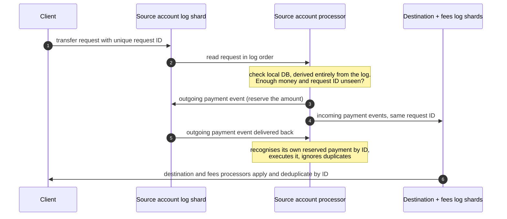
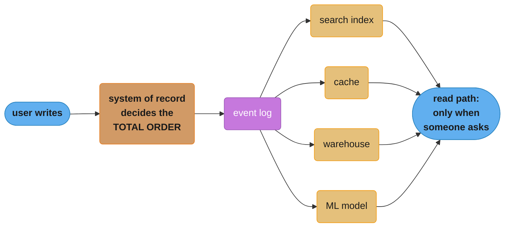
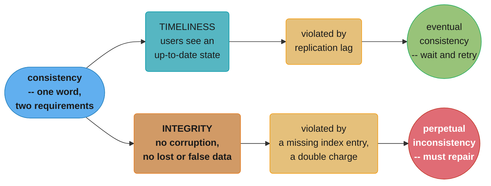
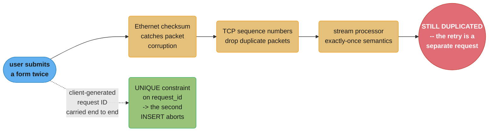

# Chapter 13: A Philosophy of Streaming Systems

> Part III — Derived Data · DDIA (Kleppmann & Riccomini, 2nd ed., O'Reilly 2026) · builds on Ch 11-12, leads to Ch 14 (doing the right thing)

## Chapter Map

Chapter 2 set the goal — reliable, scalable, maintainable applications — and every chapter since
has contributed a piece: fault-tolerance algorithms for reliability, sharding for scalability,
evolution and abstraction for maintainability. This chapter brings those ideas together and builds
on Chapter 12's streaming and event-driven architecture to develop **a philosophy of application
development** that meets those goals. The authors flag the change of register explicitly: **this
chapter is more opinionated than previous chapters, presenting a deep-dive into one particular
philosophy rather than comparing multiple approaches.** Its epigraph is Aquinas — often quoted as
*"if the highest aim of a captain was to preserve his ship, he would keep it in port forever."*

**TL;DR:**
- **No single tool fits every access pattern**, so applications must compose several — which makes
  *data integration* the central problem, and the answer is to designate systems of record and
  derive everything else from them through an ordered event log.
- **Log-based derived data beats distributed transactions** for crossing technology boundaries,
  because XA has poor fault tolerance and performance, and an ordered log with idempotent
  consumers is a far simpler abstraction to implement across heterogeneous systems.
- **Unbundling the database**: batch and stream processors are elaborate implementations of
  triggers, stored procedures and materialized-view maintenance, with derived systems playing the
  role of index types. Federation unifies reads; unbundling unifies writes.
- **The write path and the read path meet at the derived dataset.** Caches, indexes and
  materialized views simply *shift that boundary*, and the boundary can be pushed all the way to
  the end-user device.
- **Consistency conflates two things.** *Timeliness* violations are eventual consistency;
  *integrity* violations are perpetual inconsistency — and integrity matters far more.
- **Coordination-avoiding data systems** get strong integrity without atomic commit or
  linearizability, because many real business constraints are loose and repaired by apology.

## The Big Question

> "Given that no one system does everything well, how do I compose many of them into an
> application that is still correct — without paying for distributed transactions, and without
> telling everyone to 'embrace eventual consistency' and figure it out?"

The chapter's setup for this is a recurring theme made explicit: for any given problem there are
several solutions with different pros, cons and trade-offs — log-structured storage, B-trees and
column-oriented storage in Chapter 4; single-leader, multi-leader and leaderless replication in
Chapter 6. **A software implementation typically has to pick one particular approach**, because
"it's hard enough to get one code path robust and performing well — trying to do everything in one
piece of software almost guarantees that the implementation will be poor." Even a so-called
general-purpose database is designed for a particular usage pattern. And **vendors are
understandably reluctant to tell you about the workloads for which their software is poorly
suited**, so the first challenge is reading between the lines.

---

## 13.1 Data Integration

Even if you perfectly understand the mapping between tools and the circumstances where each fits,
a second challenge remains: **in complex applications, data is often used in several different
ways.** There is unlikely to be one piece of software suitable for all of them, so you inevitably
end up cobbling together several.

### Combining Specialized Tools by Deriving Data

The canonical case is integrating an OLTP database with a full-text search index for arbitrary
keyword queries. **Some databases such as PostgreSQL include full-text indexing, which can be
sufficient for simple applications**, but more sophisticated search needs specialist information
retrieval tools — and conversely, **search indexes are generally not very suitable as a durable
system of record.** So many applications combine two tools.

And the problem compounds. Besides the database and search index you may need copies in analytics
systems (warehouses, batch and stream processors); caches or denormalized versions of objects
derived from the original data; machine learning, classification, ranking or recommendation
systems; and notification systems triggered by changes. **As the number of different
representations increases, the integration problem becomes harder.**

#### Reasoning about dataflows

When copies of the same data live in several storage systems, **you need to be very clear about
inputs and outputs: where is data written first, and which representations are derived from which
sources?**

The disciplined arrangement: write to a system-of-record database, capture the changes with CDC,
and apply them to the search index **in the same order**. If CDC is the *only* way of updating the
index, you can be confident the index is entirely derived from the system of record and therefore
consistent with it, barring bugs — because writing to the database is the only way to supply new
input into the system.

```
  BROKEN — application writes to BOTH systems directly

    client A  --write X-->  database      (order: X then Y)
    client B  --write Y-->  search index  (order: Y then X)

    neither system is "in charge" of ordering
    -> contradictory decisions -> PERMANENTLY inconsistent

  FIXED — one system decides the order, everything else derives from it

    client A --\
                >--> system of record --CDC--> search index
    client B --/      (decides the total order)   analytics
                                                  cache
```

If you can funnel all user input through a single system that decides an ordering for all writes,
deriving other representations is much easier — **an application of the state machine replication
approach from Chapter 10.** The chapter is deliberately agnostic about the mechanism: **whether you
use change data capture or an event sourcing log is less important than simply the principle of
deciding on a total order.** And updating a derived system from an event log can often be made
deterministic and idempotent, which makes fault recovery easy.

#### Derived data versus distributed transactions

The classic way to keep different systems consistent is a distributed transaction (Ch 8). How do
the two approaches compare? **At an abstract level they achieve a similar goal by different means:**

| | Distributed transactions | Log-based derived data |
|--|--|--|
| Deciding an ordering of writes | **Locks** for mutual exclusion | **A log** for ordering |
| Ensuring changes take effect once | **Atomic commit** | **Deterministic retry and idempotence** |
| Reading your own writes | **Guaranteed** — after a value is written you can immediately read the up-to-date value | **Not by default** — derived systems are often updated asynchronously |

The chapter's verdict is a judgment about the industry, not just the mechanism. Distributed
transactions have been used successfully **within limited environments willing to pay the cost**,
but **XA has poor fault tolerance and performance characteristics, which severely limit its
usefulness.** A better protocol might be possible, **but getting one widely adopted and integrated
with existing tools would be challenging, and is unlikely to happen soon.** In its absence,
log-based derived data is the most promising approach.

But it refuses the easy conclusion: **guarantees such as reading your own writes are useful, and it
is not productive to tell everyone "eventual consistency is inevitable — suck it up and learn to
deal with it"** (at least not without good guidance on *how* to deal with it). The rest of the
chapter works toward a middle ground.

#### The limits of total ordering

For systems small enough, constructing a totally ordered event log is entirely feasible — the
popularity of single-leader replication demonstrates it. **Four limitations emerge at scale:**

- **Throughput.** A totally ordered log usually requires all events to pass through a single leader
  node deciding the order. Above one machine's throughput you must shard the log, and **the order
  of events in two different shards is then ambiguous.**
- **Geography.** Servers spread across regions to survive a datacenter outage typically have a
  separate leader per datacenter, because network delays make synchronous cross-datacenter
  coordination inefficient. **Events originating in two datacenters have undefined order.**
- **Microservices.** A common design deploys each service and its durable state as an independent
  unit with no shared durable state, so **two events originating in different services have no
  defined order.**
- **Client-side state.** Applications that update immediately on user input without waiting for
  server confirmation, and keep working offline, mean **clients and servers are very likely to see
  events in different orders.**

Formally, deciding a total order of events is **total order broadcast, which is equivalent to
consensus.** And the chapter names the gap directly: **most consensus algorithms are designed for
situations where a single node's throughput suffices for the entire event stream, and do not
provide a mechanism for multiple nodes to share the work of ordering.**

#### Ordering events to capture causality

Where there is no causal link, a missing total order is not a problem — concurrent events can be
ordered arbitrarily. Some cases are easy: multiple updates of the same object can be totally
ordered by **routing all updates for a particular object ID to the same log shard.** But causal
dependencies arise in subtler ways.

The chapter's example: a social network where two users have just broken up. One removes the other
as a friend, **then** sends a message to their remaining friends complaining about the ex-partner.
The intention is clearly that the ex should not see it. But if friendship status lives in one place
and messages in another, **that ordering dependency between the *unfriend* event and the
*message-send* event may be lost**, and a notification service that processes message-send before
unfriend will incorrectly notify the ex-partner. The notifications are effectively **a join between
the messages and the friend list**, which ties it to the time-dependence-of-joins problem from
Chapter 12.

**There does not seem to be a simple answer to this problem.** Three starting points:

- **Logical timestamps** provide total ordering without coordination (Ch 10), so they may help where
  total order broadcast is not feasible — but **recipients still have to handle out-of-order
  delivery, and additional metadata must be passed around.**
- **Log the state the user saw** before making a decision, give that event a unique identifier, and
  have later events reference that identifier to record the causal dependency.
- **Conflict resolution algorithms** (Ch 6) help process events delivered in an unexpected order.
  They are useful for maintaining state, **but they do not help if actions have external side
  effects, such as sending a notification.**

The section ends as an open question: perhaps future patterns will let causal dependencies be
captured efficiently and derived state be maintained correctly **without forcing all events through
the bottleneck of total order broadcast.**

### Batch and Stream Processing

The goal of data integration is to make sure data ends up in the right form in all the right
places — consuming inputs, transforming, joining, filtering, aggregating, training models,
evaluating, and writing outputs. **Batch and stream processors are the tools**, and their outputs
are derived datasets: search indexes, materialized views, recommendations, aggregate metrics. They
share a great many principles, and **the main fundamental difference is that stream processors
operate on unbounded datasets whereas batch process inputs are of a known, finite size.**

#### Maintaining derived state

Batch processing has **a quite strong functional flavor even when the code is not written in a
functional language**: it encourages deterministic, pure functions whose output depends only on the
input, with no side effects other than the explicit outputs, treating inputs as immutable and
outputs as append-only. **Stream processing is similar but extends operators to allow managed,
fault-tolerant state.**

That discipline is not only good for fault tolerance — **it simplifies reasoning about the
dataflows in an organization.** Whether the derived data is a search index, a statistical model or
a cache, it helps to think in terms of pipelines that derive one thing from another, pushing state
changes through functional application code and applying the effects to derived systems.

Why asynchronous rather than synchronous? In principle derived systems *could* be maintained
synchronously, the way a relational database updates secondary indexes inside the same transaction.
**But asynchrony is what makes event-log systems robust: it allows a fault in one part of the
system to be contained locally, whereas distributed transactions abort if any one participant
fails, so they tend to amplify failures by spreading them to the rest of the system.** The chapter
grounds this in Chapter 7's result that secondary indexes often cross shard boundaries — a sharded
system sends writes to multiple shards for a term-partitioned index or reads to all shards for a
document-partitioned one, **and such cross-shard communication is also most reliable and scalable
if the index is maintained asynchronously.**

#### Reprocessing data for application evolution

Both are useful, for different reasons: **stream processing reflects input changes in derived views
with low delay; batch processing reprocesses large amounts of accumulated historical data to derive
new views onto an existing dataset.**

Reprocessing is what makes a system evolvable. **Without it, schema evolution is limited to simple
changes like adding a new optional field or a new record type. With it, you can restructure a
dataset into a completely different model** to serve new requirements.

> **Schema migrations on railways.** In the early days of railway building in 19th-century England
> there were competing standards for the **gauge**, the distance between the rails, and trains
> built for one gauge could not run on another — which restricted possible interconnections. After
> a single standard was decided upon in **1846**, other tracks had to be converted, but shutting the
> line down for months or years was not an option. The solution: first convert the track to **dual
> gauge (mixed gauge) by adding a third rail.** That can be done gradually; once done, trains of
> both gauges run on the line using two of the three rails; and eventually, when all trains are
> standard, the nonstandard rail is removed. **It is nevertheless an expensive undertaking, which
> is why nonstandard gauges still exist — the BART system in the San Francisco Bay Area uses a
> different gauge from the majority of the US.**

Derived views allow **gradual** evolution by exactly the same trick: maintain the old and new
schemas **side by side as two independently derived views onto the same underlying data**, shift a
small number of users to the new view to test performance and find bugs, gradually increase the
proportion, and eventually drop the old view. **The beauty is that every stage is easily reversible
— you always have a working system to go back to. By reducing the risk of irreversible damage you
can be more confident about going ahead, and thus move faster.**

#### Unifying batch and stream processing

**An early proposal was the lambda architecture, which had a number of problems and has fallen out
of use.** More recent systems let batch computations (reprocessing history) and stream computations
(processing events as they arrive) run in the same system — **sometimes known as the kappa
architecture.**

Three features are required to unify them:

1. **Replay of historical events through the same processing engine** that handles recent events —
   log-based message brokers can replay messages, and some stream processors can read input from a
   distributed filesystem or object storage.
2. **Exactly-once semantics for stream processors** — ensuring the output is the same as if no
   faults had occurred, which like batch processing requires discarding the partial output of any
   failed tasks.
3. **Windowing by event time, not processing time**, since **processing time is meaningless when
   reprocessing historical events.** **Apache Beam provides an API for expressing such
   computations, which can then be run using Apache Flink or Google Cloud Dataflow.**

---

## 13.2 Unbundling Databases

At the most abstract level, **databases, batch/stream processors and operating systems all perform
the same functions: they store some data, and they allow you to process and query it.** A database
stores records in a data model — rows, documents, vertices — while a filesystem stores files, but at
their core **both are "information management" systems**, and Chapter 11 showed batch processors are
like a distributed version of Unix. There are practical differences, of course: **many filesystems
do not cope well with a directory containing 10 million small files, whereas a database with 10
million small records is completely normal and unremarkable.**

The two traditions started from opposite premises and have been in tension for decades — **both Unix
and the relational model emerged in the early 1970s and the tension still isn't resolved:**

| | Unix | Relational databases |
|--|--|--|
| Purpose | Present programmers with a logical but **fairly low-level hardware abstraction** | Give programmers a **high-level abstraction** hiding on-disk structures, concurrency, crash recovery |
| Primitives | **Pipes and files that are just sequences of bytes** | **SQL and transactions** |
| In what sense "simpler" | A thin wrapper around hardware resources | A short declarative query draws on query optimization, indexes, join methods, concurrency control and replication without the author understanding the implementation |

**The NoSQL movement could be interpreted as wanting to apply a Unix-esque approach of low-level
abstractions to the domain of distributed OLTP data storage.** This section attempts to reconcile
the two philosophies.

### Composing Data Storage Technologies

The book has covered several features databases provide: **secondary indexes** for searching by
field value; **materialized views**, a precomputed cache of query results; **replication logs**
keeping copies on other nodes up to date; and **full-text search indexes**. Chapters 11 and 12
raised the same themes from the other side: building full-text search indexes, maintaining
materialized views, replicating changes to derived systems with CDC. **There are parallels between
the features built into databases and the derived data systems people build with batch and stream
processors.**

#### Creating an index

Consider what `CREATE INDEX` actually does. The database must:

```
  1. scan a CONSISTENT SNAPSHOT of the table
  2. pick out the field values being indexed
  3. sort them and write out the index
  4. process the BACKLOG of writes made since the snapshot was taken
     (assuming the table was not locked, so writes continued)
  5. keep the index up to date on every subsequent transaction

  compare:  setting up a new FOLLOWER REPLICA      (Ch 6)
            bootstrapping CHANGE DATA CAPTURE      (Ch 12)
            -- the same five steps
```

**Whenever you run `CREATE INDEX`, the database essentially reprocesses the existing dataset and
derives the index as a new view onto the existing data.** The existing data may be a snapshot of
state rather than a log of all changes that ever happened, **but the two are closely related.**

#### The meta-database of everything

Seen this way, **the dataflow across an entire organization starts looking like one huge
database.** Whenever a batch, stream or ETL process transports data from one place and form to
another, it acts like the database subsystem that keeps indexes or materialized views up to date.
**Batch and stream processors are like elaborate implementations of triggers, stored procedures and
materialized view maintenance algorithms, and the derived data systems they maintain are like
different index types** — except that instead of B-tree, hash and spatial indexes being features of
one integrated product, they are **provided by various different pieces of software, running on
different machines, administered by different teams.**

Starting from the premise that no single data model or storage format suits all access patterns,
there are two avenues for composing tools into a cohesive system:

| | **Federated databases — unifying reads** | **Unbundled databases — unifying writes** |
|--|--|--|
| What it does | A unified query interface over a variety of underlying storage engines and processing methods; also called a **polystore** | Makes it easy to reliably plug storage systems together (via CDC and event logs), synchronizing writes across disparate technologies |
| Examples | **PostgreSQL's foreign data wrapper**; federated query engines **Trino, Hoptimator, Xorq** | Change data capture and event logs — "unbundling a database's index-maintenance features" |
| Whose tradition | **The relational tradition**: a single integrated system, high-level query language, elegant semantics, complicated implementation | **The Unix tradition**: small tools that do one thing well, communicating through a uniform low-level API (pipes), composed by a higher-level language (the shell) |
| Applications can still | Access the underlying engines directly when they need a specialized model | — |

#### Making unbundling work

**Federation and unbundling are two sides of the same coin**, and the chapter says which half is
hard: federated read-only querying requires mapping one data model into another, which **takes some
thought but is ultimately quite a manageable problem**, whereas **keeping the writes to several
storage systems in sync is the harder engineering problem.**

The traditional answer — distributed transactions across heterogeneous storage systems — is
problematic. **Transactions within a single storage or stream processing system are feasible**, and
distributed transactions are used inside some stream processors for exactly-once semantics and work
quite well. **But when a transaction would need to involve systems written by different groups of
people** — a stream processor writing to a distributed key-value store or search index — **the lack
of a standardized transaction protocol makes integration much harder. An ordered log of events with
idempotent consumers is a much simpler abstraction, and thus much more feasible to implement across
heterogeneous systems.**

The big advantage is **loose coupling**, and it shows up on two levels:

1. **At a system level.** Asynchronous event streams make the whole system more robust to outages
   or performance degradation of individual components. **If a consumer runs slow or fails, the
   event log can buffer messages** so producers and other consumers continue unaffected; the faulty
   consumer catches up when fixed, missing no data, and the fault is contained. **By contrast, the
   synchronous interaction of distributed transactions tends to escalate local faults into
   large-scale failures.**
2. **At a human level.** Unbundling lets different components be developed, improved and maintained
   independently by different teams. **Specialization allows each team to focus on doing one thing
   well, with well-defined interfaces**, and event logs provide an interface **powerful enough to
   capture fairly strong consistency properties (due to durability and ordering) but general enough
   to apply to almost any kind of data.**

#### Unbundled versus integrated systems

The chapter takes pains not to oversell. **If unbundling becomes the way of the future, it will not
replace databases in their current form — they will still be needed as much as ever**, for
maintaining state in stream processors and serving queries against batch and stream output, and
**specialized query engines will continue to matter** (warehouse engines handle exploratory analytic
queries very well).

And the costs are real: **each piece of software has a learning curve, configuration issues and
operational quirks, so it is worth deploying as few moving parts as possible.** A single integrated
product **may also achieve better and more predictable performance on the workloads it was designed
for** than a composition of tools glued with application code. **Building for scale you don't need
is wasted effort and may lock you into an inflexible design — in effect, a form of premature
optimization.**

So the goal is stated precisely: **not to compete with individual databases on performance for
particular workloads, but to combine several databases to get good performance across a much wider
range of workloads than one piece of software can manage. It's about breadth, not depth.** Which
yields a clean decision rule: **if there is a single technology that does everything you need, you
are most likely best off simply using that product** — the advantages of unbundling only appear when
no single piece of software satisfies all your requirements.

The tools are improving: **Debezium can extract change streams from many databases, Kafka's protocol
is becoming a de-facto standard for event streams, and incremental view maintenance engines make it
possible to precompute and update caches of complex queries.**

### Designing Applications Around Dataflow

The idea of updating derived data when its inputs change is old. **Spreadsheets have powerful
dataflow programming capabilities**: put a formula in a cell, and whenever any input changes the
result is automatically recalculated. **That is exactly what we want at a data system level** — when
a record changes, any index for it should update automatically and any dependent cached views or
aggregations should refresh, without you worrying how.

The chapter's needling observation: **most data systems still have something to learn from the
features VisiCalc already had in 1979.** What today's systems additionally need is fault tolerance,
scalability, durable storage, and the ability to **integrate disparate technologies written by
different groups over time and reuse existing libraries and services — it is unrealistic to expect
all software to be developed using one particular language, framework, or tool.**

#### Application code as a derivation function

Every derived dataset comes from a transformation function, and they vary enormously in how
standard they are:

| Derived dataset | Its derivation function |
|-----------------|------------------------|
| **Secondary index** | For each row or document, pick out the indexed columns or fields and sort by those values — so standard it is a core feature invoked by `CREATE INDEX` |
| **Full-text search index** | Language detection, word segmentation, stemming or lemmatization, spelling correction, synonym identification, then building an inverted index. Basic linguistic features may be built in; **the more sophisticated features often require domain-specific tuning** |
| **Machine learning model** | Feature extraction and statistical analysis over training data; applying the model derives output from input and model, and hence indirectly from the training data. **Feature engineering is notoriously application-specific** and often needs detailed knowledge of user interaction and deployment |
| **Cache** | An aggregation in the form it will be displayed in the UI — **so populating it requires knowing what fields the UI references, and a UI change may require redefining and rebuilding the cache** |

**When the derivation function is not a standard cookie-cutter one, custom code is required — and
this custom code is where many databases struggle.** Relational databases commonly support
triggers, stored procedures and user-defined functions to run application code inside the database,
**but they have been somewhat of an afterthought in database design.**

#### Separation of application code and state

In theory a database could be a deployment environment for arbitrary application code, like an
operating system. **In practice they have turned out to be poorly suited**, not fitting modern
requirements such as **dependency and package management, version control, rolling upgrades,
evolvability, monitoring, metrics, calls to network services, and integration with external
systems.** Meanwhile **Kubernetes, Docker, Mesos and YARN are designed specifically for running
application code, and by focusing on doing one thing well they do it much better** than a database
offering user-defined functions among many other features.

Hence today's dominant shape: **stateless services**, where any request can go to any application
server and the server forgets everything once it responds. Convenient — servers can be added or
removed at will — but **the state has to go somewhere: typically a database.** The trend is to keep
stateless application logic separate from state management: **not putting application logic in the
database and not putting persistent state in the application.** Or, as the functional programming
community jokes, **"We believe in the separation of Church and state."**

> *Church* is Alonzo Church, creator of the lambda calculus, an early form of computation
> underlying most functional programming languages. **The lambda calculus has no mutable state**,
> so one could say mutable state is separate from Church's work.

In this model **the database acts as a kind of mutable shared variable accessed synchronously over
the network** — the application reads and updates it, and the database makes it durable with some
concurrency control and fault tolerance. But there is a limitation that the whole section turns on:
**in most programming languages you cannot subscribe to changes in a mutable variable — you can only
read it periodically.** Unlike a spreadsheet, readers are not notified when the value changes. (You
can implement notifications yourself — the **observer pattern** — but most languages do not have it
built in.) **Databases have inherited this passive approach: often your only option for finding out
whether the content changed is to poll, and subscribing to changes is only just beginning to emerge
as a feature.**

#### Dataflow: interplay between state changes and application code

Thinking in dataflow means renegotiating the relationship between application code and state
management. **Instead of treating a database as a passive variable manipulated by the application,
we think about the interplay and collaboration between state, state changes, and the code that
processes them: application code responds to state changes in one place by triggering state changes
in another.**

The idea already appears in **change data capture, the actor model, triggers, and incremental view
maintenance.** Unbundling means applying it to creating derived datasets *outside* the primary
database — caches, full-text search indexes, machine learning, analytics — using stream processing
and messaging systems.

Two properties are required, and log-based message brokers provide both:

- **Order.** If several views are derived from an event log, **they need to process the events in
  the same order so that they remain consistent with each other.**
- **Fault tolerance.** **Losing just a single message causes the derived dataset to go permanently
  out of sync with its data source**, so both message delivery and derived state updates must be
  reliable.

These are stringent demands, **but much less expensive and more operationally robust than
distributed transactions.** Modern stream processors provide them at scale and allow application
code to run as stream operators — doing the arbitrary processing that built-in database derivation
functions generally don't. **Like Unix tools chained by pipes, stream operators can be composed to
build large systems around dataflow**, each taking streams of state changes in and producing streams
of state changes out.

#### Stream processors and services

The dominant style today breaks functionality into **services communicating via synchronous network
requests such as REST APIs.** Its advantage over a monolith is **primarily organizational
scalability through loose coupling** — different teams work on different services, reducing
coordination effort, as long as services deploy and update independently.

Composing stream operators has a lot of similar characteristics, **but the underlying communication
mechanism is very different: one-directional, asynchronous message streams rather than synchronous
request/response.** And it can be *faster*. The chapter's worked example is a purchase priced in one
currency and paid in another, requiring the current exchange rate:

```
  MICROSERVICES                          DATAFLOW

  purchase arrives                       purchase arrives
    |                                      |
    v                                      v
  QUERY the exchange-rate service        read the LOCAL database
    (synchronous network request)          (same machine, maybe same process)
    |                                      ^
    v                                      | subscribed to a stream of
  compute                                  | exchange-rate updates ahead
                                           | of time, recorded on change

  the fastest and most reliable network request is NO network request
```

The dataflow version **replaces a synchronous request to another service with a query to a local
database**, and is **also more robust to the failure of that other service.** The chapter closes the
loop honestly: you *could* cache the rate locally in the microservices version — but **to keep the
cache fresh you would poll for updates or subscribe to a stream of changes, which is exactly what
the dataflow approach does.** What was an RPC is now **a stream join between purchase events and
exchange-rate update events.**

That join is **time-dependent**: reprocess the purchase events later and the exchange rate will have
changed, so reconstructing the original output needs the historical rate at the original time of
purchase. **No matter whether you query a service or subscribe to a stream, you have to handle this
time dependence.** Subscribing rather than querying brings us closer to a spreadsheet-like model of
computation — **there are still many open questions, but building applications around dataflow is a
very promising direction to explore.**

### Observing Derived State

The chapter now names the two halves of the journey:

- **The write path** — whenever information is written, it may go through multiple stages of batch
  and stream processing until every derived dataset incorporates it. **Precomputed: done eagerly as
  soon as the data comes in, regardless of whether anyone has asked to see it.**
- **The read path** — when serving a user request you read from the derived dataset, perhaps process
  the results further, and construct the response. **Only happens when someone asks for it.**

**If you are familiar with functional programming languages, the write path is similar to eager
evaluation and the read path to lazy evaluation.** And **the derived dataset is where the two
meet** — which makes it a trade-off between work done at write time and work done at read time.

#### Materialized views and caching

A full-text search index makes the trade-off concrete. Writes update the index entries for every
term in the document; reads search for each word in the query and apply Boolean logic to find
documents containing **all** the words (`AND`) or **any** synonym of each (`OR`). Move the boundary
and both sides move:

| Design | Write path | Read path |
|--------|-----------|-----------|
| **No index** | Nothing to update | Scan over all documents like `grep` — **very expensive with many documents** |
| **An index** | Update entries for all terms in the document | Search each word, apply Boolean logic |
| **Precompute every possible query** | **Impossible** — the set of possible queries is infinite, or at least exponential in the number of terms | Trivial: look up and return |
| **Precompute the most common queries** | Update those results when new matching documents appear | Common queries served instantly; uncommon ones still go to the index |

That last row **would generally be called a cache, although we could also call it a materialized
view**, since it needs updating when new documents appear. **So an index is not the only possible
boundary between the write path and the read path** — and viewed this way, **the role of caches,
indexes and materialized views is simple: they shift the boundary, doing more work on the write path
by precomputing results, in order to save effort on the read path.**

The chapter closes the circle it opened 500 pages earlier: **shifting that boundary was in fact the
topic of the social networking home-timeline case study in Chapter 2**, including how the boundary
might be drawn differently for celebrities than for ordinary users.

#### Stateful, offline-capable clients

The idea is interesting because we can move the boundary somewhere new. **In the past web browsers
were stateless clients** that could do useful things only with an internet connection — offline, just
about the only thing you could do was scroll a page you had already loaded. **Now single-page
JavaScript apps have substantial stateful capabilities**, including client-side UI interaction and
persistent local storage, and **mobile apps store a lot of state on the device and don't require a
round-trip for most interactions.**

Chapter 6's sync engines and local-first software showed that persistent local state enables
applications where **users work offline and sync with remote servers in the background when a
connection is available.** Since mobile devices sometimes have slow, unreliable cellular
connections, **it's a big advantage if the user interface does not have to wait for synchronous
network requests.**

And once state lives on end-user devices, the framing changes: **think of the on-device state as a
cache of state on the server. The pixels on the screen are a materialized view onto model objects in
the client app; the model objects are a local replica of state in a remote datacenter.**

#### Pushing state changes to clients

Load a web page and change the data on the server, and **the browser does not find out until you
reload** — it read the data once, assuming it static, and does not subscribe. **The state in the
browser is a stale cache that is not updated unless you explicitly poll**, and HTTP-based feed
subscription protocols like **RSS are really just a basic form of polling.**

**Server-sent events (the EventSource API) and WebSockets** move beyond request/response: the
browser keeps an open TCP connection and **the server can actively push messages** as long as it
remains connected, reducing the staleness of client-side state.

In the write-path/read-path model, **actively pushing state changes to client devices means
extending the write path all the way to the end user.** A client still needs the read path for its
initial state, but thereafter it can rely on a stream of state changes. **The stream processing and
messaging ideas are not restricted to running inside a datacenter.**

Devices go offline and miss notifications — **but we already solved that problem.** Chapter 12's
consumer offsets let a consumer of a log-based message broker reconnect after failure or
disconnection **without missing any messages that arrived meanwhile, and the same technique works
for individual users, where each device is a small subscriber to a small stream of events.**

#### End-to-end event streams

**React and Elm already update the rendered user interface in response to changes in the underlying
state**, so it would be very natural to extend that programming model to let a server push
state-change events into the client-side event pipeline.

State changes could then flow through **an end-to-end write path: from the interaction on one device
that triggers a state change, via event logs and through several derived data systems and stream
processors, all the way to the user interface of a person observing the state on another device** —
**propagated with fairly low delay, say under one second end to end.** Some applications, such as
**instant messaging and online games, already have such a "real-time" architecture** (in the sense
of low delay, not response-time guarantees).

So why don't we build all applications this way? **The assumption of stateless clients and
request/response interactions is very deeply ingrained in our databases, libraries, frameworks and
protocols. Many datastores support read and write operations where a request returns one response,
but much fewer provide the ability to subscribe to changes — a request that returns a stream of
responses over time.** Extending the write path to the end user would require fundamentally
rethinking these systems, **moving from request/response toward publish/subscribe dataflow** — effort
that would buy **more responsive user interfaces and better offline support.**

#### Reads are events too

When a stream processor writes derived data to a store and that store is queried, the store is the
boundary between write and read paths, allowing random-access reads that would otherwise require
scanning the whole event log. **Often the storage is separate from the streaming system — but stream
processors also maintain state for aggregations and joins, and some frameworks allow that state to
be queried by outside clients, turning the stream processor itself into a kind of simple database.**

The chapter then takes the idea further. So far writes go through an event log while **reads are
transient network requests** to the nodes holding the data. That is reasonable but not the only
option: **it is also possible to represent read requests as streams of events**, sending both reads
and writes through a stream processor that responds to read events by emitting the result to an
output stream.

When both are events routed to the same operator, **we are in fact performing a stream-table join
between the stream of read queries and the database** — and the read event must be sent to the shard
holding the data, just as batch and stream processors copartition inputs on the same key when
joining. The chapter calls this correspondence **quite fundamental**, with a memorable formulation:

> **A one-off read request passes through the join operator, which then immediately forgets the
> request; a subscribe request is a persistent join with past and future events on the other side
> of the join.**

There is a second benefit: **recording a log of read events helps track causal dependencies and data
provenance, letting you reconstruct what the user saw before they made a particular decision.** In
an online shop, the predicted shipping date and inventory status shown to a customer likely affect
whether they buy, so analyzing that connection requires recording the result of the user's query.
The cost is **additional storage and I/O**, and **optimizing such systems to reduce the overhead is
still an open research problem** — though **if you already log read requests for operational
purposes, making the log the source of the requests is not such a great change.**

#### Multi-shard data processing

**For queries touching a single shard, sending them through a stream is perhaps overkill.** But the
idea opens up **distributed execution of complex queries combining data from several shards**, using
the message routing, sharding and joining infrastructure stream processors already provide.

Two examples:

- **Storm's distributed RPC feature.** Used to compute the number of people who have seen a URL on
  a social network — **the union of the follower sets of everyone who posted that URL.** Since the
  user set is sharded, this requires combining results from many shards.
- **Fraud prevention.** Assessing whether a purchase is fraudulent means examining reputation scores
  for the user's IP address, email address, billing address and shipping address; **each reputation
  database is itself sharded, so collecting the scores requires a sequence of joins with differently
  sharded datasets.**

**The internal query execution graphs of data warehouse query engines have similar
characteristics.** And the chapter's own advice is measured: **if you need this kind of multi-shard
join, it is probably simpler to use a database that provides the feature than to implement it with a
stream processor** — but treating queries as streams is an option for applications running against
the limits of conventional off-the-shelf solutions.

---

## 13.3 Aiming for Correctness

**With stateless services that only read data, it is not a big deal if something goes wrong: fix the
bug, restart the service, and everything returns to normal. Stateful systems are not so simple —
they are designed to remember things forever, so if something goes wrong the effects also
potentially last forever.**

For approximately four decades, **atomicity, isolation and durability have been the tools of choice
for building correct applications. However, those foundations are weaker than they seem** — witness
the confusion of weak isolation levels. In some areas transactions have been abandoned entirely for
models with better performance and scalability but **much messier semantics. *Consistency* is often
talked about but poorly defined**, and some assert we should "embrace weak consistency" for
availability **while lacking a clear idea of what that actually means in practice.**

The chapter is blunt about the state of the art: **"for a topic that is so important, our
understanding and our engineering methods are surprisingly flaky."** It is very difficult to
determine whether it is safe to run a particular application at a particular isolation level or
replication configuration, and **simple solutions often appear to work correctly when concurrency is
low and there are no faults, but turn out to have many subtle bugs in more demanding
circumstances.** **Kyle Kingsbury's Jepsen experiments have highlighted the stark discrepancies
between some products' claimed safety guarantees and their actual behavior** under network problems
and crashes — and even bug-free infrastructure would still need application code to use it
correctly, which is error-prone when the configuration is hard to understand.

The honest framing of the choice: **if your application can tolerate occasionally corrupting or
losing data in unpredictable ways, life is a lot simpler.** If you need stronger assurances,
serializability and atomic commit are established approaches, **but they typically only work in a
single datacenter — ruling out geographically distributed architectures — and they limit the scale
and fault-tolerance properties you can achieve.**

### The End-to-End Argument for Databases

**Just because an application uses a data system with strong safety properties such as serializable
transactions does not mean the application is free from data loss or corruption.** If application
code has a bug causing it to write incorrect data or delete data, serializable transactions will not
save you — **an argument in favor of immutable and append-only data, because it is easier to recover
if you remove the ability of faulty code to destroy good data.** But immutability is not a cure-all.

#### Exactly-once execution of an operation

If something goes wrong while processing a message you can either **give up (drop it — data loss) or
try again**, and retrying risks the first attempt having actually succeeded without you finding out,
so the message is processed twice. **Processing twice is a form of data corruption**: charging a
customer twice, or incrementing a counter twice and overstating a metric. **Exactly-once means
arranging the computation so the final effect is the same as if no faults had occurred, even if the
operation actually was retried.**

**One of the most effective approaches is idempotence** — the same effect whether executed once or
many times. **But making a non-idempotent operation idempotent requires effort and care: you may
need additional metadata such as the set of operation IDs that have updated a value, and you must
ensure fencing when failing over from one node to another.**

#### Duplicate suppression

The same need arises far beyond stream processing. **TCP uses sequence numbers to order packets and
detect loss or duplication; lost packets are retransmitted and duplicates removed before the data
reaches the application. But this only works within the context of a single TCP connection.**

Consider a client's database connection executing this transaction:

```sql
BEGIN TRANSACTION;
UPDATE accounts SET balance = balance + 11.00 WHERE account_id = 1234;
UPDATE accounts SET balance = balance - 11.00 WHERE account_id = 4321;
COMMIT;
```

In many databases a transaction is tied to a client connection. **If the client suffers a network
interruption and connection timeout after sending the `COMMIT` but before hearing back, it does not
know whether the transaction committed or aborted.** It can reconnect and retry — but now it is
outside the scope of TCP duplicate suppression, and since this transaction is not idempotent,
**$22 could be transferred instead of the desired $11.** The chapter's aside is worth remembering:
**even though this is a standard example of transaction atomicity, it is actually not correct, and
real banks do not work like this.**

**Two-phase commit breaks the 1:1 mapping between a TCP connection and a transaction**, since a
coordinator must be able to reconnect and tell the database whether to commit or abort an in-doubt
transaction. **Is that sufficient? Unfortunately not** — there is still the network between the
end-user device and the application server. A browser sends an HTTP POST over a weak cellular
connection; the POST arrives but the response does not; the user sees an error and retries. **The
browser warns "Are you sure you want to submit this form again?" and the user says yes, because they
wanted the operation to happen.** (**The Post/Redirect/Get pattern avoids the warning in normal
operation but doesn't help when the POST times out.**) From the web server's point of view the retry
is a separate request, and from the database's a separate transaction. **The usual deduplication
mechanisms don't help.**

#### Uniquely identifying requests

**To make a request idempotent through several hops of network communication, a database transaction
mechanism is not sufficient — you need to consider the end-to-end flow.** Generate a unique
identifier for the request (a UUID) and include it as a hidden form field in the client application,
or **calculate a hash of all the relevant form fields to derive the request ID.** Two submissions of
the same form then carry the same ID, which you pass all the way through to the database:

```sql
ALTER TABLE requests ADD UNIQUE (request_id);

BEGIN TRANSACTION;

INSERT INTO requests
  (request_id, from_account, to_account, amount)
  VALUES('0286FDB8-D7E1-423F-B40B-792B3608036C', 4321, 1234, 11.00);

UPDATE accounts SET balance = balance + 11.00 WHERE account_id = 1234;
UPDATE accounts SET balance = balance - 11.00 WHERE account_id = 4321;

COMMIT;
```

This relies on the uniqueness constraint: **a transaction attempting to insert an existing ID fails
and aborts, preventing double effect. Relational databases can generally maintain a uniqueness
constraint correctly even at weak isolation levels**, whereas an application-level check-then-insert
may fail under non-serializable isolation.

There is a bonus: **the `requests` table acts as a kind of event log**, useful for event sourcing or
CDC. **The account balance updates don't actually have to happen in the same transaction as the
event insertion, since they are redundant and could be derived from the request event by a
downstream consumer** — as long as the event is processed exactly once, again enforced by the
request ID.

#### The end-to-end argument

This is one instance of a general principle **articulated by Saltzer, Reed and Clark in 1984**:

> *The function in question can completely and correctly be implemented only with the knowledge and
> help of the application standing at the endpoints of the communication system. Therefore,
> providing that questioned function as a feature of the communication system itself is not
> possible. (Sometimes an incomplete version of the function provided by the communication system
> may be useful as a performance enhancement.)*

Here the function is duplicate suppression: **TCP suppresses duplicate packets at the connection
level and some stream processors provide exactly-once semantics at the message level, but neither
prevents a user resubmitting a request whose first attempt timed out. Solving the problem requires
an end-to-end solution: a transaction identifier passed all the way from the end-user client to the
database.**

The same argument recurs elsewhere:

| Function | The low-level mechanism catches | What it cannot catch |
|----------|--------------------------------|----------------------|
| **Duplicate suppression** | TCP duplicate packets; stream-processor exactly-once | A user resubmitting a timed-out request |
| **Integrity checking** | Checksums in Ethernet, TCP and TLS detect packet corruption | **Corruption from software bugs at either end, or corruption on the disks where data is stored** — you need end-to-end checksums |
| **Encryption** | WiFi password protects against local snooping; TLS/SSL protects against network attackers | **Attackers elsewhere on the internet; compromises of the server** — only end-to-end encryption and authentication protect against all of these |

**The low-level features are still useful, since they reduce the probability of problems at higher
levels — HTTP requests would often get mangled without TCP putting packets back in order. We just
need to remember they are not by themselves sufficient for end-to-end correctness.**

#### Applying end-to-end thinking in data systems

**The application itself needs to take end-to-end measures, such as duplicate suppression** — and
the chapter says plainly that this **is a shame, because fault-tolerance mechanisms are hard to get
right.** Low-level mechanisms like TCP's work quite well, so the remaining higher-level faults are
fairly rare; **it would be really nice to wrap the remaining machinery in an abstraction so
application code needn't worry — but it seems we have not yet found the right abstraction.**

**Transactions have long been that abstraction**, collapsing concurrent writes, constraint
violations, crashes, network interruptions and disk failures down to two outcomes, commit or abort.
**That is a huge simplification of the programming model, but it is not enough.** Transactions are
expensive, especially across heterogeneous storage technologies — **and when we refuse to use
distributed transactions because they are too expensive, we end up reimplementing fault-tolerance
mechanisms in application code.** Since reasoning about concurrency and partial failure is difficult
and counterintuitive, **most application-level mechanisms do not work correctly, and the consequence
is lost or corrupted data.**

### Enforcing Constraints

End-to-end duplicate suppression works via a request ID. What about other constraints — especially
**uniqueness**? The chapter's inventory: a username or email address must uniquely identify a user;
a file storage service cannot have two files with the same name; two people cannot book the same
seat on a flight or in a theater. And **techniques that enforce uniqueness can often be used for
similar constraints**: an account balance never going negative, not selling more items than you have
in stock, a meeting room without overlapping bookings.

#### Uniqueness constraints require consensus

**In a distributed setting, enforcing a uniqueness constraint requires consensus**: with several
concurrent requests for the same value, the system must decide which one is accepted and reject the
others. **The most common way is to make a single node the leader** and put it in charge of all
decisions — fine as long as you don't mind funneling all requests through one node even when the
client is on the other side of the world, and as long as that node doesn't fail. **Consensus
algorithms like Raft handle safely electing a new leader and preventing split brain.**

**Uniqueness checking scales out by sharding on the value that must be unique**: route all requests
with the same request ID to the same shard, or shard by hash of username. But there is a hard
exclusion: **asynchronous multi-leader replication is ruled out**, because different leaders could
concurrently accept conflicting writes. **If you want to immediately reject any write that would
violate the constraint, synchronous coordination is unavoidable.**

#### Uniqueness in log-based messaging

**A shared log ensures all consumers see messages in the same order — total order broadcast, which
is equivalent to consensus.** In the unbundled approach, a stream processor **consumes all the
messages in a log shard sequentially on a single thread**, so if the log is sharded on the value
that must be unique, the processor can **unambiguously and deterministically decide which of several
conflicting operations came first.**

For several users claiming the same username:

```
  1. every username request is a message, appended to the shard
     determined by hash(username)

  2. a stream processor reads the shard sequentially, keeping a local
     database of taken usernames
       available -> record as taken, emit SUCCESS to an output stream
       taken     -> emit REJECTION to an output stream

  3. the client watches the output stream for the success or rejection
     message matching its request

  same construction as consensus via a shared log (Ch 10);
  scales by adding shards, since each shard is processed independently
```

**The fundamental principle is that any writes that may conflict are routed to the same shard and
processed sequentially.** The definition of a conflict may depend on the application, **but the
stream processor can use arbitrary logic to validate a request** — which is why the approach
generalizes past uniqueness.

#### Multi-shard request processing

It gets more interesting when several shards are involved. The money-transfer example touches
**three shards — the request ID, the payee account and the payer account — and there is no reason
they should be in the same shard, since they are independent.** Traditionally this would require an
**atomic commit across all three, which essentially forces the transaction into a total order with
respect to all other transactions on any of those shards; the cross-shard coordination means shards
can no longer be processed independently, so throughput is likely to suffer.**

Equivalent correctness is achievable without cross-shard transactions:



*The multi-shard transfer without an atomic commit. Every arrow carries the same request ID, which
is what makes a crashed-and-replayed processor emit identical messages that downstream consumers
silently discard.*

Step by step: the request gets **a unique request ID from the client and is appended to a log shard
based on the source account ID**; a stream processor reads the log and maintains a database of the
source account state and the request IDs it has already processed, **entirely derived from the
log**; on an unseen ID it checks whether there is enough money, and if so **reserves the amount and
emits events to several logs** — an outgoing payment event to its own input log, and incoming payment
events to the destination and fees shards, **all carrying the original request ID**; eventually the
outgoing event is delivered back, **the processor recognises by request ID that this is a payment it
reserved and executes it**, ignoring duplicates; and the destination and fees shards are consumed by
independent tasks that update their state and **deduplicate on request ID.**

**The three accounts could just as well be in the same shard — it doesn't matter.** All that is
required is that **events for any given account are processed strictly in log order with
at-least-once semantics, and that the stream processors are deterministic.** Consider a crash
mid-request: on recovery the processor reprocesses the request, **makes the same decision because it
is deterministic**, and emits the same messages with the same request ID, which downstream consumers
discard as duplicates.

And the punchline: **atomicity here comes not from any transaction, but from the fact that writing
the initial request event to the source account log is an atomic action. Once that one event is in
the log, all the downstream events will eventually be written as well** — possibly after crash
recovery, possibly with duplicates, but they will appear. **Exactly-once semantics makes this easier
to implement**, since the processor's local state is reset along with reprocessed messages. To learn
the outcome, **the user subscribes to the source account log shard and waits for the outgoing payment
event** — and the processor can emit a **"declined payment"** event for insufficient balance.

### Timeliness and Integrity

**In a transactional system, as soon as one transaction commits its writes are immediately visible
to others — formalized as strict serializability.** Not so when an operation is unbundled across
stages of stream processors: **consumers of a log are asynchronous by design, so a sender does not
wait until its message has been processed.** A client *can* wait for a message on an output stream —
but **the correctness of the source account balance check does not depend on whether the user waits;
the waiting only serves to inform the user, and that notification is decoupled from the effects of
processing.**

That leads to the chapter's most quotable distinction. **The term *consistency* conflates two
different requirements worth considering separately:**

| | **Timeliness** | **Integrity** |
|--|--|--|
| Means | Users observe the system in an **up-to-date state** | **Absence of corruption** — no data loss, no contradictory or false data; a derived view's derivation must be correct |
| Example of violation | Reading from a stale replica (Ch 6 replication lag) | **A database index missing some records** |
| How bad | **Temporary** — resolved simply by waiting and trying again | **Permanent** — waiting will not fix corruption; explicit checking and repair is needed |
| Related formalisms | **CAP's "consistency" is linearizability**, a strong way of achieving timeliness; read-after-write is a weaker but useful form | **ACID's "consistency" is usually an application-specific notion of integrity**; atomicity and durability are important tools for preserving it |
| In slogan form | **"eventual consistency"** | **"perpetual inconsistency"** |

**In most applications integrity is much more important than timeliness. Violations of timeliness
can be annoying and confusing, but violations of integrity can be catastrophic.** The example: **it
is not surprising if a transaction you made in the last 24 hours does not yet appear on your credit
card statement — banks reconcile and settle asynchronously and timeliness is not very important
here. But it would be very bad if the statement balance did not equal the sum of transactions plus
the previous balance, or if a transaction was charged to you but not paid to the merchant.**

#### Correctness of dataflow systems

**ACID transactions usually provide both**, so from that viewpoint the distinction is fairly
inconsequential. **The interesting property of event-based dataflow systems is that they decouple
timeliness and integrity.** Processing asynchronously means no timeliness guarantee unless you
explicitly build consumers that wait — a user could request a payment and read their account before
the processor has executed it, and **not see the payment they just requested.**

**However, integrity is in fact central to streaming systems. Exactly-once or effectively-once
semantics is a mechanism for preserving integrity**: a lost event or one that takes effect twice
violates it. Reliable stream processing therefore **preserves integrity without distributed
transactions or an atomic commit protocol, achieving comparable correctness with much better
performance and operational robustness** — through four mechanisms:

- **Representing the write operation as a single message** that can easily be written atomically —
  a fit with event sourcing.
- **Deriving all other state updates from that single message using deterministic derivation
  functions**, similarly to stored procedures.
- **Passing a client-generated request ID through all levels of processing**, enabling end-to-end
  duplicate suppression and idempotence.
- **Making messages immutable and allowing derived data to be reprocessed**, which makes it easier
  to recover from bugs.

#### Loosely interpreted constraints

Enforcing a uniqueness constraint requires consensus, typically by funneling a shard's events
through a single node, and **stream processing cannot get around that.** But the chapter's second
move is to question whether the constraint was ever as hard as it looked. **In many real
applications there is a business requirement to allow violations of what you might think of as hard
constraints:**

- **Over-ordering stock.** If customers order more items than the warehouse holds, you order more
  stock, apologize for the delay and offer a discount. **This is the same as what you'd have to do
  if a forklift truck ran over some of the items — so the apology workflow already needs to be part
  of your business processes anyway, and a hard constraint might be unnecessary.**
- **Overbooking.** **Many airlines overbook airplanes expecting some passengers to miss their
  flight, and many hotels overbook rooms expecting cancellations.** The "one person per seat"
  constraint is **deliberately violated for business reasons**, with refunds, upgrades and
  complimentary rooms as compensation — and those processes are needed anyway for weather
  cancellations and strikes.
- **Overdrafts.** If someone withdraws more than they have, the bank charges an overdraft fee and
  asks them to pay it back, **bounding its risk by limiting total withdrawals per day.**
- **Cross-organization integration.** Inconsistencies inevitably arise and correction mechanisms are
  necessary — **settlement of payments between banks is an example.**

Correcting a mistake this way is a **compensating transaction**, and **the cost of the apology, in
money or reputation, is often quite low: you can't unsend an email, but you can send a follow-up
correction; if you accidentally charge a card twice you can refund one charge for the processing
fees and perhaps a complaint. Once money has been paid out of an ATM you can't directly get it
back, although in principle you can send debt collectors** if the account was overdrawn.

**Whether the cost of the apology is acceptable is a business decision.** Where it is, **the
traditional model of checking all constraints before even writing the data is unnecessarily
restrictive** — it may be reasonable to write optimistically and check afterwards. **You can still
ensure validation occurs before doing things that would be expensive to recover from, but that
doesn't imply you must validate before you even write the data.** These applications **do require
integrity** — you would not want to lose a reservation or have money disappear — **but they don't
require timeliness on the enforcement of the constraint.**

#### Coordination-avoiding data systems

Two observations combine:

1. **Dataflow systems can maintain integrity guarantees on derived data without atomic commit,
   linearizability, or synchronous cross-shard coordination.**
2. **Although strict uniqueness constraints require timeliness and coordination, many applications
   are fine with loose constraints that may be temporarily violated and fixed later, as long as
   integrity is preserved throughout.**

Together: dataflow systems can serve many applications **without requiring coordination, while still
giving strong integrity guarantees.** Such **coordination-avoiding data systems** can **achieve
better performance and fault tolerance** than systems needing synchronous coordination — for
instance operating across multiple datacenters in a multi-leader configuration with asynchronous
inter-region replication, where **any one datacenter can continue operating independently. Such a
system would have weak timeliness guarantees — it could not be linearizable without introducing
coordination — but it can still have strong integrity guarantees.**

**Serializable transactions remain useful as part of maintaining derived state, but run at a small
scope where they work well; heterogeneous distributed transactions such as XA are not required.**
Synchronous coordination can still be introduced where needed — **to enforce strict constraints
before an operation from which recovery is not possible — but there is no need for everything to
pay the cost of coordination if only a small part of an application needs it.**

The chapter's closing frame is a genuinely useful way to think about the whole trade-off:
**coordination and constraints reduce the number of apologies you have to make due to
inconsistencies, but potentially also reduce performance and availability, and thus potentially
increase the number of apologies you have to make due to outages. You cannot reduce the number of
apologies to zero, but you can aim to find the sweet spot where there are neither too many
inconsistencies nor too many availability problems.**

### Trust, but Verify

Everything so far assumed a **system model**: processes can crash, machines can lose power, the
network can arbitrarily delay or drop messages — but also that **data written to disk is not lost
after `fsync`, that data in memory is not corrupted, and that the CPU's multiplication instruction
always returns the correct result.** These assumptions are reasonable and it would be difficult to
get anything done otherwise.

But the chapter argues the binary framing is wrong. **Traditionally system models take a binary
approach: some things can happen, others can never. In reality it is a question of probabilities.
The question is whether violations of our assumptions happen often enough that we may encounter them
in practice** — and **if you are operating at large enough scale, even very unlikely things do
happen.** Data can become corrupted in memory, on disk, and on the network.

#### Maintaining integrity in the face of software bugs

Beyond hardware, **there is always the risk of software bugs, which would not be caught by
lower-level network, memory or filesystem checksums.** The chapter names names: **past versions of
MySQL have failed to correctly maintain uniqueness constraints, and PostgreSQL's serializable
isolation level has exhibited write skew anomalies in the past** — even though both are robust,
well-regarded and battle-tested. **In less mature software the situation is likely much worse**, and
**despite considerable efforts in design, testing and review, bugs still creep in; although rare and
eventually fixed, there is still a period during which they can corrupt data.**

**Application code deserves even less trust, since most applications don't receive anywhere near the
review and testing that database code does — and many don't even correctly use the features
databases offer for preserving integrity, such as foreign key or uniqueness constraints.**

This undercuts ACID's own framing: **consistency in the ACID sense assumes the database starts
consistent and each transaction takes it from one consistent state to another — but that only makes
sense if the transaction is free from bugs. If the application uses the database incorrectly, for
example using a weak isolation level unsafely, the integrity of the database cannot be guaranteed.**

#### Don't just blindly trust what they promise

**With hardware and software both falling short of the ideal, data corruption is inevitable sooner
or later, so we should at least have a way of finding out** — **checking the integrity of data is
known as auditing.** The chapter notes auditability is not just for financial applications, though
**it is very important in finance precisely because everyone knows that mistakes happen.**

Mature systems already do this: **HDFS and Amazon S3 do not fully trust disks — they run background
processes that continually read back files, compare them to other replicas, and move files from one
disk to another, to mitigate the risk of silent corruption.**

The principle generalizes into a piece of operational advice: **if you want to be sure your data is
still there, you have to actually read it and check** — and **it is important to try restoring from
your backups from time to time, otherwise you may only find out the backup is broken when you have
already lost data. Don't just blindly trust that it is all working.**

Even HDFS and S3 assume disks work correctly *most* of the time, **which is reasonable but not the
same as assuming they always work correctly. Not many systems currently have this "trust, but
verify" approach of continually auditing themselves** — many assume correctness guarantees are
absolute — and **in the future we may see more self-validating or self-auditing systems.**

#### Designing for auditability

**If a transaction mutates several objects, it is difficult to tell after the fact what that
transaction meant.** Even with transaction logs, insertions, updates and deletions across tables
**do not necessarily give a clear picture of *why* the mutations were performed** — the invocation of
the application logic that decided on them is **transient and cannot be reproduced.**

**Event-based systems provide better auditability.** With event sourcing, user input is a single
immutable event and all state updates derive from it, and **the derivation can be made deterministic
and repeatable, so running the same log through the same version of the derivation code produces the
same state updates.** Being explicit about dataflow **makes the provenance of data much clearer**,
which makes integrity checking feasible: **hashes verify the event storage has not been corrupted,
and for any derived state you can rerun the processors that derived it to check you get the same
result — or even run a redundant derivation in parallel.**

A deterministic, well-defined dataflow **also makes it easier to debug and trace execution to
determine why a system did something** — the ability to reproduce the exact circumstances that led
to an unexpected event, **a kind of time-travel debugging capability.**

#### The end-to-end argument again

**Checking the integrity of data systems is best done in an end-to-end fashion: the more systems
included in an integrity check, the fewer opportunities there are for corruption to go unnoticed. If
you can check that an entire derived data pipeline is correct end to end, then any disks, networks,
services and algorithms along the path are implicitly included in the check.**

And the payoff is not just safety — **continuous end-to-end integrity checks give you increased
confidence about correctness, which in turn allows you to move faster.** Like automated testing,
**auditing increases the chances that bugs are found quickly and reduces the risk that a change or a
new storage technology will cause damage. If you are not afraid of making changes, you can much
better evolve an application to meet changing requirements.**

#### Tools for auditable data systems

**At present, not many data systems make auditability a top-level concern.** Some applications log
all changes to a separate audit table, **but guaranteeing the integrity of the audit log and the
database state is still difficult** — and although **a transaction log can be made tamper-proof by
periodically signing it with a hardware security module, that does not guarantee the right
transactions went into the log in the first place.**

**Blockchains such as Bitcoin or Ethereum are shared append-only logs with cryptographic consistency
checks; the transactions they store are events, and smart contracts are basically stream
processors.** Their consensus protocols ensure all nodes agree on the same sequence of events, and
**the difference from Chapter 10's protocols is that blockchains are Byzantine fault tolerant** —
they still work if some participating nodes have corrupted data, because replicas continually check
each other's integrity.

**For most applications, blockchains have too high overhead to be useful. However, some of their
cryptographic tools can be used in a lighter-weight context.** **Merkle trees** are trees of hashes
that efficiently prove a record appears in some dataset, and **certificate transparency uses
cryptographically verified append-only logs and Merkle trees to check the validity of TLS/SSL
certificates — avoiding a consensus protocol by having a single leader per log.** Such algorithms
**might become more widely used in data systems in general in the future**, though work is needed to
make them as scalable as systems without cryptographic auditing.

---

## Beyond the book — the products behind this chapter's argument

> The chapter is a philosophy chapter: it names tools as evidence — Debezium, Kafka, Trino, Apache
> Beam — without describing how any of them works. The pointers below are this repo's, not the
> authors'. Nothing above this heading depends on them, and the chapter makes no claim about the
> repo's own material.

Three of the systems the chapter treats as the enabling technology have deep dives here:
[`technologies/debezium_change_data_capture/`](../../../technologies/debezium_change_data_capture/debezium_change_data_capture.md)
for the CDC extraction the "reasoning about dataflows" section assumes,
[`hld/message_queues/`](../../../hld/message_queues/message_queues.md) for the log-based broker the
whole unbundling argument rests on, and
[`technologies/temporal_durable_execution/`](../../../technologies/temporal_durable_execution/temporal_durable_execution.md)
for the durable-execution side of "workflow," which Chapter 5 distinguishes from the batch sense.

---

## Visual Intuition



*The shape the whole chapter argues for. Everything downstream of the log is a derived view that can
be deleted and rebuilt, which is what makes evolution and bug recovery possible.*

```
  WHERE THE WRITE PATH MEETS THE READ PATH

  no index          |W|--------------------------------------|R| grep every document
  index             |WWWWWW|--------------------------|RRRRRR| the usual choice
  cache of common   |WWWWWWWWWWWWWW|--------------|RRRRRRRRRR| precompute the hot set
  precompute ALL    |WWWWWWWWWWWWWWWWWWWWWWWWWWWWWWWWWWWW|R| IMPOSSIBLE -- query
                                                              space is infinite
  push to device    |WWWWWWWWWWWWWWWWWWWWWWWWWWWWWWWWWWWWWWW|  write path reaches
                                                               the end user's screen

  caches, indexes and materialized views do not add capability --
  they only MOVE the boundary leftward, buying read cost with write cost.
```

*The chapter's unifying claim in one picture. Every familiar optimization is the same move, and the
last row is the one it argues we have barely started using.*



*Why the chapter insists on splitting the word. Dataflow systems deliberately give up timeliness and
keep integrity — an option that is invisible while "consistency" names both at once.*



*The end-to-end argument, drawn. Each low-level mechanism is genuinely useful and none of them can
see the duplicate, because only the endpoints know the two requests were the same intent.*

---

## Key Concepts Glossary

| Term | One-line definition |
|------|---------------------|
| **Data integration** | Getting data into the right form in all the right places when no single tool serves every access pattern |
| **System of record** | The authoritative place data is written first, from which other representations are derived |
| **Derived data** | Any representation computed from a system of record — index, cache, materialized view, model, summary |
| **Total order broadcast** | Deciding a single order of events for all consumers; equivalent to consensus |
| **Compensating transaction** | A later change that corrects a mistake, such as a refund or an apology with a discount |
| **Lambda architecture** | An early proposal for unifying batch and stream processing; had a number of problems and has fallen out of use |
| **Kappa architecture** | Running batch reprocessing and stream processing in the same system |
| **Federated database / polystore** | A unified query interface over many underlying engines — unifying **reads** |
| **Unbundled database** | Composing storage systems via CDC and event logs so writes stay in sync — unifying **writes** |
| **Loose coupling** | The system-level and human-level benefit of asynchronous event streams: contained faults, independent teams |
| **Derivation function** | The transformation producing a derived dataset — trivial for a secondary index, application-specific for ML features |
| **Observer pattern** | Subscribing to changes in a value, which most programming languages and most databases do not offer natively |
| **Write path** | The eagerly precomputed portion of the journey, from data arriving to every derived dataset being updated |
| **Read path** | The lazily evaluated portion, from a user request to the response |
| **Stream-table join** | What serving a query becomes when reads are also represented as events routed to the same operator |
| **Exactly-once / effectively-once** | Arranging computation so the final effect is as if no faults had occurred, even when operations were retried |
| **Idempotence** | An operation having the same effect whether executed once or many times |
| **End-to-end argument** | A function can be completely and correctly implemented only with the help of the applications at the endpoints |
| **Timeliness** | Users observing an up-to-date state; violations are temporary — "eventual consistency" |
| **Integrity** | Absence of corruption, loss, or contradictory data; violations are permanent — "perpetual inconsistency" |
| **Coordination-avoiding data system** | One providing strong integrity without atomic commit, linearizability, or synchronous cross-shard coordination |
| **Auditing** | Checking the integrity of data, ideally continuously and end to end |
| **Provenance** | Knowing what a piece of data was derived from, which explicit dataflow makes clear |
| **Merkle tree** | A tree of hashes that efficiently proves a record appears in a dataset |
| **Certificate transparency** | Cryptographically verified append-only logs plus Merkle trees for TLS/SSL certificate validity, with a single leader per log |
| **Byzantine fault tolerance** | Continuing to work when some participating nodes have corrupted data — what distinguishes blockchain consensus from Ch 10's |

---

## Tradeoffs & Decision Tables

| Approach to cross-system consistency | Ordering | Once-only effect | Read-your-writes | Fault behaviour |
|--------------------------------------|----------|------------------|------------------|-----------------|
| **Distributed transactions (XA)** | Locks | Atomic commit | Guaranteed | **Aborts if any participant fails — amplifies local faults** |
| **Log-based derived data** | A log | Deterministic retry + idempotence | Not by default | **Log buffers for a failed consumer — contains faults** |

| Question | Use an integrated database | Use unbundled components |
|----------|---------------------------|--------------------------|
| Does one product do everything you need? | **Yes → use it** | — |
| How many moving parts can you operate? | Fewest; each extra tool has a learning curve and operational quirks | More, deliberately |
| What are you optimizing? | **Depth** — better, more predictable performance on its designed workload | **Breadth** — good performance across a much wider range of workloads |
| Risk | — | **Building for scale you don't need is premature optimization and can lock you into an inflexible design** |

| Constraint | Requires coordination? | Alternative |
|-----------|------------------------|-------------|
| **Strict uniqueness, rejected immediately** | **Yes** — synchronous coordination is unavoidable; multi-leader replication is ruled out | None |
| **Stock levels, seat bookings, account balances** | Often no | Write optimistically, check after, **compensate by apology** — a workflow you need anyway for forklift accidents and cancelled flights |
| **Operations expensive to recover from** | Yes, before the operation | Introduce coordination locally rather than making the whole system pay |

| Property | ACID transactions | Event-based dataflow |
|----------|-------------------|----------------------|
| Timeliness | Provided (linearizability) | **Not guaranteed** unless a consumer explicitly waits |
| Integrity | Provided (atomic commit) | **Central** — exactly-once semantics is a mechanism for preserving it |
| Geographic distribution | Typically single-datacenter only | Multi-leader across regions, each operating independently |
| Cost | High, especially across heterogeneous systems | Ordered log plus idempotent consumers |

---

## Common Pitfalls / War Stories

- **Letting the application write to two systems directly.** Two clients send conflicting writes,
  the database and search index apply them in different orders, neither is in charge of ordering,
  and the two become **permanently inconsistent.**
- **Losing a causal dependency across services.** Unfriend in one store, message-send in another,
  no defined order — and the notification service tells the ex-partner about the rude message. The
  chapter is explicit that **there does not seem to be a simple answer.**
- **Assuming a total order is always available.** It fails on four axes: throughput beyond one
  leader, geographic separation, microservices with independent state, and offline-capable clients.
- **Relying on `BEGIN; UPDATE; UPDATE; COMMIT;` for a money transfer.** If the connection drops
  after `COMMIT` is sent, the client cannot tell whether it committed; retrying transfers **$22
  instead of $11.** The chapter notes this standard atomicity example **is actually not correct, and
  real banks do not work like this.**
- **Believing 2PC fixes it.** It breaks the connection-to-transaction mapping, but the network
  between the end-user device and the application server is still there — the browser's "submit this
  form again?" retry looks like a fresh request to every layer.
- **Doing a check-then-insert in application code under weak isolation.** A database uniqueness
  constraint holds even at weak isolation levels; an application-level check does not.
- **Deploying a stream processor that is not deterministic.** The multi-shard transfer's whole
  correctness argument depends on a recovered processor making the same decision and emitting the
  same messages with the same request ID.
- **Trusting a claimed safety guarantee.** Jepsen has shown **stark discrepancies between claimed
  guarantees and actual behavior** under network problems and crashes; **MySQL has failed to
  maintain uniqueness constraints and PostgreSQL's serializable isolation has exhibited write skew.**
- **Assuming ACID "consistency" survives a buggy transaction.** The guarantee assumes the
  transaction is free of bugs; misuse of a weak isolation level breaks it.
- **Never restoring from a backup.** You may only find out the backup is broken **when it is too
  late and you have already lost data.**
- **Treating "consistency" as one property.** Conflating timeliness and integrity hides the option
  dataflow systems actually take — give up the first, keep the second.
- **Enforcing hard constraints where the business has an apology workflow anyway.** Overbooking is
  deliberate; a forklift accident produces the same shortfall a hard constraint was meant to
  prevent.
- **Unbundling when one product already does the job.** The advantages **only come into the picture
  when there is no single piece of software that satisfies all your requirements.**
- **Building a whole system for scale you do not have.** The chapter calls it **wasted effort that
  may lock you into an inflexible design — in effect, a form of premature optimization.**

---

## Real-World Systems Referenced

| System | What the chapter says about it |
|--------|-------------------------------|
| **PostgreSQL** | Includes full-text indexing sufficient for simple applications; **foreign data wrapper** as a federation example; its serializable isolation has exhibited write skew anomalies in the past |
| **MySQL** | Past versions failed to correctly maintain uniqueness constraints |
| **Debezium** | Can extract change streams from many databases |
| **Kafka** | Its protocol is becoming a de-facto standard for event streams |
| **Trino, Hoptimator, Xorq** | Federated query engines / polystores |
| **Apache Beam** | An API for event-time windowing, runnable on **Apache Flink or Google Cloud Dataflow** |
| **Kubernetes, Docker, Mesos, YARN** | Designed specifically for running application code, which they do far better than a database's user-defined functions |
| **React and Elm** | Already update the UI in response to state changes; a natural target for server-pushed state-change events |
| **Server-sent events (EventSource), WebSockets** | Let a server actively push messages to a connected browser, unlike request/response HTTP |
| **RSS** | Really just a basic form of polling |
| **Storm** | Its distributed RPC feature computes cross-shard aggregates, e.g. the union of follower sets of everyone who posted a URL |
| **Raft** | Safely elects a new leader and prevents split brain — how uniqueness constraints get their consensus |
| **HDFS and Amazon S3** | Run background processes that continually read back files and compare them to replicas, to mitigate silent corruption |
| **Bitcoin, Ethereum** | Shared append-only logs with cryptographic consistency checks; transactions are events, smart contracts are stream processors; **Byzantine fault tolerant, but too high overhead for most applications** |
| **Certificate transparency** | Cryptographically verified append-only logs and Merkle trees for TLS/SSL certificates, avoiding consensus with a single leader per log |
| **VisiCalc (1979)** | The dataflow model most data systems still have something to learn from |
| **BART** | Uses a different rail gauge from the majority of the US — evidence that migrations are expensive |
| **Jepsen** | Kyle Kingsbury's experiments exposing gaps between claimed and actual safety guarantees |

---

## Summary

The chapter discussed new approaches to designing data systems based on ideas from stream
processing, starting from **the observation that there is no one single tool that can efficiently
serve all possible use cases, so applications necessarily compose several pieces of software.** The
*data integration* problem is solved by using batch processing and event streams to let data changes
flow between systems.

In this approach **certain systems are designated as systems of record, and other data is derived
from them through transformations** — indexes, materialized views, machine learning models,
statistical summaries. **By making these derivations asynchronous and loosely coupled, a problem in
one area is prevented from spreading to unrelated parts of the system**, increasing robustness and
fault tolerance overall.

Expressing dataflows as transformations from one dataset to another **also helps evolve
applications**: change a processing step and rerun the new transformation code on the whole input to
rederive the output; if something goes wrong, fix the code and reprocess to recover.

Because these processes are quite similar to what databases already do internally, the chapter
recast dataflow applications as **unbundling the components of a database**, building an application
by composing loosely coupled components. Derived state can be updated by observing changes in the
underlying data, and **the derived state itself can be observed by downstream consumers — all the
way through to the end-user device**, giving user interfaces that update dynamically and continue to
work offline.

On correctness: **strong integrity guarantees can be implemented scalably with asynchronous event
processing, by using end-to-end request identifiers to make operations idempotent and by checking
constraints asynchronously.** Clients can either wait until the check has passed, or go ahead
without waiting and risk having to apologize. **This is much more scalable and robust than the
traditional approach of using distributed transactions, and fits with how many business processes
work in practice.** Structuring applications around dataflow and checking constraints asynchronously
avoids most coordination and **creates systems that maintain integrity but still perform well, even
in geographically distributed scenarios and in the presence of faults.** Finally, audits verify data
integrity and detect corruption — **and the techniques used by blockchains have a similarity to
event-based systems.**

---

## Interview Questions

**Q: Why does the chapter prefer log-based derived data over distributed transactions for integrating systems?**
**Short:** Kleppmann and Riccomini argue XA's fault tolerance and performance are too poor, and an ordered log with idempotent consumers is far simpler across heterogeneous systems.

Because the log approach achieves the same goal with a cheaper, more implementable mechanism. Both decide an ordering of writes and ensure changes take effect once — distributed transactions use locks and atomic commit, log-based systems use a log for ordering and deterministic retry plus idempotence. The chapter's judgment is that XA has poor fault tolerance and performance characteristics which severely limit its usefulness, and that even a better protocol would be hard to get widely adopted and integrated with existing tools. Crucially, when a transaction would span systems written by different groups, **the lack of a standardized transaction protocol makes integration much harder**, whereas an ordered log with idempotent consumers is a much simpler abstraction. The cost is that reading your own writes is no longer guaranteed.

**Q: What is the difference between timeliness and integrity, and which matters more?**
**Short:** Timeliness violations are eventual consistency and resolve by waiting; integrity violations are perpetual inconsistency and need explicit repair.

Timeliness means users observe the system in an up-to-date state — CAP's "consistency" is linearizability, a strong way of achieving it, and read-after-write is a weaker useful form. Integrity means absence of corruption: no data loss, no contradictory or false data, and a derived view's derivation being correct. **In slogan form, violations of timeliness are "eventual consistency" whereas violations of integrity are "perpetual inconsistency."** The chapter says integrity matters far more in most applications: a credit card transaction not yet appearing on your statement is normal and expected, but a statement balance that does not equal the sum of transactions, or money charged to you and not paid to the merchant, would be catastrophic.

**Q: How do you transfer money across three shards atomically without an atomic commit protocol?**
**Short:** Append one request event with a client-generated ID to the source shard, then derive every other update deterministically and deduplicate by that ID.

By making the single append atomic and everything downstream derived. The client gives the request a unique ID and appends it to the log shard for the source account. A stream processor reads that log, maintains a local database of account state and processed request IDs entirely derived from the log, checks the balance for an unseen ID, reserves the amount, and emits events carrying the same request ID to its own log and to the destination and fees shards. When the outgoing event comes back it recognises its own reservation and executes it, ignoring duplicates. **Atomicity comes not from any transaction but from the fact that writing the initial request event is an atomic action** — once it is in the log, all downstream events will eventually be written. It requires only strict log order, at-least-once semantics, and deterministic processors.

**Q: What is the end-to-end argument, and why can't TCP or exactly-once stream processing satisfy it?**
**Short:** A function can only be implemented completely and correctly with the help of the applications at the endpoints, so lower layers cannot see the duplicate.

Saltzer, Reed and Clark's 1984 principle: the function in question can be completely and correctly implemented only with the knowledge and help of the application standing at the endpoints of the communication system, so providing it as a feature of the communication system itself is not possible. For duplicate suppression: TCP drops duplicate packets within one connection and stream processors give exactly-once at message level, but neither can prevent a user resubmitting a request whose first attempt timed out — that retry is a genuinely separate request to every intermediate layer. **Only a transaction identifier passed all the way from the end-user client to the database solves it.** The same argument applies to checksums (which miss software bugs and disk corruption) and encryption (where only end-to-end protects against a compromised server).

**Q: Why does enforcing a uniqueness constraint require consensus?**
**Short:** With concurrent requests for the same value, something must decide which one wins, and that decision is consensus.

Because the system must decide which of several concurrent conflicting operations is accepted and reject the rest, and in a distributed setting that decision is consensus. The usual implementation is a single leader making all decisions, with a consensus algorithm like Raft handling safe leader election and split-brain prevention. It can be scaled out by sharding on the value that must be unique — route all requests with the same request ID or the same username hash to one shard. But **asynchronous multi-leader replication is ruled out**, because different leaders could concurrently accept conflicting writes. If you want to immediately reject any violating write, synchronous coordination is unavoidable.

**Q: How does a log-based system enforce uniqueness without a distributed lock?**
**Short:** Shard the log by the value that must be unique, and a single-threaded stream processor decides deterministically which request came first.

By turning ordering into the decision. Every request for a username is a message appended to the shard determined by the hash of the username. A stream processor reads that shard sequentially on a single thread, keeping a local database of taken usernames: available names are recorded and get a success message on an output stream, taken ones get a rejection. The client watches the output stream for the message matching its request. This is the same construction as achieving consensus using a shared log, and **it scales by adding shards because each shard is processed independently.** The general principle it embodies: any writes that may conflict are routed to the same shard and processed sequentially, and the processor may use arbitrary logic to validate.

**Q: What is a coordination-avoiding data system?**
**Short:** One that keeps strong integrity guarantees without atomic commit, linearizability, or synchronous cross-shard coordination.

A system built on two observations: dataflow systems can maintain integrity on derived data without atomic commit, linearizability or synchronous cross-shard coordination; and although strict uniqueness constraints do require coordination, many applications are fine with loose constraints that may be temporarily violated and fixed later. Together they mean many applications can be served without coordination while still getting strong integrity. Such a system could run multi-leader across datacenters with asynchronous inter-region replication, each datacenter operating independently — **weak timeliness, since it could not be linearizable without coordination, but strong integrity.** Serializable transactions stay useful at small scope; synchronous coordination is introduced only where recovery would be impossible.

**Q: What does the chapter mean by "unbundling the database"?**
**Short:** Making it easy to plug storage systems together via CDC and event logs, so a database's index-maintenance machinery works across separate products.

Recognising that batch and stream processors are elaborate implementations of triggers, stored procedures and materialized-view maintenance, and that the derived systems they maintain are like different index types — provided by different software on different machines administered by different teams rather than as features of one product. Unbundling makes it easy to reliably plug those systems together through change data capture and event logs, **synchronizing writes across disparate technologies.** It follows the Unix tradition of small tools that do one thing well, communicating through a uniform low-level API and composed by a higher-level language, as against federation, which unifies *reads* in the relational tradition of one integrated system with a high-level query language.

**Q: When should you NOT unbundle?**
**Short:** When one product already does everything you need — the goal is breadth of workloads, not beating any single database on its own turf.

When a single technology satisfies your requirements. The chapter is explicit that unbundling will not replace databases, which are still needed for stream processor state and for serving query results, and that specialized query engines still matter. Running several pieces of infrastructure costs learning curves, configuration issues and operational quirks, so it is worth deploying as few moving parts as possible; a single integrated product may achieve better and more predictable performance on its designed workloads. **Building for scale you don't need is wasted effort and may lock you into an inflexible design — in effect a form of premature optimization.** The advantages appear only when no single piece of software satisfies all your requirements.

**Q: What are the four limits on constructing a total order of events?**
**Short:** Single-leader throughput, geographic distribution, microservices with independent state, and offline-capable clients.

Throughput, since a totally ordered log usually requires all events through one leader and sharding above that makes the order across shards ambiguous. Geography, since a datacenter-tolerant deployment typically has a leader per region and cross-datacenter synchronous coordination is inefficient, leaving events from different datacenters unordered. Microservices, where each service owns its durable state so two events from different services have no defined order. And client-side state, where applications that update immediately on user input and work offline mean clients and servers see events in different orders. Formally this is total order broadcast, equivalent to consensus — **and most consensus algorithms assume one node's throughput suffices and offer no way for multiple nodes to share the ordering work.**

**Q: Why does the chapter say `CREATE INDEX` is the same thing as bootstrapping a replica?**
**Short:** Both scan a consistent snapshot, build a derived structure, apply the backlog of writes since the snapshot, then stay up to date.

Because the steps are identical. `CREATE INDEX` scans a consistent snapshot of the table, picks out the indexed field values, sorts them, writes the index, processes the backlog of writes made since the snapshot (assuming the table was not locked), and then keeps the index up to date on every subsequent transaction. That is remarkably similar to setting up a new follower replica and to bootstrapping change data capture in a streaming system. **Whenever you run `CREATE INDEX` the database essentially reprocesses the existing dataset and derives the index as a new view onto the existing data** — the existing data may be a snapshot rather than a change log, but the two are closely related.

**Q: Why does the dataflow approach outperform a microservices RPC for a currency conversion?**
**Short:** It replaces a synchronous request to another service with a read of a local database kept fresh by a subscribed stream.

Because it eliminates the network request. In the microservices version, the code processing a purchase queries an exchange-rate service for the current rate. In the dataflow version it subscribes to a stream of exchange-rate updates ahead of time, records the current rate in a local database whenever it changes, and at purchase time only queries that local database — possibly on the same machine, even in the same process. **The fastest and most reliable network request is no network request at all**, and it is also more robust to the other service failing. The chapter is fair about the alternative: you could cache locally in the microservices version, but keeping the cache fresh means polling or subscribing, which is exactly what dataflow does. What was an RPC is now a stream join, and that join is time-dependent.

**Q: What does it mean that the write path and read path "meet" at the derived dataset?**
**Short:** The derived dataset is a trade-off point — caches, indexes and materialized views only shift how much work happens at write time versus read time.

That every familiar optimization is the same move. The write path is precomputed eagerly as data arrives regardless of whether anyone asks; the read path happens only when someone does — eager and lazy evaluation respectively. With no index, writes are free and reads must scan every document like `grep`. With an index, writes update entries for every term and reads do Boolean logic. Precomputing every possible query is impossible because the query space is infinite or exponential in the corpus terms. Precomputing common queries is a cache, or equally a materialized view. **So caches, indexes and materialized views do not add capability — they shift the boundary, doing more work on the write path to save effort on the read path.**

**Q: What does "reads are events too" mean, and what does it buy?**
**Short:** Representing read requests as a stream makes serving a query a stream-table join, and records what the user saw before deciding.

That reads need not be transient network requests. You can represent read requests as streams of events and route both reads and writes to the same stream operator, which responds to a read event by emitting the result to an output stream — **making it a stream-table join between the stream of read queries and the database**, with the read event sent to the shard holding the data just as joins copartition inputs. The chapter frames the correspondence as fundamental: a one-off read passes through the join operator which then forgets it, while a subscribe request is a persistent join with past and future events. The benefit is provenance — reconstructing what a user saw before a decision, such as the shipping date and inventory status that influenced a purchase — at the cost of extra storage and I/O.

**Q: How does reprocessing enable a schema migration you couldn't otherwise do?**
**Short:** You maintain old and new schemas side by side as two derived views and shift users gradually, with every stage reversible.

Because it lets you rebuild rather than mutate. Without reprocessing, schema evolution is limited to simple changes such as adding an optional field or a new record type; with it, you can restructure a dataset into a completely different model. The mechanism is to maintain the old and new schemas side by side as two independently derived views onto the same underlying data, shift a small number of users to the new view to test performance and find bugs, gradually increase the proportion, then drop the old view. **Every stage is easily reversible — you always have a working system to go back to** — and by reducing the risk of irreversible damage you can move faster. The chapter's analogy is the dual-gauge railway: add a third rail, run both gauges, then remove the old one.

**Q: What is a compensating transaction, and when is it the right answer?**
**Short:** A later correction for a temporarily violated constraint — the right answer whenever the business already needs an apology workflow.

A change that corrects a mistake after the fact: refunding a double charge, apologizing for a stock shortfall with a discount, upgrading an overbooked passenger. The chapter argues these are not workarounds but how many businesses already operate — **an apology workflow is needed anyway for a forklift running over warehouse stock, or a flight cancelled by weather**, so a hard constraint on stock levels may be unnecessary. Airlines overbook deliberately expecting no-shows. The cost of an apology, in money or reputation, is often quite low. Where it is acceptable, checking all constraints before even writing the data is unnecessarily restrictive: these applications require integrity but **not timeliness on the enforcement of the constraint.**

**Q: Why is the classic two-UPDATE money-transfer transaction "actually not correct"?**
**Short:** It is not idempotent, so a client that loses the connection after COMMIT cannot safely retry — it may transfer twice.

Because TCP duplicate suppression only works within a single connection, and the transaction is not idempotent. If the client suffers a network interruption and timeout after sending `COMMIT` but before hearing back, it does not know whether the transaction committed or aborted. Reconnecting and retrying is outside TCP's scope, so **$22 could be transferred instead of the desired $11.** The chapter notes that even though this is a standard textbook example of transaction atomicity, it is actually not correct and real banks do not work like this. The fix is a client-generated request ID with a uniqueness constraint, which relational databases maintain correctly even at weak isolation levels — unlike an application-level check-then-insert.

**Q: Why does the chapter say ACID "consistency" is a weaker guarantee than it sounds?**
**Short:** It assumes the transaction is free from bugs — misuse of a weak isolation level breaks it, and databases themselves have shipped constraint bugs.

Because it is conditional on correctness you cannot verify. The ACID notion is that the database starts consistent and each transaction takes it from one consistent state to another, **but that only makes sense if the transaction is free from bugs.** If the application uses the database incorrectly — a weak isolation level used unsafely — integrity cannot be guaranteed. And the databases themselves are not exempt: past versions of MySQL failed to correctly maintain uniqueness constraints, and PostgreSQL's serializable isolation level has exhibited write skew anomalies, despite both being robust and battle-tested. Application code deserves less trust still, since it gets far less review, and many applications don't even correctly use foreign key or uniqueness constraints.

**Q: What does "trust, but verify" mean for a data system, and who already does it?**
**Short:** Continually audit your own data rather than assuming correctness guarantees are absolute — HDFS and S3 read files back and compare them to replicas.

It means treating corruption as a probability rather than an impossibility and building checking in. HDFS and Amazon S3 do not fully trust disks: they run background processes that continually read back files, compare them to other replicas, and move files between disks to mitigate silent corruption. **If you want to be sure your data is still there, you have to actually read it and check** — and by the same argument you should restore from backups periodically, or you may only discover the backup is broken after losing data. The chapter notes those systems still assume disks work correctly *most* of the time, which is reasonable but not the same as always, and that few systems currently audit themselves this way.

**Q: Why are event-based systems more auditable than transaction logs?**
**Short:** Event sourcing keeps the immutable user input and a deterministic derivation, so any derived state can be recomputed and compared.

Because a transaction log records mutations, not intent. If a transaction mutates several objects, the insertions, updates and deletions across tables do not necessarily show *why* they were performed, and the application logic that decided them is transient and cannot be reproduced. In event sourcing, user input is a single immutable event and all state updates derive from it, with the derivation deterministic and repeatable — **run the same log through the same version of the derivation code and you get the same state updates.** So hashes can verify the event storage is uncorrupted, and any derived state can be rechecked by rerunning its processors or running a redundant derivation in parallel. It also enables a kind of time-travel debugging of what led to an unexpected event.

**Q: What can blockchain techniques contribute to ordinary data systems?**
**Short:** Merkle trees and certificate-transparency-style verified append-only logs, without the full consensus overhead.

Their cryptographic tooling, not usually the whole system. Blockchains are shared append-only logs with cryptographic consistency checks whose stored transactions are events and whose smart contracts are basically stream processors; unlike Chapter 10's protocols they are **Byzantine fault tolerant**, still working when some nodes have corrupted data because replicas continually check each other. **For most applications the overhead is too high.** But **Merkle trees** — trees of hashes that efficiently prove a record appears in a dataset — can be used in a lighter-weight context, and **certificate transparency** uses cryptographically verified append-only logs and Merkle trees to check TLS/SSL certificate validity while avoiding consensus by having a single leader per log.

---

## Cross-links in this repo

- [technologies/debezium_change_data_capture/ — the CDC extraction this chapter's dataflows assume](../../../technologies/debezium_change_data_capture/debezium_change_data_capture.md)
- [hld/message_queues/ — the log-based broker the unbundling argument rests on](../../../hld/message_queues/message_queues.md)
- [database/distributed_transactions/ — the 2PC and XA machinery this chapter argues against](../../../database/distributed_transactions/distributed_transactions.md)
- [database/consistency_models_and_consensus/ — linearizability and total order broadcast](../../../database/consistency_models_and_consensus/consistency_models_and_consensus.md)
- [database/database_caching_patterns/ — the write-path/read-path boundary in practice](../../../database/database_caching_patterns/database_caching_patterns.md)
- Sibling chapters: [Ch 11 Batch Processing](../11_batch_processing/11_batch_processing.md) · [Ch 12 Stream Processing](../12_stream_processing/12_stream_processing.md) · [Ch 14 Doing the Right Thing](../14_doing_the_right_thing/14_doing_the_right_thing.md)

## Further Reading

- Kreps, "The Log: What Every Software Engineer Should Know About Real-Time Data's Unifying Abstraction," 2013.
- Helland and Campbell, "Building on Quicksand," CIDR 2009, and Helland, "Life Beyond Distributed Transactions: An Apostate's Opinion," CIDR 2007.
- Saltzer, Reed and Clark, "End-to-End Arguments in System Design," 1984.
- Kleppmann and Kreps, "Kafka, Samza and the Unix Philosophy of Distributed Data," IEEE Data Engineering Bulletin, 2015.
- Kreps, "Questioning the Lambda Architecture," 2014.
- Stonebraker, "The Case for Polystores," 2015, and Duggan et al., "The BigDAWG Polystore System," SIGMOD Record 2015.
- Lomet, Fekete, Weikum and Zwilling, "Unbundling Transaction Services in the Cloud," CIDR 2009.
- Bailis et al., "Feral Concurrency Control: An Empirical Investigation of Modern Application Integrity," SIGMOD 2015.
- Sculley et al., "Machine Learning: The High-Interest Credit Card of Technical Debt," SE4ML 2014.
- Xu, "Online Migrations at Scale," Stripe, 2017, and Santos and Stephenson, "Changing the Wheels on a Moving Bus — Spotify's Event Delivery Migration," 2021.
