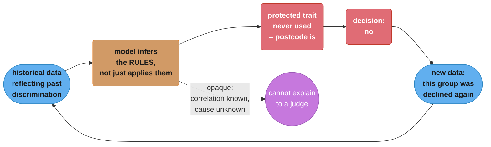
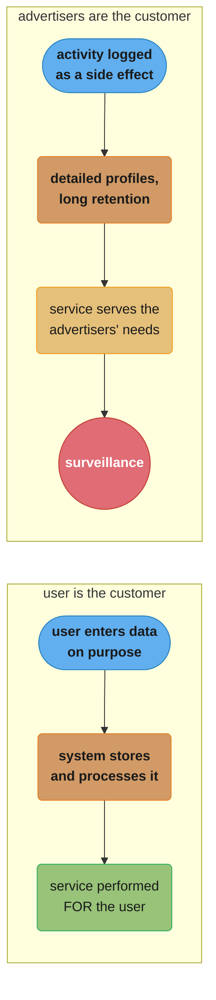
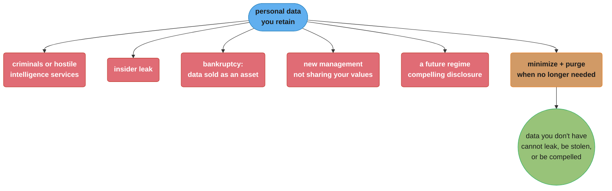

# Chapter 14: Doing the Right Thing

> Part III — Derived Data · DDIA (Kleppmann & Riccomini, 2nd ed., O'Reilly 2026) · builds on Ch 13, closes the book

## Chapter Map

The final chapter steps back from architecture entirely. Every system is built for a purpose,
and every action has both intended and unintended consequences; the purpose may be as simple as
making money, but the consequences for the world may reach far beyond it. The authors argue that
the engineers building these systems have a responsibility to consider those consequences and to
consciously decide what kind of world they want to live in. In the first edition this material
was the closing section of a chapter; in the second it is a chapter of its own, opening with an
epigraph from Prabhu and Birhane: *"Feeding AI systems on the world's beauty, ugliness, and
cruelty, but expecting it to reflect only the beauty is a fantasy."*

**TL;DR:**
- **Data is about people.** Many datasets describe behaviour, interests and identity. Users are
  humans and human dignity is paramount.
- **Predictive analytics extrapolates from the past.** If the past is discriminatory, the system
  codifies and amplifies that discrimination — "machine learning is like money laundering for
  bias."
- **Automated decisions break accountability.** A human who errs can be held to account and
  appealed against; an algorithm's mistake often has no recourse, and people must not evade
  responsibility by blaming an algorithm.
- **Replace "data" with "surveillance"** and see whether the sentence still sounds good. The
  authors call this deliberately polemic, and say strong words are needed.
- **Privacy is a decision right**, not secrecy — the freedom to choose what to reveal to whom.
  Surveillance does not erode that right so much as *transfer* it to the data collector.
- **Data may be a toxic asset**, hazardous material, "the new uranium." The remedy the chapter
  ends on is data minimization: what you do not have cannot be leaked, stolen, or compelled.

## The Big Question

> "We have spent thirteen chapters on how to build these systems correctly. What are we
> obligated to ask about whether they *should* be built, and what they do to the people whose
> data flows through them?"

The chapter's own framing is that a technology is not good or bad in itself — what matters is
how it is used and how it affects people, and that this is as true of a search engine as of a
gun. It is not sufficient for software engineers to focus exclusively on the technology and
ignore its consequences; the ethical responsibility is ours to bear also. But the authors are
careful not to promise that this is easy: what makes something "good" or "bad" is not
well-defined, and most people in computing do not even discuss the question. Unlike much of
computing, the concepts at the heart of ethics are not fixed or determinate in meaning and
require interpretation, which may be subjective. **Ethics is not going through a checklist to
confirm compliance; it is a participatory and iterative process of reflection, in dialogue with
the people involved, with accountability for the results.**

The chapter notes that guidelines exist — the **ACM Code of Ethics and Professional Conduct** is
named — but that they are rarely discussed, applied or enforced in practice, with the result
that engineers and product managers sometimes take a very cavalier attitude to privacy and to
the potential negative consequences of their products.

---

## 14.1 Predictive Analytics

Predictive analytics is a major part of why people are excited about big data and AI. The chapter
draws a line through the middle of it. **Using data analysis to predict the weather or the spread
of diseases is one thing; predicting whether a convict is likely to reoffend, whether a loan
applicant is likely to default, or whether an insurance customer is likely to make expensive
claims is another matter entirely.** The latter have a direct effect on individual people's lives.

The organizational incentive is understandable and is stated sympathetically. Payment networks
want to prevent fraudulent transactions, banks want to avoid bad loans, airlines want to avoid
hijackings, companies want to avoid hiring ineffective or untrustworthy people. From their point
of view **the cost of a missed business opportunity is low, but the cost of a bad loan or a
problematic employee is much higher**, so caution is natural: if in doubt, they are better off
saying no.

The asymmetry becomes a societal problem when the same "no" is issued everywhere at once:

```
  ONE institution says no          MANY institutions say no, from the same signal

  loan declined                    jobs        ✗
  -> inconvenient                  air travel  ✗
  -> try another bank              insurance   ✗
                                   rental      ✗
                                   finance     ✗
                                   = "ALGORITHMIC PRISON"
                                     no proof of guilt, little chance of appeal
```

Someone who has been labeled risky by some algorithm — accurately *or* falsely — may suffer a
large number of those "no" decisions. Systematic exclusion from jobs, air travel, insurance
coverage, property rental, financial services and other key aspects of society is such a large
constraint on individual freedom that it has been called **"algorithmic prison."** The chapter
sets this directly against a legal norm: in countries that respect human rights, the criminal
justice system presumes innocence until proven guilty, whereas **automated systems can
systematically and arbitrarily exclude a person from participating in society without any proof
of guilt, and with little chance of appeal.**

### Bias and Discrimination

The chapter deliberately opens this section with the counter-argument. **Decisions made by an
algorithm are not necessarily any better or any worse than those made by a human.** Every person
is likely to have biases even when actively trying to counteract them, and discriminatory
practices can become culturally institutionalized. There is genuine hope that basing decisions on
data rather than subjective and instinctive assessment could be *more* fair and give a better
chance to people the traditional system overlooks.

Then it explains why that hope so often fails. When we develop predictive analytics and AI
systems, **we are not merely automating a human's decision by specifying rules in software — we
are leaving the rules themselves to be inferred from data.** The patterns those systems learn are
opaque: even where a correlation exists in the data, we may not know why. And if there is a
systematic bias in the input, the system will most likely learn and amplify that bias in its
output.

The mechanism that defeats anti-discrimination law is **proxy variables**:

| Protected trait | Correlated feature that is not legally protected |
|-----------------|--------------------------------------------------|
| Ethnicity / race | Postal code, or even IP address, in racially segregated neighbourhoods |
| Socioeconomic class | Where a person lives |

Many countries prohibit treating people differently on protected traits — ethnicity, age, gender,
sexuality, disability, beliefs. Other features may be analyzed. But if those other features are
*correlated* with protected traits, the prohibition is circumvented without ever naming the
trait. Put like this, the chapter says, **it seems ridiculous to believe that an algorithm could
take biased data as input and produce fair and impartial output from it** — yet that belief often
seems to be implied by proponents of data-driven decision making, an attitude satirized as
*"machine learning is like money laundering for bias."*

The section's closing argument is the chapter's sharpest: predictive analytics systems **merely
extrapolate from the past. If the past is discriminatory, they codify and amplify that
discrimination.** If we want the future to be better than the past, moral imagination is
required, and that is something only humans can provide. **Data and models should be our tools,
not our masters.**

### Responsibility and Accountability

Automated decision making opens the question of who is answerable. **If a human makes a mistake
they can be held accountable, and the person affected can appeal. Algorithms make mistakes too —
but who is accountable when they go wrong?** The chapter asks it as a series of concrete
questions rather than an abstraction: when a self-driving car causes an accident, who is
responsible? If an automated credit-scoring algorithm systematically discriminates against people
of a particular race or religion, is there any recourse? If a decision by your machine learning
system comes under judicial review, can you explain to the judge how the algorithm reached it?
**People should not be able to evade their responsibility by blaming an algorithm.**

Credit rating agencies are the chapter's historical anchor — an old example of collecting data to
make decisions about people. The comparison is precise and worth holding onto:

| | Traditional credit score | ML-based predictive scoring |
|--|--|--|
| Question it answers | **"How did you behave in the past?"** | **"Who is similar to you, and how did people like you behave in the past?"** |
| Inputs | Relevant facts about the person's actual borrowing history | A much wider range of inputs |
| Transparency | Errors in the record can be corrected — though agencies do not normally make this easy | Much more opaque; hard to understand how a decision came about, or whether treatment was unfair |
| What it implies about the person | Their own record | **Stereotyping** — drawing parallels to others' behaviour, e.g. based on where they live, a close proxy for race and socioeconomic class |

And a statistical point the chapter makes plainly, because it is the one non-specialists get
wrong. **Much data is statistical in nature, so even when the probability distribution as a whole
is correct, individual cases may well be wrong.** If average life expectancy in your country is
80 years, that does not mean you are expected to drop dead on your 80th birthday; from the
average and the distribution you can say very little about how long one particular person will
live. The output of a prediction system is probabilistic in exactly the same way, and **when a
decision is incorrect due to erroneous data, recourse is almost impossible.**

The conclusion is blunt: **a blind belief in the supremacy of data for making decisions is not
only delusional, it is positively dangerous.** As data-driven decision making spreads we will
need to work out how to make algorithms accountable and transparent, how to avoid reinforcing
existing biases, and how to fix them when they inevitably make mistakes.

The same capability points both ways, and the chapter says so. Analytics can reveal financial and
social characteristics of people's lives. **That power could focus aid and support on those who
most need it — and it is sometimes used instead by predatory businesses seeking to identify
vulnerable people and sell them risky products such as high-cost loans and worthless college
degrees.**

### Feedback Loops

Even applications with less immediately far-reaching effects raise difficult issues. When services
become good at predicting what content users want to see, **they may end up showing people only
opinions they already agree with, leading to echo chambers in which stereotypes, misinformation
and polarization can breed** — an impact already visible in election campaigns.

The most pernicious problems come from **self-reinforcing feedback loops**. The chapter's worked
example is employers using credit scores to evaluate potential hires:

```
   good worker, good credit score
              |
     misfortune outside your control  (illness, family emergency)
              |
       miss payments on bills
              |
        credit score falls  <-------------------+
              |                                 |
     less likely to find work                   |
              |                                 |
        joblessness -> poverty ------------------+

   a downward spiral from poisonous assumptions,
   hidden behind a camouflage of mathematical rigor and data
```

A second example moves the same shape into markets: economists found that **when gas stations in
Germany introduced algorithmic prices, competition was reduced and consumer prices went up,
because the algorithms learned to collude.** Nobody wrote a cartel; the loop produced one.

We cannot always predict when such loops happen. But many consequences *can* be predicted by
thinking about the entire system — **not just the computerized parts but also the people
interacting with it — an approach known as systems thinking.** The questions it asks: how does a
data analysis system respond to different behaviours, structures or characteristics? Does it
reinforce and amplify existing differences between people, making the rich richer or the poor
poorer, or does it try to combat injustice? And even with the best intentions, we must beware of
unintended consequences.

---

## 14.2 Privacy and Tracking

Besides the problems of *using* data to make automated decisions about people, there are ethical
problems with **data collection itself**. The chapter's organizing question: what is the
relationship between the organizations collecting data and the people whose data is collected?

It identifies the point at which that relationship changes character:

| Situation | Whose interest is served |
|-----------|--------------------------|
| The system stores only data the user explicitly entered, because they want it stored and processed that way | The system performs **a service for the user** — the user is the customer |
| The user's activity is tracked and logged **as a side effect** of other things they are doing | Less clear. The service takes on **interests of its own**, which may conflict with the user's |
| The service is funded through advertising | **The advertisers are the actual customers**, and the users' interests take second place |

Behavioural tracking genuinely powers user-facing features and the chapter says so before
criticising it: tracking which search results are clicked improves ranking; "people who liked X
also liked Y" helps discovery; A/B tests and user flow analysis indicate how an interface might
be improved. Those features require some tracking, and users benefit.

But depending on the business model, tracking often does not stop there. Under advertising
funding, **tracking data becomes more detailed, analyses become further-reaching, and data is
retained for a long time in order to build detailed profiles of each person for marketing
purposes.** The user is given a free service and coaxed into engaging with it as much as
possible, and the tracking serves not primarily that individual but the advertisers funding the
service. The chapter names that relationship with a word carrying more sinister connotations:
**surveillance.**

### Surveillance

The section opens with a thought experiment: **replace the word *data* with *surveillance* and
see whether common phrases still sound so good.**

> "In our surveillance-driven organization we collect real-time surveillance streams and store
> them in our surveillance warehouse. Our surveillance scientists use advanced analytics and
> surveillance processing in order to derive new insights."

The authors flag this as **unusually polemic for the book — "*Designing Surveillance-Intensive
Applications*" — but say strong words are needed to emphasize the point.** In attempts to make
software "eat the world," we have built **the greatest mass surveillance infrastructure the world
has ever seen.** We are rapidly approaching a world in which every inhabited space contains at
least one internet-connected microphone: smartphones, smart TVs, voice-controlled assistants,
baby monitors, even children's toys using cloud-based speech recognition — many of which have a
terrible security record.

What is new compared to the past is that **digitization has made it easy to collect large amounts
of data about people.** Surveillance of location and movement, social relationships and
communications, purchases and payments, and health data has become almost unavoidable. A
surveillance organization may end up **knowing more about a person than that person knows about
themselves** — identifying illnesses or economic problems before the person is aware of them.

The historical comparison is stark. **Even the most totalitarian and repressive regimes of the
past could only dream of putting a microphone in every room and forcing every person to
constantly carry a location-tracking device.** Yet the benefits of digital technology are so
great that we now voluntarily accept this. The difference is only that the data is collected by
corporations providing us with services, rather than by government agencies seeking control.

Why are we seemingly happy to accept it? The chapter offers two answers and undermines both.
Perhaps you feel you have nothing to hide — in other words, **you are totally in line with
existing power structures, you are not a marginalized minority, and you need not fear
persecution. Not everyone is so fortunate.** Or perhaps the purpose seems benign: not overt
coercion and conformance, merely better recommendations and more personalized marketing. But
combined with the predictive-analytics discussion, that distinction is less clear than it looks.

Two concrete examples of the line already being crossed:

- **Behavioural data on car driving, tracked by cars without drivers' consent, affecting their
  insurance premiums**; and health insurance coverage that depends on wearing a fitness tracker.
  When surveillance determines things that hold sway over insurance coverage or employment, it
  starts to appear less benign.
- **The movement sensor in a smartwatch or fitness tracker can be used to work out what you are
  typing — including passwords — with fairly good accuracy.** Sensor accuracy and analysis
  algorithms are only going to get better.

### Consent and Freedom of Choice

The standard defence is that users voluntarily choose to use a service that tracks them, have
agreed to the terms of service and privacy policy, and therefore consent; and that they receive a
valuable service in return. The chapter grants that social networks, search engines and other
free online services are genuinely valuable, then takes the argument apart in three moves.

**First, in what way is the tracking necessary?** Some forms directly feed user-facing
improvements — click-through rate on search results improves ranking and relevance; which products
customers buy together powers related-product suggestions. But when tracking interaction to build
user profiles for advertising, **it is less clear whether this is genuinely in the user's
interest, or only necessary because the ads pay for the service.**

**Second, consent requires understanding, and understanding is absent.** Users have little
knowledge of what data they feed into our databases or how it is retained and processed, and
**most privacy policies do more to obscure than to illuminate.** Two consequences follow that
consent cannot cover:

- **Data from one user also says things about other people** who are not users of the service and
  who have not agreed to any terms.
- **The derived datasets discussed in this part of the book** — where data from the entire user
  base may be combined with behavioural tracking and external sources — are precisely the kind of
  data of which users cannot have any meaningful understanding.

**Third, the exchange is not a relationship.** Data is extracted through a one-way process, not
true reciprocity and not a fair value exchange. There is **no dialog and no option to negotiate**
how much data is provided for what service: the relationship is asymmetric and one-sided, and the
terms are set by the service, not by the user.

The chapter then measures this against what the law actually requires. Under the EU **GDPR**,
consent must be **"freely given, specific, informed, and unambiguous"**, and the user must be able
to **"refuse or withdraw consent without detriment"** — otherwise it is not considered freely
given. Any request for consent must be written **"in an intelligible and easily accessible form,
using clear and plain language"**, and **"silence, pre-ticked boxes or inactivity do not
constitute consent."** Consent is not the only lawful basis; **legitimate interest** permits
certain uses such as fraud prevention.

Finally, the "just don't use it" rebuttal. That choice is not free either. **If a service is so
popular that it is "regarded by most people as essential for basic social participation," it is
not reasonable to expect people to opt out — using it is *de facto* mandatory.** In most Western
social communities it has become the norm to carry a smartphone, to use social networks for
socializing, and to use Google to find information; where a service has network effects there is
a social cost to *not* using it. And declining is harder than it sounds: **these platforms are
designed specifically to engage users, many using game mechanics and tactics common in
gambling.** Even past that, declining is only an option for the small number of people privileged
enough to have the time and knowledge to understand a privacy policy and who can afford to miss
the social participation or professional opportunities involved. **For people in a less privileged
position there is no meaningful freedom of choice: surveillance becomes inescapable.**

### Privacy and Use of Data

People sometimes claim "privacy is dead" on the grounds that some users willingly post all sorts
of things about their lives to social media. **The chapter says this claim is false and rests on
a misunderstanding of the word.**

> **Having privacy does not mean keeping everything secret; it means having the freedom to choose
> which things to reveal to whom, what to make public, and what to keep secret. The right to
> privacy is a decision right.**

It enables each person to decide where they want to be on the spectrum between secrecy and
transparency in each situation, and it is an important aspect of freedom and autonomy. The
example: someone with a rare medical condition might be very happy to give their private medical
data to researchers if it might help develop treatments. **The important thing is that they have
a choice over who may access it and for what purpose** — and if there were a risk the information
would harm their access to medical insurance or employment, they would probably be much more
cautious.

From that definition follows the chapter's central claim about surveillance:

> When data is extracted from people through surveillance infrastructure, **privacy rights are
> not necessarily eroded, but rather *transferred* to the data collector.** Companies that acquire
> data essentially say "trust us to do the right thing with your data" — which means the right to
> decide what to reveal and what to keep secret moves from the individual to the company.

And the companies then keep much of the outcome secret, because revealing it would be perceived
as creepy and would harm a business model that relies on knowing more about people than other
companies do. Intimate information is revealed only indirectly — for example as tools for
targeting advertisements to specific groups, such as people suffering from a particular illness.
**Even if particular users cannot be personally reidentified from the targeted bucket, they have
lost their agency about the disclosure of intimate information: it is the company, not the user,
that exercises the privacy right, with the goal of maximizing profit.**

Two further observations close the section:

- Many companies aim at not being *perceived* as creepy — **managing user perceptions rather than
  addressing how intrusive the collection actually is.** Even that is often managed poorly:
  something may be factually correct but trigger painful memories the user did not want to be
  reminded of. **With any kind of data we should expect the possibility that it is wrong,
  undesirable or inappropriate, and build mechanisms for handling those failures.** Whether
  something is undesirable is a human judgment; algorithms are oblivious to such notions unless
  we explicitly program them to respect human needs, so engineers must be humble and plan for
  these failings.
- **Privacy settings are a starting point, not a solution.** They hand back some control over what
  *other users* can see — but **the service itself still has unfettered access** and is free to
  use the data in any way its privacy policy permits. Even a promise not to sell data to third
  parties usually comes with unrestricted internal rights to process and analyze it, often going
  much further than is overtly visible.

The scale is what makes this new. **This large-scale transfer of privacy rights from individuals
to corporations is historically unprecedented.** Surveillance has always existed, but it used to
be expensive and manual, not scalable and automated. Trust relationships have always existed —
patient and doctor, defendant and attorney — **but in those cases the use of data has been
strictly governed by ethical, legal and regulatory constraints.** Internet services have made it
much easier to amass sensitive information without meaningful consent and use it at massive scale
without users understanding what is happening.

### Data as Assets and Power

Behavioural data is a byproduct of users interacting with a service, so it is sometimes called
**"data exhaust"** — suggesting worthless waste material, and casting behavioural and predictive
analytics as a form of recycling that extracts value from something that would have been thrown
away.

**The chapter says it is more correct to view it the other way round.** From an economic point of
view, if targeted advertising is what pays for a service, then the user activity that generates
behavioural data could be regarded as **a form of labor**. One could go further and argue that
**the application the user interacts with is merely a means to lure users into feeding more and
more personal information into the surveillance infrastructure** — the human creativity and
social relationships expressed in online services cynically exploited by the data extraction
machine.

Personal data is a valuable asset, as evidenced by **data brokers: a shady industry operating in
secrecy, purchasing, aggregating, analyzing, inferring and reselling intrusive personal data about
people, mostly for marketing.** Startups are valued by user numbers, by "eyeballs" — which is to
say, **by their surveillance capabilities.**

Because the data is valuable, many parties want it, and the chapter enumerates them:

| Who wants it | How they get it |
|--------------|-----------------|
| Companies | They collect it — that is why it exists |
| Governments | Secret deals, coercion, legal compulsion, or simply stealing it |
| Acquirers of a bankrupt company | Personal data is **one of the assets that gets sold** |
| Criminals and hostile intelligence services | The data is difficult to secure, so **breaches happen disconcertingly often** |

Hence the framings the chapter collects from its critics: data is not just an asset but a **"toxic
asset"**, or at least **"hazardous material"** — maybe data is **not the new gold nor the new oil
but the new uranium: incredibly powerful and amazingly dangerous.** Even if we believe ourselves
capable of preventing abuse, collection must balance benefit against the risk of the data falling
into the wrong hands: systems compromised by criminals or hostile foreign intelligence services,
leaks by insiders, the company falling into the hands of unscrupulous management that does not
share our values, or **the country being taken over by a regime that has no qualms about
compelling us to hand the data over.**

That last point generalizes into the chapter's sharpest piece of practical advice: **when
collecting data we must consider not just today's political environment but all possible future
governments.** There is no guarantee every future elected government will respect human rights and
civil liberties, so **"it is poor civic hygiene to install technologies that could someday
facilitate a police state."**

And the reason surveillance is sought at all: **"Knowledge is power" — and "to scrutinize others
while avoiding scrutiny oneself is one of the most important forms of power."** This is why
totalitarian governments want surveillance: it gives them power to control the population. Today's
technology companies are not overtly seeking political power, but **the data and knowledge they
have accumulated nevertheless gives them a lot of power over our lives, much of it surreptitious
and outside public oversight.**

### Remembering the Industrial Revolution

Data is the defining feature of the information age, and the chapter reaches for the obvious
historical analogy deliberately, because of how the analogy ends.

The Industrial Revolution came about through major technological and agricultural advances and
brought sustained economic growth and significantly improved living standards **in the long run**.
Yet it also came with major problems: dreadful pollution of the air from smoke and chemical
processes and of the water from industrial and human waste; factory owners living in splendor
while urban workers lived in very poor housing and worked long hours in harsh conditions; child
labor common, including dangerous and poorly paid work in mines.

**It took a long time before safeguards were established** — environmental protection regulation,
workplace safety protocols, outlawing child labor, health inspections for food. The cost of doing
business undoubtedly increased when factories could no longer dump waste into rivers, sell tainted
food, or exploit workers. **But society as a whole benefited hugely, and few of us would want to
return to a time before.**

Just as the Industrial Revolution had a dark side that needed managing, the transition to the
information age has major problems to confront, and the collection and use of data is one of
them. The chapter quotes Bruce Schneier at length:

> *Data is the pollution problem of the information age, and protecting privacy is the
> environmental challenge. Almost all computers produce information. It stays around, festering.
> How we deal with it — how we contain it and how we dispose of it — is central to the health of
> our information economy. Just as we look back today at the early decades of the industrial age
> and wonder how our ancestors could have ignored pollution in their rush to build an industrial
> world, our grandchildren will look back at us during these early decades of the information age
> and judge us on how we addressed the challenge of data collection and misuse.*
>
> *We should try to make them proud.*

### Legislation and Self-Regulation

Data protection laws might help preserve individuals' rights. The GDPR states that personal data
must be **"collected for specified, explicit and legitimate purposes and not further processed in
a manner that is incompatible with those purposes"**, and that data must be **"adequate, relevant
and limited to what is necessary in relation to the purposes for which they are processed."**

The chapter then names the direct collision this creates:

```
  DATA MINIMIZATION                    vs.        BIG DATA PHILOSOPHY
  (GDPR)

  collect only what is necessary                  maximize collection
  for specified, explicit purposes                combine with other datasets
  do not process incompatibly                     experiment and explore
                                                  for NEW, unforeseen insights

  "specified and explicit"            <-->        exploration = using data for
                                                  UNFORESEEN purposes
```

**Exploration means using data for unforeseen purposes, which is the opposite of the "specified
and explicit" purposes for which the data must have been collected.** And the chapter's assessment
of results so far is not optimistic: while the GDPR has had **some** effect on the online
advertising industry, **the regulation has been weakly enforced, and does not seem to have led to
much of a change in culture and practices across the wider tech industry.**

It also gives the industry's objection a fair hearing. Companies that collect lots of data oppose
regulation as a burden and a hindrance to innovation, **and "to some extent that opposition is
justified."** Sharing medical data carries clear privacy risks — but also opportunities: **how
many deaths could be prevented if data analysis helped achieve better diagnostics or find better
treatments? Over-regulation may prevent such breakthroughs,** and it is difficult to balance those
opportunities against the risks.

What the chapter asks for, in its own words:

- **A culture shift in the tech industry with regard to personal data.** Stop regarding users as
  metrics to be optimized and remember they are humans who deserve respect, dignity and agency.
- **Self-regulate** data collection and processing practices to establish and maintain the trust of
  the people who depend on our software.
- **Educate end users** about how their data is used, rather than keeping them in the dark.
- **Let each individual maintain their privacy** — their control over their own data — rather than
  stealing that control through surveillance. The analogy: our individual right to control our
  data is like the natural environment of a national park; if we do not explicitly protect and
  care for it, it will be destroyed, a tragedy of the commons leaving everyone worse off.
  **Ubiquitous surveillance is not inevitable — we are still able to stop it.**
- **As a first step, do not retain data forever.** Purge it as soon as it is no longer needed and
  minimize what is collected in the first place. **Data you don't have is data that can't be
  leaked, stolen, or compelled by governments to be handed over.**

And the closing line of the argument: **as people working in technology, if we don't consider the
societal impact of our work, we're not doing our job.**

---

## Beyond the book — where this chapter came from, and what it is not

> The chapter itself makes no comparison to the first edition and contains no compliance
> checklist. Both notes below are this repo's, not the authors'. Everything above this heading is
> the chapter; this section is context for a reader holding both editions.

**On the edition.** In the first edition this material was the closing section of Chapter 12,
"The Future of Data Systems," under the heading "Doing the Right Thing." In the second edition it
stands as Chapter 14, a chapter in its own right. That promotion is structural, not a change of
position — the arguments are recognisably the same ones, extended with newer examples and a new
epigraph.

**On what it is not.** This chapter is explicitly *not* a compliance guide. It says so directly:
ethics is not going through a checklist to confirm compliance. A reader looking for GDPR
implementation mechanics, data-retention tooling, PII classification, or access controls will not
find them here and should not read the chapter's GDPR quotations as a specification. This repo's
[`backend/backend_security_owasp/`](../../../backend/backend_security_owasp/backend_security_owasp.md)
and [`devops/`](../../../devops/README.md) material covers the engineering side; the chapter
covers the question of whether to build the thing at all.

---

## Visual Intuition



*Why "just remove the protected column" does not work. The loop closes because the model's own
decisions become tomorrow's training data, so the bias is not merely preserved but compounded —
the chapter's "codify and amplify."*



*The chapter's pivot point. Nothing about the technology differs between the two rows; what
differs is who the customer is, and that alone decides whether logging is a service or
surveillance.*

```
  PRIVACY IS A DECISION RIGHT, NOT SECRECY

     secret <---------------------------------------> public
                          ^
                          |
              THE USER chooses this point,
              per fact, per audience, per situation

  after surveillance:

     secret <---------------------------------------> public
                          ^
                          |
              THE COMPANY chooses it, to maximize profit
              -- the right was TRANSFERRED, not destroyed

  which is why "some people post everything, so privacy is dead"
  is a category error: posting freely IS exercising the right.
```

*The distinction the chapter says the "privacy is dead" claim gets wrong. Privacy is not a
position on the axis; it is who holds the pointer.*



*Why the chapter calls data a toxic asset. Five of the six branches are risks you do not control
and cannot fully mitigate; only the sixth is an engineering decision, which is why minimization is
the recommendation rather than better security.*

---

## Key Concepts Glossary

| Term | One-line definition |
|------|---------------------|
| **Predictive analytics** | Using data analysis to predict outcomes; ethically distinct when the prediction is about an individual person's life rather than about weather or disease spread |
| **Algorithmic prison** | Systematic exclusion from jobs, travel, insurance, rental and financial services after being labeled risky by an algorithm, without proof of guilt or meaningful appeal |
| **Protected traits** | Characteristics anti-discrimination law forbids treating people differently on — ethnicity, age, gender, sexuality, disability, beliefs |
| **Proxy variable** | An unprotected feature strongly correlated with a protected trait, e.g. postal code or IP address as a predictor of race in segregated neighbourhoods |
| **"Money laundering for bias"** | The satirical description of the belief that an algorithm can take biased input and produce fair, impartial output |
| **Accountability gap** | The problem that a human decision-maker can be held responsible and appealed against, while an algorithmic one often cannot |
| **Credit score vs predictive score** | "How did *you* behave?" versus "Who is similar to you, and how did people *like you* behave?" — the second is stereotyping |
| **Feedback loop** | A self-reinforcing cycle where a system's own outputs become its future inputs, e.g. credit score → joblessness → worse credit score |
| **Systems thinking** | Reasoning about the entire system including the people interacting with it, not just the computerized parts, to anticipate such loops |
| **Echo chamber** | The result of recommendation systems showing people only opinions they already agree with, breeding stereotypes, misinformation and polarization |
| **Behavioural data** | Data generated as a side effect of a user's activity rather than entered deliberately |
| **Surveillance** | The chapter's word for tracking that primarily serves the advertisers funding a service rather than the user being tracked |
| **Data exhaust** | The framing of behavioural data as worthless waste material; the chapter argues the opposite framing — user activity as labor — is more correct |
| **Privacy** | Not secrecy, but a **decision right**: the freedom to choose which things to reveal to whom, what to make public and what to keep secret |
| **Transfer of privacy rights** | What surveillance actually does — the decision right moves from the individual to the data collector, who exercises it for profit |
| **Consent (GDPR sense)** | Must be "freely given, specific, informed, and unambiguous," refusable and withdrawable without detriment, in clear plain language; silence, pre-ticked boxes and inactivity do not count |
| **Legitimate interest** | A lawful basis for processing personal data other than consent, permitting uses such as fraud prevention |
| **De facto mandatory service** | One "regarded by most people as essential for basic social participation," where opting out is not a real choice |
| **Data broker** | An industry operating in secrecy that purchases, aggregates, analyzes, infers and resells intrusive personal data, mostly for marketing |
| **Toxic asset / hazardous material / "the new uranium"** | Framings of collected personal data as carrying risk proportional to its value |
| **Data minimization** | Collecting only what is necessary for specified purposes and purging it when no longer needed — a GDPR principle in direct tension with big-data exploration |
| **"Poor civic hygiene"** | Schneier's phrase for installing technologies that could someday facilitate a police state |
| **ACM Code of Ethics and Professional Conduct** | An existing guideline for software engineers, which the chapter notes is rarely discussed, applied or enforced |

---

## Tradeoffs & Decision Tables

| Question | The case for | The case against | Where the chapter lands |
|----------|-------------|------------------|-------------------------|
| Are algorithmic decisions fairer than human ones? | Every person has biases; discrimination becomes culturally institutionalized; data could give overlooked people a better chance | Systems infer the rules from data, learn and amplify systematic bias, and are opaque even when a correlation exists | Not inherently better or worse — but extrapolating from a discriminatory past codifies and amplifies it |
| Is tracking necessary? | Click-through data improves search ranking; co-purchase data powers recommendations; A/B tests improve interfaces | Profile-building for advertising is less clearly in the user's interest, and may be necessary only because ads fund the service | Distinguish tracking that feeds user-facing features from tracking that feeds the advertising model |
| Have users consented? | They agreed to the terms of service and receive a valuable free service | Users cannot understand derived datasets; data about one user describes non-users; the relationship is one-sided with no negotiation | Meaningful consent is largely absent; GDPR's bar ("freely given, specific, informed, unambiguous") is higher than practice |
| Can users just opt out? | Nobody is forced to sign up | Network effects make popular services de facto mandatory; platforms use gambling-style engagement tactics; opting out is a privilege | For the less privileged there is no meaningful freedom of choice |
| Should data collection be regulated? | Data minimization preserves individual rights; the Industrial Revolution needed safeguards too | Regulation is a burden; over-regulation could block medical breakthroughs that save lives | Both — the balance is genuinely difficult, and the chapter also calls for self-regulation and culture change |
| Is collected data an asset? | It funds services and is what startups are valued on | Companies, governments, criminals and bankruptcy purchasers all want it, and it is hard to secure | A **toxic** asset — balance benefit against the risk of it falling into the wrong hands |

| Retention decision | Consequence |
|--------------------|-------------|
| Retain indefinitely | Exposed to breach, insider leak, bankruptcy sale, hostile management, and future-government compulsion |
| Purge when no longer needed | "Data you don't have is data that can't be leaked, stolen, or compelled" |
| Minimize at collection | The same protection, applied one step earlier, and the GDPR principle |

---

## Common Pitfalls / War Stories

- **Dropping the protected column and declaring the model fair.** Postal code and IP address are
  strong predictors of race in racially segregated neighbourhoods, so the protected trait re-enters
  through a proxy. The chapter's judgment is that believing biased input can yield impartial
  output is ridiculous on its face.
- **Employers using credit scores to screen hires.** A misfortune outside your control causes
  missed payments, the score falls, work becomes harder to find, joblessness deepens poverty, the
  score falls further. A downward spiral "hidden behind a camouflage of mathematical rigor and
  data."
- **Algorithmic pricing learning to collude.** German gas stations introduced algorithmic prices;
  economists found competition was reduced and consumer prices rose. Nobody wrote a cartel.
- **Recommendation systems optimizing engagement into echo chambers.** Showing people only
  opinions they already agree with breeds stereotypes, misinformation and polarization, with
  visible impact on election campaigns.
- **Treating a probabilistic output as an individual verdict.** A correct distribution says almost
  nothing about one person, just as an average life expectancy of 80 does not predict your 80th
  birthday — and where erroneous data produced the decision, recourse is almost impossible.
- **Blaming the algorithm.** The chapter states directly that people should not be able to evade
  responsibility this way, and asks whether you could explain your system's decision to a judge.
- **Assuming a privacy policy delivers consent.** Most policies do more to obscure than
  illuminate, and derived datasets combining the whole user base with behavioural tracking and
  external sources are precisely what users cannot meaningfully understand.
- **Collecting data about non-users.** Data from one user also says things about other people who
  never agreed to any terms.
- **Relying on privacy settings.** They control what *other users* see; the service retains
  unfettered access and usually grants itself unrestricted internal processing rights.
- **Managing the perception of creepiness instead of the intrusion.** Even that is done badly —
  something factually correct can trigger painful memories, and algorithms are oblivious to
  whether an output is undesirable unless explicitly programmed to respect human needs.
- **Retaining data forever "because it might be useful."** The chapter's list of who ends up with
  it: criminals, hostile foreign intelligence services, insiders, the purchaser of your bankrupt
  company, unscrupulous new management, and a future regime with no qualms about compelling you.
- **Planning only for today's government.** "It is poor civic hygiene to install technologies that
  could someday facilitate a police state."
- **Shipping internet-connected microphones with a terrible security record** — smart TVs, voice
  assistants, baby monitors, children's toys using cloud speech recognition.
- **Assuming benign sensors are benign.** A smartwatch or fitness tracker's movement sensor can be
  used to work out what you are typing, including passwords, with fairly good accuracy.
- **Treating ethics as a checklist.** The chapter is explicit that it is instead a participatory
  and iterative process of reflection, in dialogue with the people involved, with accountability
  for the results.

---

## Real-World Systems Referenced

| Named in the chapter | Context |
|----------------------|---------|
| **ACM Code of Ethics and Professional Conduct** | An existing guideline, rarely discussed, applied or enforced in practice |
| **GDPR** (EU Regulation 2016/679) | Consent standard; purpose limitation; data minimization; legitimate interest as an alternative lawful basis |
| **Credit rating agencies** | The old example of collecting data to decide about people; errors correctable, though not made easy |
| **Data brokers** | A secretive industry purchasing, aggregating, inferring and reselling intrusive personal data |
| **German retail gasoline market** | Algorithmic pricing reduced competition and raised consumer prices — the algorithms learned to collude |
| **General Motors (FTC action)** | Driving behaviour data tracked and shared without drivers' consent, affecting insurance |
| **Smartwatches and fitness trackers** | Movement sensors used to infer typed text, including passwords; and health insurance coverage contingent on wearing one |
| **Smart TVs, voice assistants, baby monitors, connected toys** | Internet-connected microphones in every inhabited space, many with terrible security records |
| **Social networks, search engines, free online services** | Acknowledged as genuinely valuable, and as de facto mandatory for basic social participation |
| **Self-driving cars** | The chapter's example of an accident with unclear responsibility |
| **Cathy O'Neil, *Weapons of Math Destruction*** | Recurring source for accountability, feedback loops and predatory targeting |
| **Bruce Schneier, *Data and Goliath*** | The data-as-pollution passage and "poor civic hygiene" |
| **Shoshana Zuboff, "Big Other"** | Surveillance capitalism, privacy as a decision right, the asymmetry of the exchange |
| **Donella Meadows, *Thinking in Systems*** | The systems-thinking approach to anticipating feedback loops |
| **Maciej Cegłowski** | "The Moral Economy of Tech" and "Haunted by Data" — the money-laundering-for-bias framing and the case for purging |
| **Prabhu and Birhane** | The chapter's epigraph on AI reflecting the world's ugliness as well as its beauty |

---

## Summary

The chapter closes the book by recapping all thirteen preceding chapters — architecture
trade-offs, nonfunctional requirements, data models, storage engines, encoding and dataflow,
replication, sharding, transactions, distributed-systems faults, consensus, batch processing,
stream processing and the philosophy of streaming systems — and then states what this last
chapter added.

**Although data can be used to do good, it can also do significant harm:** making decisions that
seriously affect people's lives and are difficult to appeal against; leading to discrimination and
exploitation; normalizing surveillance; and exposing intimate information. We also run the risk of
data breaches, and we may find that a well-intentioned use of data has unintended consequences.

The book's final sentence is a claim about the profession rather than about technology: **as
software and data are having such a large impact on the world, we as engineers must remember that
we carry a responsibility to work toward the kind of world that we want to live in — a world that
treats people with humanity and respect.**

---

## Interview Questions

**Q: The chapter says predictive analytics can be more fair than human judgment, and also that it codifies discrimination. How do both hold?**
**Short:** Kleppmann and Riccomini argue algorithmic decisions are not inherently better or worse — what they do is extrapolate whatever past they were trained on.

Both hold because the comparison is against a low baseline and the mechanism is inheritance, not improvement. Every person has biases even when actively counteracting them, and discriminatory practices become culturally institutionalized, so there is genuine hope that data-driven decisions could be fairer and give a better chance to people the traditional system overlooks. But predictive systems infer the *rules* from data rather than having them specified, and if the input carries systematic bias the system will most likely learn and amplify it. The chapter's resolution: these systems merely extrapolate from the past, so if the past is discriminatory they codify and amplify that discrimination — improving on it requires moral imagination, which only humans can provide.

**Q: Why does removing protected traits from a model's inputs fail to prevent discrimination?**
**Short:** Unprotected features act as proxies — a postal code or IP address is a strong predictor of race in segregated neighbourhoods.

Because anti-discrimination law prohibits treating people differently on protected traits — ethnicity, age, gender, sexuality, disability, beliefs — but says nothing about features correlated with them. In racially segregated neighbourhoods a person's postal code, or even their IP address, is a strong predictor of race, so the trait re-enters the model without ever being named. The chapter says that put this way, it seems ridiculous to believe an algorithm could take biased data as input and produce fair and impartial output — an attitude satirized as "machine learning is like money laundering for bias." The fix is not feature deletion; it is examining what the system actually does to people.

**Q: What is "algorithmic prison," and what legal norm does the chapter contrast it with?**
**Short:** Systematic exclusion from jobs, travel, insurance and finance after being labeled risky, contrasted with the presumption of innocence.

It is the condition of someone labeled risky by an algorithm — accurately or falsely — who then suffers a large number of "no" decisions across society: jobs, air travel, insurance coverage, property rental, financial services. The chapter says this is such a large constraint on individual freedom that it has earned that name. The contrast it draws is with criminal justice: in countries that respect human rights the system presumes innocence until proven guilty, whereas automated systems can systematically and arbitrarily exclude a person from participating in society **without any proof of guilt and with little chance of appeal**. Each individual institution's caution is rational; the aggregate is not.

**Q: How does a machine-learning risk score differ from a traditional credit score?**
**Short:** A credit score asks how you behaved; a predictive score asks how people similar to you behaved — which is stereotyping.

A credit score summarizes "How did you behave in the past?" It is normally based on relevant facts about the person's actual borrowing history, and errors in the record can be corrected, although agencies do not make that easy. Machine-learning scoring typically uses a much wider range of inputs and is far more opaque, so it is harder to understand how a particular decision came about or whether someone was treated unfairly. And it asks a different question: "Who is similar to you, and how did people like you behave?" Drawing parallels to others' behaviour implies stereotyping — for example by where someone lives, a close proxy for race and socioeconomic class — and people put in the wrong bucket have almost no recourse.

**Q: What is the accountability problem that automated decision-making creates?**
**Short:** A human who errs can be held responsible and appealed against; when an algorithm errs, often nobody can be.

If a human makes a mistake they can be held accountable and the affected person can appeal. Algorithms make mistakes too, and the chapter asks who is accountable: when a self-driving car causes an accident, who is responsible? If an automated credit-scoring algorithm systematically discriminates by race or religion, is there any recourse? If your model's decision comes under judicial review, can you explain to the judge how it was reached? The chapter's rule is a single sentence: **people should not be able to evade their responsibility by blaming an algorithm.** As data-driven decisions spread, we have to work out how to make algorithms accountable and transparent, and how to fix them when they inevitably err.

**Q: Give the chapter's example of a self-reinforcing feedback loop, and say what would have caught it.**
**Short:** Credit scores used in hiring create a spiral from misfortune to joblessness to a worse score; systems thinking is the way to anticipate it.

Employers using credit scores to evaluate hires. You may be a good worker with a good score, then hit financial difficulty outside your control; missed payments lower your score; the lower score makes work harder to find; joblessness pushes you toward poverty, which worsens the score further. The chapter calls it a downward spiral from poisonous assumptions "hidden behind a camouflage of mathematical rigor and data." Its second example is German gas stations whose algorithmic pricing reduced competition and raised consumer prices because the algorithms learned to collude. The remedy it offers is **systems thinking** — reasoning about the entire system including the people interacting with it, and asking whether the system amplifies existing differences or combats injustice.

**Q: At what point does behavioural tracking become surveillance, in the chapter's terms?**
**Short:** When the tracking primarily serves the advertisers funding the service rather than the user being tracked.

When the customer changes. If a system stores only what a user explicitly entered because they want it processed that way, it performs a service for the user, and the user is the customer. When activity is tracked as a *side effect* of other things the user is doing, the service takes on interests of its own that may conflict with the user's. And if the service is funded by advertising, the advertisers are the actual customers and the users' interests take second place: tracking becomes more detailed, analyses further-reaching, and data is retained long enough to build detailed profiles. The chapter names that relationship surveillance, and offers the test of substituting the word "surveillance" for "data" in any sentence about a data pipeline.

**Q: The chapter says "privacy is dead" is false. What is its definition of privacy?**
**Short:** Privacy is a decision right — the freedom to choose what to reveal to whom — not the keeping of everything secret.

Having privacy does not mean keeping everything secret; it means having the freedom to choose which things to reveal to whom, what to make public and what to keep secret. It is a decision right, letting each person decide where they sit between secrecy and transparency in each situation, and it is an important aspect of freedom and autonomy. So the fact that some people post deeply personal things to social media does not show privacy is dead — posting freely *is* exercising the right. The chapter's example: someone with a rare condition may gladly give medical data to researchers, and what matters is that they choose who may access it and why, since a risk to their insurance or employment would make them far more cautious.

**Q: If surveillance does not destroy privacy, what does it do to it?**
**Short:** It transfers the decision right from the individual to the data collector, who then exercises it for profit.

It transfers it. When data is extracted through surveillance infrastructure, privacy rights are not necessarily eroded but moved: companies acquiring data effectively say "trust us to do the right thing with it," which shifts the right to decide what is revealed and to whom from the individual to the company. Those companies then keep much of what they learn secret, because revealing it would seem creepy and would harm a business model that depends on knowing more about people than competitors do; intimate information surfaces only indirectly, as ad-targeting tools for groups such as people with a particular illness. Even if no individual can be reidentified from that bucket, they have lost agency over the disclosure — the company exercises the privacy right, with the goal of maximizing profit.

**Q: Why does the chapter say users cannot give meaningful consent, even having accepted the terms?**
**Short:** Consent requires understanding, and derived datasets combining the whole user base with tracking and external sources cannot be meaningfully understood.

Three reasons. First, it questions whether the tracking is necessary at all — click-through data genuinely improves search ranking, but profile-building for advertising may be necessary only because ads pay for the service. Second, users have little knowledge of what data they feed in or how it is retained and processed, and most privacy policies do more to obscure than to illuminate; the derived datasets this part of the book describes are precisely the kind users cannot meaningfully understand, and data from one user also describes non-users who agreed to nothing. Third, data is extracted through a one-way process with no dialog and no ability to negotiate — the terms are set by the service, not the user.

**Q: What does the GDPR require for consent to be valid, and why does the chapter quote it?**
**Short:** Freely given, specific, informed and unambiguous, refusable without detriment, in clear plain language — silence and pre-ticked boxes do not count.

The GDPR requires consent to be "freely given, specific, informed, and unambiguous," and requires that the user be able to "refuse or withdraw consent without detriment," or it is not considered freely given. Any request must be written "in an intelligible and easily accessible form, using clear and plain language," and "silence, pre-ticked boxes or inactivity do not constitute consent." The chapter quotes it to give a concrete external standard against which industry practice can be measured, and notes that consent is not the only lawful basis — **legitimate interest** permits certain uses such as fraud prevention.

**Q: "Users can just not use the service." Why does the chapter reject that?**
**Short:** A service regarded as essential for basic social participation is de facto mandatory, and opting out is a privilege.

Because the choice is not free. If a service is so popular that it is "regarded by most people as essential for basic social participation," it is unreasonable to expect people to opt out — using it is de facto mandatory, and where the service has network effects there is a social cost to not using it. In most Western social communities carrying a smartphone, using social networks to socialize and using Google to find information have become the norm. On top of that, these platforms are designed specifically to engage, many using game mechanics and tactics common in gambling. Declining is only an option for the small number of people privileged enough to have the time and knowledge to understand a privacy policy and who can afford to miss the social and professional opportunities involved.

**Q: Why does the chapter call data a "toxic asset," and what follows practically?**
**Short:** Its value attracts companies, governments, criminals and bankruptcy buyers alike, so collection must weigh benefit against the risk of it escaping.

Because everyone wants it and it is hard to keep. Companies collect it; governments seek it by secret deals, coercion, legal compulsion or theft; when a company goes bankrupt the personal data is one of the assets sold; and the data is difficult to secure, so breaches happen disconcertingly often. Critics therefore call it a toxic asset, or hazardous material — "maybe data is not the new gold nor the new oil but the new uranium." Practically, the chapter says any collection must balance benefit against the risk of the data falling into the wrong hands: criminals, hostile foreign intelligence services, insider leaks, unscrupulous new management, or a regime with no qualms about compelling disclosure.

**Q: What does "poor civic hygiene" mean in this chapter?**
**Short:** Schneier's phrase for installing technologies that could someday facilitate a police state, regardless of today's government.

It is Bruce Schneier's phrase, quoted to make a specific design point: when collecting data we must consider not just today's political environment but **all possible future governments.** There is no guarantee that every future elected government will respect human rights and civil liberties, so building an infrastructure that a future regime could repurpose is a harm you commit now even if nothing bad happens yet. The chapter pairs it with the observation that "to scrutinize others while avoiding scrutiny oneself is one of the most important forms of power" — which is why totalitarian governments want surveillance, and why the data accumulated by technology companies gives them power over our lives that sits outside public oversight.

**Q: What is the tension between the GDPR's data minimization principle and big-data practice?**
**Short:** Minimization demands specified, explicit purposes; exploration is by definition the use of data for unforeseen ones.

The GDPR requires that personal data be "collected for specified, explicit and legitimate purposes and not further processed in a manner that is incompatible with those purposes," and that it be "adequate, relevant and limited to what is necessary." That principle of data minimization runs directly counter to the philosophy of big data, which is to maximize collection, combine datasets, and experiment in order to generate new insights — **exploration means using data for unforeseen purposes, the opposite of specified and explicit ones.** The chapter's assessment is that while the GDPR has had some effect on online advertising, it has been weakly enforced and has not much changed culture or practice across the wider tech industry.

**Q: What does the Industrial Revolution comparison actually argue?**
**Short:** Safeguards raised the cost of doing business and society benefited hugely — few would want to return to before them.

That the pattern is familiar and has a known ending. The Industrial Revolution brought sustained growth and much better living standards in the long run, alongside dreadful air and water pollution, urban workers in poor housing working long hours in harsh conditions, and common child labor including dangerous mine work. It took a long time before safeguards arrived — environmental regulation, workplace safety, outlawing child labor, food inspection — and the cost of doing business undoubtedly rose, **but society as a whole benefited hugely and few of us would want to return to a time before.** Schneier's framing carries it over: data is the pollution problem of the information age, and protecting privacy is the environmental challenge.

**Q: What single first step does the chapter recommend, and why that one?**
**Short:** Minimize collection and purge data when it is no longer needed — data you don't have cannot be leaked, stolen, or compelled.

Do not retain data forever: purge it as soon as it is no longer needed, and minimize what is collected in the first place. The chapter's reason is that this is the only lever that closes every risk at once — **data you don't have is data that can't be leaked, stolen, or compelled by governments to be handed over** — whereas better security addresses only some of the ways data escapes, and none of the ways a company changes hands or a government changes character. It is also the GDPR's own principle. But the chapter is clear this is a first step within a larger change: culture and attitudes have to shift too.

**Q: Why does the chapter say ethics is not a checklist?**
**Short:** The concepts at the heart of ethics are not fixed or determinate and require subjective interpretation, unlike most of computing.

Because ethics does not have the property computing usually assumes. What makes something "good" or "bad" is not well-defined, and most people in computing do not even discuss the question; in contrast to much of computing, the concepts at the heart of ethics are not fixed or determinate in their precise meaning and require interpretation that may be subjective. So the chapter describes it instead as **a participatory and iterative process of reflection, in dialogue with the people involved, with accountability for the results.** That framing is also its criticism of existing guidelines such as the ACM Code of Ethics: they exist, but are rarely discussed, applied or enforced, leaving engineers and product managers sometimes taking a cavalier attitude to privacy and consequences.

**Q: The chapter argues behavioural data should not be called "data exhaust." What does it propose instead?**
**Short:** If advertising pays for the service, the user activity generating that data is better regarded as a form of labor.

That the framing is backwards. Calling it "data exhaust" implies worthless waste material and casts analytics as recycling that extracts value from something otherwise thrown away. Economically, if targeted advertising is what pays for a service, then the user activity generating behavioural data could be regarded as **a form of labor** — and one could go further and argue the application the user interacts with is merely a means to lure them into feeding more personal information into the surveillance infrastructure. The evidence that the data is genuinely valuable: data brokers exist as an industry purchasing, aggregating, inferring and reselling it, and startups are valued by user numbers, by "eyeballs," which is to say by their surveillance capabilities.

**Q: Are privacy settings a solution to the privacy problem the chapter describes?**
**Short:** No — they control what other users see, while the service retains unfettered access under its own policy.

No, only a starting point for handing back some control. Privacy settings let a user control which aspects of their data *other users* can see. But regardless of the setting, **the service itself still has unfettered access and is free to use the data in any way its privacy policy permits.** Even a service that promises not to sell data to third parties usually grants itself unrestricted rights to process and analyze it internally, often going much further than is overtly visible to users. The chapter pairs this with the observation that with any kind of data we should expect the possibility it is wrong, undesirable or inappropriate, and build mechanisms for handling those failures — since algorithms are oblivious to such notions unless explicitly programmed to respect human needs.

---

## Cross-links in this repo

- [ml/fairness_and_responsible_ai/ — bias metrics, fairness definitions, model cards](../../../ml/fairness_and_responsible_ai/fairness_and_responsible_ai.md)
- [backend/backend_security_owasp/ — the access-control side of protecting personal data](../../../backend/backend_security_owasp/backend_security_owasp.md)
- [devops/ — retention, backups, and the operational side of purging data](../../../devops/README.md)
- Sibling chapters: [Ch 1 Trade-Offs in Data Systems Architecture](../01_tradeoffs_in_data_systems_architecture/01_tradeoffs_in_data_systems_architecture.md) · [Ch 13 A Philosophy of Streaming Systems](../13_philosophy_of_streaming_systems/13_philosophy_of_streaming_systems.md)
- The first edition's version of this material: [1e Ch 12, The Future of Data Systems](../../designing_data_intensive_applications/12_future_of_data_systems/12_future_of_data_systems.md)

## Further Reading

- Cathy O'Neil, *Weapons of Math Destruction: How Big Data Increases Inequality and Threatens Democracy*, Crown, 2016.
- Bruce Schneier, *Data and Goliath: The Hidden Battles to Collect Your Data and Control Your World*, W. W. Norton, 2015.
- Shoshana Zuboff, "Big Other: Surveillance Capitalism and the Prospects of an Information Civilization," *Journal of Information Technology*, 2015.
- Donella H. Meadows and Diana Wright, *Thinking in Systems: A Primer*, Chelsea Green, 2008.
- Maciej Cegłowski, "The Moral Economy of Tech," 2016, and "Haunted by Data," 2015.
- ACM, "ACM Code of Ethics and Professional Conduct," 2018.
- Regulation (EU) 2016/679 (GDPR), *Official Journal of the European Union*, 2016.
- Marc Steen, "Ethics as a Participatory and Iterative Process," *Communications of the ACM*, 2023.
- Assad, Clark, Ershov and Xu, "Algorithmic Pricing and Competition: Empirical Evidence from the German Retail Gasoline Market," *Journal of Political Economy*, 2024.
- Beltramelli, "Deep-Spying: Spying Using Smartwatch and Deep Learning," 2015.
