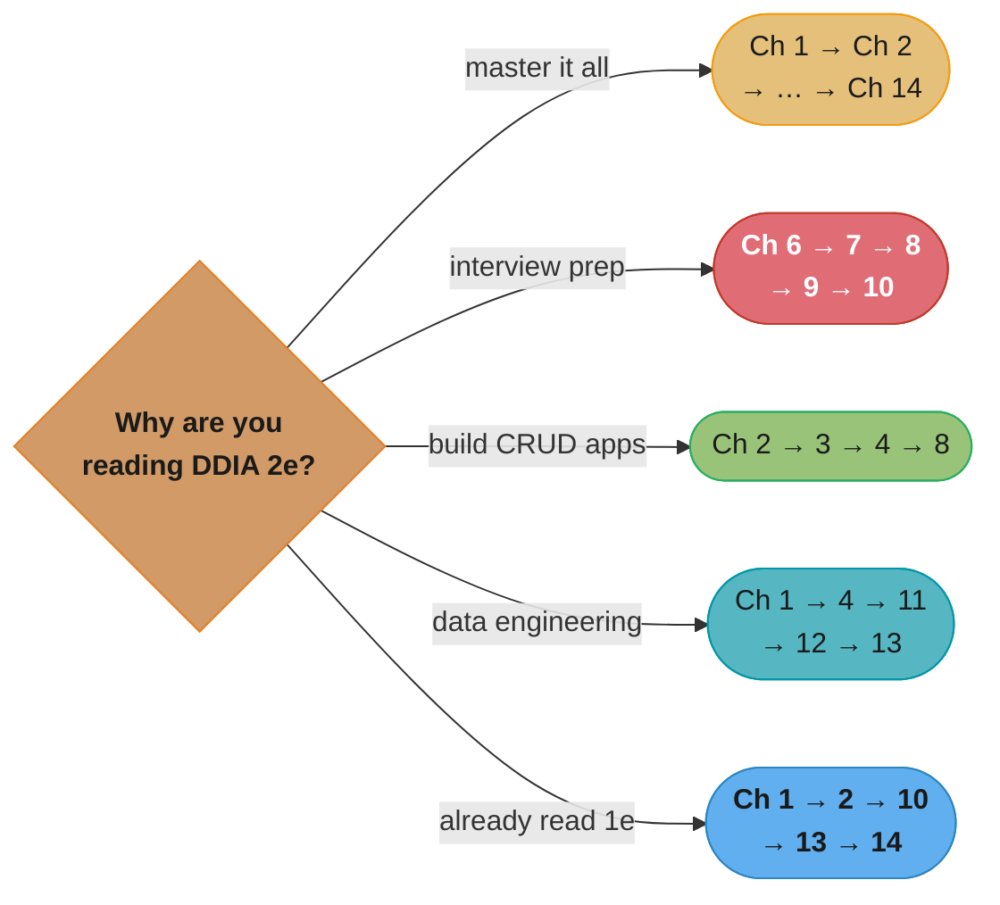

# Designing Data-Intensive Applications, 2nd Edition (DDIA 2e)

> Martin Kleppmann & Chris Riccomini · **2nd edition, O'Reilly, March 2026** · 670 pages ·
> ISBN 9781098119065 (paperback) · "The big ideas behind reliable, scalable, and maintainable
> systems." A chapter-by-chapter, in-depth summary — read this folder in order and you have
> read the book.

> **This folder summarizes the 2nd edition. The 1st edition lives next door and stays there.**
> [`designing_data_intensive_applications/`](../designing_data_intensive_applications/designing_data_intensive_applications.md)
> summarizes Kleppmann's **1st edition (2017)** and is not superseded by this folder — a
> summary is answerable to its source, so a 2017 claim is *correctly* reported as what the 2017
> book says. The two editions are re-chaptered relative to each other (14 chapters here versus
> 12 there), so a `## 7.3` heading in this folder points at 2e's Chapter 7 (Sharding), which is
> **not** Chapter 7 in a 1e copy. The **Edition Delta** table below maps one onto the other;
> that mapping is the summarizer's own reading, not a statement the authors make.

---

## The Book's Thesis

Data is at the center of most system-design difficulty today: not raw compute, but the
*amount* of data, its *complexity*, and the *speed at which it changes*. The second edition
keeps the first edition's spine — reliability, scalability, maintainability — and reframes the
opening around the question the first edition left implicit: **which architecture, and at what
cost?** Operational or analytical. Cloud or self-hosted. Distributed or a single big machine.
The rest of the book is spent making the guarantees behind each answer precise and showing
what each one costs you.

Three concerns recur on every page:

- **Reliability** — works correctly even when hardware, software, and humans go wrong.
- **Scalability** — has strategies to keep performance acceptable as load grows.
- **Maintainability** — many different people can work on it productively over time.

The through-line of Parts II and III is unchanged from the first edition and is still the
reason the book is worth reading twice: **everything is a question of guarantees.** What does
the system promise when a node dies, a network drops packets, or two writes race?

---

## The Three Parts (Part Map)

```mermaid
flowchart TD
    classDef io      fill:#61afef,stroke:#2e86c1,color:#1a1a1a,font-weight:bold
    classDef frozen  fill:#c678dd,stroke:#9b59b6,color:#fff
    classDef train   fill:#98c379,stroke:#27ae60,color:#1a1a1a
    classDef mathOp  fill:#d19a66,stroke:#e67e22,color:#1a1a1a,font-weight:bold
    classDef lossN   fill:#e06c75,stroke:#c0392b,color:#fff,font-weight:bold
    classDef req     fill:#56b6c2,stroke:#0097a7,color:#1a1a1a
    classDef base    fill:#e5c07b,stroke:#f39c12,color:#1a1a1a

    root(["DDIA 2e"]) --> P1
    root --> P2
    root --> P3

    subgraph P1["Part I — Foundations of Data Systems<br/>(one machine)"]
        C1("Ch 1<br/>Trade-offs in Data<br/>Systems Architecture") --> C2("Ch 2<br/>Defining Nonfunctional<br/>Requirements") --> C3("Ch 3<br/>Data Models and<br/>Query Languages") --> C4("Ch 4<br/>Storage and Retrieval") --> C5("Ch 5<br/>Encoding and Evolution")
    end

    subgraph P2["Part II — Distributed Data<br/>(many machines)"]
        C6("Ch 6<br/>Replication") --> C7("Ch 7<br/>Sharding") --> C8("Ch 8<br/>Transactions") --> C9("Ch 9<br/>The Trouble with<br/>Distributed Systems") --> C10("Ch 10<br/>Consistency and<br/>Consensus")
    end

    subgraph P3["Part III — Derived Data<br/>(composing systems)"]
        C11("Ch 11<br/>Batch Processing") --> C12("Ch 12<br/>Stream Processing") --> C13("Ch 13<br/>A Philosophy of<br/>Streaming Systems") --> C14("Ch 14<br/>Doing the Right Thing")
    end

    class root io
    class C1,C2 io
    class C3,C4 base
    class C5 mathOp
    class C6 frozen
    class C7 mathOp
    class C8 train
    class C9 lossN
    class C10 mathOp
    class C11 base
    class C12 req
    class C13 train
    class C14 lossN
```

*Colour follows the content: the two new framing chapters in blue, storage foundations in gold,
encoding and the hashing/coordination mechanics in orange, replication in purple, the
transactional and dataflow-composition chapters in green, Ch 12's event streams in teal, and in
red the two chapters about things going wrong — networks and clocks in Ch 9, people and society
in Ch 14.*

Part I reasons about a *single node* and, new in this edition, about the architecture decision
that precedes it. Part II asks what changes when data lives on *many* nodes (the answer:
almost everything). Part III shows how to *compose* multiple systems — batch and stream — into
a correct, maintainable whole, then closes on ethics, which now has a chapter of its own.

---

## Chapter Index

| # | Chapter | Folder | One-line summary | Repo deep-dive |
|---|---------|--------|------------------|----------------|
| 1 | Trade-Offs in Data Systems Architecture | [01_tradeoffs_in_data_systems_architecture/](01_tradeoffs_in_data_systems_architecture/01_tradeoffs_in_data_systems_architecture.md) | Analytical vs operational; cloud vs self-hosted; distributed vs single-node | [hld/](../../hld/README.md) |
| 2 | Defining Nonfunctional Requirements | [02_defining_nonfunctional_requirements/](02_defining_nonfunctional_requirements/02_defining_nonfunctional_requirements.md) | Percentiles, faults, load, shared-nothing, maintainability | [hld/scalability/](../../hld/scalability/scalability.md) |
| 3 | Data Models and Query Languages | [03_data_models_and_query_languages/](03_data_models_and_query_languages/03_data_models_and_query_languages.md) | Relational vs document vs graph; event sourcing; dataframes | [database/schema_design_and_normalization/](../../database/schema_design_and_normalization/schema_design_and_normalization.md) |
| 4 | Storage and Retrieval | [04_storage_and_retrieval/](04_storage_and_retrieval/04_storage_and_retrieval.md) | LSM-trees vs B-trees; columnar; full-text; vector indexes | [database/storage_engines_internals/](../../database/storage_engines_internals/storage_engines_internals.md) |
| 5 | Encoding and Evolution | [05_encoding_and_evolution/](05_encoding_and_evolution/05_encoding_and_evolution.md) | Protobuf/Avro; RPC and service meshes; durable execution | [backend/api_contracts_and_schema_governance/](../../backend/api_contracts_and_schema_governance/api_contracts_and_schema_governance.md) |
| 6 | Replication | [06_replication/](06_replication/06_replication.md) | Single-leader, multi-leader, leaderless; sync engines; CRDTs | [database/replication_and_high_availability/](../../database/replication_and_high_availability/replication_and_high_availability.md) |
| 7 | Sharding | [07_sharding/](07_sharding/07_sharding.md) | Key-range vs hash; hot spots; rebalancing; request routing | [database/sharding_and_partitioning/](../../database/sharding_and_partitioning/sharding_and_partitioning.md) |
| 8 | Transactions | [08_transactions/](08_transactions/08_transactions.md) | ACID; weak isolation; SSI; 2PC and XA | [database/concurrency_control_and_locking/](../../database/concurrency_control_and_locking/concurrency_control_and_locking.md) |
| 9 | The Trouble with Distributed Systems | [09_trouble_with_distributed_systems/](09_trouble_with_distributed_systems/09_trouble_with_distributed_systems.md) | Unreliable networks and clocks; fencing; formal methods | [hld/](../../hld/README.md) |
| 10 | Consistency and Consensus | [10_consistency_and_consensus/](10_consistency_and_consensus/10_consistency_and_consensus.md) | Linearizability; logical clocks; shared logs; consensus | [database/consistency_models_and_consensus/](../../database/consistency_models_and_consensus/consistency_models_and_consensus.md) |
| 11 | Batch Processing | [11_batch_processing/](11_batch_processing/11_batch_processing.md) | Unix tools; MapReduce; dataflow engines; ETL and ML | [devops/](../../devops/README.md) |
| 12 | Stream Processing | [12_stream_processing/](12_stream_processing/12_stream_processing.md) | Log-based brokers; CDC; windowing; stream joins | [hld/message_queues/](../../hld/message_queues/message_queues.md) |
| 13 | A Philosophy of Streaming Systems | [13_philosophy_of_streaming_systems/](13_philosophy_of_streaming_systems/13_philosophy_of_streaming_systems.md) | Data integration; unbundling; end-to-end correctness | [hld/](../../hld/README.md) |
| 14 | Doing the Right Thing | [14_doing_the_right_thing/](14_doing_the_right_thing/14_doing_the_right_thing.md) | Predictive analytics; bias; surveillance; regulation | [hld/](../../hld/README.md) |

---

## Edition Delta — how 2e re-chapters 1e

**This table is the summarizer's mapping, not a statement the authors make.** It exists because
the two folders sit side by side in this repo and a reader jumping between them needs to know
that the chapter numbers moved. Read it as "where did this material end up", not as an
authors' changelog.

| 2e chapter | Corresponds to 1e | What moved |
|-----------|-------------------|-----------|
| 1. Trade-Offs in Data Systems Architecture | *new framing chapter*, plus 1e Ch 3's OLTP-vs-OLAP and data-warehousing material | The architecture decision — analytics vs operations, cloud vs self-hosting, distributed vs single-node — is hoisted to the front of the book |
| 2. Defining Nonfunctional Requirements | 1e Ch 1 | Reliability / scalability / maintainability, percentiles, and the social-network timeline case study, now split out from the architecture framing |
| 3. Data Models and Query Languages | 1e Ch 2 | Gains event sourcing and CQRS, and dataframes/matrices/arrays as a data model |
| 4. Storage and Retrieval | 1e Ch 3 | Loses the OLTP-vs-OLAP framing to Ch 1; gains cloud data warehouses, vectorized execution, full-text search, and vector embeddings |
| 5. Encoding and Evolution | 1e Ch 4 | Gains service discovery and service meshes, durable execution and workflows, and event-driven architectures |
| 6. Replication | 1e Ch 5 | Gains sync engines and local-first software, and a treatment of CRDTs and operational transformation |
| 7. Sharding | 1e Ch 6 (Partitioning) | Renamed; gains sharding for multitenancy |
| 8. Transactions | 1e Ch 7, **plus** the two-phase-commit and XA material that was in 1e Ch 9 | Distributed transactions now sit with transactions rather than with consensus |
| 9. The Trouble with Distributed Systems | 1e Ch 8 | Gains formal methods, fault injection, and deterministic simulation testing |
| 10. Consistency and Consensus | 1e Ch 9, substantially rewritten | Loses 2PC to Ch 8; gains ID generators, logical and hybrid logical clocks, and a shared-log framing of consensus |
| 11. Batch Processing | 1e Ch 10, restructured | Object stores, distributed job orchestration, dataframes, and explicit use-case sections (ETL, analytics, ML, serving derived data) |
| 12. Stream Processing | 1e Ch 11 | Same spine: transmitting event streams, databases and streams, processing streams |
| 13. A Philosophy of Streaming Systems | 1e Ch 12 (The Future of Data Systems), minus its ethics section | Data integration, unbundling databases, aiming for correctness |
| 14. Doing the Right Thing | 1e Ch 12's closing section, promoted to a chapter | Predictive analytics, bias, surveillance, consent, legislation |

---

## How to Read This (Reading Paths)

- **Cover to cover (recommended):** Ch 1 → … → Ch 14, the book's intended order. Each part
  builds on the previous one.
- **Distributed-systems crash course:** Ch 6 → 7 → 8 → 9 → 10. The dense, interview-critical
  core. Read Ch 9 before Ch 10 — consensus only makes sense once you accept how badly networks
  and clocks behave.
- **"I build CRUD apps" path:** Ch 2 → 3 → 4 → 8. Requirements, data models, storage, and
  transactions cover most day-to-day backend work.
- **Data-engineering path:** Ch 1 (analytics vs operations) → Ch 4 (columnar) → 11 → 12 → 13.
- **Coming from the 1st edition:** Ch 1 → Ch 2 → Ch 10 → Ch 13 → Ch 14. The two new framing
  chapters, the rewritten consistency material, and the split of the old closing chapter.

*Five goals, five subsets of the same fourteen chapters — the interview-prep path (red)
concentrates on Ch 6-10, the chapters most heavily cross-linked to this repo's `database/`
deep dives (see the Cross-Reference Map below).*

---

## Build Manifest

Per-file build status for this book. Update the row to `done` the moment a chapter file is
completed and diagram-linted.

| # | File | Status |
|---|------|--------|
| 1 | `01_tradeoffs_in_data_systems_architecture/01_tradeoffs_in_data_systems_architecture.md` | done |
| 2 | `02_defining_nonfunctional_requirements/02_defining_nonfunctional_requirements.md` | done |
| 3 | `03_data_models_and_query_languages/03_data_models_and_query_languages.md` | done |
| 4 | `04_storage_and_retrieval/04_storage_and_retrieval.md` | done |
| 5 | `05_encoding_and_evolution/05_encoding_and_evolution.md` | done |
| 6 | `06_replication/06_replication.md` | done |
| 7 | `07_sharding/07_sharding.md` | done |
| 8 | `08_transactions/08_transactions.md` | done |
| 9 | `09_trouble_with_distributed_systems/09_trouble_with_distributed_systems.md` | done |
| 10 | `10_consistency_and_consensus/10_consistency_and_consensus.md` | done |
| 11 | `11_batch_processing/11_batch_processing.md` | done |
| 12 | `12_stream_processing/12_stream_processing.md` | done |
| 13 | `13_philosophy_of_streaming_systems/13_philosophy_of_streaming_systems.md` | done |
| 14 | `14_doing_the_right_thing/14_doing_the_right_thing.md` | done |

---

## Cross-Reference Map (DDIA 2e → repo deep dives)

| DDIA 2e concept | Primary deep-dive module |
|--------------|--------------------------|
| Percentiles, tail latency, load | [hld/scalability/](../../hld/scalability/scalability.md) |
| LSM-tree vs B-tree internals | [database/storage_engines_internals/](../../database/storage_engines_internals/storage_engines_internals.md) |
| Indexing structures, secondary indexes | [database/indexing_deep_dive/](../../database/indexing_deep_dive/indexing_deep_dive.md) |
| Vector embeddings and ANN indexes | [database/vector_databases/](../../database/vector_databases/vector_databases.md) |
| Schema evolution, Protobuf/Avro contracts | [backend/api_contracts_and_schema_governance/](../../backend/api_contracts_and_schema_governance/api_contracts_and_schema_governance.md) |
| gRPC and Protocol Buffers | [backend/grpc_and_protobuf/](../../backend/grpc_and_protobuf/grpc_and_protobuf.md) |
| Durable execution and workflows | [technologies/temporal_durable_execution/](../../technologies/temporal_durable_execution/temporal_durable_execution.md) |
| Replication topologies and failover | [database/replication_and_high_availability/](../../database/replication_and_high_availability/replication_and_high_availability.md) |
| Consistent hashing, shard keys, rebalancing | [database/sharding_and_partitioning/](../../database/sharding_and_partitioning/sharding_and_partitioning.md) |
| Isolation levels, MVCC, locks | [database/concurrency_control_and_locking/](../../database/concurrency_control_and_locking/concurrency_control_and_locking.md) |
| 2PC, XA, Saga, outbox | [database/distributed_transactions/](../../database/distributed_transactions/distributed_transactions.md) |
| Linearizability, Raft, logical clocks, CRDTs | [database/consistency_models_and_consensus/](../../database/consistency_models_and_consensus/consistency_models_and_consensus.md) |
| Log-based brokers, event streams | [hld/message_queues/](../../hld/message_queues/message_queues.md) |
| Change data capture | [technologies/debezium_change_data_capture/](../../technologies/debezium_change_data_capture/debezium_change_data_capture.md) |
| Batch orchestration and DAG scheduling | [technologies/apache_airflow/](../../technologies/apache_airflow/apache_airflow.md) |
| Open table formats for the lakehouse | [technologies/apache_iceberg/](../../technologies/apache_iceberg/apache_iceberg.md) |
| Caching patterns | [database/database_caching_patterns/](../../database/database_caching_patterns/database_caching_patterns.md) |

---

## Further Reading

- The authors' own reference list for this edition, chapter by chapter, with live links:
  <https://github.com/ept/ddia2-references>
- Book website: <https://dataintensive.net/>
- The 1st-edition summary in this repo:
  [`designing_data_intensive_applications/`](../designing_data_intensive_applications/designing_data_intensive_applications.md)
