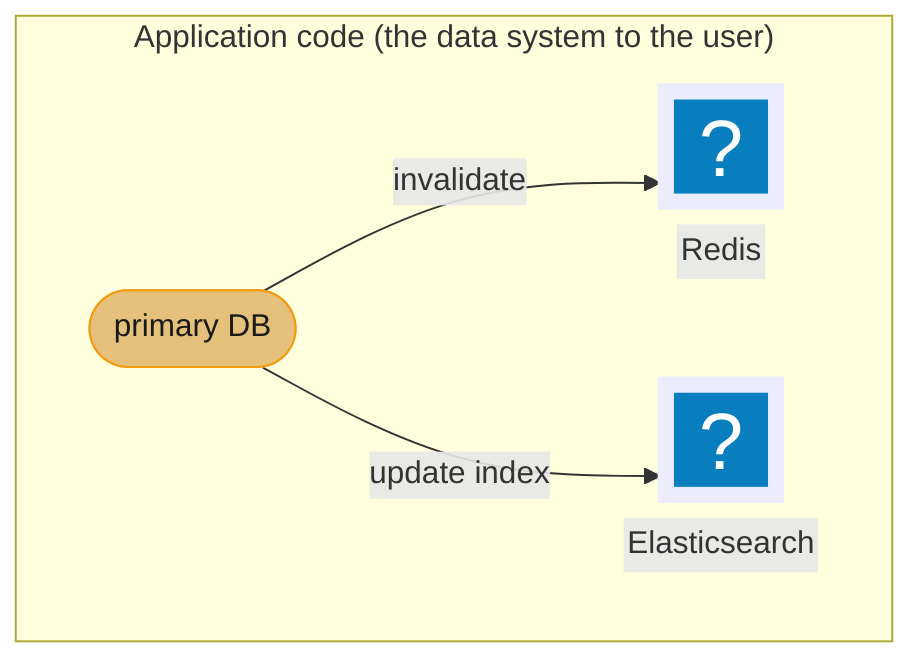
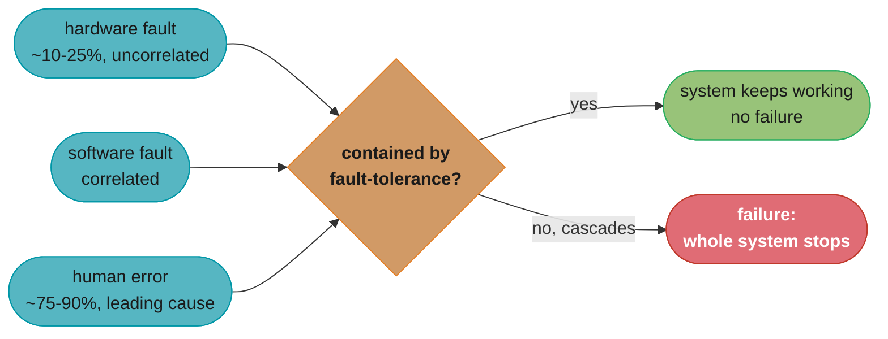
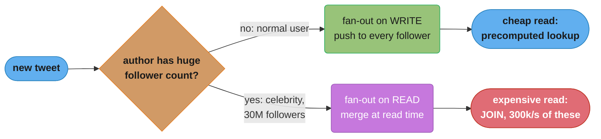
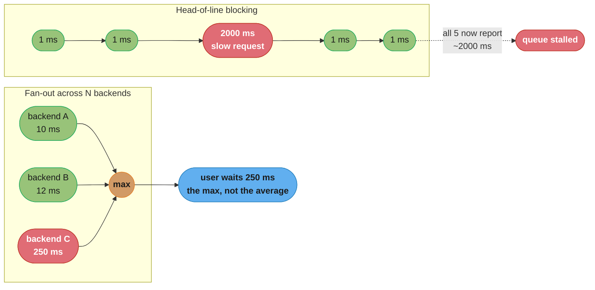
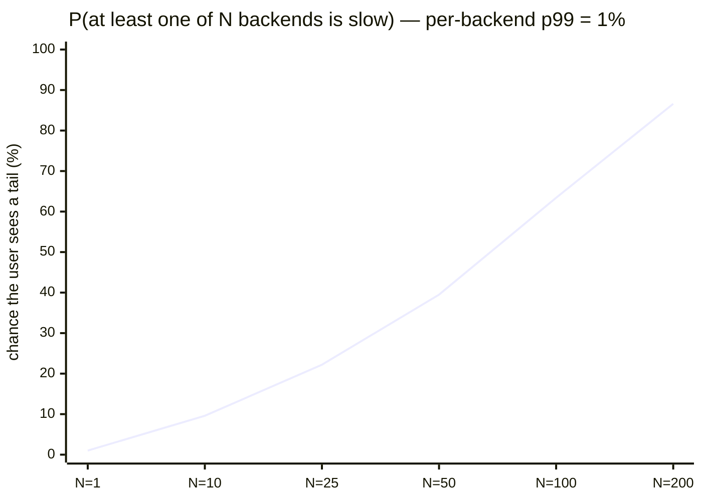
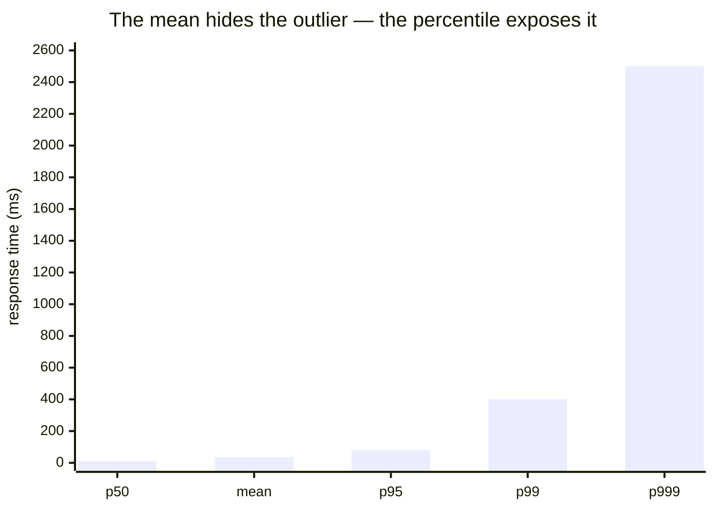

# Chapter 1: Reliable, Scalable, and Maintainable Applications

> Part I — Foundations of Data Systems · DDIA (Kleppmann, 1st ed., O'Reilly 2017) · the vocabulary chapter; leads to all of Parts II–III

## Chapter Map

This chapter defines the three concerns the entire book is built on and gives you precise,
measurable language for each. It is the most-quoted chapter in system-design interviews
because it teaches you how to *describe* load and performance rigorously (percentiles, not
averages) instead of hand-waving "it should be fast."

**TL;DR:**
- **Reliability** = tolerating hardware faults, software faults, and human error.
- **Scalability** = describing load with the right parameters, describing performance with
  percentiles (p50/p95/p99/p999), and choosing how to cope as load grows.
- **Maintainability** = operability + simplicity + evolvability; the largest lifetime cost.

## The Big Question

> "What does it even mean for a system to be 'good'? And how do I measure 'fast' and
> 'handles load' in a way I can put a number on and defend?"

Analogy: averages lie. If 99 customers are served in 10 ms and one waits 10 seconds, the
"average" hides a furious customer. Kleppmann's central move in this chapter is to replace
fuzzy adjectives with measurable definitions — and the headline tool is the **percentile**.

---

## 1.1 Thinking About Data Systems

Kleppmann opens by dissolving the category boundaries between "databases", "queues",
"caches", etc. They're increasingly the same: Redis is a datastore used as a message queue;
Kafka is a message queue with database-like durability. So he reasons about the umbrella
term **data system** — the composite you assemble from these tools plus your application
code. The user sees one system with one set of guarantees; you're responsible for those
guarantees even though no single tool provides them all.



Caption: the chapter's framing — your app is a composite data system, and the consistency
*between* its pieces (DB ↔ cache ↔ index) is your responsibility, not any single tool's.

The three concerns — reliability, scalability, maintainability — are introduced as the lens
for evaluating any such composite. Kleppmann is explicit that the boundaries in this book are
drawn for convenience of exposition, not because the underlying problems are actually
separate: the same techniques for replicating data reappear whether you call the tool a
"database" or a "message queue," and a failure mode discussed under one label (say, a
network partition affecting a database's replicas) applies just as much to a tool marketed
under a different label (a message broker's replicas). Reading the book with that in mind is
what lets the principles transfer to a tool you've never used before.

## 1.2 Reliability

**Reliability** means continuing to work *correctly* (right function, right performance)
even when things go wrong. The things that go wrong are **faults**; a system that
anticipates and copes with faults is **fault-tolerant** or **resilient**. Crucial nuance:
fault ≠ failure. A *fault* is one component deviating from spec; a *failure* is the system
stopping service entirely. You can never reduce faults to zero — in fact in some cases it may
be best to tolerate faults rather than trying to prevent them, since prevention is often
impossible or prohibitively expensive — so instead you design fault-tolerance mechanisms that
stop faults from cascading into failures. It's counterintuitive, but Kleppmann argues it can
be a good idea to deliberately *increase* the rate of faults, by triggering them
deliberately — for example, by randomly killing individual processes without warning. Many
critical bugs are actually due to poor error handling, so deliberately inducing faults
ensures the fault-tolerance machinery is continually exercised and tested, building
confidence that faults will be handled correctly when they occur naturally. Netflix's Chaos
Monkey, which randomly terminates production instances, is the book's example of this
approach, precisely because a fault-tolerance mechanism nobody has actually exercised is not
one you should trust in an emergency.

### Hardware faults

Disks fail (mean time to failure ~10–50 years for one disk, but with 10,000 disks you lose
roughly one *per day*), RAM goes bad, the power grid blips. Historically: add redundancy —
RAID, dual power supplies, hot-swappable CPUs. As data volumes grew, software fault-tolerance
techniques (tolerating the loss of whole machines) increasingly *supplement or replace*
hardware redundancy, because they enable rolling restarts and patching with zero downtime.

#### Decoding "10,000 disks means one dies every day"

That sentence is a formula in disguise. The rate at which a *fleet* fails is the fleet size
divided by the mean time to failure of one unit:

```
  failures per year = number of disks / MTTF of one disk
  failures per day  = failures per year / 365
```

**Stated plainly.** "One disk lasting decades is irrelevant. What matters is that you own
thousands of them, and the fleet failure rate scales linearly with how many you own."

| Symbol | What it is |
|--------|------------|
| `MTTF` | Mean time to failure for a *single* disk. The book's range: 10 to 50 years |
| `number of disks` | Fleet size. The multiplier that turns a rare event into a routine one |
| `failures per year` | Expected disk deaths across the whole fleet in a year |
| `365` | Days per year — only converts the rate into an on-call-relevant unit |

**Walk one example.** Push both ends of the book's MTTF range through it, 10,000 disks:

```
  optimistic disk (MTTF = 50 years)
    10000 / 50  =  200 failures/year
    200 / 365   =  0.55 failures/day      <- about one every two days

  pessimistic disk (MTTF = 10 years)
    10000 / 10  = 1000 failures/year
    1000 / 365  =  2.74 failures/day      <- about three every day

  the book's "roughly one per day" sits inside [0.55, 2.74]
```

The point of the arithmetic is the *reframing*. A single disk with a 50-year MTTF feels
like something you will never have to think about; multiply by a fleet and disk death
becomes a scheduled, budgeted, automated event. This is exactly why the chapter says
hardware redundancy alone stops being the answer at scale — you cannot hand-swap a drive
every day, so the software has to treat whole-machine loss as normal.

### Software errors

Systematic faults are more insidious than hardware faults because they're **correlated** —
a leap-second bug hits every node at once; a runaway process exhausts a shared resource for
everyone. They lurk, dormant, until an unusual set of circumstances triggers them, and
because the assumption that triggers the bug is baked into the software itself, no amount of
hardware redundancy protects you from it. Kleppmann's named examples of the pattern: a
software bug that causes every instance of an application server to crash when fed a
particular bad input (the 2012 leap-second bug that hung many Java applications
simultaneously across a fleet is the book's own example); a runaway process that uses up a
shared resource — CPU time, memory, disk space, network bandwidth; a service that the system
depends on slowing down, becoming unresponsive, or returning corrupted responses; and
**cascading failures**, where one small fault in one component triggers a fault in another,
which triggers another, snowballing into a large-scale outage from a locally minor trigger.
There is no quick fix for systematic faults; the mitigations Kleppmann offers are cultural and
procedural rather than mechanical: carefully thinking through assumptions and interactions in
the system, thorough testing, process isolation, allowing processes to crash and restart,
measuring/monitoring/analyzing system behavior in production, and building organizational
practices and tooling around all of the above.

### Human errors

Humans configure systems and are the leading cause of outages (one study: ~10–25% of
outages from hardware, the rest config errors).

#### Decoding "10-25% hardware, the rest human"

The stat is easy to skim past; walking it as a ratio makes the design implication concrete:

```
  if hardware causes 10-25% of outages, humans (directly or via config) cause 75-90%

  so: for every 1 outage prevented by better hardware redundancy,
      there are roughly 3 to 9 outages that only better human-error mitigation prevents
```

**The takeaway.** Investing purely in hardware redundancy (RAID, dual PSUs, more replicas)
caps out addressing at most a quarter of your outage risk — the majority of the reliability
budget belongs to the human side: interface design, testing, and recovery speed.

You make systems reliable *despite* humans, not by expecting humans to be careful, but by
engineering the surrounding system so mistakes are unlikely and cheap to undo:
designing APIs/admin interfaces that make the right thing easy and discourage the wrong
thing (well-chosen defaults, but overridable when truly needed); decoupling the places where
people make the most mistakes from the places where those mistakes could cause failures —
providing fully featured non-production **sandbox environments** where people can explore
and experiment safely, using real data, without affecting real users; testing thoroughly at
all levels, from unit tests to whole-system integration tests and manual tests, with
automated testing being widely used, well understood, and especially valuable for edge cases
that rarely arise in normal operation; allowing quick and easy *recovery* from human error
to minimize the impact of a failure — fast rollback of configuration changes, rolling out new
code gradually, providing tools to recompute data if it turns out the old computation was
wrong; and setting up detailed and clear **monitoring**, such as performance metrics and
error rates — known as *telemetry* in other engineering disciplines — so problems surface
early, before they compound into a failure a human then has to diagnose under pressure.

All three fault categories funnel into the same question — does fault-tolerance contain
this one, or does it cascade into a failure?



Caption: the fault/failure boundary — hardware (~10-25% of outages, uncorrelated), software
(correlated, triggered on every node by the same condition), and human error (the rest,
~75-90%, the leading cause) all cross the same fault-tolerance boundary; you can never drive
faults to zero, so reliability engineering lives entirely at this boundary.

## 1.3 Scalability

**Scalability** is *not* a one-dimensional label ("X is scalable"). It's the question: *if
load grows in a particular way, what are our options for coping?* To discuss it you need two
things: a way to describe load, and a way to describe performance.

### Describing load — load parameters

Pick numbers that capture the stress on your system: requests/sec to a server, read:write
ratio, simultaneously active users, cache hit rate. **The right parameter depends on your
architecture.** Kleppmann's running example is Twitter's timeline:

> Two operations: post tweet (~4.6k req/s avg, 12k/s peak) and home timeline reads
> (~300k req/s). The hard part isn't tweet *volume* — it's **fan-out**: each user follows
> many, and each user is followed by many.

#### Decoding the fan-out numbers

The three rates above look like trivia until you divide them. Fan-out-on-write turns one
insert into one write *per follower*, so the real write volume is not the tweet rate:

```
  timeline writes/sec = tweet rate x average followers per user
  read:write ratio    = timeline reads/sec / tweet rate
```

**The idea behind it.** "Posting is rare and reading is constant, so pay the cost at write
time — unless a single writer has so many followers that one post becomes its own outage."

| Symbol | What it is |
|--------|------------|
| `tweet rate` | Posts accepted per second. 4.6k/s average, 12k/s peak |
| `average followers per user` | The fan-out factor. ~75 in the book's example |
| `timeline reads/sec` | Home-timeline requests, ~300k/s — the dominant operation |
| `read:write ratio` | How read-heavy the workload is; decides which side to precompute |

**Walk one example.** The average case first, then the celebrity that breaks it:

```
  read:write ratio  = 300000 / 4600        = 65.2 reads per tweet
  peak headroom     =  12000 / 4600        =  2.6x above average
  fan-out on write  =   4600 x 75          = 345000 timeline writes/sec

  celebrity with 30,000,000 followers posts ONE tweet:
    30000000 writes from a single insert   = 30,000,000x write amplification
    at 100000 timeline writes/sec drain    = 300 seconds = 5 minutes
```

Read the two lines at the bottom together. Sixty-five reads per write is what *justifies*
fan-out-on-write: you precompute once and serve 65 cheap lookups. But the same choice means
one celebrity post occupies the entire write pipeline for five minutes, during which every
other user's timeline delivery queues behind it. That single division is the whole argument
for Twitter's hybrid — precompute for the 99.9% of users with ordinary follower counts, and
merge-at-read for the handful whose fan-out is pathological.

**Why "requests per second" is the wrong load parameter here.** Tweet rate alone says the
system handles 4.6k writes/s, which sounds easy. The parameter that actually predicts load
is the *distribution* of followers per user — and specifically its tail, because the mean of
75 and a maximum of 30M live in the same dataset. Sizing off the mean under-provisions by
five orders of magnitude for the accounts that matter most.



Caption: the canonical "describe the load correctly" lesson — the relevant load parameter is
the *distribution of followers per user* (fan-out), not raw tweet rate. The right parameter
chooses the architecture.

### Describing performance — throughput, latency, and percentiles

Two questions: when you increase a load parameter and keep resources fixed, how is
performance affected? And, to hold performance steady, how much must you grow resources?

- **Throughput** (records/sec, batch jobs) vs **response time** (what the client sees:
  service time + queueing + network delays). **Latency** is technically the duration a
  request waits to be handled; response time is what the client experiences. The book uses
  response time as the headline metric.
- **Use percentiles, not the mean.** Response times vary wildly; the *median (p50)* tells
  you the typical experience ("half of requests faster than this"). Tail percentiles
  **p95 / p99 / p999** tell you the worst experiences — and those often hit your *most
  valuable* customers (more data ⇒ slower requests). Amazon targets p999 and notes a 100 ms
  slowdown costs ~1% in sales.
- **Tail latencies matter disproportionately** because of **fan-out**: a single user request
  often hits many backends in parallel, and the *slowest* one determines the user's wait.
  The more backends, the higher the chance at least one is slow — so the tail dominates.

#### Decoding the percentile — and why the mean lies

Both statistics summarize the same sorted list of response times, but they ask different
questions:

```
  mean = (sum of all response times) / (number of requests)

  pN   = sort the response times ascending, then take the value at
         position ceil(N/100 x count)
         "N percent of requests were at least this fast"
```

**In plain terms.** "The mean asks *how much total time did we spend*; a percentile asks
*how bad was it for the unluckiest customers*. Only the second question has a user attached
to the answer."

| Symbol | What it is |
|--------|------------|
| `sum / count` | The mean. Every request contributes, so one huge value drags all of it |
| `sort ascending` | The step that makes percentiles robust — magnitude becomes rank |
| `ceil(N/100 x count)` | Which position in the sorted list. p50 = middle, p99 = near the end |
| `p50` | Median. The *typical* experience — half of users did better |
| `p95 / p99 / p999` | Tail. The 1-in-20, 1-in-100, 1-in-1000 worst experiences |

**Walk one example.** Twenty requests, small enough to check by hand. Sixteen at 10 ms, two
at 25 ms, one at 90 ms, and one straggler at 1800 ms:

```
  sorted: 10 x16, 25, 25, 90, 1800          count = 20, total = 2100 ms

  mean  = 2100 / 20              = 105 ms
  p50   = position ceil(0.50x20) = 10  -> value   10 ms
  p95   = position ceil(0.95x20) = 19  -> value   90 ms
  p99   = position ceil(0.99x20) = 20  -> value 1800 ms

  mean / p50 = 105 / 10 = 10.5x
  requests actually slower than the mean: 1 of 20
  the single 1800 ms request supplies 85.7% of all milliseconds spent
  drop that one request and the mean collapses to 15.79 ms
```

Look at the third line from the bottom. **The mean of 105 ms describes no request in this
dataset.** Nineteen of twenty users were served in 25 ms or less; the twentieth waited
nearly two seconds. The mean sits ten times above the typical experience and twenty times
below the worst, so it is simultaneously too pessimistic to describe the median user and
far too optimistic to describe the angry one. It is an average of two populations that
should never have been averaged.

The last line is the tell for how fragile the mean is: deleting a *single* request out of
twenty moves it from 105 ms to 15.79 ms. Any statistic that one sample can move by 6.6x is
not a summary of the distribution — it is a summary of the outlier. The percentiles barely
move at all, because `p50` only cares that the value sits at rank 10; whether the slowest
request took 1800 ms or 18000 ms is irrelevant to it.

**Why this is the chapter's most-quoted paragraph.** An SLO written as "average < 200 ms"
passes cleanly on this data (105 ms), while 5% of users wait 1.8 seconds. Written as
"p99 < 200 ms" it fails, correctly. The percentile is what makes the promise enforceable —
and the tail requests are disproportionately your largest accounts, because more data per
user means more work per request.

Why tails dominate (head-of-line blocking + fan-out):



Caption: percentiles must be measured on the *client* and aggregated correctly — you cannot
average percentiles across machines; you must keep the histogram of raw response times.

The chance that *at least one* of N parallel backend calls lands in its own p99 tail
compounds quickly as fan-out grows — this is the mechanic behind "tails dominate":



Caption: the compounding-probability mechanic behind "tails dominate" — each extra backend
is one more chance for at least one call to land in its own p99 tail (1 - 0.99^N); by
N = 100 backends that is already ~63% of users, matching the number above, which is why
fan-out-heavy services must drive down tail latency itself, not just the median.

#### Decoding tail-latency amplification

The curve above is one formula. A request that fans out to `N` backends is slow if *any*
single backend is slow, so compute the probability that they are *all* fast and subtract:

```
  P(user sees a slow request) = 1 - (1 - p)^N

  with p = 0.01 (each backend's own p99):   1 - 0.99^N
```

**What the formula is telling you.** "You are not rolling the dice once per request — you
are rolling it once per backend, and you lose if *any* roll comes up bad."

| Symbol | What it is |
|--------|------------|
| `p` | One backend's chance of being slow. `p = 0.01` is exactly what "p99" means |
| `1 - p` | Chance that one backend is fast. `0.99` |
| `(1 - p)^N` | Chance that **all** `N` are fast — multiplication, since calls are independent |
| `1 - (...)` | Flip it: chance that **at least one** was slow. This is the user's experience |
| `N` | Fan-out width. The exponent, which is why the effect compounds rather than adds |

**Walk one example.** Hold `p` fixed at 1% and widen the fan-out:

```
  N =   1    1 - 0.99^1    = 1 - 0.990000 = 0.010000  ->   1.00% of users
  N =  10    1 - 0.99^10   = 1 - 0.904382 = 0.095618  ->   9.56% of users
  N = 100    1 - 0.99^100  = 1 - 0.366032 = 0.633968  ->  63.40% of users
  N = 500    1 - 0.99^500  = 1 - 0.006570 = 0.993430  ->  99.34% of users
```

Read the last line slowly. **Every backend is meeting a 99% fast SLO, and 99.34% of users
still hit a slow call.** Nothing is broken, no service is misbehaving, every dashboard is
green — and essentially every user has a bad experience. The exponent is doing all the work:
`N` appears as a power, not a multiplier, so widening fan-out does not degrade the user
experience gradually, it collapses it.

The crossover is worth memorizing: `log(0.5) / log(0.99) = 68.97`, so at **69 backends** the
majority of your users are hitting a tail call. Most microservice architectures cross that
line without anyone deciding to.

**The fix is in `p`, not `N`.** You usually cannot shrink fan-out — the architecture needs
those services. So drive down the per-backend tail instead. Tightening each backend from
p99 (`p = 0.01`) to p999 (`p = 0.001`) is a 10x improvement in one number, and here is what
that single change buys at the same fan-out widths:

```
                    p = 0.01 (p99)      p = 0.001 (p999)
  N =   1               1.00%                0.10%
  N =  10               9.56%                1.00%
  N = 100              63.40%                9.52%
  N = 500              99.34%               39.36%
```

At `N = 100`, one order of magnitude on the backend tail takes the fraction of affected
users from 63.40% down to 9.52% — a 6.7x improvement in user-visible quality bought entirely
by work no single service's own dashboard would have flagged as urgent. This is the
arithmetic behind Amazon targeting p999 rather than p99, and behind Dean and Barroso's
"The Tail at Scale": in a fan-out system, the tail *is* the median experience.

### Approaches for coping with load

- **Scaling up (vertical)** — a more powerful machine. Simple, but a single big machine is
  expensive and has a ceiling.
- **Scaling out (horizontal / shared-nothing)** — distribute load across many machines.
  Cheaper commodity hardware, but introduces all the distributed-systems complexity of
  Parts II–III.
- A **hybrid** — a few sufficiently powerful machines, still simpler than distributing across
  hundreds of small nodes — is often the pragmatic middle ground the book points to before
  reaching for a full shared-nothing architecture.
- Most real systems are **elastic** (auto-add resources on load) or manually scaled
  (simpler, fewer surprises). Elastic systems are useful when load is highly unpredictable,
  but manually scaled systems are simpler and may have fewer operational surprises.

Distributing a **stateless** service across many machines is comparatively simple: there's no
data to keep synchronized, so any request can go to any node. Distributing data that has
state — the databases at the center of this book — is far harder, because now you must
reason about consistency, network partitions, and node failure while the data itself is
spread out; that hard problem is what the rest of the book is about, and it's why a
"scalable" *stateless* web tier doesn't automatically imply a scalable overall system.

There is **no magic "scalable" architecture** (informally known as "magic scaling sauce") —
Kleppmann is emphatic that an architecture built for scale is highly specific to the
application, built around assumptions of which operations will be common and which will be
rare, and which load parameters matter. An architecture that is appropriate for one
application is not necessarily appropriate for another with superficially similar-looking
requirements. An architecture for 100k req/s of 1 kB each is utterly different from one for
3 req/min of 2 GB each, even at identical "throughput" measured in bytes/sec. A system that
is well designed for a particular application is built around assumptions of which
operations will be common and which will be rare — and if those assumptions turn out to be
wrong, the engineering effort spent scaling for the wrong dimension is largely wasted, in the
best case, and misdirects the whole design in the worst.

In an early-stage startup or unproven product, Kleppmann's practical advice is that it's
usually more important to be able to iterate quickly on product features than to scale to
some hypothetical future load — you don't yet know which load parameters will matter, so
premature scaling work is frequently thrown away when the product's actual usage pattern
turns out to differ from the guess.

## 1.4 Maintainability

The majority of software cost is **ongoing maintenance**, not initial development: fixing
bugs, keeping it operational, investigating failures, adapting to new platforms and
requirements, paying down technical debt. Kleppmann is explicit that this is well known yet
badly underinvested in — everyone prefers to work on new features over maintaining old
systems, so the book sets out to minimize maintenance pain by design, via three principles.

### Operability — make it easy for operations to keep the system running

Kleppmann does not leave "operability" as a vague good intention; the chapter lists what a
good operations team is actually responsible for, and operability is the property of
software that makes each of these tractable rather than heroic:

- **Monitoring** the health of the system and quickly restoring service if it goes into a
  bad state.
- **Tracking down the cause of problems**, such as system failures or degraded performance.
- **Keeping software and platforms up to date**, including security patches.
- **Keeping tabs on how different systems affect each other**, so a problematic change can
  be avoided before it causes damage.
- **Anticipating future problems and solving them before they occur** — e.g. capacity
  planning.
- **Establishing good practices and tools for deployment, configuration management**, and
  more.
- **Performing complex maintenance tasks**, such as moving an application from one platform
  to another.
- **Maintaining the security of the system** as configuration changes are made.
- **Defining processes that make operations predictable** and help keep the production
  environment stable.
- **Preserving the organization's knowledge** about the system, even as individual people
  come and go.

Good operability means making routine tasks easy so the operations team can focus effort
where it matters. Concretely, that means: visibility into the runtime behavior and internals
of the system (monitoring/observability), support for automation and standard tooling,
avoiding dependency on individual machines (so any single machine can be taken down for
maintenance while the system as a whole keeps running), good documentation and an
easy-to-understand operational model ("if I do X, Y will happen"), sensible default behavior
combined with the freedom for admins to override defaults when needed, self-healing where
appropriate but also manual control for admins when automation gets it wrong, and predictable
behavior with minimal surprises. Kleppmann's summary judgment: **"good operations can often
work around the limitations of bad (or incomplete) software, but good software cannot run
reliably with bad operations."** Operability is therefore not a secondary polish item — a
brittle, undocumented, self-inflicted-outage-prone system defeats even an excellent ops team.

### Simplicity — managing complexity

Small software projects can have delightfully simple, expressive code — but as a project
grows, it typically becomes very complex and hard to understand, which slows down everyone
who has to work on it and increases the maintenance cost. The symptoms Kleppmann names:
explosion of the state space, tight coupling of modules, tangled dependencies, inconsistent
naming and terminology, hacks aimed at solving performance problems, special-casing to work
around one-off issues, and so on — much has been written about these symptoms already, but
the book focuses on the cure rather than the taxonomy.

The critical distinction is between two kinds of complexity:

- **Essential (inherent) complexity** — complexity that is intrinsic to the problem the
  software solves. It cannot be removed by any implementation choice, only managed and made
  visible.
- **Accidental complexity** — complexity that is not inherent in the problem the software
  solves but arises only from the implementation. It is the complexity you added, not the
  complexity the problem demanded.

Making a system simpler does *not* necessarily mean reducing its functionality; it can also
mean removing this accidental complexity. Kleppmann names **abstraction** as the best tool
available for that: a good abstraction can hide a great deal of implementation detail behind
a clean, simple-to-understand façade, and — because the same abstraction can be reused across
many different applications — it is both more efficient (less duplicated effort) and tends to
be higher quality than each application reinventing the mechanism for itself. High-level
programming languages are abstractions that hide machine code, CPU registers, and syscalls;
SQL is an abstraction that hides on-disk and in-memory data structures, concurrency-control
algorithms, and query-execution details from anyone writing a query. But finding good
abstractions is very hard, which is exactly why the distributed-systems abstractions the book
builds toward in Parts II and III — transactions, consensus, replication guarantees — are so
valuable: each one lets an application programmer pretend a much uglier reality (crash-prone
networks, concurrent writers, partial failures) does not exist.

### Evolvability — making change easy

Requirements are a moving target almost by definition: new facts come to light, unanticipated
use cases emerge, business priorities shift, regulation changes, growth forces a redesign.
In terms of organizational processes, the Agile community developed techniques for adapting
to change in a fast-paced environment — the *TDD* (test-driven development) and
*refactoring* practices are the most widely known. But most discussions of Agile techniques
operate at a fairly small, local scale (a couple of source files, or at most a few teams
within one application). Kleppmann's move in this chapter is to take that same idea and scale
it up to the level of an entire data system, possibly composed of several different
applications or services with different characteristics — and he prefers the term
**evolvability** (also seen as extensibility, modifiability, or plasticity) as the umbrella
name for "agility at the level of a data system." Evolvability is tightly linked to the other
two principles: a system that is simple and well abstracted is far easier to modify safely
than one that is a tangle of accidental complexity, and a system that is operable is one an
engineer can change with confidence, because they can observe the effect of the change and
roll it back quickly if it's wrong.

| Principle | The question it answers | Book's primary tool |
|-----------|--------------------------|----------------------|
| Operability | Can operations keep this running smoothly, day to day? | Monitoring, good defaults, documentation, machine-independence |
| Simplicity | Can a new engineer understand this without a guided tour? | Abstraction, removing accidental complexity |
| Evolvability | Can we change this safely as requirements shift? | Simplicity + operability, scaled up from Agile's local techniques |

---

## Visual Intuition

response times of 1000 requests, sorted:



The mean (35 ms) is dragged up by the tail yet still understates it. Only the
percentile vector (10 / 80 / 400 / 2500) tells the real story. SLOs are written
as "p99 < 200 ms", never "average < 200 ms".

Caption: the chapter's signature lesson made visible — report the percentile vector, set
SLOs on the tail (p95/p99/p999), and remember the tail hits your highest-value users hardest.

### Reconstructing the distribution behind that chart

The five bars are not five independent facts — they are five readings of one sorted list of
1000 response times. Here is a distribution that produces every one of them exactly:

```
  rank        count   value     which bar it sets
  1  - 949      949    10 ms    p50 = rank 500  -> 10 ms
  950            1     80 ms    p95 = rank 950  -> 80 ms
  951 - 989     39    130 ms
  990            1    400 ms    p99 = rank 990  -> 400 ms
  991 - 998      8   1870 ms
  999 - 1000     2   2500 ms    p999 = rank 999 -> 2500 ms
                ----
                1000 requests, 35000 ms total

  mean = 35000 / 1000 = 35 ms
```

**Read it like this.** "Ninety-five percent of this system's requests finish in 80 ms or
less, and the mean still says 35 ms — a number no user experienced, because it is the
average of a 10 ms crowd and a 2500 ms disaster."

Note what the mean of 35 ms is made of. The 949 fast requests contribute 9490 ms of the
35000 ms total; the 11 slowest requests — barely 1% of traffic — contribute 20,360 ms, or
58.2% of all time spent. The mean is majority-owned by the requests it is hiding. That
inversion is the entire reason the percentile vector `10 / 80 / 400 / 2500` is reported
instead of the single number, and why the chart puts `mean` deliberately out of rank order
between p50 and p95: it belongs to neither population.

---

## Key Concepts Glossary

- **Data system** — composite of stores + app code presenting one set of guarantees.
- **Reliability** — working correctly despite faults.
- **Fault** — one component deviating from spec. **Failure** — whole system stops.
- **Fault-tolerant / resilient** — anticipates and copes with certain faults.
- **Hardware fault** — disk/RAM/power failure; usually uncorrelated, handled by redundancy.
- **Software fault** — systematic, *correlated* bug triggered by a condition.
- **Scalability** — having coping strategies as a load parameter grows.
- **Load parameter** — number describing stress (req/s, read:write ratio, fan-out, hit rate).
- **Fan-out** — number of downstream requests one input generates (followers per user;
  backends per user request).
- **Throughput** — work per unit time. **Response time** — what the client experiences
  (service + queueing + network). **Latency** — duration a request awaits service.
- **Percentile (p50/p95/p99/p999)** — value below which that fraction of requests fall;
  p50 = median. **Tail latency** — the high percentiles.
- **Head-of-line blocking** — one slow request stalling those queued behind it.
- **Vertical scaling (scale up)** — bigger machine. **Horizontal scaling (scale out /
  shared-nothing)** — more machines.
- **Elastic** — automatically adds/removes resources with load.
- **Maintainability** — operability + simplicity + evolvability.
- **Operability** — the property of software that makes routine operational tasks
  (monitoring, deployment, maintenance, incident response) tractable rather than heroic.
- **Simplicity** — ease of understanding, achieved by removing accidental complexity.
- **Essential (inherent) complexity** — complexity intrinsic to the problem; cannot be
  designed away, only managed.
- **Accidental complexity** — complexity from the implementation, not inherent to the problem.
- **Abstraction** — clean reusable interface hiding implementation detail.
- **Evolvability (extensibility / modifiability / plasticity)** — Agile-style ease of change,
  scaled up to the level of an entire data system.
- **Stateless vs. stateful scaling** — a stateless tier scales out trivially (any node handles
  any request); a stateful (data-holding) system must additionally solve consistency and
  partitioning, which is why distributed data is the hard problem this book is about.

---

## Tradeoffs & Decision Tables

| | Scale up (vertical) | Scale out (horizontal) |
|---|---|---|
| Complexity | Low | High (distributed systems) |
| Cost curve | Superlinear at the high end | Commodity, near-linear |
| Ceiling | Hard hardware limit | Effectively none |
| Fault tolerance | Single machine = single point | Tolerates machine loss |

| | Fan-out on read (pull) | Fan-out on write (push) |
|---|---|---|
| Read cost | High (join at read) | Low (precomputed lookup) |
| Write cost | Low (one insert) | High (write to every follower) |
| Best for | Few reads, or celebrities | Read-heavy, normal fan-out |
| Twitter's choice | Used for celebrities | Used for normal users (hybrid) |

| Metric | Use it for | Don't |
|--------|-----------|-------|
| Mean / average | Quick sanity check | Anything user-facing; it hides tails |
| p50 (median) | Typical experience | Worst-case SLOs |
| p99 / p999 | SLOs, capacity, alerting | — (but expensive to optimize) |

---

## Common Pitfalls / War Stories

- **Setting SLOs on the average.** "Average response time < 200 ms" passes while 1% of
  requests take 5 s. Those 1% are often whales (largest accounts, most data). Always SLO on
  p95/p99/p999.
- **Averaging percentiles across machines.** p99 of machine A and p99 of machine B do not
  average to the cluster p99. You must aggregate raw histograms (HdrHistogram, t-digest),
  not the percentiles themselves.
- **Ignoring fan-out when reasoning about tails.** A user request that fans out to 100
  services will, with each service at p99=10 ms, *very often* hit at least one slow one —
  so the user-perceived p99 is far worse than any single service's p99.
- **The celebrity write storm.** Naively choosing fan-out-on-write, then a celebrity with
  30M followers tweets and you enqueue 30M writes, melting the system. The fix is a hybrid:
  precompute for normal users, merge-at-read for the few extreme accounts.
- **Confusing "we use Kubernetes/Cassandra" with "we are scalable."** Scalability is about
  matching architecture to the actual load parameters, not adopting a buzzword stack. The
  wrong load model produces an architecture that scales the wrong dimension.
- **Scaling prematurely, before you know the real load parameters.** Building a
  shared-nothing, horizontally-scaled architecture for a product whose actual usage pattern
  hasn't stabilized wastes engineering effort that could have gone into iterating on the
  product — and the assumptions baked into the early architecture are often wrong once real
  usage arrives.
- **Mistaking a reduction in features for simplification.** Removing accidental complexity
  (tangled dependencies, inconsistent naming, special-case hacks) makes a system simpler
  without touching what it does; cutting functionality to "simplify" is a different, much
  more painful trade that the book does not conflate with good abstraction.
- **Treating operability as an afterthought.** A system with no monitoring, no predictable
  operational model, and undocumented failure modes forces the ops team into heroics at 3
  a.m. — and, per the chapter's own framing, no amount of elegant code compensates for that.

---

## Real-World Systems Referenced

Twitter (timeline fan-out), Amazon (p999 SLOs, 100 ms ⇒ 1% sales), Netflix (Chaos Monkey
for fault injection), RAID storage, and the general practice of rolling upgrades on
shared-nothing clusters.

---

## Summary

A good data system is reliable, scalable, and maintainable. **Reliability** is tolerating
hardware faults (redundancy), software faults (correlated, fixed by testing/isolation/
monitoring), and human error (good interfaces, easy recovery, telemetry). **Scalability**
starts with describing load using the right *load parameters* (Twitter: fan-out, not tweet
rate), describing performance with *percentiles* (p50 for typical, p99/p999 for the tail
that hits your best customers), understanding why fan-out makes tails dominate, and choosing
between scaling up and scaling out. **Maintainability** — the largest lifetime cost — is
operability, simplicity (fighting accidental complexity with abstraction), and evolvability.
There is no one-size-fits-all scalable architecture; the right design follows from which
operations are common.

---

## Interview Questions

**Q: Why should you report response times as percentiles rather than as an average?**
**Short:** Averages are skewed by outliers and describe no real user, while percentiles like p50 and p99 show typical and worst-case experience.
Because response-time distributions are heavily skewed by outliers, so the mean describes no actual user — a few very slow requests drag it up while still understating the worst case. The median (p50) tells you the typical experience and the tail (p95/p99/p999) tells you the worst, which is what users actually complain about. SLOs are therefore written as "p99 < 200 ms," never as an average.

**Q: What is the difference between a fault and a failure, and which one do you design to eliminate?**
**Short:** A fault is one component deviating from spec; you design fault-tolerance to stop faults escalating into system-wide failures.
A fault is one component deviating from spec (a disk dies); a failure is the whole system stopping service. You do *not* try to eliminate faults — they're inevitable — you build fault-tolerance so faults don't escalate into failures. Netflix's Chaos Monkey deliberately injects faults in production to verify the system absorbs them.

**Q: In the Twitter timeline example, what is the real load parameter, and why does it determine the architecture?**
**Short:** The real load parameter is fan-out — how many followers each user has — not the raw tweet-posting rate.
The real load parameter is the *fan-out* — the distribution of how many followers each user has — not the raw tweet rate. Tweets arrive at only ~5k/s, but timeline reads run ~300k/s, so the cost is in delivering each tweet to all followers. This drives the choice between fan-out-on-read (cheap writes, expensive reads) and fan-out-on-write (expensive writes, cheap reads); Twitter uses a hybrid because celebrities make pure fan-out-on-write explode.

**Q: Why do tail latencies (p99/p999) matter more than the median in a system with high fan-out?**
**Short:** A request fanning out to many backends waits on the slowest one, so the user-perceived p99 is worse than any single service's p99.
Because a single user-facing request often fans out to many backend services in parallel, and the user waits for the *slowest* of them. The more backends, the higher the probability that at least one is in its slow tail — so even if each service has a good p99, the user-perceived p99 is much worse. This is why services that fan out heavily must drive down tail latency, not just the median.

**Q: Why can't you average the p99 values reported by ten different servers to get the cluster p99?**
**Short:** Percentiles aren't linear, so you must combine the raw response-time histograms and recompute the percentile, not average reported percentiles.
Percentiles are not linear, so averaging them is mathematically meaningless — a server handling few requests and one handling many contribute unequally. You must aggregate the raw response-time *histograms* (using structures like HdrHistogram or t-digest) and compute the percentile from the combined distribution. Averaging percentiles is a common and silent monitoring bug.

**Q: What is head-of-line blocking and how does it inflate tail latency?**
**Short:** Head-of-line blocking is one slow request stalling all the requests queued behind it, inflating their latency too.
Head-of-line blocking is when one slow request occupies the server (or sits at the front of a queue) and stalls all the requests queued behind it, even if those would have been fast. The result is that a single slow operation makes many requests report high latency. It's a major contributor to tail latency and is why queueing delay must be measured on the client side, where the full wait is visible.

**Q: Distinguish the three categories of faults and the main mitigation for each.**
**Short:** Hardware faults are mitigated by redundancy, software faults by testing and isolation, and human errors by good interfaces and fast rollback.
Hardware faults (disk/RAM/power) are mostly uncorrelated and handled by redundancy and, increasingly, software fault-tolerance enabling rolling restarts. Software faults are systematic and *correlated* (a bug that hits all nodes on a trigger), mitigated by testing, process isolation, monitoring, and crash-restart. Human errors are the largest source of outages, mitigated by well-designed interfaces, sandboxes, easy/fast rollback, and detailed telemetry.

**Q: Why are correlated software faults more dangerous than uncorrelated hardware faults?**
**Short:** Hardware faults fail independently so redundancy helps, but a correlated software bug can hit every redundant node at once.
Hardware faults are largely independent — one disk dying doesn't make another die, so redundancy (RAID, replicas) works well. Software faults are correlated: a leap-second bug or a bad input pattern hits every node simultaneously, so your redundant copies all fail at once and redundancy gives no protection. Correlation defeats the statistical independence that hardware redundancy relies on.

**Q: What are the three components of maintainability?**
**Short:** Operability, simplicity, and evolvability — Kleppmann's three-part decomposition of maintainability.
Operability (making it easy for operations to keep the system running smoothly — monitoring, good defaults, predictability), simplicity (managing complexity so new engineers can understand it, chiefly by removing accidental complexity through abstraction), and evolvability (making it easy to change as requirements evolve). Maintenance dominates total lifetime cost, so these are economically the most important properties.

**Q: What is accidental complexity, and what is the primary tool for reducing it?**
**Short:** Accidental complexity comes from the implementation rather than the problem itself, and good abstraction is the primary tool for removing it.
Accidental complexity is complexity that arises from the implementation rather than being inherent in the problem the software solves — tangled dependencies, special cases, inconsistent naming. The primary tool against it is good abstraction: a clean, reusable interface that hides implementation detail (SQL hiding storage engines, a high-level language hiding machine code). Removing accidental complexity is the essence of "simplicity."

**Q: Compare scaling up and scaling out; when would you still choose to scale up?**
**Short:** Scaling up is simpler but hits a cost ceiling, so you scale up when the workload fits one machine and you value avoiding distributed complexity.
Scaling up (a bigger machine) is operationally simple and avoids distributed-systems complexity but is expensive at the high end and has a hard ceiling. Scaling out (more commodity machines, shared-nothing) is cost-effective and tolerates machine loss but imports all the hard problems of Parts II–III. You scale up when the workload fits comfortably on one machine and you value simplicity and strong single-node consistency over a distributed system's complexity.

**Q: What does Kleppmann mean by "there is no magic scalable architecture"?**
**Short:** Scalability is relative to specific load parameters, so architecture must be designed around your actual operations, not copied wholesale.
He means scalability is always relative to specific load parameters, so an architecture is designed around which operations are common and which are rare — not adopted as a universal recipe. A system tuned for 100k small requests/sec looks nothing like one tuned for a few multi-gigabyte requests per minute, even at the same nominal throughput. Copying another company's stack without matching its load profile is how you scale the wrong dimension.

**Q: Why does measuring response time on the client matter more than measuring it on the server?**
**Short:** Server-side timing misses queueing and network delay, so only client-side measurement captures what the user actually experiences.
Because the server's view excludes queueing delay, network transit, and time the request spent waiting to be accepted — exactly the components that head-of-line blocking and load inflate. The client sees the full response time the user actually experiences. Server-side timing can look healthy while clients are timing out.

**Q: What is the relationship between throughput and response time, and why keep them separate?**
**Short:** Throughput is work per unit time, response time is per-request latency, and pushing one can worsen the other.
Throughput measures work completed per unit time (jobs/sec, records/sec) and is the natural metric for batch systems; response time measures how long an individual request takes and is the natural metric for online systems. They can move in opposite directions — pushing throughput by batching often raises individual response times. Conflating them leads to optimizing one while silently degrading the other.

**Q: How does the load parameter you choose change as a system's architecture changes?**
**Short:** The right load parameter is whatever captures that architecture's dominant stress, so it shifts as the architecture does.
The relevant load parameter is whatever best captures the dominant stress for *that* architecture: requests/sec for a stateless web tier, read:write ratio for a database, simultaneous connections for a chat server, cache hit rate for a read-through cache, fan-out for a social feed. As you redesign the system, the binding constraint shifts, so the parameter you track must shift with it; tracking the wrong one hides the real bottleneck.

**Q: Why does the chapter say good operations can work around bad software but not vice versa?**
**Short:** Skilled operations can contain a flawed system through monitoring and rollback, but no software design survives an environment with no operational safety net.
Because operability — monitoring, runbooks, fast rollback, capacity headroom — lets a skilled ops team contain and recover from a flawed system, keeping it serving users. But no amount of elegant software survives an environment with no monitoring, no rollback path, and unpredictable manual changes; the software will eventually hit a condition operations can't see or recover from. Hence investing in operability pays off even for imperfect code.

**Q: What ten responsibilities does the book assign to a good operations team, and why does that list matter for how you design software?**
**Short:** Operability means designing software so the book's ten operational duties are tractable, not heroic.
Kleppmann lists: monitoring and restoring service, tracking down the cause of problems, keeping software and platforms current (including security patches), tracking how systems affect each other to avoid damaging changes, anticipating and solving future problems (capacity planning), establishing good deployment/configuration tooling and practices, performing complex maintenance tasks like platform migrations, maintaining security as configuration changes, defining processes that make operations predictable, and preserving organizational knowledge as people come and go. The list matters because "operability" is otherwise a vague virtue; naming the concrete tasks tells you exactly what good monitoring, good defaults, and good documentation are *for*.

**Q: What is the difference between essential complexity and accidental complexity?**
**Short:** Essential complexity is inherent to the problem; accidental complexity comes only from the implementation.
Essential (inherent) complexity is intrinsic to the problem the software solves and cannot be removed by any implementation choice, only managed. Accidental complexity is complexity that is *not* inherent in the problem but arises purely from how the software happens to be built — tangled dependencies, inconsistent naming, performance hacks, special-casing. Simplifying a system does not mean cutting functionality; it means stripping out the accidental kind while leaving the essential kind clearly exposed.

**Q: Why does Kleppmann prefer the term "evolvability" over "agility" when talking about a whole data system?**
**Short:** Kleppmann scales Agile's local techniques (TDD, refactoring) up to the level of an entire data system and calls that evolvability.
Agile techniques like TDD and refactoring were developed for adapting to change at a fairly small, local scale — a few source files or a handful of teams within one application. Kleppmann wants a word for the same underlying goal — making change easy — applied to an entire data system that may be composed of several applications and services with very different characteristics, so "agility" (with its connotation of a specific set of team practices) doesn't quite fit. "Evolvability" names the system-level property directly: how easy is it to modify this data system and adapt it to changing requirements.

**Q: What is an abstraction, according to the book, and why is finding a good one so valuable?**
**Short:** A good abstraction hides implementation detail behind a reusable interface, cutting accidental complexity everywhere it's reused.
An abstraction hides a great deal of implementation detail behind a clean, simple-to-understand interface, and because that same interface can be reused across many different applications, it both saves duplicated effort and tends to raise the quality of everything built on it (SQL hiding storage engines and concurrency control; a high-level language hiding registers and syscalls). Good abstractions are hard to find, which is exactly why the book treats distributed-systems abstractions like transactions and consensus as prized results in Parts II–III — each one lets application code pretend a much uglier reality (crash-prone networks, concurrent writers) doesn't exist.

---

## Cross-links in this repo

- [hld/scalability/ — horizontal vs vertical scaling, load modeling](../../../hld/scalability/scalability.md)
- [hld/load_balancing/ — distributing traffic, fan-out at the edge](../../../hld/load_balancing/load_balancing.md)
- [hld/ — the system-design interview framework (requirements, scale estimation)](../../../hld/README.md)
- [database/database_caching_patterns/ — cache-aside, stampede, hit-rate as a load parameter](../../../database/database_caching_patterns/database_caching_patterns.md)

## Further Reading

- Kleppmann, DDIA Ch 1 — original text and its reference list.
- Dean & Barroso, "The Tail at Scale," CACM 2013 — the canonical paper on why tail latency
  dominates fan-out systems.
- Brendan Gregg, *Systems Performance* — latency measurement and percentiles in depth.
